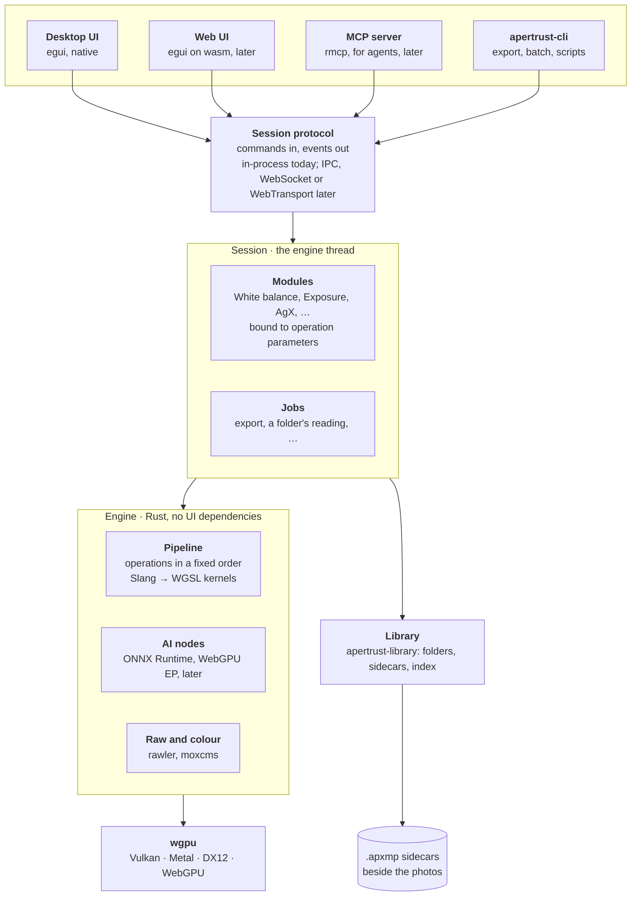
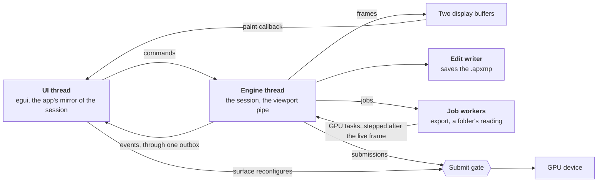

# Apertrust: Architecture

Apertrust is a free, non-destructive, cross-platform raw photo editor. It aims for measured image quality, controls that keep to what they say, and help in reaching the look you want. [principles.md](principles.md) says what that means for photographers (decision 1).

Technically it is:

- **a Rust engine on wgpu,** a GPU-resident, scene-referred fp32 pipeline whose kernels are written in Slang and compiled to WGSL, with derivatives that let it set the sliders;
- **darktable's trusted colour science,** migrated first, module by module, and then evolved on its own (decision 2);
- **modules over operations:** people edit modules, the first pass darktable's modules as darktable has them; the engine runs operations, each bound to one owning module;
- **one session protocol** that every client speaks: the egui desktop app, the command line, and later the browser, MCP agents and scripts;
- **sidecars as the truth,** an `.apxmp` beside each photo, with folder mode first and libraries and projects later, never a database;
- **ONNX Runtime** with its WebGPU execution provider for AI, and MCP for assistants, both later.

This document is the overview: what the parts are and how they fit. Each area's design is in a document of its own, linked below with its open questions ([Where things are](#where-things-are)). Every decision is a numbered file in [decisions/](decisions/README.md), with its options and reasons, and the [current state by area](decisions/README.md#the-current-state-by-area); this document cites them by number.

**Contents**

1. [At a glance](#at-a-glance)
2. [The rules that shape everything](#the-rules-that-shape-everything)
3. [The engine–UI boundary](#the-engineui-boundary)
4. [Programs](#programs)
5. [Crates](#crates)
6. [The areas](#the-areas)
7. [Naming](#naming)
8. [Platforms and language](#platforms-and-language)
9. [Background and prior art](#background-and-prior-art)
10. [Where things are](#where-things-are)
11. [Implementation plan](#implementation-plan)

## At a glance

Every client reaches the engine through one session protocol, at the level of modules. The session, in the engine, turns module values into operation parameters through each module's binding, serves the library's commands, and runs long work as jobs (decisions 4, 28, 54 and 57).

The desktop UI, the web UI, MCP and scripts never touch the engine's internals. They send the same commands, so undo, agents and the remote web mode work the same way (decision 58).

Inside the desktop app, the work is split across threads. The engine thread owns every GPU submission; the UI thread draws the engine's latest frame and sends commands. The window and the engine share one device, so they take turns through one submit gate (decisions 17, 18 and 57).

## The rules that shape everything

- **GPU-resident and fp32** (decision 8). The raw is uploaded once and every intermediate stays on the GPU, with no host round trip between operations; kernels are fp32, never rely on NaN checks, and keep differentiable. Memory bandwidth is the budget, so chains of per-pixel operations are to be fused. Details: [engine.md, The GPU](engine.md#the-gpu).
- **No CPU path** (decision 7). Without a hardware GPU the same kernels run on a software one, lavapipe or WARP; what cannot bind there is refused, naming the pass. Details: [engine.md, Software GPUs](engine.md#software-gpus).
- **Rust, and no C or C++** compiled in or shipped unless no Rust option exists (decision 5); ONNX Runtime the one exception, and the platform's own libraries, loaded at run time, outside the rule. Details: [dependencies.md](dependencies.md).
- **darktable as the migration's reference, then Apertrust's own way** (decisions 2 and 3). Each darktable module is ported from the reference release's source, never loaded or linked, and judged by ΔE2000 against darktable-cli; once the whole first pass is in, at the end of Phase 3, Apertrust's own renders are the baselines. Details: [testing.md](testing.md).
- **Modules over operations** (decision 4). A module is what people edit; an operation is one engine algorithm and never appears in the interface; each operation parameter has exactly one owning module. A module at its defaults, or off, leaves the render byte for byte as it was. Details: [engine.md, The module layer](engine.md#the-module-layer), [modules/README.md](modules/README.md).
- **Sidecars are the truth** (decision 46). Edits, ratings and albums live in files people can see and copy; a library's cache is per machine and rebuilt from them. Details: [library.md](library.md).
- **Widgets only emit commands** (decision 58). No client touches engine state; the engine never depends on UI code ([below](#the-engineui-boundary)).
- **Data files in `data/`** (decision 45), darktable's verbatim, each embedded at build time by the one crate that parses it, never read from an installed folder. Details: [engine.md, Data files](engine.md#data-files).

## The engine–UI boundary

The session protocol is commands in and events out, at the level of modules (decision 28), independent of transport: in-process today, later IPC, WebSocket or WebTransport, or behind MCP (decision 58). Clients send module values; the session turns them into operation parameters through the modules' bindings and hands those to the pipeline, so every client, the CLI and MCP included, sees the same modules and none translates module values itself. Each event is a fact or a notice, numbered against the commands, sent through one outbox and taken in by one reducer per client (decision 59). This keeps undo, MCP and the remote web mode working.

Details: [session-protocol.md](session-protocol.md) (the commands, their numbering and batching, the transports, the remote queue, `Sync` and versioning, the library's commands, and what stays out) and [events.md](events.md) (every event, its order and delivery).

## Programs

Two binaries, built from the same engine crates (decision 6):

- **`apertrust`:** the desktop GUI (egui), with the engine in-process. It can also expose an MCP endpoint, so agents can drive the open editing session.
- **`apertrust-cli`:** headless, with subcommands: `export` (render edits to files, like `darktable-cli`), `batch` (apply styles or presets to many images), `info` (metadata and edit summary), `serve` (the server on a home NAS: sync for the desktop app's photos, then the engine for web and tablet clients; decision 71) and `mcp` (MCP over stdio for local agents). It runs without a display, on a software GPU where there is no hardware one (decision 7).

The server and MCP parts are library crates used by these two executables, not separate programs.

## Crates

**The dependency rule.** The engine depends on `apertrust-plugin`, `apertrust-color`, `apertrust-raw`, `apertrust-modules`, `apertrust-base`, `apertrust-export`, whose writers and disk rules its export job uses, and `apertrust-library`, whose commands its session serves and whose `sidecar` module is the `.apxmp` format's text layer (decision 54). It never depends on an operation crate or a client: the binaries hand it `apertrust-operations` and the built-in modules (decision 20). Few crates: new code goes into a module of an existing crate unless it needs `unsafe` FFI, a dependency direction that would otherwise break, or a decided boundary (decision 65; [settings.md, Where it lives](settings.md#where-it-lives)).

| Crate | Owns | From |
| --- | --- | --- |
| `apertrust-engine` | Pipeline, executor, buffers, caches, tiling, the session, history and `.apxmp`'s typed reading; the kernels that belong to no operation | Phase 0 |
| `apertrust-plugin` | The operation interface: manifest, schema, parameter values, passes, image context; no wgpu ([plugins.md](plugins.md)) | Phase 1 |
| `apertrust-op-<id>` | One operation each, in `crates/op/<id>`: Slang source, generated WGSL, `prepare`, manifest, schema, provenance | Phase 1 |
| `apertrust-operations` | The explicit list of built-in operations | Phase 1 |
| `apertrust-color` | Shared colour maths and numerical helpers: Slang for kernels, Rust for setups | Phase 1 |
| `apertrust-raw` | Raw decoding with rawler, wrapped in Apertrust's own types | Phase 0 |
| `apertrust-base` | What every program sets up as it starts: logging and the banner, the version, folders, settings, the safe write, jobs and, planned, the disk cache (decision 76), each behind a feature ([settings.md](settings.md#where-it-lives)) | Phase 2 |
| `apertrust-export` | What an export writes and where, with no GPU: the export settings, darktable's size computation and variables, the file-on-disk rules, the JPEG and PNG writers (decision 56) | Phase 2 |
| `apertrust-display` | The window's platform code where wgpu and winit stop: display colour ([gui.md](gui.md#display-colour)), the window frame (decision 39), the Mac's native popup menus (decision 40), dialogs and alerts (decision 41); an FFI crate allowed `unsafe` | Phase 0 |
| `apertrust-modules` | Module definitions, bindings, transfer functions, their values and the built-in modules, depending on `apertrust-plugin` and `apertrust-color` only (decision 28) | Phase 2 |
| `apertrust-library` | Folder mode, libraries and projects in four layers (decision 54): the `.apxmp` text layer and the XMP layer, the library's TOML files, the model, one `Index`, and the operations; no GPU and no engine dependency; reached through the session protocol, never read by a client directly | Phase 2 |
| `apertrust-ui` | The design system: tokens and themes, fonts, icons, components and their gallery, translation in an egui-free `i18n` module; no engine or module types ([gui.md](gui.md), decision 36) | Phase 2 |
| `apertrust`, `apertrust-cli` | The desktop app and the headless binary | Phase 0 |
| `apertrust-golden` | The golden-image harness: per-operation cases and the whole-pipeline test | Phase 0 |
| `apertrust-fs` | Planned only if bulk listing needs FFI that `rustix` and the `windows` crate do not cover: bulk listing, cloud placeholders' flags, macOS's materialisation turned off, later `NSFileVersion`; an FFI crate allowed `unsafe` (decisions 53 and 65) | Phase 2, if needed |
| `apertrust-protocol` | The session's commands and events, once a client must compile them without the engine (decision 58) | When needed |
| `apertrust-server`, `apertrust-mcp` | The server, sync and then remote access (decision 71), and agent access | Phases 6 and 7 |

Each crate's state, what is built and what is planned, is in [crates.md](crates.md).

## The areas

### The engine

The engine turns a decoded raw and an edit into pixels on the GPU: viewport frames, their scopes, export files, later masks and gradients. It plans each render backwards from what is shown, runs the raw stage and demosaic at full resolution and the rest at the view's scale, keeps a few cache points so a slider drag reruns only what follows it, tiles exports so they equal untiled ones bit for bit, and runs passes larger than one binding in row strips (decisions 12 to 16). Its session, on the engine thread, holds the open photo and its edit, saves the `.apxmp` after each completed change, and steps background jobs, export first, one submission at a time after the live frame (decisions 17, 56 and 57). A photo opens in stages: a picture at once; its values, read-only, before the raw is decoded on a job worker; then the live frame, which enables editing (decision 77).

Details: [engine.md](engine.md): [Planning](engine.md#planning), [Pipes](engine.md#pipes), [Caching](engine.md#caching), [Tiling](engine.md#tiling), [Session and threads](engine.md#session-and-threads), [Jobs](engine.md#jobs), [Export jobs](engine.md#export-jobs), [Edits](engine.md#edits).

### The GPU and kernels

wgpu gives one API over Vulkan, Metal, DX12 and WebGPU. Kernels are written in Slang for its modules, generics and automatic differentiation, compiled to WGSL that is committed and validated with naga, and FXC is pinned on Direct3D 12, so no kernel writes a local at a run-time index (decisions 8 to 10). Every differentiable kernel exports its derivative entry points.

Details: [engine.md, The GPU](engine.md#the-gpu), the `slang-kernels` skill.

### Operations and plugins

Every operation, built-in or third-party, is a plugin behind one interface: a manifest with its slot in darktable's order, a versioned parameter schema, Slang kernels and a CPU-side `prepare`, one crate each (decisions 20 to 22). Built-in operations are compiled in; third-party ones are to come as declarative packages with WebAssembly logic, never native shared libraries.

Details: [plugins.md](plugins.md), with the order in [engine.md, Order](engine.md#order) and each operation's slot in [crates/operations/order.md](../crates/operations/order.md).

### Modules

`apertrust-modules` describes each module as static data, darktable's page with its tabs and collapsible groups, and binds it to operation parameters with a pure function the session runs (decisions 28 to 33). Preset rows, lossless views and curves are other views of the same stored values; one tone mapper is planned per edit.

Details: [engine.md, The module layer](engine.md#the-module-layer), [modules/README.md](modules/README.md) for every module of the first pass and its invariants.

### The desktop interface

One egui interface for the desktop and the browser, the photo drawn by a wgpu paint callback in the same frame (decision 35). A design system crate holds tokens, themes, fonts, icons, components and translation (decision 36). The app is one view: the side panel's Photos tab chooses the photos, the centre shows the photo, the grid panel is always there (decision 37). The window's frame, menus, popups and dialogs are native where the platform has them (decisions 39 to 41); the viewport's colour is managed by the app, by the system later for HDR.

Details: [gui.md](gui.md): [Why egui](gui.md#why-egui), [Display colour](gui.md#display-colour), [The shell](gui.md#the-shell), [Module panels from definitions](gui.md#module-panels-from-definitions), and the [UI wireframe](https://claude.ai/artifact/V4r2xReSqn344AQstUgeiK) for how it looks.

### Settings and folders

Every setting is declared once in `data/settings.schema.toml`, from which each owner's crate generates typed statics; `apertrust-base` holds the store, `--conf` and the user data folder. The engine never opens a folder or a settings file: the binaries read the store and hand it plain options. No build overwrites an edit a newer Apertrust wrote (decision 43). The cache folder, its choice, flag, variable and settings built and the rest planned, holds only what can be rebuilt with nothing lost, each kind's size shown and cleared in Settings › Storage and by `apertrust-cli cache`, thumbnails and later previews kept within one limit, oldest removed first, or unlimited by the person's choice, library caches and local copies kept until the person removes them; what clearing would lose, root maps, pending changes and conflict copies, is in the user data folder (decision 76).

Details: [settings.md](settings.md); the cache, [cache.md](cache.md).

### The library and sidecars

The library's design and API are in [library.md](library.md), decisions 46 to 55, 71 and 73. In short:

- **Sidecars are the truth; no database ever is** (decision 46). One photo from a terminal and folder mode come first, sidecars only, a raw opened from the system opening its folder; then the Library, of any size, and the Project, a small library for one job, each a folder with a short TOML file and a hidden `.apertrust/`, with nested albums and smart albums ([library.md](library.md#what-the-library-is)).
- **Edits** live in `.apxmp` beside the photos by default, or in a library's own folder as each root's id file says, with the optional binary `.apdata`; version 2 holds the photo's identity, its virtual copies and its history as a log of steps (decisions 47 to 50; [library.md](library.md#sidecars)).
- **Several computers** compare two copies of a sidecar by clock vectors, keeping a diverged edit as a second virtual copy and combining metadata, with no locks; roots are found by an id file and photos by root, path and fingerprint (decisions 52 and 53; [library.md](library.md#finding-photos-and-several-computers)).
- **A server,** planned: a self-hosted container on a NAS that the app optionally connects to, the originals and sidecars in its folders, the desktop editing local copies and sending back sidecars, merged as several computers' copies are (decision 71; [library.md](library.md#a-server)).
- **The code** is `apertrust-library`, in four layers over a storage interface for local files and the server, clients seeing only `LibraryCommand` and `LibraryEvent`, served by the engine's session as jobs (decisions 54 and 57; [library.md](library.md#the-code), [The API](library.md#the-api)); a library's cache is one per machine, rebuilt from the files (decision 55; [library.md](library.md#a-librarys-cache)).

The library is built in steps, folder mode first ([roadmap.md, The library's steps](roadmap.md#the-librarys-steps)).

### History and undo

Each virtual copy's history is one log of steps, a step being one completed change with its source and note, and Undo and Redo take back the session's undo records, as darktable's, or move the log's end. Built (steps 9.1 to 9.4): the log in the session's memory, `Undo`, `Redo`, `GoTo`, `Reset` as a step, `Step` making several commands one step of a source and note, a control's quick repeats merged into one step as darktable's undo merges them, one `History` fact every client of a session draws, and the app's Edit › Undo and Redo naming the step they would take back or put back. Planned: the log saved in the sidecar, so Undo survives reopening the photo; `Compress` and `Truncate`; the CLI working on the sidecar through the same engine functions (decisions 47 and 78).

Details: [history.md](history.md).

### Colour pickers

One active picker per session, a module's or the Colour picker module's, and stored samples beside it. Built: 79.1, the Colour picker module's own picker through the session, its region kept through the geometry and measured on the frame; 79.2, each module's pickers declared in its definition with `Module::pick`; 79.3, module pickers in the engine, measured at their operation in the render or a sample-only render and applied through the module's `pick`; the rest planned. The engine reduces the area on the GPU at the module's operation in the fitted viewport pipe and on the frame, reads back a few numbers without waiting, and the session applies a reading through the module's own pure `pick` as one change of source Auto, the same for every client. The marks on the photo use the design system's one overlay language (decision 79).

Details: [pickers.md](pickers.md).

### Export

An export is a job of the engine's session, beside live editing: darktable's sizes, resample, formats, variables and file-on-disk rules, written by `apertrust-export`, which has no GPU (decision 56).

Details: [engine.md, Export jobs](engine.md#export-jobs), [gui.md, The Export dialog](gui.md#the-export-dialog).

### Layers

Planned for Phase 4: a layer is masked module instances at their normal pipeline positions, in a fixed order, not compositing on top of the finished image, so local edits keep darktable's scene-referred quality (decision 34).

Details: [layers.md](layers.md), with the scene and display domains.

### AI, agents and matching

Models run through ONNX Runtime's WebGPU execution provider, vendor providers as optional packs (decision 60). Agents connect through MCP, a thin client of the session protocol, and change the photo only through modules, in the history like a person's edits. The pipeline's derivatives are to fit editable module settings to a reference photo, Phase 3's first engine work (decision 11).

Details: [ai.md](ai.md).

### Testing

During the migration, every ported operation is compared with darktable-cli by ΔE2000 with its own tolerance, the whole pipeline is compared on the raw.pixls.us corpus, gradients are checked against finite differences, and every module's invariants are tests (decisions 61 to 63).

Details: [testing.md](testing.md), the `golden-tests` skill.

### Web, tablets and remote access

The engine always runs natively; browsers and tablets are to be remote clients over the network, on a home server or the user's machine (decision 58). The same server, `apertrust-cli serve`, first syncs the desktop app's photos (decision 71).

Details: [session-protocol.md, Web, tablets and remote access](session-protocol.md#web-tablets-and-remote-access).

## Naming

**Apertrust** is the app's name (decision 65), written with a capital A where people read it, and `apertrust` in crates, binaries and identifiers. Internal parts are descriptive under one prefix, so agents and contributors understand them without explanation ([Crates](#crates)). User-facing concepts stay plain: Library, Project, Folder, Album, Smart album, Edit, Export, Layers, Styles.

| Part | Name |
| --- | --- |
| Desktop app | Apertrust, binary `apertrust` |
| Command-line tool | `apertrust-cli` |
| Headless server | `apertrust-server`, a library run by `apertrust-cli serve` |
| MCP server | `apertrust-mcp`, a library used by the GUI and `apertrust-cli mcp` |
| Web client | Apertrust Web |
| Session protocol | `apertrust-protocol`, a module of the engine until a client must compile it without the engine (decision 58) |
| Edit files | `.apxmp` and `.apdata` sidecars; the `.apxmp` format is `apertrust-library`'s `sidecar` module (decision 54) |
| Library and project files | `Name.aplibrary` and `Name.approject`, with a hidden `.apertrust/` (decision 46) |
| The safe write | `apertrust_base::fs` |

**The library's words** are decision 46's ([library.md](library.md#words)):

- The interface says Folder, Library, Project, Album, Smart album, Capture, Selects, Output, Trash, Virtual copy and Snapshot.
- The code and docs add **folder roles**, **root** and **collection**, for any set of photos Browse chooses.
- Never: film roll; catalogue; workspace for a library; session for a library or project ("session" is the engine's); Shoot or layout for the roles; version for a virtual copy.

**The window's words** (decision 37): the app is one view; the centre's Photo and Map are its layouts; a workspace is a named, saved set of the side panel's tabs.

## Platforms and language

Windows, macOS and Linux are equal first-class desktop platforms; the browser is an additional target (decision 6). The engine and the UI are written in Rust (decision 5).

**Why Rust:**

- **The compiler checks the agents' code.** The pipeline is concurrent everywhere: parallel tiles, preview and full pipes, thumbnails, AI inference. The borrow checker and the `Send` and `Sync` rules reject most memory and data-race mistakes at compile time, and agents fix their own code from the error messages.
- **The libraries exist:** wgpu, egui, `ort`, `rmcp`, rayon, serde, tokio, moxcms, jxl-oxide, zune.
- **One toolchain for every target:** Windows x64 and ARM64, macOS, Linux and wasm32, through Cargo.
- **C libraries still work** through FFI where no Rust option exists, though the project avoids compiling them in or shipping them. The platform's own libraries, which Apertrust never ships and loads at run time, are outside that rule: wgpu and winit reach the GPU and the window system through them.
- **Proven for this kind of app:** LightCraft and RapidRaw are both Rust, built with heavy AI assistance.

**Costs accepted:** a learning curve when reviewing Rust, graph structures held with arenas and indices instead of pointers, no copy-paste from darktable, longer compile times, and `unsafe` at FFI boundaries.

**Languages rejected:** C++, the credible alternative (Dear ImGui, Dawn, ONNX Runtime's C++ API, darktable's code compiling almost unchanged), for vcpkg or Conan on three platforms, undefined behaviour in agents' code and slower iteration, its one real advantage smaller than it looks since the GPU kernels and darktable's glue code are rewritten either way; C, for manual memory in a concurrent GPU pipeline written mostly by agents, no package manager and no good native UI toolkit; Zig, pre-1.0 with a thin ecosystem and agents less fluent in it, despite excellent C interop; Swift, too weak for GPU and UI work on Windows and Linux; Go and C#, garbage-collected, with weak GPU ecosystems for this work.

Every package is built by cargo-packager from one config, `packaging/Packager.toml`, through `tools/package.sh` (decision 68; [packaging.md](packaging.md)):

| Platform | Packaging | Notes |
| --- | --- | --- |
| Windows | An NSIS installer for the person installing, and a portable zip; code signing planned, MSIX later | Windows on ARM nearly free: wgpu's DX12 works, and the QNN execution provider covers the NPU |
| macOS | An app bundle and a disk image for each architecture, Apple silicon and Intel, signed ad hoc; a Developer ID and notarisation planned | Core ML bundled at no cost |
| Linux | An AppImage and a tarball; Flatpak planned | Execution providers load at run time instead of being bundled; the platform's libraries (the Vulkan loader, libwayland, libxkbcommon, the X11 libraries, libdbus) never bundled, the Flatpak taking them from its runtime and the AppImage from the system (decision 5) |

The main libraries, rawler for raws, lensfun's data and models, moxcms for colour and Apertrust's own XMP layer, and why each, are in [dependencies.md](dependencies.md#the-main-libraries).

## Background and prior art

Apertrust builds a raw editor on darktable's trusted colour science, with a disciplined engineering workflow and heavy AI assistance, not vibe coding.

**What shapes the design:**

- Windows, macOS and Linux, all first-class.
- The engine separate from the UI, with a web UI and MCP possible from the start.
- GPU processing from day one, on a wide-gamut, scene-referred canvas.
- No Qt, and themes in the UI.
- A multi-vendor GPU homelab for validation: an RTX 5060, a Radeon RX 9060, a Radeon 780M and an Apple M4.
- Existing work on darktable's AI modules and ONNX Runtime execution providers (CUDA, ROCm, OpenVINO), which carries over. ONNX Runtime has the best capabilities but is hard to install on Linux.
- Leading commercial editors and many new apps ship almost the same desktop and web interface.

**Reference projects and prior art,** from a survey of open-source raw editors and what photographers ask for, as of October 2026:

- **LightCraft:** an open-source, clean-room reimplementation of a commercial raw editor in Rust, built by four to six AI agents in parallel. Its roadmap of 24 October 2026 rates feature breadth at about 80% but colour and render fidelity at 35%: agents produce features fast, and colour fidelity is slow.
- **RapidRaw:** a raw editor written from scratch, evidently with heavy AI assistance.
- **vkdt**, Johannes Hanika's GPU-first node-graph engine with darktable heritage, is the closest prior art. Study its graph, memory and kernel design; check its licence before reusing code.
- **darktable's [RFC #22732](https://github.com/darktable-org/darktable/issues/22732):** replacing OpenCL with Slang kernels and native Metal and Vulkan. It reports native Metal running about 40% slower than OpenCL on an M1 Max because of redundant memory copies, and documents the duplicate-kernel and unified-memory problems this design avoids.

## Where things are

| Document | What it holds | Open questions |
| --- | --- | --- |
| [principles.md](principles.md) | What Apertrust is and how it should feel to use | — |
| [roadmap.md](roadmap.md) | The plan: the phases with their exit criteria, effort and gates, what is built and what remains, the library's steps | — |
| [decisions/](decisions/README.md) | Every architecture decision, one file each, and the current state by area | — |
| [engine.md](engine.md) | The GPU and kernels, the pipeline (planning, regions, geometry, pipes, caching, tiling), the session and threads, jobs, export jobs, edits, the module layer, data files, software GPUs | [Yes](engine.md#open-questions) |
| [plugins.md](plugins.md) | The operation interface, operation crates, manifests and schemas, passes, slots, the image context, loading third-party plugins | — |
| [session-protocol.md](session-protocol.md) | The commands every client sends, their numbers and batches, transports, remote clients, the web and tablets | [Yes](session-protocol.md#open-questions) |
| [events.md](events.md) | Every event the session sends, their order and delivery, and the app's one reducer | — |
| [gui.md](gui.md) | The desktop app's interface: why egui, display colour, the design system, translation, the window, menus, popups, dialogs, the shell, module panels, keys, settings, accessibility, tests | [Yes](gui.md#open-questions) |
| [settings.md](settings.md) | The settings schema, the store, `--conf`, the user data folders, edits in another folder | — |
| [library.md](library.md) | Folder mode, libraries and projects, sidecars, the XMP layer, finding photos, several computers, the library's API | [Yes](library.md#open-questions) |
| [layers.md](layers.md) | Layers and masks, and the scene and display domains | — |
| [ai.md](ai.md) | AI inference, models, agents and MCP, the differentiable pipeline | — |
| [testing.md](testing.md) | The golden-image harness, the migration's baselines, departures from darktable | [Yes](testing.md#open-questions) |
| [dependencies.md](dependencies.md) | How a dependency is chosen and tracked, the main libraries, the licence | — |
| [packaging.md](packaging.md) | The packages on each platform, what they hold, how to build one, the unsigned state and signing to come | — |
| [crates.md](crates.md) | Each crate's state, built and planned | — |
| [modules/](modules/README.md) | Every module of the first pass, its rules, and each module's page with its invariants | — |
| `docs/ports/` | One spec per darktable port, from darktable's source, with its deliberate differences | — |

## Implementation plan

Thin vertical slices, each ending in something usable and testable, with early go/no-go gates so the project can stop cheaply if the core bet fails. The phases with their exit criteria, effort and gates, what is built and what remains, and the library's steps are in [roadmap.md](roadmap.md), the one place for the plan.
