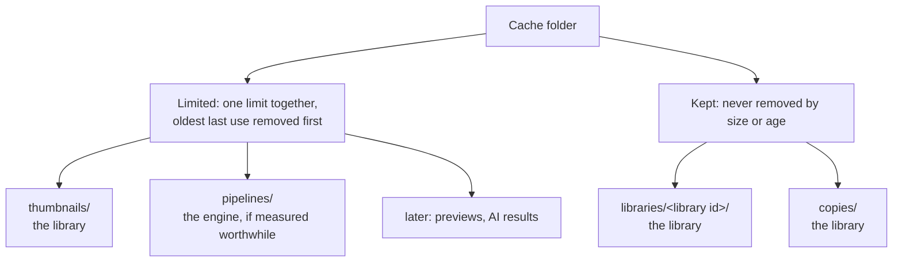

# The cache

Apertrust keeps on disk what it can compute again, so that a folder's thumbnails, a library's index and later previews come back at once instead of being made again. This document describes the cache: where it lives, what it holds, how it stays within its limit, and how the person sees and clears it. The settings it reads are in [settings.md](settings.md), the thumbnails and the library's caches themselves in [library.md](library.md).

**Status.** [Decision 76](decisions/0076-the-cache-kinds-limits-and-control.md) records the design, with the options considered. Base's `cache` module is built: the kinds, a limited entry's write and read with its last use, the walk, eviction to 90% of a limit and clearing a limited kind, on a folder its caller gives. The rest is planned: the folder's choice, the settings, the session's commands and jobs, and thumbnails written to the cache come with the library's step 6, the Storage page and `apertrust-cli cache` with step 6b, library caches with step 27 and local copies with step 31 ([roadmap.md](roadmap.md#the-librarys-steps)). Thumbnails today are read in memory and written nowhere.

## What goes in it

The cache holds only what Apertrust can rebuild with no one's help and nothing lost. Clearing all of it costs time, never an edit, a rating or a question to the person. What would be lost goes in the user data folder instead ([What is not in the cache](#what-is-not-in-the-cache)).

## The folder

Chosen once, as the program starts, by `Folders` in `apertrust-base` ([settings.md](settings.md#user-data-folders)), in this order:

1. `--cache-dir DIR`, as darktable's `--cachedir`;
2. `APERTRUST_CACHE_DIR`;
3. `<user data>/cache`, when the user data folder is given by flag or variable, since a development build changes kernels without bumping the thumbnails' render version and could otherwise show its thumbnails in the person's Apertrust;
4. the platform's cache folder: `~/Library/Caches/Apertrust` on macOS, `%LOCALAPPDATA%\Apertrust\cache` on Windows, `$XDG_CACHE_HOME/apertrust` (`~/.cache/apertrust`) on Linux.

Apertrust Dev has its own. The CLI finds the folder to read, as it finds the user data folder.

## Kinds

Each kind is a folder of its own, listed in `apertrust_base::cache::KINDS` with its policy.

| Kind | Folder | Policy | Owner | An entry |
| --- | --- | --- | --- | --- |
| Thumbnails | `thumbnails/` | limited | the library | a photo, virtual copy and size |
| Pipelines | `pipelines/` | limited | the engine | wgpu's pipeline cache for one adapter, Vulkan only, if measured worthwhile |
| Library caches | `libraries/<library id>/` | kept | the library | one library ([A library's cache](library.md#a-librarys-cache)) |
| Local copies | `copies/` | kept | the library | one raw by fingerprint, for offline drives and server roots |
| Later: previews, AI results such as depth maps | their own | limited | their owners | |

- **Limited** kinds count together against one limit and lose their oldest entries first, unless the person makes the cache unlimited.
- **Kept** kinds are removed only by the person, or by their own step's rule.
- **Elsewhere:** embeddings for search live inside a library's cache (decision 55). AI models are the AI page's downloads, not cache. Drivers' own shader caches (macOS's, Mesa's, the GPU vendors') are outside Apertrust's folder and not counted.

## Entries

- **One file per slot.** A limited entry's slot is what it stands for: a thumbnail's is the photo's fingerprint, its virtual copy and the size, one of 128, 256, 512 or 1024. The file is named by the slot's hash, in 256 subfolders by the name's first byte.
- **The version inside.** The file holds its version: a thumbnail's is the edit's hash and the render version, or the embedded picture's mark. A reader wanting another version renders again, and may show the stale picture meanwhile.
- **A write replaces the slot's file whole,** through a hidden temporary and a rename (base's `fs`), so a newer version removes the stale one at once and stale entries never pile up.
- **Last use is the file's modified time,** which Apertrust sets as it writes the entry and as it reads it, at most once a day an entry. Access times are never read: many systems record them lazily or not at all.
- **A kept entry** is a folder or a file of its own. A library's cache records the library's name, its last path and when it was last opened on this machine.

## Sizes and the walk

There is no index file. Sizes come from a walk of each limited kind: one listing per subfolder, with each file's size and time.

- **Its cost:** 0.2 s for 100,000 files on the M4's internal SSD, warm; 10,000 removed in 0.56 s.
- **When:** once as the session starts, then before each eviction and each time the Storage page asks. In between, the session counts its own writes and removals, so the size shows at once; another process's writes are counted at the next walk.
- **Tidying:** a walk removes temporaries more than a day old, by name, as a folder's listing does.

## Two processes at once

The app, a second instance and the CLI share the cache with no lock for limited kinds:

- two processes writing one slot each rename a whole file, the last rename winning;
- a removal that finds the file gone is ignored, and a reader whose file vanished renders again;
- a crash leaves at most a temporary, which a walk removes.

A library's cache is locked: a process that has it open holds an OS lock on its `lock` file (`std::fs::File::lock`), and no clear removes it then.

## The limit and Unlimited

Two settings of owner `engine`, declared in the settings schema ([settings.md](settings.md#user-data-folders)):

- `cache.limited`, on by default. Off is **Unlimited**: nothing is evicted by size, and every size and Clear stay.
- `cache.limit`, in GB from 0.5 to 1,000 in steps of 0.5, 4 by default, drawn disabled while `cache.limited` is off. 4 GB holds about 90,000 thumbnails at 512 px or 27,000 at 1024 px, at an estimated 45 kB and 150 kB each, which step 6 measures for the format it chooses.

Unlimited is the person's choice, never the default, and its size is always shown and can be cleared, where darktable's disk cache grows unseen.

## Eviction

While `cache.limited` is on, a `SystemBackground` job of kind `cache-evict`, with no progress and never shown, one at a time:

- **added** after the start's walk, after a write that takes the limited kinds past the limit, and when the limit is lowered or turned on;
- **walks** the limited kinds, then removes their entries oldest last use first, across kinds, until they hold at most 90% of the limit, so it does not run again at the next write;
- **costs** the walk and the removals, about 0.2 s for 100,000 entries and 0.06 ms a removal on the M4, off the engine thread and the interface's, paused by an export as darktable's crawler is (decision 57).

## Time and Never

Nothing in the cache is removed by age.

- **A library's cache** unopened on this machine for `cache.unused_after` (30, 90, 180 or 365 days, or Never; 90 by default), or whose library was not found at its last path, is marked on the Storage page and offered for removal. It is never removed without the person, and the open library's is rebuilt by Rebuild Cache, not removed.
- **Local copies** are never removed by size or age; how they are cleared, and when one is no longer needed, is decided with the library's step 31.

**With Unlimited and Never, nothing in the cache is ever removed except by the person's Clear or Remove,** and by a write replacing its own slot's stale version.

## What is not in the cache

What clearing would lose, or would make the person do again, lives in the user data folder ([settings.md](settings.md#user-data-folders)), which the person backs up and nothing clears with the cache:

| What | Where | Why not the cache |
| --- | --- | --- |
| A library's root map on this machine (decision 53) | `<user data>/libraries/<library id>/` | its loss would ask the person to locate roots again |
| The last copy of each sidecar this machine wrote, for silent winners (decision 52) | `<user data>/libraries/<library id>/` | it may be the only copy of an edit a sync service overwrote |
| A server root's sidecars with the changes the server has not taken yet (decision 71) | `<user data>/libraries/<library id>/` | the changes are nowhere else |
| Conflict copies, once compared (decision 52) | `<user data>/conflict-copies/`, removed 30 days later | each is the only copy of what it held |

## Through the session

The engine opens no folder: each binary opens the cache and hands the session its handle, the golden harness none. The session's part ([session-protocol.md](session-protocol.md#commands-planned), [events.md](events.md)):

- **`Command::Cache(CacheCommand)`:**
  - `Sizes`: walks the cache and answers;
  - `Clear { kind }`: removes the kind's entries listed as it starts;
  - `Remove { library }`: removes one library's cache, skipped and said so while another process has it open.
- **`Event::Cache`:** a fact for each kind (its entries and bytes) and for each library's cache.
- Their types are base's `cache`, as the jobs' events are its `jobs`.

**The jobs** (decision 57):

| Job | Queue | Shown |
| --- | --- | --- |
| The start's walk | `SystemBackground` | no |
| `cache-evict` | `SystemBackground` | no |
| `cache-clear`: Clear and Remove | `UserBackground`, cancellable, as Rebuild Cache | with a progress |
| Conflict copies past 30 days removed, as the app starts | `SystemBackground` | no |

## Settings › Storage

A hand-built page with rows from the schema ([gui.md](gui.md#the-settings-dialog)); a level the design draws from:

- the cache folder, how it was chosen, and Show in Finder (Explorer, the file manager);
- each kind present, with its entries and size, and Clear;
- the limit, `cache.limited`'s and `cache.limit`'s rows, with the limited kinds' total against it, or the total alone while unlimited;
- `cache.unused_after`'s row;
- each library's cache with the library's name, its last path, when it was last opened and its size, those unopened for `cache.unused_after` or not found marked, each with Remove;
- the conflict copies' count and size, with Show in Finder, and no Clear.

## The CLI

`apertrust-cli cache`, with no session and no GPU, calls base's `cache` directly, as `library scan` builds an index in its own process. `--cache-dir DIR` is global, as `--user-data-dir` is.

- **`cache info`:** the folder and how it was chosen; the limit, or `unlimited`, and the limited kinds' total; `cache.unused_after`; each kind's entries and size; each library's cache with its id, name, last path, last opened and size, marked as on the Storage page. It walks and writes nothing.
- **`cache clear [KIND...] [--library ID]`:** no kind clears every limited kind; `libraries` every library's cache no process has open; `--library ID` one. Local copies wait for step 31. It prints what it removed and what it skipped.

## Where the code lives

`apertrust_base::cache`, behind a `cache` feature ([crates.md](crates.md#apertrust-base)): the kinds, the folder's layout, the entry's write, read and touch, the walk, eviction's order, clearing, `UnusedAfter`, and the commands' and events' types. Owners name their slots and versions: the library its thumbnails, library caches and local copies, the engine its pipelines.

## Open questions

- **The walk on Windows and on hard disks:** the 0.2 s for 100,000 entries is the M4's SSD, warm. Step 6 times a cold walk on Windows, with its virus scanner, and on a hard disk; a walk too slow for the start's background job brings in the per-kind index of entries decision 76 keeps as its next step.

- **Free space:** whether the cache also stops writing when its disk is nearly full, below the limit.
