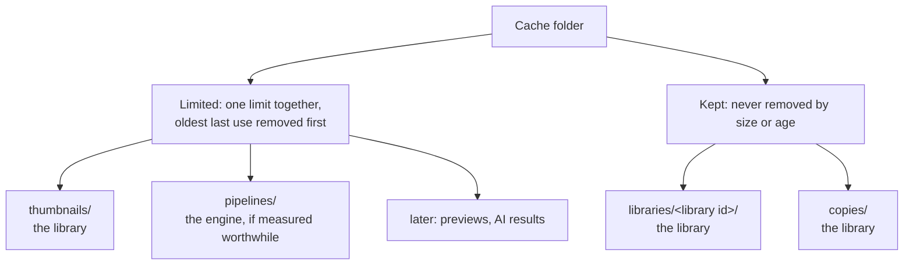

# The cache

Apertrust keeps on disk what it can compute again, so that a folder's thumbnails, a library's index and later previews come back at once instead of being made again. This document describes the cache: where it lives, what it holds, how it stays within its limit, and how the person sees and clears it. The settings it reads are in [settings.md](settings.md), the thumbnails and the library's caches themselves in [library.md](library.md).

**Status.** [Decision 76](decisions/0076-the-cache-kinds-limits-and-control.md) records the design, with the options considered. Base's `cache` module is built: the kinds, a limited entry's write and read with its last use, the walk, the tidy of old temporaries, eviction past a limit to 90% of it and clearing a limited kind, on a folder its caller gives. So are the folder's choice in `Folders`, with `--cache-dir` (or darktable's `--cachedir`) in the app and the CLI, and the three settings, on Settings › Storage as rows, with the engine's `settings::cache_limit` turning the first two into a `Limit`. The app opens the cache as it starts and hands it to its session, which tidies and walks it as it starts and keeps it within the limit by eviction, as background jobs ([Through the session](#through-the-session)). The thumbnails kind is built for the camera's embedded pictures: read from the cache first, written to it on a miss ([Thumbnails](#thumbnails)). So are the session's sizes and Clear, `CacheCommand::Sizes` and `Clear { kind }` answered by `Event::Cache` ([Through the session](#through-the-session)), and `apertrust-cli cache info` and `cache clear` ([The CLI](#the-cli)). So is Settings › Storage's hand-built part: the folders, each kind's size with its Clear, and the total against the limit ([Settings › Storage](#settings--storage)). The rest is planned: Apertrust's own rendered thumbnails with the library's step 6, the photo's fingerprint as their slot with step 8, library caches, each listed with its Remove, with step 27, and local copies with step 31 ([roadmap.md](roadmap.md#the-librarys-steps)).

## What goes in it

The cache holds only what Apertrust can rebuild with no one's help and nothing lost. Clearing all of it costs time, never an edit, a rating or a question to the person. What would be lost goes in the user data folder instead ([What is not in the cache](#what-is-not-in-the-cache)).

## The folder

Chosen once, as the program starts, by `Folders` in `apertrust-base` ([settings.md](settings.md#user-data-folders)), in this order:

1. `--cache-dir DIR`, or darktable's `--cachedir` as its alias, as `--configdir` is `--user-data-dir`'s;
2. `APERTRUST_CACHE_DIR`;
3. `<user data>/cache`, when the user data folder is given by flag or variable, since a development build changes kernels without bumping the thumbnails' render version and could otherwise show its thumbnails in the person's Apertrust;
4. the platform's cache folder: `~/Library/Caches/Apertrust` on macOS, `%LOCALAPPDATA%\Apertrust\cache` on Windows, `$XDG_CACHE_HOME/apertrust` (`~/.cache/apertrust`) on Linux.

Apertrust Dev has its own. A leading `~` and a relative folder are taken as for the user data folder, and one given empty, or with a `~` and no home folder, stops the start. `Folders` only chooses the folder, never creating or probing it, and `-d settings` logs it with how it was chosen; the CLI finds it as the app does.

**Opening it.** A program that writes the cache opens it with `Cache::create`, which creates the folder where it is missing and writes and removes a file of its own there: the cache's first write. The app does so as it starts. The CLI writes no cache: its `cache` commands open it with `Cache::open`, which creates nothing, a missing folder an empty cache, and its other commands open none. A folder that cannot be created or written is warned of once, as the program starts, and the program runs with no disk cache: it never refuses to start, and is never warned of again for each write it would have made.

## Kinds

Each kind is a folder of its own, listed in `apertrust_base::cache::KINDS` with its policy.



| Kind | Folder | Policy | Owner | An entry |
| --- | --- | --- | --- | --- |
| Thumbnails | `thumbnails/` | limited | the library | a photo, virtual copy and size |
| Pipelines | `pipelines/` | limited | the engine | wgpu's pipeline cache for one adapter, Vulkan only, if measured worthwhile |
| Library caches | `libraries/<library id>/` | kept | the library | one library ([A library's cache](library.md#a-librarys-cache)) |
| Local copies | `copies/` | kept | the library | one raw by fingerprint, for offline drives and server roots |
| Later: previews, AI results such as depth maps | their own | limited | their owners | |

- **Limited** kinds count together against one limit and lose their oldest entries first, unless the person makes the cache unlimited.
- **Kept** kinds are removed only by the person, or by their own step's rule.
- **Thumbnails** are stored as JPEG at quality 90, through the JPEG encoder export uses ([Thumbnails](#thumbnails)).
- **Elsewhere:** embeddings for search live inside a library's cache (decision 55). AI models are the AI page's downloads, not cache. Drivers' own shader caches (macOS's, Mesa's, the GPU vendors') are outside Apertrust's folder and not counted.

## Entries

- **One file per slot.** A limited entry's slot is what it stands for: a thumbnail's is the photo's fingerprint, its virtual copy and the size, one of 128, 256, 512 or 1024; until the fingerprint is built (step 8), the photo's path stands for it. Until then, a raw replaced or renamed onto another's path with the same size and modified time keeps the old thumbnail, which FAT32's 2-second times make possible for a burst. The file is named by the slot's hash, in 256 subfolders by the name's first byte.
- **The version inside.** The file holds its version: a thumbnail's is the edit's hash and the render version, or the embedded picture's mark, which is how the picture was read (`apertrust_raw::PREVIEW_VERSION`, rawler's version and the reading's own) and the raw's size and modified time. A reader wanting another version renders again, and may show the stale picture meanwhile.
- **A write replaces the slot's file whole,** through a hidden temporary and a rename (base's `fs`), so a newer version removes the stale one at once and stale entries never pile up.
- **Last use is the file's modified time,** which Apertrust sets as it writes the entry and as it reads it, at most once a day an entry. Access times are never read: many systems record them lazily or not at all.
- **A kept entry** is a folder or a file of its own. A library's cache records the library's name, its last path and when it was last opened on this machine.

## Sizes and the walk

There is no index file. Sizes come from a walk of each limited kind: one listing per subfolder, with each file's size and time.

- **Its cost:** 0.2 s for 100,000 files on the M4's internal SSD, warm; 10,000 removed in 0.56 s. Measured again with thumbnails written by the session's own path: 153 to 185 ms for 100,000 entries, the first walk of each process the slowest ([below](#timing-the-walk)).
- **When:** once as the session starts, then before each eviction, each time a client asks for the sizes (`CacheCommand::Sizes`, which Settings › Storage sends each time it is shown) and each time `apertrust-cli cache info` runs. In between, the session counts its own writes and removals, so the size shows at once; another process's writes are counted at the next walk.
- **Tidying:** temporaries more than a day old are removed by name, as a folder's listing does, by a tidy of their own as the session starts, with the write checks `Cache::create` left in the cache folder; a walk writes nothing.
- **Stopping:** the walk, the tidy and eviction's listing ask their cancel before each subfolder, and eviction before each removal, so a program that quits never waits for a cold walk; a walk stopped keeps no sizes.
- **Overtaken:** a walk that the handle's own eviction or clear overlaps keeps and returns nothing, since it may have seen part of what their count takes away: the handle keeps a generation of its removals, raised as each begins removing and once it has counted, and a walk keeps its sizes only where the generation stayed and nothing was removing. The session then walks once more; overtaken again, its count stands, which holds what they removed.

## Thumbnails

Built for the camera's embedded pictures, the only thumbnails until Apertrust renders its own ([library.md](library.md#thumbnails)). A thumbnail job (`LibraryCommand::Thumbnails`), given a cache:

- **reads the cache first,** by the slot and version above (`ops::thumbnail_key`), and sends the picture as the library would;
- **on a miss** reads the embedded picture and sends it as without a cache, then encodes it and writes it, so a write never delays the picture shown. A write past the limit asks for an eviction;
- **keeps nothing** for a raw with no embedded picture, or a picture that cannot be encoded: it is sent, and read again the next time;
- with no cache, in the CLI or where the folder cannot be written, reads as before.

**The JPEG:** quality 90, through the export's JPEG writer (`apertrust_export::jpeg::write`), chroma halved across (4:2:2). It is read back by rawler's own decoder (`apertrust_raw::read_jpeg`), the image crate's zune-jpeg, so no decoder is added; zune-jpeg misreads the export's 4:2:0, whose optimised tables give a scan for each component, and a test says when it no longer does. An entry that does not end with the JPEG's end marker, cut short or not a JPEG, is a miss: read again and written over. The encoding runs in the engine, where the thumbnail jobs run: the library depends on neither the export nor the GPU, and needs neither for this.

**Apertrust's own rendered thumbnails** are planned with step 6: a still of the viewport pipe, its version the edit's hash and the render version.

### Timing the walk

An ignored test, `session::cache::tests::time_the_walk`, measures it:

```sh
APERTRUST_CACHE_TIMING=DIR cargo test --release -p apertrust-engine --lib \
    time_the_walk -- --ignored --nocapture
```

On its first run in `DIR`, on the disk to time, it writes the thumbnails of every raw of the corpus (`APERTRUST_RAW_CORPUS` or `test-images/raw.pixls.us`) at 256, 512 and 1024 through the session's own path, reads them back as hits, and tells their sizes; then it fills the thumbnails kind to 100,000 entries. Every run then walks it five times. For a cold first walk, flush the file system's cache first: `sudo purge` on a Mac, a restart or a fresh mount elsewhere.

On the M4's internal SSD, 40 raws of the corpus, 33 with an embedded picture rawler reads:

| Size | Written, 40 asked | Read back | Each entry |
| --- | --- | --- | --- |
| 256 | 2.75 s | 0.02 s, 33 hits | 25.3 kB |
| 512 | 1.89 s | 0.05 s, 33 hits | 65.8 kB |
| 1024 | 2.15 s | 0.16 s, 33 hits | 199.9 kB |

The walk of 100,000 entries, warm, three processes of five walks each: 161.4 to 184.8 ms for the first walk of a process, 153.4 to 163.5 ms for the rest.

## Two processes at once

The app, a second instance and the CLI share the cache with no lock for limited kinds:

- two processes writing one slot each rename a whole file, the last rename winning;
- a removal that finds the file gone is ignored, and a reader whose file vanished renders again;
- a crash leaves at most a temporary, which the start's tidy removes.

A library's cache is locked: a process that has it open holds an OS lock on its `lock` file (`std::fs::File::lock`), and no clear removes it then.

## The limit and Unlimited

Two settings of owner `engine`, declared in the settings schema ([settings.md](settings.md#user-data-folders)):

- `cache.limited`, on by default. Off is **Unlimited**: nothing is evicted by size, and every size and Clear stay.
- `cache.limit`, in GB of 10⁹ bytes, as disks count them, from 0.5 to 1,000 in steps of 0.5, 4 by default, drawn disabled while `cache.limited` is off (the schema's `requires`). 4 GB holds about 61,000 thumbnails at 512 px or 20,000 at 1024 px, at 66 kB and 200 kB each, measured on the corpus's embedded pictures ([above](#timing-the-walk)); at 256 px, 25 kB.

Unlimited is the person's choice, never the default, and its size is always shown and can be cleared, where darktable's disk cache grows unseen.

## Eviction

While `cache.limited` is on, a `SystemBackground` job of kind `cache-evict`, with no progress and never shown, one at a time:

- **run** by the start's walk itself where the cache is past the limit, the walk counting as an eviction running; **added** after a write that takes the limited kinds past the limit, and when the limit is lowered or turned on; never when it is raised or turned off;
- **one at a time:** a request while one is queued is that one's, since it reads the limit as it runs; a request while one runs, the start's walk among them, is folded into it, which walks and evicts once more before it ends; one that panics leaves the next request free to add another;
- **walks** the limited kinds, then removes their entries oldest last use first, across kinds, until they hold at most 90% of the limit, so it does not run again at the next write;
- **costs** the walk and the removals, about 0.2 s for 100,000 entries and 0.06 ms a removal on the M4, off the engine thread and the interface's; it stops before its next removal as the session ends. Planned: paused by an export, as darktable's crawler is (decision 57).

## Time and Never

Nothing in the cache is removed by age.

- **A library's cache** unopened on this machine for `cache.unused_after` (30, 90, 180 or 365 days, or Never; 90 by default), or whose library was not found at its last path, is marked on the Storage page and offered for removal. It is never removed without the person, and the open library's is rebuilt by Rebuild Cache, not removed.
- **Local copies** are never removed by size or age; how they are cleared, and when one is no longer needed, is decided with the library's step 31.

**With Unlimited and Never, nothing in the cache is ever removed except by the person's Clear or Remove,** and by a write replacing its own slot's stale version.

## What is not in the cache

What clearing would lose, or would make the person do again, lives in the user data folder ([settings.md](settings.md#user-data-folders)), which the person backs up and nothing clears with the cache:

| What | Where | Why not the cache |
| --- | --- | --- |
| A library's root map on this machine (decision 53) | `<user data>/libraries/<library id>/` | its loss would ask the person to locate roots again |
| The last copy of each sidecar this machine wrote, for silent winners (decision 52) | `<user data>/libraries/<library id>/` | it may be the only copy of an edit a sync service overwrote |
| A server root's sidecars with the changes the server has not taken yet (decision 71) | `<user data>/libraries/<library id>/` | the changes are nowhere else |
| Conflict copies, once compared (decision 52) | `<user data>/conflict-copies/`, removed 30 days later | each is the only copy of what it held |

## Through the session

The engine opens no folder: a binary opens the cache and hands `Session::start` a `CacheOptions`, the `Arc<Cache>` and the limit its settings give, or none. The app hands one; the CLI, whose commands write no cache yet, hands none, and the golden harness starts no session.

**Built:**

- **As the session starts,** a `cache-walk` job: the tidy of old temporaries, then the walk, then eviction in the same job where the limited kinds are past the limit.
- **Eviction** ([above](#eviction)), asked for after a write past the limit (`Upkeep::check`, which the thumbnails' writes call), and by `Command::Cache(CacheCommand::Limit(limit))`, which the app sends each time Settings changes `cache.limited` or `cache.limit`, applied at once. Only the engine thread adds the jobs, since it owns the control: a worker asks it through the session's inbox.
- **The session's end** is the cancel of the tidy, the walk and eviction ([Sizes and the walk](#sizes-and-the-walk)), so quitting returns promptly.
- **Thumbnails** ([below](#thumbnails)), read from the cache by the thumbnail jobs and written on a miss.
- **`CacheCommand::Sizes`,** answered by `Event::Cache`: at once with the sizes the handle counts, once a walk has run, then by a `cache-walk` of its own, which counts what other processes did meanwhile and answers again, its answer always the later. One such walk at a time, as eviction runs: a `Sizes` while it is queued is answered by its first pass, and one while it runs by a pass more, so every `Sizes` has a walk begun after it. A walk that fails is `SessionError::CacheWalk`, once for each command its pass answers.
- **`CacheCommand::Clear { kind }`,** a limited kind's entries removed by a `cache-clear` job (below), base's `Cache::clear` with its progress and cancel; as it ends, cancelled or not, `Event::Cache` again. Refused: a kept kind (`SessionError::CacheKept`), a kind a Clear is clearing already until its job has ended (`CacheClearing`), and a session with no cache (`NoCache`).
- **`Event::Cache(CacheEvent)`,** a fact, the whole cache: each kind's entries and bytes, the limited kinds' together and the limit (`CacheEvent::Sizes`), or `CacheEvent::NoCache` for a session handed none, which answers `Sizes` too. The libraries' caches count as one kind, `libraries`, their items and bytes.
- **Their types** are base's `cache`, `CacheCommand`, `CacheEvent`, `Kind`, `Sizes` and `Usage`, as the jobs' events are its `jobs`.
- **Logging:** `-d perf`, the walk's sizes, the temporaries tidied and its time (each kind's under `verbose`), each walk for the sizes with its time, each eviction's and each Clear's entries and bytes removed, its failures and its time; for each `LibraryCommand::Thumbnails`, once its last job has ended, how many came from the cache and how many were read, each with their time, and how many were written, each thumbnail under `verbose`; a cache that cannot be tidied, walked, evicted or cleared is a warning, as is a folder that cannot be created or written as the program starts.

**A Clear's row** in the jobs window, as every job's is its own (decision 72): its title `job-cache-clear` ("Clearing the thumbnail cache"), the line under its bar `job-cache-clear-now` ("1,200 of 2,104 removed"), its bar the entries done of those listed as it started, its ✕ `CancelJob`; as it ends, its title `job-cache-cleared` ("Cleared 2,104 thumbnails, 138 MB") or `job-cache-clear-cancelled` ("Clearing cancelled: 1,200 thumbnails removed, 72 MB"). Each names the kind, `$kind`, and the outcome the entries and their size, `$size` in `$unit`, `kb`, `mb` or `gb` of disks' powers of ten, one decimal below 10. Entries it could not remove fail the job, `job-cause-cache-remove`, the rest removed; a kind's folder that cannot be listed fails it, `job-cause-cache-read`.

**Planned** with step 27: `CacheCommand::Remove { library }`, one library's cache removed by a `cache-clear` job, skipped and said so while another process has it open; and `Event::Cache` listing each library's cache with its name, last path and last opening, which the walk does not read.

**The jobs** (decision 57):

| Job | Queue | Shown | |
| --- | --- | --- | --- |
| `cache-walk`, the start's tidy and walk, and the walk for `Sizes` | `SystemBackground` | no | built |
| `cache-evict` | `SystemBackground` | no | built |
| `cache-clear`: Clear | `UserBackground`, cancellable, as Rebuild Cache | with a progress | built |
| `cache-clear`: Remove | the same | with a progress | step 27 |
| Conflict copies past 30 days removed, as the app starts | `SystemBackground` | no | step 13 |

## Settings › Storage

A page of rows from the schema with a hand-built part around them ([gui.md](gui.md#the-settings-dialog)), `crates/app/src/storage.rs`.

**Built,** in three groups:

| Group | Lines |
| --- | --- |
| Folders, hand-built, first | The user data folder and the cache folder, each in full with the home as `~`, cut in its middle where the page is narrow, how it was chosen under it (the flag, the variable, inside the user data folder, or the system's), and Show in Finder (Explorer, Files), read-only, since a folder is chosen before the app starts |
| Cache, the schema's | `cache.limited`, `cache.limit` (disabled while unlimited) and `cache.unused_after` |
| In the cache, hand-built, last | Thumbnails and Pipelines, each with its entries and size in the language's numbers and its Clear; Library caches, one read-only line with their entries and size; the limited kinds' total against the limit, or with "unlimited" |

- **The sizes** are `CacheCommand::Sizes`, sent each time the page is shown, and again after a limit Settings changed is sent, so the total and the limit agree. The app's mirror keeps the latest `Event::Cache` (`storage::Mirror`) and hands Settings the page's view as it changes, through the dialog host. Before the first answer each line says "Counting…", and Clear waits.
- **Clear** sends `CacheCommand::Clear { kind }`. Its button is disabled from the press until that job's `Ended`, not until the next sizes; the job's row is the jobs window's, which it does not open. A refusal is worded under the lines: "These are being cleared already.", "There is no disk cache to clear.", or "They could not be cleared." for any other.
- **With no cache** the In the cache group says so plainly, with no Clear; the folders still show.
- **Its words** are `settings-storage-…` messages in every language; sizes take the Clear's `$size` and `$unit` (`session::size_in_unit`), so 999,800 bytes read 1.0 MB.

**Planned:** with step 27, each library's cache on a line of its own with the library's name, its last path, when it was last opened and its size, those unopened for `cache.unused_after` or not found marked, each with Remove; with step 13, the conflict copies' count and size, with Show in Finder, and no Clear.

## The CLI

`apertrust-cli cache`, with no session and no GPU, calls base's `cache` directly, as `library scan` builds an index in its own process. `--cache-dir DIR`, or `--cachedir`, is global, as `--user-data-dir` is.

Built (`crates/cli/src/cache.rs`). It opens the cache with `Cache::open`, creating nothing, so a missing folder is an empty cache; with no cache folder at all, on a system with no home folder, it stops, naming `--cache-dir`. Its output is one item to a line, as `library scan`'s:

- **`cache info`:** the folder, `(not created yet)` where it is missing, and how it was chosen (`chosen by: --cache-dir`, `APERTRUST_CACHE_DIR`, `the user data folder` or `the platform`); the limit, `cache.limit`'s gigabytes or `unlimited`; the limited kinds' total; each kind's entries and size, kB, MB or GB to one decimal; `cache.unused_after` by its id. The settings are the user data folder's, `--conf` over them, read and never written. It walks and writes nothing.
- **`cache clear [KIND...]`:** the limited kinds named, `thumbnails` or `pipelines`, or every limited kind with none named, each kind once however often it is named: on stdout a line of what it removed, on stderr what it could not and a folder that cannot be listed. A kept kind, `libraries` or `copies`, or one that does not exist, is refused by name as a usage error, exit status 2, before anything is removed. An entry that cannot be removed is passed over and said so, and the exit status is then 1.

```text
$ apertrust-cli cache info
folder: /Users/anna/Library/Caches/Apertrust
chosen by: the platform
limit: 4 GB
limited kinds: 2104 entries, 138.4 MB
thumbnails: 2104 entries, 138.4 MB
pipelines: 0 entries, 0.0 kB
libraries: 0 entries, 0.0 kB
copies: 0 entries, 0.0 kB
cache.unused_after: days_90
```

**Planned** with step 27: `cache info` listing each library's cache with its id, name, last path, last opened and size, marked as on the Storage page; `cache clear libraries`, every library's cache no process has open, and `cache clear --library ID`, one, saying what it skipped. Local copies wait for step 31.

## Where the code lives

- `apertrust_base::cache`, behind a `cache` feature ([crates.md](crates.md#apertrust-base)): the kinds, the folder's layout and its creation (`Cache::create`), the entry's write, read and touch, the walk, eviction's order, clearing, `UnusedAfter`, and the commands' and events' types, `CacheCommand` and `CacheEvent`.
- The engine's `session::cache` ([crates.md](crates.md#the-cache)): `CacheOptions`, the start's job, eviction's, the walk for the sizes and the Clear's; its `session::thumbnail`, the thumbnails read from and written to the cache.
- The library's `ops::thumbnail_key`, a thumbnail's slot and version.
- `apertrust-raw`'s `PREVIEW_VERSION` and `read_jpeg`, which reads a cached thumbnail back.
- The app's `open_cache`, which opens it as the app starts.
- The CLI's `cache` commands, `crates/cli/src/cache.rs`.

The CLI reads no thumbnails: `library scan` lists a folder, and only its `cache` commands touch the cache, walking and clearing it.

Owners name their slots and versions: the library its thumbnails, library caches and local copies, the engine its pipelines.

## Open questions

- **The walk cold, on Windows and on hard disks:** the 153 to 185 ms for 100,000 entries are the M4's SSD with the file system's cache warm; a cold walk needs `sudo purge` first, which is the maintainer's to run. A cold walk on Windows, with its virus scanner, and on a hard disk are still to time, by the method [above](#timing-the-walk); a walk too slow for the start's background job brings in the per-kind index of entries decision 76 keeps as its next step.

- **Free space:** whether the cache also stops writing when its disk is nearly full, below the limit.
