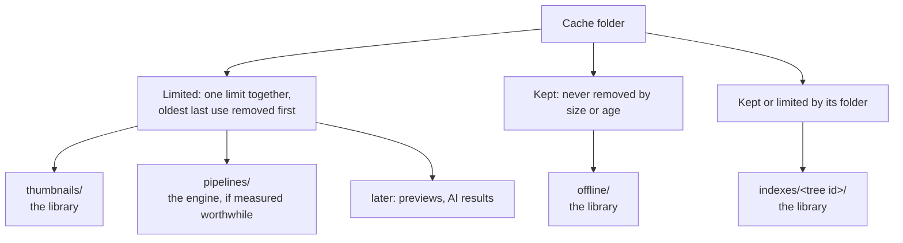

# The cache

Apertrust keeps on disk what it can compute again, so that a folder's thumbnails, a folder tree's index and later previews come back at once instead of being made again. This document describes the cache: where it lives, what it holds, how it stays within its limit, and how the person sees and clears it. The settings it reads are in [settings.md](settings.md), the thumbnails and the indexes themselves in [library.md](library.md).

**Status.** [Decision 76](decisions/0076-the-cache-kinds-limits-and-control.md) records the design, with the options considered. Base's `cache` module is built: the kinds, a limited entry's write and read with its last use, its version read alone, the walk, the tidy of old temporaries, eviction past a limit to 90% of it and clearing a limited kind, on a folder its caller gives. So are the folder's choice in `Folders`, with `--cache-dir` (or darktable's `--cachedir`) in the app and the CLI, and the three settings, on Settings › Storage as rows, with the engine's `settings::cache_limit` turning the first two into a `Limit`. The app opens the cache as it starts and hands it to its session, which tidies and walks it as it starts and keeps it within the limit by eviction, as background jobs ([Through the session](#through-the-session)). The thumbnails kind is built for the camera's embedded pictures: read from the cache first, written to it on a miss, each slot the photo's fingerprint, its virtual copy and the size ([Thumbnails](#thumbnails)). So are the session's sizes and Clear, `CacheCommand::Sizes` and `Clear { kind }` answered by `Event::Cache` ([Through the session](#through-the-session)), and `apertrust-cli cache info` and `cache clear` ([The CLI](#the-cli)). So is Settings › Storage's hand-built part: the folders, each kind's size with its Clear, and the total against the limit ([Settings › Storage](#settings--storage)). The live photo's rendered thumbnails are built too. The rest is planned: rendered thumbnails of the other photos with the library's step 6, the indexes, the kept ones each listed with its Remove, with step 23, and the offline thumbnails with step 27 ([roadmap.md](roadmap.md#the-librarys-steps)). The built `KINDS` still lists `libraries` and `copies`, empty, which `indexes` and `offline` replace with those steps ([decision 101](decisions/0101-folders-first-libraries-optional.md)).

## What goes in it

The cache holds only what Apertrust can rebuild with no one's help and nothing lost. Clearing all of it costs time, never an edit, a rating or a question to the person. What would be lost goes in the user data folder instead ([What is not in the cache](#what-is-not-in-the-cache)).

## The folder

Chosen once, as the program starts, by `Folders` in `apertrust-base` ([settings.md](settings.md#user-data-folders)), in this order:

1. `--cache-dir DIR`, or darktable's `--cachedir` as its alias, as `--configdir` is `--user-data-dir`'s;
2. `APERTRUST_CACHE_DIR`;
3. `<user data>/cache`, when the user data folder is given by flag or variable, since a development build changes kernels without bumping the thumbnails' render version and could otherwise show its thumbnails in the person's Apertrust;
4. the platform's cache folder: `~/Library/Caches/Apertrust` on macOS, `%LOCALAPPDATA%\Apertrust\cache` on Windows, `$XDG_CACHE_HOME/apertrust` (`~/.cache/apertrust`) on Linux.

Apertrust Nightly has its own. A leading `~` and a relative folder are taken as for the user data folder, and one given empty, or with a `~` and no home folder, stops the start. `Folders` only chooses the folder, never creating or probing it, and `-d settings` logs it with how it was chosen; the CLI finds it as the app does.

**Opening it.** A program that writes the cache opens it with `Cache::create`, which creates the folder where it is missing and writes and removes a file of its own there: the cache's first write. The app does so as it starts. The CLI writes no cache: its `cache` commands open it with `Cache::open`, which creates nothing, a missing folder an empty cache, and its other commands open none. A folder that cannot be created or written is warned of once, as the program starts, and the program runs with no disk cache: it never refuses to start, and is never warned of again for each write it would have made.

## Kinds

Each kind is a folder of its own, listed in `apertrust_base::cache::KINDS` with its policy.



| Kind | Folder | Policy | Owner | An entry |
| --- | --- | --- | --- | --- |
| Thumbnails | `thumbnails/` | limited | the library | a photo, virtual copy and size |
| Pipelines | `pipelines/` | limited | the engine | wgpu's pipeline cache for one adapter, Vulkan only, if measured worthwhile |
| Indexes | `indexes/<tree id>/` | kept while a folder it covers has a record, limited otherwise | the library | one folder tree ([The saved index](library.md#the-saved-index)) |
| Offline thumbnails | `offline/` | kept | the library | one 256 px thumbnail per photo and virtual copy of a folder kept offline or in a Library ([Keep Available Offline](library.md#keep-available-offline)) |
| Later: previews, AI results such as depth maps | their own | limited | their owners | |
| Later, if asked: local copies | `copies/` | kept | the library | one raw by fingerprint, to edit a photo whose folder is away |

- **Limited** kinds count together against one limit and lose their oldest entries first, unless the person makes the cache unlimited.
- **Kept** kinds are removed only by the person, or by their own step's rule.
- **Indexes** are kept or limited by the folders they cover: an index is kept while its tree's folder or any folder inside it has a record (in a Library, kept offline, keeping its edits here), since a recorded subfolder reads the enclosing tree's index; any other counts against the limit and is removed oldest first with the limited kinds, never while a process has it open. The index's folder notes the records it covers, which eviction reads.
- **An index is one entry, a folder:** the walk lists it once, its size the sum of its files'; its last use is its `lock` file's modified time, set as it is opened, at most once a day; it is removed whole, renamed first to a hidden temporary beside it so no reader finds half of one, the start's tidy removing what a crash leaves.
- **Its lock:** a process with an index open, the app or the CLI, holds a shared lock on its `lock` file (`File::lock_shared`); Clear, Remove and eviction take an exclusive one with `try_lock` and pass over an index they cannot lock. Its files are replaced whole through the safe write, the last rename winning, since every process builds it from the same files; an engine with a writer lock of its own, as `tantivy` has, keeps it (spike L2).
- **Offline thumbnails** are one size, 256 px, 25.3 kB each ([below](#timing-the-walk)), so 100,000 photos take about 2.5 GB; the grid reads one as the thumbnails kind's 256 px slot. They go once their folder is neither marked Keep Available Offline nor in any Library, or by the person's Clear.
- **Thumbnails** are stored as JPEG at quality 90, through the JPEG encoder export uses ([Thumbnails](#thumbnails)).
- **Elsewhere:** embeddings for search live inside a folder tree's index (decision 55). AI models are the AI page's downloads, not cache. Drivers' own shader caches (macOS's, Mesa's, the GPU vendors') are outside Apertrust's folder and not counted.

## Entries

- **One file per slot.** A limited entry's slot is what it stands for: a thumbnail's is the photo's fingerprint, its virtual copy and the size, one of 128, 256, 512 or 1024 ([Thumbnails](#thumbnails)), so a raw renamed or moved keeps its thumbnails, and a raw replaced by another at its path, with the same size and modified time as FAT32's 2-second times make possible for a burst, never takes the old one's from the next session on; within the session the memo keeps the old fingerprint ([Thumbnails](#thumbnails)). The file is named by the slot's hash, in 256 subfolders by the name's first byte.
- **The version inside.** The file holds its version: a thumbnail's is the edit's hash and the render version, or the embedded picture's mark, which is how the picture was read (`apertrust_raw::PREVIEW_VERSION`, rawler's version and the reading's own) and the raw's size and modified time. A reader wanting another version renders again, and may show the stale picture meanwhile.
- **A write replaces the slot's file whole,** through a hidden temporary and a rename (base's `fs`), so a newer version removes the stale one at once and stale entries never pile up.
- **Last use is the file's modified time,** which Apertrust sets as it writes the entry and as it reads it, at most once a day an entry. Access times are never read: many systems record them lazily or not at all.
- **A kept entry** is a folder or a file of its own. An index records its folder tree's name, its last path, its folder record where it has one, and when it was last opened on this machine.

## Sizes and the walk

There is no index file. Sizes come from a walk of each limited kind: one listing per subfolder, with each file's size and time.

- **Its cost:** 0.2 s for 100,000 files on the M4's internal SSD, warm; 10,000 removed in 0.56 s. Measured again with thumbnails written by the session's own path: 153 to 185 ms for 100,000 entries, the first walk of each process the slowest ([below](#timing-the-walk)).
- **When:** once as the session starts, then before each eviction, each time a client asks for the sizes (`CacheCommand::Sizes`, which Settings › Storage sends each time it is shown) and each time `apertrust-cli cache info` runs. In between, the session counts its own writes and removals, so the size shows at once; another process's writes are counted at the next walk.
- **Tidying:** temporaries more than a day old are removed by name, as a folder's listing does, by a tidy of their own as the session starts, with the write checks `Cache::create` left in the cache folder; a walk writes nothing.
- **Stopping:** the walk, the tidy and eviction's listing ask their cancel before each subfolder, and eviction before each removal, so a program that quits never waits for a cold walk; a walk stopped keeps no sizes.
- **Overtaken:** a walk that the handle's own write, eviction or clear overlaps keeps and returns nothing, since it may have seen only part of those changes. The handle keeps a generation of its mutations, raised before and after each write or removal, including its count update; a walk keeps its sizes only where the generation stayed and nothing was changing. Writes and individual removals through one handle serialise the file change with its count update. The session then walks once more. If a walk has completed before, its count stands when the retry is overtaken too, holding the changes already counted. Before the first count, the startup job keeps retrying after a short pause until a walk succeeds, an error occurs or the job is cancelled, then enforces the limit once it has a count.

## Thumbnails

Built for the camera's embedded pictures and the live photo's saved edit ([library.md](library.md#thumbnails)). A thumbnail job (`LibraryCommand::Thumbnails`), given a cache:

- **looks at the raw's state first** (`ops::raw_state`, one `std::fs::metadata`): a cloud file not on the disk has no fingerprint and so no slot, and is never read in the background (decision 53), so the job reads no entry, no embedded picture and writes nothing, and sends no picture ([library.md](library.md#shares-offline-drives-and-cloud-folders)). An entry left from when it was on the disk stays as it is, for eviction or for when the file is local again;
- **finds the photo's slot** (`ops::thumbnail_slot`): `thumbnail`, a zero byte, the photo's fingerprint (`sidecar::read_fingerprint`, decision 53), a zero byte, its virtual copy's id, 8 hex digits, or nothing, a zero byte, then the size as a little-endian `u32`. The copy is the id of the sidecar's first virtual copy, the one the session edits, as `Edits::parse` reads it, a version 1 file's `FIRST_COPY` (`ops::thumbnail_copy`); a photo with no sidecar, or one that cannot be read, has none, so two files of one raw, one edited and one not, never share a slot. Its sidecar is read for the copy, and its fingerprint taken from the session's memo (`ops::Fingerprints`, by path and the state's `ops::RawStamp`), which reads its first and last 64 KiB once a session and again only when its size or modified time changes (`ops::Identity::read`). A raw replaced by another of the same size and time keeps its fingerprint until the next session. A raw whose size, time or fingerprint cannot be read, or a name that is no plain file name, is read and not kept;
- **reads the cache first:** the slot's render at any version, current or stale, else its embedded picture at `ops::thumbnail_key`'s version, read and decoded outside the lock below. A corrupt entry is a miss;
- **on a miss** reads the embedded picture and sends it as without a cache, then encodes it and writes it, so a write never delays the picture shown. A write past the limit asks for an eviction;
- **keeps nothing** for a raw with no embedded picture, or a picture that cannot be encoded: it is sent, and read again the next time;
- with no cache, in the CLI or where the folder cannot be written, reads as before.

One lock in the session orders the thumbnails' replacements and the events that send them, held only to look at the slot's version (`Cache::version`, the entry's first bytes) and to send or write: an embedded picture never replaces a render, nor is sent after one, and a render that took the slot while a picture was read is read and sent in its place.

**The JPEG:** quality 90, through the export's JPEG writer (`apertrust_export::jpeg::write`), chroma halved across (4:2:2). It is read back by rawler's own decoder (`apertrust_raw::read_jpeg`), the image crate's zune-jpeg, so no decoder is added; zune-jpeg misreads the export's 4:2:0, whose optimised tables give a scan for each component, and a test says when it no longer does. An entry that does not end with the JPEG's end marker, cut short or not a JPEG, is a miss: read again and written over. The encoding runs in the engine, where the thumbnail jobs run: the library depends on neither the export nor the GPU, and needs neither for this.

**Apertrust's own rendered thumbnails** are the live photo's: when they are made and how is [engine.md](engine.md#rendered-thumbnails-of-the-live-photo)'s. Their version is exactly `ops::RENDERED` (`rendered` and a zero byte), the 32 bytes of the BLAKE3 hash of the sidecar's bytes as written (`index::hash`, which the index keeps too), then `ops::THUMBNAIL_RENDER_VERSION` as a little-endian `u32`; `ops::rendered_version` builds it and `rendered_matches` checks both. Raise the render version by hand when an operation or the pipeline changes what a saved edit renders, colour conversion, quantisation and the averages included, and when a tool's or an operation's defaults change, which every render of a photo with no edit (`ops::UNALTERED`) holds. A photo with no edit, no sidecar or one at the defaults, once shown at least 300 ms, has the render of its defaults at every size; one not shown that long has its slots as `library.raw_thumbnails_from` shows them ([library.md](library.md#thumbnails)): the embedded picture under never, a render the rule made replaced by it or removed where the raw has none; a render where darktable's rule shows one, under never only for a raw with no embedded picture or a Phase One raw. Its hash is `ops::UNALTERED`, 32 zero bytes, since every such photo renders alike (`ops::rendered_unaltered`). After its render version come the raw's facts the rule reads as they were written, where the render came from, and the raw as they were read (`ops::unaltered_version`): 1 or 0 for an embedded picture, that picture's stored width and height and the raw's, each a little-endian `u32`, 1 or 0 for a Phase One raw; then the origin, one byte, 1 for a render made from the live photo (`ops::Origin::Opened`) or 0 for one the rule made (`Origin::Rule`); then the raw's size and modified time (`ops::RawStamp`, as the embedded picture's version holds them). An entry written before the origin was recorded has no such byte and reads as `Rule`'s, so the render version did not change. `unaltered_facts` gives the facts and the origin back only for the raw at that size and time. A render whose job found the raw gone or replaced since the open records none, so the next read looks again.

- **A grid read** of such a render sends one made from the live photo, of the raw as it is, at every size. It judges one the rule made by the facts it records, reading the raw's (`raw_facts`) only for a render that records none, one of an earlier render version, or one of a raw since replaced, one made from the live photo among them.
- **The opening photo and the live photo's renders** decide from them too, as [Opening a photo](engine.md#opening-a-photo) and [Rendered thumbnails of the live photo](engine.md#rendered-thumbnails-of-the-live-photo) say.

An opening photo reads the largest rendered slot, whatever its version (`Cache::read_any`), as its first picture (decision 77), a render of a photo with no edit as [Opening a photo](engine.md#opening-a-photo) says: one made from the live photo always, one the rule made only where the rule shows a render at the Viewer's size; a grid read likewise sends a stale render, the nearest to the edit, until the live photo replaces it. A render of a photo with no edit the rule made is sent only where the rule shows it at the size asked; otherwise the embedded picture is read, sent, and written over it, only while the slot still holds that render.

An entry whose slot no photo has any more is never read again: it leaves by eviction, as nothing in the cache is migrated.

### Keyed by fingerprint: the cost

A cache hit stats the raw, looks for its sidecar, and reads the raw's first and last 64 KiB once a session. Measured on a Linux machine, an AMD Ryzen 7 8845HS with a Radeon 780M, on its NVMe SSD (WD_BLACK SN7100, ext4) and on a NAS over SMB 3.0 on the LAN (the kernel's `cifs`), before and after the fingerprint slots, the two builds run in turn, three runs of each:

- **The folder:** 120 raws in its root, of which the listing takes 117; they are 40 distinct raws, each in three byte-identical copies under other names, which share a fingerprint and so, after the change, one slot. The SSD's is a copy of the NAS's.
- **The thumbnails** asked at 256 by a session of their own with the cache warm, 30 at a time, since a queue keeps 30 jobs waiting (decision 57). The numbers are the four commands' `-d perf` lines added up (`thumbnails at 256: cached N in T ms, read …`, each job's time summed, the jobs running in parallel), and the wall time from the first ask to the last thumbnail, less the 100 ms each command was left for its line. Each run is a new session, its fingerprints read again; its second ask finds them in the memo.
- **The hits alone:** the 99 raws whose embedded picture the cache holds, the 18 that have none rawler reads (`3FR`, `GPR`, `IIQ`, `ORF`, `SRW`, `X3F`) left out, asked once the folder's capture times are read, so nothing else reads the raws meanwhile.

| Disk | Ask | Before: hits summed, wall | After: hits summed, wall |
| --- | --- | --- | --- |
| NVMe SSD | First of the session | 59–62 ms, 10–11 ms | 65–135 ms, 11–26 ms |
| NVMe SSD | Second | 52–63 ms, 9–11 ms | 55–62 ms, 10–11 ms |
| NAS over SMB | First of the session | 0.49–0.78 s, 78–127 ms | 5.9–8.1 s, 0.91–1.26 s |
| NAS over SMB | Second | 0.18–0.24 s, 32–38 ms | 0.17–0.20 s, 29–36 ms |

- **On the SSD** the fingerprints cost nothing measurable, the raws' ends already in the system's page cache.
- **Over SMB** the first ask of a session takes about a second longer for 99 raws, 59 to 82 ms a raw summed over the parallel jobs; the second is as before. Each fingerprint pulls about 2.3 MB from the NAS, since the client reads ahead past each 64 KiB read: alone, one takes 54 to 81 ms, and 40 of them take 0.99 s with 16 at once.
- **Beside the rest of an open,** the whole folder of 117 asked as the folder opens, its capture times read meanwhile (75 to 117 s over SMB) and the 18 raws with no picture kept read again each time: on the SSD the wall time is 107 to 114 ms before and after. Over SMB the first ask takes 65 to 81 s before and 91 to 133 s after, the fingerprints' reads waiting behind those whole-file reads, and the second 30 to 45 s before and 16 to 17 s after, which these runs do not explain; both vary by tens of seconds from run to run.
- **Writing the cache** for the first time, the copies sharing a slot already hit: 14 of the 117 on the first pass.

The Apple M4's internal SSD is not measured yet.

### Live render timings

On the Apple M4, the live frame fitted within 2400 × 1600, the raw and the kernels already there, 12 runs for each photo and edit. The edits come as a person's do, in bursts: the photo still for 150 ms, then four changes 20 ms apart. Each run times six such bursts alone, then the still alone, then the still beside the same bursts: it takes a turn once the photo has stood still, and is asked for one after each change, which it declines while the photo changes (`EDITING_QUIET`). Frames alone are slower in this rhythm than back to back, as the GPU slows while idle, so each frame beside the still is compared with frames alone in the same rhythm: one in the middle of a burst with those alone, and one that resumes the editing right after a turn with the first of each burst alone.

The machine was busy throughout, its photo analysis (`mediaanalysisd`) taking two cores and the GPU: renders took about twice as long as on a quiet machine, and frames alone varied by more than half. No quiet runs could be had; the numbers below are as measured.

| Photo | Edit | 1024 render | Slowest turn | Writes | Alone, mid-burst: median, slowest | Alone, first of a burst: median, slowest | Editing beside the still: median, slowest | Its frames slower than every frame alone | Resumed right after a turn: median, slowest | Its frames slower than every first alone |
| --- | --- | --- | --- | --- | --- | --- | --- | --- | --- | --- |
| Nikon Z 6, 24 MP | Exposure | 33.7 ms | 9.2–14.3 ms | 43.7 ms | 20.4–26.4, 27.2–46.6 ms | 25.9–35.4, 27.6–42.6 ms | 20.8–25.6, 28.6–44.3 ms | 14 of 408, in 6 runs | 26.7–30.3, 31.0–47.0 ms | 17 of 144, in 7 runs |
| Sony 7R V, 61 MP | Exposure | 73.5 ms | 12.5–34.6 ms | 56.7 ms | 12.8–14.4, 15.9–31.9 ms | 14.7–19.3, 19.3–37.9 ms | 13.7–14.5, 19.0–29.7 ms | 68 of 732, in 10 runs | 14.9–18.5, 19.3–36.5 ms | 12 of 252, in 6 runs |
| Nikon Z 6, 24 MP | Haze removal | 39.1 ms | 5.4–15.1 ms | 46.2 ms | 13.7–30.3, 18.1–43.8 ms | 17.2–34.1, 22.7–45.5 ms | 16.3–27.6, 30.9–74.6 ms | 38 of 444, in 9 runs | 18.6–32.4, 34.5–46.4 ms | 43 of 156, in 11 runs |
| Sony 7R V, 61 MP | Haze removal | 83.1 ms | 23.6–33.9 ms | 55.0 ms | 14.7–22.9, 20.1–35.8 ms | 16.8–32.1, 18.0–38.7 ms | 15.1–19.9, 22.6–71.3 ms | 35 of 768, in 6 runs | 20.2–30.7, 34.1–46.7 ms | 79 of 264, in 10 runs |

- **While the person edits,** the frame beside the still is a frame alone: in the middle run its median is 0.2 to 1.1 ms above theirs, and 3.4 to 9.3% of frames are slower than every frame alone of their run, under a load that makes frames alone themselves vary by half.
- **The first frame of a resumed edit** can still wait for the one turn under way as it comes, since a turn cannot be split: at 61 MP with haze removal, 79 of 264 such frames were slower than every first frame alone of their run, the middle run's median 2.1 ms above theirs. Another 12 runs of that case, under the same load, gave 21 of 768 frames mid-burst and 49 of 264 resumed frames over.
- **The 24 MP frames are slower than the 61 MP ones** on the CPU, not the GPU: the GPU time of a change is about the same for both, but planning one takes 1.6 to 1.8 ms for the Z 6 against 0.2 ms for the 7R V. Colour calibration's defaults for the Z 6 take 0.36 to 0.44 ms a call, several calls a change, and none for the 7R V; no operation's `prepare` takes more than 0.1 ms.
- Preparing a still takes 0.2 to 0.7 ms, with no wait for the GPU, and the downscale's bands about 1 ms each on a quiet machine. These headless timings leave a hand check of the app's responsiveness.

The ignored session test `time_rendered_thumbnails` repeats the measurement, with the two raw paths in `APERTRUST_THUMBNAIL_RAWS` as a platform path list, `APERTRUST_THUMBNAIL_HAZE=1` for haze removal, whose full-resolution result the still reads in place, and `APERTRUST_THUMBNAIL_ROUNDS` for the runs, 3 by default; it prints each frame alone's GPU time, its slowest passes and the time a plan takes too. It links each raw into a temporary folder, keeping its original sidecar untouched:

```sh
APERTRUST_THUMBNAIL_ROUNDS=12 APERTRUST_THUMBNAIL_RAWS="Z6.NEF:7RV.ARW" \
    cargo test --release -p apertrust-engine --lib time_rendered_thumbnails -- --ignored --nocapture
```

### Timing the walk

An ignored test, `session::cache::tests::time_the_walk`, measures it:

```sh
APERTRUST_CACHE_TIMING=DIR cargo test --release -p apertrust-engine --lib \
    time_the_walk -- --ignored --nocapture
```

On its first run in `DIR`, on the disk to time, it writes the thumbnails of every raw of the corpus (`APERTRUST_RAW_CORPUS` or `test-images/raw.pixls.us`) at 256, 512 and 1024 through the session's own path, reads them back as hits, and tells their sizes; then it fills the thumbnails kind to 100,000 entries. Every run then walks it five times. For a cold first walk, flush the file system's cache first: `sudo purge` on a Mac, a restart or a fresh mount elsewhere.

On the M4's internal SSD, 40 raws of the corpus, 33 with an embedded picture rawler reads:

| Size | Written, 40 asked | Read back | Each entry |
| --- | --- | --- | --- |
| 256 | 2.75 s | 0.02 s, 33 hits | 25.3 kB |
| 512 | 1.89 s | 0.05 s, 33 hits | 65.8 kB |
| 1024 | 2.15 s | 0.16 s, 33 hits | 199.9 kB |

The walk of 100,000 entries, warm, three processes of five walks each: 161.4 to 184.8 ms for the first walk of a process, 153.4 to 163.5 ms for the rest.

## Two processes at once

The app runs one instance per user data folder ([decision 89](decisions/0089-one-instance-and-one-window-per-user-data-folder.md)). Each instance's cache folder is chosen as [The folder](#the-folder) says: `--cache-dir`, then `APERTRUST_CACHE_DIR`, then `<user data>/cache` for a user data folder given by flag or variable, then the platform's cache folder for the default one. So instances on different user data folders share a cache only when that order gives them the same folder, as the same `--cache-dir` or one `APERTRUST_CACHE_DIR` set for both does. The processes that may share one cache are the app and the CLI, and such instances. They share it with no lock for limited kinds:

- two processes writing one slot each rename a whole file, the last rename winning;
- a removal that finds the file gone is ignored, and a reader whose file vanished renders again;
- a crash leaves at most a temporary, which the start's tidy removes.

An index is locked: a process that has it open, the app or the CLI, holds a shared lock on its `lock` file (`File::lock_shared`), and clear and eviction, which take an exclusive one with `try_lock`, pass over it then ([Kinds](#kinds)).

## The limit and Unlimited

Two settings of owner `engine`, declared in the settings schema ([settings.md](settings.md#user-data-folders)):

- `cache.limited`, on by default. Off is **Unlimited**: nothing is evicted by size, and every size and Clear stay.
- `cache.limit`, in GB of 10⁹ bytes, as disks count them, from 0.5 to 1,000 in steps of 0.5, 4 by default, drawn disabled while `cache.limited` is off (the schema's `requires`). 4 GB holds about 61,000 thumbnails at 512 px or 20,000 at 1024 px, at 66 kB and 200 kB each, measured on the corpus's embedded pictures ([above](#timing-the-walk)); at 256 px, 25 kB.

Unlimited is the person's choice, never the default, and its size is always shown and can be cleared, where darktable's disk cache grows unseen.

## Eviction

While `cache.limited` is on, a `SystemBackground` job of kind `cache-evict`, with no progress and never shown, one at a time:

- **run** by the start's walk itself where the cache is past the limit, the walk counting as an eviction running; **added** after a write that takes the limited kinds past the limit, and when the limit is lowered or turned on; never when it is raised or turned off;
- **one at a time:** a request while one is queued is that one's, since it reads the limit as it runs; a request while one runs, the start's walk among them, is folded into it, which walks and evicts once more before it ends; one that panics leaves the next request free to add another;
- **walks** the limited kinds, then removes their entries oldest last use first, across kinds, until they hold at most 90% of the limit, so it does not run again at the next write;
- **costs** the walk and the removals, about 0.2 s for 100,000 entries and 0.06 ms a removal on the M4, off the engine thread and the interface's; it stops before its next removal as the session ends. Planned: paused by an export, as darktable's crawler is (decision 57).

## Time and Never

Nothing in the cache is removed by age.

- **A kept index** unopened on this machine for `cache.unused_after` (30, 90, 180 or 365 days, or Never; 90 by default) is marked on the Storage page and offered for removal; once the last record of a folder it covers is removed, the tree's or a subfolder's, it is no longer kept, but limited, as any other index. It is never removed without the person, and the open tree's is rebuilt by Rebuild Index, not removed.
- **Offline thumbnails** are never removed by size or age; they go once their folder is neither marked Keep Available Offline nor in any Library.

**With Unlimited and Never, nothing in the cache is ever removed except by the person's Clear or Remove,** by a write replacing its own slot's stale version, and, for offline thumbnails, once their folder is neither kept offline nor in any Library, as the person's own change of those.

## What is not in the cache

What clearing would lose, or would make the person do again, lives in the user data folder ([settings.md](settings.md#user-data-folders)), which the person backs up and nothing clears with the cache:

| What | Where | Why not the cache |
| --- | --- | --- |
| The folder records (decisions 53 and 101) | `<user data>/folders/<id>.toml` | their loss would ask the person to locate folders again |
| A folder's changes waiting while its drive is away, and the edits kept on this computer | `<user data>/folders/<id>/pending/` and `edits/` | they are nowhere else |
| The Libraries kept on this computer, their folders and albums, and the last copy read of one saved in a folder (decision 101) | `<user data>/libraries/<id>/` | they are nowhere else |
| The last copy of each sidecar this machine wrote, for silent winners (decision 52, planned) | `<user data>/last-written/`, by the sidecar's path, its folder's record where it has one, with the photo's fingerprint | it may be the only copy of an edit a sync service overwrote |
| Conflict copies, once compared (decision 52) | `<user data>/conflict-copies/`, removed 30 days later | each is the only copy of what it held |

## Through the session

The engine opens no folder: a binary opens the cache and hands `Session::start` a `CacheOptions`, the `Arc<Cache>` and the limit its settings give, or none. The app hands one; the CLI, whose commands write no cache yet, hands none, and the golden harness starts no session.

**Built:**

- **As the session starts,** a `cache-walk` job: the tidy of old temporaries, then the walk, then eviction in the same job where the limited kinds are past the limit.
- **Eviction** ([above](#eviction)), asked for after a write past the limit (`Upkeep::check`, which the thumbnails' writes call), and by `Command::Cache(CacheCommand::Limit(limit))`, which the app sends each time Settings changes `cache.limited` or `cache.limit`, applied at once. Only the engine thread adds the jobs, since it owns the control: a worker asks it through the session's inbox.
- **The session's end** is the cancel of the tidy, the walk and eviction ([Sizes and the walk](#sizes-and-the-walk)), so quitting returns promptly.
- **Thumbnails** ([below](#thumbnails)), read from the cache by the thumbnail jobs and written on a miss.
- **`CacheCommand::Sizes`,** answered by `Event::Cache`: at once with the sizes the handle counts, once a walk has run, then by a `cache-walk` of its own, which counts what other processes did meanwhile and answers again, its answer always the later. One such walk at a time, as eviction runs: a `Sizes` while it is queued is answered by its first pass, and one while it runs by a pass more, so every `Sizes` has a walk begun after it. A walk that fails is `SessionError::CacheWalk`, once for each command its pass answers.
- **`CacheCommand::Clear { kind }`,** a limited kind's entries removed by a `cache-clear` job (below), base's `Cache::clear` with its progress and cancel; as it ends, cancelled or not, `Event::Cache` again. Refused: a kept kind (`SessionError::CacheKept`), a kind a Clear is clearing already until its job has ended (`CacheClearing`), and a session with no cache (`NoCache`).
- **`Event::Cache(CacheEvent)`,** a fact, the whole cache: each kind's entries and bytes, the limited kinds' together and the limit (`CacheEvent::Sizes`), or `CacheEvent::NoCache` for a session handed none, which answers `Sizes` too. The libraries' caches count as one kind, `libraries`, their items and bytes, until `indexes` replaces it with step 23.
- **Their types** are base's `cache`, `CacheCommand`, `CacheEvent`, `Kind`, `Sizes` and `Usage`, as the jobs' events are its `jobs`.
- **Logging:** `-d perf`, the walk's sizes, the temporaries tidied and its time (each kind's under `verbose`), each walk for the sizes with its time, each eviction's and each Clear's entries and bytes removed, its failures and its time; for each `LibraryCommand::Thumbnails`, once its last job has ended, how many came from the cache and how many were read, each with their time, and how many were written, each thumbnail under `verbose`; a cache that cannot be tidied, walked, evicted or cleared is a warning, as is a folder that cannot be created or written as the program starts.

**A Clear's row** in the jobs window, as every job's is its own (decision 72): its title `job-cache-clear` ("Clearing the thumbnail cache"), the line under its bar `job-cache-clear-now` ("1,200 of 2,104 removed"), its bar the entries done of those listed as it started, its ✕ `CancelJob`; as it ends, its title `job-cache-cleared` ("Cleared 2,104 thumbnails, 138 MB") or `job-cache-clear-cancelled` ("Clearing cancelled: 1,200 thumbnails removed, 72 MB"). Each names the kind, `$kind`, and the outcome the entries and their size, `$size` in `$unit`, `kb`, `mb` or `gb` of disks' powers of ten, one decimal below 10. Entries it could not remove fail the job, `job-cause-cache-remove`, the rest removed; a kind's folder that cannot be listed fails it, `job-cause-cache-read`.

**Planned** with step 23: `CacheCommand::Remove { index }`, one kept index removed by a `cache-clear` job, skipped and said so while another process has it open; and `Event::Cache` listing each kept index with its folder's name, last path and last opening, which the walk does not read.

**The jobs** (decision 57):

| Job | Queue | Shown | |
| --- | --- | --- | --- |
| `cache-walk`, the start's tidy and walk, and the walk for `Sizes` | `SystemBackground` | no | built |
| `cache-evict` | `SystemBackground` | no | built |
| `cache-clear`: Clear | `UserBackground`, cancellable, as Rebuild Index | with a progress | built |
| `cache-clear`: Remove | the same | with a progress | step 23 |
| Conflict copies past 30 days removed, as the app starts | `SystemBackground` | no | step 13 |

## Settings › Storage

A page of rows from the schema with a hand-built part around them ([gui.md](gui.md#the-settings-dialog)), `crates/app/src/storage.rs`.

**Built,** in three groups:

| Group | Lines |
| --- | --- |
| Folders, hand-built, first | The user data folder and the cache folder, each in full with the home as `~`, cut in its middle where the page is narrow, how it was chosen under it (the flag, the variable, inside the user data folder, or the system's), and Show in Finder (Explorer, Files), read-only, since a folder is chosen before the app starts |
| Cache, the schema's | `cache.limited`, `cache.limit` (disabled while unlimited) and `cache.unused_after` |
| In the cache, hand-built, last | Thumbnails and Pipelines, each with its entries and size in the language's numbers and its Clear; Library caches, one read-only line with their entries and size, the kept indexes' from step 23; the limited kinds' total against the limit, or with "unlimited" |

- **The sizes** are `CacheCommand::Sizes`, sent each time the page is shown and each time its window comes back to the front on it, and again after a limit Settings changed is sent, so the total and the limit agree. The app's mirror keeps the latest `Event::Cache` (`storage::Mirror`) and hands Settings the page's view as it changes, through the dialog host, the window open or only asked for. Before the first answer each line says "Counting…", and Clear waits.
- **Clear** sends `CacheCommand::Clear { kind }`. Its button is disabled from the press, by the page itself until the app hands it the view, then until that job's `Ended`, whether it finished, was cancelled or failed, or until the engine stops; not until the next sizes. A `cache-clear` job the page did not send, as a Try again, disables its kind too, told by its job's kind and the cache kind its title names. The job's row is the jobs window's, which it does not open. A refusal is worded under the lines, "These are being cleared already.", "There is no disk cache to clear.", or "They could not be cleared." for any other, until the next sizes or the end of a Clear.
- **With no cache** the In the cache group says so plainly, with no Clear; the folders still show.
- **Its words** are `settings-storage-…` messages in every language; sizes take the Clear's `$size` and `$unit` (`session::size_in_unit`), the unit chosen after rounding and a size below 10 written with its decimal in the language's numbers, as the Clear's messages write it: 999,800 bytes read "1.0 MB", 5 MB "5.0 MB", and in Ukrainian 1.5 MB "1,5 МБ". The limit is written as its row writes it, "4.0 GB".

**Planned:** with step 23, each kept index on a line of its own with its folder's name, its last path, when it was last opened and its size, those unopened for `cache.unused_after` marked, each with Remove; with step 27, the offline thumbnails' entries and size; with step 13, the conflict copies' count and size, with Show in Finder, and no Clear.

## The CLI

`apertrust-cli cache`, with no session and no GPU, calls base's `cache` directly, as `library scan` builds an index in its own process. `--cache-dir DIR`, or `--cachedir`, is global, as `--user-data-dir` is.

Built (`crates/cli/src/cache.rs`). It opens the cache with `Cache::open`, creating nothing, so a missing folder is an empty cache; with no cache folder at all, on a system with no home folder, it stops, naming `--cache-dir`. Its output is one item to a line, as `library scan`'s:

- **`cache info`:** the folder, `(not created yet)` where it is missing, and how it was chosen (`chosen by: --cache-dir`, `APERTRUST_CACHE_DIR`, `the user data folder` or `the platform`); the limit, `cache.limit`'s gigabytes or `unlimited`; the limited kinds' total; each kind's entries and size, kB, MB or GB to one decimal; `cache.unused_after` by its id. The settings are the user data folder's, `--conf` over them, read and never written. It walks and writes nothing.
- **`cache clear [KIND...]`:** the limited kinds named, `thumbnails` or `pipelines`, or every limited kind with none named, each kind once however often it is named: on stdout a line of what it removed, on stderr what it could not and a folder that cannot be listed. A kept kind, `libraries` or `copies` as built, or one that does not exist, is refused by name as a usage error, exit status 2, before anything is removed. An entry that cannot be removed is passed over and said so, and the exit status is then 1.

```text
$ apertrust-cli cache info
folder: /Users/anna/Library/Caches/Apertrust
chosen by: the platform
limit: 4 GB
limited kinds: 2104 entries, 138.4 MB
thumbnails: 2104 entries, 138.4 MB
pipelines: 0 entries, 0.0 kB
libraries: 0 entries, 0.0 kB
copies: 0 entries, 0.0 kB
cache.unused_after: days_90
```

**Planned** with step 23: `cache info` listing each kept index with its id, name, last path, last opened and size, marked as on the Storage page; `cache clear` taking the indexes without a record with the limited kinds, `cache clear indexes`, every index no process has open, and `cache clear --index ID`, one, saying what it skipped; with step 27, `cache clear offline`.

## Where the code lives

- `apertrust_base::cache`, behind a `cache` feature ([crates.md](crates.md#apertrust-base)): the kinds, the folder's layout and its creation (`Cache::create`), the entry's write, read and touch, a read of any version (`Cache::read_any`, an opening photo's rendered thumbnail, stale or not, decision 77), the walk, eviction's order, clearing, `UnusedAfter`, and the commands' and events' types, `CacheCommand` and `CacheEvent`.
- The engine's `session::cache` ([crates.md](crates.md#the-cache)): `CacheOptions`, the start's job, eviction's, the walk for the sizes and the Clear's; its `session::thumbnail`, the thumbnails read from and written to the cache.
- The library's `ops::thumbnail_key`, a thumbnail's slot and version, and `ops::thumbnail_slot`, its slot alone, with the marks its versions start with.
- `apertrust-raw`'s `PREVIEW_VERSION` and `read_jpeg`, which reads a cached thumbnail back.
- The app's `open_cache`, which opens it as the app starts.
- The CLI's `cache` commands, `crates/cli/src/cache.rs`.

The CLI reads no thumbnails: `library scan` lists a folder, and only its `cache` commands touch the cache, walking and clearing it.

Owners name their slots and versions: the library its thumbnails, indexes and offline thumbnails, the engine its pipelines.

## Open questions

- **The walk cold, on Windows and on hard disks:** the 153 to 185 ms for 100,000 entries are the M4's SSD with the file system's cache warm; a cold walk needs `sudo purge` first, which is the maintainer's to run. A cold walk on Windows, with its virus scanner, and on a hard disk are still to time, by the method [above](#timing-the-walk); a walk too slow for the start's background job brings in the per-kind index of entries decision 76 keeps as its next step.

- **Free space:** whether the cache also stops writing when its disk is nearly full, below the limit.
