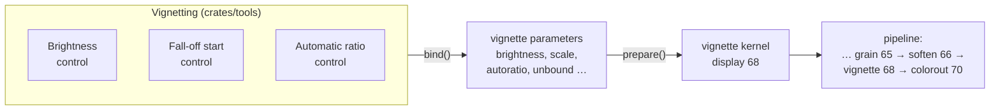

# A new processing tool and its operation

This guide walks through adding a processing tool to Apertrust together with the operation it drives, in the order the work is done: the operation's crate, its kernel and tests, the tool, its page, running it, and the pull request. The last section says what is particular to porting a darktable module, which is how every first-pass tool is made.

It is written for a developer who knows Rust but not Apertrust. The rules it touches are designed in the docs it links, which win where the two differ. Vignetting is the worked example throughout: the operation `vignette` in `crates/op/vignette`, the tool in `crates/tools/src/vignetting.rs`. It is small, per pixel and switched, so it shows most of what a new tool needs.

## 1. Operations and tools

Apertrust keeps what a person works with apart from the algorithms that change the pixels. The first is a tool, the second an operation.

### An operation

An operation is one algorithm of the engine, such as vignetting, exposure or demosaicing. It has:

- **a GPU kernel,** written in Slang and compiled to WGSL, that runs on every pixel or over a neighbourhood;
- **a CPU-side setup,** `prepare`, that turns parameter values into the bytes and tables the kernel reads;
- **a parameter schema:** named, typed parameters with ranges and defaults, versioned so that old edits keep their look;
- **a fixed place in the pipeline,** its slot, so the order of operations never depends on what the person did.

A person never sees an operation. Operations have no labels, no words in the interface and no widgets; their parameters are reached only through tools.

### A tool

A tool is what a person sees and works with in the Tools panel: its header (title, reset, presets, ⋯), its page of controls, and what those controls do. A processing tool edits the photo:

- **Its controls** are what the edit stores: Vignetting's Fall-off start, Brightness, Automatic ratio and the rest.
- **It binds** each control to an operation parameter, through a pure function, `bind`. In the first pass each control is one darktable parameter, and no control sets several ([tools/README.md](../tools/README.md#the-rules), rule 3).
- **It owns** the parameters it binds. Each parameter has at most one owning tool, so no two tools fight over a value. Depth comes from the tool's own tabs and groups, never from a second tool.
- **It may translate** a value on the way, through a named transfer function with its derivative, where a control's unit or scale is not the parameter's.

One tool may drive several operations: no built tool does yet, but `apertrust_tools::testing::Sample`, the tests' tool, owns parameters of both `exposure` and `grain`. One operation's parameters may in principle be split between tools, each parameter still owned once.

### How they meet



What a tool at its defaults does depends on its kind ([tools/README.md](../tools/README.md#the-rules), rule 4):

- **A tool whose operation every photo runs,** as Exposure, starts at the photo as first shown. At its defaults it sets nothing, and the render is the same as no edit.
- **A switched tool,** as Vignetting, is off on a new photo, as darktable leaves its module off. Off, it is never bound and its operation is not planned. Any write of a control turns it on; on, its operations are planned at their own defaults, darktable's new instance, so its render differs from no edit even with every control at its default. Its reset turns it off ([Switched tools](../tools/README.md#switched-tools)).

The engine's session runs the bindings, so the app, the CLI and scripts all see the same tools and send the same commands ([engine.md](../engine.md#the-tool-layer)).

## 2. Before you start

1. **Open an issue first.** A new tool, a new operation and a darktable port each start with an issue, so the scope is agreed before the code ([CONTRIBUTING.md](../../CONTRIBUTING.md#before-you-start)).
2. **Find its place.** Each tool has a tab in the Tools panel (Adjust, Detail, Geometry, Effects, Raw), listed in [tools/README.md](../tools/README.md#the-tools-by-tab) with its darktable module, operation, slot and whether it works on layers.
3. **During the migration, a tool is a darktable port.** In the first pass every tool is one darktable module, under darktable's name and with darktable's controls ([testing.md](../testing.md#the-migration-then-apertrusts-own-way)). An operation of Apertrust's own is a product question for the issue, before it is code.

A tool and its operation land as separate commits: the operation first, then the tool, then the docs.

## 3. The operation

An operation is a crate of its own in `crates/op/<id>`, named `apertrust-op-<id>`, where `<id>` is darktable's operation name ([plugins.md](../plugins.md#one-crate-per-operation)):

```text
crates/op/vignette/          apertrust-op-vignette
  Cargo.toml
  slang/vignette.slang       the kernel: main, vignette_backward, vignette_forward_diff
  generated/vignette.wgsl    generated from the Slang, committed
  src/setup.rs               Settings and prepare(): darktable's commit_params
  src/lib.rs                 KERNEL, manifest, schema, impl Operation, unit tests
```

### 3.1 The crate

The root `Cargo.toml`'s `members` already takes every folder under `crates/op/*`. Add the crate to `[workspace.dependencies]` beside the others (`apertrust-op-vignette = { path = "crates/op/vignette" }`), and give it a manifest like vignette's:

```toml
[package]
name = "apertrust-op-vignette"
description = "Vignetting, ported from darktable"
version.workspace = true
edition.workspace = true
rust-version.workspace = true
license.workspace = true
repository.workspace = true
publish.workspace = true

[dependencies]
apertrust-plugin.workspace = true

[lints]
workspace = true
```

An operation depends on `apertrust-plugin`, and on `apertrust-color` where it shares colour maths. Never on the engine, the tools or egui.

### 3.2 The manifest and the schema

`src/lib.rs` declares the kernel, the manifest and the versioned parameter schema, then implements `apertrust_plugin::Operation`. Trimmed from `crates/op/vignette/src/lib.rs`:

```rust
pub const KERNEL: Kernel = Kernel {
    name: "vignette",
    wgsl: include_str!("../generated/vignette.wgsl"),
    derivatives: true,
};

pub struct Vignette;

static MANIFEST: Manifest = Manifest {
    id: "vignette",
    version: 1,
    slot: Slot { stage: Stage::Display, order: 68.0 },
    domain: Domain::Display,
    layers: true,
    differentiable: true,
    radius: 0,
    default_enabled: false,
    provenance: Some(Provenance {
        darktable_module: "vignette",
        release: "5.6.2",
        commit: "20891f6c6f",
        sources: &["src/iop/vignette.c", "data/kernels/extended.cl"],
    }),
};

static SCHEMA: Schema = Schema {
    version: 1,
    params: &[
        float("scale", 80.0, 0.0, 200.0),
        float("brightness", -0.5, -1.0, 1.0),
        // …
        Param { name: "unbound", kind: Kind::Bool { default: true } },
    ],
};

impl Operation for Vignette {
    fn manifest(&self) -> &'static Manifest { &MANIFEST }
    fn schema(&self) -> &'static Schema { &SCHEMA }
    fn kernel(&self) -> &'static Kernel { &KERNEL }

    fn prepare(
        &self,
        params: &ParamValues,
        _image: &ImageContext,
        input: &ImageDesc,
    ) -> Result<Prepared, NotPorted> {
        let prepared = prepare(&settings(params))?;
        Ok(Prepared::per_pixel(input, prepared.params(), Vec::new()))
    }
}
```

What each field means:

- **`slot`:** the stage the operation reads and its number in darktable's v5.0 order. No two operations share one, and the numbers rise with the stages ([engine.md](../engine.md#order)).
- **`radius`:** its neighbourhood radius at full resolution, 0 for a per-pixel operation: the border a tile needs ([plugins.md](../plugins.md#the-reach)). A reach that depends on the parameters is planned as `Operation::reach`, which the trait does not have yet.
- **`default_enabled`:** on only for an operation every unedited photo runs; a test holds that set. A new operation is almost always off, planned only while its tool sets one of its parameters or, for a switched tool, while the tool is on.
- **The schema:** darktable's field names, ranges and defaults, version 1 ([plugins.md](../plugins.md#parameters)). A later change that removes, renames or narrows a parameter raises the version and comes with a migration ([plugins.md](../plugins.md#rules-the-engine-enforces-for-every-plugin)).
- **`Operation`'s other methods:** defaults that come from the photo (`defaults`), `geometry` for one that moves pixels, `tiles_whole_image_passes` and `whole_image_at_full_resolution` for whole-image passes, `reads_raw_histogram`, `computed`, `output_profile`. Each has a default; override one only when the operation needs it ([plugins.md](../plugins.md#the-interface), [Passes](../plugins.md#passes)).

### 3.3 The CPU-side setup

`src/setup.rs` turns parameter values into the kernel's uniform bytes and tables, as darktable's `commit_params` does. Vignette's has a typed `Settings`, a `prepare(&Settings) -> Result<…, NotPorted>`, and `PARAMS_SIZE`, the bytes of the kernel's parameter struct, which its tests check `prepare`'s output against. Return `NotPorted` for a mode the port does not cover yet: vignette does for dithering.

Write the bytes field by field, little-endian, in the kernel struct's order. Lay that struct out in 16-byte steps: vectors as `float4` or `uint4`, scalars in groups of four or padded, as `VignetteParams` pads its flags with `pad1`.

### 3.4 The kernel

Kernels are written in Slang, for its automatic differentiation, and compiled to WGSL, which is committed ([engine.md](../engine.md#the-gpu)). Keep three parts apart: a parameter struct, any once-per-image setup, and a pure per-pixel function that the entry points wrap. Exposure's kernel, `crates/op/exposure/slang/exposure.slang`, is the simplest complete one:

```slang
import pass;

struct ExposureParams : IDifferentiable
{
    float black;
    float exposure;
};

struct Params
{
    PassHeader pass;          // 48 bytes, crates/plugin/slang/pass.slang
    ExposureParams exposure;
};

[[vk::binding(0, 0)]] StructuredBuffer<float4> input;
[[vk::binding(1, 0)]] RWStructuredBuffer<float4> output;
[[vk::binding(2, 0)]] ConstantBuffer<Params> params;

[Differentiable]
float3 exposure(float3 rgb, ExposureParams p, float scale)
{
    return (rgb - p.black) * scale;
}

[shader("compute")]
[numthreads(16, 16, 1)]
void main(uint3 id: SV_DispatchThreadID)
{
    if (id.x >= params.pass.width || id.y >= params.pass.height)
        return;
    // … apply exposure() to input[i], write output[i], alpha passing through
}

// Bindings 8 and 9 carry the derivatives.
[shader("compute")] [numthreads(16, 16, 1)]
void exposure_backward(uint3 id: SV_DispatchThreadID) { /* bwd_diff(…) */ }

[shader("compute")] [numthreads(16, 16, 1)]
void exposure_forward_diff(uint3 id: SV_DispatchThreadID) { /* fwd_diff(…) */ }
```

The bindings are fixed by convention: input 0, output 1, uniforms 2, tables from 3, the derivative buffers 8 and 9, scratch from 10 ([plugins.md](../plugins.md#images-bindings-and-scratch)). Every differentiable operation exports `<id>_backward` and `<id>_forward_diff`, and documents their parameter order in the kernel. The raw stage's kernels and operations with no continuous parameter export none, with `derivatives: false` and `differentiable: false`.

The rules that bite ([AGENTS.md](../../AGENTS.md#engineering-rules), Kernels):

- **fp32 only.** Redesign darktable's `double` maths for fp32, and say so in the spec.
- **No NaN or infinity checks.** WGSL may assume they never occur, so `isnan` can compile to `false`. Clamp and guard inputs instead.
- **No write to a local vector component or array element at a run-time index.** Write `sum = add_at(sum, c, v)` or `color = set_at(color, f, v)` from `crates/plugin/slang/components.slang` (`import components;`). FXC, the Direct3D 12 compiler the engine uses, fails on the indexed write.
- **Write workgroup memory before any invocation reads it,** behind a barrier: the engine does not zero it.
- **Stay differentiable:** continuous parameters, no needless clamps, thresholds or branches, and `pow0` from `crates/color/slang/color.slang`, never `pow`, whose derivative is zero below 1e-6 ([ai.md](../ai.md#the-differentiable-pipeline)).
- **Position-dependent maths adds the pass header's origin,** so a tile computes what the whole image would ([engine.md](../engine.md#regions)).

Build the WGSL and commit it with its source:

```sh
tools/fetch-slang.sh              # the pinned slangc into external/, checksum-verified
tools/build-kernels.sh            # every slang/*.slang -> generated/*.wgsl, licence header included
tools/build-kernels.sh --check    # lists stale or orphaned generated files; changes nothing
```

### 3.5 Licence headers

Every `.rs`, `.slang`, `.wgsl` and `.sh` file starts with the GPLv3 header in [AGENTS.md](../../AGENTS.md#licence-headers). A file that ports darktable code adds darktable's copyright as its third line, with the years of the darktable file it ports:

```text
// Copyright (C) 2010-2026  darktable developers (ported from src/iop/vignette.c)
```

`tools/build-kernels.sh` copies the Slang file's header into the WGSL, and `tools/check-license-headers.sh` checks every file.

### 3.6 Registering it

The engine never depends on an operation crate; the binaries hand it the list in `apertrust-operations` (`crates/operations`). In one change:

1. Add the crate to `crates/operations/Cargo.toml`'s `[dependencies]`.
2. In `crates/operations/src/lib.rs`, add `pub use apertrust_op_vignette as vignette;`, the operation to `OPERATIONS` and its `KERNEL` to `KERNELS`, both at its place in pipeline order, darktable's.
3. Add its row to `crates/operations/order.md`, the table of slots that `crates/operations/tests/order.rs` reads and holds every manifest to.

Until its kernel is in `KERNELS`, the naga tests never see it.

## 4. The operation's tests

```sh
cargo test -p apertrust-op-vignette                                  # its unit tests
cargo test -p apertrust-operations -p apertrust-engine --test naga   # naga validates every kernel
cargo test -p apertrust-operations --test order                      # slots and order
```

- **Unit tests** in `src/lib.rs` and `src/setup.rs`. Vignette's hold the schema's defaults to darktable's (`schema_defaults_are_darktables`), check that every parameter reaches the settings, that `prepare` gives one per-pixel pass of `PARAMS_SIZE` bytes, and that dithering is refused as not ported.
- **The naga tests** validate each kernel, check that it has `main` and, where `derivatives` is set, both derivative entry points, and walk its IR for writes at a run-time index (`no_kernel_writes_a_local_at_a_run_time_index` in `crates/engine/tests/naga.rs`).
- **A golden case** compares the operation with darktable-cli by ΔE2000, and **the gradient check** compares its derivatives with finite differences and forward with reverse mode. Both run locally only, since CI cannot install darktable; paste their results in the pull request ([testing.md](../testing.md#the-golden-image-harness-during-the-migration); [section 9](#9-porting-a-darktable-module)).

darktable's integration-test images are a submodule of darktable's clone, set up beside the checkout as in [section 9](#9-porting-a-darktable-module). From Apertrust's root:

```sh
git -C ../darktable submodule update --init src/tests/integration   # once
export APERTRUST_TEST_IMAGES=$PWD/../darktable/src/tests/integration/images
cargo run --release -p apertrust-golden -- render vignette     # darktable's references, cached in target/golden
cargo run --release -p apertrust-golden -- run vignette        # ΔE2000 against darktable, then timing
cargo run --release -p apertrust-golden -- gradient vignette               # derivatives on the case's image
cargo run --release -p apertrust-golden -- gradient vignette --synthetic   # and on the synthetic sweep; --explain shows where a gap sits
```

A raw-stage operation (rawprepare, temperature, highlights, demosaic) has no `Case` and no gradient check, since its kernels export no derivatives. It is compared with darktable through the raw stage's commands instead:

```sh
cargo run --release -p apertrust-golden -- raw-run        # the raw stage and colorin vs darktable
cargo run --release -p apertrust-golden -- raw-defaults   # darktable's rawprepare defaults vs ours
```

Each runs on every raw in `APERTRUST_TEST_IMAGES`; name images after the command to run only those, and add `--as-shot` to `raw-run` to compare with temperature's preset at "as shot" on both sides.

GPU tests need an adapter; a software one (lavapipe, WARP) counts.

## 5. The tool

A processing tool lives in `apertrust-tools` (`crates/tools`), which never depends on egui, wgpu, the engine or an operation crate: it names operations and parameters by id. Its source and tests are named by its English name, its id by its operation's ([tools/README.md](../tools/README.md#the-rules), rule 1):

| What | Path |
| --- | --- |
| Definition and binding | `crates/tools/src/vignetting.rs` |
| Invariant tests | `crates/tools/tests/vignetting.rs` |
| Its page: controls, sliders, invariants | `docs/tools/vignetting.md` |

### 5.1 The definition

A tool is static data, a `ProcessingDefinition` wrapping the `ToolDefinition` every tool shares, plus an implementation of the `ProcessingTool` trait. The app draws its header, page and ⋯ from that data with no code of its own ([gui.md](../gui.md#tool-panels-from-definitions)). Trimmed from `vignetting.rs`:

```rust
static CONTROLS: [Control; 10] = [
    number("scale", (0.0, 200.0), 1.0, 80.0, Some(Unit::Percent)),
    number("brightness", (-1.0, 1.0), 0.01, -0.5, None),
    // …
    Control {
        id: "autoratio",
        kind: ControlKind::Bool { default: false },
        unit: None,
        unported: false,
    },
];

static DEFINITION: ProcessingDefinition = ProcessingDefinition {
    tool: ToolDefinition {
        id: "vignette",
        tabs: &[Tab {
            id: None,
            rows: &[
                Row::Slider(Slider::new("scale")),
                Row::Slider(Slider::new("brightness").decimals(3)),
                Row::Group(Group {
                    id: "position_form",
                    kind: GroupKind::Plain,
                    rows: &[/* … */ Row::Toggle { control: "autoratio" }],
                }),
            ],
        }],
        before: &[],
        after: &[],
        reset: Reset::Tool,
        presets: true,
        open_at_first: false,
        menus: &[],
        toolbar: &[],
        cursors: &[],
    },
    version: 2,
    layers: true,
    auto: false,
    switched: true,
    controls: &CONTROLS,
    preset_rows: &[],
    views: &[],
    pickers: &[],
    facts: Some(Facts { /* darktable's description() */ }),
};
```

- **Controls** are what an edit stores, with the tool's `version`; **rows** are how the page draws them ([section 6](#6-the-tools-page)).
- **`switched`:** on for a tool darktable leaves off on a new photo ([section 1](#how-they-meet)).
- **The rest** (preset rows, lossless views, pickers, menus and Toolbar items) are empty until the tool has one; [engine.md](../engine.md#the-tool-layer) and [tools/README.md](../tools/README.md#the-rules) say when each applies.

### 5.2 Ownership and the binding

```rust
static OWNS: [Owned; 11] = [
    Owned::new("vignette", "scale"),
    // … every parameter the tool owns, `unbound` among them, which has no control
];

impl ProcessingTool for Vignetting {
    fn definition(&self) -> &'static ProcessingDefinition { &DEFINITION }
    fn owns(&self) -> &'static [Owned] { &OWNS }

    fn bind(&self, values: &ToolValues, _image: &ImageContext, _base: &Base) -> Vec<Setting> {
        CONTROLS
            .iter()
            .filter_map(|control| {
                let value = match *values.get(control.id)? {
                    ControlValue::Number(value) => Value::Float(value),
                    ControlValue::Bool(on) => Value::Bool(on),
                    _ => return None,
                };
                Some(Setting::new("vignette", control.id, value))
            })
            .collect()
    }
}
```

- **`bind` is pure:** the tool's values, the photo's image context and `Base` (each operation's defaults for the photo) in, operation parameters out. It gets only the controls off their defaults (`apertrust_engine::edit::instances`). A tool that is not switched is not bound at its defaults, so it leaves the render untouched. A switched tool that is off is never bound. One that is on is bound even with no control off its defaults, possibly setting nothing, and its operations are still planned at their own defaults, so it renders differently from no edit.
- **A control that is not one-to-one** goes through a named transfer function implementing `transfer::Transfer`, with its derivative (`crates/tools/src/transfer.rs`).
- **The trait's other methods** have defaults: `defaults` from the photo, `fixed` for owned parameters with no control, `available` and `visible` for the page ([section 6.4](#64-rows-that-follow-the-photo-and-the-values)), `options`, `range`, `migrate` from an older version. Override only what the tool needs; each is documented in `crates/tools/src/lib.rs`.

In `crates/tools/src/lib.rs`, declare its file (`pub mod vignetting;`) and add the tool to `TOOLS` (`&vignetting::Vignetting`). Add its operation's parameters to the owners table in [tools/README.md](../tools/README.md#owners-by-operation).

### 5.3 Its invariants

Each tool's page holds an invariants table: what each control changes, what stays fixed, and one row per invariant, each a test in the tool's file under `crates/tools/tests/`, named after its row (`v0_off_renders_as_no_edit`). Every table has the rows in [Rows every table has](../tools/README.md#rows-every-table-has); a switched tool has its own set there, starting with off rendering byte-identical to no edit ([tools/README.md](../tools/README.md#invariants)). Write the table before the binding.

The unit tests in the tool's source cover the rest, as `vignetting.rs`'s do: `DEFINITION.check()`, `check::accept` and `check::sweep` over `OPERATIONS`, the controls in darktable's order, and the sliders against darktable's through `testing::slider_differences`. `crates/tools/tests/builtin.rs` checks every built-in tool together, its messages included.

```sh
cargo test -p apertrust-tools                     # unit tests and builtin.rs
cargo test -p apertrust-tools --test vignetting   # the invariant rows
```

### 5.4 Where it appears

The Default workspace's tabs and their order are data, in `data/workspaces/default.toml`. Add the tool's id to its tab's list under `[order]`, at the place [tools/README.md](../tools/README.md#the-tools-by-tab) gives it:

```toml
effects = ["vignette", "grain", "soften"]
```

`crates/app/src/layout/tests.rs` holds the file to the tabs' lists in that README.

### 5.5 Actions and shortcuts

Every control and row of a tool is to be an action, `tool-<tool>-control-<control>`, generated from its definition, so a tool's author writes nothing for shortcuts (planned; [gui.md](../gui.md#actions-after-darktable)). Buttons' actions are already built.

## 6. The tool's page

A tool writes no UI code. Its page is the rows of its definition, which the app's renderer, `crates/app/src/tools.rs`, draws with the design system's components from `apertrust-ui`; every row only sends session commands, never touching engine state ([gui.md](../gui.md#tool-panels-from-definitions)). In the first pass the page is darktable's: its controls in `gui_init`'s order, its tabs and sections, its sliders' ranges ([tools/README.md](../tools/README.md#the-rules), rules 3 and 5).

### 6.1 Tabs and groups

- **Tabs.** `tabs` holds one `Tab` per darktable notebook tab, each with an id for its title. One tab with `id: None`, as Vignetting's, draws no tab strip. Colour balance RGB has `master`, `four_ways` and `masks`.
- **Plain groups,** `Group { kind: GroupKind::Plain, .. }`: darktable's section label, a title over its rows, always open, as Vignetting's position / form.
- **Collapsible groups,** `GroupKind::Collapsible`: darktable's collapsible section, closed at first, as Demosaic's capture sharpening. A plain group may sit inside a collapsible one; no other group sits in a group.
- **`before` and `after`:** rows drawn above and below whichever tab is open, as the tone equalizer's mask display.

There is no Advanced controls toggle: depth lives in tabs and collapsible groups.

### 6.2 The rows

Every row is a variant of `Row` in `crates/tools/src/definition.rs`:

| Row | Draws | Used by |
| --- | --- | --- |
| `Slider(Slider)` | A number control as darktable's slider | every tool |
| `Choice { control, style }` | A choice, `ChoiceStyle::List` (a drop-down) or `Segmented` (a few short options) | Exposure's Manual \| Automatic, Vignetting's Dithering |
| `Toggle { control }` | A boolean control | Vignetting's Automatic ratio |
| `Group(Group)` | A plain or collapsible group of rows | Vignetting, Demosaic |
| `When { control, is, rows }` | Rows shown only while a choice or toggle holds one of `is`'s values | Demosaic's rows per method |
| `WhenSetting { .. }` | Rows shown while a tool setting holds an option | Exposure's Lightness and Reference, under Picker target |
| `Custom { widget, controls }` | A painted widget from the closed `Widget` list | the Tone curve's `Curve`, the tone equalizer's `Equalizer` |
| `Preset { preset, style }` | A preset row: one choice whose options write several controls | White balance's Settings |
| `Setting(SettingRow)` | One of darktable's own settings for the tool, kept in the app's settings, never the edit | Colour calibration's checker, the tone equalizer's mask display |
| `Action { id }` | One of darktable's buttons, writing controls when pressed | AgX's buttons |
| `Pickers { .. }` | A label with colour-picker buttons at its end | the tests' `testing::Sample` |
| `Buttons { control, buttons }` | A control's row of buttons that write it | Orientation's rotate and flip |
| `Computed(Computed)` | A read-only number the operation computes | Exposure's computed EC |
| `Reference`, `LastPick`, `Patches` | A kept reference, what the last pick did, a picker's input and target patches | Exposure's first two; `Patches` no tool yet |
| `Guides` | darktable's guides toggle | Orientation |

Each control appears in one row. A row darktable draws only in one mode goes inside a `When`; one parameter shown under two labels by mode has one row per mode.

Exposure's page, trimmed, shows several at once:

```rust
rows: &[
    Row::Choice { control: "mode", style: ChoiceStyle::Segmented },
    Row::When {
        control: "mode",
        is: &["manual"],
        rows: &[
            Row::Toggle { control: "camera_bias" },
            Row::Toggle { control: "compensate_hilite_pres" },
            Row::Slider(
                Slider::new("exposure")
                    .decimals(3)
                    .soft(-3.0, 4.0)
                    .quad(Quad::Picker("exposure")),
            ),
            // … Picker target, Lightness, Reference
            Row::LastPick { picker: "exposure" },
        ],
    },
    Row::When {
        control: "mode",
        is: &["automatic"],
        rows: &[
            Row::Slider(Slider::new("deflicker_percentile")),
            Row::Slider(Slider::new("deflicker_target_level")),
            // …
        ],
    },
],
```

### 6.3 Numbers: range, track, step and units

The control holds what a value may be; the slider row holds how it is shown:

- **The range and default** are the control's: `ControlKind::Number { min, max, step, default }`, darktable's hard range in the units shown. A typed value, a script or a preset may reach anywhere in it.
- **The soft range,** `Slider::soft(min, max)`, is what the track spans at rest, darktable's `dt_bauhaus_slider_set_soft_range`. The track widens to show a value beyond it.
- **The step** is the control's `step`, what a key moves. `slider_step(min, max, factor)` computes darktable's default step, where darktable sets none.
- **Decimals:** `Slider::new` shows two; `.decimals(n)` sets darktable's digits.
- **The unit,** `Control::unit`, from the closed `Unit` list: `Ev`, `Percent`, `Degrees`, `Kelvin`, `Pixels`, `Iso`. A fixed change of unit is allowed (a factor shown as a percentage, radians as degrees), and the binding converts back.
- **The track:** `Track::Plain` by default; `.track(Track::Luminance)` and the others paint darktable's colour ramps, as Colour balance RGB's luminance rows do. `.no_fill()` drops the fill from the default to the value.
- **The quad:** `.quad(Quad::Picker(id))` puts a picker's button at the row's end, as on Exposure's slider.
- **A range that moves with other controls,** as AgX's pivot does, comes from `ProcessingTool::range`.

[tools/README.md](../tools/README.md#sliders-against-darktable) says how each is read from darktable's `gui_init`, and every tool's test compares them with `testing::slider_differences`.

### 6.4 Rows that follow the photo and the values

- **Disabled, never hidden:** a control that cannot act in the current state is drawn disabled and keeps its value. `ProcessingTool::available` says when, as Vignetting's width/height ratio while automatic ratio is on.
- **Hidden per photo:** `ProcessingTool::visible` hides a row the photo gives nothing to do. Only Exposure overrides it, for its two camera rows; hiding any other row is a design question for the issue.
- **Options per photo:** `ProcessingTool::options` lists the choice's options this photo has, as Demosaic lists the sensor's methods. An option not ported is listed in `ControlKind::Choice`'s `unported` and drawn disabled.

### 6.5 The header

Every tool's header is drawn from its `ToolDefinition`: its title, ↺ as `reset` says (`Reset::Tool` for a processing tool), the presets button where `presets` is true (drawn disabled until presets come), and ⋯ with the app's items and those of `menus`. A processing tool starts closed (`open_at_first: false`). There is no Auto or options button. A tool takes no right-click: what it adds to menus goes in `menus` ([tools/README.md](../tools/README.md#the-rules), rule 14).

### 6.6 Its words

A tool's words are Fluent messages in `crates/ui/locales/<locale>/tools.ftl`, with ids its definition implies, which `apertrust_tools::messages` builds: `tool-<tool>-title`, `-description`, `tool-<tool>-tab-<tab>`, `tool-<tool>-group-<group>`, `tool-<tool>-collapsible-<group>`, and for each control `tool-<tool>-control-<control>-label` (the row's short label), `-full` (what screen readers say), `-promise` (its tooltip) and `-option-<option>`. The rest are in [the locales' README](../../crates/ui/locales/README.md#adding-a-message):

```ftl
tool-vignette-title = Vignetting
    .search = vignetting
tool-vignette-control-scale-label = Fall-off start
tool-vignette-control-scale-full = Fall-off start
tool-vignette-control-scale-promise = The radii scale of vignette for start of fall-off.
```

Write them in `en-GB`, the source, under darktable's labels in British spelling; translate them into `uk` and `pl` in the same change; add to `en-US` only the messages American English spells differently. `every_message_a_definition_implies_is_translated` fails on one missing, and `tools/check-ui-strings.sh` on an English literal in interface code ([gui.md](../gui.md#translation)).

### 6.7 When a custom widget is needed

Use the rows above wherever they fit. A widget of its own is needed only where darktable draws one that no row can show, such as a curve, colour wheels or the tone equalizer's graph.

- **The list is closed.** `Widget` in `apertrust-tools` names the painted widgets a definition may use: `Curve`, `ColourWheels`, `Equalizer`, `HueCurve`, `Swatches`, and utilities' own. A tool names one in `Row::Custom` with the controls it edits:

  ```rust
  // crates/tools/src/tone_equalizer.rs, its Advanced tab
  Row::Custom { widget: Widget::Equalizer, controls: &BANDS },
  ```

- **The widget lives in `apertrust-ui`,** as `crates/ui/src/components/curve.rs` and `equalizer.rs`, with no engine or tool types, shown in the gallery (`cargo run -p apertrust-ui --example gallery`).
- **The app connects it,** in `crates/app/src/tools.rs`, turning its output into session commands.

A new widget is a design system change: a new `Widget` variant, a component in `apertrust-ui`, its drawing in the renderer, and its design in [gui.md](../gui.md#painted-widgets). Raise it in the issue first.

### 6.8 Testing the page

The app's panel tests draw a tool and check its rows, as `vignetting_draws_darktable_s_page_in_order` and `vignetting_s_ratio_is_drawn_disabled_while_automatic_ratio_is_on` in `crates/app/src/tools.rs`. Snapshots, where a tool has them, are accepted with `UPDATE_SNAPSHOTS=1` and reviewed like golden images ([gui.md](../gui.md#testing)).

## 7. Running it

The CLI reaches tools as every client does, by tool id and control id:

```sh
# Render with the tool set, on top of the photo's saved edit
cargo run --release -p apertrust-cli -- export photo.CR3 -o vignetted.png --set vignette.brightness=-0.8

# Write it into photo.CR3.apxmp, then preview what the viewport renders, with timings
cargo run --release -p apertrust-cli -- edit photo.CR3 --set vignette.brightness=-0.8 --set vignette.scale=40
cargo run --release -p apertrust-cli -- -d perf preview photo.CR3 --png preview.png

# The app, the tool in its tab
cargo run --release -p apertrust -- photo.CR3
```

`--set` refuses an id that names no control and a value outside its range. `--param OPERATION.PARAMETER=VALUE` sets only parameters no tool owns, of an operation an unedited photo runs, so it refuses the new tool's. Every flag is in [crates.md](../crates.md#apertrust-cli).

## 8. Before the pull request

Run the checks in [CONTRIBUTING.md](../../CONTRIBUTING.md#checks), at least:

```sh
cargo fmt --all
cargo clippy --workspace --all-targets -- -D warnings
cargo test --workspace
tools/check-license-headers.sh
tools/check-ui-strings.sh
tools/build-kernels.sh --check
cargo deny check                 # only if a dependency was added
```

`pre-commit run --hook-stage manual --all-files` runs every check but the tests. CodeRabbit reviews every pull request; with its CLI installed, `coderabbit review` on your branch catches the same comments first.

Then:

- **Update the docs your change makes wrong:** the tool's page in `docs/tools/`, its row in [tools/README.md](../tools/README.md), the crates' sections in [crates.md](../crates.md) (Operation crates, `apertrust-tools`, The built tools), and the port spec's status and results.
- **One commit per piece,** each building on its own: the operation, then the tool, then the docs ([CONTRIBUTING.md](../../CONTRIBUTING.md#pull-requests)).
- **Sign off every commit** with `git commit -s`, a person's name and address (the DCO, [CONTRIBUTING.md](../../CONTRIBUTING.md#sign-off)).
- **Paste the golden and gradient results** in the pull request.

## 9. Porting a darktable module

Every first-pass tool is a darktable module ported to an operation and a tool. darktable is the reference, never a dependency: nothing of it is loaded or linked. What a port adds to the steps above:

- **The reference release, at its tag.** Port from darktable's latest stable release, the number in `REFERENCE_VERSION` (`crates/golden/src/darktable.rs`), at its tag `release-<number>`, never a newer checkout. Clone darktable once, outside the checkout, and name the clone in `DARKTABLE_SRC` before the rest; unset, `git -C ""` would run in Apertrust's checkout. Run these from Apertrust's root:

  ```sh
  git clone https://github.com/darktable-org/darktable.git ../darktable   # once
  export DARKTABLE_SRC=$PWD/../darktable
  DT_TAG=release-$(sed -n 's/^pub const REFERENCE_VERSION: &str = "\(.*\)";$/\1/p' crates/golden/src/darktable.rs)
  git -C "$DARKTABLE_SRC" fetch origin tag "$DT_TAG" --no-tags   # origin: darktable-org/darktable
  git -C "$DARKTABLE_SRC" rev-parse --short "$DT_TAG^{commit}"   # fails if the tag is missing; else the commit for the provenance
  git -C "$DARKTABLE_SRC" checkout "$DT_TAG"                     # every file read from the clone is the reference release's
  git -C "$DARKTABLE_SRC" show "$DT_TAG":src/iop/vignette.c      # the tagged file, whatever the working tree holds
  ```

- **A port spec first,** `docs/ports/<module>.md`, from darktable's source: its parameters with their versions, `commit_params`, `process` (the CPU path is the truth), neighbourhood and scale, **every deliberate difference** with its reason and size, the tool binding notes with darktable's controls, and the module's actions and default shortcuts with their Apertrust ids. `docs/ports/vignette.md` is a complete one to follow. For a large module, have the spec reviewed before writing kernels.
- **Port the processing path, not the GUI.** Every continuous parameter; an alternative mode only when a tool needs it, `NotPorted` otherwise.
- **darktable's copyright line** in every file that ports its code ([section 3.5](#35-licence-headers)).
- **Provenance** in the manifest: darktable's module, the release, the commit and the source files, as vignette's `Provenance` above.
- **Golden references from darktable's official build only,** the release's AppImage, disk image or installer, never one compiled for the local CPU, whose fast-maths code renders differently. Where the official package cannot run, a distribution's package or a local build counts only if built with `BINARY_PACKAGE_BUILD=ON` from the reference release's tag, and the port spec's results name that build. Switching builds means deleting `target/golden` ([testing.md](../testing.md#the-golden-image-harness-during-the-migration)).
- **A golden case** (outside the raw stage, which `raw-run` and `raw-defaults` check, with no gradient check; [section 4](#4-the-operations-tests)) starts from darktable's integration tests: a `Case` in `crates/golden/src/cases.rs`, its sidecar in `crates/golden/cases/<case>.xmp`, and the translation of darktable's parameters in `crates/golden/src/ports.rs`. It passes within its ΔE2000 tolerance, `Tolerance::DARKTABLE` (mean 0.767, max 2.3) unless the spec argues otherwise. Never change a case or a tolerance to make a port pass.
- **The gradient check compares, then passes,** for a differentiable operation. Register its gradient parameters in `crates/golden/src/ports.rs`: its arm in `gradient_parameters`, in the order of the kernel's `<id>_backward` outputs, and the same parameter moved by a step in `perturbed_inputs` (a one-pass kernel) or `perturbed_values` (an operation planned through the engine). Without them, `apertrust-golden gradient` prints `no gradient port` and succeeds without comparing anything. A differentiable operation needs real results from both runs, on the case's image and with `--synthetic`, reported in the spec and the pull request: below 1% against finite differences, and forward and reverse mode agreeing within 1e-4. Every continuous parameter must be checked, by the gradient check or by a test of its own, or its gap recorded in the spec: the check's loss sums R, G and B, so it cannot see vignette's saturation, which `derivatives_match_finite_differences_for_every_parameter` in `crates/golden/tests/vignette.rs` checks with unequal channel weights (`docs/ports/vignette.md`, Gradients).
- **The first pass keeps darktable's controls and labels:** every control darktable shows, under its label in British spelling, an unported one drawn disabled; a parameter with no editing meaning and no widget is owned with no control, at darktable's value ([tools/README.md](../tools/README.md#fixed-parameters)).

The long form, with darktable's source map, the spec template and the common pitfalls, is the agent kit's [port-module skill](https://github.com/apertrust/agent-kit/blob/main/skills/port-module/SKILL.md). Its procedure is the same for a person.

## Checklist

- [ ] An issue agreed on the scope.
- [ ] `crates/op/<id>`: manifest, schema at version 1, `prepare`, Slang kernel with `main` and, unless it is in the raw stage or has no continuous parameter, `<id>_backward` and `<id>_forward_diff`; generated WGSL committed.
- [ ] Licence headers, darktable's line in ported files.
- [ ] `[workspace.dependencies]`, `crates/operations/Cargo.toml`, `OPERATIONS`, `KERNELS` and `crates/operations/order.md`.
- [ ] Unit tests, naga and order tests pass.
- [ ] Golden case within tolerance; for a differentiable operation, gradient parameters registered in `ports.rs`; the gradient check passing on the case and with `--synthetic`, every continuous parameter checked or its gap in the spec.
- [ ] `crates/tools/src/<name>.rs`: definition, `owns`, `bind`; `pub mod <name>;` and its entry in `TOOLS`.
- [ ] Its page from darktable's: tabs, groups, rows, sliders checked with `testing::slider_differences`.
- [ ] Invariants table on `docs/tools/<name>.md`, each row a test in `crates/tools/tests/<name>.rs`.
- [ ] Its id in `data/workspaces/default.toml`.
- [ ] Messages in `en-GB`, `uk` and `pl` (`en-US` where spelled differently).
- [ ] Rendered with `apertrust-cli export --set` and seen in the app.
- [ ] fmt, clippy, tests, licence headers, UI strings, `build-kernels.sh --check`; `cargo deny check` for a new dependency.
- [ ] Docs updated: port spec, tool page, tools README, crates.md.
- [ ] One signed-off commit per piece: operation, tool, docs.
