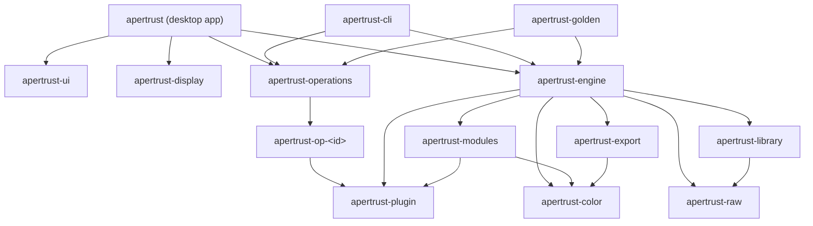
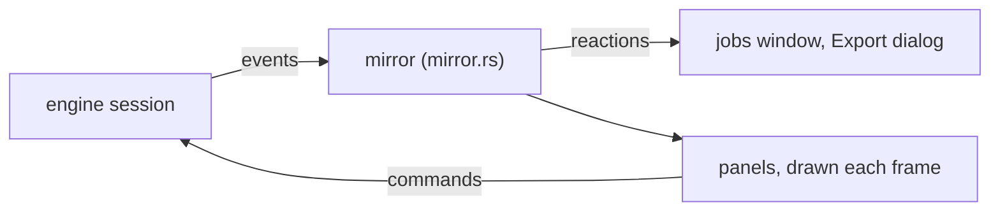
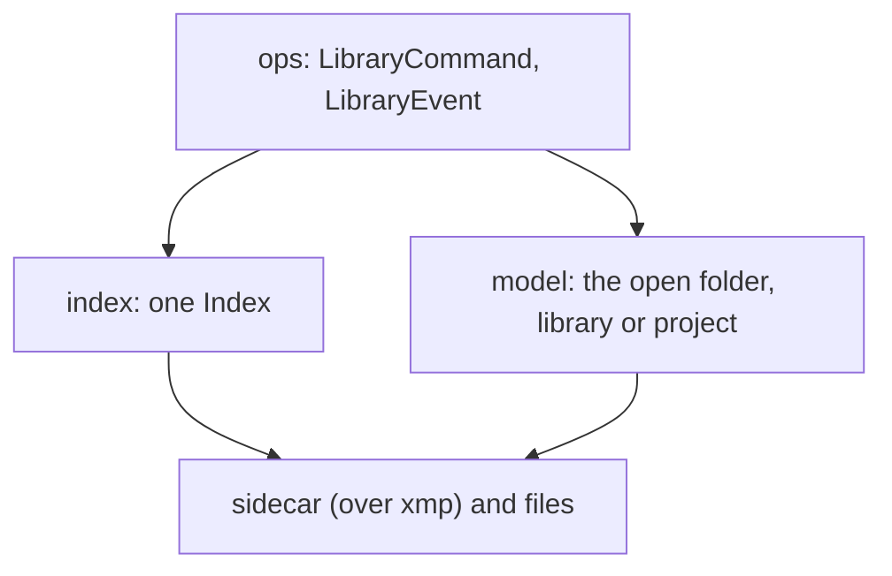

# Crates

What each of Apertrust's crates holds today, and what is planned for it. [AGENTS.md](../AGENTS.md) lists the crates with their roles and the rules for adding one; this document is their state.

Each crate lives in `crates/<name>`, its package name without `apertrust-`: the desktop app in `crates/app`, operation crates in `crates/op/<id>`.

## How they depend on each other

The arrows are normal dependencies. `apertrust-base` is left out: nearly every crate uses it. The engine never depends on the operations: each binary hands it `apertrust-operations`' list.

## apertrust-engine

The GPU-resident pipeline, with no UI dependencies.

### GPU and submission

- GPU setup and the image kernel runner.
- Every submission goes through `GpuContext::submit`, which holds a `SubmitGate`. A window client holds the gate while its toolkit reconfigures the surface. The holds take turns in the order asked, and a viewport frame is one submission (decision 18).
- `gpu::AdapterChoice`: an adapter a flag names that is not there is an error; one a setting names is a warning, and wgpu's choice is used.
- `gpu::choose_adapter`, for a window that creates the engine's device, in wgpu's order; a test holds it against `request_adapter`.

### The pipeline

The plan and the executor for the export and viewport pipes (decision 12): output buffers by format and size, scratch buffers, reductions without readback, cache points and restarts.

- **Output profile.** The pipe's output profile is asked of every instance before any `prepare` and put in every `prepare`'s image context, never the defaults'. An export's parts before and inside its tiles are planned with the whole export's (decision 26).
- **Whole-image results** are kept by their own key in the viewport, across rebuilds (decision 15).
- **Full-resolution estimates.** An operation that opts in through `Operation::whole_image_at_full_resolution` (haze removal) has its estimate computed in the untiled viewport from the full-resolution image its downscale read, bound as `Resource::FullResolution`. Its passes up to the last that binds it are kept on that image's key, so a new viewport size runs only the passes after them (decision 15).
- **The stage at the pipe's scale.** The planner sets `ImageDesc::scaled_extent` for every RGBA image (decision 15).
- **Derivatives.** `Pipeline::derivative` dispatches an operation's derivative entry points over the scratch its last render left (decision 15).

### Tiled exports

Exports are tiled when they would not fit (decision 13).

- An operation with whole-image passes after demosaic, such as the tone equalizer's mask, gets a first round of tiles. It builds its result in scratch the export holds across both rounds (decision 15).
- Each tile is sized without that scratch. Where the scratch exceeds the budget, `-d memory` logs it.

### Exports at a size

Decision 56 and [docs/ports/finalscale.md](ports/finalscale.md).

- `Pipe::Resampled` and `export::export_at`, with the engine's `resample` kernel: darktable's lanczos3, its plans made on the CPU (`resample`).
- The resample runs after demosaic (after haze removal while that is planned), or, with high quality resampling, at finalscale's place before colorout.
- Tiles of the output at its scale are walked back through the plans, and the result equals the untiled export bit for bit.
- An export at a size resamples on either side of a geometry of whole pixels (`Geometry::whole_pixels`), orientation's turns and mirrors, in the stage its place gives: after demosaic in the photo's own stage, its sides the output's turned back, or at finalscale's place in the turned image, as darktable does; one with a geometry that interpolates or crops is refused.
- Without high quality, whole-image passes after the resample cover its output, their stage at the export's scale (`ImageDesc::scaled_extent`), whole or tiled. A run of them takes its first round in the output's own tiles at the export's scale, each grown a pixel and walked back through the resample.
- A run before the resample takes its first round in tiles at full resolution.
- One export can take both runs, haze removal's and the tone equalizer's. Each run's side of the resample is its place in the plan, `Plan::resample`.

### Row strips

Where an image is larger than the GPU binds at once (decision 14):

- passes run in row strips over windows, as the raw stage's do on lavapipe;
- a pass that binds only scratch (highlights' dilation) runs in bands of its rows, with no window;
- the viewport's demosaic and downscale run in tiles where its full resolution does not fit;
- `Limits` and `GpuOptions` force a smaller binding.

### Geometry

For an operation that returns a `Geometry` (decision 16):

- extents go forward, the scale comes from the output's, and regions go backward through it;
- buffers are allocated by region, and each instance's origin and stage extent are in the pass header;
- a translation runs with no pass, and export tiles are tiles of the output image;
- it is tested on two test-only operations; a plan without geometry is unchanged, with its keys;
- an operation that moves no pixel and runs no pass, keeping its input as it is, leaves the plan, as darktable's `commit_params` disables its piece: orientation at no rotation, so a photo the right way up plans as before;
- `pipeline::extent`, the image an edit's instances make at full resolution, which the session reports as `Values::extent` and a client fits with `Values::viewport_size`.

Orientation, `flip` (`docs/ports/flip.md`), is the first built-in operation that returns one.

The groundwork for orientation:

- Whole-image passes after a geometry cover their stage's extent at the pipe's scale. Bloom, soften, the colour equalizer, the tone equalizer and haze removal read it from `ImageDesc::scaled_extent`, with its `origin` (`ImageContext::whole_image`).
- Such passes are refused before a geometry that keeps part of their stage, such as crop's window, until crop is built.
- A tile's RGBA input after a split past a geometry is in that geometry's stage.
- The viewport's edit cache is sized for the largest image after its start and holds any image by its bytes, so a quarter turn keeps it.

### Edits and sidecars

- **`edit`**: an edit's module values and the parameters no module owns. `edit::instances` is the one function every builder of instances uses: a module at its defaults adds nothing, and a misbehaving one is left out (decision 28).
- **Ranges that follow other controls** (decision 30): `Edit::set_control` refuses a number outside the range its module's values give. `Edit::clamp` runs after every change: a number a moved range leaves outside is written at its nearer end in the same change, and kept. A clamp of a control the change wrote itself is refused (`EditError::ClampFailed`). `Edit::clamp_read` runs as a photo's edit is read.
- **`sidecar`**: `.apxmp` version 1 edits, and reading version 0 (decisions 28 and 48). It reads and writes an edit's module values and operation parameters, typed, with the module definitions: migrations, clamps, warnings, and `Newer` told by module. It works over the text layer of `apertrust-library`'s `sidecar`, whose `Newer`, `ViewOnly` and `path_for` it re-exports.
- The image context and the mosaic from a raw.

### The editing session

`session` is an editing session on the engine thread: one photo, its edit and the viewport pipe. `Session::start` takes the memory budget, and every photo of the session is planned within it, and the disk cache, if any ([The cache](#the-cache)).

**The photo.** It is reported as `Photo`, with its image context (decision 27) and the exposure time, f-number and focal length the raw's EXIF records, read as it decodes, for the caption under the photo. Its ISO is in its image context.

**Controls.** Each module's controls are reported with their defaults, marks, and whether they can change the photo, asked of the module with its values after every change (decision 30).

- Each choice comes with the options its photo lists (`ControlState::options`, from `edit::listed`), computed once as the photo opens. Where a module panics or gives a list that does not hold together, every option is listed.
- Another option is refused as `EditError::NotListed`, the edit given the image context. A choice that lists only the option it holds is unavailable (decision 30).
- Each number's range is reported as `ControlState::range`.
- Each preset row's matching option and the options the photo can have are reported (`PresetState`).
- Each view's coordinates are reported with whether each can change the photo (`CoordinateState`).

**Module commands:**

- `SetControl`, `ResetControl`, `ResetModule` and `Keep`.
- `ApplyPreset`, for a preset row's option: each control it writes is kept, with no follow writes, as in darktable's `_preset_tune_callback`.
- `Reset`, and `Set` only for parameters no module owns.
- `RetrySave`, a client's Try again: the edit written again after a failed write, nothing otherwise.
- `SetControl`, `ResetControl` and `Keep` also take a lossless view's coordinate. They write the view's controls, with the other coordinates held through a gesture (`edit::Held`); all coordinates back at their defaults reset the controls exactly.
- `SetControl` and `ResetControl` carry the module's follow writes in the same change (`Edit::follow`). A wrong one refuses the change whole (`EditError::FollowFailed`, decision 27).
- `CancelGesture { module }`, a slider popup's cancel (decision 42). It puts the module back as it was before the gesture's first `done: false` change: values, marks, follow writes, clamps and the held coordinates (and `enabled`, once switched modules are built). It adds no history step and writes nothing while the file holds that edit, and `Saved` is reported with the cancel's number. Any other command on the edit, refused or not, ends a gesture; a resize, the scopes and a cancel naming another module do not.

**Frames and saving.**

- Commands are coalesced, and frames go to two alternating display buffers (decision 17).
- The edit is saved after each completed change by a writer thread that reports `Saved`, recording the build the binary hands the session.
- An edit a newer Apertrust wrote (a newer file or module version, or a module neither known nor in `apertrust_modules::RETIRED`) opens for viewing only: every change is refused and its file never written (decision 43).

### Scopes

`scopes` (decision 19): once a client asks with `Command::Scopes`, each frame is counted on the GPU after it by workgroup atomics:

- the clipping totals, and, as asked, the histogram, the waveform and darktable's default vectorscope (u\*v\*, with each cell's colour);
- read back through two staging buffers mapped without waiting, and sent as `Event::Scopes`;
- a failure turns the scopes off, never the frame.

### Settings

`settings`: the engine's settings, `engine.adapter` and `engine.memory_budget`, and the cache's, `cache.limited`, `cache.limit` and `cache.unused_after` (decision 76), generated from the schema by its `build.rs` as `settings::registry` (decision 43).

- `settings::Options::read` turns a store a binary hands it, under the binary's own flags (`--adapter`), into `GpuOptions` and the budget. It logs each value, and where it came from, under `-d settings`.
- `settings::cache_limit` turns a store's `cache.limited` and `cache.limit` into base's `cache::Limit`: `Unlimited` while the first is off, else the limit's GB as bytes, a GB 10⁹ of them. The app reads it for its session's start and each change (`Keeper::cache_limit`).
- The engine opens no folder or settings file.

### Jobs

`jobs` (decision 57): one `apertrust_base::jobs` control per session.

### The cache

`session::cache` (decision 76; [cache.md](cache.md#through-the-session)): the disk cache a binary hands `Session::start` as `CacheOptions`, the `Arc<Cache>` it opened and the limit its settings give, or none. The engine opens no folder; the app hands one, the CLI none, and the golden harness starts no session.

- **`cache-walk`,** a `SystemBackground` job with no progress, added as the session starts: base's `tidy`, then its `walk`, then, where the limited kinds are past the limit, eviction in the same job. It counts as an eviction running, so a limit lowered meanwhile is folded into it.
- **`cache-evict`,** the same queue, never shown, one at a time: asked for after a write past the limit (`Upkeep::check`, for the thumbnails' writes), and by `Command::Cache(CacheCommand::Limit(limit))` where the limit is lowered or turned on; never while the cache is unlimited. A request while one is queued is that one's, which reads the limit as it runs; one while it runs is folded into it, which runs once more. A guard puts eviction back to idle should a job panic, so the next request still adds one.
- **`Command::Cache(CacheCommand::Sizes)`,** answered by `Event::Cache(CacheEvent)`, a fact, `Fact::Cache`: at once with the handle's count where a walk has run, through the outbox before the walk is added, then by a `cache-walk` of its own (`Upkeep::walk_for_sizes`), one at a time, that counts what other processes did, a `Sizes` while it runs folded into a pass more; `CacheEvent::NoCache` with no cache; `SessionError::CacheWalk` for each command a failed pass answers. A walk the handle's own eviction or clear overlaps keeps nothing (base's generation of its removals), and the session walks once more, the start's walk too, else keeps its count.
- **`Command::Cache(CacheCommand::Clear { kind })`,** a `cache-clear` job on `UserBackground` with a progress, cancellable (`Upkeep::clear_job`): base's `clear`, its progress the bar and `job-cache-clear-now`, its title `job-cache-clear` and outcome `job-cache-cleared` or `job-cache-clear-cancelled` with the entries and their size (`$size`, `$unit`, from `session::size_in_unit`, which Settings › Storage shares), the sizes told as it ends; entries it could not remove fail it, `cache-remove`, a folder that cannot be listed `cache-read` (`session::CACHE_REMOVE`, `CACHE_READ`). Refused, `SessionError::Refused`, for a kept kind (`CacheKept`), a kind whose Clear has not ended (`CacheClearing`, `Upkeep::clearing` asking the control) and with no cache (`NoCache`).
- Only the engine thread adds them, since it owns the control: a worker asks it through the inbox (`Inbox::Evict`), one arriving after the session's `Stop` dropped. As the session ends, its stop flag is the cancel of base's `tidy`, `walk` and eviction's listing, asked before each subfolder, and of eviction's removals, so quitting never waits for a cold walk.
- `-d perf` logs the walk's sizes, the temporaries tidied and its time, each kind under `verbose`, each walk for the sizes, and each eviction's and Clear's removals, failures and time; a cache that cannot be tidied, walked, evicted or cleared is a warning.
- **Thumbnails,** `session::thumbnail`: a thumbnail job reads the cache first, by the library's `thumbnail_key`, and decodes a hit with `apertrust_raw::read_jpeg`; on a miss it sends the library's reading, then encodes it with the export's JPEG writer at quality 90, 4:2:2, writes it and calls `Upkeep::check`. No picture, or one that cannot be encoded, is sent and not kept; with no cache the library's reading alone. One `-d perf` line for each `Thumbnails` command once its last job ends (`Tally`), each thumbnail under `verbose`.
- **Live rendered thumbnails,** `session::thumbnail::rendered` and `pipeline::still`: the live photo's saved edit rendered from its live pipe at 1024 pixels as a `SystemForeground` job, reading the pipe's cached image and whole-image results in place, its turns waiting while the photo changes (`EDITING_QUIET`, 150 ms), after a one-second settle and as the photo leaves, and written to the thumbnails kind; a reset puts the embedded picture back ([engine.md](engine.md#rendered-thumbnails-of-the-live-photo)).

- A job's body hands the engine thread `GpuTask`s through its `Tasks`. They are stepped one a turn, after the live frame, by darktable's queue order and ageing, with one step's work on the GPU at a time.
- A cancelled job's task is dropped before its next step.
- `Event::Job` (`Added` naming its command), `Command::CancelJob`, and `Command::RetryJob`, which runs what a failed job left the session, the latest 64 kept (decision 72).
- Dropping the session steps tasks until the control has shut down.

### The export job

`export_job` (decisions 56 and 57): `Command::Export`, a `UserExport` job, one at a time.

- Each photo's edit is taken as Export is pressed (the Export dialog's D12 in [docs/gui.md](gui.md)): the open photo's from memory, the others' read by the edit writer after its writes.
- The job's worker decodes, encodes, writes and renames. Its render is a `GpuTask`, planned, compiled and allocated on the worker; the engine thread only steps its submissions, one at a time.
- It always renders in tiles of at most 1024 (`Tiling::AtMost`), each tile one step. A tile's readback is mapped as the engine thread polls, and waited for by the worker (`export::export_handing`).
- The operations before the tiles (the raw stage, on a default edit) take a step per pass, in row strips of about 8 MP, a step per strip (`export_job::STRIP_BINDING`). Highlights' dilation, which binds only scratch, runs in bands of its rows too.
- Each new buffer is touched in a step of its own first (`Pipeline::parts`).
- It steps beside a live frame only, or one step at a time where no photo is open or no viewport sized, as in the CLI (`Run::live_frame`).
- Everything its row shows is sent as `Event::Job` (decision 72): its total and done, the photo under way, its folder then its first file as its destination, its outcome, the failure that ended it or else its first photo's, and `Retry` unless cancelled or refused, its retry, the same export of the photos that failed and those not reached, left with the session for `RetryJob`; its photos as `Event::Export`, the record for scripts and the CLI.
- `names` gives darktable's variables their values; the client passes the person's folders and name (`Places`).

### The export preview

`export_preview`: `Command::PreviewExport` and `Event::ExportPreview`, a `UserForeground` job with no progress, which the next preview cancels. It reports:

- each photo's file, with the sequence rule, and what On conflict would do (`Disk::foresee`, counting the files earlier photos take);
- the pattern's errors (D8) and the variables with no value (D7);
- the open photo's output size, and each folder's preflight (`disk::preflight`).

It writes and makes nothing and decodes no image; it reads the EXIF only for a path that uses it.

### Library commands

`Command::Library` (decision 54):

- `LibraryCommand::Open(Source::Folder(path))` is a cancellable job of kind `folder` on darktable's `UserBackground` queue (`job-folder`), and cancels the reading before it.
- Its body is `apertrust_library::ops::open`, with an observer that sends each `LibraryEvent` as `Event::Library`, and the job's cancel.
- `LibraryCommand::Close` cancels it and answers `Closed` at once.
- An `Open` outside the session's `tree`, or of its root again, starts the tree's walk: a job of kind `walk` on darktable's `SystemBackground` queue, as its backthumbs job runs, with no progress, in that open's number, which waits until the root's photos are listed, its body `apertrust_library::ops::walk`. An `Open` inside the tree leaves it; a new root, the root again, a `Close` or `Engine::finish` cancels it, and the jobs' shutdown cancels every job with no progress too.
- `LibraryCommand::Thumbnails { photos, size }`: each photo a job of kind `thumbnail` on darktable's `SystemForeground` queue, with no progress, deduplicated by the open, the photo and the size, added from the last so the first asked is read first; its body is `apertrust_library::ops::thumbnail`, sending `LibraryEvent::Thumbnail` naming the folder's open. A new open or a close cancels those not yet sent; with no folder open nothing is read.
- `LibraryCommand::RawThumbnails(raw)`: the setting the thumbnail jobs, the open's picture and the live photo's render follow from then on; the live photo's thumbnail is chosen again.
- `LibraryCommand::Subfolders { folder }`: a cancellable job of kind `subfolders` on `UserBackground`, with no progress, its body `apertrust_library::ops::subfolders`, handed the tree's root, the first folder opened, kept while each later `Open` lies inside it (the session's `tree`), which refuses a folder outside it and lists through `listing::subfolders` on the listing's own thread, answered by `SubfoldersOf` in the open folder's number; a new open or a close cancels it, and with no folder open it is not added.
- Every library event names the number of its folder's open or close and is a notice. Opening a folder opens no photo.
- `session::library` re-exports the library's `ops`.

### Opening a photo

`session/open.rs`, decision 77 ([engine.md](engine.md#opening-a-photo)):

- `Command::Open` saves and closes the photo before it, cancels the open before it and adds a job of kind `open` on `SystemForeground`, with no progress, keyed by its open so a newer open of the same photo is never taken for it.
- Its body maps the raw once (`open::RawFile`, over `apertrust_raw::RawFile`), sends the largest rendered thumbnail the cache holds, stale or not (`Cache::read_any` on `ops::thumbnail_slot`, its version starting `ops::RENDERED`), reads the metadata without the pixels, the EXIF and the sidecar after the edit writer's writes (`Writer::read`), and hands them to the engine thread, which sends `Opened` and `Values { live: false }`; then the embedded picture at the last `Resize`'s longer side where no rendered one was sent, as `Event::OpenPreview`.
- It waits for the session's one decode slot (`open::Decodes`) through `Context::wait`, tells the engine thread, which plans and compiles the photo's kernels meanwhile, decodes, and hands the mosaic over; a cancelled open's is dropped. The engine thread uploads it and renders the first frame, sending `Values { live: true }` and the `Frame`.
- From the `Open` until live, every command on the edit is refused, `SessionError::NotLive`. A job dropped from the stack before it ran is added again; one that ends early fails its open.
- Compiled kernels are kept across photos (`pipeline::Kernels`, `Pipeline::with_kernels`, `Pipeline::into_kernels`).
- Each stage's time from the `Open` is logged under `-d perf`.
- `open::testing` gives tests synthetic raws, and `Command::HoldDecode` holds a decode with the slot taken. Behind the `testing` feature, `session::testing::start` starts a real session on such raws for the tests of the engine's clients, the app's through its dev-dependencies.

### Events

The session's events (decision 59, [docs/events.md](events.md)):

- Each is a fact, superseding the last of its topic, or a notice (`Event::topic()`, `Topic::Fact(Fact)` or `Topic::Notice`). A job's progress, title, detail, destination and state are a fact each, by job, its `Added` and `Ended` notices; the Export dialog's preview and an opening photo's picture are facts.
- A refused command names its number (`SessionError::Refused { command, error }`), its words the error's.
- Every thread of the session sends through one `Outbox` (`session/outbox.rs`): the engine thread, the edit writer, the jobs' observer, and the bodies of the export, the preview, the folder's reading, the thumbnails and an open.
- The outbox calls `wake` once per burst, through a flag that `events()` clears as it drains with one loop of `try_recv`. Nothing is sent once the handle drops.
- Each send and drain is logged under `-d event` (`signal` an alias), and a count per kind each second under `-d verbose`.

### Planned

- **Several photos in one session** (decision 37, once spike W1 measures it): the active one live and every other on screen a still, rendered once from its saved edit; background work one tile per submission; decoding off the engine thread on a job worker (decision 57), as the live photo's is (decision 77); kernels kept for the session, as they are across photos (decision 77).
- **Readouts** (decision 19): what an operation measures of the photo for its module's panel, the tone equalizer's mask histogram first. Its readout pass is planned in the viewport alone and dispatched while a client asks (`Command::Readouts`, by module) and its key, a whole-image result's, has changed. Its counts are read back through the scopes' staging pair, decoded by the operation and sent as `Event::Readout`. A failure turns readouts off, never the frame.
- **Preset rows' camera options and tuning** (decision 27): `PresetState::listed` and `PresetState::tuning`, `ApplyPreset` at the row's tuning, and `SetControl`, `ResetControl` and `Keep` on a tuning's id, for White balance's Finetune.
- **Exports** (decisions 56 and 57): rayon in the encoding, and a long tile split into steps.
- **Switched modules' on state** (decision 32): `ModuleValues::enabled` in the `Edit`, set by any write of a switched module's control (`set_control`, a coordinate, `apply_preset`) and cleared by `reset_module`, never by `reset_control` or `keep`. `edit::instances` plans an optional operation while its switched module is on, binding its values off their defaults, possibly none. `.apxmp` gets `apertrust:enabled="true"`: a switched module's value off its defaults without it is read as on, with a warning, and the flag on a module this build does not switch makes the photo view-only. `ModuleState::enabled`, and `edited` and `Values::edited` counting an on switched module.
- **History and undo** (decision 78; [history.md](history.md)): `history`'s log of steps, each completed change a step with its source, note and batch, darktable's undo merging; the session's undo records; `Undo`, `Redo`, `GoTo`, `Compress`, `Truncate`, `Step` and `Hide`; `Event::History`, a fact; the log saved in the sidecar's version 2.
- **Colour pickers** (decision 79; [pickers.md](pickers.md)): `picker` and `picker.slang`, the active picker and stored samples, the reduction at an operation and on the frame, sample-only renders, a pick applied through `Module::pick`, `Event::Picker` and `Event::Samples`.
- **Events** (decision 59): `Event::Notice`; the remote protocol's queue, coalescing, `Sync` and versioning.
- **The cache** (decision 76): rendered thumbnails for photos other than the live one; eviction paused by an export; with the library's step 27, `CacheCommand::Remove { library }`, a `cache-clear` job, and each library's cache in `Event::Cache`; later wgpu's pipeline cache on Vulkan as the kind `pipelines`, if measured worthwhile.

## apertrust-cli

The headless binary. Its commands are `gpu`, `info`, `edit`, `export`, `preview`, `library scan`, `cache info` and `cache clear`; `history`, `batch`, `serve` and `mcp` are planned. AGENTS.md's Commands list shows how to run each.

### Options for every command

- **`--user-data-dir DIR`**, or `--config-dir`, darktable's `--configdir`, or `APERTRUST_USER_DATA_DIR`; else the platform's folder. `gpu`, `preview` and `export` read the engine's settings from the folder's `settings.toml`, its `[engine]` table (`adapter`, `memory_budget`), and never write them (decision 43).
  - The folder is found for reading (`Folders::find_to_read`): nothing is created or probed, and one given that is missing is an error.
  - The settings are read through a read-only store, by the commands that run the engine and by `cache`, which reads the `[cache]` table.
  - The budget applies to `export` and `preview`.
- **`--cache-dir DIR`**, or darktable's `--cachedir`, or `APERTRUST_CACHE_DIR`; else the user data folder's `cache` when that is given, else the platform's cache folder. Chosen and logged under `-d settings`, never created; read by the `cache` commands.
- **`--adapter NAME`** comes before the file. A name that matches no adapter is an error, while a setting that names none falls back to wgpu's choice (decision 43).
- **`--conf KEY=VALUE`**: a setting for this run only, as darktable's `--conf`, never written.
  - Global and repeatable; the last value for a key counts.
  - KEY is the setting's id in `settings.toml`; VALUE is written as the file holds it, but text without quotes.
  - The CLI takes the engine's settings and the export settings (`export.jpeg.quality=80`); its store opens on both registries.
  - Every command checks it before the folder is looked for. An unknown key or a value that cannot be read stops the start.
  - It counts after a flag of its own (`--adapter`) and before the file.
- **`--max-binding MIB`**: `export`, `preview` or `gpu` as on a GPU that binds at most that many MiB at once; 128 is lavapipe's (decision 14).
- **`-d DOMAIN`** and **`--version`**, as every binary has them (see `apertrust-base`).

### gpu and info

- `gpu` lists the adapters and the one the engine opens.
- `info FILE` decodes a raw and shows its metadata.

### edit

`edit FILE` changes the edit saved beside the raw, `FILE.apxmp` (version 1). `export` and `preview` start from it.

- `--set MODULE.CONTROL=VALUE` and `--reset MODULE.CONTROL` on module controls. A `--set` on a choice decodes the raw, since the choice's options are the photo's (decision 30); `export` checks them after its decode.
- `--param OP.PARAM=VALUE` and `--reset-param OP.PARAM` only for a parameter no module owns yet, of an operation an unedited photo runs (decision 28). `--clear` starts from no settings at all; the saved edit is still read first.
- A number a moved range leaves outside is clamped after each `--set` and `--reset`, and as the edit is read (decision 30).
- An edit a newer Apertrust wrote is refused and left as it is (decision 43).
- Planned (decision 32): `edit --reset MODULE`, the module's reset, turning a switched module off, and `edit` showing a switched module that is on.
- Planned (decision 78; [history.md](history.md#the-cli)): `edit` adding one step for all its flags, with `--note TEXT`, `--clear` resetting within that step; and `history FILE`, listing the steps with `--undo [N]`, `--redo [N]`, `--to STEP|original`, `--compress` and `--truncate`.

### export

`export FILE...` renders JPEG or PNG through every ported operation, raw to output colour, from the saved edit, tiled when it would not fit, and written by `apertrust-export`.

**Through the session.** It runs through its in-process session's export job, with the same lines and exit codes. With `--runs` (any value), `--tile`, `--skip`, `--set` or `--param` it renders directly. `--runs N` with `-d perf` gives median timings (the pipeline timings).

**Size.** Full size, or darktable-cli's `--width` and `--height` (0, no limit), `--hq` (true) and `--upscale` (false), as `apertrust-export`'s `size` computes them: darktable's export size and its lanczos3 resample, after demosaic or, with `--hq`, before colorout (decision 56, [docs/ports/finalscale.md](ports/finalscale.md)). The size never comes from `export.size`.

**Format.** `-o`'s extension chooses it as darktable-cli does (`jpg` or `jpeg`, `png`; case counts), whatever `export.format` says. The file is written with darktable's sRGB profile. The format's options come from the folder's `export.*` settings, as darktable-cli takes them from darktablerc, with `--conf` over them (`apertrust_export::settings::format`):

- JPEG: `export.jpeg.quality` and `.subsample`, and in the cm and inch modes `export.size.dpi` as its density;
- PNG: `export.png.bit_depth` and `.compression`;
- darktable's defaults without them; each value is logged under `-d settings` with where it came from.

**Destination.** `-o PATTERN` is File on disk's pattern of darktable's variables, over `export.disk.path`:

- the extension is stripped; a folder that exists means `FOLDER/$(FILE_NAME)`, the format then `export.format`'s;
- `_$(SEQUENCE)` is added with several files and no `$` in the pattern;
- the variables' values come from the raw and its EXIF, through the engine's `names`;
- `export.disk.on_conflict` (create unique filename, overwrite, overwrite if changed, skip) decides about a file already there, acted on by `apertrust-export`'s `disk`: the folder is made, and each file is written to a temporary file beside its name, synced and renamed into place;
- a photo that fails does not stop the others, as in darktable-cli, but a destination that fails does (decision 56).

**Controls.** `--set MODULE.CONTROL=VALUE` takes a module's control; `--param OP.PARAM=VALUE` only a parameter no module owns yet, of an operation an unedited photo runs (decision 28). `--skip OP` leaves an operation out (repeatable); `--tile N` renders in tiles of N pixels across and down.

**Planned** (decisions 56 and 57): `--out-ext`, `--icc-type` and `--preset NAME`.

### preview

`preview FILE [--width W --height H] [--exposure EV] [--png OUT]` times changes of the Exposure module's Exposure through the viewport pipe.

- `--png OUT` writes the frame through `apertrust-export`, with PNG's defaults.
- `--join OPERATION` then times an optional operation joining and leaving the plan, each rebuild keeping kernels and cache points, against a pipeline built from nothing.
- `--scopes[=totals|histogram|waveform|vectorscope]` times what counting each frame for the scopes adds, and reports what the last frame clips.
- `-d perf preview FILE --beside-export ROUNDS [--changes N] [--interval MS]` is spike X1's measurement: changes through an in-process session, alone and while its export job exports the photo, tiled as `engine.memory_budget` says. `-d perf -d verbose` adds each job step's GPU time and readback, as trace lines of the perf domain.

### library scan

`library scan DIR` (`crates/cli/src/library.rs`, decision 54) lists one folder, not its subfolders:

- the raws, with their `.apxmp` sidecars, and orphan sidecars (an `.apxmp` with no raw); other files are skipped;
- from the index, the photos with an edit, those that open view-only, and the sidecars that could not be read;
- the leftover temporaries it removed;
- the times, under `-d perf` (decisions 46 and 53).

### cache

`cache info` and `cache clear` (`crates/cli/src/cache.rs`, decision 76; [cache.md](cache.md#the-cli)) call `apertrust_base::cache` directly, with no session and no GPU, in the folder `--cache-dir DIR`, `--cachedir` or `APERTRUST_CACHE_DIR` names, else the user data folder's or the platform's. They open it with `Cache::open`, creating nothing: a missing folder is an empty cache.

- `cache info`: the cache folder, `(not created yet)` where missing, and how it was chosen; `cache.limit` in GB, or `unlimited` while `cache.limited` is off; the limited kinds' total; each kind's entries and size; `cache.unused_after` by its id; one item to a line. It walks the folder and writes nothing.
- `cache clear [KIND...]`: the limited kinds named, each once, or every one with none named, a line each on stdout of what it removed and, on stderr, of how many could not be removed and of a folder that cannot be listed, the exit status then 1. A kept kind (`libraries`, `copies`) or an unknown one is refused by name as a usage error, status 2, before anything is removed.
- Planned with step 27: each library's cache in `cache info`, with its id, name, last path, last opened and size, those unopened for `cache.unused_after` or not found marked; `cache clear libraries`, every library's cache no process has open, and `--library ID`, one, saying what it skipped. Local copies wait for step 31.

## apertrust-golden

The golden-image harness against darktable-cli (decision 61). AGENTS.md lists its commands, and the `golden-tests` skill explains them.

**Cases**, each a one-instance engine plan:

| Operation | Cases |
| --- | --- |
| exposure | 1 |
| colorbalancergb | 2 (JzAzBz, darktable UCS) |
| blurs | 1 |
| agx | 4 |
| sigmoid | 5 |
| rgbcurve | 9 |
| rgblevels | 8 |
| vignette | 6 |
| grain | 5 |
| channelmixerrgb | 11 |
| toneequal | 7 |
| bilat | 2 (the local laplacian filter, the bilateral grid) |
| hazeremoval | 2 |
| bloom | 1 |
| soften | 1 |
| filmicrgb | 8 (every colour science, the highlight reconstruction) |
| colorequal | 2 (with and without its guided filter) |
| primaries | 1 |
| flip | 7 (every orientation, bit for bit) |

**Other checks:**

- the raw stage's: `raw-passthrough`, `raw-run` and `raw-defaults`;
- the whole-pipeline exit test, `pipeline` (decision 62);
- `pipeline IMAGE... --width W --height H [--hq BOOL --darktable-hq BOOL --upscale BOOL]`: an export at a size against darktable-cli's at that size, measured without a bound, with the 99th percentile (decision 56). `--darktable-hq` is darktable's side's `--hq`, `--hq`'s by default;
- `--add CASE` puts a grain, vignetting, tone equalizer, haze removal, colour equalizer, colour balance rgb, local contrast, bloom or soften case's module on both sides;
- `export RAW -o OUT.png [--darktable-xmp FILE] [--add CASE]...`: `apertrust-cli`'s export of the exit test's modules (the declared image, plus the cases'), with darktable's history for the same render written for darktable-cli.

**Timing against darktable.** `tools/compare-cpu.sh` runs darktable-cli against Apertrust on lavapipe or WARP and on the GPU, on one machine, from both programs' `-d perf` lines, and writes tables into `target/compare-cpu/results.md` (the pipeline timings). `--raws` and `--paths` (`dt-cpu`, `dt-opencl`, `software`, `gpu`) choose what runs. With `--add` it exports golden cases' modules and the exit test's history on both sides through `apertrust-golden export`, at a size if asked (`--size PX --hq BOOL`), GPU only, with no warm export or preview. `--wait-quiet PERCENT` waits for a quiet CPU (macOS).

## apertrust-raw

Raw decoding with rawler (decision 23).

**Decoding:**

- the uncropped mosaic and its metadata;
- the camera's names as darktable's (decision 24): the model is an alias's camera, resolved from rawler's embedded camera files, and the alias apart;
- the EXIF exposure bias, and the ISO by darktable's rule as far as rawler's EXIF reaches;
- the orientation from the EXIF Orientation tag, IFD0's or a Panasonic raw's, as darktable reads it, where rawler's decoders set one only for a DNG;
- a DNG's colour calibration tags and its LinearResponseLimit;
- black measured from the masked areas as darktable's decoder does, to explain darktable's levels.

**A raw mapped once** (decision 77): `RawFile::open`, then its `metadata`, rawler's decode with `dummy`, everything the decode gives but the pixels, which are empty, in milliseconds; its `preview`; and its `decode`. The metadata and the decode each come with the shooting data (`Exif`) from their one parse of the metadata. `tests/corpus.rs`'s `the_metadata_read_equals_the_decode_but_for_the_pixels` holds the two equal, field for field, over the corpus.

**Shooting data.** `read_exif_file` and `read_exif` give the shooting data darktable's variables read (`Exif`), from rawler's metadata, without decoding the image.

**The embedded picture.** `read_preview_file` and `read_preview` (`src/preview.rs`) read the camera's own picture without decoding the mosaic, as darktable's thumbnails show it before their render: rawler's thumbnail (a DNG's) when it is at least the size asked, else its preview, else the larger of the two; at most the size asked on its longer side, each pixel the mean of those under it, never made larger; turned upright by the EXIF Orientation, since the camera stores it as the sensor sees it; 8-bit RGBA (`Preview`). A raw with none gives `None`. `tests/preview.rs` holds the corpus's pictures at 256 pixels to `tests/corpus/previews.txt` and each upright where its raw decodes.

**For darktable's raw-thumbnail rule:** `read_embedded_file` and `RawFile::embedded` give the embedded picture as `read_preview_file` does, with the stored size of the largest the raw holds, as `dt_imageio_large_thumbnail` gives `_init_8` ([library.md](library.md#thumbnails)).

**For the cache's thumbnails** (decision 76): `PREVIEW_VERSION`, rawler's version and the reading's own, held to `Cargo.lock`'s rawler by a test, so updating rawler fails until it is raised; and `read_jpeg`, a baseline JPEG of three components back into 8-bit RGBA through rawler's own JPEG decoder, an error, never a panic, for what is no such JPEG or does not end with its end marker, as one cut short.

**Lens corrections** the raw carries, as darktable reads them, over rawler's public parsers (decision 25): Fujifilm's (the FujiIFD and the maker note's CropMode), held to Exiv2's dump in `tests/lens.rs`. Sony's, DNG opcodes and Olympus's are planned.

**Planned** (decision 27):

- darktable's spellings where they differ from rawler's (`Z 6_2`, `OM System`, `GFX100S`), applied to `make`, `model` and `alias`;
- darktable's `data/wb_presets.json`, embedded and parsed once with serde_json as darktable reads it, the camera's presets looked up by alias then model and carried in the image context.

## apertrust (the desktop app)

The desktop GUI, on egui ([docs/gui.md](gui.md)), in `crates/app`.

### Window and event loop

- eframe runs on the app's own winit event loop, with the engine's submit gate held round its callbacks (`Gated`, decision 18).
- A start that fails is returned as an error; uncaptured GPU errors are logged once each.
- While the window resizes, the photo's new size waits until the window has kept its size for 150 ms, and the last frame is drawn scaled meanwhile.
- One raw is shown in the central panel, rendered by the engine's session through every ported operation and drawn by a paint callback (decision 17).

### Packaging

- The packages are built by `tools/package.sh` with cargo-packager from `packaging/Packager.toml` (decision 68; [packaging.md](packaging.md)); `tests/packaging.rs` holds every platform's file types to the extensions rawler decodes and the app's id, `org.apertrust.Apertrust`, to be the same in each file.
- The window takes that id as its Wayland app id (`APP_ID`), so the compositor finds its icon through the desktop file.
- On Windows, `build.rs` compiles the executable's icon and version resource through winresource and the SDK's `rc.exe`: the four numbers of `Version::numbers` and the full version as text.
- `examples/icons.rs`, run by `tools/build-icons.sh`, renders the icon's platform files from its SVGs with resvg and packs the `.icns` and `.ico` itself (`assets/icons/README.md`).
- `examples/dmg_background.rs`, run by `tools/build-dmg-background.sh`, renders the disk image's background, `packaging/macos/dmg/background.svg`, at 1× and 2× with resvg for `tiffutil` to join (`docs/packaging.md`).

### The shell

The shell comes from `apertrust-ui`: the top panel, the side panel, the central bar and the grid panel.

- **Settings** (`src/settings_dialog.rs`): its pages listed at its start, the rows of each drawn from the settings registry by kind, a change kept at once through `Keeper::apply` and taken in by the shell (`docs/gui.md`, The Settings dialog); a window of the dialog host, modeless on the Mac, modal on Windows and Linux.
- **Settings › Storage's hand-built part** (`src/storage.rs`, decision 76; [cache.md](cache.md#settings--storage)): the Folders group before the cache's rows, the user data and cache folders with how each was chosen and Show in Finder; the In the cache group after them, each limited kind's entries and size with its Clear, the libraries' caches as one line, the total against the limit. The page asks for `CacheCommand::Sizes` as it is shown and as its window comes back to the front (`Output::Storage`; a dialog's frame hands the app every output it asked for, in order, `Asks::outputs`), and `cache_commands` sends `Sizes` after each limit Settings changed. The mirror's `storage::Mirror` keeps the latest `Event::Cache` and each Clear from its command, or a `cache-clear` job's `Added` naming the kind, to its job's `Ended`, its button disabled meanwhile and from the press within the page, and words a refusal until the next sizes or a Clear's end; the app hands the dialog the page's `View` as it changes, open or asked for (`Dialogs::storage`). A size below 10 keeps its decimal: base's `jobs::Argument::Decimals` in the Clear's messages, `apertrust_ui::i18n::decimals` on the page.
- **About** (`src/about.rs`): a modal over the scrim with the full logo, the version as the banner gives it, the copyright and the licence. Credits and Licence are one step in: `CREDITS.md` drawn as Markdown by `egui_commonmark`, and `LICENSE`. The `about` action opens it, from the top panel's mark.

### The title bar

On macOS and Linux the top panel is the window's title bar (decision 39).

- **Mac:** the traffic lights sit in it; a drag from its empty areas moves the window, and a double-click does what the system's setting says.
- **Linux (X11 and Wayland):** decorations are off and the caption buttons are at its end. A drag is handed to the compositor, a double-click maximises, a right-click opens the compositor's window menu on Wayland, and 6-point bands inside the edges resize.

### The photo frame

The photo and its caption are one block in the central panel's slot, under the central bar, centred inside a margin (`PhotoFrame`).

- The margin is `[central_panel] margin`, 10 points. While Proof margin is on it is `proof_margin`, 0.12 of the slot's smaller side (40% less than darktable's colour assessment border), with no white.
- The margin has no page in Settings; set it with `--conf central_panel.margin=…`.
- The background behind the photo is `[central_panel] background`, one of six neutral greys from the surround's right-click menu (not the photo's) or View › Background; until one is chosen, the theme's own surround.
- The engine is asked to render at the room the block leaves the photo.
- The caption's exposure values come from the shooting data the session's `Photo` carries, written in the language by `exposure.rs`. Its centre, for the rating and labels, stays empty until the library stores them.

### Folder mode

In `src/folder.rs`, `src/library.rs`, `src/dialogs.rs`, `src/dropped.rs` and `src/mirror.rs`.

**From the command line.** `arguments` in `src/main.rs` reads the first path beside the flags and asks the disk what it is (`dropped::found`) before the window opens: a folder opens in folder mode, a raw, told by its name, alone (`Start::Photo`); `started` sends either, as `open_photo` and `open_folder` send what Open…, a drop and Browse open, so tests drive them with no session. A library's or a project's file until Phase 5, another file, or nothing there stops the start with a line on stderr saying why and status 2, as a flag without its folder does. The path is resolved (`resolved`): absolute from the folder the app starts in, `.`, `..` and links resolved, a photo's in its folder only, so a photo that is a link keeps its name and the folder it lies in; on Windows only made absolute, which resolves `.` and `..` too.

**Open With and a double-click** (decision 46). On Windows and Linux the registrations pass `--in-folder` before the files (`Arguments::in_folder`), which the disk is not asked of as the app starts; on macOS `apertrust-display` hands over Finder's (`take_opened_files`, each frame). Either goes to `App::opened`, a `dropped::Drops` of its own, which looks at the files on a thread of its own as a drop's are, so a share that hangs never holds the window, and opens them as a drop of them would, through `carry_out_opening`: the first raw and its folder behind it, the others from its folder set aside until the grid panel selects (Phase 3), as `library.md` says, a folder as Open Folder…, anything else refused with the refused alert in the window, since a launcher has no terminal. Unlike a drop's, the answer waits for a modal dialog to go and then opens.

**One photo** (`docs/library.md`, One photo). `FolderState::alone` makes the mirror's folder `Folder::Alone`, the photo and its one cell, with no library command sent: nothing is listed or indexed, no thumbnail is asked for, so nothing is written but the photo's edit, and no `Reaction::FolderOpened` comes, so the recents never hold it. The grid panel holds that cell alone, its edit mark following the session's values (`FolderState::edited`). Browse's top line names the photo with the photo icon, and its Folders holds Open This Folder alone (`browse-open-this-folder`), the photo's folder in its tooltip and its description for screen readers, as each tree row's is, after its count where it has one; it, and ⋯'s Open This Folder, open the folder in folder mode, the photo staying open and becoming its active cell once listed; ⋯'s Show in Finder shows the photo in its folder. Open…, a drop or a recent then opens folder mode as from any other state. Snapshot `photos-tab-alone`.

**Opening a folder.**

- File › Open Folder… (`open-folder`, Ctrl+Shift+O, in the group after Open…) shows rfd's asynchronous folder dialog. It starts in the open folder, else the open photo's, else Pictures.
- The folder chosen is sent as `Command::Library(Open(Folder))`.
- File › Open… of a photo, Open With's and a drop's: where its folder is the open root or inside its tree, that folder is chosen there (`folder::Show::Choose`, through `change_folder`), the root and the recents staying, and nothing changes if it is active already; elsewhere it is a way in to its folder, opened as the tree's root (`Show::Open`) (`FolderState::to_show`).
- Opening a folder opens no photo.
- A folder dropped onto the window opens the same way, raws dropped as Open…'s do ([Drag and drop](#drag-and-drop)).

**The folder's state.** The mirror's `FolderState` (`src/folder.rs`) folds `Event::Library` and the reading's job:

- it keeps the number of the latest library command and drops events naming another;
- it holds the folder's name, path, subfolders and photos, accumulated from `Listed` chunks until `done`, and the thumbnails that have come, by photo and size with the generation they came at, `FolderState::generation` raised whenever the folder or its thumbnails change;
- it returns `Reaction::FolderOpened`, which puts the folder at the top of the recents (`src/recents.rs`, newest first, ten), written to `state.toml` on their own thread;
- a failure, `Failed`, or the job ending cancelled (the jobs window's Cancel) returns `Reaction::FolderFailed`: the recent folder is drawn disabled with the reason. The list is never checked as it is drawn, since a share may be slow: the recents' check, started as the window opens and again as it gains the focus and as Browse comes into sight, marks a folder gone, drawn disabled too, and `App::logic` takes its answers each frame without waiting.
- The folder's reading shows in the spinner and never opens the jobs window.

**The first tab**, the Photos tab (decision 37; `tab-photos`, kept as `photos`), chosen like the others (Ctrl+1), holds Browse (decision 73; the section `browse`, `section-browse`) in folder mode's form (`library::browse`, drawn from a `library::Browse`): its top line, a box saying what is open (`ChoiceBox`) whose list is the recents, the paths it was built from kept under its id, missing ones with Try Again, Locate… (the folder dialog's `Pick::Locate(path)`, then `Shell::located`, which opens the folder chosen) and Remove from the List; ＋ (New Library… and New Project… disabled, Open Folder…, Open…) and ⋯ (Show in Finder, the tree's root, `Section::options_menu`); then, scrolling under the top line in the shared module list (`apertrust-ui`'s `section_list`) so Browse keeps its height, its Folders group (`browse-folders`, open by default, kept in `edit.groups` as `browse.folders`), the tree of the folder opened: its root at the top (`FolderState::root`, set by a way in, `FolderState::opening`) with its count and nothing above it, the active folder chosen with its count once listed, a click or Open choosing a folder (`library::Action::Choose`, `FolderState::choosing`: the library's `Open` for it, the root, the folders listed, `Shell::tree` and the recents kept), each folder's raw count and its subfolders filled in from the tree's walk as its `Walked` batches come (`FolderState::counts`, taken in by the number of the open that made the session's tree, an earlier tree's dropped), its subfolders a level in and theirs at every level as each opens, those the walk has not reached asked for while the tree is drawn (`library::Action::Ask`, once an open by `FolderState::ask_inside`), a folder's open or closed state kept for the run at every level (`Shell::tree`), one whose subfolders could not be listed offering Try Again, each row's right-click (`apertrust-ui`'s `context_menu`) holding Show in Folder and Open. Albums and Smart albums are not shown, as folder mode has none. Every change of the active folder, chosen in the tree or opened as a way in (`App::open_folder`: Open Folder…, Open Recent, Browse's recents and Open This Folder, Locate…, a dropped folder), goes through `change_folder`: the photo open is closed unless it is the folder's, by `close_photo`, the session's `Command::Close` alone, and the one last active there this run (`Remembered`), else the one `[last]` records for it, opens once its listing holds it. View › Browse (`show-browse`, L, `Intent::ShowBrowse`) chooses the first tab holding Browse, the Photos tab (`BROWSE` in `src/main.rs`) until workspaces change the tabs, and pressed again does nothing; it rests while a dialog's own window has the focus, as the tabs' keys do.

**The grid panel** is never hidden: one row of `GridCell`s in the grid bar's sort, which the mirror applies (`FolderState::order`), at the grid bar's size, the open photo the active cell, each caption the name alone until the library keeps ratings (`Thumb::rating` none, its first line's clicks not read). A click or Enter opens one; the arrows, Home and End move between cells. The grid bar's choices are actions of the registry (`sort-…`, `thumbnails-…`, `show-labels`), which View › Sort By, Thumbnail Size and Show Labels run too, kept under `[grid_panel]` with its position, the rows and columns its edge was dragged to, `labels` and `square_thumbnails` (which `--conf` sets, with no Settings row yet; a filling thumbnail asked for half as large again), at most as many as fit in half the window (`Shell::grid_edge`). At the right it lies between the photo and the side panel, at the left at the window's left edge (`Shell::grid_frame`); View › Grid Panel Position and the grid bar's options menu move it (`grid-position-…`).

**Thumbnails** (`src/thumbnails.rs`): the cells the panel drew without a thumbnail at the cell's size, each asked for once while it stays in sight, as one `LibraryCommand::Thumbnails`, at the cell's side in physical pixels rounded up to 128, 256, 512 or 1024 (`thumbnails::size_for`); a photo that comes back into sight without its thumbnail asked for again (`Asking`). Their textures (`Textures`), a cache derived from the mirror, made as they come by comparing the folder's generation, another size's standing in meanwhile, and dropped with the folder.

**Empty states** (`library::empty_state`). The central panel shows them as a card: reading; failed, with its reason and both ways to open. Nothing open ("No folder open", `browse-no-folder`), no photo chosen and a folder with no raws ("No photo selected" both) are each one line on the surround, in the surround's text colour, with no card; the grid panel says a folder has no raws (`Empty::grid_says`), with a hint to choose a subfolder where its listing found some (`Empty::grid_hint`); nothing open only as a fallback, while Open With's files are looked at as the app starts and under the alert refusing them, the start window taking the main window's place otherwise. With no photo open, the central panel is the folder's empty state. Snapshot `nothing-open`.

**Open Recent and Close** (`docs/gui.md`, File). Open Recent is `menus.rs`'s `OPEN_RECENT`, whose `Entry::Recents` lists the recents `Shell::recent_items` hands in (`menus::Recent`: the folder's label, `OpenKind::label` of its name with as many of the folders it is in as tell it from another recent, `told_apart`, "Folder: Selects — Lisbon"; the tip, its path after why it cannot be opened; and the path), each the registry's action for its place, `ActionId::OPEN_RECENT[i]` (`Intent::OpenRecent(i)`, enabled by `State::recents`, one found gone not, one whose open failed this run so), then Clear Menu (`clear-recent`). A choice opens the path its item showed: `Shell::show_recents` keeps the paths in `menu_recents` as the ☰'s menu is built and as each frame fills the Mac's bar, and `State::recents` follows them. `menus::listed` gives what such a menu holds on every platform: the ☰ draws it, with the tips, and the Mac's `NativeMenus` fills the submenu afresh whenever it changes. Close (`close`, Ctrl+W off the Mac, `Intent::Close`, enabled by `State::opened`) runs `close` in `src/main.rs`: `Command::Close` and `Mirror::closing` for the photo, whose late events the mirror drops, `LibraryCommand::Close` and `FolderState::closing` for the folder, and what was open last forgotten where it is the root closed (`forget_last`).

**Reopening what was open last** (`docs/gui.md`, The start window). `Reaction::FolderOpened` makes the folder what was open last (`Shell::remember_folder`, `Recents::set_last`), unless it is that already, whose folder and photo stay; `on_exit` adds the folder and photo active in it while it is still the root (`keep_at_exit`, `at_exit`), but while a reopen is under way. In `App::new`, with no path, no `--in-folder` and no file Finder handed over at the launch, and with `library.reopen_last` on (`Keeper::reopen_last`), `reopen` opens the root; `reopened`, after each drain, chooses the folder of its tree once the root has opened, opens the photo once its folder's listing holds it and none was asked for meanwhile, chooses the root again where that folder cannot be read, and closes a root whose reading failed, so the start window shows, its recent marked.

**The start window** (`src/start.rs`; `docs/gui.md`, The start window). With nothing open the main window draws the start window in place of the shell, at its size (`start::SIZE`, 820 by 520 points at the interface's scale): `App::follow_start`, before each frame, follows `shows_start` (nothing `opened` in the mirror; once shown it stays, else it shows unless Open With's or a drop's files are still looked at or a modal dialog or alert is up), and `App::finish_frame`, the end of every frame, draws the frame again (`request_discard`) where what ran changed it, so the main window is never drawn with nothing open after a Close or the start window after a way in. `reshape` gives the winit window the start window's size, neither resized nor maximised, centred where the main window was (`start_placement`), once it has left full screen and its maximised state, and the main window's own placement back, centred on its monitor where none is kept (`placed_on_monitor`), which `keep` does not track meanwhile nor until the window has it (`start::Window::keeps_placement`); `start_shape` decides each frame's step; `main` makes the window at whichever it opens as, and `App::new` gives it the other where Finder's files turn out to be there. `start::show` draws the strip, the first column (About's logo, the build's version cut at its `~`, the copyright and what the app is, and the ways in, a quiet list), the recents (`Shell::recent_folders`, a list box of options) and Open, and says what was asked (`start::Asked`), which `App::start_frame` carries out as Browse's actions (`Asked::library`); the list's keys are its own but under a modal (`start::Shown::keys`). `in_start` rests what acts on the main window. Its close (`App::close_start`): its button, Escape, Close Window, and on the Mac its red button, taken out of eframe's input in `raw_input_hook` unless Quit asked for it (`Shell::leaving`), resting under a modal (`close_button`); `start_closes` decides hiding or quitting, and Quit's alert shows the hidden window first; on the Mac it hides the window, the app running on, and `App::reveal` shows it again for the Dock's click (`apertrust_display::take_reopened`), Finder's files and a menu's choice but those in `OVER_NO_WINDOW` (`reveals_for`); elsewhere it runs Quit. On the Mac's main window Close Window and the red button do what Close does (`close_window_runs`). Snapshots `start-window-dark` and `start-window-light`.

### The recents

`src/recents.rs`, with no `unsafe`: the one list of what was opened, which File › Open Recent, Browse's recent folders and the start window read ([docs/settings.md](settings.md#the-settings-schema) has the file). The app's alone, so not in `apertrust-base`, which holds only what every program sets up (decision 43); `Folders::state` there names its file.

- `Recents::open(file, old)` reads `state.toml` and starts its writer thread; where the file holds no list, `old`, settings' `library.recent_folders`, becomes it and is written at once. `Recents::nowhere` keeps nothing.
- `entries()`, newest first, at most `MOST` (10), each an `Entry` of an open kind, `OpenKind` (`Folder`), a path and `opened`; `opened(kind, path)` moves one to the top, after the newest; `remove`, `repoint` and `clear` are Remove from the List, Locate…'s new path and Clear Menu.
- `OpenKind::label(words, name)`: how one of a kind is named where a recent or what is open is named by itself, Open Recent's items and Browse's top line and its recents, "Folder: 2026-10 Lisbon" (`open-kind-folder`); `OpenKind::name(words)`, the kind's own name, "Folder" (`start-kind-folder`), the start window's caption at a row's end beside the bare name. Their matches on the kind are exhaustive, so a kind added later does not compile until it names both message ids, `open-kind-<kind>` and `start-kind-<kind>`, which go in every locale. Each recent carries its kind (`library::Recent::kind`, from the entry), so every list names it by its own.
- `last()` and `set_last(last)`: what was open last (`Last`, a kind, the root's path, the folder chosen in its tree and the photo's file name), `state.toml`'s `[last]`, merged by the writer as the list's changes are; none takes it out.
- `save()` hands what changed to the writer, which merges each change into the file as it then is through `apertrust-base`'s `fs::write`, keeping what it could not write for the next merge; `flush()` waits for it, on exit.
- `check()` asks whether each entry's path is there, a thread an entry and none for a path still being asked; `take()` marks the answers that have come without waiting, dropping one asked before its entry was opened again; `missing(kind, path)` says what was found.

### The side panel

- It is as wide as its edge is dragged or moved with the keys: 240 to 600 points, 320 at first, at most half the window but never under 240, kept in settings.
- **Tabs** are darktable's scene-referred groups between Apertrust's own two (decision 38; [docs/gui.md](gui.md), The tabs: darktable's groups): Photos, Base, Colour, Correct, Effect and History (`TABS`).
  - Kept by darktable's ids (`base`, `color`, `correct`, `effect`). Edit opens on Base; History is drawn disabled until built, saying it is to come, and its key is unavailable.
  - A kept id of History opens Base; `photos` opens the first tab, and `library`, which earlier builds kept for it, is unknown (decision 38). An unknown id (such as `adjust`) is read as unknown and Base is shown with a warning; both are kept until the user chooses a tab.
- **Modules by tab** (`TAB_MODULES`): each module in darktable's group, those in none in the one darktable's other layouts give them, in darktable's order, the last in the pipeline at the top. A test holds the order to `OPERATIONS` reversed.

| Tab | Modules |
| --- | --- |
| Base | AgX, Tone curve, Tone equalizer, Exposure, Demosaic, Highlight reconstruction, White balance, Raw black/white point |
| Colour | Output colour profile, Colour balance RGB, RGB primaries, Colour calibration |
| Correct | Haze removal |
| Effect | Vignetting, Soften, Grain |

- The sections' open state is kept in settings.
- **The Scopes section** (`src/scopes.rs`) is pinned over every tab's modules but the Photos tab's. Its `Histogram` is fed by the session's latest reading (the histogram, the waveform, the RGB parade and the vectorscope, and what clips). It asks the session with `Command::Scopes` for the totals while it shows and for the graph while it is open. Its view and open state are kept in settings.

### The module panel renderer

`src/modules.rs` draws any module's section from its definition and the mirrored values, and sends its rows' module commands through pending values.

- **darktable's page:** its tabs, the rows a mode shows, and its collapsible groups, each group's open state kept in settings per module and group, closed at first, with a tooltip of the count set while closed.
- **Choices.** A choice, a preset row and a tool setting's choice are Blended, darktable's combobox (decision 42).
  - A choice's kept marker is the mirror's and is sent as `Keep`.
  - Its unported options are disabled.
  - Only the options the session reports its photo lists are drawn. One the edit holds that the photo does not list comes last, chosen and disabled: "Not available for this photo" (`Choice::unlisted`, decision 30).
- **Preset rows** show the option the session reports matched, or Custom, which is no option. The options the photo cannot have are disabled; a choice is sent as `ApplyPreset`.
- **View rows** show a lossless view's coordinate as a slider, set, reset and kept as a control. While a change is pending, `Pending::show` moves the view's controls and coordinates as the session will, through the module's `view` and `unview`; the coordinates shown stand in for the session's held ones.
- **Unavailable controls.** A control another's value disables is drawn disabled, keeping its value, as the session reports, and while a change is pending at once through the module's own `available` (decision 30).
- **Custom rows:**
  - the Tone curve's `Curve`;
  - the Tone equalizer's graph of its bands, `Equalizer`, a second view of them. The module's curve is sampled at darktable's 256 points; each drag step settles the bands on it as darktable's does, and every band whose rounded value moves is sent as `SetControl`. A double-click and Shift+Delete reset the nine. It has no histogram until the readouts (decision 19).

### The edit's state

- The session's module values are mirrored; a pending change is shown on the image context the session's `Photo` carries (`PhotoState::image`, decision 27).
- Saved shows in the top panel as the session saves the edit.
- A photo whose edit a newer Apertrust wrote is drawn with its controls and resets disabled, View only where Saved sits, and a line under it saying which version wrote the edit (decision 43).

### Menus

**The Mac's menu bar** (`src/menus.rs`, decision 39):

- One model, `MENUS`, holds the actions the registry declares and the system's own items. It is built with muda (a macOS-only dependency) in place of winit's default menu once the window exists.
- Each frame gives it what changed: words in the language, enabled when the action can run in its scope, and the keymap's first key unless the focused widget keeps it.
- Its choices go down a channel and run through `Shell::run` in `App::logic`, so they run while the window is minimised too. A press action's choice by a held key's repeat is dropped.
- AppKit's own full-screen item is kept out.
- The app menu is titled Apertrust by an Info.plist the build embeds in the binary (`build.rs`).

**The ☰ on Windows and Linux** in the top panel (decision 39): `MENUS` as one pull-down of submenus drawn by `apertrust_ui::popup` (`menus::request`, `menus::chosen`). The ☰, F10, or Alt with a top-level menu's access key opens it (`actions::access_key`; Alt with a letter is refused for actions). Its choice runs through `Shell::run`. On both the window has no decorations, the top panel drawing the caption buttons (`CAPTION_BUTTONS`); on Windows winit's shadow is turned on for it (`frame_shadow`).

**Planned on Windows:** Alt pressed and released alone opening the ☰'s menu, and native hit testing.

### Popup menus on the Mac

`src/popups.rs` (decision 40):

- A `popup::Service` is installed on the main window's context and on each dialog window's. It takes every plain list, `Choice`'s included, with AppKit's type-to-jump in place of darktable's filter.
- After the frame it hands the list to `apertrust_display::pop_up_menu` with the window, the keymap's spelling turned back into key equivalents. The answer comes back through `popup::answered`.
- Windows and Linux keep every popup drawn.

### Open…

File › Open… (`open`, Ctrl+O, first in File, and Browse's ＋; `src/dialogs.rs`, `dialogs::Pick::Files`):

- rfd's asynchronous open dialog for one or more raws of the formats the decoder reads (`session::raw_extensions`), over the window and polled each frame, so neither the window nor the engine stops; a library's or a project's file is not among them, so it is greyed out until Phase 5; the paths chosen are told by their names as a drop's are (`dropped::chosen`), so a name typed into it that is a library's file or no raw is refused with the drop's alert;
- AppKit's open panel as a sheet on the Mac, COM on Windows, the XDG desktop portal on Linux, never GTK;
- it starts in the open folder, else the open photo's, else Pictures;
- the first raw chosen is opened through the session in place of the photo open, whose edit the session saves first, and its folder behind it (`App::open`); the others are to be selected with it once the grid panel selects (Phase 3).

### Drag and drop

`src/dropped.rs`, read from egui's dropped and hovered files (macOS, Windows and X11; winit has no drops on Wayland):

- a drop is taken unless a modal dialog is up (`State::modal`), and `dropped::Drops` asks the disk what each path is on a thread of its own, in order until one opens (`dropped::opens`), the answer taken a later frame: each frame takes an earlier drop's answer before its own drop, so none opens the frame it came in;
- a folder opens as Open Folder… does; a raw, by its extension, as Open… does, with the raws dropped beside it from its folder (`Dropped::Raws`); of several, the first;
- where nothing opens, the alert `alerts::Purpose::Refused` says why, `Refusal::Library` naming the first `.aplibrary` or `.approject` among the paths, else `Refusal::Unknown` the first path, with OK alone, asked through `alerts::Alerts`, so it is not asked while another alert is up (`Ask::Busy`);
- while something hovers, `dropped::show_target` outlines the photo and the grid panel in `focus_ring`, `separator_width` wide (snapshot `drop-target`).

### The dialog host

`src/dialog_host.rs` (decision 41). Each dialog is one type implementing the `Dialog` trait: its id, title, form, look, keys and content. Each platform's part of each form is in `dialog_host::platform`:

- a sheet on the Mac, a modal window elsewhere;
- on Windows the window is owned by the main window, on X11 it has the dialog type;
- the main window's input is taken under it, and a press on the main window brings the dialog forward.

**How it runs:**

- One dialog at a time, in a winit window of its own beside eframe's, made and run by `Gated` with the submit gate held, and kept out of other windows' tabs.
- It has its own egui context, egui-winit state and AccessKit adapter, and an egui-wgpu painter on the engine's device. Its events, AccessKit requests and repaints are routed to it.
- It is sized to its content as it is drawn, but for one the person resizes (`Dialog::resize`, the log window alone), whose content takes the window's size; its title is translated.
- A sheet on the Mac (the Export dialog) is begun and ended from the run loop, its window kept until `endSheet:` returns, the main window's input taken meanwhile. The sheet's phases are one pure function, `step`.
- A dialog's buttons sit at the row's end in the order given, the platform's, for readers and Tab too (`dialog_host::buttons`).

**Settings on the Mac** is a modeless window:

- where the user last left it (`settings_window.position`, restored on its monitor as the main window is), or centred on the main window the first time;
- Cmd+, opens it or brings it to the front; it has no Close button, Escape does nothing, and File › Close Window (`close-window`, Cmd+W) closes it; minimise and zoom are dimmed;
- what it changes is taken by the shell before the next frame.

**Focus and modality:**

- `State::modal` counts a sheet or a modal window of the host's, About and the open dialog asking. It rests every action that opens a dialog, and Close Window unless a dialog's own window has the focus.
- `State::dialog_window`, while a modeless dialog's window has the focus, rests the view's keys, the side panel's tabs, Full Screen and Reset Edit; Close Window then closes that window.
- The focus goes back to the control that had it; after a modeless window, only where it has not moved.
- The main window's own controls are drawn as with it focused, and the menus follow the key window.
- Quit, Close Window on the main window and its close button close the dialog first and leave once it has gone. Quit waits for the open dialog's answer.

### The jobs window

`src/jobs.rs` (decision 57): a second modeless window, in a slot of its own beside the dialog's.

- It opens from the top panel's spinner and View › Jobs (`show-jobs`, Ctrl+Shift+J), which bring it to the front and never let it close itself, and by itself for a job on `UserForeground` or `UserExport` whose `Added` names a command the app sent (`Mirror::apply`'s `Show::Open`), never for another job.
- It is kept at `jobs_window.position`. Closing it stops no job.
- Opened by itself, it closes itself about 2 seconds after the jobs it opened for (`Mirror::opened`) have finished, unless one failed or was cancelled, or the person touched it (`Window::opened_for`; [gui.md](gui.md#in-the-app)).
- It is fed by `App::receive`'s mirror, `jobs::Mirror`, a fold of `Event::Job` alone: each event sets its part of its job's row, with no code for any kind of job (decision 72). An export sent is noted by its number until its job is added (`Mirror::starting`), so quitting waits for it.
- Its buttons: the ✕ (sent as `CancelJob`), Show in Finder (the job's destination, a file selected in its folder, through the platform), Try again on a failed row that offers it (sent as `RetryJob`, the new job's row taking the failed one's place), Dismiss on a failed row and Clear Finished for the finished and cancelled ones.

### The log window

`src/log_window.rs` (`docs/gui.md`, The log window): a third modeless window, in a slot of its own beside the dialog's and the jobs window's.

- Help › Show Log (`show-log`) opens it or brings it to the front, on every platform. With logging off it says so and opens Settings on General.
- It reads `apertrust_base::log::Kept` into a copy of its own each frame, never holding the log while it draws, and is woken by the log as a line is kept, through the waker the host hands it (`Dialog::wake_with`).
- Its filters, its lines drawn row by row in view (`quiet_scroll_rows`), the pill back to the newest, Copy to clipboard and Save to file…, through rfd's save dialog (`dialogs::Saving`), the file written on a thread of its own.
- The person resizes it, from 560 by 320 points (`Dialog::resize`); it is kept at `log_window.position` and `log_window.size`, its last save's folder at `log_window.folder`. The app turns the log on and off as `log.keep` and `log.domains` say, at its start and as Settings changes them (`keep_log`).

### Actions and keys

The actions registry and the default keyboard map:

- every action declared once, with its keys, scope and availability;
- keys matched exactly, digits by their physical key;
- shortcuts shown in tooltips and given to AccessKit;
- F6 moves between regions; the interface has a scale.

### The settings file

`settings.toml` in the user data folder that `apertrust_base::folders` chooses (decision 43):

- `--user-data-dir DIR` or `=DIR`, `--config-dir` or `--configdir`, the last given; then `APERTRUST_USER_DATA_DIR`; then the platform's folder. A relative folder is taken from the current folder and created if missing.
- `--cache-dir DIR` or `=DIR`, or `--cachedir`, the last given, names the cache folder, chosen with the user data folder. The app opens the cache there as it starts (`open_cache`, `Cache::create`), creating the folder; one that cannot be created or written is warned of once, under `settings`, and the app runs with no disk cache, never refused (decision 76). Its session gets it with the limit, and `Command::Cache(CacheCommand::Limit(limit))` each time Settings changes `cache.limited` or `cache.limit` (`changed`).
- It is opened by `Keeper::open_in`. A flag without its folder, or a folder given that cannot be created or written, stops the start; it never falls back to the platform's folder.
- The folder separates settings only. Edits are where each root's id file says, beside the photos by default, never decided by this folder (decision 47).
- `src/paths.rs` keeps only Pictures, through `directories`.

**`--conf KEY=VALUE`** (or `--conf=KEY=VALUE`) sets the app's settings, the engine's and the export's for one run (`apertrust --conf scale=1.5`):

- read before the folder by `settings::overrides`; an unknown key or a value that cannot be read stops the start;
- each of the app's is logged under `-d settings` with `from: --conf`;
- the settings dialog's theme and language rows are drawn disabled while it sets them, saying why (`Keeper::overridden`);
- the window's position and scale factor are never written while it sets either.

**The file** is version 1, read and written through `apertrust-base`'s store:

- the app's `Settings` is set where it differs from the app's reading of the store;
- it is read before the window opens, and written a second after a change on a writer thread, which merges only what changed into the file as it is;
- it holds the theme, the language once chosen, the scale, key overrides in a portable text form (clashing and clipboard ones refused), Edit's tab, tab names, the side panel's width, which sections and collapsible groups are open, the window's placement (restored on its monitor) and Settings' window's place;
- a damaged file is kept as `.bak`, and a newer one is never overwritten.

### The Export dialog

`src/export.rs` (decision 56; [docs/gui.md](gui.md), The Export dialog): a sheet on the Mac, a modal window on Windows and Linux (`impl Dialog for Export`).

- File › Export… (`export`, Cmd+E) opens it, enabled with a photo open. Where the host shows no alert (`dialog_host::platform::shows_alerts`, the Mac's only so far), `Export::alerts(false)` lists Overwrite disabled and rests Export while it is chosen.
- `Dialog::show(&mut Ui)` is its content: darktable's File on disk, JPEG and PNG, Set size's four modes, Allow upscaling, High quality resampling, and Profile (Image settings, sRGB). Every other row is drawn disabled, saying why. Its choices are Boxed.
- The fifteen `export.*` settings are `export::Values` in `Settings::export`, kept as they change. The app's store opens on the export registry too, and `--conf export.…` is read.
- Its feedback lines come from the session: `PreviewExport` on the first frame and on every change, through `export::commands`; `Event::ExportPreview` is handed back by `Dialogs::preview`, the highest `through` kept.
- Export sends `Command::Export` for the active photo and closes the sheet.
- Keys: Esc, Cmd+. and Cmd+W; Return and Cmd+Return; F6.

### Alerts

`src/alerts.rs`; `Dialogs::ask` and `answer` in the host.

- **Overwrite.** Asked from the Export sheet when On conflict is Overwrite, as darktable's storage asks: whether or not a file is there, and never for Overwrite if changed (`export::asks_before`).
  - Its default is Cancel, which Return and Escape press; Overwrite is destructive, with no key.
  - Don't ask again is a suppression box (`Request::suppression`). A ticked yes turns `export.ask_before_overwrite` off (`Overwrite`), unless `--conf` holds it; Export and Export Again then ask nothing. It has no Settings page yet.
- **Quit.** Before Quit, Close Window or the window's close button while a job the user started runs. Its yes cancels the stoppable jobs and leaves once none runs (`Guard`).

### Export Again

`src/export_again.rs`: File › Export Again (`export-again`, no key; available as Export… is) exports the active photo with the settings as last kept, with no dialog and no preview:

- at once, or after the overwrite question when On conflict is Overwrite and the setting is on (`Again` holds the export meanwhile).

### The mirror

The session's events enter the app in one place (decision 59, `src/mirror.rs`): the mirror's `apply(event) -> Vec<Reaction>`, with no egui type.

- It is drained first in `App::logic`, so while the window is minimised too.
- It holds what the app knows of the session: the photo, the values (with the changes sent since shown over them), the frame, the scopes' reading, whether the edit is saved, the jobs, the failure the central panel shows, the open folder with its thumbnails, and the Export dialog's floor for previews.
- It drops what an earlier open left on its way.
- It returns the reactions the app owes: `Reaction::Jobs`, the jobs window to open or update, and `Reaction::Preview`, a preview for the Export dialog.
- A refused command's number (`SessionError::Refused`) drops its pending change and the save it would have waited for.
- It is tested by feeding it event sequences. There is no bus and no subscriptions: panels draw from the mirror each frame.
- **A photo opening in stages** (decision 77): asked for, the mirror takes the largest thumbnail the folder holds of it as its `Picture`, which `OpenPreview` replaces for its own open where larger or rendered; `Values { live: false }` show read-only (`Shown::Opening`, every control drawn disabled, the module sections' rows of controls saying "Opening IMG_2041…" at the pointer and in their AccessKit description); the first live frame drops the picture, the controls enabled in the same apply, and tells the app so (`Reaction::Swapped`), which fades the picture's texture out over the frame in `fade::FADE`, 120 ms, eased out, repainting only meanwhile, unless `apertrust_display::reduce_motion` says otherwise or the theme's motion is zero (`animation_time`). The picture is placed and drawn by `place_photo` and `paint_picture`, scaled to the photo's place until the first live frame: the whole place where the picture has its shape (`same_shape`), otherwise letterboxed in it. Before the photo's values, the place is the picture's own shape fitted to the room. `Mirror::rendering` tells the central bar to say Rendering… once the photo is still not live `RENDERING_AFTER`, a second, after the click (`CentralBar::status`). A `NotLive` refusal is dropped with nothing said, and a failure after `Opened` fails the open.

### Planned

- **Dialogs** (decision 41): every dialog a native modal window of its own, hosted beside eframe's window in `Gated`, each with its own egui context, AccessKit adapter and surface on the engine's device, Settings first; every confirmation the system's alert. About stays the modal over the scrim, and a future splash screen will be drawn so too.
- **Layouts** (decision 37): the app is one view. The old views' enum, holding only `View::Edit` with E, and `Scope::View` are to become the central panel's layouts, Photo and Map (Map later, switched by the central bar's Map toggle after Guides).
- **Switched modules** (decision 32): a module's reset available only while the session reports it edited, a switched module while it is on, or while a change is pending; a switched module that is off told to screen readers as "Not applied", with no other sign of it.
- **Slider popups** (decision 42; [docs/gui.md](gui.md), Slider values and choices): a slider popup's cancel sent as `CancelGesture`, the module shown as reported when the gesture began until a report includes it.
- Windows' Alt pressed and released alone, opening the ☰'s menu.
- **Colour pickers** (decision 79; [pickers.md](pickers.md)): the quads and picker rows drawn, the marks over the photo with their pointer and keys, the central bar's words, and the Colour picker section in the History tab.

## apertrust-ui

The design system ([docs/gui.md](gui.md), decision 36): tokens and themes, fonts, icons and components, with no engine or module types. It uses `apertrust-base` for `settings::Choice` alone (decision 43).

### Settings choices

`settings::Choice` for its theme (`Builtin`), its language (`Locale`) and the scopes' graph, scale and channels (`Scope`, `Scale`, `Channel`). Each value has its id as settings keep it, which `id()` reads.

### Tokens, themes, fonts and icons

- Tokens by role; the dark (default), grey, light and high-contrast themes in `crates/ui/themes`, checked for WCAG AA contrast, a menu's chosen line that shows on `raised` with its text readable on it (in high contrast and the themes extending it, the band 3:1 against `raised`, its text 7:1 and a disabled line 3:1), a button's words on its plate in each state, a ticked checkbox and its tick, a plate's edge where the theme draws one, and a neutral photo surround. Plates (`button`, `button_hover`, `button_pressed`, `button_edge`, and a text button's words under the pointer, `text_on_button_hover`), a ticked box (`check`, `check_hover`, `check_pressed`, `check_mark`), a primary button's states (`accent_hover`, `accent_pressed`) and the focus ring's gap (`shape.focus_gap`) are tokens of their own; `Theme::apply` gives egui's own widgets the plate.
- User theme files that extend a theme.
- IBM Plex Sans, and IBM Plex Mono Regular for the log window's lines.
- SVG icons rendered by resvg, their lines 1.25 points wide at every size (`STROKE`): Apertrust's own files, derived from Lucide's (release 1.70.0, each naming its source, `LICENSE-Lucide` beside them) or drawn in Lucide's style where it has none, mapped by `Icon::file`; and `Picture`, an SVG in its own colours, as About's logo.
- The gallery, photographed in every theme and in the pseudo-locale by `egui_kittest`.

### Translation

- The egui-free `i18n` module, and `tr(ctx, id)`.
- Fluent messages in `crates/ui/locales` for British English, Ukrainian and Polish, the translations drafts awaiting native review, American English as an overlay of the words it spells differently, and a pseudo-locale. Units are written as darktable's uk.po and pl.po write them ("50%" and "px").
- Numbers in each language's CLDR format (ICU4X).
- `tools/check-ui-strings.sh` refuses English literals in interface code.

### Controls

In `crates/ui/src/components`. Each reports its role, full name and value to AccessKit, which the app enables, and is driven by `egui_kittest` interaction tests.

**`SliderRow`**, in two lines, the track under the label and the value:

- The track spans darktable's soft range when given (`soft_range`), and widens to show a value beyond it until reset.
- A dragged or typed value is rounded to the decimals shown. A key's step grows with a widened span and is never under the last decimal shown.
- At rest the value is read-only, with its unit as darktable's `dt_bauhaus_slider_get_text` writes it, signed while the range spans zero, zero as "+0.00" (`format_number`'s signed zero). It is 12 points and never cut; the label is cut instead.
- Under the pointer: the hover band and an I-beam.
- A click on the value, a digit, a minus sign or the separator typed on the track, or Enter, opens `ValueField` in its place, the number selected, as wide as it needs (`ValueField::width`).
- Screen readers hear the value as drawn, with Enter as its key (Return on the Mac). The focus goes back to the track after Enter or Esc.
- A field whose row was hidden before it ended keeps nothing typed.
- `SliderRow::unit`: a value with its unit for screen readers (`unit-<unit>-value`).

**`ValueField`** takes a number only, for now (`ValueField::number_only`, decision 42):

- digits, a leading minus and one decimal separator, the point or the language's own; any other character is ignored as typed or composed;
- a paste or a screen reader's set value is taken whole or refused whole; no `+` in the field;
- the value is clamped to the range and never −0; empty, or a sign alone, puts the value back;
- the field is named with the slider's unit (`field-value-in`, "Exposure, in EV").

**`ChoiceBox`**, a Boxed choice's box alone, its list the caller's, hung from it with `components::pull_down`: Browse's top line, whose list holds submenus.

**`Choice`**, with a text of its own while no option is chosen, and an option the photo does not list shown last, disabled and described (`unlisted`). Two styles (decision 42, `Choice::style`):

- `ChoiceStyle::Boxed`, the default;
- `Blended`, darktable's combobox: its option right-aligned with ⌄ after it, its stroke ending where slider values end, no box and no minimum width, the hover band across the row and the focus ring round it, and the kept marker a slider row has (`Choice::mark`, `ChoiceAction::ToggleKeep`).

**Checkboxes, text buttons and icon buttons** ([docs/gui.md](gui.md#checkboxes-text-buttons-and-icon-buttons)): `Checkbox`, `Button` (default, or primary with `Button::primary`; at least a width, with the keys that do the same at its end, `Button::width` and `Button::keys`), `IconButton` and `ToolButton`, the bars' quiet one, drawn from one plate and one focus ring with a point of ground inside it (`components/plate.rs`); `ButtonState` draws any of them in one state, as the gallery's strip of states does.

**Others:** `Segmented`, `Swatches`, `ToggleRow` for a module's checkboxes, `ActionRow` for its buttons, drawn disabled until their tools come, and `ButtonsRow`, a control's label with darktable's icon buttons inline (`ButtonsAction`), as Orientation's transform row.

**`TextField` and `PathField`** (`components/text_field.rs`): a one-line text well, every edit reported whole, with a hint and an error outline. The path field has a list of variables with their descriptions, part of the row while the caret stands after `$(` and the letters of a name. A click, or ↓ ↑ and Enter, inserts one, closed; Escape closes the list alone (`PathOutput::list_open`).

### Sections and the side panel

- **`Section`:** a header with a chevron, the title, and the wand, reset and presets buttons. A module has no options button; a utility has options only. Underlined `Tabs`; `group_label`; peeking while H is held (`Section::peek`, H read by the app). `Section::presets` and a utility's `options` are drawn disabled while nothing is behind them; `Section::options_menu` gives the options button a menu, its choice in `SectionOutput::chosen`. `Section::body_margin` is the body's margin at its sides. `section_list` is every scrolling area inside a module: `sizes.section_list` high, its floating quiet bar in the body's end margin, shown with the pointer over it.
- **`middle_cut`:** a name cut in its middle with … to fit a width in a font, a tail kept whole after it: the grid cell's file name, its extension kept, and Browse's folders.
- **`CollapsibleGroup`**, darktable's collapsible section (decision 29): a row in `group_label`'s type with a hairline to a chevron, and a dot while closed with controls set. To AccessKit it is a Button with `expanded` and "N set"; its rows, the caller's, are a Group while open. It reports a toggle and keeps nothing. One with nothing behind it yet is drawn disabled and closed, its tooltip saying it is to come (`CollapsibleGroup::disabled`).
- **`TabBar`:** icon tabs; a tab with nothing behind it yet is drawn disabled, never chosen, saying it is to come; » and ⋮ menus.
- **`PanelBody`:** pinned sections, a band, scrolling sections, and a quiet scroll bar in tokens of its own. `quiet_scroll` is that scroll bar for other scrolling text.
- **`PanelEdge`:** the edge towards the photo. Dragging it, or the arrow keys, Home and End while it is focused, resize the panel; a double-click or Delete resets it.

### The top panel

**`TopPanel`:**

- The mark, in one colour and never folded, is a button reporting `About`.
- The common actions are at its start, Copy edit and Apply edit a group of their own; Saved is at its end. Groups are told apart by space; there is no switcher.
- Narrowing is measured each frame: the words go first, then every action but Undo and Redo moves under ⋯, then Saved's word, then Undo and Redo, always leaving 24 points to move the window.
- As the title bar it leaves room for the window's buttons and takes drags and double-clicks from its empty areas. It has caption buttons (`caption_buttons`, `maximised`) and a right-click on its empty areas (`WindowMenu`), which the app uses on Linux.
- `TopPanel::menu_button` is the ☰ before the mark on Windows and Linux, reporting `Menu`.

**The jobs** (decision 57), `Jobs` through `TopPanel::jobs`:

- `spinner`: one icon button beside Saved, never one per job. It turns while a job is queued or running (still where the theme's motion is zero); with none, it shows the warning sign while a failed job is left, and nothing otherwise, no tick (decision 72). It is named "Jobs", with the count in its value ("2 running"), sits in the Tab order, and is a polite live region speaking at a job's start and end only. It has no words, so it never folds. It reports `TopPanelAction::Jobs`.
- `window`: the jobs window's content, as a function of `&mut Ui`, which the app hosts. One row per `Job`, newest first, stacked on a sunken list that scrolls past five, every row drawn alike from the parts its job reports (decision 72), as [gui.md](gui.md#a-row-and-where-each-part-comes-from) shows them: its kind's icon (`kind_icon`, a generic one for a kind not listed), its title translated (`job-…`), once ended its outcome, a bar while it is queued or running, indeterminate with no total, with the ✕ where it can be cancelled, its detail, destination with the time it ended, or failure (`JobFailure`), and the buttons its state and parts allow; then Clear Finished in the footer. It returns `ActivityAction`s.

### Popups

`popup`, the drawn part of the popup service (decision 40):

- the drawn pull-down with submenus, and the dropdown: `Choice`'s list with darktable's type-to-filter (decision 42, `Kind::Dropdown`);
- each level an egui `Area`; an open one takes its plain keys through an egui plugin;
- `popup::show` is called once a frame; a second call in a pass does nothing, so `Choice` calls it too;
- `popup::Service`, which an app installs in a context (`popup::install`) to show the requests it takes itself, answering between frames through `popup::answered`; the next frame's `popup::answer` gives the answer. The drawn popups show the rest, and everything where no service is installed;
- a request's opener (`Request::opened_by`) is the control the focus goes back to, set by `Choice` and `components::pull_down`, since a press leaves the focus on nothing;
- `components::pull_down`, a menu hung from a button, and `components::context_menu`, one opening at the pointer on a right-click, or under the control on the menu key or Shift+F10, are public for the app's own controls.

### The central bar and the grid panel

- **`CentralBar`:** view toggles with Guides, the layer menu, the values under the cursor, the scale.
- **`GridPanel`** draws the grid bar, a column at its left end at the bottom and a row across its top at a side, Sort and Labels at its start and Zoom at its end, Sort and Zoom each opening its menu through the popup service, the one in use checked, and Labels a toggle, reporting the choice as a `GridBarAction` (`Labels` for the toggle); and only the visible cells, its `GridCell`s, squares of the size chosen (`ThumbnailSize`: 84, 120, 176 or 256 points) with their captions under them while labels show (`GridPanel::labels`; `ThumbnailSize::cell`, `GridCell::caption_height`: 20 points at Small, 40 at the others):
  - the photo's thumbnail, a texture the caller made (`CellPicture`), the picture alone with no box or margin, fitted at the square's bottom centre or, with square thumbnails (`GridPanel::square`), filling it, cut evenly at its longer sides; the file name in a box of the square's size until it comes or where there is none;
  - the corner marks on a scrim at the picture's bottom right, labels on or off: a lock for a view-only edit or a warning sign for an unreadable sidecar (`warning_on_thumb_scrim`), then the pencil of an edited photo (`thumb_scrim`, `text_on_thumb_scrim`);
  - the rings round the picture, 2 points out: a thin `frame_ring` for selected and a thicker one for the active photo (the icons' grey, never the accent), none for the rest;
  - the caption: at Medium and larger a first line of the reject mark, five stars and the colour labels' circle (`ColourLabel`, `ColourLabels`, the theme's `label_red` to `label_purple`), drawn only with a `CellRating`, which `Thumb::rating` gives where the library has one, and the file name cut in its middle, the active photo's in `text_strong`; at Small the name alone; a star's, the reject's and the circle's list's clicks reported as a `CellAction` with the photo (`GridPanelOutput::cell`), the list through the popup service with darktable's keys F1 to F5 shown;
  - to AccessKit a list item named by its file, its marks, rating, reject and labels in its description, the first line's stars, reject and circle buttons inside it with no Tab stops;
  - the panel's arrows, Home, End and Enter, and its empty message (`GridPanel::empty`) under `Icon::PhotoOff`, with an optional hint under it (`GridPanel::empty_hint`), each line wrapped to the strip; `Icon::Edited`;
  - `GridPanelOutput`: what the user did, and the photos whose cells it drew (`shown`), whose thumbnails the caller asks for;
  - several lines (`GridPanel::lines`): rows at the bottom, each column filled from the top before the next, and columns at the left or right (`GridPanel::position`, `GridPosition`), each row filled from the left, the strip scrolling up and down there; the arrows moving as the cells lie; `grid_panel_thickness` and `grid_panel_lines`, the panel's height or width for its lines and the most that fit;
  - the side panel's quiet scroll bar along the strip's far edge while the cells overflow it, a plain wheel scrolling a row sideways;
  - the grid bar's options menu, a right-click on it: Position › Left, Right, Bottom, as a pull-down hung from the pointer, its choice a `GridBarAction::Position`.
- **`GridEdge`**, the grid panel's edge towards the photo, `PanelEdge` laid along its top in whole rows, or its side in whole columns (`GridEdge::position`): a drag adds or takes a line as the pointer passes the next one's middle, the arrows towards and away from the photo, Home and End, Delete and a double-click back to one; a splitter named "Grid panel height" or "Grid panel width", its value "2 rows" or "3 columns".

### The photo frame

`components/photo_frame.rs` ([docs/gui.md](gui.md), The photo frame):

- `PhotoFrame`, the central panel's slot rule: the margin, Proof margin's larger margin with no white, the room the engine renders the photo for, the caption as wide as the photo, the block centred;
- `PhotoCaption`, one line never wrapped that drops its parts as the photo narrows: the exposure values from the last, the view-only word for its lock, the name cut in its middle, then gone (`CaptionFit`).

### On-photo overlays

`overlay` ([docs/gui.md](gui.md#on-photo-overlays)), darktable's picker line for every mark on the photo, painting only:

- `Overlay`, made from the photo's rectangle on screen and the zoom, the points one frame pixel spans, marks in the photo's coordinates, 0 to 1, their sizes in points from the theme's `overlay` tokens and `overlay_line` and `overlay_halo`;
- `Mark`'s lines, areas, square and circle handles and crosshairs at a `Weight` (normal, selected, secondary), stroked black first, then white;
- the point picker's mark (`Overlay::point`, `Point::Active` or `Point::Stored`) with its sampled colour at the centre, by darktable's half-pixel;
- a label in the line's white over its black, and the focus ring round a focused area or point, shown only after a key;
- in the gallery over a light, a dark and a busy photo made in code, photographed in every theme and at twice the size in the dark theme.

### Painted widgets

**`Curve`:** points on a square plot through a curve the caller samples, black and white handles as `levels` or as the curve's `ends`, a histogram, display axes.

- To AccessKit, a list of the points, each named with its input and output, and sliders for the handles.
- Page Up and Page Down choose points, the arrows move them, Insert or + adds, Delete removes, Shift+Delete resets.
- Its open choices are in [docs/gui.md](gui.md), The curve.

**`Equalizer`:** darktable's tone equalizer graph of its bands, in the theme's tokens.

- −8 to +0 EV across, ±2 EV down; the tone bars; the curve the caller samples, in `warning` where no curve fits; the bands' bars and ring nodes.
- A drag moves the bands around the pointer by darktable's falloff, settling them as the caller says, with a ring of the drag's reach under the pointer. A double-click resets them.
- Page Up and Page Down choose a band, the arrows move it, Delete and Shift+Delete reset.
- To AccessKit, a group of sliders, one per band, described by where the mask overflows them.
- The mask's histogram is `MaskHistogram` (bins, their EV range, the 5th and 95th percentiles), drawn in `graph_histogram` with darktable's warning signs; `None` until the engine measures it (decision 19).
- Its open choices are in [docs/gui.md](gui.md), The equalizer.

**`Histogram`**, the scopes: the histogram, waveform, RGB parade and vectorscope, from counts the caller passes.

- A graph is chosen with buttons over it, not tabs.
- The vectorscope's cells are drawn as darktable draws them, lightened towards white, and on a light ground their mirror.
- The scale, channel and clipping-overlay toggles show on hover or focus.
- To AccessKit, an image described by what clips.
- Its open choices are in [docs/gui.md](gui.md), The scopes.

### Other parts

- **`calculator`** (decision 42), egui-free: `solve`, darktable's `dt_calculator_solve` restated over f64 and held against darktable's compiled `calculator.c` on generated texts. Numbers are decimal only, and a character darktable's popup refuses makes no value. `without_unit` drops one trailing unit. Both are unused until the field takes darktable's expressions.
- **`alert::Request`**, an alert as plain data: a title, a message, and buttons with their `Role` (Default, Cancel or Destructive). The default, the first unless `default_button` names another, is Return's and may be the cancel, which is Escape's.
- **`components::AlertBody`**, its drawn body for the platforms with no alert of their own; built, not yet used.

### Planned

From decision 42 ([docs/gui.md](gui.md), Slider values and choices):

- darktable's fine-control popup as the popup service's `Kind::Slider`, drawn on every platform, opened by Enter, a right-click, Shift+F10 or the Menu key, with `SliderAction::Cancel` on its cancel;
- `Choice`'s list as the service's dropdown, with darktable's type-to-filter.

From decision 79 ([pickers.md](pickers.md)): the on-photo overlay primitives ([gui.md](gui.md#on-photo-overlays)), `PickerButton` and the picker's marks.

## apertrust-display

The window's platform code, an FFI crate that may use `unsafe`. On macOS:

- **Colour:** it tags the Metal layer sRGB.
- **The window frame** (decision 39): it places the traffic lights in the top panel each frame and after AppKit's own layouts of the title bar, and reports the room they take. It keeps winit's view from moving the window except while it starts the window's moves. It reads the double-click setting and zooms from the run loop.
- **The menu bar** (decision 39): it keeps AppKit's own full-screen item out, and tells whether a menu item answers a key's repeat.
- **Dialogs** (`src/dialog.rs`, decision 41):
  - `begin_sheet` and `end_sheet` present a dialog's window as a sheet on the main window and end it, where AppKit puts it, centred. Each is scheduled on the main run loop in its default mode, so AppKit's animation (about 200 ms) runs outside winit's handler, and calls back once AppKit's call has returned.
  - `keep_out_of_tabs` keeps a dialog's window out of other windows' tabs.
  - `show_without_focus` shows the jobs window in front without making it the key window.
  - `begin_alert` shows the system's alert, `NSAlert`, as a sheet on the window it rises from, with its keys set on each button. The answer is called back on the main thread, with whether the suppression box was ticked.
- **On Linux:** `set_parent` parents a Wayland dialog with `xdg_toplevel.set_parent`. It does not use xdg-dialog's modal hint, which Mutter uses to attach the dialog to its parent; the app supplies modality instead.
- **Files the system opens with the app** (`src/opened.rs`, decision 46): a double-click in Finder, Open With and a drop on the Dock icon come as an open-documents event, which winit 0.30's delegate does not take. `receive_opened_files`, called once winit's event loop is made and before it runs, gives winit's delegate class `application:openURLs:` and sets the delegate again, so the launch's files come too. It adds the method only to winit's class, `WinitApplicationDelegate`, by name, and refuses another delegate (`Error::UnknownDelegate`, which the app warns of under `control`). Each event's file URLs are kept as paths, the latest event's until `take_opened_files` takes them, and `on_opened_files` wakes the app as they come; the app takes them in `logic`, which runs while the window is minimised too, and brings the window back and to the front. Elsewhere both do nothing: Windows and Linux pass `--in-folder`.
- **A click on the Dock icon** (`src/opened.rs`; `docs/gui.md`, The start window): winit 0.30's delegate has no `applicationShouldHandleReopen:hasVisibleWindows:` either. `receive_reopen`, called beside `receive_opened_files`, gives winit's delegate class that method, the same way and by the same `add`; it notes the click for `take_reopened`, wakes the app through `on_reopen`, and answers yes, so AppKit still brings a minimised window back. The app shows its start window again with it, once closed. Elsewhere it does nothing.
- **Popup menus** (`pop_up_menu`, decision 40): the popup service's plain lists as AppKit's menus.
  - An `NSMenu` built from `PopUpMenu`, plain data of its own: titles, enabled and on states, tips, separators, submenus, key equivalents (shown only), the anchor, the item over a dropdown's control, Aqua or Dark Aqua, and the interface's scale.
  - `autoenablesItems` is off, and every item's target is an object of its own class that notes the tag chosen, so the menu runs nothing.
  - It is shown with `popUpMenuPositioningItem:atLocation:inView:` from the main run loop, outside winit's handler, and calls back with the id chosen once AppKit's call has returned.

On every platform, `reduce_motion` reads the system's preference for less motion: on macOS `NSWorkspace.accessibilityDisplayShouldReduceMotion`, on Windows `SPI_GETCLIENTAREAANIMATION`; on Linux it is not read, GNOME's `enable-animations` needing GIO or D-Bus, so it says no.

**Planned** (decision 41): Windows' task dialog and owner disabling; X11's `WM_TRANSIENT_FOR` and `_NET_WM_STATE_MODAL`.

## Operation crates

`apertrust-op-<id>`, one operation each in `crates/op/<id>` (decision 20): a Slang kernel, its generated WGSL, the CPU-side setup, a manifest and a schema. Each implements `Operation` at darktable's place in the pipeline (decision 22).

**Run on every photo** (`default_enabled`):

| Operation | What is ported |
| --- | --- |
| rawprepare | |
| temperature | "as shot to reference" where the camera has a matrix |
| highlights | inpaint opposed |
| demosaic | RCD, Markesteijn 1-pass |
| flip | orientation: every orientation, auto the photo's own from its EXIF; at no rotation it runs no pass and leaves the plan |
| exposure | |
| colorin | |
| channelmixerrgb | colour calibration: every adaptation and illuminant. As shot by default, as darktable's `reload_defaults`: the camera's white under CAT16, snapped to daylight or Planckian where one lies close (decision 27) |
| agx | |
| colorout | |

**Run only while a module's binding sets them** (`default_enabled` off, decision 28):

| Operation | What is ported |
| --- | --- |
| toneequal | no mask filter, EIGF and averaged EIGF, their mask in whole-image passes; not the guided filters; darktable's curve (decision 22) |
| colorbalancergb | both saturation formulas, darktable UCS the default |
| rgbcurve, rgblevels | every mode |
| bilat | local contrast: the local laplacian filter and the bilateral grid, in whole-image passes over scratch, run whole with everything before them |
| bloom | its box means in whole-image passes over scratch, its lights in a first round of export tiles |
| soften | its box means likewise, its softened image in a first round of export tiles |
| colorequal | the color equalizer, with and without its guided filter, whose Gaussians run in whole-image passes over scratch, its chromaticity in a first round of export tiles |
| primaries | rgb primaries, every setting |
| hazeremoval | a new instance's mode: A0, the depth and the guided filter as whole-image passes, the quantiles exact by radix select, one run whose first pass alone reads the input, its 40 bytes a pixel of scratch built in a first round of export tiles; in the untiled viewport, its estimate from the full resolution, the transmission downscaled by the viewport's box filter for `main` (decision 15) |
| grain | |
| vignette | without dithering |
| sigmoid | every mode: per channel with the primaries and hue preservation, and RGB ratio |
| filmicrgb | filmic rgb: every colour science (v3 to v7), every norm and curve, and the highlight reconstruction's wavelets in whole-image passes, run whole with everything before them; spline v1 and v2, only in older edits, refused |

Sigmoid and filmic rgb are planned for an edit that chooses either as its tone mapper (decision 2).

## apertrust-operations

The list of built-in operations, `OPERATIONS`: all twenty-four in darktable's v5.0 order (decision 22), and their kernels. Decision 22's eight, colour calibration (decision 27) and orientation, which darktable enables on every image at auto, are `default_enabled`. Tests hold the enabled set to those ten, and every slot to [crates/operations/order.md](../crates/operations/order.md)'s table.

## apertrust-base

What every program sets up as it starts, and nothing about images, colour, the GPU or the UI (decision 43). Each part is behind a feature:

| Feature | Part | Turned on by |
| --- | --- | --- |
| `log` | logging, the banner, the version | every binary; never the design system |
| `build` | `build::version()` | build-dependencies only |
| `codegen` | the settings generator | build-dependencies only |
| `folders` | `Folders` | the binaries (the app and the CLI) |
| `fs` | the safe write | the export and the library |
| `jobs` | darktable's control jobs | the engine; the library is to |
| `cache` | the disk cache, `UnusedAfter`, `CacheCommand` and `CacheEvent` among it; turns on `fs` | the engine, the app and the CLI; the library is to |
| (none) | `settings` | |

### Logging

`log` (decision 44):

- darktable-style `-d` domains: gpu, raw, pipe, perf, memory, golden, settings (the folder, the file and the engine's settings with where each came from), control (each job added, run, discarded or cancelled) and event (`signal` an alias); `-d all` and `-d verbose`;
- short lines within 100 columns; other crates' lines condensed to fit, errors whole, a repeated line counted, rawler's lens lookups one line under `-d raw`, and all whole under `verbose`;
- `Domain`, a domain, is also a `Choice`, the options of the app's `log.domains`: every domain but `golden`, the harness's, then `Domain::VERBOSE`;
- the log kept in memory, `Kept` (`src/log/kept.rs`), for the app's log window: a second layer beside stderr's, which `init` sets up with a filter that is off, its level hint `OFF` and every callsite's interest `never`, so off it costs nothing and keeps nothing. `Kept::keep` switches it through `tracing_subscriber`'s `reload`, which rebuilds the interest cache, keeping from that moment the lines exactly as stderr writes them (`Shared::write`, which both layers share; each reads its own clock, so their seconds may differ in the last place), for the domains chosen and those `-d` turned on, warnings and errors always, `verbose`'s detail where chosen; the banner first. At most 20,000 lines (`CAPACITY`), the oldest dropped and counted. A reader takes the lines since its `Cursor` (`Kept::read`) and may hand it a `Waker`, woken once per read as lines come. A kept `debug!` line costs about 1 µs in a release build on the M4 (0.7 to 1.4 µs over nine runs), against a render's tens of milliseconds, and one the log is off for under a nanosecond (`a_kept_line_s_cost`).

### The banner and the version

- With a domain on, the startup banner comes first: the version and commit, the build (wgpu and its backends, rawler, Slang, …) and where to report bugs. `--version` (or `-V`) prints the same.
- `program!()` gives the binary with its version and the banner's versions, which each binary's own `build.rs` reads with `build::version()`: from `Cargo.lock`, the Slang pin, and Apertrust's version, which it also returns, its `Version::numbers` the release's three and the count of commits for what takes numbers only (the Windows version resource).
- The version comes from the newest `release-X.Y.Z` tag with the commit, or `APERTRUST_VERSION`, read again when HEAD, a tag or `shallow` changes (`src/build/version.rs`). So a commit rebuilds the binaries and no library.

**Version rules** (decision 44). `Cargo.toml`'s version is not the app's.

- A release is tagged on a commit of main, `git tag release-X.Y.Z`, and that commit builds as `X.Y.Z`.
- N commits later a build is `X.Y.Z+N~gHASH`, and before the first release tag `0.0.0+N~gHASH`, N counting every commit. `-dirty` follows when tracked files had changes as HEAD last moved.
- Other tags are ignored. A release tag that is not three numbers, a shallow clone or a folder without git builds as `0.0.0`, with a warning saying why.
- A packager sets `APERTRUST_VERSION`, used as given.
- The banner, `--version` and About show it: each binary's `apertrust_base::program!()`, its `version`, with the commit count beside it as `build_number`.
- A development build, Apertrust Dev, is `program!().dev`: once the history has a release tag, a build not on one (`Version::dev`, beside the version); and whatever the tags, a build with `APERTRUST_DEV=1`, as the nightly packages are. It names itself Apertrust Dev (`Program::app_name`, `app_id`) and finds Apertrust Dev's folder (`Folders::find(given, dev)`; [settings.md](settings.md), Development builds).

### Settings

**Types.** `Setting<T>`, typed by its value, with:

- its `Kind`: boolean, number, choice, text, and lists and `Table`s of any kind. Whole numbers, folders, units, pages and platforms come with the first setting that needs one;
- `DefaultValue`, a value or `Computed`;
- `Owner` (`App`, `Engine`, `Export`, `Module`) and `Applies`;
- a number's `above`, an exclusive minimum;
- `requires`, the boolean setting whose row must be on for its own to be enabled.

`Choice` is a type's options, each with its stable id.

**The schema**, `data/settings.schema.toml` (decision 45): the app's settings, the engine's (`engine.adapter`, `engine.memory_budget`, and the cache's `cache.*`, decision 76) and the export settings (`export.*`, decision 56). The language and the side panel's width are computed, and the window's place is `optional`.

**The generator**, `settings::codegen`, reads the schema with toml_edit, in the file's order.

- It refuses, naming the line: an unknown field, a wrong kind or field, a default out of range, a missing default on a setting not `optional`, an id that is not snake_case or not under a header of its own, and a `requires` on a setting with no page, or naming no other boolean setting on a page.
- It writes one owner's settings into `OUT_DIR` as typed statics, each doc comment its note and its line.
- A choice's default that is none of its type's ids, two ids with one name, and a type that is no `Choice` stop the build where the static compiles.
- The app's `build.rs` generates its own `settings::registry`, from which `Settings::default()`, `SCALES`, `PANEL_WIDTHS` and the window's first size come. The engine generates `apertrust_engine::settings::registry`, and `apertrust-export` `apertrust_export::settings::registry`.

**The store**, `settings::Store`, opened on a registry: one owner's generated `ALL`, or several together. The app opens its own and the engine's; the CLI the engine's and the export's.

- `get` and `set`, typed by the statics, owned for text, lists and tables. A set that leaves the value as it is changes nothing (a computed default stays no value); `reset`.
- The file's rules as read, and the merge-write, a table's entries one by one, on a thread of its own a second after the last change and on exit.
- `Storage`, with `FileStorage`; the migrations' hook, with none yet.
- `Store::read_only`, which borrows its storage and so never writes, sets aside or tidies, for the CLI.

**Overrides.** `Overrides` holds `--conf KEY=VALUE`'s values for one run (`CONF_FLAG`).

- Each is read against a registry by its setting's kind with the file's rules: text and a choice's id as typed, anything else as TOML. The last for a key counts.
- An unknown key or a value that cannot be read is an `OverrideError`.
- `Store::with_overrides` holds them over the file, never written. A set or a reset of one is refused, as darktable keeps its override for the run. `Store::overridden` tells the dialog.

### Folders

`folders`: `Folders`, the one place that decides Apertrust's folders.

- The user data folder is chosen by `--user-data-dir` or its aliases, `--config-dir` and darktable's `--configdir` (`FLAGS`, which each binary reads into a `Given`); then `APERTRUST_USER_DATA_DIR` (`VARIABLE`, empty as unset); then the platform's folder, through `directories`.
- A leading `~` is the home folder (`~` or `~/…`, never `~user`); a relative folder is taken from the current folder; a missing one is created.
- One given by flag or variable that cannot be created or written is an `Error` that stops the start, never falling back to the platform's. The platform's own failure is only warned of.
- For a program that only reads, the CLI, `Folders::find_to_read` creates and probes nothing. One given that is missing or cannot be read is an `Error`; a missing platform folder is left missing.
- `-d settings` logs the folder and how it was chosen (`Chosen`). `Folders::settings` is its `settings.toml`.
- The cache folder (decision 76) is chosen by `--cache-dir` or darktable's `--cachedir` (`CACHE_FLAGS`, read into a `Given`), then `APERTRUST_CACHE_DIR` (`CACHE_VARIABLE`, empty as unset), then `<user data>/cache` when the user data folder was given by flag or variable, then the platform's cache folder, Apertrust Dev's its own. `~` and a relative folder are taken as for the user data folder; it is never created or probed. `Folders::cache` and `Folders::cache_chosen` (`CacheChosen`) give it, and `-d settings` logs it after the user data folder. `find` and `find_to_read` take it beside the user data folder's `Given`.

### The safe write

`fs`, with no `unsafe` (decision 53): the library uses it for its sidecar and its listing.

- `fs::write(path, bytes)` replaces a file whole through a hidden temporary beside it (`fs::create`, named `.~NAME.XXXXXX.tmp`, `NAME` cut so the name fits 255 bytes): written, flushed, synced and renamed.
- When the file already holds the bytes, nothing is written and the file is untouched. On an error nothing is left behind and the old file is as it was.
- `fs::persist_retrying` and `Retry`: a rename Windows refuses (sharing violation, access denied) is tried again for about a second (ten times 100 ms). `apertrust-export`'s `disk` uses it for its own renames.
- `fs::is_temporary_name` and `fs::remove_if_stale`: a temporary is told by its name alone, and removed when it is a plain file more than a day old. The library's listing calls it for the folder it lists.
- The settings store's `FileStorage` keeps its own write: its permissions, visible `.{pid}-{n}.tmp` names and one-minute tidy differ.

The cache's `Cache::remove(kind, slot)` removes one limited entry and adjusts the handle's count, as a reset discards a rendered thumbnail where the camera has no embedded picture; `Cache::version(kind, slot)` reads an entry's version alone, from its first bytes, without setting its last use.

### Jobs

`jobs` (decision 57): darktable's control jobs, on std threads and `tracing` alone.

- `Control`: `start`, `add`, `run_now`, `cancel`, `state`, `pending`, `shutdown`.
- Its five queues, and `jobs::schedule`'s pure `add` and `pick`: priorities with ageing, `SystemForeground`'s deduplicated stack of 30, one export at a time. Tables worked through darktable's code hold them.
- `Job` (`dedup`, `progress`, and for its `Added` `destination`, `detail`, `total` and `retries`); `Context` (`cancelled`, `set_progress`, `set_title`, `set_detail`, `set_destination`, `set_outcome`, `offer`, `wait`); a `Message` id with arguments; `Progress` (done and an optional total), `Destination`, `Failure` (cause, item, file, reason) and `Offer` (decision 72).
- `JobEvent`s, everything a job's row shows: the progress, title, detail and destination each at most every 0.5 s, the last of each before `Ended`, which carries the outcome, failure, time and offers; a failure or a panic (cause `panicked`) ends a job failed; 7 or 4 workers; `-d control`.
- The engine's export reports its whole row through them, and the app's mirror folds them into its rows; Try again is the session's `RetryJob` (decision 72).
- Tested with a counting job.

### Planned

**The cache folder and the cache,** with thumbnails (decisions 43 and 76; [cache.md](cache.md)):

- `cache`, beside what its feature holds: clearing library caches, one skipped while another process holds its `lock` file; `CacheCommand::Remove { library }` beside `Limit`, `Sizes` and `Clear { kind }`, and each library's cache in `CacheEvent`, with the library's step 27.

## apertrust-plugin

The operation interface.

- **The `Operation` trait**, its manifest, parameter schema and values (numbers, whole numbers, choices, booleans), and image formats.
- **Camera metadata**, with the camera's identity (`make`, `model`, `alias` and `iso`, as darktable's, decision 24) and `lens_correction`, darktable's four lens correction types as darktable stores them (decision 25).
- **The pipe's kind**, `PipeKind` (an export or the viewport), as `ImageContext::pipe`, set by the planner (decision 16).
- **The pipe's output profile**, as matrices to and from XYZ D50 (`OutputProfile`, `ImageContext::output_profile`, `None` the working profile), which colorout reports through `Operation::output_profile` (decision 26).
- **Passes** with explicit bindings and scratch buffers; `Kernel` and the 48-byte pass header; passes' row strips (`Strips`, decision 14).
- **Full resolution:** `Resource::FullResolution` with `ImageContext::full_resolution`, for an operation whose estimate the viewport computes at full resolution (`Operation::whole_image_at_full_resolution`, decision 15).
- **The stage at the pipe's scale:** `ImageDesc::scaled_extent` (decision 15), set by the planner for every RGBA image and returned by `ImageContext::whole_image` in every pipe, so after an export's resample a whole-image pass covers the export's size.
- **Geometry:** `Operation::geometry` and `Geometry`, darktable's region and point maps for operations that move pixels, with `ImageDesc`'s extent and origin and `Extent` (decision 16). No built-in operation returns one yet.
- **For kernels:** `pass.slang` and `components.slang` (`add_at`, `set_at`).

**Planned:**

- Readouts (decision 19): `Manifest::readouts`, `Prepared::readouts` (`ReadoutPass`, its counts buffer bound as `Resource::Readout`, outside `Prepared::passes`), `Operation::readout`, and the counts decoded on the CPU into `ReadoutValue::Histogram`.
- White balance presets (decision 27): `WhiteBalancePreset` and `Camera::white_balance_presets`, the camera's entries of darktable's white balance presets in the file's order.

## apertrust-color

Colour maths shared by operations, and the numerical helpers their ports share once a second port is scheduled (decision 65): Slang for kernels, Rust for their setup.

**Colour:**

- matrices, primaries, lcms's profile matrices, darktable's camera profile, and a DNG's camera matrix and white-balance multipliers;
- Yrg, JzAzBz, darktable UCS 22 and CIE xyY (`ucs`), HSV, middle-grey uncompensation, and Lab to and from XYZ D50 (Slang and Rust);
- darktable's RGB norms (`RgbNorm`, and `rgb_norm` in Slang);
- darktable's illuminants: the daylight and Planckian loci, the fluorescent and LED tables, temperature from white-balance multipliers;
- chromatic adaptation: Bradford, CAT16, XYZ;
- darktable's white balance model (`white_balance`), which White balance's view uses: temperature and tint of coefficients through the camera's matrix, black-body and CIE daylight spectra over the CIE 1931 observer, lcms2's daylight locus restated with no lcms2, and darktable's pseudoinverse, in `f64`;
- darktable UCS's gamut table (`ucs::gamut_lut`), which the colour equalizer's setup uses and colour balance rgb's is to.

**Numerical helpers:**

- darktable's curve interpolation (`curve`): cubic spline, Catmull-Rom and monotone Hermite as cubic Hermite knots, and the power law past the last. RGB curve's setup and the Tone curve's panel share it.
- darktable's box mean (`box_filter.slang`, generic over the value and the line's storage, and its Rust restatement `box_filter`), which bloom's and soften's kernels use.
- Each box iteration's radius at the pipe's scale (`box_filter::iterated_radii`, decision 63): r and r + 1 across its passes, so that its variance is the export's, every pass darktable's radius at scale 1. Bloom's and soften's setups take it.
- darktable's recursive Gaussian (`gaussian.slang`, its coefficients and Rust restatement `gaussian`) and bilinear resampling between grids (`bilinear.slang`, `bilinear`), which the colour equalizer's kernel uses and the tone equalizer's EIGF is to.
- The tone equalizer's correction curve (`tone_equalizer`): eight Gaussians fitted to the nine bands' gains by least squares in f64, `None` where the fit fails, as `pseudo_solve` can. Its operation's setup and the Tone equalizer module's band graph share it.

## apertrust-modules

Modules (decision 28): what the user edits with, bound to operation parameters. No egui, wgpu, engine or operation crate. [docs/modules/README.md](modules/README.md) holds the rules every module follows; each module's page holds its invariants.

### The Module trait

- `available`: whether a control can change the photo. It is unavailable when it can change nothing on a photo, or while the module's own values disable it (decision 30).
- `options`: the options a choice lists on the photo, the definition's by default, held by `check::listed` (decision 30).
- `range(control, values)` (decision 30): a number's `Range`, track and step for the module's values, the definition's by default (`Definition::range`).
- `curve`: the curve a curve row or a band graph draws, as its operation renders it (decision 31); `curve_width`, how far a band graph's drag reaches.
- `fixed`: the parameters it owns that no control sets; `--param` and `Command::Set` on them are refused as fixed (`EditError::Fixed`).
- `preset` and `matching`, for a preset row's options.
- `view` and `unview`, for a lossless view's coordinates (decision 2).
- `follow`: the other controls darktable's GUI writes with one, which the session writes in the same change (decision 27).

### Definitions

- Controls are apart from rows.
- **Preset rows** (`PresetRow`, `Row::Preset`): a list, never segmented.
- **Lossless views** (`View`, `Coordinate`): a `Row::Slider` naming a coordinate.
- **darktable's page** as darktable has it (decision 29): content tabs, collapsible groups (`Row::Group`), rows that follow a choice or toggle's mode (`Row::When`), a control's row per mode with words of its own (`Slider::label`), and rows before and after every tab's.
- **Unported options and controls.** Every option darktable lists for a choice on some photo is there; those not ported are marked and refused as values. A whole control not ported is marked so (`Control::unported`), takes only its default and is reported unavailable.
- **Tool settings and actions.** darktable's own settings for a tool, which no edit stores, are rows of no control drawn disabled (`Row::ToolSetting`). Its buttons, actions that write controls and are never stored, are drawn disabled until their tools come (`Row::Action`).
- **Button rows** (`Row::Buttons`): a control's label, darktable's reset label, with darktable's buttons inline, each an action the module runs on the values shown (`Module::action`, its writes sent as `SetControl`, one change), as Orientation's rotate and flip; and darktable's guides widget (`Row::Guides`), drawn disabled until a module's guides come.
- A slider row's soft range, darktable's, is the track's span inside the control's range (`Slider::soft`).
- A titled tab or a collapsible group without rows is drawn disabled, its rows to come.
- Values with kept and Auto marks; `Base`; message ids (`messages`); transfer functions with derivatives.

### Checks and test helpers

- `check::accept`, `owner` and `sweep`, which the session and the tests run. `check::range` holds a module's ranges to its definition's; `check::clamp` is the one clamp the edit and the app share; the sweep holds every range to decision 30's rules.
- `slider_step`, `dt_bauhaus_slider_get_step` restated.
- `testing::slider_differences` holds each built module's sliders to darktable's (hard and soft ranges, factor, digits, step), comparing at the values it is given; the table is in each module's `docs/modules` file. None differs (decision 30). AgX's pivot is compared at its defaults and at other input ranges.
- Behind the `testing` feature, for the other crates' tests:
  - `testing::Sample`: its method lists camera only on a photo that records a bias; its coarseness is unavailable unless its size is coarse and its grain on (decision 30), and reaches up to 100 % plus the bias, the worked example of a range that follows other controls;
  - `testing::Faulty`; `testing::Twin`, two lossless views of two controls; `testing::Pushing`, a follow write its change's clamp would rewrite; and `testing::Defaultless`, whose defaults panic.
- `tests/corpus/mod.rs` gives Exposure's and Colour balance RGB's tests the corpus.
- `RETIRED`: the ids of the modules Apertrust has retired, whose values an edit loses with a warning without opening the photo for viewing only, as a module neither built in nor retired does (decision 43). It is empty until RGB curve replaces the Tone curve.

### The built modules

`MODULES`, in its order. Each module's file is `crates/modules/src/<file>.rs`, its page `docs/modules/<page>.md`, and its invariant rows are tests in `crates/modules/tests/<file>.rs`.

| Module | File | darktable module | Operation | Tested rows |
| --- | --- | --- | --- | --- |
| Raw black/white point | `raw_black_white_point` | raw black/white point | rawprepare | R0–R4 |
| Highlight reconstruction | `highlight_reconstruction` | highlight reconstruction | highlights | K0–K3 |
| Demosaic | `demosaic` | demosaic | demosaic | D0–D4 (D5 in its source) |
| AgX | `agx` | AgX | agx | A0–A7 |
| Output colour profile | `output_colour_profile` | output color profile | colorout | O0, O1, O3–O5 (O2 in its source) |
| White balance | `white_balance` | white balance | temperature | W0–W9 |
| Orientation | `orientation` | orientation | flip | F0–F2, F4, F5 (F3 and F6 in its source) |
| Exposure | `exposure` | exposure | exposure | its invariant rows |
| Colour calibration | `colour_calibration` | color calibration | channelmixerrgb | C0–C7 |
| Tone equalizer | `tone_equalizer` | tone equalizer | toneequal | Q0–Q4 |
| Colour balance RGB | `colour_balance_rgb` | color balance rgb | colorbalancergb | B0–B4 |
| Tone curve | `tone_curve` | rgb curve (its Luma curve) | rgbcurve | T0, T1, T4–T8, T11, T16, T17 |
| Haze removal | `haze_removal` | haze removal | hazeremoval | Z0–Z4, Z6 |
| RGB primaries | `rgb_primaries` | rgb primaries | primaries | P0–P4, P6 |
| Grain | `grain` | grain | grain | G0–G5 |
| Soften | `soften` | soften | soften | S0–S4, S6 |
| Vignetting | `vignetting` | vignetting | vignette | V0–V4, V6 |

Raw black/white point, Highlight reconstruction, Orientation, Output colour profile, AgX and Grain work on the background only, never on a layer (decision 34). Where a module's row is the first step (B1, G1, P1, Q1, S1, Z1), it is measured without a bound; V1 is exact.

#### Raw black/white point

- Black level 0 to 3 and White point, each one `rawprepare` parameter, a whole raw value with no decimals, the track over darktable's soft range of 0 to 16384.
- Each starts at the operation's default for the photo, the raw's own level (rule 4), so the binding sets one only off it.
- Flat field correction, its embedded GainMap not ported, is drawn disabled on every photo.
- It owns the crop margins at the raw's values, with no control (rule 12), so `--param` sets no `rawprepare` parameter.
- R3 binds darktable's own levels, as `apertrust-golden raw-defaults` recovers them, to darktable's parameters bit for bit. R4 holds the raw stage finite with the white point at or below a black level, which the operation guards by keeping each divisor at one level.

#### Highlight reconstruction

- Method: darktable's list for a Bayer raw. Inpaint opposed is the one ported; the rest are drawn disabled and refused. Reconstruct colour, listed for no sensor, is left out.
- Clipping threshold, with three decimals, starts at the operation's default for the photo, the lower of 1 and its linear response limit; the binding sets `clip` only off it.
- Segmentation based's and guided laplacians' controls, not ported, sit at darktable's defaults, in rows following their method and Rebuild as `gui_changed` shows them. They own no parameter until their methods come.
- The showmask buttons wait for the renderer.
- K3 holds the threshold to darktable's parameters and clipping levels bit for bit.

#### Demosaic

- The method, then the rows darktable's `gui_changed` shows for it: dual threshold, edge threshold, LMMSE refine, colour smoothing, match greens, and capture sharpen with its collapsible group.
- Each control is one `demosaic` parameter. Its defaults are the operation's for the photo (RCD, Markesteijn 1-pass on X-Trans), so an untouched module sets nothing.
- Every other method, and capture sharpening, are not ported: drawn disabled and refused.
- The method lists the sensor's methods as darktable's four comboboxes do (`Module::options`, decision 30): Bayer's nine, X-Trans's seven, Bayer4's three, a monochrome sensor's one (unavailable there). Another sensor's method an edit holds is shown last, disabled, and rendered as the photo's own.

#### AgX

darktable's AgX, the tone mapper.

- **Settings tab:** the input exposure range, the basic curve parameters, and the Show curve, Advanced curve parameters and Look groups. Show curve is drawn disabled until a read-only graph row exists. The gamma shows while Keep the pivot on the diagonal is off.
- **Primaries tab:** while adjustments are on, the primaries before tone mapping, Reverse all, and, while it is off, those after.
- Each control is one `agx` parameter, its percentages and degrees as darktable's sliders show them.
- The pivot is stored in EV and written as `curve_pivot_x` from it and the range, so moving the range keeps the pivot's exposure. Its range, track and step are darktable's for the input range (`Module::range`, decision 30). A pivot a range's move leaves outside is clamped and stored.
- Every default is the operation's, darktable's scene-referred one, so the binding sets a parameter only off it.
- Not ported: dynamic range scaling, which no render reads, and the export profile. Auto tune levels, Read exposure, Reset primaries and Set from above are drawn disabled.
- A7: the pivot clamped by black's move and refused outside the range. A4 binds the four golden AgX cases' parameters bit for bit, but for three of `agx`'s, which the binding's `value / factor` lands one f32 step from, where darktable's rounding to its digits reaches them; a sweep's ΔE2000 max is 1.4e-4.

#### Output colour profile

- Export profile (`type`): darktable's twelve export profiles in its order. sRGB (web-safe), its default and the operation's, is the only one an edit can choose.
- Linear Rec709 and linear Rec2020, which colorout ports, are refused until the display path converts from the edit's profile (decision 26). The nine others are not ported.
- So the control is unavailable, drawn disabled at sRGB, its list opening only once it is available. ICC files are not listed.
- It owns `type` and `intent`, the intent fixed at perceptual (rule 12), so `--param` sets neither.
- O1 binds the two held-back profiles directly; O2, each profile written by its name, is in its source.

#### White balance

darktable's white balance over the raw-stage `temperature` (decision 27).

- **Settings**, a preset row over the coefficients and `preset`: as shot, camera reference, as shot to reference; from image area disabled; user modified the label when nothing matches, within darktable's 1e-5.
- **Temperature and Tint**, a view of the three coefficients through darktable's model, unavailable without the camera's matrix.
- **The closed Channel coefficients group.** `various` is a control not ported, in no row, which Settings writes with the other three.
- A coefficient, temperature or tint writes `preset` user modified (`Module::follow`).
- W3's proposed bound, and the view's reach outside 0 to 8, are ignored tests (decision 30).

#### Exposure

darktable's exposure page, on one untitled tab.

- Mode, its automatic option not ported.
- In manual mode: Compensate camera exposure; Highlight preservation mode, not ported; and Exposure, darktable's slider, `exposure.exposure` itself, its default the photo's, +0.7 EV on a colour raw (decision 30).
- In automatic mode: Percentile and Target level, not ported.
- Black level correction, and the Area exposure mapping group's picker settings.
- It owns every `exposure` parameter and drives only it; the unported controls are drawn disabled and take only their defaults. Its hidden Contrast and Pivot are left for Colour balance RGB (decision 2).
- Ranges: Exposure holds darktable's −18 to +18 EV. Black level correction holds darktable's −1 to +1 over the photo's black; a black that reaches the white the photo renders goes 0.01 below it.
- Version 2: an edit's version 1 Exposure, in exact stops, is left out with a warning.
- Its invariant rows are tests on the synthetic ramp and sweep, and locally on the corpus.

#### Colour calibration

darktable's color calibration with every tab, owning every `channelmixerrgb` parameter (decision 27).

- **CAT tab:**
  - the adaptation, unavailable while the illuminant is as shot in camera (decision 30);
  - then, unless none, the illuminant (darktable's nine, as shot in camera bound by its value 10) and what its type reads: an F or LED source, a temperature, or a custom light's hue and chroma, a lossless view of `x` and `y` reaching darktable's chroma of 300 within the operation's widened `x` and `y`;
  - gamut compression, clipping, and the area colour mapping's settings, drawn disabled;
  - its defaults As shot, the operation's for the photo, restated and held to it bit for bit;
  - choosing an illuminant, a source or a temperature writes the light's `x`, `y` and temperature, and hue or chroma writes its temperature, as darktable's `gui_changed` does (`Module::follow`);
  - the CCT readout row waits for the renderer.
- **R, G, B, Colourfulness, Brightness and Grey tabs:** each Input R, G and B and Normalise channels, every control its parameter as it is. `version` is owned at 3, with no control (rule 12).
- The colour checker's settings, under every tab, are drawn disabled until the tool comes.
- C4 ties it to the eleven channelmixerrgb golden cases, and C6 to darktable's `gui_changed` restated. Two proposed bounds are kept `#[ignore]`d, awaiting a decision (decision 30): C5's on the hue, which fails below a chroma of 12 %, and C1's on an illuminant reset control by control, which keeps its light as custom rather than As shot.

#### Tone equalizer

- Its Simple, Advanced and Masking tabs with every `gui_init` control in darktable's order, each one `toneequal` parameter as darktable's slider shows it, with darktable's soft ranges.
- Curve smoothing is its σ as `s`, with σ = √2^(1 + s).
- Preserve details lists the two guided filters, drawn disabled; the filter's rows follow it (`Row::When`). Mask contrast compensation, on the Advanced tab, follows it too, shown only with EIGF or the guided filters.
- Display exposure mask, under every tab, is a `Row::ToolSetting` drawn disabled.
- It plans `toneequal` only while a control is off its default (decision 22).
- The Advanced tab opens with darktable's graph of the bands, a custom row over them (`Widget::Equalizer`): its curve the operation's, through `Module::curve`, its drag's reach `Module::curve_width`, its mask histogram waiting for the readouts (decision 19).
- The wands and the showmask button wait for the renderer and their tools.
- Q1, the first step, is darktable's ripple. Q4 holds the module's values to the seven toneequal golden cases' parameters.

#### Colour balance RGB

- Its Master, 4 ways and Masks tabs, with every `gui_init` control in darktable's order under its labels and group labels.
- Each control is one `colorbalancergb` parameter; a percentage is the parameter times 100, `contrast` and `grey_fulcrum` at 18.45 % among them. darktable UCS is the default formula (decision 22).
- It plans `colorbalancergb` only while a control is off its default, as in darktable (decision 32).
- The luminance ranges graph and the mask display wait for the renderer, and the pickers, in the definition, for their tool ([pickers.md](pickers.md), decision 79).
- B4 holds the module's values to darktable's golden cases' parameters.

#### Tone curve

- The Luma curve: up to 18 points stored between ends fixed at (0, 0) and (1, 1), which the binding adds (decision 31).
- One `rgbcurve` instance, planned only while the curve is not straight, and drawn as `rgbcurve` renders it for greys (`LumaCurve`).
- Preserve colours, in an Advanced tab: luminance and the port's five other norms.
- Its RGB, Red, Green and Blue tabs are drawn disabled until it becomes RGB curve (decision 2).
- T7's proposed bound fails on a curve, and T4's with Preserve colours on sum or norm (decision 30).
- Planned (decision 2): it becomes RGB curve (`rgbcurve`), the first pass's darktable module, its Luma curve the linked curve.

#### Haze removal

- Strength and Distance in `gui_init`'s order, each one `hazeremoval` parameter as it is, with two and three decimals.
- Untouched at a strength of 0; darktable's 0.2 becomes its "darktable's default" preset once the presets menu comes.
- It plans `hazeremoval` only while Strength is off 0, whatever Distance holds, and then always writes the strength, since the operation's default is darktable's 0.2.
- Z4 holds the module's values to the two hazeremoval golden cases' parameters bit for bit.

#### RGB primaries

- Its eight sliders in `gui_init`'s order, each one `primaries` parameter shown with darktable's slider factor and offset: a hue in degrees, a primary's purity a percentage less 100.
- It plans `primaries` only while a control is off its default.
- darktable's painted tracks wait for the renderer.
- P4 holds the module's values to darktable's golden case's parameters.

#### Grain

- Coarseness in ISO (`Unit::Iso`) with no decimals, and Strength and Mid-tones bias in percent with two, each one `grain` parameter. The coarseness is converted with darktable's f32 factor of 213.2.
- It plans `grain` only while Strength is off 0, whatever the others hold; darktable's 25 % waits for the header's presets menu.
- G4 binds the five golden grain cases' parameters bit for bit. G5 holds Coarseness and Mid-tones bias to no edit while Strength is 0.

#### Soften

- Size, Saturation and Mix in percent and Brightness in EV, two decimals each, each one `soften` parameter as it is; the mix's id is `amount`.
- It plans `soften` only while Mix is off 0, whatever the others hold; darktable's 50 % waits for the header's presets menu.
- S4 binds the golden soften case's parameters bit for bit. S6 holds the other three to no edit while Mix is 0.

#### Vignetting

- Fall-off start, Fall-off radius, Brightness and Saturation; then, under the Position / form label, the centres, Shape, Automatic ratio and Width/height ratio; then Dithering, its two noises not ported.
- Each is one `vignette` parameter as it is; `unbound` is owned and fixed on.
- Untouched at brightness and saturation 0 (darktable's −0.5 each), so it plans `vignette` only while Brightness or Saturation is off 0, whatever the others hold, and then sets both.
- The width/height ratio is unavailable while automatic ratio is on, as darktable's `gui_changed` has it (decision 30).
- V4 binds five golden vignette cases' parameters bit for bit, `vignette-clip`'s clipping out of its reach.

### Planned

- **Camera presets and tuning** (decision 27): preset rows listing a photo's options after their own under a heading (`PresetRow::camera`, `Module::listed`) and taking a tuning addressed like a control (`PresetRow::tuning`, `Module::tuning`), `Module::preset` given the tuning and the module's values. Then White balance's camera presets, stored in `preset` by darktable's name, and Finetune ([docs/modules/white-balance.md](modules/white-balance.md), Build).
- **Colour pickers** (decision 79; [pickers.md](pickers.md)): `Picker`, `Definition::pickers`, `Quad::Picker(id)`, `Row::Pickers`, `Module::pick`, and each built module's pickers.
- **Switched modules** (decision 32): `Definition::switched` for every module darktable leaves off on a new photo: off until a control is written, then on with darktable's defaults, its reset turning it off.
  - `check::accept` refusing a switched module over an operation every photo runs, and `check::switched_defaults` holding its defaults to its operation's.
  - Grain at darktable's 25 %, Soften's 50 %, Vignetting's −0.5 and Haze removal's 0.2, each module version 2 with its migration.
  - Colour balance RGB, RGB primaries and the Tone equalizer switched at their defaults.
  - G5, S6, Z6 and V0's clause for the others at 0 withdrawn.

## apertrust-export

What an export writes and where, with no GPU (decision 56). The engine's session runs the job; the app's dialog and the CLI take its settings.

- the export settings as plain data, and their registry, generated by its `build.rs`;
- darktable's size computation and darktable's variables;
- the file-on-disk rules: names, On conflict, and a temporary file beside each name, renamed into place, its naming and Windows' rename retry those of `apertrust-base`'s `fs`;
- the format writers: JPEG through jpeg-encoder (its IJG licence allowed, acknowledged in `CREDITS.md`) and PNG through png, with darktable's sRGB profile, written as lcms2 saves it;
- the presets file, `presets/export.toml`.

### The writers

- `Format` and `Image`.
- **`jpeg`:** darktable's quality, 5 to 100, through libjpeg's tables; its Auto and four chroma subsamplings; optimised Huffman tables; the JFIF density; the profile in APP2.
- **`png`:** 8 or 16 bits; zlib's level 0 to 9 through flate2; the profile in an iCCP chunk named "sRGB", then cICP (1, 13, 0, 1).
- **`quantise`:** darktable's `roundf(CLAMP(v × 255, 0, 255))`, and 65535's.
- **`profile`:** darktable's sRGB output profile. Its colorants and chromatic adaptation come from `apertrust-color`'s lcms restatement, its curve is lcms2's 4096 samples, its maker "Apertrust", with no CMM, platform or creator named. It is written as lcms2 saves darktable's, version 2.4, not by moxcms, whose encoder writes version 4 only, and stamped once a process, as darktable builds its profiles once.
- Tests hold the tables at every quality, the sampling factors for each quality and choice, the optimised Huffman tables, a decoded PNG equal to the quantised render at 8 and 16 bits, and the profile byte for byte to darktable-cli's (`tests/darktable/srgb.icc`), but for its maker, its preferred CMM, platform and creator, and its creation time.

### The size

`size`, darktable's export size:

- the limit in pixels, centimetres or inches, and the scale text as darktable reads it;
- Allow upscaling's side at 0: a hundred times the other in the dialog alone (`Request::dialog`), the photo's own in the CLI, as darktable-cli has it;
- the format's largest side;
- the scale and the output's floor in double, where the resample runs;
- the refusals.

### The settings

`settings`: the `export.*` settings of a third owner, `export`, generated by its `build.rs` as `settings::registry`.

- File on disk's path and on conflict, the format, JPEG's quality and subsampling, PNG's bit depth and compression, the size's mode, width, height, dpi, scale, upscaling and high quality, the profile, and ask before overwrite.
- Each is darktable's key with its default, kind and range, every choice's options in darktable's order (`OnConflict`, `FileFormat`, `SizeMode`, `Profile`, `jpeg::Subsample` and `png::BitDepth` implement `Choice`), held to darktable's by its tests.
- `settings::format`: a format with the options a store holds, a JPEG's density the print dpi in the cm and inch modes, as darktable's `metadata/resolution`.

### The variables

`variables` ([docs/ports/variables.md](ports/variables.md)): darktable's variables.c.

- `Pattern::parse` and `expand` over `Values`: every name with its legacy aliases, and darktable's operations.
- `not_here` (D7): darktable's names read as Apertrust's, and the no-value names listed.
- D8's refusals: `Unknown`, with the nearest name; `Unclosed`; `NoOperation`; and `TooDeep`, past 64 levels.
- `list`, darktable's entries with their descriptions.

### Disk

`disk`: the file-on-disk rules the CLI and the export job act on: the folder made, each file written beside its name and renamed into place, `Disk::foresee` and `disk::preflight` for the preview.

### Planned

The rest of the Export dialog's build ([docs/gui.md](gui.md), The Export dialog).

## apertrust-library

Folder mode, libraries and projects (decisions 46, 47 and 52 to 55), with no GPU. It depends on quick-xml, thiserror, tracing, blake3, chrono, machine-uid, getrandom, `apertrust-base`'s `fs` part and its `settings::Choice`, and `apertrust-raw`, never on the engine, modules, plugin or wgpu.

A rendered thumbnail's version is the library's, for the engine and the index alike: `ops::rendered_version` and `rendered_matches`, with `THUMBNAIL_RENDER_VERSION`, and `UNALTERED`, `rendered_unaltered`, `unaltered_version` and `unaltered_facts` for a photo with no edit, whose version records the raw's facts and its size and modified time (`RawStamp`, `raw_stamp`) ([cache.md](cache.md#thumbnails)). So is darktable's raw-thumbnail setting, `ops::RawThumbnails`, the `Choice` of the engine's `library.raw_thumbnails_from`, with darktable's levels (`LEVELS`, `level`), what its rule reads of a raw (`RawFacts`) and `shows_render` ([library.md](library.md#thumbnails)).

Its design and API are in [library.md](library.md).

### Its layers

Four layers (decision 54):

1. The `.apxmp` format's text layer (`sidecar`, over the XMP layer, `xmp`), and the library's TOML files (`files`: `Name.aplibrary` or `Name.approject`, and `.apertrust/`'s roots, albums, smart albums and keywords).
2. The model of the open folder, library or project (`model`).
3. One `Index` for rules, sorts, pages and full text: in memory for folder mode, a per-machine cache for a library, its engine chosen by spike L2 (`index`, decision 55).
4. The operations, `LibraryCommand` and `LibraryEvent` (`ops`).

It also holds roots by id file and photos by fingerprint (decision 53), change detection and two copies' comparison (decision 52), and the slots and versions of the cache's thumbnails, library caches and local copies, over base's `cache` (decision 76).

**Through the engine.** The engine's session serves its commands, so clients reach it through the session protocol (decisions 37, 53 and 57). The long ones run as jobs of its control on darktable's queues: a folder's reading `UserBackground`, thumbnails `SystemForeground`, and move, copy, rename, delete and Import… `UserForeground`, each call into a root on that root's queue. The engine uses its `sidecar` and `ops`.

### ops

- `LibraryCommand`: `Open(Source::Folder)`, `Close` and `Thumbnails { photos, size }`.
- `LibraryEvent`: `Opened { name, folder }`, `Subfolders { names }`, `Listed { photos, done }` in chunks of 256, `Failed { reason }`, `Closed`, `Thumbnail { photo, size, image }` and `Walked { folders, done }`, each naming the number of its folder's open or close (`open`), `Walked` the open that made the tree's root.
- `ops::walk` and `walk::walk`: the whole tree under the root, breadth first, read on a thread of its own, directory entries alone, each folder's raws counted by the decoder's extensions and its subfolders named (`WalkedFolder`) by the listing's own rule (`listing::kind`: hidden folders by a dot, Finder's flag or Windows' attribute, a Mac package a file, a link to a folder named but never walked into), on Unix a folder on another device named but not walked into, an unreadable folder recorded, in batches of at most 64 folders, each waiting at most 250 ms.
- Each `Photo` has its name, size, modified time and `EditState`: none, edited, view-only with its `Newer`, or unreadable with the reason.
- `ops::open` is a blocking call a job's body makes, with an observer and a cancel closure, over `Index::build`. Nothing is sent after a cancel, and a cancelled reading returns at once, without waiting for a call into the folder.
- `ops::thumbnail`, a blocking call a thumbnail job's body makes, with the same two: the photo's embedded picture through `apertrust_raw::read_preview_file`, as a `Thumbnail` (8-bit RGBA, upright, its pixels an `Arc<[u8]>`), or `None` where the raw holds none that can be read; nothing sent after a cancel, and nothing read for a name that is no plain file name.
- `ops::thumbnail_key`: a thumbnail's slot and version in the disk cache (decision 76), the slot the photo's path, its virtual copy and the size (its fingerprint with step 8), the version `apertrust_raw::PREVIEW_VERSION` and the raw's size and modified time; none for a name that is no plain file name or a file whose size and time cannot be read. The engine's thumbnail jobs read and write the cache with it. `ops::thumbnail_slot` is the slot alone, for any picture, and `ops::EMBEDDED` and `ops::RENDERED` what an embedded picture's and a rendered thumbnail's versions start with, an opening photo reading the largest rendered one at `ops::THUMBNAIL_SIZES`, stale or not (decision 77).

### sidecar

The `.apxmp` format's text layer (decision 54's first layer):

- `Document`, a file as text: its `apertrust:version`, the build in `x:xmptk`, and its entries, a module's or an operation's attributes as strings in the file's order (`Document::parse`, `Document::to_xml`, `read`). The layout never varies, so a file read and written back is the same bytes.
- `Document::newer`, a file version above `VERSION`, with `Newer` and `ViewOnly` (decision 43).
- `path_for`, with `SUFFIX`.
- `write_xml`, the safe write of `apertrust-base`'s `fs`: a hidden temporary flushed and renamed into place, Windows' refused renames retried, nothing written when the file already holds the bytes.
- The namespaces: `https://apertrust.org/ns/xmp/`, with `control/` and `param/` (decision 48).
- It knows no module, operation or number's meaning; the engine turns entries into an `Edit` and back.
- A fixture folder (`tests/fixtures/*.apxmp`) is written back byte for byte.

### xmp

A conformant XMP layer on quick-xml with namespace resolution, with no dependency of its own (decision 50).

- **The tree:** `Xmp` (toolkit, `about`, declared prefixes, and properties in order); `Property`; `Node`, with `Value` simple, resource, struct, or a Bag, Seq or Alt array, and qualifiers, `xml:lang` first.
- **Reading:** `Xmp::parse` and `parse_bytes`: the xpacket wrapper, BOM and UTF-16, bare `rdf:RDF`, merged descriptions, attribute and element forms, `parseType="Resource"`, nested descriptions, `rdf:resource`, `rdf:value` qualifiers, CDATA. An error names the line, and RDF beyond XMP's subset is refused.
- **Writing:** `to_xml`, exiv2's compact form, laid out as the `.apxmp` fixtures are (same tree, same bytes), and `to_packet`, with the wrapper, for embedding.
- Every unknown namespace, property and prefix is kept, in order. `Xmp::get`, `set` and `remove`.
- `Document::parse` and `to_xml` go through it; the version-1 fixtures still round-trip byte for byte.
- Fixtures in `tests/fixtures/xmp`: four of darktable's `.xmp` and four hand-written forms. ExifTool and exiv2 read what it writes.

### clock

Hybrid logical clocks and the machine id (decision 47), plain data the engine's history is to use; no file holds them yet (sidecar version 2, step 8.2).

- `Clock { when, counter, machine }`: UTC milliseconds since 1970, at most `MAX_WHEN` (9999-12-31T23:59:59.999Z), the counter and the `MachineId`, ordered by time, then counter, then machine.
- `Clock::now(last, machine)`, and `Clock::at` with the wall clock given: the wall clock with counter 0 where it is past `last`, else `last`'s time with its counter raised, so it never goes back when the wall clock does; a full counter moves the time on 1 ms. The time stops at `MAX_WHEN`, a wall clock past it counting as it, where the counter alone rises, saturating.
- `Clock::fields` and `Clock::from_fields`, the three fields' text under `WHEN`, `COUNTER` and `MACHINE`: `format_when` writes an XMP Date in UTC with milliseconds and `Z` (`2026-03-14T14:02:11.120Z`), and `parse_when` reads any with seconds and a time zone, or RFC 3339's other forms (chrono), from 1970 to `MAX_WHEN`; `ClockError` names the field that could not be read.
- `MachineId`: eight hex digits, `MachineId::current()` once a run, the first 32 bits of BLAKE3's key derivation over the system's machine id (`machine-uid`: `/var/lib/dbus/machine-id` or `/etc/machine-id` on Linux, `gethostuuid` on macOS, the registry's `MachineGuid` on Windows) and the user's home folder (`std::env::home_dir`, its text as UTF-8); never stored. A system id that cannot be read, is empty or is `uninitialized` gives a random id for the run (getrandom), with a warning. `MachineId::from_system` and `from_parts` take their inputs, the random number as a closure, for tests; `UNKNOWN` is `00000000`, never drawn.

### index

`Index::build(folder, options, cancel)`, a blocking call a job's body can make (cancel is a closure): the listing plus every sidecar read through `sidecar`, on up to 16 threads at once (`READERS`). Plain data:

- per photo its `Sidecar`: none; read, as an `Edit` with the file's version, `file_hash` (the BLAKE3 of its bytes, `blake3` with pure Rust features only; not the thumbnail key, which hashes the edit), whether it has entries, and `view_only` from `Document::newer`; unreadable, with the reason; or not read, after a cancel;
- `Index::counts`, and `cancelled`;
- the folder's subfolders (`Index::subfolders`).

### listing

One folder, not its subfolders, listed on a worker thread of its own with `std::fs`, cancellable (`Listing::cancel`, and dropping it).

- Its raws by `apertrust_raw::extensions()`, in any case, and their `.apxmp` sidecars (the raw's name plus `sidecar::SUFFIX`, exact), each with name, size and modified time.
- Sent in chunks over a bounded channel: `Event::Chunk`, then `Orphans` for sidecars with no raw, then `Done` with the counts, or `Failed`.
- Names starting with a dot, and other files, are skipped. The folder's subfolders are named, hidden ones skipped, in the file browser's order (`listing::browser_order`; `Event::Subfolders`, `Folder::subfolders`).
- A deadline passed is reported once, as `Event::DeadlinePassed`, by a timer thread, even while a call is stuck.
- The listing's time is a `-d perf` line.
- It removes the leftover temporaries of the safe write from the folder it lists: `.~NAME.XXXXXX.tmp` by their naming alone, plain files more than a day old (`apertrust_base::fs::remove_if_stale`), counted in `Summary::stale_removed` and shown by `library scan`. Young ones, and any file that merely looks similar, stay hidden files in `Summary::hidden`.
- It depends on `apertrust-raw` for the list of extensions, and `ops` on it for the embedded picture.

### Planned

- Thumbnails' cache, keyed by fingerprint, edit hash, render version and size, then Apertrust's own rendered thumbnails; then bulk listing (with spike L1).
- The comparison of two copies by their clock vectors.
- Sidecar version 2: the photo's name and fingerprint, and its virtual copies, each with its history as a log of steps and its end, its snapshots and clocks (decisions 47 and 52).
- darktable's `.xmp`, read through the XMP layer.
- The storage interface (decision 54), `storage`: every call into a root's files, the listing and the safe write among them, through one interface, local files first and the server's backend later (decision 71).

## Planned crates

- **`apertrust-fs`**, only if the library's bulk listing needs FFI that `rustix` and the `windows` crate do not cover (decision 65). It would be an FFI crate allowed `unsafe` (decision 53), with spike L1:
  - bulk listing: `getattrlistbulk`, `FindFirstFileExW` with a large fetch, `statx` (0.3 s against 21.6 s with a call per file, for 2,825 files over SMB on the M4);
  - cloud placeholders' flags, and macOS's materialisation turned off on the library's threads;
  - later, `NSFileVersion`.
  - The safe write, with Windows' retries, is built in `apertrust-base`'s `fs`.
- **`apertrust-protocol`, `apertrust-server`, `apertrust-mcp`**: the session protocol, the server (sync for the desktop app, decision 71, then the engine for the web client) and MCP, in later phases. The protocol is a module of the engine until a client must compile it without the engine (decision 59).
