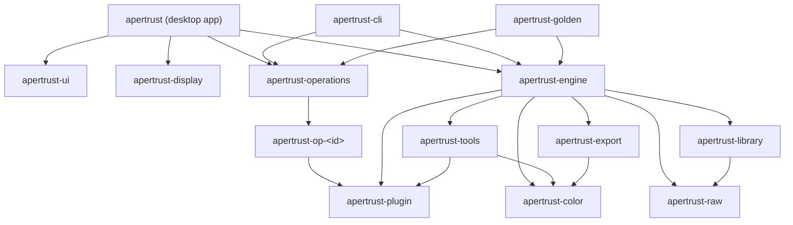
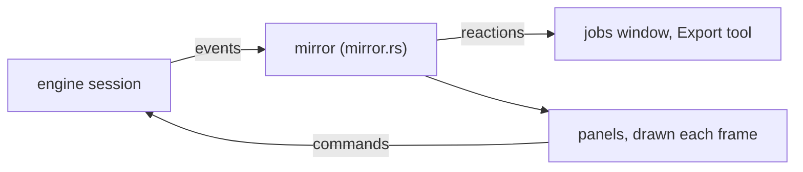
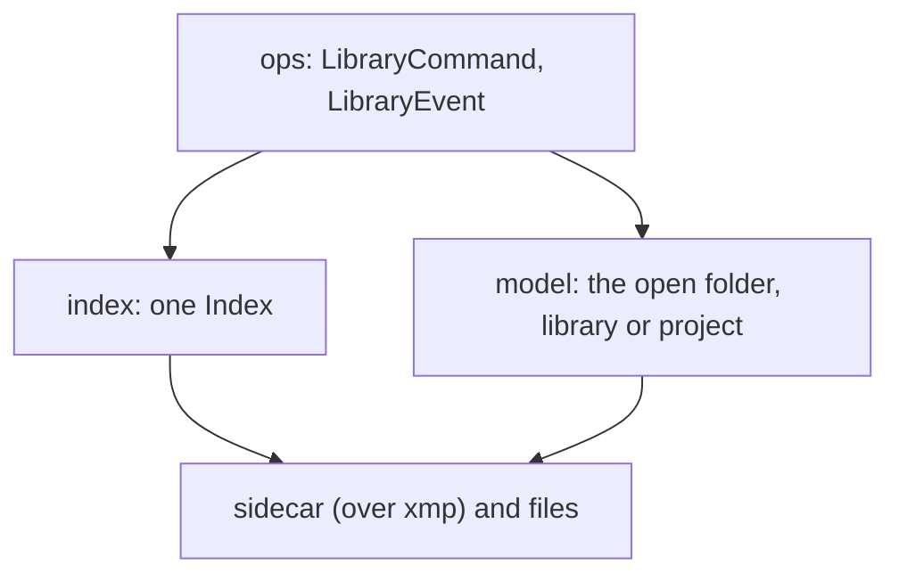

# Crates

What each of Apertrust's crates holds today, and what is planned for it. [AGENTS.md](../AGENTS.md) lists the crates with their roles and the rules for adding one; this document is their state.

Each crate lives in `crates/<name>`, its package name without `apertrust-`: the desktop app in `crates/app`, operation crates in `crates/op/<id>`.

## How they depend on each other

The arrows are normal dependencies. `apertrust-base` is left out: nearly every crate uses it. The engine never depends on the operations: each binary hands it `apertrust-operations`' list.

## apertrust-engine

The GPU-resident pipeline, with no UI dependencies.

### GPU and submission

- GPU setup and the image kernel runner.
- Every submission goes through `GpuContext::submit`, which holds a `SubmitGate`. A window client holds the gate while its toolkit reconfigures the surface. The holds take turns in the order asked, and a viewport frame is one submission (decision 18).
- `gpu::AdapterChoice`: an adapter a flag names that is not there is an error; one a setting names is a warning, and wgpu's choice is used.
- `gpu::matching` (decision 82): the adapter a name opens, the one of exactly that name first, then the first whose name holds it, ignoring case; `gpu::CPU`, `cpu`, the first software adapter, whatever the platform calls it. `GpuContext::new` and `gpu::choose_adapter` both find by it.
- `gpu::choose_adapter`, for a window that creates the engine's device, in wgpu's order; a test holds it against `request_adapter`. `gpu::automatic` is its choice among adapters' kinds, `gpu::rank` the order, `gpu::power_preference` the preference, `WGPU_POWER_PREF`'s or high performance; Settings lists the graphics cards in that order.
- `gpu::listed(backend)`: every adapter an instance loading that backend lists, for the app's helper that lists them for Settings.
- `gpu::Backend` (decision 82): the graphics API, `Auto` (wgpu's primary backends, never GL), `Dx12` or `Vulkan`, the `engine.backend` setting's `Choice`, in `GpuOptions::backend`.
- `gpu::instance_descriptor(options)` and `gpu::instance(options)`: every instance, the app's window's included, loads the backends `options` choose, `WGPU_BACKEND` before them, with FXC as Direct3D 12's compiler (decision 10). `gpu::check_backend` refuses a backend this build lacks, unless `WGPU_BACKEND` chooses; `GpuContext::new` and the app's start call it. `gpu::finds_adapter` says whether a backend lists any adapter on this machine, for the settings file's backend.

### The pipeline

The plan and the executor for the export and viewport pipes (decision 12): output buffers by format and size, scratch buffers, reductions without readback, cache points and restarts.

- **Output profile.** The pipe's output profile is asked of every instance before any `prepare` and put in every `prepare`'s image context, never the defaults'. An export's parts before and inside its tiles are planned with the whole export's (decision 26).
- **Whole-image results** are kept by their own key in the viewport, across rebuilds (decision 15).
- **Full-resolution estimates.** An operation that opts in through `Operation::whole_image_at_full_resolution` (haze removal) has its estimate computed in the untiled viewport from the full-resolution image its downscale read, bound as `Resource::FullResolution`. Its passes up to the last that binds it are kept on that image's key, so a new viewport size runs only the passes after them (decision 15).
- **The stage at the pipe's scale.** The planner sets `ImageDesc::scaled_extent` for every RGBA image (decision 15).
- **Derivatives.** `Pipeline::derivative` dispatches an operation's derivative entry points over the scratch its last render left (decision 15).

### Tiled exports

Exports are tiled when they would not fit (decision 13).

- An operation with whole-image passes after demosaic, such as the tone equalizer's mask, gets a first round of tiles. It builds its result in scratch the export holds across both rounds (decision 15).
- Each tile is sized without that scratch. Where the scratch exceeds the budget, `-d memory` logs it.

### Exports at a size

Decision 56 and [docs/ports/finalscale.md](ports/finalscale.md).

- `Pipe::Resampled` and `export::export_at`, with the engine's `resample` kernel: darktable's lanczos3, its plans made on the CPU (`resample`).
- The resample runs after demosaic (after haze removal while that is planned), or, with high quality resampling, at finalscale's place before colorout.
- Tiles of the output at its scale are walked back through the plans, and the result equals the untiled export bit for bit.
- An export at a size resamples on either side of a geometry of whole pixels (`Geometry::whole_pixels`), orientation's turns and mirrors, in the stage its place gives: after demosaic in the photo's own stage, its sides the output's turned back, or at finalscale's place in the turned image, as darktable does; one with a geometry that interpolates or crops is refused.
- Without high quality, whole-image passes after the resample cover its output, their stage at the export's scale (`ImageDesc::scaled_extent`), whole or tiled. A run of them takes its first round in the output's own tiles at the export's scale, each grown a pixel and walked back through the resample.
- A run before the resample takes its first round in tiles at full resolution.
- One export can take both runs, haze removal's and the tone equalizer's. Each run's side of the resample is its place in the plan, `Plan::resample`.

### Row strips

Where an image is larger than the GPU binds at once (decision 14):

- passes run in row strips over windows, as the raw stage's do on lavapipe;
- a pass that binds only scratch (highlights' dilation) runs in bands of its rows, with no window;
- the viewport's demosaic and downscale run in tiles where its full resolution does not fit;
- `Limits` and `GpuOptions` force a smaller binding.

### Geometry

For an operation that returns a `Geometry` (decision 16):

- extents go forward, the scale comes from the output's, and regions go backward through it;
- buffers are allocated by region, and each instance's origin and stage extent are in the pass header;
- a translation runs with no pass, and export tiles are tiles of the output image;
- it is tested on two test-only operations; a plan without geometry is unchanged, with its keys;
- an operation that moves no pixel and runs no pass, keeping its input as it is, leaves the plan, as darktable's `commit_params` disables its piece: orientation at no rotation, so a photo the right way up plans as before;
- `pipeline::extent`, the image an edit's instances make at full resolution, which the session reports as `Values::extent` and a client fits with `Values::viewport_size`.

Orientation, `flip` (`docs/ports/flip.md`), is the first built-in operation that returns one.

The groundwork for orientation:

- Whole-image passes after a geometry cover their stage's extent at the pipe's scale. Bloom, soften, the colour equalizer, the tone equalizer and haze removal read it from `ImageDesc::scaled_extent`, with its `origin` (`ImageContext::whole_image`).
- Such passes are refused before a geometry that keeps part of their stage, such as crop's window, until crop is built.
- A tile's RGBA input after a split past a geometry is in that geometry's stage.
- The viewport's edit cache is sized for the largest image after its start and holds any image by its bytes, so a quarter turn keeps it.

### The zoomed view

Decision 99, [engine.md](engine.md#the-zoomed-view), in seven steps, the first four and the sixth built:

- Built: `view` (`apertrust_engine::view`), with `View { scale, centre }`, `ViewScale` (`Small`, `Fit`, `Fill`, `Factor(f32)`, a factor clamped to Fit and 16) and `place(extent, bounds, &view) -> Placement`, a pure function the app uses too, agreeing with `pipeline::fit` at Fit; `Command::View`, view state off the edit, one view per session kept across photos, its centre clamped to each; `Event::View(ViewState { through, view, placement })`, the session's one view told to every client once in each batch that moved it or its placement; `Frame::place` (`FramePlace { scale, origin, extent }`), the whole photo at the fitted scale at Fit, the detail's region at 1 from 100% on.
- Built at 100%: `Pipe::Detail { region, scale }`, the visible region at scale 1, planned as a tile up to its start and as the viewport after it (`PlanError::Detail` refusing an operation after demosaic with a reach past its pixel, a region past the image's edge, and any scale but 1); `Plan::keyed_on`, its keys chained from its source's; its source the fitted pipeline's demosaic image read in place (`Pipeline::demosaiced`), or in a tiled fitted viewport the raw stage's output it keeps, the region's photosites copied, grown by demosaic's reach and aligned to the colour pattern, then demosaiced, that image a cache point too, as an export's tile starts (`Pipeline::detail_source`, the instances after it from `pipeline::detail_instances`), its margin shrinking further where that plan binds more a pixel than the region's RGBA image (`Plan::binding_ratio`); recorded with the fitted pipeline's passes in one encoder and one submission (`Pipeline::record`, `Pipeline::timings`) where no whole-image round is due, the fitted passes submitted first and each round tile after them where one is; the session's `Detail`, its own display pair, `Frame::overview` (`Overview { buffer, width, height }`), and `SessionError::Zoom`, the refusal of a `View` whose detail cannot render: a plan `PlanError::Detail` refuses, or no memory for the detail's buffers; the frame then stays at Fit, and a supported detail renders at scale 1 at every zoom from 100% up. Planned: scales between Fit and 100%.
- Built, the margin: `view::rendered`, the visible rectangle times `viewer.anticipate_move` (1.0 to 2.0, default 1.2, no page), rounded up to a 64-pixel grid, of a constant size, moved rather than shrunk at the photo's edges, its margin shrinking to what the GPU binds; `view::covers`; the session keeping the detail's region while it covers the visible rectangle at its scale, so a pan inside it renders nothing and sends only the `View` fact, and moving it past there with an update in place; `ViewOptions { budget, anticipate_move }`, which `Session::start` takes, from `settings::Options::view`.
- Built at 100%, the whole-image results (`apertrust_engine::detail`): `Results`, which plans a detail (`Results::plan`), its keys chained from its source's, each operation's whole-image passes left out and only the scratch its later passes bind held, under the key the untiled plan at the detail's scale gives them, with no region; `Rounds`, the first rounds whose key changed, an operation that opts in in tiles of its stage within the budget, the others whole with every operation before them, planned by the export's own `export::Round::plans` from the detail's source, each tile from a tiled viewport's raw-stage output demosaicing its part as an export's first round does; `Results::pipeline`, the detail's pipeline binding the results; `Results::run`, each round's tiles a submission waited for, after the fitted pipeline's passes. Haze removal's full-resolution part is borrowed from the fitted pipeline (`Pipeline::result_at_full_resolution`), as is every result of a fitted viewport at scale 1, and estimated in a round of its own where it holds none. A held result too large to bind refuses the zoom with the export's `ExportError::HeldScratch`. Local contrast and filmic rgb size their whole-image passes by the whole image at the pipe's scale (`ImageContext::whole_image`), so a region binds what a round over the whole image built.
- The scopes, the colour pickers, the readouts and the rendered thumbnails reading the fitted pipeline at every zoom: built for the scopes and the Colour picker from 100% on.
- `apertrust-cli preview --zoom FACTOR --at X,Y [--pans N]` for its timings, built.

### Edits and sidecars

- **`edit`**: an edit's tool values and the parameters no tool owns. `edit::instances` is the one function every builder of instances uses: a tool at its defaults adds nothing, and a misbehaving one is left out (decision 28). A tool the history's end leaves before its default step, of those darktable has off until its workflow applies them, is not applied: the edit holds it so, derived from the log and never stored, `instances` leaves out each operation it owns a parameter of, and `Edit::is_on` reports it off (decision 78).
- **Ranges that follow other controls** (decision 30): `Edit::set_control` refuses a number outside the range its tool's values give. `Edit::clamp` runs after every change: a number a moved range leaves outside is written at its nearer end in the same change, and kept. A clamp of a control the change wrote itself is refused (`EditError::ClampFailed`). `Edit::clamp_read` runs as a photo's edit is read.
- **Redrawn** (decision 79): `Edit::redraw` writes what each tool's `ProcessingTool::redrawn` gives, as darktable's `gui_update` writes parameters as it redraws a module: White balance's `preset` from image area becomes what its coefficients match. The session runs it after the clamp as a photo opens, after a move of the history's end and as a newer file is taken in (`history::as_read`), a change not yet a step, never a step of its own: a tool counts as changed only where its state differs from both the fold and the fold as read, which the history keeps as the fold changes (`PhotoHistory::baseline`), so the rewrite is saved only with its own tool's next step, and neither it nor a pick saved this session is laid over a newer file taken in. A photo open for viewing only is redrawn too, in the session alone.
- **`sidecar`**: `.apxmp` edits, typed, with the tool definitions (decisions 28, 47, 48 and 78): migrations, clamps, warnings, and `Newer` told by tool, in every entry of every step. It works over the text layer of `apertrust-library`'s `sidecar`, whose `Edits`, `Newer`, `Problem`, `Reason`, `ViewOnly`, `path_for` and `photo_for` it re-exports.
  - Reading (`from_xml_at`, `from_xml`, `read`): the first virtual copy of version 2, or a version 1 or 0 file as a step of each entry (`Edits::parse`), into `Loaded`: the `log`, its fold as the `edit`, `newer`, the text layer's `problems`, `warnings`, and the `file` as text, which a write lays the log on. An entry this build leaves out is left out of its step, a step left with none goes with its place in the end. `Loaded::view_only` names a `Reason`, a newer build's first, then a problem's.
  - Writing (`log_xml`, `write_log`, step 9.5): version 2, the first copy's log, end and clock vector written into the file as read, every other copy kept; each step's entries as version 1 writes a tool. `to_xml` and `write` still write version 1 of an edit, which every build reads, for tests and fixtures.
- **Switched tools' on state** (decision 32): `ToolValues::enabled` in the `Edit`, set by any write of a switched tool's control (`set_control`, a coordinate, `apply_preset`) and cleared by `reset_tool`, never by `reset_control` or `keep` (`Edit::is_on`). `edit::instances` plans an optional operation while its switched tool is on, binding its values off their defaults, possibly none, and never binds one that is off. `.apxmp` writes `apertrust:enabled="true"` on an on tool's entry: a switched tool's value off its defaults without it is read as on, with a warning, and the flag on a tool this build does not switch makes the photo view-only (`Newer::Enabled`).
- The image context and the mosaic from a raw.
- **`history`** (decision 78, steps 9.1 to 9.3, 9.5, 9.6, 9.9 and the default steps; [history.md](history.md)): the edit's `Log` of `Step`s and its end. A step holds a random `StepId`, a `Clock` (`apertrust_library::clock`), a `StepSource`, an optional `Note` and `BatchId`, and its `Change`: one tool's `Entry`, its whole state after it, or an operation's unowned parameters, or Reset's, an empty entry for each tool it reset; an empty entry is the reset state. `Log::fold` is the edit, each tool's last entry up to the end; `Entry::between` the entries that differ from one edit to another; `Change::between` the steps a completed change makes, one per tool in the order its commands wrote them (`Wrote`), Reset one; `Log::add_change` adds them, a step of each sharing a new batch, which the session and `apertrust-cli edit` both use; `Log::from_steps` a log the sidecar read; `advance`, a copy's clock vector advanced with a clock, and `latest`, the clock the next follows after reading a log, another machine's far past the wall clock ignored; `Log::merge` a merged change taking the place of the last applied step's entry, the step keeping its id; `Log::batch_start` and `batch_end` the steps Undo's and Redo's fallback move over, a batch's whole, and `Log::undo_end` and `redo_end` where the fallback moves the end, Undo's stopping above the last default step before the end, wherever it lies, which the session and `apertrust-cli history` both use. A new photo's default steps: `Log::add_defaults` gives a log with no step a step of source Default of each tool `default_tools` lists, darktable's default modules for a new raw (those on by default, then Exposure, Colour calibration and AgX, which its workflow auto-applies) in its history order, and a log that has steps none; `Log::defaults` counts them, where Undo's fallback stops; `Log::unapplied` names the tools whose default step lies after the end that darktable has off until its workflow applies them, which the fold, the sidecar's reading among them, holds as not applied; `Log::add` keeps the default steps after the end, moved below the change. The event's types, `History`, `HistoryStep`, `ToolChange`, `ControlChange` and `Move`, and `Described`, which describes each step once, before → after on the photo's defaults, kept while the steps before it stay; a tool or an operation this build does not know is a `ToolChange` under its stored name, owned (`ToolChange::tool` is a `Cow`), with no control.

### The editing session

`session` is an editing session on the engine thread: one photo, its edit and the viewport pipe. `Session::start` takes the memory budget, and every photo of the session is planned within it, and the disk cache, if any ([The cache](#the-cache)).

**The photo.** It is reported as `Photo`, with its image context (decision 27) and the exposure time, f-number and focal length the raw's EXIF records, read as it decodes, for the caption under the photo. Its ISO is in its image context.

**Controls.** Each tool's controls are reported with their defaults, marks, and whether they can change the photo, asked of the tool with its values after every change (decision 30).

- Each choice comes with the options its photo lists (`ControlState::options`, from `edit::listed`), computed once as the photo opens. Where a tool panics or gives a list that does not hold together, every option is listed.
- Another option is refused as `EditError::NotListed`, the edit given the image context. A choice that lists only the option it holds is unavailable (decision 30).
- Each number's range is reported as `ControlState::range`.
- Whether each control's row shows on the photo and a value of the photo's after its label (`ControlState::visible` and `label_value`, from `edit::photo_rows`), computed as the photo opens and again where its decode's context replaces the metadata's (decision 88). Where a tool panics, every row shows with no value.
- Each preset row's matching option and the options the photo can have are reported (`PresetState`), an option that turns a picker on (`PresetRow::pickers`) wherever the photo can be edited.
- Each view's coordinates are reported with whether each can change the photo (`CoordinateState`).
- Each tool is reported on or off (`ToolState::enabled`, decision 32), and edited while its reset would change the render: a control off its default, or a switched tool on (`ToolState::edited`, `Values::edited`).

**Tool commands:**

- `SetControl`, `ResetControl`, `ResetTool` and `Keep`.
- `ApplyPreset`, for a preset row's option: each control it writes is kept, with no follow writes, as in darktable's `_preset_tune_callback`.
- `Reset`, one history step noted `history-reset`, and `Set` only for parameters no tool owns.
- `Undo` and `Redo` (decision 78, `session/history.rs`): the undo records, one change's steps added, a batch's whole, leaving the log and the steps they dropped coming back, a `GoTo` the end put back, and with none the end moved over the step next to it and its batch, recorded for the other to reverse. Each completed change is a step of each tool it touched, of source You, several sharing a `BatchId`; a `Set` or a gesture joins the next change, or is made one before Undo, Redo, `GoTo` or the photo's close; a gesture another command ends is a step of its own, of the source of the change that began it. The log is saved in the sidecar's version 2 with its end (step 9.5), so after reopening Undo and Redo move the end through the steps read. A photo opened with no history, and not view-only, is given its default steps, a log of them alone written with the first change, whatever its end; once in the file, a move among them is saved as any move of the end. The fallback stops above them; the end among them leaves the later tools darktable has off by default not applied, until a change moves the values, a Reset or a tool's reset (each one step) or a tool's picker turned on. Thumbnails and the live export render the edit as the file holds it (`Open::saved_edit`).
- `GoTo { step }` (step 9.2): the end just after a step, or at Original, an undo record; a step not in the log refused, `UnknownStep`; the end where it is already, nothing.
- `Compress`, `Truncate` and `DiscardHistory` (step 9.8, the engine's half): the log rewritten by `history::Log::compressed`, `truncated` or emptied, as darktable's compress, its Ctrl-click and its discard, Compress and Truncate keeping every default step so neither changes what the photo shows but at end 0, each one undo record holding the log as it was, which Undo puts back and Redo rewrites again; a log left with no step given the default steps again, the file written with none until the first change. On an edit view-only because of any `sidecar::Problem`, never a newer build's, `DiscardHistory` alone is taken: `Log::afresh`, a new photo's default steps and a step of each tool the edit holds as read, noted `history-discard`, the file's unreadable parts going with the old log, `Opened` sent again editable. A rewrite not yet saved when a newer file is taken in is not kept, `MoveNotKept`.
- `Hide { tool, hidden }` (step 9.7), the History tab's eye: view state, no command on the edit; the live frame renders the edit as shown (`Open::shown`), each hidden tool as if reset, off where switched and at its defaults where every photo runs it, its operation still planned; no step, nothing written, the live export and the thumbnails taking the edit; reported as `ToolState::hidden`, gone as the photo closes or another opens. While any tool is hidden, a tool's picker on measures and applies nothing, its reading due waiting until all are shown (`Pickers::wait`, `Engine::hiding`), and `On` for one is refused, `SessionError::Hidden`; the Colour picker's works as before. A default tool the end leaves not applied stays out when hidden.
- `Step { source, note, commands }` (step 9.2): the seven commands that change the edit's values as one change of that source and note, a step of each tool they write, in a batch where there are several, applied in order, all or none, refused whole as `InStep { index, error }` (`NotInStep` for any other command inside), the source `Default` (`DefaultSource`) and an empty `Step` (`EmptyStep`) refused before the gesture is touched; it takes in the gesture under way on a tool it writes when its source and note are the gesture's, one source per gesture, one of `done: false` changes alone is a gesture's change of its source, and a `Step` refused begins no gesture.
- Merging (step 9.3): a completed change to the target the step before changed, a control or a preset row, of the same source, You or Auto, with no note and no command on the edit between, merges into that step within 10 s of its first write and, once a frame including its last change is published, 2 s of that frame, as darktable's undo merges; it adds no undo record. A change is timed when the client sent its command and a frame when it is published; a test sets both.
- `RetrySave`, a client's Try again: the edit written again after a failed write, nothing otherwise.
- `SetControl`, `ResetControl` and `Keep` also take a lossless view's coordinate. They write the view's controls, with the other coordinates held through a gesture (`edit::Held`); all coordinates back at their defaults reset the controls exactly.
- `SetControl` and `ResetControl` carry the tool's follow writes in the same change (`Edit::follow`). A wrong one refuses the change whole (`EditError::FollowFailed`, decision 27).
- `CancelGesture { tool }`, a slider popup's cancel (decision 42). It puts the tool back as it was before the gesture's first `done: false` change: values, marks, follow writes, clamps, the held coordinates and a switched tool's `enabled`. It adds no history step and writes nothing while the file holds that edit, and `Saved` is reported with the cancel's number. Any other command on the edit, refused or not, ends a gesture; a resize, the scopes and a cancel naming another tool do not.

**Frames and saving.**

- Commands are coalesced, and frames go to two alternating display buffers (decision 17).
- The edit's log is saved, version 2, after each completed change and each move of the end, by a writer thread that reports `Saved`, recording the build the binary hands the session. The log's XML is built on the engine thread as it is handed over (about 6 to 16 ms at 1,000 steps on the M4, [history.md](history.md#in-the-sidecar)).
- Before every write of the live photo's sidecar, held ones too, the writer compares its size and modified time (`export_job::Stamp`) with those the session last read or it last wrote, a written file's taken from its own handle after the rename (`apertrust_base::fs::write_metadata`); where they differ it writes nothing, keeps the newer file and wakes the engine (`Inbox::Newer`), which takes it in (`Engine::newer_file`), every write handed over before dropped by the writer's generation. The file is compared with the base, what it held as last read or written (`session::history::Base`): written over where its clock vector holds nothing past the base's, else the steps not yet saved laid on its log after its end, `Values` and `History` sent again; one now for viewing only sends `Opened` again and `SessionError::NotSaved`, one that cannot be read `NotSaved` once, never written over ([history.md](history.md#behaviour)). As the photo closes, its last write is waited for, so a newer file it finds is taken in too.
- An edit a newer Apertrust wrote (a newer file or tool version, or a tool neither known nor in `apertrust_tools::RETIRED`), or with a `sidecar::Problem`, opens for viewing only: every change is refused and its file never written (decisions 43 and 48).

### The selection

`session/selection.rs` (decision 37; [session-protocol.md](session-protocol.md#the-selection)): the selection of the folder open's photos and the active photo, the session's.

- `Command::Selection(SelectionCommand)`: `Set`, `Add`, `Remove`, `Range { to, order }` from the active photo in the client's order, `All`, `Clear`, `Invert` and `Unedited`, view state, never a command on the edit; a photo named by `Set`, `Add` or `Range`'s `to` that is neither the collection's nor active refused, `NotInCollection`, one in `Remove` or `Range`'s `order` passed over.
- The collection is the folder open, as the folder's reading lists it: its job hands each `Listed` chunk and its failure to the engine thread too (`Inbox::Listing`). Or it is the photos opened alone (`Source::Photos`), held as a folder with an empty path, each named by its absolute path, listed and done at once, their edit states coming from their job (`Inbox::Classified`, `State::found`), the edit writer's later classification winning as over a listing's row. It is one list (`Folder::photos`), each photo with its edit state, the listing that last brought it and the one under way when the edit writer last classified it, so every command, the fact and `Unedited` read the same photos. A folder listed again keeps its photos and the selection by photo until its listing is done, the photos gone from it dropped then; a photo of it opened meanwhile is held until then too; a later listing's row sets a photo's edit state, but not the row of the listing under way when the writer classified it. A cancel before the listing is done leaves no photo, one after it nothing changed. Another folder, or a close, leaves the active photo alone.
- The active photo, open or opening (`Engine::active`), is always selected: `Open` of one outside the selection selects it alone, of a selected one keeps it, and a command that leaves it out closes it as `Close` does.
- While a photo is open, `Unedited` reads its edit as it stands in memory, its values or the batch's change, over its listed state.
- As it closes, by any path, a close, a failed write or a panic, that override ends, and the listing takes what its sidecar holds: the edit writer classifies it as a listing does (`library::sidecar_state`), after its last write, off the engine thread, and the engine applies the result where the folder's open is still the one it was asked in. `Unedited` waits for the classifications asked for, and counts an open photo open for viewing only, or with a newer sidecar that cannot be read, as edited (`Engine::settle_edited`).
- Told as `Event::Selection`, the fact `Fact::Selection`, once a turn where it changed, after the turn's other events.

### Scopes

`scopes` (decision 19): once a client asks with `Command::Scopes`, each frame is counted on the GPU after it by workgroup atomics:

- the clipping totals, and, as asked, the histogram, the waveform and darktable's default vectorscope (u\*v\*, with each cell's colour);
- read back through two staging buffers mapped without waiting (`readback`, the staging pair the colour pickers share), and sent as `Event::Scopes`;
- a failure turns the scopes off, never the frame.

### The raw's histogram

`raw_histogram` (decision 87): the raw's histogram, counted for an operation that reads it (`Operation::reads_raw_histogram`, `read_by`), once per photo.

- The engine's kernel, `slang/raw_histogram.slang`, in `pipeline::KERNELS`: each photosite of a region of the 16-bit mosaic in the bin of its value, 65536 words of integer atomics, four photosites an invocation; a mosaic larger than one binding in row windows, every window's dispatch in one submission (`count`, or `record` and `Counting::finish` for a caller that submits it itself).
- Over the declared image (`for_instances`, `fill`), read back once and kept in the photo's image context: by the session before its values report and its rendered thumbnail (`Engine::count_raw_histogram`), where the edit as shown or as saved reads it; a failure reported once for the photo, an export failing, and by `export_at` before it plans, a job's handed to the engine thread (`Hand::hand_commands`, `export::Commands`).
- The session reports what an operation computes for a tool's computed value (`Operation::computed`) with the tool's state (`ToolState::computed`, `ComputedState`), from a plan of the operations up to it, while the row shows.

### Colour pickers

`picker` and `session/pickers.rs` (decision 79; [pickers.md](pickers.md)), 79.1 and 79.3 of its plan: the Colour picker's own picker, and tool pickers.

- `Command::Picker` with `On`, `Point`, `Area`, `Switch`, `Reset`, `Settings`, `Channel` and `Off`, view state, never a command on the edit; `On` refused before the photo is live (`NotLive`), for a tool's picker on a photo open for viewing only (`ViewOnly`), for a picker no tool declares (`UnknownPicker`) and a setting none of its pickers reads (`UnknownSetting`); a move, switch or reset with none on (`NoPicker`).
- Its point and area kept for the session in the original image's coordinates through every geometry (`Geometries`, `Place`, `pipeline::geometries`), darktable's defaults, and darktable's box in a buffer (`pixels`), and in an operation's buffer, after the downscale or on the sensor (`boxed`).
- The engine's reduction kernel, `slang/picker.slang` (`picker_rgba`, `picker_mosaic`, `picker_combine`), in `pipeline::KERNELS`: up to 64 boxes' mean, minimum and maximum of four channels over up to two buffers, an RGBA one denoised by darktable's B-spline where asked or a mosaic per CFA colour (`Cfa`), the sums a fixed tree; a buffer larger than one binding read in row windows (`Reducer`, `Group`, `Layout`).
- The frame measured under the active picker after each frame's copy and the scopes' count, and the frame shown when its region moves with nothing rendered; read back through `readback` and sent as `Event::Picker`, the region as drawn and the frame's RGB and Lab D50, after the frame it measured; with no reading, through every command then applied, as it turns off, by `Off` and as another photo opens or the photo closes.
- A tool's picker measured at its operation's input and output: in the render's own encoder right after the operation's last pass while what it reads changes (`Pipeline::render_probing`), else by a sample-only render (`Pipeline::sample`), which reads the edit cache where it holds the input, captures the operation's input into it, and cancels a still it would write under (`Pipeline::sample_writes`); its tool turned on with `On`; sent as `Event::Picker`'s tool part.
- A reading applied through `ProcessingTool::pick` as one change (`Edit::pick`, no follow writes, numbers held to their range, a hue wrapped): the first after `On`, each after a move and after `Settings` the tool's latest reading measured again, never one an edit caused; a drag's steps saved with their release; every completing command answered with a `Saved` through it, the edit reported held where it wrote nothing (`Pickers::owed`); the picker off as a command on the edit changes its tool, unless it keeps.
- The viewport planned within the budget less the two reducers' buffers (`picker::reserved`).
- A failure turns the pickers off for the session, reported once as `SessionError::Pickers`, never the frame; a pick its tool gets wrong is refused (`EditError::PickFailed`) and turns the picker off.

### Settings

`settings`: the engine's settings, `engine.adapter`, `engine.backend` (decision 82) and `engine.memory_budget`, and the cache's, `cache.limited`, `cache.limit` and `cache.unused_after` (decision 76), generated from the schema by its `build.rs` as `settings::registry` (decision 43).

- `settings::Options::read` turns a store a binary hands it, under the binary's own flags (`--adapter`, `--backend`), into `GpuOptions` and the budget, wgpu's `WGPU_BACKEND` before every source of the backend. It logs each value, and where it came from, under `-d settings`. A backend the file names that this build lacks, or that finds no adapter on this machine (`gpu::finds_adapter`), is warned of and Automatic taken; one typed for the run is kept, and `GpuContext::new` (and the app, before its window opens, through `gpu::check_backend`) refuses one this build lacks.
- `settings::Options::instead` reads the same store with the graphics card given (empty for wgpu's choice, or `cpu`, preferred, never required) and the API given, Automatic or one, in place of the card and API settings for one run, the file and `--conf` keeping theirs, `WGPU_BACKEND` still first, and logs them as from its reason (`Source::Instead`): the app's `--safe-mode`, or a start after one that did not finish (decision 82).
- `settings::cache_limit` turns a store's `cache.limited` and `cache.limit` into base's `cache::Limit`: `Unlimited` while the first is off, else the limit's GB as bytes, a GB 10⁹ of them. The app reads it for its session's start and each change (`Keeper::cache_limit`).
- The engine opens no folder or settings file.

### Jobs

`jobs` (decision 57): one `apertrust_base::jobs` control per session.

### The cache

`session::cache` (decision 76; [cache.md](cache.md#through-the-session)): the disk cache a binary hands `Session::start` as `CacheOptions`, the `Arc<Cache>` it opened and the limit its settings give, or none. The engine opens no folder; the app hands one, the CLI none, and the golden harness starts no session.

- **`cache-walk`,** a `SystemBackground` job with no progress, added as the session starts: base's `tidy`, then its `walk`, then, where the limited kinds are past the limit, eviction in the same job. It counts as an eviction running, so a limit lowered meanwhile is folded into it.
- **`cache-evict`,** the same queue, never shown, one at a time: asked for after a write past the limit (`Upkeep::check`, for the thumbnails' writes), and by `Command::Cache(CacheCommand::Limit(limit))` where the limit is lowered or turned on; never while the cache is unlimited. A request while one is queued is that one's, which reads the limit as it runs; one while it runs is folded into it, which runs once more. A guard puts eviction back to idle should a job panic, so the next request still adds one.
- **`Command::Cache(CacheCommand::Sizes)`,** answered by `Event::Cache(CacheEvent)`, a fact, `Fact::Cache`: at once with the handle's count where a walk has run, through the outbox before the walk is added, then by a `cache-walk` of its own (`Upkeep::walk_for_sizes`), one at a time, that counts what other processes did, a `Sizes` while it runs folded into a pass more; `CacheEvent::NoCache` with no cache; `SessionError::CacheWalk` for each command a failed pass answers. A walk the handle's own write, eviction or clear overlaps keeps nothing (base's generation of its mutations), and the session walks once more, the start's walk too, else keeps its count where one exists. If both startup walks are overtaken, automatic eviction waits for a later completed walk.
- **`Command::Cache(CacheCommand::Clear { kind })`,** a `cache-clear` job on `UserBackground` with a progress, cancellable (`Upkeep::clear_job`): base's `clear`, its progress the bar and `job-cache-clear-now`, its title `job-cache-clear` and outcome `job-cache-cleared` or `job-cache-clear-cancelled` with the entries and their size (`$size`, `$unit`, from `session::size_in_unit`, which Settings › Storage shares), the sizes told as it ends; entries it could not remove fail it, `cache-remove`, a folder that cannot be listed `cache-read` (`session::CACHE_REMOVE`, `CACHE_READ`). Refused, `SessionError::Refused`, for a kept kind (`CacheKept`), a kind whose Clear has not ended (`CacheClearing`, `Upkeep::clearing` asking the control) and with no cache (`NoCache`).
- Only the engine thread adds them, since it owns the control: a worker asks it through the inbox (`Inbox::Evict`), one arriving after the session's `Stop` dropped. As the session ends, its stop flag is the cancel of base's `tidy`, `walk` and eviction's listing, asked before each subfolder, and of eviction's removals, so quitting never waits for a cold walk.
- `-d perf` logs the walk's sizes, the temporaries tidied and its time, each kind under `verbose`, each walk for the sizes, and each eviction's and Clear's removals, failures and time; a cache that cannot be tidied, walked, evicted or cleared is a warning.
- **Thumbnails,** `session::thumbnail`: a thumbnail job reads the cache first, by the library's `thumbnail_key`, and decodes a hit with `apertrust_raw::read_jpeg`; on a miss it sends the library's reading, then encodes it with the export's JPEG writer at quality 90, 4:2:2, writes it and calls `Upkeep::check`. No picture, or one that cannot be encoded, is sent and not kept; with no cache the library's reading alone. A photo alone's is served the same way as a file of its own folder, its event named by path (`thumbnail::named`). One `-d perf` line for each `Thumbnails` or `PhotoThumbnails` command once its last job ends (`Tally`), each thumbnail under `verbose`.
- **Live rendered thumbnails,** `session::thumbnail::rendered` and `pipeline::still`: the live photo's saved edit rendered from its live pipe at 1024 pixels as a `SystemForeground` job, reading the pipe's cached image and whole-image results in place, its turns waiting while the photo changes (`EDITING_QUIET`, 150 ms), after a one-second settle and as the photo leaves, and written to the thumbnails kind; a reset puts the embedded picture back ([engine.md](engine.md#rendered-thumbnails-of-the-live-photo)).

- A job's body hands the engine thread `GpuTask`s through its `Tasks`. They are stepped one a turn, after the live frame, by darktable's queue order and ageing, with one step's work on the GPU at a time.
- A cancelled job's task is dropped before its next step.
- `Event::Job` (`Added` naming its command), `Command::CancelJob`, and `Command::RetryJob`, which runs what a failed job left the session, the latest 64 kept (decision 72).
- Dropping the session steps tasks until the control has shut down.

### The export job

`export_job` (decisions 56 and 57): `Command::Export`, a `UserExport` job, one at a time.

- Each photo's edit is taken as Export is pressed (Export's D12 in [docs/gui.md](gui.md#deviations-from-darktable)): the open photo's from memory, the others' read by the edit writer after its writes.
- The job's worker decodes, encodes, writes and renames. Its render is a `GpuTask`, planned, compiled and allocated on the worker; the engine thread only steps its submissions, one at a time.
- It always renders in tiles of at most 1024 (`Tiling::AtMost`), each tile one step. A tile's readback is mapped as the engine thread polls, and waited for by the worker (`export::export_handing`).
- The operations before the tiles (the raw stage, on a default edit) take a step per pass, in row strips of about 8 MP, a step per strip (`export_job::STRIP_BINDING`). Highlights' dilation, which binds only scratch, runs in bands of its rows too.
- Each new buffer is touched in a step of its own first (`Pipeline::parts`).
- It steps beside a live frame only, or one step at a time where no photo is open or no viewport sized, as in the CLI (`Run::live_frame`).
- Everything its row shows is sent as `Event::Job` (decision 72): its total and done, the photo under way, its folder then its first file as its destination, its outcome, the failure that ended it or else its first photo's, and `Retry` unless cancelled or refused, its retry, the same export of the photos that failed and those not reached, left with the session for `RetryJob`; its photos as `Event::Export`, the record for scripts and the CLI.
- `names` gives darktable's variables their values; the client passes the person's folders and name (`Places`).

### The export preview

`export_preview`: `Command::PreviewExport` and `Event::ExportPreview`, a `UserForeground` job with no progress, which the next preview cancels. It reports:

- each photo's file, with the sequence rule, and what On conflict would do (`Disk::foresee`, counting the files earlier photos take);
- the pattern's errors (D8) and the variables with no value (D7);
- the open photo's output size, and each folder's preflight (`disk::preflight`).

It writes and makes nothing and decodes no image; it reads the EXIF only for a path that uses it.

### Library commands

`Command::Library` (decision 54):

- `LibraryCommand::Open(Source::Folder(path))` is a cancellable job of kind `folder` on darktable's `UserBackground` queue (`job-folder`), and cancels the reading before it.
- Its body is `apertrust_library::ops::open`, with an observer that sends each `LibraryEvent` as `Event::Library`, and the job's cancel.
- `LibraryCommand::Close` cancels it and answers `Closed` at once. `LibraryCommand::Open(Source::Photos(paths))`, photos opened alone, closes the folder as `Close` does, answering nothing, and makes them the selection's collection, their sidecars read by a job of kind `alone` on darktable's `SystemBackground` queue with no progress, never the edit writer, so no open or save waits for them, the reads on a thread of their own the job never joins, as a listing's calls into its folder, so a share that does not answer holds neither the worker nor the session's end, each state handed to the engine thread as it is read, so a stuck read leaves only the photos after it unknown (`Inbox::Classified`, `Engine::photos_alone`).
- An `Open` outside the session's `tree`, or of its root again, starts the tree's walk: a job of kind `walk` on darktable's `SystemBackground` queue, as its backthumbs job runs, with no progress, in that open's number, which waits until the root's photos are listed, its body `apertrust_library::ops::walk`. An `Open` inside the tree leaves it; a new root, the root again, a `Close` or `Engine::finish` cancels it, and the jobs' shutdown cancels every job with no progress too.
- `LibraryCommand::Thumbnails { photos, size }`: each photo a job of kind `thumbnail` on darktable's `SystemForeground` queue, with no progress, deduplicated by the open, the photo and the size, added from the last so the first asked is read first; its body is `apertrust_library::ops::thumbnail`, sending `LibraryEvent::Thumbnail` naming the folder's open. A new open or a close cancels those not yet sent; with no folder open nothing is read.
- `LibraryCommand::PhotoThumbnails { paths, size }`: the same jobs for photos opened alone, by path, whatever is open (`Engine::photo_thumbnails`, sharing `thumbnail_jobs` with `Thumbnails`): each photo read as a file of its own folder, nothing else of the folder read, deduplicated by the latest open or close, the path and the size, sending `LibraryEvent::PhotoThumbnail` in the number of the latest open or close (`latest_library`, 0 before any); the next open or close cancels those not yet sent. The live photo's render, written, comes the same way where it was asked for by path (`rendered::State::asked_alone`).
- `LibraryCommand::RawThumbnails(raw)`: the setting the thumbnail jobs, the open's picture and the live photo's render follow from then on; the live photo's thumbnail is chosen again.
- `LibraryCommand::Subfolders { folder }`: a cancellable job of kind `subfolders` on `UserBackground`, with no progress, its body `apertrust_library::ops::subfolders`, handed the tree's root, the first folder opened, kept while each later `Open` lies inside it (the session's `tree`), which refuses a folder outside it and lists through `listing::subfolders` on the listing's own thread, answered by `SubfoldersOf` in the open folder's number; a new open or a close cancels it, and with no folder open it is not added.
- Every library event names the number of its folder's open or close and is a notice. Opening a folder opens no photo.
- `session::library` re-exports the library's `ops`.

### Opening a photo

`session/open.rs`, decision 77 ([engine.md](engine.md#opening-a-photo)):

- `Command::Open` saves and closes the photo before it, cancels the open before it and adds a job of kind `open` on `SystemForeground`, with no progress, keyed by its open so a newer open of the same photo is never taken for it.
- Its body maps the raw once (`open::RawFile`, over `apertrust_raw::RawFile`), sends the largest rendered thumbnail the cache holds, stale or not (`Cache::read_any` on `ops::thumbnail_slot`, its version starting `ops::RENDERED`), reads the metadata without the pixels, the EXIF and the sidecar after the edit writer's writes (`Writer::read`), and hands them to the engine thread, which sends `Opened` and `Values { live: false }`; then the embedded picture at the last `Resize`'s longer side where no rendered one was sent, as `Event::OpenPreview`.
- It waits for the session's one decode slot (`open::Decodes`) through `Context::wait`, tells the engine thread, which plans and compiles the photo's kernels meanwhile, decodes, and hands the mosaic over; a cancelled open's is dropped. The engine thread uploads it and renders the first frame, sending `Values { live: true }` and the `Frame`.
- From the `Open` until live, every command on the edit is refused, `SessionError::NotLive`. A job dropped from the stack before it ran is added again; one that ends early fails its open.
- Compiled kernels are kept across photos (`pipeline::Kernels`, `Pipeline::with_kernels`, `Pipeline::into_kernels`).
- Each stage's time from the `Open` is logged under `-d perf`.
- `open::testing` gives tests synthetic raws, and `Command::HoldDecode` holds a decode with the slot taken. Behind the `testing` feature, `session::testing::start` starts a real session on such raws for the tests of the engine's clients, the app's through its dev-dependencies.

### Events

The session's events (decision 59, [docs/events.md](events.md)):

- Each is a fact, superseding the last of its topic, or a notice (`Event::topic()`, `Topic::Fact(Fact)` or `Topic::Notice`). A job's progress, title, detail, destination and state are a fact each, by job, its `Added` and `Ended` notices; the Export tool's preview and an opening photo's picture are facts.
- A refused command names its number (`SessionError::Refused { command, error }`), its words the error's.
- `Event::History`, a fact (decision 78): after `Values { live: false }` as a photo opens, and once in each batch that changed the log, its end or the undo records, after its `Values` and before its `Frame`, its steps shared behind `Arc`s. Building it takes about 0.01 ms in a batch at 200 and at 1,000 steps on the M4, and 0.08 and 0.4 ms with every step described anew; its JSON, estimated, is about 59 kB at 200 steps and 295 kB at 1,000, over its 256 kB budget, so the remote protocol takes the planned fallback ([history.md](history.md#the-history-event)).
- Every thread of the session sends through one `Outbox` (`session/outbox.rs`): the engine thread, the edit writer, the jobs' observer, and the bodies of the export, the preview, the folder's reading, the thumbnails and an open.
- The outbox calls `wake` once per burst, through a flag that `events()` clears as it drains with one loop of `try_recv`. Nothing is sent once the handle drops.
- Each send and drain is logged under `-d event` (`signal` an alias), and a count per kind each second under `-d verbose`.

### Planned

- **Several photos in one session** (decision 37, once spike W1 measures it): the active one live and every other on screen a still, rendered once from its saved edit; background work one tile per submission; decoding off the engine thread on a job worker (decision 57), as the live photo's is (decision 77); kernels kept for the session, as they are across photos (decision 77).
- **Readouts** (decision 19): what an operation measures of the photo for its tool's panel, the tone equalizer's mask histogram first. Its readout pass is planned in the viewport alone and dispatched while a client asks (`Command::Readouts`, by tool) and its key, a whole-image result's, has changed. Its counts are read back through the scopes' staging pair, decoded by the operation and sent as `Event::Readout`. A failure turns readouts off, never the frame.
- **Preset rows' camera options and tuning** (decision 27): `PresetState::listed` and `PresetState::tuning`, `ApplyPreset` at the row's tuning, and `SetControl`, `ResetControl` and `Keep` on a tuning's id, for White balance's Finetune.
- **Exports** (decisions 56 and 57): rayon in the encoding, and a long tile split into steps.
- **Colour pickers** (decision 79; [pickers.md](pickers.md)): the spaces other than the operation's own; stored samples and `Event::Samples`; a pick's change of source Auto, with history.
- **Events** (decision 59): `Event::Notice`; the remote protocol's queue, coalescing, `Sync` and versioning.
- **The cache** (decision 76): rendered thumbnails for photos other than the live one; eviction paused by an export; with the library's step 27, `CacheCommand::Remove { library }`, a `cache-clear` job, and each library's cache in `Event::Cache`; later wgpu's pipeline cache on Vulkan as the kind `pipelines`, if measured worthwhile.

## apertrust-cli

The headless binary. Its commands are `gpu`, `info`, `edit`, `history`, `export`, `preview`, `library scan`, `cache info` and `cache clear`; `import` (with the library's step 20a, decision 85), `batch`, `serve` and `mcp` are planned. AGENTS.md's Commands list shows how to run each.

### Options for every command

- **`--user-data-dir DIR`**, or `--config-dir`, darktable's `--configdir`, or `APERTRUST_USER_DATA_DIR`; else the platform's folder. `gpu`, `preview` and `export` read the engine's settings from the folder's `settings.toml`, its `[engine]` table (`adapter`, `backend`, `memory_budget`), and never write them (decision 43).
  - The folder is found for reading (`Folders::find_to_read`): nothing is created or probed, and one given that is missing is an error.
  - The settings are read through a read-only store, by the commands that run the engine and by `cache`, which reads the `[cache]` table.
  - The budget applies to `export` and `preview`.
- **`--cache-dir DIR`**, or darktable's `--cachedir`, or `APERTRUST_CACHE_DIR`; else the user data folder's `cache` when that is given, else the platform's cache folder. Chosen and logged under `-d settings`, never created; read by the `cache` commands.
- **`--adapter NAME`** comes before the file: the adapter of exactly that name, else the first whose name holds it, ignoring case, `cpu` the software adapter (decision 82). A name that matches no adapter is an error, while a setting that names none falls back to wgpu's choice (decision 43).
- **`--backend NAME`**, on `gpu`, `preview` and `export` beside `--adapter`: the graphics API, the setting's names, `auto` (wgpu's primary backends, Metal on macOS), `dx12` or `vulkan`, before `--conf engine.backend=…` and the file, after wgpu's `WGPU_BACKEND` (decision 82). An unknown name is a usage error; one this build lacks (Direct3D 12 off Windows, Vulkan on macOS) is an error as the engine starts, and one that finds no adapter fails as the device opens, where the file's is warned of and Automatic taken.
- **`--conf KEY=VALUE`**: a setting for this run only, as darktable's `--conf`, never written.
  - Global and repeatable; the last value for a key counts.
  - KEY is the setting's id in `settings.toml`; VALUE is written as the file holds it, but text without quotes.
  - The CLI takes the engine's settings and the export settings (`export.jpeg.quality=80`); its store opens on both registries.
  - Every command checks it before the folder is looked for. An unknown key or a value that cannot be read stops the start.
  - It counts after a flag of its own (`--adapter`, `--backend`) and before the file.
- **`--max-binding MIB`**: `export`, `preview` or `gpu` as on a GPU that binds at most that many MiB at once; 128 is lavapipe's (decision 14).
- **`-d DOMAIN`** and **`--version`**, as every binary has them (see `apertrust-base`).

### gpu and info

- `gpu` says which backends the engine's instance asks for and why, "Backends asked for: Direct3D 12, Vulkan (Automatic, from the default)", or from the settings file, `--backend`, `--conf` or `WGPU_BACKEND=…` (`backends_line`, only those this build has; wgpu does not say which loaded, and one that did not lists no adapter); then lists the adapters each finds, in wgpu's order, marking the one Automatic opens (`<- Automatic`) and the software adapter as `CPU, --adapter cpu` (`adapter_lines`, tested from a fake list), then the one the engine opens with its driver and limits. Unlike Settings, it keeps the software adapter's own name (WARP, llvmpipe) beside the mark: it is a tool for finding out what a machine has (decision 82).
- `info FILE` decodes a raw and shows its metadata.

### edit

`edit FILE` changes the edit saved beside the raw, `FILE.apxmp`, adding one change to its history (step 9.5): a step of each tool and operation its flags write, in the order they came on the command line, `--clear` first as one Reset, noted `history-reset` whatever `--note` says, and a step with the end among the default steps though it moves no value, applying the tools not applied as the session's Reset does, sharing a batch where there are several, source You, after the log's end, the steps after it dropped. A run that changes nothing writes nothing. It writes only over the file it read, by its size and modified time: another program's write meanwhile is read again and the change made on it, once, and a second refuses the run. The file is written as version 2, any version 1 file read as a step of each entry first. `export` and `preview` start from its fold.

- `--set TOOL.CONTROL=VALUE` and `--reset TOOL.CONTROL` on tool controls. A `--set` on a choice decodes the raw, since the choice's options are the photo's (decision 30); `export` checks them after its decode.
- `--param OP.PARAM=VALUE` and `--reset-param OP.PARAM` only for a parameter no tool owns yet, of an operation an unedited photo runs (decision 28). `--clear` starts from no settings at all; the saved edit is still read first.
- A number a moved range leaves outside is clamped after each `--set` and `--reset`, and as the edit is read (decision 30).
- An edit open for viewing only, a newer Apertrust's or one with a `sidecar::Problem`, is refused and left as it is (decisions 43 and 48).
- `edit` shows a switched tool that is on with no control set as `<module>: on` (decision 32). Planned: `edit --reset TOOL`, the tool's reset, turning a switched tool off.
- `--note TEXT` is the change's note (step 9.9): an assistant's or a script's own words, `Note::Text`, stored as written on each of its steps but a `--clear`'s Reset, which keeps `history-reset`, and listed by `history`; an empty one is a usage error, and one with nothing to change is not used, which `edit` says.
- A photo with no history is given its default steps before its first change, as the app's first change gives them (decision 78), so `history` lists the Defaults group and Original leaves out the tools darktable's workflow applies.

### history

`history FILE` (`crates/cli/src/history.rs`, decision 78, step 9.9; [history.md](history.md#the-cli)) works on the sidecar beside the raw, with no session and no GPU, through the engine's `history` and `sidecar` as `edit` does.

- With no move it lists the history as the History tab does, in words, newest first: each step's number, its tool's id, what changed (the control with ↑ or ↓, or how many controls), its source where it is not You, its note and its time in UTC; a batch and the default steps each under a line of their own; Original, 0; the end marked `>` and the steps after it counted. Changes are described on the photo's defaults, its image context read from the raw's metadata alone; a file the decoder cannot read is described on none.
- One move a run, a usage error otherwise: `--undo` and `--redo`, the session's fallback (`Log::undo_end`, `Log::redo_end`), since the CLI keeps no undo records; `--go-to N`, 0 for Original; `--compress`, `--truncate` and `--discard`, by `Log::compressed`, `Log::truncated` and an empty log. Each is one write, the copy's clock vector advanced, only over the file as it was read: another program's write between the two refuses the run. A move that changes nothing writes nothing and says why.
- An edit a newer Apertrust wrote takes no move; one with a `sidecar::Problem` takes `--discard` alone, its log started afresh from the edit as read (`Log::afresh`). A step the history lacks is refused. Errors exit with status 1, usage errors with 2.
- No `--json` yet.

### export

`export FILE...` renders JPEG or PNG through every ported operation, raw to output colour, from the saved edit, tiled when it would not fit, and written by `apertrust-export`.

**Through the session.** It runs through its in-process session's export job, with the same lines and exit codes. With `--runs` (any value), `--tile`, `--skip`, `--set` or `--param` it renders directly. `--runs N` with `-d perf` gives median timings (the pipeline timings).

**Execution.** Export orchestration is synchronous and owns the CLI thread until the command ends. It drives each required engine future with `pollster::block_on`; it is not a task on a shared async executor. The direct path deliberately decodes raws, reads sidecars and their modification times, and writes outputs on that thread, serially. The ordinary path submits the session's worker job and blocks while consuming its events. Neither path promises concurrent progress for other work on the CLI thread; clients needing that use the session protocol's jobs.

**Size.** Full size, or darktable-cli's `--width` and `--height` (0, no limit), `--hq` (true) and `--upscale` (false), as `apertrust-export`'s `size` computes them: darktable's export size and its lanczos3 resample, after demosaic or, with `--hq`, before colorout (decision 56, [docs/ports/finalscale.md](ports/finalscale.md)). The size never comes from `export.size`.

**Format.** `-o`'s extension chooses it as darktable-cli does (`jpg` or `jpeg`, `png`; case counts), whatever `export.format` says. The file is written with darktable's sRGB profile. The format's options come from the folder's `export.*` settings, as darktable-cli takes them from darktablerc, with `--conf` over them (`apertrust_export::settings::format`):

- JPEG: `export.jpeg.quality` and `.subsample`, and in the cm and inch modes `export.size.dpi` as its density;
- PNG: `export.png.bit_depth` and `.compression`;
- darktable's defaults without them; each value is logged under `-d settings` with where it came from.

**Destination.** `-o PATTERN` is File on disk's pattern of darktable's variables, over `export.disk.path`:

- the extension is stripped; a folder that exists means `FOLDER/$(FILE_NAME)`, the format then `export.format`'s;
- `_$(SEQUENCE)` is added with several files and no `$` in the pattern;
- the variables' values come from the raw and its EXIF, through the engine's `names`;
- `export.disk.on_conflict` (create unique filename, overwrite, overwrite if changed, skip) decides about a file already there, acted on by `apertrust-export`'s `disk`: the folder is made, and each file is written to a temporary file beside its name, synced and renamed into place;
- a photo that fails does not stop the others, as in darktable-cli, but a destination that fails does (decision 56).

**Controls.** `--set TOOL.CONTROL=VALUE` takes a tool's control; `--param OP.PARAM=VALUE` only a parameter no tool owns yet, of an operation an unedited photo runs (decision 28). `--skip OP` leaves an operation out (repeatable); `--tile N` renders in tiles of N pixels across and down.

**Planned** (decisions 56 and 57): `--out-ext`, `--icc-type` and `--preset NAME`.

### preview

`preview FILE [--width W --height H] [--exposure EV] [--png OUT]` times changes of the Exposure tool's Exposure through the viewport pipe.

- `--png OUT` writes the frame through `apertrust-export`, with PNG's defaults. The output must not already exist, so a preview cannot overwrite an original photo or an alias of it.
- `--join OPERATION` then times an optional operation joining and leaving the plan, each rebuild keeping kernels and cache points, against a pipeline built from nothing.
- `--scopes[=totals|histogram|waveform|vectorscope]` times what counting each frame for the scopes adds, and reports what the last frame clips.
- `-d perf preview FILE --zoom FACTOR [--at X,Y] [--pans N] [--changes N] [--png OUT]` zooms through an in-process session from the saved edit, the raw linked and its sidecar copied into a folder of the run's own, a `Resize` then a `View`, `X,Y` in the photo's coordinates, 0.5,0.5 by default: it logs `zoom: entered in N ms`; with `--pans N` it moves the centre across by a tenth of the view N times, back at the photo's edge, each waited for, and prints how many rendered and each render's time to the frame and GPU time, logging each as `zoom: pan`; then each exposure change's GPU time, both pipelines', and prints their medians; `--png` writes the zoomed frame. The engine's own lines name the detail's renders `detail:`. Between Fit and 1 the frame stays at Fit for now.
- `-d perf preview FILE --beside-export ROUNDS [--changes N] [--interval MS]` is spike X1's measurement: changes through an in-process session, alone and while its export job exports the photo, tiled as `engine.memory_budget` says. `-d perf -d verbose` adds each job step's GPU time and readback, as trace lines of the perf domain.

### library scan

`library scan DIR` (`crates/cli/src/library.rs`, decision 54) lists one folder, not its subfolders:

- the raws, with their `.apxmp` sidecars, and orphan sidecars (an `.apxmp` with no raw); other files are skipped;
- from the index, the photos with an edit, those that open view-only, and the sidecars that could not be read;
- the leftover temporaries it removed;
- the times, under `-d perf` (decisions 46 and 53).

### cache

`cache info` and `cache clear` (`crates/cli/src/cache.rs`, decision 76; [cache.md](cache.md#the-cli)) call `apertrust_base::cache` directly, with no session and no GPU, in the folder `--cache-dir DIR`, `--cachedir` or `APERTRUST_CACHE_DIR` names, else the user data folder's or the platform's. They open it with `Cache::open`, creating nothing: a missing folder is an empty cache.

- `cache info`: the cache folder, `(not created yet)` where missing, and how it was chosen; `cache.limit` in GB, or `unlimited` while `cache.limited` is off; the limited kinds' total; each kind's entries and size; `cache.unused_after` by its id; one item to a line. It walks the folder and writes nothing.
- `cache clear [KIND...]`: the limited kinds named, each once, or every one with none named, a line each on stdout of what it removed and, on stderr, of how many could not be removed and of a folder that cannot be listed, the exit status then 1. A kept kind (`libraries`, `copies`) or an unknown one is refused by name as a usage error, status 2, before anything is removed.
- Planned with step 27: each library's cache in `cache info`, with its id, name, last path, last opened and size, those unopened for `cache.unused_after` or not found marked; `cache clear libraries`, every library's cache no process has open, and `--library ID`, one, saying what it skipped. Local copies wait for step 31.

## apertrust-golden

The golden-image harness against darktable-cli (decision 61). AGENTS.md lists its commands, and the `golden-tests` skill explains them.

**Cases**, each a one-instance engine plan:

| Operation | Cases |
| --- | --- |
| exposure | 1 |
| colorbalancergb | 2 (JzAzBz, darktable UCS) |
| blurs | 1 |
| agx | 4 |
| sigmoid | 5 |
| rgbcurve | 9 |
| rgblevels | 8 |
| vignette | 6 |
| grain | 5 |
| channelmixerrgb | 11 |
| toneequal | 7 |
| bilat | 2 (the local laplacian filter, the bilateral grid) |
| hazeremoval | 2 |
| bloom | 1 |
| soften | 1 |
| filmicrgb | 8 (every colour science, the highlight reconstruction) |
| colorequal | 2 (with and without its guided filter) |
| primaries | 1 |
| flip | 7 (every orientation, bit for bit) |

**Other checks:**

- the raw stage's: `raw-passthrough`, `raw-run` and `raw-defaults`;
- the whole-pipeline exit test, `pipeline` (decision 62);
- `pipeline IMAGE... --width W --height H [--hq BOOL --darktable-hq BOOL --upscale BOOL]`: an export at a size against darktable-cli's at that size, measured without a bound, with the 99th percentile (decision 56). `--darktable-hq` is darktable's side's `--hq`, `--hq`'s by default;
- `--add CASE` puts a grain, vignetting, tone equalizer, haze removal, colour equalizer, colour balance rgb, local contrast, bloom or soften case's operation on Apertrust's side and darktable's module on the other;
- `pipeline IMAGE... --automatic PERCENTILE,TARGET`: Exposure in automatic mode on both sides, darktable's deflicker; Apertrust meters darktable's own crop, recovered from its render as `raw-defaults` recovers it, through `raw_histogram::count`, a region only the harness gives (decisions 63 and 87), and the line gives the exposure computed there and over the declared image the engine meters;
- `export RAW -o OUT.png [--darktable-xmp FILE] [--add CASE]...`: `apertrust-cli`'s export of the exit test's operations (the declared image, plus the cases'), with darktable's history for the same render written for darktable-cli. Both destinations must be new files. The XMP is written first and remains if a later step fails, including when the PNG already exists; retry with a new XMP path or remove the generated sidecar after inspecting it.

**Timing against darktable.** `tools/compare-cpu.sh` runs darktable-cli against Apertrust on lavapipe or WARP and on the GPU, on one machine, from both programs' `-d perf` lines, and writes tables into `target/compare-cpu/results.md` (the pipeline timings). `--raws` and `--paths` (`dt-cpu`, `dt-opencl`, `software`, `gpu`) choose what runs. With `--add` it exports golden cases' operations, darktable's modules on its side, and the exit test's history on both sides through `apertrust-golden export`, at a size if asked (`--size PX --hq BOOL`), GPU only, with no warm export or preview. `--wait-quiet PERCENT` waits for a quiet CPU (macOS).

## apertrust-raw

Raw decoding with rawler (decision 23).

**Decoding:**

- the uncropped mosaic and its metadata;
- the camera's names as darktable's (decision 24): the model is an alias's camera, resolved from rawler's embedded camera files, and the alias apart;
- the EXIF exposure bias, and the ISO by darktable's rule as far as rawler's EXIF reaches;
- the orientation from the EXIF Orientation tag, IFD0's or a Panasonic raw's, as darktable reads it, where rawler's decoders set one only for a DNG;
- a DNG's colour calibration tags and its LinearResponseLimit;
- black measured from the masked areas as darktable's decoder does, to explain darktable's levels.

**A raw mapped once** (decision 77): `RawFile::open`, then its `metadata`, rawler's decode with `dummy`, everything the decode gives but the pixels, which are empty, in milliseconds; its `preview`; and its `decode`. The metadata and the decode each come with the shooting data (`Exif`) from their one parse of the metadata. `tests/corpus.rs`'s `the_metadata_read_equals_the_decode_but_for_the_pixels` holds the two equal, field for field, over the corpus.

**Shooting data.** `read_exif_file` and `read_exif` give the shooting data darktable's variables read (`Exif`), from rawler's metadata, without decoding the image.

**The embedded picture.** `read_preview_file` and `read_preview` (`src/preview.rs`) read the camera's own picture without decoding the mosaic, as darktable's thumbnails show it before their render: rawler's thumbnail (a DNG's) when it is at least the size asked, else its preview, else the larger of the two; at most the size asked on its longer side, each pixel the mean of those under it, never made larger; turned upright by the EXIF Orientation, since the camera stores it as the sensor sees it; 8-bit RGBA (`Preview`). A raw with none gives `None`. `tests/preview.rs` holds the corpus's pictures at 256 pixels to `tests/corpus/previews.txt` and each upright where its raw decodes.

**For darktable's raw-thumbnail rule:** `read_embedded_file` and `RawFile::embedded` give the embedded picture as `read_preview_file` does, with the stored size of the largest the raw holds, as `dt_imageio_large_thumbnail` gives `_init_8` ([library.md](library.md#thumbnails)).

**For the cache's thumbnails** (decision 76): `PREVIEW_VERSION`, rawler's version and the reading's own, held to `Cargo.lock`'s rawler by a test, so updating rawler fails until it is raised; and `read_jpeg`, a baseline JPEG of three components back into 8-bit RGBA through rawler's own JPEG decoder, an error, never a panic, for what is no such JPEG or does not end with its end marker, as one cut short.

**Lens corrections** the raw carries, as darktable reads them, over rawler's public parsers (decision 25): Fujifilm's (the FujiIFD and the maker note's CropMode), held to Exiv2's dump in `tests/lens.rs`. Sony's, DNG opcodes and Olympus's are planned.

**The exposure a highlight-preserving mode held back** (`RawImage::highlight_preservation`, in EV, 0 where none), as darktable estimates it from the maker notes through Exiv2 0.28 (`_check_highlight_preservation`; decision 24, [ports/exposure.md](ports/exposure.md)): Canon's Auto Lighting Optimizer from a CR2's maker note or a CR3's CMT3 box, Fujifilm's dynamic range from a RAF's, Nikon's ColorSpace (HLG) or else Active D-Lighting, Olympus's and OM System's gradation, over rawler's public TIFF, maker-note and BMFF parsers with no change to rawler (`src/highlight.rs`). Pentax's, which darktable reads as none through Exiv2 0.28, and Sony's, left to do in darktable, are not read. Its tests hold the corpus to Exiv2 0.28.9's reading of every tag, with `--ignored`.

**Planned** (decision 27):

- darktable's spellings where they differ from rawler's (`Z 6_2`, `OM System`, `GFX100S`), applied to `make`, `model` and `alias`;
- darktable's `data/wb_presets.json`, embedded and parsed once with serde_json as darktable reads it, the camera's presets looked up by alias then model and carried in the image context.

## apertrust (the desktop app)

The desktop GUI, on egui ([docs/gui.md](gui.md)), in `crates/app`.

### Window and event loop

- eframe runs on the app's own winit event loop, with the engine's submit gate held round its callbacks (`Gated`, decision 18).
- A start that fails is returned as an error; uncaptured GPU errors are logged once each.
- While the window resizes, the photo's new size waits until the window has kept its size for 150 ms, and the last frame is drawn scaled meanwhile.
- One raw is shown in the Viewer, rendered by the engine's session through every ported operation and drawn by a paint callback (decision 17).

### Packaging

- The packages are built by `tools/package.sh` with cargo-packager from `packaging/Packager.toml` (decision 68; [packaging.md](packaging.md)); `tests/packaging.rs` holds every platform's file types to the extensions rawler decodes and the app's id, `org.apertrust.Apertrust`, to be the same in each file.
- The window takes that id as its Wayland app id (`APP_ID`), so the compositor finds its icon through the desktop file.
- On Windows, `build.rs` compiles the executable's icon and version resource through winresource and the SDK's `rc.exe`: the four numbers of `Version::numbers` and the full version as text.
- `examples/icons.rs`, run by `tools/build-icons.sh`, renders the icon's platform files from its SVGs with resvg and packs the `.icns` and `.ico` itself (`assets/icons/README.md`).
- `examples/dmg_background.rs`, run by `tools/build-dmg-background.sh`, renders the disk image's background, `packaging/macos/dmg/background.svg`, at 1× and 2× with resvg for `tiffutil` to join (`docs/packaging.md`).

### The shell

The shell comes from `apertrust-ui`: the Toolbar, the Tools panel, the viewer bar and the Browser.

- **Settings** (`src/settings_dialog.rs`): its pages listed at its start, the rows of each drawn from the settings registry by kind, a change kept at once through `Keeper::apply` and taken in by the shell (`docs/gui.md`, The Settings dialog); a window of the dialog host, modeless on the Mac, modal on Windows and Linux.
- **Settings › Storage's hand-built part** (`src/storage.rs`, decision 76; [cache.md](cache.md#settings--storage)): the Folders group before the cache's rows, the user data and cache folders with how each was chosen and Show in Finder; the In the cache group after them, each limited kind's entries and size with its Clear, the libraries' caches as one line, the total against the limit. The page asks for `CacheCommand::Sizes` as it is shown and as its window comes back to the front (`Output::Storage`; a dialog's frame hands the app every output it asked for, in order, `Asks::outputs`), and `cache_commands` sends `Sizes` after each limit Settings changed. The mirror's `storage::Mirror` keeps the latest `Event::Cache` and each Clear from its command, or a `cache-clear` job's `Added` naming the kind, to its job's `Ended`, its button disabled meanwhile and from the press within the page, and words a refusal until the next sizes or a Clear's end; the app hands the dialog the page's `View` as it changes, open or asked for (`Dialogs::storage`). A size below 10 keeps its decimal: base's `jobs::Argument::Decimals` in the Clear's messages, `apertrust_ui::i18n::decimals` on the page.
- **Settings › Processing's Hardware acceleration group** (`src/hardware.rs`, decision 82; [gui.md](gui.md#the-settings-dialog)): the graphics card's row as a list of the adapters the chosen API finds (`hardware::card`, pure and tested from a fake list), listed by the app's own executable as a helper process, `apertrust --list-adapters [auto|dx12|vulkan]`, which prints them as lines and exits without a window, read on a thread of its own with a 10-second limit (`hardware::run`, `hardware::parse`), each API once while the dialog is open; a card an API change leaves out reset with it (`settings_dialog::Asked::changes`, several a frame); and the In use line, from the adapter the window's `RenderState` opened, handed the dialog as `hardware::Running` with the lister (`Settings::with_hardware`), drawn as Storage's `Line`.
- **Restart now** (`src/restart.rs`, decision 82): the waiting line and its button under the In use line (`hardware::waiting`, while a value that applies after a restart differs from `hardware::Started`, this run's), `Output::Restart` running the `restart` action, which `quit_to_restart` turns into Quit once `Restart::ask` has found the app to start (`Launcher::here`; else nothing quits and the line says why, `Running::restart_failed`), so the app's own quit path runs, a no to the quit alert taking it back; `on_exit` hands `main` the new start through a `restart::Slot` (`Restart::ended`: this run's flags as `Arguments::flags` keeps them, with the folders a variable chose (`carried`), `--safe-mode` while the card and API are as they started and Try again did not ask, then the photos alone's paths, the active one first, or that one alone past 30,000 characters (`MOST_CHARACTERS`, under Windows' 32,767), `--reopen-last` for a folder, or `--no-reopen-last` for nothing or one gone), and `main` starts it (`restart::start`) once the event loop has returned, its session dropped. `Launcher::of`, pure and tested per platform, picks the executable, the AppImage where the executable lies in `APPDIR`, or, on macOS from the Finder or the Dock, `open -n -a` with the bundle, whose answer is waited for.
- **One instance per user data folder** (`src/instance.rs`, decision 89; [docs/gui.md](gui.md#instances-and-windows)): `instance::start` takes `instance.lock` in the folder (`File::try_lock`, the file holding nothing) before the settings, the GPU or a window, `--help`, `--version` and `--list-adapters` taking none; the instance serves its channel on a thread of its own, each second start on one of its own, an abstract Unix socket on Linux (`apertrust-<uid>-<hash>`, `std::os::linux::net`, each end checking the other's user with `SO_PEERCRED`) and Windows' named pipe through `apertrust-display`. A second start sends its arguments, its paths already absolute, its working folder, activation token and flags for one run, in a versioned message, and is answered Taken or Refused, another format refused as another version; one that cannot connect retries for 2 s, then says the instance is not answering. On macOS a start that finds the lock held is refused on stderr, exit status 1. `main`'s handler refuses flags for one run, the instance's alert saying so (`alerts::Purpose::Running`), and posts what it takes to the window, logging each under `control` with its arrival (`taken_line`); `instance::Join` joins the hand-offs that arrive before the window shows with its own command line, and on Windows those within 500 ms of the one before, and `dropped::joined` opens them as they would one after another, raws joining raws, so raws handed in after a folder are never lost to it. Restart now releases the lock before the next start; the inbox closes at `on_exit`. Another user data folder's name ends the window's title (`window_title`, against `Folders::platform_user_data` by canonical path).
- **A start that did not finish** (`src/recovery.rs`, decision 82): `recovery::begin` opens `starting.toml` (`Folders::starting`) and locks it for the whole start (`File::try_lock`): locked by another start, it is that start's and this one keeps none; unlocked, what is in it is a start that did not finish. It writes what this start tries before the engine's settings are read, and what they resolve to after (`Tried::opened`); `decide` gives `--safe-mode`'s Automatic first, then Automatic or the CPU after a marker, on Automatic's APIs but the one the marker names where another is left (`gpu::Backend::without`, and `Backend::software` for the CPU, Direct3D 12 alone on Windows; `decide_in` takes the build's backends, tested for Windows, Linux and macOS; a marker of a start on the API left, `Tried::alternate`, gives the CPU), else the settings, read through `Keeper::engine_instead`; `Pending` empties and removes the marker on a thread of its own once a frame has been drawn into the window (`Pending::mark` adds `Drawn`, a physical pixel's paint callback that draws nothing, which egui's renderer runs only into a surface texture it got, so a frame it skips keeps the marker), is waited for on exit, and removes it at once where the event loop cannot be made (`abandon`); `Run::notice` picks the notice by what the window opened, the CPU or wgpu's choice again, and `Notice::show` draws it over the window's top from `App::finish_frame`, Keep applying `Notice::kept`, the API left included, and taking the values as the run's, in Settings open too (`Dialogs::hardware`, a row `--conf` sets left as it is), or, where `--conf` sets the card or the API (`recovery::held`), changing nothing, the notice staying to say why, Try again restarting without `--safe-mode`.
- **The command line** (`Arguments`, `USAGE`): `apertrust [-d DOMAIN]... [--user-data-dir DIR] [--cache-dir DIR] [--conf KEY=VALUE]... [--safe-mode] [FILE... | FOLDER]`, `--help` (`-h`) printing the usage and `--version` (`-V`) the banner; `--list-adapters`, `--reopen-last` and `--no-reopen-last` are the app's own, for Settings' helper and a restart, and left out of the usage, as is `--in-folder`, accepted and ignored until the first release is tagged.
- **About** (`src/about.rs`): a modal over the scrim with the full logo, the version as the banner gives it, the copyright and the licence. Credits and Licence are one step in: `CREDITS.md` drawn as Markdown by `egui_commonmark`, and `LICENSE`. The `about` action opens it, from the app menu on the Mac and Help on Windows and Linux; closed, it gives the focus back to what had it as it opened, which the menu gave it back to (`About::open`).

### The title bar

On macOS, Windows and Linux the Toolbar is the window's title bar, Windows and Linux with its caption buttons drawn in it (decision 39).

- **Mac:** the traffic lights sit in it; a drag from its empty areas moves the window, and a double-click does what the system's setting says.
- **Linux (X11 and Wayland):** decorations are off and the caption buttons are at its end. A drag is handed to the compositor, a double-click maximises, a right-click opens the compositor's window menu on Wayland, and 6-point bands inside the edges resize.

### The photo frame

The photo and its caption are one block in the Viewer's slot, under the viewer bar, centred inside a margin (`PhotoFrame`).

- The margin is `[viewer] margin`, 10 points. While Proof margin is on it is `proof_margin`, 0.12 of the slot's smaller side (40% less than darktable's colour assessment border), with no white.
- The margin has no page in Settings; set it with `--conf viewer.margin=…`.
- The background behind the photo is `[viewer] background`, one of six neutral greys from the surround's right-click menu, the photo's Background ▸ or View › Background; until one is chosen, the theme's own surround.
- The engine is asked to render at the room the block leaves the photo.
- **The zoom** (`src/zoom.rs`, [gui.md](gui.md#the-zoom), steps 1 to 3 built): `Zoomed`, a `Scale` (Small, Fit, Fill or a factor) with the view's centre, Fit as the app starts and never kept, and `Zoomed::view`, the `View` the app sends the session (`Command::View`) whenever it changes; `Room`, the photo's extent and the room, placing it through the engine's `view::place`, so the app never clamps on its own; `ZoomStep` the moves the `zoom-*` actions and the viewer bar's menu ask for, Zoom in and out by `zoom::steps` and `zoom::step` in order of scale, entries within 1% counted once; `Zoomed::panned` by `zoom::moved`, nothing at Fit. About the pointer, `Zoomed::about` and `Zoomed::step_about` keep a screen point still by `zoom::anchored`, darktable's anchor, then clamp the centre through `view::place`; `zoom::notch` is a wheel's notch (1.1 under 200%, 2 from it), `zoom::snapped` a smooth zoom's scale on Fit, 100% or 200% within `SNAP`, 4%, neither below Fit; `zoom::Gesture` holds a smooth scroll's or a pinch's unsnapped scale until 100 ms pass without one, a trackpad's phase ends or the scale shown changes under it; `zoom::middle_click` is darktable's cycle. `main.rs` places the photo area (`area_size`: the photo at its scale, or the room where it overflows), the whole photo's rectangle (`whole_photo`) the marks and guides go on, moves the photo by scroll and drag with the hands (`pan_photo`), zooms it about the pointer by Ctrl+scroll (Cmd+scroll on the Mac), a pinch and middle-click (`zoom_photo`; `PointerZoom` reads the frame's wheel and pinch events unsmoothed, a whole line a notch, in order, and takes them from the input; a touch screen's pinch where its centre is in the slot, its first finger's drag panning nothing; none while a popup is open), keeps the photo area under the pointer (`Shell::pointed`) for the keys to zoom about, the frame's keys running before its clicks and menu choices, which zoom about the centre, shows Rendering… a second after a view is sent and not yet told (`view_rendering`), and goes back to Fit on `SessionError::Zoom` (the mirror's `Reaction::Unzoomed`, logged under `control`). `viewport::paint` draws any frame where its `FramePlace` falls in the view (`frame_shown`, `Shown { source, scale, filter }`), the overview under it (`overview_shown`): `Filter::Exact` pixel for pixel at Fit and 100%, at a whole offset; `Box2` the mean of each 2×2 block at Small; `Smooth` bilinear for a frame of another size or scale, the stand-in while the view renders, and from 100% to 200%; `Nearest` square pixels from 200%. Each of the four buffers bound has its own view. `viewport::frame_pixel` is the frame pixel under the pointer, none over the overview, for the values under the cursor. Ctrl+=, Ctrl+− and Ctrl+0 zoom the photo, Z to 100% and back, their Shift forms (`zoom-*-all`) the same with one photo, and Interface Size has no keys.
- The caption's exposure values come from the shooting data the session's `Photo` carries, written in the language by `exposure.rs`. Its centre, for the rating and labels, stays empty until the library stores them.

### Folder mode

In `src/folder.rs`, `src/library.rs`, `src/dialogs.rs`, `src/dropped.rs` and `src/mirror.rs`.

**From the command line** (decision 46). `arguments` in `src/main.rs` reads every path beside the flags, made absolute, and asks the disk nothing before the window opens; `--in-folder`, which earlier nightly builds' registrations passed before the files, is accepted and ignored, out of the usage, until the first release is tagged. The paths, a terminal's, Open With's and a double-click's on Windows and Linux (the registrations pass the files alone) and a restart's, go to `App::opened`, with Finder's at the launch, through `Drops::look_given`, which resolves each on the drop's thread (`dropped::resolved`: absolute from the folder the app starts in, `.`, `..` and links resolved, a photo's in its folder only, so a photo that is a link keeps its name and the folder it lies in; on Windows only made absolute, which resolves `.` and `..` too), then looks at them as a drop's (`dropped::opens`); where nothing opens it writes the reason to stderr too (`dropped::refused_line`, the disk's error for a path not there), and where something opens, each path left out that would open nothing on its own (`dropped::left_out`), as a photo not there among others that are. With any path given or handed over, what was open last is not reopened, the main window showing "No folder open" while they are looked at and under the alert refusing them.

**Open With and a double-click** (decision 46). On macOS `apertrust-display` hands over Finder's (`take_opened_files`, each frame); on Windows and Linux they are the command line's paths. Either goes to `App::opened`, a `dropped::Drops` of its own, which looks at the files on a thread of its own as a drop's are, so a share that hangs never holds the window, and opens them as a drop of them would, through `carry_out_opening`: raws and edits alone, a folder as Open Folder…, anything else refused with the refused alert in the window, since a launcher has no terminal. Unlike a drop's, the answer waits for a modal dialog to go and then opens.

**One photo** (`docs/library.md`, One photo). Every way in that opens raws, Open…, a drop, Open With, Finder and the command line, goes through `open_alone`: the session is told the photos (`LibraryCommand::Open(Source::Photos)`), its collection for the selection, which closes a folder open, `FolderState::alone` closing the mirror's folder under that command's number, as `FolderState::closing` does, but keeping the thumbnails of photos alone before that are among them still, what was open last keeping the folder and photo active in it where it is the root (`App::open_alone`, through `keep_at_exit`), so a photo from the folder open opens alone too, and `FolderState::alone` makes the mirror's folder `Folder::Alone`, the photos opened together, from any folders, each once, in the order given, with their cells, the first active, with no other library command sent for them but their thumbnails': nothing is listed or indexed, so nothing is written but the photos' edits and the cache's thumbnails, and no `Reaction::FolderOpened` comes, so the recents and what was open last never hold them. The Browser holds just their cells, their edit marks following the session's values (`FolderState::edited`), a click on one opening it (`open_listed`) and making it the active one (`FolderState::locate`). Collections' top line names the active photo with the photo icon, and its Folders holds Open This Folder alone (`collections-open-this-folder`), the active photo's folder in its tooltip and its description for screen readers, as each tree row's is, after its count where it has one; it, and ⋯'s Open This Folder, open that folder in folder mode, the photo staying open and becoming its active cell once listed; ⋯'s Show in Finder shows the active photo in its folder. Open Folder…, a dropped folder or a recent then opens folder mode as from any other state. `Restart::ended` passes every photo alone's path, the active one first (`restart::Open::Photos`). Snapshot `photos-tab-alone`.

**Opening a folder.**

- File › Open Folder… (`open-folder`, Ctrl+Shift+O, in the group after Open…) shows rfd's asynchronous folder dialog. It starts in the open folder, else the open photo's, else Pictures.
- The folder chosen is sent as `Command::Library(Open(Folder))`.
- File › Open… of a photo, Open With's and a drop's open no folder: they open the photo alone (One photo, above).
- Opening a folder opens no photo.
- A folder dropped onto the window opens the same way, raws dropped as Open…'s do ([Drag and drop](#drag-and-drop)).

**The folder's state.** The mirror's `FolderState` (`src/folder.rs`) folds `Event::Library` and the reading's job:

- it keeps the number of the latest library command and drops events naming another;
- it holds the folder's name, path, subfolders and photos, accumulated from `Listed` chunks until `done`, and the thumbnails that have come, by photo and size with the generation they came at, `FolderState::generation` raised whenever the folder or its thumbnails change; the photos alone keep theirs the same way, by path, taken from `PhotoThumbnail` where its path is among them, those of the paths still among them kept as photos are opened alone again and all dropped as a folder opens, a cell's key (`folder::CellKey`, `FolderState::key`) a folder's photo's name or a photo alone's whole path;
- it returns `Reaction::FolderOpened`, which puts the folder at the top of the recents (`src/recents.rs`, newest first, ten), written to `state.toml` on their own thread;
- a failure, `Failed`, or the job ending cancelled (the jobs window's Cancel) returns `Reaction::FolderFailed`: the recent folder is drawn disabled with the reason. The list is never checked as it is drawn, since a share may be slow: the recents' check, started as the window opens and again as it gains the focus and as Collections comes into sight, marks a folder gone, drawn disabled too, and `App::logic` takes its answers each frame without waiting.
- The folder's reading shows in the spinner and never opens the jobs window.

**The selection.** The mirror keeps the session's latest `Event::Selection` by its `through` (`Mirror::selection`). Each selection command the app sends, and each open, is laid over it at once by the session's rules (`Mirror::selecting`), as a value sent is: kept in the order sent until a fact includes its number, and laid over each fact again until then; a refused command, or an open that fails, is taken out alone, the rest laid over without it. The Browser's cells are marked by that (`Mirror::is_selected`), the browser bar counts it over the Browser's photos (`Mirror::selected_count`, `browser_count` in `main.rs`, `Browser::count`), and the next gesture reads it, so two gestures before the session answers act as the person sees. The Browser's gestures go to the session through `selection::browse` (`src/selection.rs`), with the paths in the Browser's sort:

- a click, or Enter, opens the photo, whose open keeps a selection that holds it and selects any other alone, as the session's does; a photo shown outside the selection while All, Invert or Unedited is not yet told is `Set` alone after its open too, since that command may select it first; a click on the active photo opens nothing;
- Ctrl-click (Cmd on the Mac), or Ctrl+Space on the focused cell, `Add`s a photo not selected, the active photo staying as it is, or `Remove`s a selected one;
- on the active photo it `Remove`s it, closes it in the mirror as File › Close does (`Mirror::closing`), and opens the nearest selected photo in the Browser's order, the later of two as near, or none;
- Shift-click sends `Range { to, order }`, the active photo staying;
- a click on the Browser's empty space (`BrowserAction::ClearSelection`) sends `Clear` and closes the active photo in the mirror, as Select None does, opening none and ending a wait for Invert's or Unedited's first photo; with the active photo alone selected too, where Select None is disabled; with nothing selected, no photo open and no All, Invert or Unedited waiting to be told, nothing;
- among photos opened alone, the session's collection too, a click on empty space sends `Clear` as in a folder, and Ctrl and Shift-click send nothing yet;
- a click on empty space while a photo waits to reopen, what was open last or the photo last active in a folder chosen again, leaves it closed, the folder still chosen (`stay_closed`).

The Select menu's items, darktable's select all, select none, invert selection and select untouched, are registry actions sending the session's commands (`select-all`, Ctrl+A, `All`; `select-none`, Ctrl+Shift+A, `Clear`; `invert-selection`, Ctrl+Shift+I, darktable's Ctrl+I being Import's, `Invert`; `select-unedited`, no key, `Unedited`), Previous Selection (`previous-selection`, Ctrl+Shift+D) declared after a line and drawn disabled until Phase 3, which `run_actions` hands to `selection::edit` to be laid over the mirror as the gestures are:

- Select None closes the active photo in the mirror and opens none; Invert Selection closes it, and Select Unedited where its cell's pencil says it has an edit, or, among photos opened alone, which have no pencils, where its edit as it stands has one, a view-only photo counting as edited (`selection::edited`); and once the session tells the selection through that command the first selected photo in the Browser's order opens (`selection::open_first`, after each frame's events, `App::opening_first`), none with nothing selected; a later item moves the wait to its own command, and a photo opened meanwhile ends it.
- Each is disabled where it would change nothing (`selection::selectable`, `State::select`): Select All with every photo of the folder, or every photo opened alone, selected, Select None with none selected, Invert Selection with neither, Select Unedited with none of the folder's photos unedited, and enabled with any photos opened alone, the session deciding, once the active photo is live, its values saying whether it leaves. Among photos opened alone they run over `Folder::Alone`'s paths in the order opened, the Browser's (`selection::alone`).
- Next Photo, Previous Photo and the export read one view of the collection, `selection::Collection`: a folder's listing or `Folder::Alone`'s paths, each photo by its place there, which the Browser's order sorts, so a folder and photos opened alone take one path. `selection::open_first` reads it too. Select None is disabled with the active photo alone too, where it would only close it, which is File › Close's.
- Select All is an editing item, as Undo is: a focused text field keeps Ctrl+A, the Mac's item keeps Cmd+A (`menus::edits_the_field`), and run from a menu there it hands the field egui's Cmd+A (`actions::field_keys`).

Photo › Next Photo (`next-photo`, Space and →) and Previous Photo (`previous-photo`, Backspace and ←), `Intent::Step`, open the photo `selection::stepped` reaches from the active one in the Browser's sort, applied first (`selection::step`): with several selected, the next or previous selected photo, the selection staying, as the session's `Open` of a selected photo keeps it; else the folder's next or previous, or that of the photos opened alone in the order opened, which the open selects alone. With no active photo they reach the first or the last; at the end none, and the item is disabled (`State::next`, `State::previous`).

**The first tab**, the Photos tab (decision 37; `tab-photos`, kept as `photos`), chosen like the others (Ctrl+1), holds Collections (decision 73; the section `collections`, `section-collections`) in folder mode's form (`library::Collections`, a utility tool drawn through `utility::section`, decision 93): its top line, a box saying what is open (`ChoiceBox`) whose list is the recents, the paths it was built from kept under its id, missing ones with Try Again, Locate… (the folder dialog's `Pick::Locate(path)`, then `Shell::located`, which opens the folder chosen) and Remove from the List; ＋ (New Library… and New Project… disabled, Open Folder…, Open…) and ⋯ (Show in Finder, the tree's root, `Section::options_menu`); then, scrolling under the top line in the shared tool list (`apertrust-ui`'s `section_list`) so Collections keeps its height, its Folders group (`collections-folders`, open by default, kept in `edit.groups` as `collections.folders`), the tree of the folder opened: its root at the top (`FolderState::root`, set by a way in, `FolderState::opening`) with its count and nothing above it, the active folder chosen with its count once listed, a click or Open choosing a folder (`library::Action::Choose`, `FolderState::choosing`: the library's `Open` for it, the root, the folders listed, `Shell::tree` and the recents kept), each folder's raw count and its subfolders filled in from the tree's walk as its `Walked` batches come (`FolderState::counts`, taken in by the number of the open that made the session's tree, an earlier tree's dropped), its subfolders a level in and theirs at every level as each opens, those the walk has not reached asked for while the tree is drawn (`library::Action::Ask`, once an open by `FolderState::ask_inside`), a folder's open or closed state kept for the run at every level (`Shell::tree`), one whose subfolders could not be listed offering Try Again, each row's right-click (`apertrust-ui`'s `context_menu`) holding Show in Folder and Open. Albums and Smart albums are not shown, as folder mode has none. Every change of the active folder, chosen in the tree or opened as a way in (`App::open_folder`: Open Folder…, Open Recent, Collections' recents and Open This Folder, Locate…, a dropped folder), goes through `change_folder`: the photo open is closed unless it is the folder's, by `close_photo`, the session's `Command::Close` alone, and the one last active there this run (`Remembered`), else the one `[last]` records for it, opens once its listing holds it. View › Collections (`show-collections`, L, `Intent::ShowCollections`) chooses the first tab holding Collections, the Photos tab (`COLLECTIONS` in `src/main.rs`) in the built-in workspaces, else reveals it in the Hidden tab (decision 96), and pressed again does nothing; it rests while a dialog's own window has the focus, as the tabs' keys do.

**The Browser** is never hidden: one row of `GridCell`s in the browser bar's sort, which the mirror applies (`FolderState::order`), at the browser bar's size, the open photo the active cell, the selected ones ringed, each caption the name alone until the library keeps ratings (`Thumb::rating` none, its first line's clicks not read). A click or Enter opens one, Ctrl and Shift-click select, and a click on empty space selects nothing (The selection, above); the arrows, Home and End move between cells. The browser bar's choices are actions of the registry (`sort-…`, `thumbnails-…`, `show-labels`), which View › Sort By, Thumbnail Size and Show Labels run too, kept under `[browser]` with its position, the rows and columns its edge was dragged to, `labels` and `square_thumbnails` (Settings › Photos › Thumbnails' Square thumbnails row, or `--conf` for one run; a filling thumbnail asked for half as large again), at most as many as fit in half the window (`Shell::browser_edge`). At the right it lies between the photo and the Tools panel, at the left at the window's left edge (`Shell::browser_frame`); View › Browser Position and the browser bar's options menu move it (`browser-position-…`).

**Thumbnails** (`src/thumbnails.rs`): the cells the panel drew without a thumbnail at the cell's size, each asked for once while it stays in sight, as one `LibraryCommand::Thumbnails`, or `LibraryCommand::PhotoThumbnails` by path for the photos alone (`Asking::command`), at the cell's side in physical pixels rounded up to 128, 256, 512 or 1024 (`thumbnails::size_for`); a photo that comes back into sight without its thumbnail asked for again (`Asking`). Their textures (`Textures`), a cache derived from the mirror, made as they come by comparing the folder's generation, another size's standing in meanwhile, and dropped with the folder or the photos alone.

**Empty states** (`library::empty_state`). The Viewer shows them as a card: reading; failed, with its reason and both ways to open. Nothing open ("No folder open", `collections-no-folder`), no photo chosen and a folder with no raws ("No photo selected" both) are each one line on the surround, in the surround's text colour, with no card; the Browser says a folder has no raws (`Empty::browser_says`), with a hint to choose a subfolder where its listing found some (`Empty::browser_hint`); nothing open only as a fallback, while Open With's files are looked at as the app starts and under the alert refusing them, the start window taking the main window's place otherwise. With no photo open, the Viewer is the folder's empty state. Snapshot `nothing-open`.

**Open Recent and Close** (`docs/gui.md`, File). Open Recent is `menus.rs`'s `OPEN_RECENT`, whose `Entry::Recents` lists the recents `Shell::recent_items` hands in (`menus::Recent`: the folder's label, `OpenKind::label` of its name with as many of the folders it is in as tell it from another recent, `told_apart`, "Folder: Selects — Lisbon"; the tip, its path after why it cannot be opened; and the path), each the registry's action for its place, `ActionId::OPEN_RECENT[i]` (`Intent::OpenRecent(i)`, enabled by `State::recents`, one found gone not, one whose open failed this run so), then Clear Menu (`clear-recent`). A choice opens the path its item showed: `Shell::show_recents` keeps the paths in `menu_recents` as the menu button's menu is built and as each frame fills the Mac's bar, and `State::recents` follows them. `menus::listed` gives what such a menu holds on every platform: the menu button's menu draws it, with the tips, and the Mac's `NativeMenus` fills the submenu afresh whenever it changes. Close (`close`, Ctrl+W off the Mac, `Intent::Close`, enabled by `State::opened`) runs `close` in `src/main.rs`: `Command::Close` and `Mirror::closing` for the photo, whose late events the mirror drops, `LibraryCommand::Close` and `FolderState::closing` for the folder, and what was open last forgotten where it is the root closed (`forget_last`).

**Reopening what was open last** (`docs/gui.md`, The start window). `Reaction::FolderOpened` makes the folder what was open last (`Shell::remember_folder`, `Recents::set_last`), unless it is that already, whose folder and photo stay; `on_exit` adds the folder and photo active in it while it is still the root (`keep_at_exit`, `at_exit`), but while a reopen is under way. In `App::new`, with no path on the command line and no file Finder handed over at the launch (a photo alone never reopened, as it is never the last), and with `library.reopen_last` on (`Keeper::reopen_last`), `reopen` opens the root; `reopened`, after each drain, chooses the folder of its tree once the root has opened, opens the photo once its folder's listing holds it and none was asked for meanwhile, chooses the root again where that folder cannot be read, and closes a root whose reading failed, so the start window shows, its recent marked.

**The start window** (`src/start.rs`; `docs/gui.md`, The start window). With nothing open the main window draws the start window in place of the shell, at its size (`start::SIZE`, 820 by 520 points at the interface's scale): `App::follow_start`, before each frame, follows `shows_start` (nothing `opened` in the mirror; once shown it stays, else it shows unless Open With's or a drop's files are still looked at or a modal dialog or alert is up), and `App::finish_frame`, the end of every frame, draws the frame again (`request_discard`) where what ran changed it, so the main window is never drawn with nothing open after a Close or the start window after a way in. `reshape` gives the winit window the start window's size, neither resized nor maximised, centred where the main window was (`start_placement`), once it has left full screen and its maximised state, and the main window's own placement back, centred on its monitor where none is kept (`placed_on_monitor`), which `keep` does not track meanwhile nor until the window has it (`start::Window::keeps_placement`); `start_shape` decides each frame's step; `main` makes the window at whichever it opens as, and `App::new` gives it the other where Finder's files turn out to be there. `start::show` draws the strip, the first column (About's logo, the build's version cut at its `~`, the copyright and what the app is, and the ways in, a quiet list), the recents (`Shell::recent_folders`, a list box of options) and Open, and says what was asked (`start::Asked`), which `App::start_frame` carries out as Collections' actions (`Asked::library`); the list's keys are its own but under a modal (`start::Shown::keys`). `in_start` rests what acts on the main window. Its close (`App::close_start`): its button, Escape, Close Window, and on the Mac its red button, taken out of eframe's input in `raw_input_hook` unless Quit asked for it (`Shell::leaving`), resting under a modal (`close_button`); `start_closes` decides hiding or quitting, and Quit's alert shows the hidden window first; on the Mac it hides the window, the app running on, and `App::reveal` shows it again for the Dock's click (`apertrust_display::take_reopened`), Finder's files and a menu's choice but those in `OVER_NO_WINDOW` (`reveals_for`); elsewhere it runs Quit. On the Mac's main window Close Window and the red button do what Close does (`close_window_runs`). Snapshots `start-window-dark` and `start-window-light`.

### The recents

`src/recents.rs`, with no `unsafe`: the one list of what was opened, which File › Open Recent, Collections' recent folders and the start window read ([docs/settings.md](settings.md#the-settings-schema) has the file). The app's alone, so not in `apertrust-base`, which holds only what every program sets up (decision 43); `Folders::state` there names its file.

- `Recents::open(file, old)` reads `state.toml` and starts its writer thread; where the file holds no list, `old`, settings' `library.recent_folders`, becomes it and is written at once. `Recents::nowhere` keeps nothing.
- `entries()`, newest first, at most `MOST` (10), each an `Entry` of an open kind, `OpenKind` (`Folder`), a path and `opened`; `opened(kind, path)` moves one to the top, after the newest; `remove`, `repoint` and `clear` are Remove from the List, Locate…'s new path and Clear Menu.
- `OpenKind::label(words, name)`: how one of a kind is named where a recent or what is open is named by itself, Open Recent's items and Collections' top line and its recents, "Folder: 2026-10 Lisbon" (`open-kind-folder`); `OpenKind::name(words)`, the kind's own name, "Folder" (`start-kind-folder`), the start window's caption at a row's end beside the bare name. Their matches on the kind are exhaustive, so a kind added later does not compile until it names both message ids, `open-kind-<kind>` and `start-kind-<kind>`, which go in every locale. Each recent carries its kind (`library::Recent::kind`, from the entry), so every list names it by its own.
- `tab(workspace)`, `set_tab(workspace, tab)` and `move_tab(workspace, old)`: the tab last shown in each workspace, `state.toml`'s `[tab]` (decision 96), merged as `[last]` is; `move_tab` takes settings' old `edit.tab` where the file holds none for the workspace, written at once.
- `last()` and `set_last(last)`: what was open last (`Last`, a kind, the root's path, the folder chosen in its tree and the photo's file name), `state.toml`'s `[last]`, merged by the writer as the list's changes are; none takes it out.
- `save()` hands what changed to the writer, which merges each change into the file as it then is through `apertrust-base`'s `fs::write`, keeping what it could not write for the next merge; `flush()` waits for it, on exit.
- `check()` asks whether each entry's path is there, a thread an entry and none for a path still being asked; `take()` marks the answers that have come without waiting, dropping one asked before its entry was opened again; `missing(kind, path)` says what was found.

### The Tools panel

- It is as wide as its edge is dragged or moved with the keys: 240 to 600 points, 320 at first, at most half the window but never under 240, kept in settings.
- **Its side,** the window's right, the default, or its left, outside the Browser where both are on one side (`Shell::panel_frame`, laid out before the Browser), its edge towards the Viewer (`PanelEdge::at_start`): chosen by ⋮'s Position ▸ and View › Tools Panel Position, the actions `tools-panel-position-left` and `-right` (`ActionId::TOOLS_PANEL_POSITION`, `Intent::ToolsPanelPosition`), no default keys, drawn disabled with `--conf`'s tip where it sets the side (`State::panel_position_given`, `actions::why_unavailable`); kept as `tools_panel.position` (`right`, `left`), app-wide, once changed.
- **Tabs** are the workspace's (decision 96; `layout.rs`), read as the app starts from `settings.toml`'s `workspace`, `default` by default: the Default workspace's by editing stage, between Apertrust's own two, Photos, Adjust, Detail, Geometry, Effects, Raw and History (decision 38, [docs/gui.md](gui.md), The tabs, by editing stage), opening on Adjust, the first tab holding a processing tool (`Workspace::opening`). Each tab's title is its message (`tab-<id>`) for a tab a built-in has, a person's own as written; its icon by name.
  - The tab last shown is kept by its id in `state.toml`'s `[tab]`, by workspace (`default = "adjust"`), set only when the user chooses a tab (`Recents::set_tab`); `settings.toml`'s `edit.tab`, an earlier build's, moves there once as the app starts where `state.toml` holds none for Default (`Recents::move_tab`, `Keeper::old_tab`), and is never written. Each tab is chosen through its action, `panel-tab-1` to `panel-tab-12` (`ActionId::PANEL_TABS`, as many as `layout::MOST_TABS`, checked as the app compiles), which a click, a key and Tools Panel Tab's item run, its menu holding the first seven; Raw and History, the sixth and seventh, have no default key. A tab holding no tool but Scopes is drawn disabled, its key unavailable (`Tab::enabled`): Detail, for now.
  - `photos` opens the first tab. darktable's ids, `base`, `color`, `correct` and `effect`, which earlier builds kept for the Edit view, `library`, which they kept for the Photos tab, and an id no build has (such as `profile`) are read as unknown, and a tab that cannot be chosen yet as `detail` is: Adjust is shown with a warning, and the id is kept until the user chooses a tab (decision 38).
- **Tools by tab,** the layout shown (`layout.rs`, decision 96): the Default workspace is `data/workspaces/default.toml`, embedded and read as a person's own is, each built tool in its tab, top to bottom in editing order, Raw's in processing order, Scopes pinned in the five editing tabs; Essentials `data/workspaces/essentials.toml`, Photos, Adjust (Scopes pinned over White balance, Exposure, AgX, Tone equalizer, Colour balance RGB and Orientation) and History, every other tool hidden, opening on Adjust; tests hold Default's file to decision 38's lists, each tool to one tab, Essentials' to its lists with every other tool hidden, and every tool and icon each names to the build's. A workspace's file in `<user data>/workspaces/<id>.toml` (`version`, `name`, `[[tabs]]` with `id`, `title` and `icon`, `[pinned]` and `[order]` by tab id, `hidden`, `seen`) takes the built-in's place, or is a person's own; the workspaces are read once as the app starts (`layout::Workspaces::read`), the built-in ones then a person's own, each `<id>.toml` that reads, by name, and the layout shown worked out from them when one is opened (`Workspaces::open`, `layout::resolve`): each tab's lists, the tools `hidden` names out of every tab but Export, a new tool, one the file names nowhere, placed in its default tabs after its nearest default neighbour, a built-in's by its own defaults and a person's own by Default's, else hidden, a tool in no tab hidden, the first twelve tabs shown, and Export, where no tab shown holds it, at the end of the Photos tab, else of the first tab that can be chosen. A file not TOML is set aside as `<id>.toml.bak`, one listing no tab refused, each with a warning, a built-in's defaults then applying and a person's own not listed, so one settings name opens Default; a newer version's is read and marked never to be written. Unit tests hold the invariants (each tab's tools once, `pinned` and `order` apart, every tool in a tab or hidden, Export in a tab). The Tools panel draws the tab shown's tools by id (`panel_body`), the pinned over the band, Collections and Export through `photos_tool`, History alone in its tab with its header at the top. A tab of a person's own with no icon, or one this build lacks, shows `grid`, until `square` joins the icons. **Switching** (step 2): View › Workspace lists every workspace read, Default and Essentials by their messages, then a person's own by its `name`, else its id, the one shown checked, on the Mac's bar (filled afresh as Open Recent is, its items check items) and in the menu button's menu (`menus::Lists`); each is the registry action `workspace-<id>` (`actions::workspace`), made as the app starts before the keys settings keep are loaded, with no default key; choosing one keeps its id as `workspace` and shows it on the tab `state.toml` keeps for it, else the tab it opens on (`Shell::switch_workspace`), with no file read then; where `--conf` sets `workspace`, every item is disabled, saying so. **Hidden tools** (step 3): the Hidden tab, `layout::Workspace::hidden_tab`, worked out with the layout shown, the tools in no tab shown, processing tools in pipeline order by the first of their operations in `apertrust_operations::OPERATIONS`, then utilities, Export never; shown last in the tab bar while Show Hidden Tools is on (`tools-panel-show-hidden`, first in the Tools panel's ⋮, then Workspace ▸, View › Workspace's submenu, both built by `menus::tools_panel`; kept as `tools_panel.show_hidden`), chosen by a click and `panel-tab-hidden`, saying "No hidden tools in this workspace." where it holds none, and kept as the tab last shown while Show Hidden Tools is on; unchecked, the tab shown before it again. History's Shift-click on a hidden tool's step and View › Collections where Collections is hidden reveal it there, for the moment while Show Hidden Tools is off (`Shell::reveal`, `Shell::choose_hidden`). While the Hidden tab does not show and a hidden tool changes the photo, `ToolState::edited` as the mirror lists it when its values change (`Mirror::edited`), ⋮ carries the accent dot, its tooltip, description and Show Hidden Tools' tip "Hidden tools change this photo: …", heard once as it appears (`Shell::hidden_changing`). **⋯'s layout items** (step 4): the moves, `layout::Move` (up, down, pin, unpin, to a tab, hide), applied to the layout as its file will be written (`Layout::settled`, `Layout::apply`, `Workspace::apply`), a processing tool moved to a tab landing after the processing tool nearest before it in the pipeline and the unknown ids that follow it, never after Export, a utility at the top; ⋯ ending with Pin Tool or Unpin Tool, Move Tool Up and Move Tool Down, Move Tool to Tab ▸ and Remove Tool, or Show Tool in Tab ▸ alone for a hidden tool (`menus::layout_items`, `Shell::layout_head`), Move Tool Up disabled first in its list and Move Tool Down last, each saying so, Export's Remove Tool disabled; Alt+↑ and Alt+↓ on a focused header; the registry's `section-pin`, `section-move-up`, `section-move-down`, `section-move-to-tab-1` to `-12`, `section-hide` and `section-show`, with no default keys, on the header with the focus as each runs (`Shell::focused_section`, `State::section`, `actions::Placing`); AccessKit's custom actions on the header, none under a modal dialog, in the tree though AccessKit 0.25's platform adapters do not yet pass custom actions to VoiceOver, NVDA or Orca, so Alt+↑ and Alt+↓ and ⋯ serve screen-reader users meanwhile; a polite live region saying where the tool went; the focus to the icon of the tab a tool went to, » where that tab is folded under it and ⋮ where it is drawn disabled, or to the next header where the tool was hidden; a tab the person emptied still taking a tool (`Workspace::receiving`); nothing sent to the session. **Writing the file** (step 4, `layout::Files`): each move kept and written whole through the safe write on a thread of its own once the layout has stood still for a second, at once on a switch and on exit, re-reading the file and applying the moves to it as it is, so hand edits, unknown keys and ids stay, a move between tabs skipped where the tab it left no longer holds the tool and another tab shown does, Remove Tool still hiding it, and a list for a tab the file no longer lists never changed; a failed write, or one finding the file listing no tab for a moment, tried again at the next switch too; a file found a newer build's never written again that run, saves asked before included; a newer build's file never written, the first move in such a workspace this run saying so in one line over the Tools panel's sections, as does a write that finds one written since the app read it, waking the window (`Files::newer`, `Files::waking`); one damaged set aside, a failed write after it tried again from what the writer keeps (`files::Kept`); a built-in's deleted by hand written from its bundled file, a person's own that is gone not written again; written in `toml`'s pretty form, a hand-written comment not kept; tests hold each move's invariants, the write's timing, hand edits, the retry and the newer file. **Find Tool…** (step 6, `find.rs`): the registry action `find-tool` (Ctrl+Shift+F, Cmd+Shift+F on a Mac, from a text field too), first in the Tools panel's ⋮, opens it or, open, closes it (`Shell::toggle_find`); while it is open `FindBar` takes the tab bar's place, the tabs' keys and Tools Panel Tab's items rest (`State::tabs` all false, `hidden_tab` none), and the tab shown gives way to `find::Search`'s tab of the tools found, which `panel_body` draws as any tab, each tool found closed at first and opened or closed for the search alone (`find::Search::opened`, through `Shell::section_open`), its collapsible groups too (`find::Search::groups`, over the tab's, a utility's page drawn with them through `Shell::drawn_settings`), scrolling in a scroll area of its own (`PanelBody::scroll_id`) so the tab keeps its place, "Type a tool's name." while nothing is typed and "No tool matches "…"." where nothing does. Every tool of the Tools panel is found, hidden ones included (`layout::known`), each header saying where it lives (`Shell::found`, `tools::Head::found`): the first tab holding it, or Hidden. A tool is found by its name in the interface's language, then a word of it, then its British English name, darktable's name and aliases, its title's `.search` in the interface's language (`find::Index`, read again when the language changes), case and accents ignored, ties in the Hidden tab's order (`layout::hidden_order`). Return in the field opens the first; Escape closes the search, giving back the tab shown before as it was, unless an open list, a value field or a widget outside the Tools panel, a found tool's picker on the photo, had the keys as the last frame ended, noted last in the frame, once the Browser, the Viewer and the popups have drawn and the frame's actions, F6 among them, have run, or a dialog is open (`Shell::find_escape`, `Shell::find_keys`); ✕ and the key again close it too, and anything that reveals a tool in its tab closes it first, never a reveal that finds no tool (`Shell::reveal`, View › Collections). Tests hold the matching in each language, hidden tools found and marked, the hint, nothing matching, Escape and what keeps it, the tabs resting, the keys and the headers they scroll into view, the scroll and groups kept apart, View › Collections, ⋮'s item and the screen readers' names and count, with snapshots of the field empty, with tools found, with a hidden one and with none, the notes in the middle of the body. Planned: the floating ones and the tab bar's menu (decisions 83 and 96).

| Tab | Tools |
| --- | --- |
| Adjust | White balance, Colour calibration, Exposure, AgX, Tone equalizer, Haze removal, Tone curve, Colour balance RGB, RGB primaries |
| Detail | None yet: drawn disabled |
| Geometry | Orientation |
| Effects | Vignetting, Grain, Soften |
| Raw | Raw black/white point, Highlight reconstruction, Demosaic, Input colour profile, Output colour profile |

- The sections' open state is kept in settings, by the tool's id in `[edit.sections]`, once the person opens or closes one; until then each starts as its tool declares (`ToolDefinition::open_at_first`), read by `Shell::section_open` for every header: every processing tool closed, Collections, Scopes and History open, Export closed.
- **The Scopes section** (`src/scopes.rs`) is pinned over the editing tabs' tools, not the Photos tab's nor History's. Its `Histogram` is fed by the session's latest reading (the histogram, the waveform, the RGB parade and the vectorscope, and what clips). It asks the session with `Command::Scopes` for the totals while it shows and for the graph while it is open. Its view and open state are kept in settings.

### The tool panel renderer

`src/tools.rs` draws any processing tool's section from its definition and the mirrored values, and sends its rows' tool commands through pending values. One page drawer, `tools::page`, draws every tool's page, a utility's included, through the trait `tools::Rows`: labels, groups, rows following a value, settings and actions itself, the rest by the tool's kind (decision 93; [gui.md](gui.md#one-tool-model)).

- **One header and ⋯ for every tool** (decision 93, steps 93.2 and 93.3; [gui.md](gui.md#one-tool-model)): `tools::header` builds the `Section` from a `ToolDefinition` and what the shell gives it (`tools::Head`: open, peek, ⋯'s entries, whether ⋯ opens, the photo its items act on), ↺ as its `reset` says (`Reset::Tool` an editing tool's three buttons, `Reset::Action` and `Reset::Own` a utility's ↺ before ⋯, `Reset::None` none), presets where `presets` holds; `tools::pressed` reads what it asked for as `tools::Pressed` (toggle, tab, its own ↺, a registry action from ↺ or ⋯, or one of Collections' own items), dropping a ⋯ choice once another photo opens. ⋯'s entries are `menus::options`, the tool's declared items through the menu builder. A processing tool's ⋯ item comes back as `Change::Run`.
- **Utilities** (`src/utility.rs`): the trait `UtilityTool`, with `definition`, `body` drawing one custom row of its page with the row's `Widget`, and `reset`, a no-op by default; one `Context` (the mirror, the settings, the words, the frame's command list); `utility::rows` drawing a utility's page with the one page drawer, each custom row by `body`, its groups open as the settings keep them; `utility::section` drawing a utility's header and page, and `utility::header` a header alone. History (`history::HistoryTool`, drawn by `history::tab`), Scopes (`scopes::ScopesTool`) and Collections (`library::Collections`) implement it: Scopes' page the graph with its buttons (`Widget::Scopes`), History's its steps (`Widget::History`), drawn by `history::tab` with `utility::rows` under its header, and Collections' two, its top line (`Widget::CollectionsTopLine`) and its Folders (`Widget::CollectionsGroups`), its group holding the tree in a list that scrolls under the top line. App tests hold every utility to its check and every header to what the header draws, and the drawer to a utility's rows.
- **The header's tooltip** (`tools::about`, [gui.md](gui.md#the-headers-tooltip)): the tool's sentence, its kind and what it works on from its definition's facts, and darktable's lines; Scopes' and History's sections take theirs from the same function, as utilities, and Collections, which has no sentence yet, none.
- **darktable's page:** its tabs, the rows a mode shows, and its collapsible groups, each group's open state kept in settings per tool and group, closed at first, with a tooltip of the count set while closed.
- **Choices.** A choice, a preset row and a setting's choice are Blended, darktable's combobox (decision 42).
  - A choice's kept marker is the mirror's and is sent as `Keep`.
  - Its unported options are disabled.
  - Only the options the session reports its photo lists are drawn. One the edit holds that the photo does not list comes last, chosen and disabled: "Not available for this photo" (`Choice::unlisted`, decision 30).
- **Preset rows** show the option the session reports matched, or Custom, which is no option. The options the photo cannot have are disabled; a choice is sent as `ApplyPreset`, but for an option that turns a picker on (`PresetRow::pickers`, White balance's From image area), sent as its picker's `Change::Picker` with `On` as an area, nothing while that picker is on, and disabled where the pickers cannot be pressed.
- **View rows** show a lossless view's coordinate as a slider, set, reset and kept as a control. While a change is pending, `Pending::show` moves the view's controls and coordinates as the session will, through the tool's `view` and `unview`; the coordinates shown stand in for the session's held ones.
- **Unavailable controls.** A control another's value disables is drawn disabled, keeping its value, as the session reports, and while a change is pending at once through the tool's own `available` (decision 30).
- **Custom rows:**
  - the Tone curve's `Curve`;
  - the Tone equalizer's graph of its bands, `Equalizer`, a second view of them. The tool's curve is sampled at darktable's 256 points; each drag step settles the bands on it as darktable's does, and every band whose rounded value moves is sent as `SetControl`, the release's `done` writes of several bands as one `Step { source: You }` (`Change::Step`), one history step with the drag. A double-click and Shift+Delete reset the nine, as one `Step`. It has no histogram until the readouts (decision 19).
- **Colour pickers** (decision 79; [pickers.md](pickers.md#the-picker-button)): a slider's `Quad::Picker(id)` is a `PickerButton` in its quad mode (`SliderRow::picker`), and a `Row::Pickers` its label and toggle `PickerButton`s at the row's end, each on while the mirror shows its picker on (`tools::Pickers`), disabled with the reason on a photo opening or open for viewing only, its words `messages::picker`'s. A press is `Change::Picker` with the keys held, sent as `PickerCommand::On`, or `Off` for the picker on (`pickers::pressed`). Only the tools in `tools::PICKING`, those whose pick is built, draw theirs: Exposure's, and White balance's, turned on from Settings. `On` carries the tool's settings as the app keeps them.
- **A tool's settings** (decisions 29 and 43): kept in the app's store with its own (`settings::ToolSettings`, `[tools.<module>]`), each `Row::Setting` that has one drawn live, a change reported as `Change::Setting`, kept at once and sent with the tool's others as `PickerCommand::Settings` as the gesture ends; one with none drawn disabled at darktable's default. A pick's measured settings are kept as the user's own (`Reaction::Measured`). Rows following a setting (`Row::WhenSetting`) show while the setting the app keeps holds one of their options; a choice setting lists an option still to come disabled, and, where a picker's words follow it, each option with its own tooltip. A picker's tooltip and the viewer bar's words follow such a setting (`pickers::by_setting`, decision 88). A reference (`Row::Reference`, decision 88) is drawn as the design system's `ReferenceRow`, its two settings optional, a number and a text, kept together, its L handed back by its picker with the open photo's path, cleared together (`Change::ClearReference`); whether its photo is still there is asked off the interface's thread as each photo opens and as it is set (`pickers::ReferencePhotos`). A picker its tool says is not ready (`ProcessingTool::picker_ready`) is drawn disabled with its reason. What a tool's last pick did and its warnings (`Row::LastPick`) are kept with its patch (`pickers::Picked::last`), drawn as warning rows over a readout with two patches, and said by the live region in place of the controls the pick changed (`pickers::LastPickWords`).
- **Patches** (`Row::Patches`, no tool's yet): the design system's `Patches`, the input the tool's last pick showed on the photo with its L readout (`pickers::Picked`, gone as darktable's `gui_update` zeroes it: undo, redo, a move through history, the edit's or the tool's reset, another photo; a pick measured before the command that took it away, or carried again by a later reading, never brings it back), the target from the tool's settings, disabled until the tool's pickers are drawn.

### The colour picker in the app

`src/pickers.rs` (decision 79; [pickers.md](pickers.md#on-the-photo)), the active picker in the app:

- **The mirror's part,** `pickers::Mirror`: the session's latest `Event::Picker`, with what the app asked since shown at once, a picker turned on or off until a reading or the end of one through its command answers, as when the session turns a picker just turned on off before its first reading, or its command is refused, and the region a drag or a key sent until a reading through its command includes it (`Showing`); forgotten as the photo is left, a photo left's readings dropped.
- **On the photo** (`on_photo`, returning `PhotoPicked`): the marks, `PickerMarks` on the whole photo's overlay at the frame's zoom, cut to the photo area, focused with the node; a drag past the area's edge returns how far past (`PhotoPicked::pan`), which moves the view each frame, as darktable's; darktable's pointer, a point moved, an area's corner taken with the opposite one held where the press is strictly within 6 points of its nearest edge on each axis, as darktable's or a new area drawn round the press, 2 % of the photo's width each way, at least a frame pixel, each step `done: false` and the release `done: true`, a touch screen's pinch ending a drag where it was, the move cursor during an area's drag; Ctrl-click (Cmd-click on the Mac) `Switch`, a right-click on an area, or Control-click on the Mac, `Reset`. Its keys, while its node has the focus, which keeps them from the actions: the arrows a frame pixel, Shift ten, Alt with them an area's right or bottom edge, Space `Switch`, Delete or Backspace `Reset`, Esc `Off` with the focus back on the button. To AccessKit a group named "Picker area, Exposure", its value in percent of the photo, Increment and Decrement along x and the custom actions Move up and Move down along y.
- **Focus:** a picker turned on moves the focus to its node on the photo (`focus_photo`); Esc gives it back to its button (`takes_back`).
- **The viewer bar's words** (`bar_words`, `ViewerBar::picker`): `picker-bar-name`, the tool's title and the picker's name, its control's label on a quad, then `picker-bar-area`, or `picker-bar-point` with the picker's own sentence, `picker-bar-point-what` where it has none.
- **The live region** (`Said`, `live_region`): a polite status on the photo, saying each control a pick changed with its value as its row writes it (`picker-said-control`), else the frame's mean RGB, 0 to 255 (`picker-said-rgb`), once a reading through the last move has come and the picker has rested half a second (`RESTS`).
- **Tested** with `testing::Sample`'s three pickers in a scene wired as the app wires them: the buttons' states and commands, drags, a corner and a new area, Ctrl-click and a right-click, every key, Esc and the focus, screen readers' moves, the live region, the bar's words, the mirror's part, the focus given back lasting two frames, a pick's write in the save state (`mirror.rs`), and the keys taken before Next Photo and Previous Photo (`main.rs`); Sample's rows of pickers beside the marks photographed at twice the size (`tools.rs`), `pickers-dark` and `pickers-light`.

### The edit's state

- The session's tool values are mirrored; a pending change is shown on the image context the session's `Photo` carries (`PhotoState::image`, decision 27).
- Saved shows in the Toolbar as the session saves the edit.
- A photo whose edit a newer Apertrust wrote is drawn with its controls and resets disabled, View only where Saved sits, and a line under it saying which version wrote the edit (decision 43).

### Menus

**The Mac's menu bar** (`src/menus.rs`, decision 39):

- One model, `MENUS`, holds the actions the registry declares and the system's own items, in the app menu, File, Edit, Photo, Select, View, Window and Help; Windows and Linux have all but the app menu and Window. It is built with muda (a macOS-only dependency) in place of winit's default menu once the window exists.
- Each frame gives it what changed: words in the language, Undo's and Redo's naming their step, enabled when the action can run in its scope, and the keymap's first key unless the focused widget keeps it.
- Its choices go down a channel and run through `Shell::run` in `App::logic`, so they run while the window is minimised too. A press action's choice by a held key's repeat is dropped.
- AppKit's own full-screen item is kept out.
- The app menu is titled Apertrust by an Info.plist the build embeds in the binary (`build.rs`).

**The menu button on Windows and Linux** in the Toolbar (decision 39), the app's icon or ☰ as `toolbar.menu_button` says (`Settings::menu_button`, passed to `Toolbar::menu_button_style` each frame and followed at once): `MENUS` as one pull-down of submenus drawn by `apertrust_ui::popup` (`menus::request`, `menus::chosen`). The menu button, F10, or Alt with a top-level menu's access key opens it (`actions::access_key`; Alt with a letter is refused for actions). Its choice runs through `Shell::run`. On both the window has no decorations, the Toolbar drawing the caption buttons (`CAPTION_BUTTONS`); on Windows winit's shadow is turned on for it (`frame_shadow`).

**Context menus** (decision 91; [docs/gui.md](gui.md#context-menus)), in `src/menus.rs`:

- `menus::Place`, `Open` with `apertrust-tools`' `Place` for the photo, a thumbnail and ⋯, or `Surround`, the app's alone; `Target`, what an item acts on (`Photo` with the point in the photo's coordinates, `Selection`, `Tool`, `App`).
- `APP_ITEMS`, the app's items as `MenuItem`s: the photo's Export… and Background ▸, a `MenuEntry::Submenu` of View › Background's ids, and a thumbnail's Export….
- `menus::options(tool)` is a tool's ⋯, its declared items at `Place::Options` built as `menus::context` builds every menu, each saying in its tip what it does where the registry words it (`actions::options_tip`; decision 93).
- `menus::context(place, target)` builds a place's menu from the app's items and those tools and utilities add, a tool's actions as `tool-<tool>-<action>`, sorted by `(section, order)` with a separator where the section changes; the surround's is `BACKGROUND`'s items. In the photo's and a thumbnail's an item that cannot run is hidden, or shown disabled while only the photo's not being live stops it, a submenu left with none is hidden with the lines it leaves, and no item shows its keys (`pared`); a thumbnail's hides Reset while several photos are selected (`ONE_PHOTO`, counted by `State::photos`), and its Export… says how many (`menus::words`).
- In `src/main.rs`, `central_menu` opens the photo's on a right-click on the photo, unless a picker on takes it, and the surround's round it; a thumbnail's opens from the Browser's `CellMenu`, making its photo active first. `context_popup` shows either, rebuilds a drawn one in place once the photo it waited for is live, and dismisses it, taking no answer, once another photo is asked for; the Mac's native menu is modal and keeps what it opened with.
- Tests: the utilities' items within a tool's limits and section rules, History's Reset alone at `(EDIT, 100)`, each in the menu bar on every platform; every tool's items naming registry actions; the sort and its lines; the photo's menu reading Reset, —, Export…, —, Background ▸, Orientation ▸, Orientation ▸ its four buttons, and a thumbnail's Reset, —, Export…; Background ▸ equal to View › Background; the lines and submenus hidden items leave; at most 16 items, a submenu's children counted; and the surround's menu.

**Planned on Windows:** Alt pressed and released alone opening the menu button's menu, and native hit testing.

### Popup menus on the Mac

`src/popups.rs` (decision 40):

- A `popup::Service` is installed on the main window's context and on each dialog window's. It takes every plain list, `Choice`'s included, with AppKit's type-to-jump in place of darktable's filter.
- After the frame it hands the list to `apertrust_display::pop_up_menu` with the window, the keymap's spelling turned back into key equivalents. The answer comes back through `popup::answered`.
- Windows and Linux keep every popup drawn.

### Open…

File › Open… (`open`, Ctrl+O, first in File, and Collections' ＋; `src/dialogs.rs`, `dialogs::Pick::Files`):

- rfd's asynchronous open dialog for one or more raws of the formats the decoder reads (`session::raw_extensions`), over the window and polled each frame, so neither the window nor the engine stops; a library's or a project's file is not among them, so it is greyed out until Phase 5; the paths chosen are told by their names as a drop's are (`dropped::chosen`), so a name typed into it that is a library's file or no raw is refused with the drop's alert;
- AppKit's open panel as a sheet on the Mac, COM on Windows, the XDG desktop portal on Linux, never GTK;
- it starts in the open folder, else the open photo's, else Pictures;
- the raws chosen open alone, together, through `open_alone` (Folder mode, One photo): the first through the session in place of the photo open, whose edit the session saves first, the others in the Browser with it.

### Drag and drop

`src/dropped.rs`, read from egui's dropped and hovered files (macOS, Windows and X11; winit has no drops on Wayland):

- a drop is taken unless a modal dialog is up (`State::modal`), and `dropped::Drops` asks the disk what each path is on a thread of its own, in order until one opens (`dropped::opens`), the answer taken a later frame: each frame takes an earlier drop's answer before its own drop, so none opens the frame it came in;
- a folder opens as Open Folder… does, of several the first; a raw, by its extension, as Open… does, with every raw dropped after it, from any folders, each once (`Dropped::Raws`); an edit, `IMG.ARW.apxmp`, is asked as its photo (`sidecar::photo_for`), so Open With's and Finder's edits open their photos too;
- where nothing opens, the alert `alerts::Purpose::Refused` says why, `Refusal::Library` naming the first `.aplibrary` or `.approject` among the paths, or `Refusal::NoPhoto` the first edit whose photo, named as a raw, is not beside it, its message naming the photo (`alert-refused-no-photo`), whichever comes first, else `Refusal::Unknown` the first path, with OK alone, asked through `alerts::Alerts`, so it is not asked while another alert is up (`Ask::Busy`);
- while something hovers, `dropped::show_target` outlines the photo and the Browser in `focus_ring`, `separator_width` wide (snapshot `drop-target`).

### The dialog host

`src/dialog_host.rs` (decision 41). Each dialog is one type implementing the `Dialog` trait: its id, title, form, look, keys and content. Each platform's part of each form is in `dialog_host::platform`:

- a sheet on the Mac, a modal window elsewhere;
- on Windows the window is owned by the main window, on X11 it has the dialog type;
- the main window's input is taken under it, and a press on the main window brings the dialog forward.

**How it runs:**

- One dialog at a time, in a winit window of its own beside eframe's, made and run by `Gated` with the submit gate held, and kept out of other windows' tabs.
- It has its own egui context, egui-winit state and AccessKit adapter, and an egui-wgpu painter on the engine's device. Its events, AccessKit requests and repaints are routed to it.
- It is sized to its content as it is drawn, but for one the person resizes (`Dialog::resize`, the log window alone), whose content takes the window's size; its title is translated.
- A sheet on the Mac is begun and ended from the run loop, its window kept until `endSheet:` returns, the main window's input taken meanwhile. The sheet's phases are one pure function, `step`.
- A dialog's buttons sit at the row's end in the order given, the platform's, for readers and Tab too (`dialog_host::buttons`).

**Settings on the Mac** is a modeless window:

- where the user last left it (`settings_window.position`, restored on its monitor as the main window is), or centred on the main window the first time;
- Cmd+, opens it or brings it to the front; it has no Close button, Escape does nothing, and File › Close Window (`close-window`, Cmd+W) closes it; minimise and zoom are dimmed;
- what it changes is taken by the shell before the next frame.

**Focus and modality:**

- `State::modal` counts a sheet or a modal window of the host's, About and the open dialog asking. It rests every action that opens a dialog, and Close Window unless a dialog's own window has the focus.
- `State::dialog_window`, while a modeless dialog's window has the focus, rests the view's keys, the Tools panel's tabs, Full Screen, Reset Edit, Undo and Redo; Close Window then closes that window.
- The focus goes back to the control that had it; after a modeless window, only where it has not moved.
- The main window's own controls are drawn as with it focused, and the menus follow the key window.
- Quit, Close Window on the main window and its close button close the dialog first and leave once it has gone. Quit waits for the open dialog's answer.

### The jobs window

`src/jobs.rs` (decision 57): a second modeless window, in a slot of its own beside the dialog's.

- It opens from the Toolbar's spinner and View › Jobs (`show-jobs`, Ctrl+Shift+J), which bring it to the front and never let it close itself, and by itself for a job on `UserForeground` or `UserExport` whose `Added` names a command the app sent (`Mirror::apply`'s `Show::Open`), never for another job.
- It is kept at `jobs_window.position`. Closing it stops no job.
- Opened by itself, it closes itself about 2 seconds after the jobs it opened for (`Mirror::opened`) have finished, unless one failed or was cancelled, or the person touched it (`Window::opened_for`; [gui.md](gui.md#in-the-app)).
- It is fed by `App::receive`'s mirror, `jobs::Mirror`, a fold of `Event::Job` alone: each event sets its part of its job's row, with no code for any kind of job (decision 72). An export sent is noted by its number until its job is added (`Mirror::starting`), so quitting waits for it.
- Its buttons: the ✕ (sent as `CancelJob`), Show in Finder (the job's destination, a file selected in its folder, through the platform), Try again on a failed row that offers it (sent as `RetryJob`, the new job's row taking the failed one's place), Dismiss on a failed row and Clear Finished for the finished and cancelled ones.

### The log window

`src/log_window.rs` (`docs/gui.md`, The log window): a third modeless window, in a slot of its own beside the dialog's and the jobs window's.

- Help › Show Log (`show-log`) opens it or brings it to the front, on every platform. With logging off it says so and opens Settings on General.
- It reads `apertrust_base::log::Kept` into a copy of its own each frame, never holding the log while it draws, and is woken by the log as a line is kept, through the waker the host hands it (`Dialog::wake_with`).
- Its filters, its lines drawn row by row in view (`quiet_scroll_rows`), the pill back to the newest, Copy to clipboard and Save to file…, through rfd's save dialog (`dialogs::Saving`), the file written on a thread of its own.
- The person resizes it, from 560 by 320 points (`Dialog::resize`); it is kept at `log_window.position` and `log_window.size`, its last save's folder at `log_window.folder`. The app turns the log on and off as `log.keep` and `log.domains` say, at its start and as Settings changes them (`keep_log`).

### Actions and keys

The actions registry and the default keyboard map:

- every action declared once, with its keys, scope and availability;
- keys matched exactly, digits by their physical key;
- shortcuts shown in tooltips and given to AccessKit;
- F6 moves between regions; the interface has a scale.
- **Tools' own actions** (decision 91, `actions::tool_actions`): one for each `Row::Action` and each button of `Row::Buttons` of every tool, made once as the app starts into a `OnceLock` beside the static `ACTIONS`, so every lookup by id (`action`, `named`, `all`) finds them, the keymap, the keys settings keep and the menus among them. Each is `tool-<tool>-<action>`, its words `tool-<tool>-action-<action>-full`, with no default keys, in the view's scope, available while the photo takes edits, on the main window with no modal dialog over it. A button's sends `Intent::ToolAction`, which `tool_action` runs as pressing the button does (`Change::Action`, `ProcessingTool::action`, a `SetControl` for each control written); a `Row::Action`'s is listed and never runs.
- **Planned, darktable's actions and shortcuts** (decision 98; [docs/gui.md](gui.md#actions-after-darktable)): `actions.rs` split into `crates/app/src/actions/`: `registry.rs`, an owned `Registry` built once at start from `ACTIONS`, the tools, the utilities and the workspaces, taking actions added at run time, in place of the leaked generated actions, each `Action` with its `owner` in the tree and its `kind`; `kinds.rs`, darktable's kinds with their elements, effects (`Effect`, one variant per darktable word), fallbacks and `process`; `shortcut.rs`, `Shortcut`, `Trigger` (today's `Shortcut`), `DefaultShortcut` (today's `Binding`), made also from each tool's `apertrust_tools::ShortcutDef`, and their text and table forms, `default = true` among them; `keymap.rs`, lookup, conflicts, the load rule and restore points; `dispatch.rs`, the `raw_input_hook` state machine for presses, clicks and moves; `darktable.rs`, the `shortcutsrc` reader and its table of darktable's paths; `devices/` later. Every tool's node, tabs, controls and rows generated as actions, `tool-<tool>`, `tool-<tool>-tabs`, `tool-<tool>-control-<control>` and the rest, one action per control, acting on the row the current mode shows; a processing tool's effects sent as session commands, a utility's setting rows set in the settings store; no `enable`. The page is `settings_dialog/shortcuts.rs`; visual mapping the shell's.

**Undo and Redo** (step 9.4, decision 78; [history.md](history.md#in-the-app)):

- Edit › Undo (`undo`, Cmd+Z, Ctrl+Z) and Redo (`redo`, Shift+Cmd+Z; Ctrl+Y then Ctrl+Shift+Z on Windows, the other way round on Linux, each platform's first the one its menu shows, `Platforms::Windows` and `Linux`) send `Command::Undo` and `Command::Redo`, as do the Toolbar's buttons, which take the history alone. A held key repeats them.
- They are enabled from the mirror's history, `State::undo` and `State::redo` from `History::undo` and `redo`, while the photo is live and not open for viewing only; on the main window, with no modal dialog over it.
- Their items name what they would do, `menu-undo-step` and `menu-redo-step` with `$step` ("Undo Exposure", "Redo Go to Step"), on the Mac's bar and in the menu button's menu alike (`menus::words`). `history::steps`, before each frame in `App::logic`, words the steps Undo or Redo would move as History names them: their note, else the title of the first step's tool the app knows, with how many more it knows for a batch (`history-tools`); `GoTo` is `history-go-to-step` and `Reset`'s note `history-reset`. With nothing to name they read Undo and Redo.
- A focused text field keeps their keys for its own undo (`Focus::keeps`), but the Mac's items keep them too (`menus::edits_the_field`, decision 39), and hold none while a dialog's own window has the focus, so its field takes them. While a field has the focus they are enabled and read Undo and Redo, and performed or chosen from a menu they hand the field egui's own keys, Cmd+Z or Shift+Cmd+Z, for the next frame (`actions::field_keys`, `Shell::field_keys`, added in `raw_input_hook`).
- Reset Edit keeps no default key, as darktable's discard history has none.

**The History tab** (step 9.6, decision 78; [history.md](history.md#in-the-app)):

- `history::tab`, the History tab, with no Scopes, draws the History section, its header every tool's (`utility::header`) kept over its list as the list scrolls (`PanelBody::header`, `Section::show_header`, `section_body`), the list `HistoryTool`'s page, and the mirror's `History` as `history::listed` words it: the steps newest first, numbered, each named by its tool's title, a note left to its tooltip (Reset's by its note, a newer build's tool by its stored name), then what changed in the small secondary text (`history::summary`: a number's label and ↑ or ↓, the arrow alone for the tool's own control, none where it did not move; another control's label; several `history-line-controls`; nothing for Reset; cut at the panel's width), screen readers hearing the values before and after in the step's name (`history::heard`), and its source's tag only for Auto, Style and Assistant; a batch one closed group (`Entry::Group`, `GroupKey::Batch`): its note or `history-group-tools`, its range in the numbers' column, its tools' titles, its source, its steps inside it with no tag, a click on it going to its last step, its chevron opening it; a heading over each day's steps (`history-day-today`, `history-day-yesterday`, `Translator::format_day`; `history-day-unknown` over steps of unknown time under a day's), from `today`, the local calendar's day, which the app passes each frame; a new photo's default steps, numbered 1 to n with no tag, one closed group, Defaults (`GroupKey::Defaults`, `history-defaults`, `history-defaults-tools`), its range in the numbers' column, a click on it going to its last step as a batch's does; Original, 0. Each frame lays out the groups open, kept in egui's memory while the app runs, a group opening itself when the end lands inside it, and scrolls the end's line into sight when the end moves; each line's widget id is its `LineKey`, so the focus stays on it as groups open and close. Each line's piece of the rail is `Rail`, a group's a square. The end's line is on `list_chosen`: a closed batch's line at its last step or inside it, the undone mark then under it; at end 0 Original's; the later steps in `text_secondary`, the default steps among them, never Original, the undone mark under them (`history-undone`); with no history, Original alone, disabled. The keys are a tree's: ↑ and ↓, Home and End, → and ← opening, closing and moving in and out of a group, kept from egui's own moves of the focus. To AccessKit a `Tree`, its lines `TreeItem`s with their level from 0 and their `position_in_set`, the tree's `size_of_set` its top lines, an open group's lines in a `Group` of their own with theirs; a group's line has its expanded state and offers `Expand` or `Collapse` by it, read with `has_accesskit_action_request`, its `Click` going to its last step.
- A step's tooltip (`history::Tip`, drawn by `tip_ui`): a row for each control, its label, its value before as its row writes it, an arrow and its value after, in columns lined up down the rows, or a row said whole, kept, released or set by Auto, with no row for a switched tool turned on or off; a tool's title over its rows in Reset's, the one step of several tools; a step's note beside who and when, its line keeping its tool's title; then who and when apart in `text_secondary`, `Translator::format_date_time`. A default step's is who and when alone. Screen readers hear `Tip::said`, the same in plain text (`history-said-change`).
- A click or Enter sends `Command::GoTo` while the photo takes edits: of the step, a group's last, or of Original; none on the end, nor on Original at end 0. Shift-click and Shift+Enter on a step open the tool (`Shell::reveal`: its first tab chosen, its section opened and scrolled to); Shift is read from the click's own event, a pointer's release or the key's press, not the input's latest modifiers (`history::shift_clicked`). `HistoryTool`'s body sends `GoTo` with the frame's commands, and `Shell::history_asked` carries out the rest the section asks. The header's reset, `Reset::Action("reset")` ("Reset edit"), runs Reset Edit, enabled as the Toolbar's Reset. ↑ and ↓ move between the lines; to screen readers a list of items named "Step N: name", described by their tooltips, the end selected.
- The eye (step 9.7): at the end of a step's line of one tool the app knows, never on Reset's, a group's line or Original, every line leaving its room so the tags line up; an `IconButton`, Lucide's eye (`Icon::Visible`), drawn under the pointer and while the line or the eye has the focus, so Tab reaches it, a plain button named `history-peek` with its tooltip `history-peek-tip`. Held, the primary button pressed on it and the pointer over it, or Space or Enter down while it has the focus, and the window focused (`history::held`), it asks `history::Action::Peek(module)` each frame; `Shell::peek` sends `Command::Hide { hidden: true }` as a hold begins and `hidden: false` as it ends, the pointer leaving, the focus lost, the line or the tab gone, with no save awaited. While the session reports the tool hidden, its name is struck through in `text_secondary`. On the eye, its tooltip alone.
- The options (step 9.8; decision 93): ⋯ in the header, its declared items through the menu builder, registry actions: Compress History (`compress-history`, `Command::Compress`), Truncate History, an item of its own (`truncate-history`, `Command::Truncate`), Create a Style… (`create-style`) drawn disabled, and Discard History… (`discard-history`, Edit's, which asks first, `alerts::discard_request`); each enabled from the mirror's `History` (`history::options`, carried by the actions' `State::compress`, `truncate` and `discard`), its tip `actions::options_tip`.
- The section's open state is kept by its id, `history`, as every section's. The lines are worded once for each history, language and day, kept in egui's memory (`history::kept`): 1,000 steps take about 5 ms to word in a release build on the M4.

### The settings file

`settings.toml` in the user data folder that `apertrust_base::folders` chooses (decision 43):

- `--user-data-dir DIR` or `=DIR`, `--config-dir` or `--configdir`, the last given; then `APERTRUST_USER_DATA_DIR`; then the platform's folder. A relative folder is taken from the current folder and created if missing.
- `--cache-dir DIR` or `=DIR`, or `--cachedir`, the last given, names the cache folder, chosen with the user data folder. The app opens the cache there as it starts (`open_cache`, `Cache::create`), creating the folder; one that cannot be created or written is warned of once, under `settings`, and the app runs with no disk cache, never refused (decision 76). Its session gets it with the limit, and `Command::Cache(CacheCommand::Limit(limit))` each time Settings changes `cache.limited` or `cache.limit` (`changed`).
- It is opened by `Keeper::open_in`. A flag without its folder, or a folder given that cannot be created or written, stops the start; it never falls back to the platform's folder.
- The folder separates settings only. Edits are where each root's id file says, beside the photos by default, never decided by this folder (decision 47).
- `src/paths.rs` keeps only Pictures, through `directories`.

**`--conf KEY=VALUE`** (or `--conf=KEY=VALUE`) sets the app's settings, the engine's, the export's and the tools' settings (`tools.*`, as `tools.exposure.lightness=40`) for one run (`apertrust --conf scale=1.5`):

- read before the folder by `settings::overrides`; an unknown key or a value that cannot be read stops the start;
- each of the app's is logged under `-d settings` with `from: --conf`;
- the settings dialog's theme and language rows are drawn disabled while it sets them, saying why (`Keeper::overridden`);
- the window's position and scale factor are never written while it sets either.

**The file** is version 2, read and written through `apertrust-base`'s store:

- a version-1 file is read through base's one migration, the window's parts' keys, action ids and Browse's entries moved to their new names (decision 95; [settings.md](settings.md#the-settings-schema), The migrations), and written as version 2 at its next write; the app's tests read a version-1 file of every renamed key with every value kept, an old key beside its new one keeping the new one's, and `--conf` refusing the old keys;

- the app's `Settings` is set where it differs from the app's reading of the store;
- it is read before the window opens, and written a second after a change on a writer thread, which merges only what changed into the file as it is;
- it holds the theme, the language once chosen, the scale, key overrides in a portable text form (clashing and clipboard ones refused), the workspace shown, tab names, the Tools panel's side and width, which sections and collapsible groups are open, the window's placement (restored on its monitor) and Settings' window's place;
- a damaged file is kept as `.bak`, and a newer one is never overwritten.

### The Export tool

`src/export.rs` (decision 56; [docs/gui.md](gui.md#as-built), The Export tool, As built): the Photos tab's last section, after Collections, a utility with ↺ for Default settings, a presets button drawn disabled and ⋯ (decision 90; [docs/gui.md](gui.md#the-export-tool)). It is no dialog: `Export::show(&mut Ui, Head, &Shown, &mut utility::Context)` draws it from `photos_body` in `main.rs`, its header the shell's, through its `UtilityTool` (decision 93, step 93.6): every tool's header from its declaration, and its page, setting rows naming the `export.*` keys, bound to `Values`, a choice by the settings' id of its option (`Values::get`, `set`, `stored_id`), each change routed back to it by `utility_setting` in `main.rs`, a key `--conf` gives refused, never `PickerCommand::Settings`; the rows of a key `--conf` gives, setting rows and custom rows' fields alike, drawn disabled at its value saying so (`UtilityTool::given`, `Export::given`, from `Keeper::overridden`), and kept by Default settings; a press of Export decided there too, from the settings once the frame's changes are in (`export::press`); and five custom rows (`Widget::ExportStorage`, `ExportPath`, `ExportSize`, `ExportLater`, `ExportEnd`) its `body` draws, with the tooltips, notes and disabled options it gives the page drawer; and the field `App.export` keeps it for the app's life; `export/end.rs` draws the Summary's list and its end, the warnings, the button and a failed export's line. The app tells it each frame, as `Shown`, whether the Summary is open, the photo it acts on (`Photo`: none, ready, or view-only and why) and whether the last export failed (`Jobs`, from `jobs::Mirror::failed_export`). Planned: the preview's in-view rule, its presets, with the presets API every tool shares, and the rest of decision 90.

- File › Export… and Ctrl+E (Cmd+E) (`export`) reveal it, enabled with a photo open or a selection to export: `Shell::reveal` chooses the Photos tab, opens the section and scrolls it into view, and the button takes the focus (`Export::reveal`). Ctrl+Return presses Export from anywhere in the tool, and Esc gives the focus back to what had it before the reveal, or lets it go (`Export::keys`). Where the host shows no alert (`dialog_host::platform::shows_alerts`, true on macOS and Linux, false on Windows alone, until its task dialog is built), `Export::alerts(false)` lists Overwrite disabled and rests Export while it is chosen.
- Its groups are Storage options and Format options, plain, Global options, collapsible and open at first, and Metadata and Multi-preset export, closed and disabled, then the Summary, a collapsible group open at first and drawn for an exportable photo; the state of Global options and of the Summary is kept under `export` in `edit.groups` (`export::GLOBAL`, `export::SUMMARY`).
- Its rows are darktable's File on disk, its path on one line that scrolls with the folder button at its end, which opens the system's folder chooser where the path is and puts the folder chosen before the path's file part (`export/folder.rs`, after darktable's `button_clicked`), JPEG and PNG, Set size's four modes, Allow upscaling, High quality resampling, and Profile (Image settings, sRGB). Every other row is drawn disabled, saying why. They are drawn as a tool's: its choices Blended, its booleans choices of No and Yes as darktable's, a row whose label and fields do not fit the panel's width putting its label above them (`end_row`).
- The fifteen `export.*` settings are `export::Values` in `Settings::export`, kept as they change. The app's store opens on the export registry too, and `--conf export.…` is read.
- Its feedback lines come from the session: `PreviewExport` while the tool is open and the Photos tab shown, on the first frame and when the settings, the photo, the photo's becoming live or its edit, or the user's export jobs change (`export::Previews`, `export::preview_command`); `Event::ExportPreview` is handed back as `Reaction::Preview` to `Export::receive`, shown only where its `through` is the latest request's (`Export::sent`) or later.
- The button is `Button::centred` and `held_off` where Export cannot run, its reason its tooltip and description; a second press within half a second is ignored. Its only line is a failed export's.
- Export sends `Command::Export` for every selected photo in the Browser's order while several are selected, or one is with none open, else the photo open (`selection::exported`), a folder's or the photos opened alone's in the order opened, leaving out one open for viewing only, the open photo by its own state and a folder's others by their listed edit; the other photos alone, whose edits the app does not know, are never left out, the export job exporting one for viewing only as this build reads its edit, its result saying so; the selection stays as it was; nothing while All, Invert or Unedited is not yet told (`Mirror::selection_pending`). Not while the app is quitting, and it closes nothing. With On conflict Overwrite the command is held in `export_again::Again` through the overwrite question, as Export Again's, so a yes sends the photos that were asked for.
- The button counts what it exports ("Export 12 photos"), the selected photos besides the one open coming in `Shown::others` (`export::Others`, `export_others` in `main.rs`), and it waits, drawn disabled, while a selection command is not yet told (`Others::pending`), and the warning counts every view-only photo left out; the Summary, the files-replaced warning, the size and name problems and the folder's checks follow the photo open's preview, so they count its file alone and say nothing where it is left out; the path's own problems, every photo's, still hold Export off (`Export::pattern_problem`). File › Export… and Export Again name the count of photos the export takes while it is more than one (`State::exported`, `selection::exported_count`; `menu-export-photos`, `menu-export-photos-again`, `menus::words`), and `State::photos` is the selection's count, the active photo at least, so a thumbnail's menu sees several (decision 91). Export Again is available whenever an export takes a photo (`State::exportable`), one selected with none open included.
- Its keys are its own, no actions of the registry (`Export::keys`): Ctrl+Return presses Export from anywhere in it but an open list, and Esc, but in a list or a field being typed in, gives the focus back to what had it before Export… revealed it, or lets it go.

### Alerts

`src/alerts.rs`; `Dialogs::ask` and `answer` in the host.

- **Overwrite.** Asked over the main window, from the Export tool or Export Again, when On conflict is Overwrite, as darktable's storage asks: whether or not a file is there, and never for Overwrite if changed (`export::asks_before`).
  - Its default is Cancel, which Return and Escape press; Overwrite is destructive, with no key.
  - Don't ask again is a suppression box (`Request::suppression`). A ticked yes turns `export.ask_before_overwrite` off (`Question`), unless `--conf` holds it; Export and Export Again then ask nothing. Settings › General › Confirmations shows it.
- **Discard History.** Asked by Edit › Discard History… and the History section's ⋯ (`discard_request`): Discard History, destructive, and Cancel, the default; a ticked yes turns `history.ask_before_discard` off (`Question`), unless `--conf` holds it. On an edit view-only because of a `sidecar::Problem` it always asks, with no box, naming the edit's file to copy first. What it does is `discard`'s, a pure function of the photo (`Discarding`), the setting and whether the platform shows alerts, and a yes reaches only the photo asked for, opened the same way (`discard_confirmed`). Where no alert can be shown, Windows' for now, it is disabled wherever it would ask, saying why (`discard_runs`).
- **Quit.** Before Quit, Close Window or the window's close button while a job the user started runs. Its yes cancels the stoppable jobs and leaves once none runs (`Guard`).

### Export Again

`src/export_again.rs`: File › Export Again (`export-again`, on Ctrl+Shift+E, Cmd+Shift+E on the Mac, decision 90; available whenever an export takes a photo) exports the photos selected as it runs, else the photo open (`selection::exported`), with the settings as last kept, with no dialog and no preview:

- at once, or after the overwrite question when On conflict is Overwrite and the setting is on (`Again` holds the export meanwhile).

### The mirror

The session's events enter the app in one place (decision 59, `src/mirror.rs`): the mirror's `apply(event) -> Vec<Reaction>`, with no egui type.

- It is drained first in `App::logic`, so while the window is minimised too.
- It holds what the app knows of the session: the photo, the values (with the changes sent since shown over them), the frame, the scopes' reading, whether the edit is saved, the photo's history, the active colour picker (`pickers::Mirror`), the jobs, the failure the Viewer shows, the open folder with its thumbnails, and the Export tool's floor for previews.
- It drops what an earlier open left on its way.
- **The photo's history** (decision 78): `Mirror::history`, the latest `Event::History` by its `through`, one numbered lower dropped; none with no photo, while another opens until its own arrives, an earlier open's dropped as its values are, and once the photo closes or an open fails.
- It returns the reactions the app owes: `Reaction::Jobs`, the jobs window to open or update, and `Reaction::Preview`, a preview for the Export tool.
- A refused command's number (`SessionError::Refused`) drops its pending change and the save it would have waited for.
- **A pick's write** (decision 79): a tool picker's command that completes a change, and `Settings` whatever picker is on (`pickers::completes_edit`), is sent to the save state as any completed change (`Saving::sent`), and waited for until the `Saved` the session always answers it with, or a failed write, is reported; the Colour picker's never.
- It is tested by feeding it event sequences. There is no bus and no subscriptions: panels draw from the mirror each frame.
- **A photo opening in stages** (decision 77): asked for, the mirror takes the largest thumbnail the folder, or the photos alone, hold of it as its `Picture`, which `OpenPreview` replaces for its own open where larger or rendered; `Values { live: false }` show read-only (`Shown::Opening`, every control drawn disabled, the tool sections' rows of controls saying "Opening IMG_2041…" at the pointer and in their AccessKit description); the first live frame drops the picture, the controls enabled in the same apply, and tells the app so (`Reaction::Swapped`), which fades the picture's texture out over the frame in `fade::FADE`, 120 ms, eased out, repainting only meanwhile, unless `apertrust_display::reduce_motion` says otherwise or the theme's motion is zero (`animation_time`). The picture is placed and drawn by `place_photo` and `paint_picture`, scaled to the photo's place until the first live frame: the whole place where the picture has its shape (`same_shape`), otherwise letterboxed in it. Before the photo's values, the place is the picture's own shape fitted to the room. `Mirror::rendering` tells the viewer bar to say Rendering… once the photo is still not live `RENDERING_AFTER`, a second, after the click (`ViewerBar::status`). A `NotLive` refusal is dropped with nothing said, and a failure after `Opened` fails the open.

### Planned

- **Dialogs** (decision 41): every dialog a native modal window of its own, hosted beside eframe's window in `Gated`, each with its own egui context, AccessKit adapter and surface on the engine's device, Settings first; every confirmation the system's alert. About stays the modal over the scrim, and a future splash screen will be drawn so too.
- **Layouts** (decision 37): the app is one view. The old views' enum, holding only `View::Edit` with E, and `Scope::View` are to become the Viewer's layouts, Photo and Map (Map later, switched by the viewer bar's Map toggle after Guides).
- **Switched tools** (decision 32): a switched tool's reset available only while the session reports it edited, which it is while it is on, or while a change is pending; every other tool's always, until kept marks count as edited. A switched tool that is off is described to screen readers as "Not applied" (`Section::not_applied`), with no other sign of it.
- **The toolbar** (decision 92; [docs/gui.md](gui.md#customising-the-toolbar)), Phase 3: each workspace's `toolbar` list in place of `TOOLBAR`, an id it does not know skipped and kept; the registry's actions with an icon offered, and the `.toolbar` words; the guards for a hidden menu button, View › Panels' Show Menu Button among them, save state, jobs and assistant; the toolbar menu (`Place::Toolbar`); `toolbar.labels` in the settings schema; tests of the overflow at 500 points in every language, the parts' ids against the registry's, the icon names and the words' width. Later, the Customise Toolbar window in the dialog host.
- **Slider popups** (decision 42; [docs/gui.md](gui.md), Slider values and choices): a slider popup's cancel sent as `CancelGesture`, the tool shown as reported when the gesture began until a report includes it.
- Windows' Alt pressed and released alone, opening the menu button's menu.
- **Colour pickers** (decision 79; [pickers.md](pickers.md)): each other tool's pickers drawn as its pick lands; and the Colour picker section, hidden by default, its place to be decided.
- **One tool model** (decision 93; [docs/gui.md](gui.md#one-tool-model)): a utility's presets, with the presets API every tool shares, its decision first; `overlay` and `pointer`, provided as no-ops, when a utility draws over the photo.
- **The Import sheet** (decision 86; [docs/gui.md](gui.md#sheets)): its modality, the view's keys and the Toolbar resting under it; each tool's place, the Tools panel or Import, declared and tested.
- **The Export tool** (decision 90; [docs/gui.md](gui.md#the-export-tool)): the preview's in-view rule; Select › Previous Selection with Phase 3's selection; Collections' Import….

## apertrust-ui

The design system ([docs/gui.md](gui.md), decision 36): tokens and themes, fonts, icons and components, with no engine or tool types. It uses `apertrust-base` for `settings::Choice` alone (decision 43).

### Settings choices

`settings::Choice` for its theme (`Builtin`), its language (`Locale`) and the scopes' graph, scale and channels (`Scope`, `Scale`, `Channel`). Each value has its id as settings keep it, which `id()` reads.

### Tokens, themes, fonts and icons

- Tokens by role; the dark (default), grey, light and high-contrast themes in `data/themes`, embedded at build time, checked for WCAG AA contrast, a menu's chosen line that shows on `raised` with its text readable on it (in high contrast and the themes extending it, the band 3:1 against `raised`, its text 7:1 and a disabled line 3:1), a button's words on its plate in each state, a ticked checkbox and its tick, a plate's edge where the theme draws one, and a neutral photo surround. Plates (`button`, `button_hover`, `button_pressed`, `button_edge`, and a text button's words under the pointer, `text_on_button_hover`), a ticked box (`check`, `check_hover`, `check_pressed`, `check_mark`), a primary button's states (`accent_hover`, `accent_pressed`) and the focus ring's gap (`shape.focus_gap`) are tokens of their own; `Theme::apply` gives egui's own widgets the plate.
- User theme files that extend a theme.
- IBM Plex Sans, and IBM Plex Mono Regular for the log window's lines.
- SVG icons rendered by resvg, their lines 1.25 points wide at every size (`STROKE`): Apertrust's own files, derived from Lucide's (release 1.70.0, each naming its source, `LICENSE-Lucide` beside them) or drawn in Lucide's style where it has none, mapped by `Icon::file`; and `Picture`, an SVG in its own colours, as About's logo.
- The gallery, photographed in every theme and in the pseudo-locale by `egui_kittest`.

### Translation

- The egui-free `i18n` module, and `tr(ctx, id)`.
- Fluent messages in `crates/ui/locales` for British English, Ukrainian and Polish, the translations drafts awaiting native review, American English as an overlay of the words it spells differently, and a pseudo-locale. Units are written as darktable's uk.po and pl.po write them ("50%" and "px").
- Numbers in each language's CLDR format (ICU4X).
- Dates and times, `Translator::format_date_time`: a UTC time in milliseconds on the local clock, CLDR's short Gregorian date with the year whole and the time to the minute (`icu_datetime`, its data compiled in, `chrono` for the local zone), as History's tooltips write them. Days, `Translator::format_day`: a day as `local_day` counts it, the local calendar's day of a UTC time, in CLDR's long month and day, "12 November", with its year where it is not today's year's, as History's day headings write them.
- `Translator::attribute`, a message's attribute translated, a tool title's `.search`; `i18n::fold`, text as a search compares it, lower case with Latin letters' accents taken off (`icu_normalizer`'s decomposition, compiled in), `ł` read as `l`, Cyrillic letters kept whole (`й`, `ї`, `ё`), and `ʼ` and `’` read as `'`.
- `tools/check-ui-strings.sh` refuses English literals in interface code.

### Controls

In `crates/ui/src/components`. Each reports its role, full name and value to AccessKit, which the app enables, and is driven by `egui_kittest` interaction tests.

**`SliderRow`**, in two lines, the track under the label and the value:

- The track spans darktable's soft range when given (`soft_range`), and widens to show a value beyond it until reset.
- A dragged or typed value is rounded to the decimals shown. A key's step grows with a widened span and is never under the last decimal shown; the arrows move a step, ten with Shift and a tenth with Ctrl, Option on the Mac, and with Alt on Windows and Linux, or Cmd or Ctrl on the Mac, leave it to the app (`wheel::key_scale`).
- At rest the value is read-only, with its unit as darktable's `dt_bauhaus_slider_get_text` writes it, signed while the range spans zero, zero as "+0.00" (`format_number`'s signed zero). It is 12 points and never cut; the label is cut instead.
- Under the pointer: the hover band and an I-beam.
- A click on the value, a digit, a minus sign or the separator typed on the track, or Enter, opens `ValueField` in its place, the number selected, as wide as it needs (`ValueField::width`).
- Screen readers hear the value as drawn, with Enter as its key (Return on the Mac). The focus goes back to the track after Enter or Esc.
- A field whose row was hidden before it ended keeps nothing typed.
- `SliderRow::unit`: a value with its unit for screen readers (`unit-<unit>-value`).
- `SliderRow::wheel`: where the row takes the scroll wheel, a notch a key's step sent done, taking the focus (below).

**`ValueField`** takes a number only, for now (`ValueField::number_only`, decision 42):

- digits, a leading minus and one decimal separator, the point or the language's own; any other character is ignored as typed or composed;
- a paste or a screen reader's set value is taken whole or refused whole; no `+` in the field;
- the value is clamped to the range and never −0; empty, or a sign alone, puts the value back;
- the field is named with the slider's unit (`field-value-in`, "Exposure, in EV").

**`ChoiceBox`**, a Boxed choice's box alone, its list the caller's, hung from it with `components::pull_down`: Collections' top line, whose list holds submenus.

**`Choice`**, with a text of its own while no option is chosen, a tooltip of each option's own in the list (`option_tips`, decision 88), and an option the photo does not list shown last, disabled and described (`unlisted`), a separator before an option (`separator_before`, Settings' CPU after the graphics cards) and a description screen readers hear on the box (`description`, a Settings row's note). Two styles (decision 42, `Choice::style`):

- `ChoiceStyle::Boxed`, the default;
- `Blended`, darktable's combobox: its option right-aligned with ⌄ after it, its stroke ending where slider values end, no box and no minimum width, the hover band across the row and the focus ring round it, and the kept marker a slider row has (`Choice::mark`, `ChoiceAction::ToggleKeep`).

`Choice::wheel` gives it the wheel too, an option a notch, past those that cannot be chosen, stopping at the ends, never while its list is open.

**The wheel** (`components/wheel.rs`; [docs/gui.md](gui.md#the-scroll-wheel-over-a-row)): `Wheel::Off`, the default, the Settings dialog's; `Pointer`, the Tools panel's rows, taking it under the pointer; `Focused`, Export's, only while focused too. `set_wheel_scrolls_panel` holds `tools_panel.wheel_scrolls_panel` in the context, as `set_marker` the marker: on, the default, a row takes the wheel only with Ctrl (Option on the Mac), Shift with it ten steps; off, darktable's default, plain, Shift ten steps and Ctrl a tenth. Planned with decision 98's dispatcher: a shortcut never takes the wheel from a row unless a key with a click or a move shortcut is held. A line is a notch, a trackpad's points darktable's `_scroll_attenuate`'s, the rest of a notch kept in the row for the next; momentum changes no row; a row that took a notch keeps the frame's scroll, and the rest of that scroll's, from the panel. Disabled rows take none.

**Checkboxes, text buttons and icon buttons** ([docs/gui.md](gui.md#checkboxes-text-buttons-and-icon-buttons)): `Checkbox`, `Button` (default, or primary with `Button::primary`; at least a width, with the keys that do the same at its end, `Button::width` and `Button::keys`) and `ToolButton`, the bars' quiet one, drawn from one plate, and `IconButton`, drawn with none, its icon `text_secondary` at rest, `text_strong` under the pointer, `accent_text` held down and its filled form while on (decision 81), with a dot, `accent` and 6 points, centred on its icon's top end corner where asked (`IconButton::dot`, decisions 85 and 96), all with one focus ring with a point of ground inside it (`components/plate.rs`); `ButtonState` draws any of them in one state, as the gallery's strip of states does.

**Others:** `Segmented`, an option a photo does not list drawn disabled with its reason (`Segmented::disabled_options`, decision 88), `Swatches`, `ToggleRow` for a tool's booleans, the label at the start, a value of the photo's after it (`ToggleRow::value`, decision 88) and a `Switch` at the end (`sizes.switch_width`, `switch_height` and `switch_knob`; [docs/gui.md](gui.md#switches-and-boolean-rows)), `ActionRow` for its buttons, drawn disabled until what they run is built, `ReferenceRow` for a reference kept across photos, its patch, value and photo, its picker and ⋯ (decision 88), `ReadoutRow` for a number the photo gives, its label at the start and its value at the end where a slider's ends (decision 87), or words of its own with two patches before them, as Last pick (`text`, `patches`, decision 88), `WarningRow` for an important warning inline, the warning sign and its words in `warning` (decision 88), and `ButtonsRow`, a control's label with darktable's icon buttons inline (`ButtonsAction`), as Orientation's transform row.

**`TextField` and `PathField`** (`components/text_field.rs`): a one-line text well, every edit reported whole, with a hint and an error outline. The path field has a list of variables with their descriptions, part of the row while the caret stands after `$(` and the letters of a name. A click, or ↓ ↑ and Enter, inserts one, closed; Escape closes the list alone (`PathOutput::list_open`).

### Sections and the Tools panel

- **`Rail`:** a timeline's rail down a list's rows, painted into a row the caller lays out (`Rail::paint`): a node (`RailNode`: a step's dot, the end's larger filled dot ringed by the row's ground, an undone step's hollow dot, Reset's glyph, a group's square, the end's larger, filled and ringed, an undone one's hollow, or none) and the line above and below it (`RailLine`: none, solid in `border`, or dashed in `text_disabled` under an undone step); no accent. Reset at the end is ringed, a shape cue beside its colour; drawn disabled, every part is `text_disabled`. The rail and each node's centre fall on pixel centres, and the dashes keep one phase from the row's top, so rows a whole number of dashes high join seamlessly at any scale. History's lines draw it; the gallery shows each node, Reset and a group at the end and a disabled one, in rows with no space between. `Theme::check` holds `text` on `list_chosen` to 4.5:1, as the chosen line's change needs, and `list_chosen` apart from `hover`, `panel` and `sunken` by 1.08:1, so the chosen line is told from the one under the pointer and seen on any ground a list is drawn on.
- **`Section`:** the Tools panel's block a tool is shown in: a header with a chevron, the title, and a tool's reset, presets and options buttons, or a utility's options alone, with a reset before them where it has one (`Section::utility_reset`, History's), the buttons the app asks for from every tool's `ToolDefinition` (decision 93), each `sizes.section_button` wide and `spacing.section_button_gap` apart, the last one's ink ending where the rows do. A tool's options are drawn disabled while it gives them no menu (`Section::options_menu`, an editing tool's too), the app ends it with the layout's items (decisions 83 and 96). `Section::movable` makes Alt+↑ and Alt+↓ on the focused header its own keys, reported as `SectionAction::MoveUp` and `MoveDown`; `SectionOutput::header` and `focused` name the header, for the app's AccessKit custom actions, and say whether it has the focus. Float or Dock and the draggable header, `Section::draggable`, are planned. Underlined `Tabs`; `PlainGroup` and `CollapsibleGroup` (below); peeking while H is held (`Section::peek`, H read by the app). `Section::presets` and a utility's `options` are drawn disabled while nothing is behind them; `Section::options_menu` gives the options button a menu, its choice in `SectionOutput::chosen`. `Section::body_margin` is the body's margin at its sides. `Section::about` gives the header its tooltip, an `About` of plain words (a description, and where there are any, Kind, Works on or Measures, darktable's three lines), sized by the theme's `about` tokens, drawn beside the Tools panel after 0.6 s at rest or with the header focused by a key, and the header's description for screen readers ([gui.md](gui.md#the-headers-tooltip)). `section_list` is every scrolling area inside a tool: `sizes.section_list` high, its floating quiet bar in the body's end margin, shown with the pointer over it. `Section::found` marks a tool Find Tool… found (decision 96): after its title, in `text_secondary`, where it lives, its tab's name or `eye-off` and Hidden, the title giving way first; "in Adjust" or "hidden" first in its description; its header one of the tools found, which ↑ and ↓ move between.
- **`middle_cut`:** a name cut in its middle with … to fit a width in a font, a tail kept whole after it: the grid cell's file name, its extension kept, and Collections' folders.
- **`PlainGroup`**, darktable's section label (decision 100): its title in caption-sized Medium capitals over the rows it holds, always open, 8 points above it. To AccessKit it is a Group named by its title, its rows inside it, the title no node of its own.
- **`CollapsibleGroup`**, darktable's collapsible section (decision 29): a row in a plain group's title type (`group_label_text`) with a hairline to a chevron, 4 points above it, and a dot while closed with controls set. To AccessKit it is a Button with `expanded` and "N set"; its rows, the caller's, are a Group named by its title while open, drawn by the same helper as a plain group's. It reports a toggle and keeps nothing. One with nothing behind it yet is drawn disabled and closed, its tooltip saying it is to come (`CollapsibleGroup::disabled`).
- **The first-row rule** (decision 100): `PlainGroup::first` and `CollapsibleGroup::first` leave out the space above a group that is its container's first row, a tool's body, a tab or a group, so every tool's first row is 4 points under its header, or 8 under its tab strip. The container says so: the app's page drawer, never a tool.
- **`TabBar`:** icon tabs; a tab with nothing behind it yet is drawn disabled, never chosen, saying it is to come; » and ⋮ menus, ⋮ holding the app's items first (`TabBar::items`, plain items and submenus, a choice reported as `TabBarAction::Chosen` with its id), a line, then Show tab names and Customise tabs…; a dot on ⋮ with its words (`TabBar::dot`): its tooltip, its description and a polite live region (decision 96); `TabBar::focus` gives a tab the focus, as one a section moved to takes it.
- **`FindBar`:** Find Tool…'s field in the tab bar's place, at its height with tab names or without (decision 96): the search icon, a text field whose hint is its name, and ✕ (`find-tool-close`). It reports the whole text after each keystroke (`FindBarAction::Typed`), Return as `OpenFirst`, with the text that frame typed, so a paste and Return together open the pasted text's first, the field keeping the focus, and ✕ as `Close`; ↓ takes the focus to the first header `Section::found` draws that frame, the first of what the text found once the field had the frame's keys, the field keeping it where none is, never egui's move to what lies below, and ↑ and ↓ between the headers, each scrolled into view where it is next drawn, inside the scroll area of the tools found. Escape is the app's. To AccessKit a search box named "Find a tool" (`find-tool-field`), and a polite live region saying how many tools match (`FindBar::count`, `find-tool-count`). The gallery opens it from ⋮.
- **`PanelBody`:** pinned sections, a band, scrolling sections, and a quiet scroll bar in tokens of its own; `PanelBody::header` keeps a section's header over the scrolling sections, as wide as they are, a hairline and a soft shadow under it while they scroll under it (History's). `Section::show_header` draws a header alone and `section_body` its body, laid out as `Section::show` lays them, the hairline after the body. `quiet_scroll` is that scroll bar for other scrolling text.
- **`PanelEdge`:** the edge towards the photo, at the panel's start for a panel at the window's end, or its end with `PanelEdge::at_start`. Dragging it, or the arrow keys, Home and End while it is focused, resize the panel; a double-click or Delete resets it.
- **`ToolsPanelPosition`:** `Right`, the default, or `Left`, the setting `tools_panel.position`'s choice.

### The Toolbar

**`Toolbar`:**

- The common actions are at its start, after the menu button where there is one; Copy edit and Apply edit a group of their own; Saved is at its end. Groups are told apart by space; there is no switcher.
- Narrowing is measured each frame: the words go first, then every action but Undo and Redo moves under ⋯, then Saved's word, then Undo and Redo, always leaving 24 points to move the window.
- As the title bar it leaves room for the window's buttons and takes drags and double-clicks from its empty areas. It has caption buttons (`caption_buttons`, `maximised`) and a right-click on its empty areas (`WindowMenu`), which the app uses on Linux until the toolbar menu takes the right-click (decision 92).
- `Toolbar::menu_button` is the menu button at its start on Windows and Linux, never folded, reporting `Menu`; `menu_button_style` draws it as the app's icon with a caret (`MenuButtonStyle::Icon`, `Icon::AppIcon` and `Icon::Caret`, 41 points wide, on the `hover` plate under the pointer) or as ☰ (`MenuButtonStyle::Menu`, 30 points), the same button to AccessKit either way. `MenuButtonStyle` is the `toolbar.menu_button` setting's choice. A test holds the narrowing's widths gui.md gives (`the_toolbar_folds_where_gui_md_says`).
- Planned (decision 92, Phase 3; [docs/gui.md](gui.md#customising-the-toolbar)): the Toolbar drawn from a list of items as plain data, parts, actions with their icons and words, `space` and `flexible-space`, in place of its fixed parts; the overflow's five steps with » (`toolbar-more`) in place of ⋯ More actions, fixed spaces removed as it narrows and » at the end with no flexible space, the window's minimum width raised to what never folds; labels; a right-click anywhere on it reported with what is under it, for the toolbar menu.

**The jobs** (decision 57), `Jobs` through `Toolbar::jobs`:

- `spinner`: one icon button beside Saved, never one per job. It turns while a job is queued or running (still where the theme's motion is zero); with none, it shows the warning sign while a failed job is left, and nothing otherwise, no tick (decision 72). It is named "Jobs", with the count in its value ("2 running"), sits in the Tab order, and is a polite live region speaking at a job's start and end only. It has no words, so it never folds. It reports `ToolbarAction::Jobs`.
- `window`: the jobs window's content, as a function of `&mut Ui`, which the app hosts. One row per `Job`, newest first, stacked on a sunken list that scrolls past five, every row drawn alike from the parts its job reports (decision 72), as [gui.md](gui.md#a-row-and-where-each-part-comes-from) shows them: its kind's icon (`kind_icon`, a generic one for a kind not listed), its title translated (`job-…`), once ended its outcome, a bar while it is queued or running, indeterminate with no total, with the ✕ where it can be cancelled, its detail, destination with the time it ended, or failure (`JobFailure`), and the buttons its state and parts allow; then Clear Finished in the footer. It returns `ActivityAction`s.

### Popups

`popup`, the drawn part of the popup service (decision 40):

- the drawn pull-down with submenus, and the dropdown: `Choice`'s list with darktable's type-to-filter (decision 42, `Kind::Dropdown`);
- each level an egui `Area`; an open one takes its plain keys through an egui plugin;
- `popup::show` is called once a frame; a second call in a pass does nothing, so `Choice` calls it too;
- `popup::Service`, which an app installs in a context (`popup::install`) to show the requests it takes itself, answering between frames through `popup::answered`; the next frame's `popup::answer` gives the answer. The drawn popups show the rest, and everything where no service is installed;
- an item's alternate (`Item::alternate`), shown and chosen in its place while Alt (Option) is held, as macOS's alternate menu items, the line keeping its id so the focus stays; Enter with Alt alone is the popup's;
- a request's opener (`Request::opened_by`) is the control the focus goes back to, set by `Choice` and `components::pull_down`, since a press leaves the focus on nothing;
- `components::pull_down`, a menu hung from a button, and `components::context_menu`, one opening at the pointer on a right-click, or under the control on the menu key or Shift+F10, are public for the app's own controls, and so is `components::field_inset`, where a field's text, a slider's value at rest and a Blended option end.

### The viewer bar and the Browser

- **`ViewerBar`:** view toggles with Guides, the layer menu, the values under the cursor, or while a colour picker is on its name and how to use it (`ViewerBar::picker`), and the scale, whose menu offers every scale, Zoom in and Zoom out where the app says they have somewhere to go (`ViewerBar::steps`), a percentage's label rounded by `percent_label`, which reads 100 only at 1:1; no count of the photos, which the browser bar shows.
- **`Browser`** draws the browser bar, a column at its left end at the bottom and a row across its top at a side, Sort at its start and Zoom at its end, each opening its menu through the popup service, the one in use checked, between them the count where the caller gives it (`Browser::count`: "3/120" on one line in the row, a stacked fraction shrunk to fit the 36-point column, "120" alone with none selected, nothing with no photos; to AccessKit a label in the toolbar named in words, "3 of 120 photos selected", a polite live region, its tooltip the same; `browser-count`, `browser-count-thousands`, `browser-selected-count`, `browser-photo-count`), and its options menu on a right-click, Show Labels and Position ›, reporting the choice as a `BrowserBarAction` (`Labels` for Show Labels); and only the visible cells, its `GridCell`s, squares of the size chosen (`ThumbnailSize`: 84, 120, 176 or 256 points) with their captions under them while labels show (`Browser::labels`; `ThumbnailSize::cell`, `GridCell::caption_height`: 20 points at Small, 40 at the others):
  - the photo's thumbnail, a texture the caller made (`CellPicture`), the picture alone with no box or margin, fitted at the square's bottom centre or, with square thumbnails (`Browser::square`), filling it, cut evenly at its longer sides; the file name in a box of the square's size until it comes or where there is none;
  - the corner marks on a scrim at the picture's bottom right, labels on or off: a lock for a view-only edit or a warning sign for an unreadable sidecar (`warning_on_thumb_scrim`), then the pencil of an edited photo (`thumb_scrim`, `text_on_thumb_scrim`);
  - the rings round the picture, 2 points out: a thin `frame_ring` for selected and a thicker one for the active photo (the icons' grey, never the accent), none for the rest;
  - the caption: at Medium and larger a first line of the reject mark, five stars and the colour labels' circle (`ColourLabel`, `ColourLabels`, the theme's `label_red` to `label_purple`), drawn only with a `CellRating`, which `Thumb::rating` gives where the library has one, and the file name cut in its middle, the active photo's in `text_strong`; at Small the name alone; a star's, the reject's and the circle's list's clicks reported as a `CellAction` with the photo (`BrowserOutput::cell`), the list through the popup service with darktable's keys F1 to F5 shown;
  - to AccessKit a list item named by its file, its marks, rating, reject and labels in its description, selected while it is selected or active (`Thumb::selected`), the first line's stars, reject and circle buttons inside it with no Tab stops, under a list that allows several to be selected where the caller says so (`Browser::several`; the app's photos opened alone not);
  - a click on a picture reported as `BrowserAction::Open`, Shift-click as `SelectRange` and Ctrl or Cmd-click as `ToggleSelected`, which Ctrl+Space on the focused cell reports too (Cmd+Space or Control+Space on the Mac, since Spotlight holds Cmd+Space), taken before the cell counts the Space as a click;
  - a click with no modifier on the panel's empty space reported as `BrowserAction::ClearSelection`: between the cells and after the last to the panel's edge, all of it with no photos, through a click-only target under the cells with no focus or node of its own, a second one inside the strip over the drag that scrolls it on a touch screen; and a cell's square round a fitted picture and its caption outside the first line and the name (`GridCellOutput::empty`). The modifiers are read from the button's release, so Ctrl or Shift let go in the same frame still counts;
  - the panel's arrows, Home, End and Enter, and its empty message (`Browser::empty`) under `Icon::PhotoOff`, with an optional hint under it (`Browser::empty_hint`), each line wrapped to the strip; `Icon::Edited`;
  - `BrowserOutput`: what the user did, and the photos whose cells it drew (`shown`), whose thumbnails the caller asks for;
  - several lines (`Browser::lines`): rows at the bottom, each column filled from the top before the next, and columns at the left or right (`Browser::position`, `BrowserPosition`), each row filled from the left, the strip scrolling up and down there; the arrows moving as the cells lie; `browser_thickness` and `browser_lines`, the panel's height or width for its lines and the most that fit;
  - 8 points round the cells on every side inside the strip (`TOP`), the cells 12 apart (`GAP`) but 16 one above another in a column (`COLUMN_GAP`), and the Tools panel's quiet scroll bar in its own 8-point lane along the strip's far edge (`SCROLL_BAR`) while the cells overflow it, a plain wheel scrolling a row sideways;
  - the browser bar's options menu, a right-click on it: Position › Left, Right, Bottom, as a pull-down hung from the pointer, its choice a `BrowserBarAction::Position`.
  - a cell's right-click, Shift+F10 and the Menu key on the focused cell reported as `BrowserOutput::menu`, a `CellMenu` with its photo, where the menu hangs and the cell as its opener, the app building the menu (decision 91; [docs/gui.md](gui.md#context-menus)).
- **`BrowserEdge`**, the Browser's edge towards the photo, `PanelEdge` laid along its top in whole rows, or its side in whole columns (`BrowserEdge::position`): a drag adds or takes a line as the pointer passes the next one's middle, the arrows towards and away from the photo, Home and End, Delete and a double-click back to one; a splitter named "Browser height" or "Browser width", its value "2 rows" or "3 columns".

### The photo frame

`components/photo_frame.rs` ([docs/gui.md](gui.md), The photo frame):

- `PhotoFrame`, the Viewer's slot rule: the margin, Proof margin's larger margin with no white, the room the engine renders the photo for, the caption as wide as the photo, the block centred;
- `PhotoCaption`, one line never wrapped that drops its parts as the photo narrows: the exposure values from the last, the view-only word for its lock, the name cut in its middle, then gone (`CaptionFit`).

### On-photo overlays

`overlay` ([docs/gui.md](gui.md#on-photo-overlays)), darktable's picker line for every mark on the photo, painting only:

- `Overlay`, made from the photo's rectangle on screen and the zoom, the points one frame pixel spans, marks in the photo's coordinates, 0 to 1, their sizes in points from the theme's `overlay` tokens and `overlay_line` and `overlay_halo`;
- `Mark`'s lines, areas, square and circle handles and crosshairs at a `Weight` (normal, selected, secondary), stroked black first, then white;
- the point picker's mark (`Overlay::point`, `Point::Active` or `Point::Stored`) with its sampled colour at the centre, by darktable's half-pixel;
- a label in the line's white over its black, and the focus ring round a focused area or point, shown only after a key;
- in the gallery over a light, a dark and a busy photo made in code, photographed in every theme and at twice the size in the dark theme.

`components/picker.rs` ([pickers.md](pickers.md#the-picker-button)), which the app's panel and photo draw:

- `PickerButton`, the pipette as an `IconButton` toggle 18 points square with no plate, the filled pipette in `text_strong` while on (decision 81), reporting `PickerAction::On { area }` (Ctrl-click or Cmd-click with no other modifier, Shift+F10 or the Menu key for an area, and a right-click too except on a quad, which takes every mouse button alike as darktable's does) or `Off` for any press while on; its tooltip darktable's words with `picker-tip-area`'s area hint, or why it is disabled; to AccessKit a toggled button described by its tooltip; taking the focus where asked (`PickerButton::focus`); a slider's quad through `SliderRow::picker`, reported as `SliderAction::Picker`;
- `PickerMarks`, the active picker's area with its corner handles or its point with its sampled colour, and the focus ring round it, painted with the overlay;
- in the gallery's Pickers section, photographed in every theme and at twice the size in the dark and the light theme.

### Painted widgets

**`Curve`:** points on a square plot through a curve the caller samples, black and white handles as `levels` or as the curve's `ends`, a histogram, display axes.

- To AccessKit, a list of the points, each named with its input and output, and sliders for the handles.
- Page Up and Page Down choose points, the arrows move them, a tenth with Ctrl (Option on the Mac), Insert or + adds, Delete removes, Shift+Delete resets.
- Its open choices are in [docs/gui.md](gui.md), The curve.

**`Equalizer`:** darktable's tone equalizer graph of its bands, in the theme's tokens.

- −8 to +0 EV across, ±2 EV down; the tone bars; the curve the caller samples, in `warning` where no curve fits; the bands' bars and ring nodes.
- A drag moves the bands around the pointer by darktable's falloff, settling them as the caller says, with a ring of the drag's reach under the pointer. A double-click resets them.
- Page Up and Page Down choose a band, the arrows move it, a tenth with Ctrl (Option on the Mac), Delete and Shift+Delete reset.
- To AccessKit, a group of sliders, one per band, described by where the mask overflows them.
- The mask's histogram is `MaskHistogram` (bins, their EV range, the 5th and 95th percentiles), drawn in `graph_histogram` with darktable's warning signs; `None` until the engine measures it (decision 19).
- Its open choices are in [docs/gui.md](gui.md), The equalizer.

**`Histogram`**, the scopes: the histogram, waveform, RGB parade and vectorscope, from counts the caller passes.

- A graph is chosen with buttons over it, not tabs.
- The vectorscope's cells are drawn as darktable draws them, lightened towards white, and on a light ground their mirror.
- The scale, channel and clipping-overlay toggles show on hover or focus.
- To AccessKit, an image described by what clips.
- Its open choices are in [docs/gui.md](gui.md), The scopes.

### Other parts

- **`calculator`** (decision 42), egui-free: `solve`, darktable's `dt_calculator_solve` restated over f64 and held against darktable's compiled `calculator.c` on generated texts. Numbers are decimal only, and a character darktable's popup refuses makes no value. `without_unit` drops one trailing unit. Both are unused until the field takes darktable's expressions.
- **`alert::Request`**, an alert as plain data: a title, a message, and buttons with their `Role` (Default, Cancel or Destructive). The default, the first unless `default_button` names another, is Return's and may be the cancel, which is Escape's.
- **`components::AlertBody`**, its drawn body for the platforms with no alert of their own; built, not yet used.

### Planned

From decision 42 ([docs/gui.md](gui.md), Slider values and choices):

- darktable's fine-control popup as the popup service's `Kind::Slider`, drawn on every platform, opened by Enter, a right-click, Shift+F10 or the Menu key, with `SliderAction::Cancel` on its cancel;
- `Choice`'s list as the service's dropdown, with darktable's type-to-filter.

From decision 79 ([pickers.md](pickers.md)): the Colour picker section's rows (79.16) and stored samples' marks.

From decision 98 ([docs/gui.md](gui.md#settings--shortcuts)): a tree list and a grid with editable cells for Settings › Shortcuts, a field recording a shortcut, and visual mapping's cursor, with no action types.

From decision 86 ([docs/gui.md](gui.md#sheets), Sheets): the setting rows a sheet's tools lack (a slider with no kept marker, the path, note, field and size rows, an indented toggle); `Sheet`, its regions, bar, column and footer; `GridCell`'s check-box caption and mark slot; `Checks`, plain data.

## apertrust-display

The window's platform code, an FFI crate that may use `unsafe`. On macOS:

- **Colour:** it tags the Metal layer sRGB.
- **The window frame** (decision 39): it places the traffic lights in the Toolbar each frame and after AppKit's own layouts of the title bar, and reports the room they take. It keeps winit's view from moving the window except while it starts the window's moves. It reads the double-click setting and zooms from the run loop.
- **The menu bar** (decision 39): it keeps AppKit's own full-screen item out, and tells whether a menu item answers a key's repeat.
- **Dialogs** (`src/dialog.rs`, decision 41):
  - `begin_sheet` and `end_sheet` present a dialog's window as a sheet on the main window and end it, where AppKit puts it, centred. Each is scheduled on the main run loop in its default mode, so AppKit's animation (about 200 ms) runs outside winit's handler, and calls back once AppKit's call has returned.
  - `keep_out_of_tabs` keeps a dialog's window out of other windows' tabs.
  - `show_without_focus` shows the jobs window in front without making it the key window.
  - `begin_alert` shows the system's alert, `NSAlert`, as a sheet on the window it rises from, with its keys set on each button. The answer is called back on the main thread, with whether the suppression box was ticked.
- **On Linux:** `set_parent` parents a Wayland dialog with `xdg_toplevel.set_parent`. It does not use xdg-dialog's modal hint, which Mutter uses to attach the dialog to its parent; the app supplies modality instead.
- **Files the system opens with the app** (`src/opened.rs`, decision 46): a double-click in Finder, Open With and a drop on the Dock icon come as an open-documents event, which winit 0.30's delegate does not take. `receive_opened_files`, called once winit's event loop is made and before it runs, gives winit's delegate class `application:openURLs:` and sets the delegate again, so the launch's files come too. It adds the method only to winit's class, `WinitApplicationDelegate`, by name, and refuses another delegate (`Error::UnknownDelegate`, which the app warns of under `control`). Each event's file URLs are kept as paths, the latest event's until `take_opened_files` takes them, and `on_opened_files` wakes the app as they come; the app takes them in `logic`, which runs while the window is minimised too, and brings the window back and to the front. Elsewhere both do nothing: Windows' and Linux's registrations pass the files on the command line, alone.
- **A click on the Dock icon** (`src/opened.rs`; `docs/gui.md`, The start window): winit 0.30's delegate has no `applicationShouldHandleReopen:hasVisibleWindows:` either. `receive_reopen`, called beside `receive_opened_files`, gives winit's delegate class that method, the same way and by the same `add`; it notes the click for `take_reopened`, wakes the app through `on_reopen`, and answers yes, so AppKit still brings a minimised window back. The app shows its start window again with it, once closed. Elsewhere it does nothing.
- **Popup menus** (`pop_up_menu`, decision 40): the popup service's plain lists as AppKit's menus, an item's alternate (`MenuItem::alternate`) as AppKit's alternate item, its keys with Option added.
  - An `NSMenu` built from `PopUpMenu`, plain data of its own: titles, enabled and on states, tips, separators, submenus, key equivalents (shown only), the anchor, the item over a dropdown's control, Aqua or Dark Aqua, and the interface's scale.
  - `autoenablesItems` is off, and every item's target is an object of its own class that notes the tag chosen, so the menu runs nothing.
  - It is shown with `popUpMenuPositioningItem:atLocation:inView:` from the main run loop, outside winit's handler, and calls back with the id chosen once AppKit's call has returned.

- **The single-instance hand-off** (`src/instance.rs`, decision 89): Windows' named pipe for the instance's channel (`PipeListener`, `connect_pipe`), created as the first instance of its name and open to the user's account alone, the server's user checked through `GetNamedPipeServerProcessId` and its process's token (`pipe_server_is_own`), and `AllowSetForegroundWindow` (`allow_foreground`); on Linux the process's user and a socket peer's (`user_id`, `peer_user`, `SO_PEERCRED`); on Wayland the window activated with another process's token (`activate_with_token`, xdg-activation), where winit offers no way, let go of as the loop ends (`end_activation`).

On every platform, `reduce_motion` reads the system's preference for less motion: on macOS `NSWorkspace.accessibilityDisplayShouldReduceMotion`, on Windows `SPI_GETCLIENTAREAANIMATION`; on Linux it is not read, GNOME's `enable-animations` needing GIO or D-Bus, so it says no.

**Planned** (decision 41): Windows' task dialog and owner disabling; X11's `WM_TRANSIENT_FOR` and `_NET_WM_STATE_MODAL`.

## Operation crates

`apertrust-op-<id>`, one operation each in `crates/op/<id>` (decision 20): a Slang kernel, its generated WGSL, the CPU-side setup, a manifest and a schema. Each implements `Operation` at darktable's place in the pipeline (decision 22).

**Run on every photo** (`default_enabled`):

| Operation | What is ported |
| --- | --- |
| rawprepare | |
| temperature | "as shot to reference" where the camera has a matrix |
| highlights | inpaint opposed |
| demosaic | RCD, Markesteijn 1-pass |
| flip | orientation: every orientation, auto the photo's own from its EXIF; at no rotation it runs no pass and leaves the plan |
| exposure | |
| colorin | |
| channelmixerrgb | colour calibration: every adaptation and illuminant. As shot by default, as darktable's `reload_defaults`: the camera's white under CAT16, snapped to daylight or Planckian where one lies close (decision 27) |
| agx | |
| colorout | |

**Run only while a tool's binding sets them** (`default_enabled` off, decision 28):

| Operation | What is ported |
| --- | --- |
| toneequal | no mask filter, EIGF and averaged EIGF, their mask in whole-image passes; not the guided filters; darktable's curve (decision 22) |
| colorbalancergb | both saturation formulas, darktable UCS the default |
| rgbcurve, rgblevels | every mode |
| bilat | local contrast: the local laplacian filter and the bilateral grid, in whole-image passes over scratch, run whole with everything before them |
| bloom | its box means in whole-image passes over scratch, its lights in a first round of export tiles |
| soften | its box means likewise, its softened image in a first round of export tiles |
| colorequal | the color equalizer, with and without its guided filter, whose Gaussians run in whole-image passes over scratch, its chromaticity in a first round of export tiles |
| primaries | rgb primaries, every setting |
| hazeremoval | a new instance's mode: A0, the depth and the guided filter as whole-image passes, the quantiles exact by radix select, one run whose first pass alone reads the input, its 40 bytes a pixel of scratch built in a first round of export tiles; in the untiled viewport, its estimate from the full resolution, the transmission downscaled by the viewport's box filter for `main` (decision 15) |
| grain | |
| vignette | without dithering |
| sigmoid | every mode: per channel with the primaries and hue preservation, and RGB ratio |
| filmicrgb | filmic rgb: every colour science (v3 to v7), every norm and curve, and the highlight reconstruction's wavelets in whole-image passes, run whole with everything before them; spline v1 and v2, only in older edits, refused |

Sigmoid and filmic rgb are planned for an edit that chooses either as its tone mapper (decision 2).

## apertrust-operations

The list of built-in operations, `OPERATIONS`: all twenty-four in darktable's v5.0 order (decision 22), and their kernels. Decision 22's eight, colour calibration (decision 27) and orientation, which darktable enables on every image at auto, are `default_enabled`. Tests hold the enabled set to those ten, and every slot to [crates/operations/order.md](../crates/operations/order.md)'s table.

## apertrust-base

What every program sets up as it starts, and nothing about images, colour, the GPU or the UI (decision 43). Each part is behind a feature:

| Feature | Part | Turned on by |
| --- | --- | --- |
| `log` | logging, the banner, the version | every binary; never the design system |
| `build` | `build::version()` | build-dependencies only |
| `codegen` | the settings generator | build-dependencies only |
| `folders` | `Folders` | the binaries (the app and the CLI) |
| `fs` | the safe write | the export and the library |
| `jobs` | darktable's control jobs | the engine; the library is to |
| `cache` | the disk cache, `UnusedAfter`, `CacheCommand` and `CacheEvent` among it; turns on `fs` | the engine, the app and the CLI; the library is to |
| (none) | `settings` | |

### Logging

`log` (decision 44):

- darktable-style `-d` domains: gpu, raw, pipe, perf, memory, golden, settings (the folder, the file and the engine's settings with where each came from), control (each job added, run, discarded or cancelled) and event (`signal` an alias); `-d all` and `-d verbose`;
- short lines within 100 columns; other crates' lines condensed to fit, errors whole, a repeated line counted, rawler's lens lookups one line under `-d raw`, and all whole under `verbose`;
- `Domain`, a domain, is also a `Choice`, the options of the app's `log.domains`: every domain but `golden`, the harness's, then `Domain::VERBOSE`;
- the log kept in memory, `Kept` (`src/log/kept.rs`), for the app's log window: a second layer beside stderr's, which `init` sets up with a filter that is off, its level hint `OFF` and every callsite's interest `never`, so off it costs nothing and keeps nothing. `Kept::keep` switches it through `tracing_subscriber`'s `reload`, which rebuilds the interest cache, keeping from that moment the lines exactly as stderr writes them (`Shared::write`, which both layers share; each reads its own clock, so their seconds may differ in the last place), for the domains chosen and those `-d` turned on, warnings and errors always, `verbose`'s detail where chosen; the banner first. At most 20,000 lines (`CAPACITY`), the oldest dropped and counted. A reader takes the lines since its `Cursor` (`Kept::read`) and may hand it a `Waker`, woken once per read as lines come. A kept `debug!` line costs about 1 µs in a release build on the M4 (0.7 to 1.4 µs over nine runs), against a render's tens of milliseconds, and one the log is off for under a nanosecond (`a_kept_line_s_cost`).

### The banner and the version

- With a domain on, the startup banner comes first: the version and commit, the build (wgpu and its backends, rawler, Slang, …) and where to report bugs. `--version` (or `-V`) prints the same.
- `program!()` gives the binary with its version and the banner's versions, which each binary's own `build.rs` reads with `build::version()`: from `Cargo.lock`, the Slang pin, and Apertrust's version, which it also returns, its `Version::numbers` the release's three and the count of commits for what takes numbers only (the Windows version resource).
- The version comes from the newest `release-X.Y.Z` tag with the commit, or `APERTRUST_VERSION`, read again when HEAD, a tag or `shallow` changes (`src/build/version.rs`). So a commit rebuilds the binaries and no library.

**Version rules** (decision 44). `Cargo.toml`'s version is not the app's.

- A release is tagged on a commit of main, `git tag release-X.Y.Z`, and that commit builds as `X.Y.Z`.
- N commits later a build is `X.Y.Z+N~gHASH`, and before the first release tag `0.0.0+N~gHASH`, N counting every commit. `-dirty` follows when tracked files had changes as HEAD last moved.
- Other tags are ignored. A release tag that is not three numbers, a shallow clone or a folder without git builds as `0.0.0`, with a warning saying why.
- A packager sets `APERTRUST_VERSION`, used as given.
- The banner, `--version` and About show it: each binary's `apertrust_base::program!()`, its `version`, with the commit count beside it as `build_number`.
- A development build, Apertrust Nightly, is `program!().dev`: once the history has a release tag, a build not on one (`Version::dev`, beside the version); and whatever the tags, a build with `APERTRUST_NIGHTLY=1`, as the nightly packages are. It names itself Apertrust Nightly (`Program::app_name`, `app_id`) and finds Apertrust Nightly's folder (`Folders::find(given, dev)`; [settings.md](settings.md), Development builds).

### Settings

**Types.** `Setting<T>`, typed by its value, with:

- its `Kind`: boolean, number, choice, text, and lists and `Table`s of any kind. Whole numbers and folders come with the first setting that needs one;
- `DefaultValue`, a value or `Computed`;
- `Owner` (`App`, `Engine`, `Export`, `Tool`) and `Applies`;
- a number's `above`, an exclusive minimum;
- `requires`, the boolean setting whose row must be on for its own to be enabled;
- `platforms`, the `Platform`s (`windows`, `macos`, `linux` in the schema) the Settings dialog draws its row on, None for every one; the value is read everywhere alike.

`Choice` is a type's options, each with its stable id.

**The schema**, `data/settings.schema.toml` (decision 45): the app's settings, the engine's (`engine.adapter`, `engine.backend`, `engine.memory_budget`, and the cache's `cache.*`, decision 76) and the export settings (`export.*`, decision 56). The language and the Tools panel's width are computed, and the window's place is `optional`.

**The generator**, `settings::codegen`, reads the schema with toml_edit, in the file's order.

- It refuses, naming the line: an unknown field, a wrong kind or field, a default out of range, a missing default on a setting not `optional`, an id that is not snake_case or not under a header of its own, and a `requires` on a setting with no page, or naming no other boolean setting on a page.
- It writes one owner's settings into `OUT_DIR` as typed statics, each doc comment its note and its line.
- A choice's default that is none of its type's ids, two ids with one name, and a type that is no `Choice` stop the build where the static compiles.
- The app's `build.rs` generates its own `settings::registry`, from which `Settings::default()`, `SCALES`, `PANEL_WIDTHS` and the window's first size come. The engine generates `apertrust_engine::settings::registry`, and `apertrust-export` `apertrust_export::settings::registry`.

**The store**, `settings::Store`, opened on a registry: one owner's generated `ALL`, or several together. The app opens its own and the engine's; the CLI the engine's and the export's.

- `get` and `set`, typed by the statics, owned for text, lists and tables. A set that leaves the value as it is changes nothing (a computed default stays no value); `reset`.
- The file's rules as read, and the merge-write, a table's entries one by one, on a thread of its own a second after the last change and on exit.
- `Storage`, with `FileStorage`; the migrations, `MIGRATIONS` (`settings/migrations.rs`), one so far: version 1 to 2, the window's parts' tables `[side_panel]`, `[central_panel]` and `[grid_panel]` moved to `[tools_panel]`, `[viewer]` and `[browser]`, `show-browse` and `grid-position-*` in `[keys]` to `show-collections` and `browser-position-*`, and `browse` in `edit.sections` and `edit.groups` to `collections`, the new key winning where both are set, Browse's groups joining Collections' one by one, with a line under `-d settings` (decision 95). A file that parses but whose `version` is missing, not an integer or below 1 is read as version 1, with a warning, so it migrates too; a file that cannot be read at all, for its permissions, leaves the store at its defaults and the file untouched.
- `Store::read_only`, which borrows its storage and so never writes, sets aside or tidies, for the CLI.

**Overrides.** `Overrides` holds `--conf KEY=VALUE`'s values for one run (`CONF_FLAG`).

- Each is read against a registry by its setting's kind with the file's rules: text and a choice's id as typed, anything else as TOML. The last for a key counts.
- An unknown key or a value that cannot be read is an `OverrideError`.
- `Store::with_overrides` holds them over the file, never written. A set or a reset of one is refused, as darktable keeps its override for the run. `Store::overridden` tells the dialog.

### Folders

`folders`: `Folders`, the one place that decides Apertrust's folders.

- The user data folder is chosen by `--user-data-dir` or its aliases, `--config-dir` and darktable's `--configdir` (`FLAGS`, which each binary reads into a `Given`); then `APERTRUST_USER_DATA_DIR` (`VARIABLE`, empty as unset); then the platform's folder, through `directories`.
- A leading `~` is the home folder (`~` or `~/…`, never `~user`); a relative folder is taken from the current folder; a missing one is created.
- One given by flag or variable that cannot be created or written is an `Error` that stops the start, never falling back to the platform's. The platform's own failure is only warned of.
- For a program that only reads, the CLI, `Folders::find_to_read` creates and probes nothing. One given that is missing or cannot be read is an `Error`; a missing platform folder is left missing.
- `-d settings` logs the folder and how it was chosen (`Chosen`). `Folders::settings` is its `settings.toml`, `Folders::state` the app's `state.toml`, `Folders::workspaces` its `workspaces/` (decision 96) and `Folders::starting` the app's start marker, `starting.toml` (decision 82). `Folders::platform_user_data` is the platform's folder whichever this run uses, for the app's window title (decision 89).
- The cache folder (decision 76) is chosen by `--cache-dir` or darktable's `--cachedir` (`CACHE_FLAGS`, read into a `Given`), then `APERTRUST_CACHE_DIR` (`CACHE_VARIABLE`, empty as unset), then `<user data>/cache` when the user data folder was given by flag or variable, then the platform's cache folder, Apertrust Nightly's its own. `~` and a relative folder are taken as for the user data folder; it is never created or probed. `Folders::cache` and `Folders::cache_chosen` (`CacheChosen`) give it, and `-d settings` logs it after the user data folder. `find` and `find_to_read` take it beside the user data folder's `Given`.

### The safe write

`fs`, with no `unsafe` (decision 53): the library uses it for its sidecar and its listing.

- `fs::write(path, bytes)` replaces a file whole through a hidden temporary beside it (`fs::create`, named `.~NAME.XXXXXX.tmp`, `NAME` cut so the name fits 255 bytes): written, flushed, synced and renamed.
- When the file already holds the bytes, nothing is written and the file is untouched. On an error nothing is left behind and the old file is as it was.
- On Unix, replacing a regular file preserves its observed read, write and execute permission bits, with the temporary restricted from creation before any data is written. Special mode bits, ownership and ACLs are not copied. New files and replacements of symlinks keep the ordinary umask-filtered creation mode; a symlink's target is untouched.
- `fs::persist_retrying` and `Retry`: a rename Windows refuses (sharing violation, access denied) is tried again for about a second (ten times 100 ms). `apertrust-export`'s `disk` uses it for its own renames.
- `fs::is_temporary_name` and `fs::remove_if_stale`: a temporary is told by its name alone, and removed when it is a plain file more than a day old. The library's listing calls it for the folder it lists.
- The settings store's `FileStorage` keeps its own write: its permissions, visible `.{pid}-{n}.tmp` names and one-minute tidy differ.

The cache's `Cache::remove(kind, slot)` removes one limited entry and adjusts the handle's count, as a reset discards a rendered thumbnail where the camera has no embedded picture; `Cache::version(kind, slot)` reads an entry's version alone, from its first bytes, without setting its last use.

### Jobs

`jobs` (decision 57): darktable's control jobs, on std threads and `tracing` alone.

- `Control`: `start`, `add`, `run_now`, `cancel`, `state`, `pending`, `shutdown`.
- Its five queues, and `jobs::schedule`'s pure `add` and `pick`: priorities with ageing, `SystemForeground`'s deduplicated stack of 30, one export at a time. Tables worked through darktable's code hold them.
- `Job` (`dedup`, `progress`, and for its `Added` `destination`, `detail`, `total` and `retries`); `Context` (`cancelled`, `set_progress`, `set_title`, `set_detail`, `set_destination`, `set_outcome`, `offer`, `wait`); a `Message` id with arguments; `Progress` (done and an optional total), `Destination`, `Failure` (cause, item, file, reason) and `Offer` (decision 72).
- `JobEvent`s, everything a job's row shows: the progress, title, detail and destination each at most every 0.5 s, the last of each before `Ended`, which carries the outcome, failure, time and offers; a failure or a panic (cause `panicked`) ends a job failed; 7 or 4 workers; `-d control`.
- The engine's export reports its whole row through them, and the app's mirror folds them into its rows; Try again is the session's `RetryJob` (decision 72).
- Tested with a counting job.

### Planned

**The cache folder and the cache,** with thumbnails (decisions 43 and 76; [cache.md](cache.md)):

- `cache`, beside what its feature holds: clearing library caches, one skipped while another process holds its `lock` file; `CacheCommand::Remove { library }` beside `Limit`, `Sizes` and `Clear { kind }`, and each library's cache in `CacheEvent`, with the library's step 27.

## apertrust-plugin

The operation interface.

- **The `Operation` trait**, its manifest, parameter schema and values (numbers, whole numbers, choices, booleans), and image formats.
- **Camera metadata**, with the camera's identity (`make`, `model`, `alias` and `iso`, as darktable's, decision 24), `lens_correction`, darktable's four lens correction types as darktable stores them (decision 25), and `embedded_matrix`, whether the camera's matrix is a DNG's own, darktable's embedded matrix, rather than the decoder's camera table's, its standard matrix.
- **The pipe's kind**, `PipeKind` (an export or the viewport), as `ImageContext::pipe`, set by the planner (decision 16).
- **The pipe's output profile**, as matrices to and from XYZ D50 (`OutputProfile`, `ImageContext::output_profile`, `None` the working profile), which colorout reports through `Operation::output_profile` (decision 26).
- **Passes** with explicit bindings and scratch buffers; `Kernel` and the 48-byte pass header; passes' row strips (`Strips`, decision 14).
- **Full resolution:** `Resource::FullResolution` with `ImageContext::full_resolution`, for an operation whose estimate the viewport computes at full resolution (`Operation::whole_image_at_full_resolution`, decision 15).
- **The stage at the pipe's scale:** `ImageDesc::scaled_extent` (decision 15), set by the planner for every RGBA image and returned by `ImageContext::whole_image` in every pipe, so after an export's resample a whole-image pass covers the export's size.
- **Statistics of the raw** (decision 87): `RawHistogram`, the raw's histogram with darktable's percentile search, its conversion to EV and the exposure that puts a percentile at a target, given as `ImageContext::raw_histogram` to an operation that asks (`Operation::reads_raw_histogram`); `ImageDesc::raw_black` and `raw_white`, rawprepare's levels as darktable's `dsc.rawprepare`; `Operation::computed`, a number its setup computes for its tool's readout row.
- **Geometry:** `Operation::geometry` and `Geometry`, darktable's region and point maps for operations that move pixels, with `ImageDesc`'s extent and origin and `Extent` (decision 16). No built-in operation returns one yet.
- **For kernels:** `pass.slang` and `components.slang` (`add_at`, `set_at`).

**Planned:**

- Readouts (decision 19): `Manifest::readouts`, `Prepared::readouts` (`ReadoutPass`, its counts buffer bound as `Resource::Readout`, outside `Prepared::passes`), `Operation::readout`, and the counts decoded on the CPU into `ReadoutValue::Histogram`.
- White balance presets (decision 27): `WhiteBalancePreset` and `Camera::white_balance_presets`, the camera's entries of darktable's white balance presets in the file's order.

## apertrust-color

Colour maths shared by operations, and the numerical helpers their ports share once a second port is scheduled (decision 65): Slang for kernels, Rust for their setup.

**Colour:**

- matrices, primaries, lcms's profile matrices, darktable's camera profile, and a DNG's camera matrix and white-balance multipliers;
- Yrg, JzAzBz, darktable UCS 22 and CIE xyY (`ucs`), HSV, middle-grey uncompensation, and Lab to and from XYZ D50 (Slang and Rust);
- darktable's RGB norms (`RgbNorm`, and `rgb_norm` in Slang);
- darktable's illuminants: the daylight and Planckian loci, the fluorescent and LED tables, temperature from white-balance multipliers;
- chromatic adaptation: Bradford, CAT16, XYZ;
- darktable's white balance model (`white_balance`), which White balance's view uses: temperature and tint of coefficients through the camera's matrix, black-body and CIE daylight spectra over the CIE 1931 observer, lcms2's daylight locus restated with no lcms2, and darktable's pseudoinverse, in `f64`;
- darktable UCS's gamut table (`ucs::gamut_lut`), which the colour equalizer's setup uses and colour balance rgb's is to.

**Numerical helpers:**

- darktable's curve interpolation (`curve`): cubic spline, Catmull-Rom and monotone Hermite as cubic Hermite knots, and the power law past the last. RGB curve's setup and the Tone curve's panel share it.
- darktable's box mean (`box_filter.slang`, generic over the value and the line's storage, and its Rust restatement `box_filter`), which bloom's and soften's kernels use.
- Each box iteration's radius at the pipe's scale (`box_filter::iterated_radii`, decision 63): r and r + 1 across its passes, so that its variance is the export's, every pass darktable's radius at scale 1. Bloom's and soften's setups take it.
- darktable's recursive Gaussian (`gaussian.slang`, its coefficients and Rust restatement `gaussian`) and bilinear resampling between grids (`bilinear.slang`, `bilinear`), which the colour equalizer's kernel uses and the tone equalizer's EIGF is to.
- The tone equalizer's correction curve (`tone_equalizer`): eight Gaussians fitted to the nine bands' gains by least squares in f64, `None` where the fit fails, as `pseudo_solve` can. Its operation's setup and the Tone equalizer tool's band graph share it.

## apertrust-tools

Tools (decision 28): what the user edits with, bound to operation parameters. No egui, wgpu, engine or operation crate. [docs/tools/README.md](tools/README.md) holds the rules every tool follows; each tool's page holds its invariants.

- **Built, one tool model's parent** (decision 93, steps 93.1 to 93.6; [gui.md](gui.md#one-tool-model)): `ToolDefinition`, what every tool declares (id, tabs, `before`, `after`, `reset`, `presets`, `open_at_first`, `menus`), embedded as `tool` in a processing tool's `ProcessingDefinition`, its preset rows `preset_rows`, with the trait `ProcessingTool`, listed in `TOOLS`, and in a utility's `UtilityDefinition`, with `measures`, Scopes, History, Collections and Export in `utility::UTILITIES`, each page its own widgets as custom rows (`Widget::Scopes`, `History`, Collections' `CollectionsTopLine` and `CollectionsGroups`), Export's setting rows in groups with its five custom rows (`utility::export::EXPORT`); each held by `UtilityDefinition::check` (step 93.4) to one untitled tab of rows that edit nothing: settings, labels, groups, `Row::WhenSetting` and custom rows of a utility's widget naming no control, each label, group and setting once, its menus a tool's, its ↺ not `Reset::Tool`; its presets button, where it declares one, drawn disabled until its presets are built, its words `<id>-presets` and `<id>-presets-later`, and its own ↺ named `<id>-reset` (`messages::utility_presets`, `utility_reset`); action rows planned, bound to the registry, refused until then. `Widget::is_utility` tells the two kinds' widgets apart, each check refusing the other's. `messages::of_utility` lists a utility's rows' words, which a test finds translated. `ToolDefinition::setting` finds a setting row wherever the page has it. A setting row may name its key in full and declare its words (`SettingRow::key`, `words`, `SettingWords`, `Word`), a utility's alone, a boolean with two option words a choice of No and Yes (`SettingRow::no_or_yes`); a test fails on a key not in `data/settings.schema.toml`. A utility titles its labels and groups and opens groups at first by its declaration (`UtilityDefinition::titles`, `open`, `title`, `opens`; `utility::opens`). `messages::setting_row` and `setting_row_options` give a setting row's words, declared or implied. `Reset` says what the header's ↺ does: a processing tool's own (`Tool`), a registry action (`Action`, History's `reset`), the utility's own (`Own`) or none (`None`). `open_at_first` says whether a tool's section is open before the person opens or closes it: false for every processing tool and Export, true for Scopes, History and Collections, a test holding them. History's items: Reset in the photo's and a thumbnail's menus, and its ⋯'s four, `compress-history`, `truncate-history`, `create-style` and, in a section of its own, `discard-history`.
- **Planned, the rest of one tool model** (decision 93): `ToolDefinition` gaining `toolbar` and the place once decisions 92 and 86 are built, and `shortcuts: &'static [ShortcutDef]`, a tool's default shortcuts as plain data of its own, no app type (its node, a control or an action by id, darktable's element and effect words, the trigger as text), which the app converts into its registry's `DefaultShortcut`, so this crate never depends on the app (decision 98); a utility's presets, of every setting its page stores, its custom rows' included, with the presets API every tool shares.

### The `ProcessingTool` trait

- `available`: whether a control can change the photo. It is unavailable when it can change nothing on a photo, or while the tool's own values disable it (decision 30).
- `options`: the options a choice lists on the photo, the definition's by default, held by `check::listed` (decision 30).
- `visible(control, image)` (decision 88): whether a control's row shows on the photo, true by default, read from its metadata alone; only Exposure's two camera rows are ever hidden, which a test holds.
- `label_value(control, image)` (decision 88): a value of the photo's for a row's label, none by default: `LabelValue { value, unit, format }`, its `ValueFormat` `Thirds` ("−⅔", "+1⅓", "0", one decimal where it is no third or half) or `Decimals(n)`, written by `LabelValue::write` through the client's number format.
- `range(control, values)` (decision 30): a number's `Range`, track and step for the tool's values, the definition's by default (`ProcessingDefinition::range`).
- `curve`: the curve a curve row or a band graph draws, as its operation renders it (decision 31); `curve_width`, how far a band graph's drag reaches.
- `fixed`: the parameters it owns that no control sets; `--param` and `Command::Set` on them are refused as fixed (`EditError::Fixed`).
- `preset` and `matching`, for a preset row's options.
- `view` and `unview`, for a lossless view's coordinates (decision 2).
- `follow`: the other controls darktable's GUI writes with one, which the session writes in the same change (decision 27).
- `pick` (decision 79): what a picker makes of a `Reading`, its operation's input and output `Stats`, given the values, the image context, the tool's settings, the channel shown, the tool's last reading and the keys held: the controls it writes and what its panel shows (`Picked`, `Shown`, `Patch`). Pure; none by default; Exposure's is built (`Exposure::pick`, darktable's `_auto_set_exposure`); the session calls it as a reading is applied.

### Definitions

- Controls are apart from rows.
- **Preset rows** (`PresetRow`, `Row::Preset`): a list, never segmented.
- **Lossless views** (`View`, `Coordinate`): a `Row::Slider` naming a coordinate.
- **darktable's page** as darktable has it (decision 29): content tabs, groups holding their rows, `Row::Group(Group { id, kind, rows })` of two kinds, `GroupKind::Plain`, darktable's section label, and `GroupKind::Collapsible`, its collapsible section, a plain group inside a collapsible one the only nesting and a plain group never empty, both checked (decision 100), rows that follow a choice or toggle's mode (`Row::When`), a control's row per mode with words of its own (`Slider::label`), and rows before and after every tab's.
- **Unported options and controls.** Every option darktable lists for a choice on some photo is there; those not ported are marked and refused as values. A whole control not ported is marked so (`Control::unported`), takes only its default and is reported unavailable.
- **Settings and actions.** darktable's own settings for a tool, which no edit stores, are rows of no control (`Row::Setting`), drawn disabled until what uses them keeps them in settings: the settings schema's `[tools.<module>]`, `owner = "tool:<tool>"`, generated by the crate's `build.rs` into `settings::registry` and found by id (`settings::setting`), a test holding each to its row; Exposure's Picker target (`exposure::PickerTarget`), Lightness and its reference so far. A reference row (`Row::Reference`) names its picker, which writes no control, and its two settings, an optional number and an optional text; whether a picker can start is the tool's (`ProcessingTool::picker_ready`, decision 88). Rows may follow a choice setting (`Row::WhenSetting`), holding no control; a picker's words may follow one (`Picker::words_by`), each option then with a tooltip of its own (decision 88). A picker's input and target patches are `Row::Patches`, the target painted from the tool's settings (`pick::Patch::of_lch`). Its buttons, actions that write controls and are never stored, are drawn disabled until what they run is built (`Row::Action`).
- **Computed values** (`Row::Computed`, `Computed`, decision 87): a number the tool's operation computes for the panel (`Operation::computed`, by the value's id), with its unit and decimals, its words `messages::computed`'s; `ProcessingDefinition::computed` lists them with whether the controls' modes show them; `ProcessingDefinition::check` refuses two of one id (`DuplicateComputed`) and `check::accept` one of an operation the tool owns no parameter of (`ComputedOperation`). Exposure's computed EC.
- **Button rows** (`Row::Buttons`): a control's label, darktable's reset label, with darktable's buttons inline, each an action the tool runs on the values shown (`ProcessingTool::action`, its writes sent as `SetControl`, one change), as Orientation's rotate and flip; and darktable's guides widget (`Row::Guides`), drawn disabled until a tool's guides come.
- A slider row's soft range, darktable's, is the track's span inside the control's range (`Slider::soft`).
- **Toolbar items** (decision 92, planned): `ToolbarItem { action, icon }` in `ToolDefinition::toolbar` (decision 93), an action of the tool's own, or for a utility a registry action it names, as History's `reset`, offered for the toolbar with an `apertrust-ui` icon by name, or none for a `Row::Buttons` action, which takes its button's; a utility's the same way. The definition's check refuses an unknown action, a repeat and more than two. Orientation's two rotations are the first.
- **Menu items** (decision 91): `Place`, the places open to tools' items and no other, `Photo`, `Thumbnail` and `Options`, so a tool's item cannot name one of the app's; `Section` (named constants 1000 apart: `EDIT`, `EXPORT`, `VIEW`, `HISTORY`, `LAYOUT`) and `MenuItem { place, section, order, entry }` in `ToolDefinition::menus`, `order` 100 apart within a section, its `entry` a `MenuEntry`: `Action`, one of the tool's own actions (`Row::Action`, a button of `Row::Buttons`), or `Submenu { title, actions }`, one to eight of them (`MOST_IN_SUBMENU`), one level deep and one item towards the limit; a utility's in the same field of its `UtilityDefinition` (`UTILITIES`, in the `utility` module), each naming a registry action (decision 93). `check_menus` refuses an action twice in a place, a submenu's children included, a submenu of none or more than eight, and more than two items on the photo or a thumbnail, or four in ⋯; `check_section` a section outside `EDIT` up to, not including, `LAYOUT` (`MenuSection`) and an `EDIT` order under 200 (`MenuOrder`), Reset's 100; `ProcessingDefinition::check` runs both and refuses an unknown action. History's Reset is the first item, on the photo and a thumbnail; Orientation's Orientation ▸, its four buttons, on the photo in `VIEW` at 200, the first submenu; Discard History… is in no context menu.
- A titled tab or a collapsible group without rows is drawn disabled, its rows to come.
- Values with kept and Auto marks; `Base`; message ids (`messages`); transfer functions with derivatives.
- **What a tool is for** (`about`; [gui.md](gui.md#the-headers-tooltip)): `ProcessingDefinition::facts`, darktable's `description()` of the tool's module at the reference release as data, its `Purpose` and its input, process and output, each a `Fact` whose message is darktable's string (`messages::fact`); `Facts::kind` and `Facts::works_on`, the one mapping to the header's tooltip's plain words (`Kind`, `WorksOn`); `UTILITIES`, the utilities built (Scopes, History) and what each measures; every tool's and utility's sentence `messages::description`. `tests/about.rs` holds each built tool's facts to darktable's words and translations.
- **Switched tools** (decision 32): `ProcessingDefinition::switched`, true for a tool darktable leaves off on a new photo, and `ToolValues::enabled`, whether one is on. Off, it holds no value, only marks, and renders nothing; any write of a control turns it on with darktable's defaults for the rest, until its reset turns it off. `switched_from` is the migration a tool that becomes switched gives its older version's edits: on with their values where they rendered, else off, their values dropped.
- **What a colour picker reads** (`pick`, decision 79): `Region`, a point or an area in the photo's coordinates; `Stats`, a reading's mean, minimum and maximum of four channels; `PickKeys`, the keys held. The engine's session takes and gives them, and `ProcessingTool::pick` takes them.
- **Colour pickers** (decision 79; [pickers.md](pickers.md#declaring-pickers)): `ProcessingDefinition::pickers`, each a `Picker` with darktable's flags (`PickerKind`, `denoise`, `output`, `keep`), its `Space`, the controls it may write and the tool's settings it reads, ids a namespace of their own; each in one place, a slider's `Quad::Picker(id)`, a `Row::Pickers`, a `Row::Reference`, or a drawn preset row's option that turns it on (`PresetRow::pickers`), which the app draws for a tool whose pick is built; their words `messages::picker`'s, which `messages::of` lists as the button and the viewer bar use them (`messages::picker_words`). Exposure's, Colour balance RGB's six and AgX's four on sliders are declared, and White balance's `spot`, which Settings' from image area turns on; Exposure's and White balance's pick. `ProcessingTool::redrawn`, darktable's `gui_update` writes, White balance's `preset` from image area turned into what the coefficients match.

### Checks and test helpers

- `check::accept`, `owner` and `sweep`, which the session and the tests run. `check::accept` refuses a switched tool over an operation every photo runs, and a picker reading an operation its tool owns no parameter of, or a mosaic other than in its own space and not denoised; `check::switched_defaults` holds a switched tool's defaults, made explicit, to bind its operations' own exactly, Colour balance RGB's two grey fulcrums within one f32 step (`check::ONE_STEP_FROM_DEFAULT`). `check::range` holds a tool's ranges to its definition's; `check::clamp` is the one clamp the edit and the app share; the sweep holds every range to decision 30's rules.
- `slider_step`, `dt_bauhaus_slider_get_step` restated.
- `testing::slider_differences` holds each built tool's sliders to darktable's (hard and soft ranges, factor, digits, step), comparing at the values it is given; the table is in each tool's `docs/tools` file. None differs (decision 30). AgX's pivot is compared at its defaults and at other input ranges.
- Behind the `testing` feature, for the other crates' tests:
  - `testing::Sample`: its method lists camera only on a photo that records a bias; its coarseness is unavailable unless its size is coarse and its grain on (decision 30), and reaches up to 100 % plus the bias, the worked example of a range that follows other controls; its three pickers, `brightness` on a quad and `spread` and `show` on a row of pickers, read the channel shown, the last reading and the keys held, one only showing;
  - `testing::Faulty`; `testing::Twin`, two lossless views of two controls; `testing::Pushing`, a follow write its change's clamp would rewrite; and `testing::Defaultless`, whose defaults panic.
- `tests/corpus/mod.rs` gives Exposure's and Colour balance RGB's tests the corpus, and `tests/switched/mod.rs` gives the switched tools' tests their rows' edits: off, on at darktable's defaults, and an edit version 1 saved, read through the sidecar.
- `RETIRED`: the ids of the tools Apertrust has retired, whose values an edit loses with a warning without opening the photo for viewing only, as a tool neither built in nor retired does (decision 43). It is empty until RGB curve replaces the Tone curve.

### The built tools

`TOOLS`, in its order. Each tool's file is `crates/tools/src/<file>.rs`, its page `docs/tools/<page>.md`, and its invariant rows are tests in `crates/tools/tests/<file>.rs`.

| Tool | File | darktable module | Operation | Tested rows |
| --- | --- | --- | --- | --- |
| Raw black/white point | `raw_black_white_point` | raw black/white point | rawprepare | R0–R4 |
| Highlight reconstruction | `highlight_reconstruction` | highlight reconstruction | highlights | K0–K3 |
| Demosaic | `demosaic` | demosaic | demosaic | D0–D4 (D5 in its source) |
| Input colour profile | `input_colour_profile` | input color profile | colorin | I0, I1, I3, I5, I6 (I2 and I4 in its source) |
| AgX | `agx` | AgX | agx | A0–A7 |
| Output colour profile | `output_colour_profile` | output color profile | colorout | O0, O1, O3–O5 (O2 in its source) |
| White balance | `white_balance` | white balance | temperature | W0–W9, W15 |
| Orientation | `orientation` | orientation | flip | F0–F2, F4, F5 (F3 and F6 in its source) |
| Exposure | `exposure` | exposure | exposure | its invariant rows |
| Colour calibration | `colour_calibration` | color calibration | channelmixerrgb | C0–C7 |
| Tone equalizer | `tone_equalizer` | tone equalizer | toneequal | Q0–Q4 |
| Colour balance RGB | `colour_balance_rgb` | color balance rgb | colorbalancergb | B0–B4 |
| Tone curve | `tone_curve` | rgb curve (its Luma curve) | rgbcurve | T0, T1, T4–T8, T11, T16, T17 |
| Haze removal | `haze_removal` | haze removal | hazeremoval | Z0–Z4, Z6 |
| RGB primaries | `rgb_primaries` | rgb primaries | primaries | P0–P4, P6 |
| Grain | `grain` | grain | grain | G0–G5 |
| Soften | `soften` | soften | soften | S0–S4, S6 |
| Vignetting | `vignetting` | vignetting | vignette | V0–V4, V6 |

Raw black/white point, Highlight reconstruction, Orientation, Input colour profile, Output colour profile, AgX and Grain work on the background only, never on a layer (decision 34). Where a tool's row is the first step (B1, G1, P1, Q1, S1, Z1), it is measured without a bound; V1 is exact.

#### Raw black/white point

- Black level 0 to 3 and White point, each one `rawprepare` parameter, a whole raw value with no decimals, the track over darktable's soft range of 0 to 16384.
- Each starts at the operation's default for the photo, the raw's own level (rule 4), so the binding sets one only off it.
- Flat field correction, its embedded GainMap not ported, is drawn disabled on every photo.
- It owns the crop margins at the raw's values, with no control (rule 12), so `--param` sets no `rawprepare` parameter.
- R3 binds darktable's own levels, as `apertrust-golden raw-defaults` recovers them, to darktable's parameters bit for bit. R4 holds the raw stage finite with the white point at or below a black level, which the operation guards by keeping each divisor at one level.

#### Highlight reconstruction

- Method: darktable's list for a Bayer raw. Inpaint opposed is the one ported; the rest are drawn disabled and refused. Reconstruct colour, listed for no sensor, is left out.
- Clipping threshold, with three decimals, starts at the operation's default for the photo, the lower of 1 and its linear response limit; the binding sets `clip` only off it.
- Segmentation based's and guided laplacians' controls, not ported, sit at darktable's defaults, in rows following their method and Rebuild as `gui_changed` shows them. They own no parameter until their methods come.
- The showmask buttons wait for the renderer.
- K3 holds the threshold to darktable's parameters and clipping levels bit for bit.

#### Demosaic

- The method, then the rows darktable's `gui_changed` shows for it: dual threshold, edge threshold, LMMSE refine, colour smoothing, match greens, and capture sharpen with its collapsible group.
- Each control is one `demosaic` parameter. Its defaults are the operation's for the photo (RCD, Markesteijn 1-pass on X-Trans), so an untouched tool sets nothing.
- Every other method, and capture sharpening, are not ported: drawn disabled and refused.
- The method lists the sensor's methods as darktable's four comboboxes do (`ProcessingTool::options`, decision 30): Bayer's nine, X-Trans's seven, Bayer4's three, a monochrome sensor's one (unavailable there). Another sensor's method an edit holds is shown last, disabled, and rendered as the photo's own.

#### Input colour profile

- Input profile (`type`), Working profile (`type_work`) and Gamut clipping (`normalize`), darktable's lists in its order, each default the operation's for the photo, so an untouched tool sets nothing.
- Input profile lists the photo's own matrix first, the embedded matrix on a DNG whose image context holds its own (`Camera::embedded_matrix`), the standard matrix on another raw, then darktable's fifteen built-in input profiles (`ProcessingTool::options`, decision 30). The camera's matrix, linear Rec709 and linear Rec2020 can be chosen; the rest are not ported.
- Working profile ports linear Rec2020 alone, so it is unavailable, drawn disabled at its default; Gamut clipping ports all five options. darktable's own camera tables' matrices, embedded ICC profiles and ICC files are not listed.
- It owns every `colorin` parameter, the intent and blue mapping fixed (rule 12), so `--param` sets none of them.
- I0 holds an untouched edit to the operations and parameters of the built-in tools without it; I2, each option written by its name, and I4, what each photo lists, are in its source.

#### AgX

darktable's AgX, the tone mapper.

- **Settings tab:** the input exposure range, the basic curve parameters, and the Show curve, Advanced curve parameters and Look groups. Show curve is drawn disabled until a read-only graph row exists. The gamma shows while Keep the pivot on the diagonal is off.
- **Primaries tab:** while adjustments are on, the primaries before tone mapping, Reverse all, and, while it is off, those after.
- Each control is one `agx` parameter, its percentages and degrees as darktable's sliders show them.
- The pivot is stored in EV and written as `curve_pivot_x` from it and the range, so moving the range keeps the pivot's exposure. Its range, track and step are darktable's for the input range (`ProcessingTool::range`, decision 30). A pivot a range's move leaves outside is clamped and stored.
- Every default is the operation's, darktable's scene-referred one, so the binding sets a parameter only off it.
- Not ported: dynamic range scaling, which no render reads, and the export profile. Auto tune levels, Read exposure, Reset primaries and Set from above are drawn disabled.
- A7: the pivot clamped by black's move and refused outside the range. A4 binds the four golden AgX cases' parameters bit for bit, but for three of `agx`'s, which the binding's `value / factor` lands one f32 step from, where darktable's rounding to its digits reaches them; a sweep's ΔE2000 max is 1.4e-4.

#### Output colour profile

- Export profile (`type`): darktable's twelve export profiles in its order. sRGB (web-safe), its default and the operation's, is the only one an edit can choose.
- Linear Rec709 and linear Rec2020, which colorout ports, are refused until the display path converts from the edit's profile (decision 26). The nine others are not ported.
- So the control is unavailable, drawn disabled at sRGB, its list opening only once it is available. ICC files are not listed.
- It owns `type` and `intent`, the intent fixed at perceptual (rule 12), so `--param` sets neither.
- O1 binds the two held-back profiles directly; O2, each profile written by its name, is in its source.

#### White balance

darktable's white balance over the raw-stage `temperature` (decision 27).

- **Settings**, a preset row over the coefficients and `preset`: as shot, camera reference, as shot to reference; from image area turning the picker on; user modified writing the coefficients the session remembers for the photo, darktable's `mod_coeff` (`ProcessingTool::remember` and `recall`, decision 27). Its label: the option the coefficients match within darktable's 1e-5, user modified when none, and from image area while `preset` holds it.
- **The picker**, `spot`, an area of the mosaic at `temperature`'s input: darktable's `color_picker_apply`, the coefficients that make the area neutral, where every channel's mean is above darktable's 0.001 floor and every coefficient inside 0 to 8, and `preset` from image area (`ProcessingTool::pick`); redrawn, as the photo opens and after Undo, Redo or a move through history, from image area becomes what the coefficients match within 1e-5, as shot or camera reference, else user modified (`ProcessingTool::redrawn`).
- **Temperature and Tint**, a view of the three coefficients through darktable's model, unavailable without the camera's matrix.
- **The closed Channel coefficients group.** `various` is a control not ported, in no row, which Settings writes with the other three.
- A coefficient, temperature or tint writes `preset` user modified (`ProcessingTool::follow`).
- W3's proposed bound, and the view's reach outside 0 to 8, are ignored tests (decision 30).

#### Exposure

darktable's exposure module, on one untitled tab, its page the board's (decision 88).

- Mode, a Manual | Automatic switch, automatic darktable's deflicker (decision 87), listing manual alone on an image that is not a raw (`ProcessingTool::options`), Automatic drawn disabled there with its reason (decision 88). It has no Auto (`auto: false`).
- In manual mode: Exposure, darktable's slider, `exposure.exposure` itself, its default the photo's, +0.7 EV on a colour raw (decision 30), with its picker, its tooltip and hint following Picker target (`Picker::words_by`); Picker target, Middle grey, Lightness or Reference, a setting (`tools.exposure.target`, `PickerTarget`), with Lightness under it while chosen (`Row::WhenSetting`) and the reference row while Reference is (`Row::Reference`, its `reference` picker measuring an area's L, `tools.exposure.reference_lightness` and `reference_photo`); Compensate camera exposure; Highlight preservation mode, on by default; both hidden where the photo gives them nothing to do and labelled with the camera's value (`ProcessingTool::visible`, `ProcessingTool::label_value`, decision 88).
- In automatic mode: Percentile, Target level and the computed EC (`Row::Computed`), labelled Measure at, Place it at and This photo (decision 88).
- Black level correction.
- Its picker: darktable's correction toward Picker target's lightness, L 50 for Middle grey, the Lightness setting for Lightness, the reference's L for Reference, not ready with none set (E50, E52, E53); the reference picker writes nothing (E54). Each pick fills Last pick, the area before and after and the change, and its warnings, clipped at 0.99 × the input's maximum in any one channel (`Reading::input_maximum`, which the session fills in) and short where Exposure is held at ±18 EV.
- It owns every `exposure` parameter and drives only it; every control is ported. Its hidden Contrast and Pivot are left for Colour balance RGB (decision 2).
- Ranges: Exposure holds darktable's −18 to +18 EV. Black level correction holds darktable's −1 to +1 over the photo's black; a black that reaches the white the photo renders goes 0.01 below it.
- Version 2: an edit's version 1 Exposure, in exact stops, is left out with a warning. Version 3: Highlight preservation mode ported, on by default, an older edit's stored Exposure entry reading it off, as it rendered; an edit with no Exposure entry has nothing to migrate and takes the default, on, as an unedited photo does.
- Its invariant rows are tests on the synthetic ramp and sweep, and locally on the corpus.
- The page as redesigned (decision 88), in six steps ([tools/exposure.md](tools/exposure.md#the-page-as-redesigned)): all built: the camera's rows, automatic mode's page, Picker target with Middle grey and Lightness, the reference (`ProcessingTool::picker_ready`, `Row::Reference`, the `reference` picker, E53 and E54), Last pick with its warnings (`Row::LastPick`, `Shown::last` and `warnings`, `Reading::input_maximum`), and the check against the board.

#### Colour calibration

darktable's color calibration with every tab, owning every `channelmixerrgb` parameter (decision 27).

- **CAT tab:**
  - the adaptation, unavailable while the illuminant is as shot in camera (decision 30);
  - then, unless none, the illuminant (darktable's nine, as shot in camera bound by its value 10) and what its type reads: an F or LED source, a temperature, or a custom light's hue and chroma, a lossless view of `x` and `y` reaching darktable's chroma of 300 within the operation's widened `x` and `y`;
  - gamut compression, clipping, and the area colour mapping's settings, drawn disabled;
  - its defaults As shot, the operation's for the photo, restated and held to it bit for bit;
  - choosing an illuminant, a source or a temperature writes the light's `x`, `y` and temperature, and hue or chroma writes its temperature, as darktable's `gui_changed` does (`ProcessingTool::follow`);
  - the CCT readout row waits for the renderer.
- **R, G, B, Colourfulness, Brightness and Grey tabs:** each Input R, G and B and Normalise channels, every control its parameter as it is. `version` is owned at 3, with no control (rule 12).
- The colour checker's settings, under every tab, are drawn disabled until the colour checker is built.
- C4 ties it to the eleven channelmixerrgb golden cases, and C6 to darktable's `gui_changed` restated. Two proposed bounds are kept `#[ignore]`d, awaiting a decision (decision 30): C5's on the hue, which fails below a chroma of 12 %, and C1's on an illuminant reset control by control, which keeps its light as custom rather than As shot.

#### Tone equalizer

- Its Simple, Advanced and Masking tabs with every `gui_init` control in darktable's order, each one `toneequal` parameter as darktable's slider shows it, with darktable's soft ranges.
- Curve smoothing is its σ as `s`, with σ = √2^(1 + s).
- Preserve details lists the two guided filters, drawn disabled; the filter's rows follow it (`Row::When`). Mask contrast compensation, on the Advanced tab, follows it too, shown only with EIGF or the guided filters.
- Display exposure mask, under every tab, is a `Row::Setting` drawn disabled.
- Switched (decision 32), version 2, at the defaults it had: it plans `toneequal` while it is on.
- The Advanced tab opens with darktable's graph of the bands, a custom row over them (`Widget::Equalizer`): its curve the operation's, through `ProcessingTool::curve`, its drag's reach `ProcessingTool::curve_width`, its mask histogram waiting for the readouts (decision 19).
- The wands and the showmask button wait for the renderer and what they run.
- Q1, the first step, is darktable's ripple. Q4 holds the tool's values to the seven toneequal golden cases' parameters; Q6 and Q7 hold it on at darktable's defaults and version 1's edits.

#### Colour balance RGB

- Its Master, 4 ways and Masks tabs, with every `gui_init` control in darktable's order under its labels, in its plain groups (decision 100).
- Each control is one `colorbalancergb` parameter; a percentage is the parameter times 100, `contrast` and `grey_fulcrum` at 18.45 % among them. darktable UCS is the default formula (decision 22).
- Switched (decision 32), version 2, at the defaults it had: it plans `colorbalancergb` while it is on, as in darktable.
- The luminance ranges graph and the mask display wait for the renderer, and the pickers, in the definition, for their pick ([pickers.md](pickers.md), decision 79).
- B4 holds the tool's values to darktable's golden cases' parameters; B6 and B7 hold it on at darktable's defaults and version 1's edits.

#### Tone curve

- The Luma curve: up to 18 points stored between ends fixed at (0, 0) and (1, 1), which the binding adds (decision 31).
- One `rgbcurve` instance, planned only while the curve is not straight, and drawn as `rgbcurve` renders it for greys (`LumaCurve`).
- Preserve colours, in an Advanced tab: luminance and the port's five other norms.
- Its RGB, Red, Green and Blue tabs are drawn disabled until it becomes RGB curve (decision 2).
- T7's proposed bound fails on a curve, and T4's with Preserve colours on sum or norm (decision 30).
- Planned (decision 2): it becomes RGB curve (`rgbcurve`), the first pass's darktable module, its Luma curve the linked curve.

#### Haze removal

- Strength and Distance in `gui_init`'s order, each one `hazeremoval` parameter as it is, with two and three decimals.
- Switched (decision 32), version 2, at darktable's strength and distance of 0.2: it plans `hazeremoval` while it is on, each control bound while off its default.
- Z4 holds the tool's values to the two hazeremoval golden cases' parameters bit for bit; Z7 and Z8 hold it on at darktable's defaults and version 1's edits.

#### RGB primaries

- Its eight sliders in `gui_init`'s order, each one `primaries` parameter shown with darktable's slider factor and offset: a hue in degrees, a primary's purity a percentage less 100.
- Switched (decision 32), version 2, at the defaults it had: it plans `primaries` while it is on.
- darktable's painted tracks wait for the renderer.
- P4 holds the tool's values to darktable's golden case's parameters; P7 and P8 hold it on at darktable's defaults and version 1's edits.

#### Grain

- Coarseness in ISO (`Unit::Iso`) with no decimals, and Strength and Mid-tones bias in percent with two, each one `grain` parameter. The coarseness is converted with darktable's f32 factor of 213.2.
- Switched (decision 32), version 2, at darktable's 25 %: it plans `grain` while it is on, each control bound while off its default.
- G4 binds the five golden grain cases' parameters bit for bit; G6 and G7 hold it on at darktable's defaults and version 1's edits.

#### Soften

- Size, Saturation and Mix in percent and Brightness in EV, two decimals each, each one `soften` parameter as it is; the mix's id is `amount`.
- Switched (decision 32), version 2, at darktable's mix of 50 %: it plans `soften` while it is on, each control bound while off its default.
- S4 binds the golden soften case's parameters bit for bit; S7 and S8 hold it on at darktable's defaults and version 1's edits.

#### Vignetting

- Fall-off start, Fall-off radius, Brightness and Saturation; then, under the Position / form label, the centres, Shape, Automatic ratio and Width/height ratio; then Dithering, its two noises not ported.
- Each is one `vignette` parameter as it is; `unbound` is owned, with no control, at the operation's default, on.
- Switched (decision 32), version 2, at darktable's brightness and saturation of −0.5: it plans `vignette` while it is on, each control bound while off its default.
- The width/height ratio is unavailable while automatic ratio is on, as darktable's `gui_changed` has it (decision 30).
- V4 binds five golden vignette cases' parameters bit for bit, `vignette-clip`'s clipping out of its reach; V7 and V8 hold it on at darktable's defaults and version 1's edits.

### Planned

- **Camera presets and tuning** (decision 27): preset rows listing a photo's options after their own under a heading (`PresetRow::camera`, `ProcessingTool::listed`) and taking a tuning addressed like a control (`PresetRow::tuning`, `ProcessingTool::tuning`), `ProcessingTool::preset` given the tuning and the tool's values. Then White balance's camera presets, stored in `preset` by darktable's name, and Finetune ([docs/tools/white-balance.md](tools/white-balance.md), Build).
- **Colour pickers** (decision 79; [pickers.md](pickers.md)): each built tool's `pick`; Colour calibration's and AgX's Auto tune levels' pickers with their rows; White balance's button bar with its picker's toggle.

## apertrust-export

What an export writes and where, with no GPU (decision 56). The engine's session runs the job; the app's Export tool and the CLI take its settings.

- the export settings as plain data, and their registry, generated by its `build.rs`;
- darktable's size computation and darktable's variables;
- the file-on-disk rules: names, On conflict, and a temporary file beside each name, renamed into place, its naming and Windows' rename retry those of `apertrust-base`'s `fs`;
- the format writers: JPEG through jpeg-encoder (its IJG licence allowed, acknowledged in `CREDITS.md`) and PNG through png, with darktable's sRGB profile, written as lcms2 saves it;
- the presets file, `presets/export.toml`.

### The writers

- `Format` and `Image`.
- **`jpeg`:** darktable's quality, 5 to 100, through libjpeg's tables; its Auto and four chroma subsamplings; optimised Huffman tables; the JFIF density; the profile in APP2.
- **`png`:** 8 or 16 bits; zlib's level 0 to 9 through flate2; the profile in an iCCP chunk named "sRGB", then cICP (1, 13, 0, 1).
- **`quantise`:** darktable's `roundf(CLAMP(v × 255, 0, 255))`, and 65535's.
- **`profile`:** darktable's sRGB output profile. Its colorants and chromatic adaptation come from `apertrust-color`'s lcms restatement, its curve is lcms2's 4096 samples, its maker "Apertrust", with no CMM, platform or creator named. It is written as lcms2 saves darktable's, version 2.4, not by moxcms, whose encoder writes version 4 only, and stamped once a process, as darktable builds its profiles once.
- Tests hold the tables at every quality, the sampling factors for each quality and choice, the optimised Huffman tables, a decoded PNG equal to the quantised render at 8 and 16 bits, and the profile byte for byte to darktable-cli's (`tests/darktable/srgb.icc`), but for its maker, its preferred CMM, platform and creator, and its creation time.

### The size

`size`, darktable's export size:

- the limit in pixels, centimetres or inches, and the scale text as darktable reads it;
- Allow upscaling's side at 0: a hundred times the other in the Export tool alone (`Request::dialog`), the photo's own in the CLI, as darktable-cli has it;
- the format's largest side;
- the scale and the output's floor in double, where the resample runs;
- the refusals.

### The settings

`settings`: the `export.*` settings of a third owner, `export`, generated by its `build.rs` as `settings::registry`.

- File on disk's path and on conflict, the format, JPEG's quality and subsampling, PNG's bit depth and compression, the size's mode, width, height, dpi, scale, upscaling and high quality, the profile, and ask before overwrite.
- Each is darktable's key with its default, kind and range, every choice's options in darktable's order (`OnConflict`, `FileFormat`, `SizeMode`, `Profile`, `jpeg::Subsample` and `png::BitDepth` implement `Choice`), held to darktable's by its tests.
- `settings::format`: a format with the options a store holds, a JPEG's density the print dpi in the cm and inch modes, as darktable's `metadata/resolution`.

### The variables

`variables` ([docs/ports/variables.md](ports/variables.md)): darktable's variables.c.

- `Pattern::parse` and `expand` over `Values`: every name with its legacy aliases, and darktable's operations.
- `not_here` (D7): darktable's names read as Apertrust's, and the no-value names listed.
- D8's refusals: `Unknown`, with the nearest name; `Unclosed`; `NoOperation`; and `TooDeep`, past 64 levels.
- `list`, darktable's entries with their descriptions.

### Disk

`disk`: the file-on-disk rules the CLI and the export job act on: the folder made, each file written beside its name and renamed into place, `Disk::foresee` and `disk::preflight` for the preview.

### Planned

The Export tool's presets, For sharing and Full size JPEG among them, and metadata ([docs/gui.md](gui.md#the-build-in-steps), The Export tool).

## apertrust-library

Folder mode, libraries and projects (decisions 46, 47 and 52 to 55), with no GPU. It depends on quick-xml, thiserror, tracing, blake3, chrono, machine-uid, getrandom, `apertrust-base`'s `fs` part and its `settings::Choice`, and `apertrust-raw`, never on the engine, tools, plugin or wgpu.

A rendered thumbnail's version is the library's, for the engine and the index alike: `ops::rendered_version` and `rendered_matches`, with `THUMBNAIL_RENDER_VERSION`, and `UNALTERED`, `rendered_unaltered`, `unaltered_version` and `unaltered_facts` for a photo with no edit, whose version records the raw's facts and its size and modified time (`RawStamp`, `raw_stamp`) ([cache.md](cache.md#thumbnails)). So is darktable's raw-thumbnail setting, `ops::RawThumbnails`, the `Choice` of the engine's `library.raw_thumbnails_from`, with darktable's levels (`LEVELS`, `level`), what its rule reads of a raw (`RawFacts`) and `shows_render` ([library.md](library.md#thumbnails)).

Its design and API are in [library.md](library.md).

### Its layers

Four layers (decision 54):

1. The `.apxmp` format's text layer (`sidecar`, over the XMP layer, `xmp`), and the library's TOML files (`files`: `Name.aplibrary` or `Name.approject`, and `.apertrust/`'s roots, albums, smart albums and keywords).
2. The model of the open folder, library or project (`model`).
3. One `Index` for rules, sorts, pages and full text: in memory for folder mode, a per-machine cache for a library, its engine chosen by spike L2 (`index`, decision 55).
4. The operations, `LibraryCommand` and `LibraryEvent` (`ops`).

It also holds roots by id file and photos by fingerprint (decision 53), change detection and two copies' comparison (decision 52), and the slots and versions of the cache's thumbnails, library caches and local copies, over base's `cache` (decision 76).

**Through the engine.** The engine's session serves its commands, so clients reach it through the session protocol (decisions 37, 53 and 57). The long ones run as jobs of its control on darktable's queues: a folder's reading `UserBackground`, thumbnails `SystemForeground`, and move, copy, rename, delete and Import… `UserForeground`, each call into a root on that root's queue. The engine uses its `sidecar` and `ops`.

### ops

- `LibraryCommand`: `Open(Source::Folder)` and `Open(Source::Photos)`, which `ops::open` reads nothing of, `Close`, `Thumbnails { photos, size }` and `PhotoThumbnails { paths, size }`.
- `LibraryEvent`: `Opened { name, folder }`, `Subfolders { names }`, `Listed { photos, done }` in chunks of 256, `Failed { reason }`, `Closed`, `Thumbnail { photo, size, image }`, `PhotoThumbnail { path, size, image }` and `Walked { folders, done }`, each naming the number of its folder's open or close (`open`), a photo alone's thumbnail the latest open or close, `Walked` the open that made the tree's root.
- `ops::walk` and `walk::walk`: the whole tree under the root, breadth first, read on a thread of its own, directory entries alone, each folder's raws counted by the decoder's extensions and its subfolders named (`WalkedFolder`) by the listing's own rule (`listing::kind`: hidden folders by a dot, Finder's flag or Windows' attribute, a Mac package a file, a link to a folder named but never walked into), on Unix a folder on another device named but not walked into, an unreadable folder recorded, in batches of at most 64 folders, each waiting at most 250 ms.
- Each `Photo` has its name, size, modified time and `EditState`: none, edited, view-only with its `Newer`, or unreadable with the reason.
- `ops::open` is a blocking call a job's body makes, with an observer and a cancel closure, over `Index::build`. Nothing is sent after a cancel, and a cancelled reading returns at once, without waiting for a call into the folder.
- `ops::thumbnail`, a blocking call a thumbnail job's body makes, with the same two: the photo's embedded picture through `apertrust_raw::read_preview_file`, as a `Thumbnail` (8-bit RGBA, upright, its pixels an `Arc<[u8]>`), or `None` where the raw holds none that can be read; nothing sent after a cancel, and nothing read for a name that is no plain file name.
- `ops::thumbnail_key`: a thumbnail's slot and version in the disk cache (decision 76), the slot the photo's path, its virtual copy and the size (its fingerprint with step 6's rest), the version `apertrust_raw::PREVIEW_VERSION` and the raw's size and modified time; none for a name that is no plain file name or a file whose size and time cannot be read. The engine's thumbnail jobs read and write the cache with it. `ops::thumbnail_slot` is the slot alone, for any picture, and `ops::EMBEDDED` and `ops::RENDERED` what an embedded picture's and a rendered thumbnail's versions start with, an opening photo reading the largest rendered one at `ops::THUMBNAIL_SIZES`, stale or not (decision 77).

### sidecar

The `.apxmp` format's text layer (decision 54's first layer):

- `Document`, version 1's file as text: its `apertrust:version`, the build in `x:xmptk`, and its entries, a tool's or an operation's attributes as strings in the file's order (`Document::parse`, `Document::to_xml`, `read`). The layout never varies, so a file read and written back is the same bytes.
- `Document::newer` and `Edits::newer`, a file version above `COPIES_VERSION`, 2, the version the engine writes, with `Newer` and `ViewOnly` (decision 43); `ViewOnly`'s `Reason`, `Newer` or `Unreadable`, a `Problem`.
- `Entry::is_empty`, an entry holding nothing as text, and `VirtualCopy::applied` and `edited`, `Edits::edited`, a log folded as text, which the index counts a photo edited by.
- `Edits::other`, the top-level properties of other namespaces, as ExifTool's, kept and written back; an unknown field of Apertrust's own, or any in a copy or a step, a `Problem::UnknownField`.
- A tool entry's `apertrust:enabled="true"`, a switched tool that is on (decision 32), as `Entry::Tool`'s `enabled`.
- `path_for`, with `SUFFIX`, and its inverse `photo_for`: the photo a sidecar's name names, without its lower-case `.apxmp` as the listing matches it, or none.
- `write_xml`, the safe write of `apertrust-base`'s `fs`: a hidden temporary flushed and renamed into place, Windows' refused renames retried, nothing written when the file already holds the bytes.
- The namespaces: `https://apertrust.org/ns/xmp/`, with `control/` and `param/`, and `arg/` from version 2 (decision 48).
- Version 2 (step 8.2, decisions 47 and 78), `Edits` in `sidecar/copies.rs`: `COPIES_VERSION`, the photo's `apertrust:photo` and `apertrust:fingerprint`, and its `VirtualCopy`s, each with its id, number, name, end, clock vector (`Clock`s) and history; each `Step` with its id, clock, source, `Note` (words, or a message id with its arguments, the `arg:` fields of the struct `apertrust:noteArgs`), batch and entries, version 1's `Entry`s in the step's order. `Edits::parse` and `Edits::to_xml`, in one layout that never varies, each clock vector written in the order of its machine ids; `Edits::newer`, a version above `COPIES_VERSION`; `read_edits` with the file's modified time. A version 1 or 0 file reads as one copy, `FIRST_COPY`, of a step of each entry, tools first, then operations, each in id order: the first step's id the first 16 hex digits of the file's BLAKE3 hash, each next one more, several sharing the batch of its next 16, their clock the modified time on `MachineId::UNKNOWN`; or of no step for a file holding nothing. What cannot be read as written is a `Problem` in `Edits::problems`, the rest read: a step's clock (the step kept, its `clock` `None`), a vector's clock (left out), a note or message that is no plain text, a note beside a message, arguments without a message, and what `apertrust:noteArgs` holds that is not a text argument; a step's id or batch that is not 16 lowercase hex digits, a source none of `SOURCES`, and an end naming no step (step 9.5). The engine writes version 2 (step 9.5).
- `fingerprint` and `read_fingerprint` (decision 53): the size, a colon and the BLAKE3 hash of the first and last 64 KiB (`FINGERPRINT_SPAN`), 64 hex digits.
- It knows no tool, operation or number's meaning; the engine turns entries into an `Edit` and back.
- A fixture folder (`tests/fixtures/*.apxmp`) is written back byte for byte, and so is version 2's with a history (`tests/fixtures/xmp/version-2-history.apxmp`), which a test has ExifTool and exiv2 read where they are installed.

### xmp

A conformant XMP layer on quick-xml with namespace resolution, with no dependency of its own (decision 50).

- **The tree:** `Xmp` (toolkit, `about`, declared prefixes, and properties in order); `Property`; `Node`, with `Value` simple, resource, struct, or a Bag, Seq or Alt array, and qualifiers, `xml:lang` first.
- **Reading:** `Xmp::parse` and `parse_bytes`: the xpacket wrapper, BOM and UTF-16, bare `rdf:RDF`, merged descriptions, attribute and element forms, `parseType="Resource"`, nested descriptions, `rdf:resource`, `rdf:value` qualifiers, CDATA. An error names the line, and RDF beyond XMP's subset is refused.
- **Writing:** `to_xml`, exiv2's compact form, laid out as the `.apxmp` fixtures are (same tree, same bytes), an empty array closed at once (`<rdf:Seq/>`), and `to_packet`, with the wrapper, for embedding.
- Every unknown namespace, property and prefix is kept, in order. `Xmp::get`, `set` and `remove`.
- `Document::parse` and `to_xml` go through it; the version-1 fixtures still round-trip byte for byte.
- Fixtures in `tests/fixtures/xmp`: four of darktable's `.xmp`, four hand-written forms and version 2's sidecar with a history. ExifTool and exiv2 read what it writes.

### clock

Hybrid logical clocks and the machine id (decision 47), plain data the engine's history uses (step 9.1) and version 2's text layer reads and writes (step 8.2); the engine writes them in each edit's history (step 9.5).

- `Clock { when, counter, machine }`: UTC milliseconds since 1970, at most `MAX_WHEN` (9999-12-31T23:59:59.999Z), the counter and the `MachineId`, ordered by time, then counter, then machine.
- `Clock::now(last, machine)`, and `Clock::at` with the wall clock given: the wall clock with counter 0 where it is past `last`, else `last`'s time with its counter raised, so it never goes back when the wall clock does; a full counter moves the time on 1 ms. The time stops at `MAX_WHEN`, a wall clock past it counting as it, where the counter alone rises, saturating.
- `Clock::observe(last, read, wall, me)`, the last clock to keep after reading one: the later of the two, but another machine's clock more than `MAX_DRIFT` (5 minutes) past the wall clock ignored, so one file dated far ahead never pins a machine's clock; `me`'s own always followed, so a wall clock set back never orders a new step before its own earlier ones; never earlier than `last`.
- `Clock::fields` and `Clock::from_fields`, the three fields' text under `WHEN`, `COUNTER` and `MACHINE`: `format_when` writes an XMP Date in UTC with milliseconds and `Z` (`2026-03-14T14:02:11.120Z`), and `parse_when` reads any with seconds and a time zone, or RFC 3339's other forms (chrono), from 1970 to `MAX_WHEN`; `ClockError` names the field that could not be read.
- `MachineId`: eight hex digits, `MachineId::current()` once a run, the first 32 bits of BLAKE3's key derivation over the system's machine id (`machine-uid`: `/var/lib/dbus/machine-id` or `/etc/machine-id` on Linux, `gethostuuid` on macOS, the registry's `MachineGuid` on Windows) and the user's home folder (`std::env::home_dir`, its text as UTF-8); never stored. A system id that cannot be read, is empty or is `uninitialized` gives a random id for the run (getrandom), with a warning. `MachineId::from_system` and `from_parts` take their inputs, the random number as a closure, for tests; `UNKNOWN` is `00000000`, never drawn.

### index

`Index::build(folder, options, cancel)`, a blocking call a job's body can make (cancel is a closure): the listing plus every sidecar read through `sidecar`, on up to 16 threads at once (`READERS`). Plain data:

- per photo its `Sidecar`: none; read, as an `Edit` with the file's version, `file_hash` (the BLAKE3 of its bytes, `blake3` with pure Rust features only; not the thumbnail key, which hashes the edit), whether it has entries, and `view_only` from `Document::newer`; unreadable, with the reason; or not read, after a cancel;
- `Index::counts`, and `cancelled`;
- the folder's subfolders (`Index::subfolders`).

### listing

One folder, not its subfolders, listed on a worker thread of its own with `std::fs`, cancellable (`Listing::cancel`, and dropping it).

- Its raws by `apertrust_raw::extensions()`, in any case, and their `.apxmp` sidecars (the raw's name plus `sidecar::SUFFIX`, exact), each with name, size and modified time.
- Sent in chunks over a bounded channel: `Event::Chunk`, then `Orphans` for sidecars with no raw, then `Done` with the counts, or `Failed`.
- Names starting with a dot, and other files, are skipped. The folder's subfolders are named, hidden ones skipped, in the file browser's order (`listing::browser_order`; `Event::Subfolders`, `Folder::subfolders`).
- A deadline passed is reported once, as `Event::DeadlinePassed`, by a timer thread, even while a call is stuck.
- The listing's time is a `-d perf` line.
- It removes the leftover temporaries of the safe write from the folder it lists: `.~NAME.XXXXXX.tmp` by their naming alone, plain files more than a day old (`apertrust_base::fs::remove_if_stale`), counted in `Summary::stale_removed` and shown by `library scan`. Young ones, and any file that merely looks similar, stay hidden files in `Summary::hidden`.
- It depends on `apertrust-raw` for the list of extensions, and `ops` on it for the embedded picture.

### Planned

- Thumbnails' cache, keyed by fingerprint, edit hash, render version and size, then Apertrust's own rendered thumbnails; then bulk listing (with spike L1).
- The comparison of two copies by their clock vectors.
- Sidecar version 2's other parts: snapshots, tombstones and groups (decisions 47 and 52).
- darktable's `.xmp`, read through the XMP layer.
- Import in folder mode (decision 85, step 20): a source's listing, the check against the base folder's tree, the source left out, by size and camera name (its own or the `xmpMM:PreservedFileName` every renamed copy keeps) then the fingerprint, `PreviewImport` and the copy job in path order, skipping only a byte-for-byte duplicate at its destination, with `LibraryCommand::ListSource`, `CancelListing`, `SourceThumbnails`, `PreviewImport` and `Import` and their events; the `import` settings' statics ([library.md](library.md#import-in-folder-mode)).
- The storage interface (decision 54), `storage`: every call into a root's files, the listing and the safe write among them, through one interface, local files first and the server's backend later (decision 71).

## Planned crates

- **`apertrust-fs`**, only if the library's bulk listing needs FFI that `rustix` and the `windows` crate do not cover (decision 65). It would be an FFI crate allowed `unsafe` (decision 53), with spike L1:
  - bulk listing: `getattrlistbulk`, `FindFirstFileExW` with a large fetch, `statx` (0.3 s against 21.6 s with a call per file, for 2,825 files over SMB on the M4);
  - cloud placeholders' flags, and macOS's materialisation turned off on the library's threads;
  - later, `NSFileVersion`.
  - The safe write, with Windows' retries, is built in `apertrust-base`'s `fs`.
- **`apertrust-protocol`, `apertrust-server`, `apertrust-mcp`**: the session protocol, the server (sync for the desktop app, decision 71, then the engine for the web client) and MCP, in later phases. The protocol is a module of the engine until a client must compile it without the engine (decision 59).
