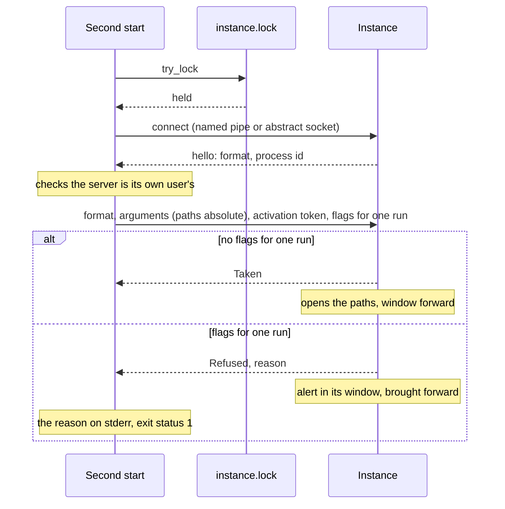

# 0089. One instance and one window per user data folder

## Context

Each start of the app is a process of its own, with one main window holding one place ([0046](0046-sidecars-are-the-truth-folder-mode-library-and-project.md)). So two processes can run on one user data folder, each writing `settings.toml`, `state.toml` and the same photos' sidecars. On Windows, Explorer starts the app once for each file opened with it, so several raws opened together open as one photo each, in as many apps.

The questions: how many processes and main windows run on one folder; how a second start reaches the running one, and what it may send; where a file opened from outside goes; and what a different `--user-data-dir` means. The constraints: no C library ([0005](0005-rust-and-no-c-or-c-unless-no-rust-option-exists.md)); only the user's own account may reach the running app; and each platform's own way of opening files: macOS's LaunchServices, Windows' Explorer starting a process per file, Linux's desktop entry.

## Decision

**One process and one main window per user data folder,** its canonical path ([0043](0043-settings-and-apertrusts-folders.md)).

- The CLI stays a separate process, with no lock.
- An open from outside replaces the window's place, as [0046](0046-sidecars-are-the-truth-folder-mode-library-and-project.md) has it.
- Several main windows are not planned (Options considered).
- The single-instance hand-off is built, but for the switch test's measurement, which waits for Windows.

### The lock

- **`instance.lock`** in the user data folder, held for the whole run with the standard library's `File::try_lock`. The start that takes it is the instance, and the system releases it when the process ends, a crash included. The file holds nothing else.
- **It is the guard against two writers** on every platform, whether or not a channel exists.
- **No lock and no hand-off** for `--help`, `--version` or `--list-adapters` (Settings' helper, which the instance itself starts, [0082](0082-hardware-acceleration-the-backends-the-graphics-card-and-the-api-as-settings.md)).
- **Restart now** ([0082](0082-hardware-acceleration-the-backends-the-graphics-card-and-the-api-as-settings.md)) releases the lock and the channel before it starts the next process, so that process becomes the instance.

### The channel, Windows and Linux only

`<hash>` is the first 16 hex digits of BLAKE3 over the canonical path.

- **Windows:** a named pipe, `\\.\pipe\apertrust-<hash>`. It is created as the first instance of its name, open to the user's own account alone. The second start sends only to a server whose process runs as the same user (`GetNamedPipeServerProcessId`, then the process's token).
- **Linux:** an abstract Unix socket, `apertrust-<uid>-<hash>`, from the standard library's `std::os::linux::net`. It has no file, so there is no directory to check, no stale socket after a crash and no path length limit.
  - The instance refuses a connection from another user (`SO_PEERCRED`).
  - The second start reads the server's credentials the same way and sends nothing to another user's server: it says so on stderr and exits with status 1.
  - Another user who takes the name first can only stop the hand-off, never receive paths.
- **macOS:** no channel. LaunchServices delivers Open With, a double-click and a Dock drop to the running app as an open-documents event ([0046](0046-sidecars-are-the-truth-folder-mode-library-and-project.md)), and activates it. A second start of the binary that finds the lock held, from a terminal for example, is refused before anything else: a message on stderr saying Apertrust is already running with that folder, and exit status 1.

### The hand-off, Windows and Linux

- **It comes first:** a start takes or checks the lock and hands off as soon as it has read its command line, set up the log and found its folders, before the settings, the GPU or a window, so a second start lives only milliseconds.
- **The instance** binds the channel right after taking the lock, before its first window opens. Hand-offs that arrive before that window shows join its own command line into one open, however long the start takes.
- **The message:**
  - a format version;
  - the second start's arguments, its paths already made absolute against its own working folder, so that Windows' drive-relative paths such as `C:IMG_1.ARW` resolve as it meant them;
  - its activation token;
  - its flags for one run.

  The answer is Taken or Refused, with the reason. A second start whose format the instance does not speak, another build on the folder, is refused, saying another version is running.
- **No answer:** a second start that cannot connect while the lock is held retries for 2 s, then says on stderr that the instance is not answering, and exits with status 1.
- **Windows' Explorer:** Open With is offered for one file alone. Several files come through Send To, one start with every file, or through Open where Apertrust is a type's default: the verb has `MultiSelectModel=Document`, which starts a process per file, each handing off, for up to 15 files, Windows' limit for a command-line verb with that model, more going through Send To; `Player`, one invocation for the whole selection, would pass a command line's `%1`, the first file alone. `DelegateExecute` (Options considered) receives the whole selection in one call.
  - The instance joins hand-offs that arrive within 500 ms of the one before into one open, its own command line included; while the instance is starting, every hand-off joins.
  - **The switch test** opens 15 raws with Open, Apertrust the type's default, on Windows 11, with the app closed and running, and records the largest gap between the hand-offs' arrivals at the instance, the gap the join times. Above 250 ms, half the join's interval, Explorer's `DelegateExecute` verb replaces the join before the first release. Send To cannot stand in for it, being one start.
- **Linux's desktop entry** passes every file, `%F`, in one start, which hands off.
- **Focus:** on Windows the second start calls `AllowSetForegroundWindow` with the instance's process id, which the instance sends first; on Linux it passes `XDG_ACTIVATION_TOKEN` on Wayland (xdg-activation) and `DESKTOP_STARTUP_ID` on X11. A second start with no paths, a launcher's click, brings the window forward.

### Flags for one run

A start with flags for one run (`--safe-mode`, `--conf`, `-d`, a `--cache-dir` naming another folder than the instance's, and any such flag the app gains, an adapter or `--max-binding`) while an instance runs on its folder is **refused**:

- on Windows and Linux, an alert in the instance's window, brought forward, saying Apertrust is already running with that folder and must be quit first, plus the same words on stderr and exit status 1; on Windows the alert is planned, waiting for the app's alerts there, and until then the window is still brought forward and the words go to stderr;
- on macOS, the stderr refusal above.

Such a start is never handed off with its flags dropped, and never runs as a second writer.

### Another user data folder

Another `--user-data-dir` is a **separate instance of the same application**: its own process and lock, so two starts on one folder share an instance and different folders run side by side, but the same app id, `org.apertrust.Apertrust`, icon, Dock and taskbar grouping and file associations.

- **On Windows and Linux** opens from outside start with no `--user-data-dir`, so they reach the instance on the folder such a start uses: `APERTRUST_USER_DATA_DIR`'s where the desktop session sets it, else the platform's.
- **On macOS** an instance on another folder takes an open-documents event LaunchServices delivers to it, as any instance does. It starts from a terminal (`open -n -a Apertrust --args --user-data-dir DIR`, or the binary).
- **Its window's title ends with the folder's name,** "Apertrust — work", and the default folder's shows none. The default is the platform's folder, compared by canonical path.
- **A truly separate application** is Apertrust Nightly's model, its own identity and folder ([0043](0043-settings-and-apertrusts-folders.md), [0068](0068-packages-built-by-cargo-packager.md)).
- **Two instances opening one library or folder** rely on the library cache's lock and the sidecars' rules ([0052](0052-comparing-two-copies-of-a-sidecar.md), [0054](0054-four-layers-for-the-librarys-code.md), [0076](0076-the-cache-kinds-limits-and-control.md)), as the CLI does.

## Options considered

- **A process per start, as now:** two writers on one folder's settings, recents and sidecars, and Windows' starts per file never open together.
- **Several main windows, one per place:** they need the main window moved off eframe onto the app's own winit host, several sessions on one engine thread with one edit per photo shared between windows, and per-platform close and quit rules, all for a feature darktable has never had. The hand-off is what they would build on, if they are wanted later.
- **The lock alone, every second start refused:** Explorer's raws opened together would give one photo and an error for each of the others.
- **The channel alone, with no lock:** macOS has no channel, and on Linux another user who binds the name first would make every start think an instance runs. The lock, in the user's own folder, decides which start is the instance.
- **A socket file on Linux and macOS:** it needs checks of the directory's owner, mode and ACLs, a fallback directory another account could take first, cleanup of the socket a crash leaves, and the socket path's 104- and 108-byte limits. Linux's abstract socket has none of these, and macOS's LaunchServices already delivers opens to the running app. In the user data folder itself it would also fail on a network file system.
- **Explorer's `DelegateExecute` verb** (`IExecuteCommand`), which hands a whole selection to one call, so no join is needed: a COM server the installer registers and the app serves through `apertrust-display`. It is the fallback, built before the first release if the switch test measures a gap above 250 ms. Not first, since it is a COM server in `unsafe` code and an installer's registration, against gaps that a hand-off made first keeps to milliseconds.
- **D-Bus and GApplication** for the single instance: GLib is C ([0005](0005-rust-and-no-c-or-c-unless-no-rust-option-exists.md)), and Linux only.
- **A single-instance or IPC crate** (`interprocess` and the like): a dependency for what the standard library's abstract socket and a few Win32 calls in `apertrust-display` do.
- **Handing a start's flags for one run to the instance, or ignoring them:** a flag typed for the run silently does nothing, where a folder or adapter typed for the run is never ignored ([0043](0043-settings-and-apertrusts-folders.md)). **Running such a start as a second instance on the folder:** a second writer.
- **A different user data folder as a separate application,** with its own id: a second Dock icon and its own file associations for a second set of settings; that is the model for a separate build, Apertrust Nightly.

## Consequences

- [0043](0043-settings-and-apertrusts-folders.md): one instance per user data folder, `instance.lock` in it. [0046](0046-sidecars-are-the-truth-folder-mode-library-and-project.md): an open from outside replaces the window's place, and Windows' raws opened together open together once the hand-off is built. [0068](0068-packages-built-by-cargo-packager.md): `MultiSelectModel=Document` in `packaging/windows/installer.nsi`, one app id for every user data folder. [0076](0076-the-cache-kinds-limits-and-control.md): the cache shared only by instances on other folders given the same cache folder, and the CLI. [0082](0082-hardware-acceleration-the-backends-the-graphics-card-and-the-api-as-settings.md): the instance lock before the start's marker; Restart now releasing it first.
- Code: the app's `instance` module (the lock, the message, the join, the refusal), Linux's abstract socket through the standard library, Windows' named pipe, `AllowSetForegroundWindow` and, where winit lacks it, activating the window with another process's token in `apertrust-display`; the user data folder's name in the window's title.
- Tests: the hand-off between two processes of the app on a temporary user data folder (taken, refused, no answer, another format; on Linux a connection from another user refused and a second start refusing to send to a server of another user; on macOS a second start refused); the join's timing as a pure function, the hash and the canonical path, paths made absolute, Windows' drive-relative ones among them, the refused flags; the switch test, LaunchServices and the activation tokens by hand on each platform.
- Built in one step, a pull request ([roadmap.md](../roadmap.md#the-window-and-the-shell)).
- Docs: [gui.md](../gui.md#instances-and-windows), [settings.md](../settings.md#user-data-folders), [cache.md](../cache.md#two-processes-at-once), [library.md](../library.md#one-photo), [packaging.md](../packaging.md#opening-a-raw-from-the-system), [architecture.md](../architecture.md) and [roadmap.md](../roadmap.md#the-window-and-the-shell).
