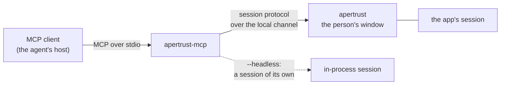

# 0108. Agents through apertrust-mcp, joining the app's session

## Context

[0058](0058-a-native-engine-every-client-through-the-session-protocol.md) made MCP a thin client of the session protocol, through `rmcp`, allowed by the person and read-only unless writes are allowed (principle 8). It left open where MCP runs and how it reaches the running app, what an agent shares with the person and what is its own, what happens during the person's drag, how the agent's changes enter the history and what it may undo, how the person consents, and how the agent learns of the person's changes.

The constraints:

- **The person sees the agent's edits live,** in the window they have open, in the same history, and can undo them ([0078](0078-undo-redo-and-the-edits-history.md)).
- **Only the person's own account reaches the app,** as [0089](0089-one-instance-and-one-window-per-user-data-folder.md) holds for the single-instance hand-off; no browser page, other user or other machine.
- **MCP revision 2026-07-28** ([the specification](https://modelcontextprotocol.io/specification/2026-07-28)) is stateless: no `initialize` handshake and no session id. A server pushes only list changes and `notifications/resources/updated` through `subscriptions/listen`. Its security best practices tell a local server to use stdio, or IPC restricted to the user, over a port on localhost. Its tools page asks for a human in the loop and requires a server to rate-limit tool calls.
- **One session per window** ([0037](0037-one-view-the-photos-tab.md)): the selection and the active photo are the session's, one `View` per session ([0099](0099-the-zoomed-view-a-detail-pipeline-beside-the-fitted-one.md)), one active picker ([0079](0079-colour-pickers-one-api-for-tools-and-the-colour-picker.md)).

## Decision

**Agents reach Apertrust through `apertrust-mcp`, a program of its own that speaks MCP over stdio and joins the running app's session over a local channel, as a remote client of the session protocol.** Everything is planned for Phase 6 with MCP, but for two foundation pieces planned now (9 below). [session-protocol.md](../session-protocol.md#agents) holds the details.

### 1. Where MCP runs

- **`apertrust-mcp`** is the binary of the planned `apertrust-mcp` crate, beside the library it runs ([0006](0006-two-programs-on-three-desktop-platforms.md)). There is no `apertrust-cli mcp`.
- **It speaks MCP over stdio,** through `rmcp`. Its stdout carries JSON-RPC alone; logs and the debug domains go to stderr.
- **It joins the app's session over a local channel,** speaking the session protocol ([0059](0059-one-event-system.md)'s remote protocol, of which it is the first client): JSON commands and events tagged by `type`, binary frames and stills, `Hello` and `Welcome`.
- **The app never speaks MCP itself.** It serves the session protocol on the channel, and checks and enforces what each connection may do. It has no HTTP endpoint. A client that needs a URL would get a shim over this channel, if one is ever needed.

### 2. The local channel

A second endpoint beside [0089](0089-one-instance-and-one-window-per-user-data-folder.md)'s single-instance hand-off, with its own name and format version; the hand-off stays as it is. **The app binds it only while Allow assistants to connect is on,** so with the setting off there is no listener. `<hash>` is the hand-off's, the first 16 hex digits of BLAKE3 over the user data folder's canonical path.

| Platform | The channel | Who may connect |
| --- | --- | --- |
| Windows | A named pipe, `\\.\pipe\apertrust-mcp-<hash>`, created with `FILE_FLAG_FIRST_PIPE_INSTANCE`, so the app's bind fails, binding nothing, where another process already holds the name, and with `PIPE_REJECT_REMOTE_CLIENTS` | A security descriptor for the current user alone; the app checks the client's token, and `apertrust-mcp` checks that the server's process runs as its own user (`GetNamedPipeServerProcessId`, then the process's token) |
| Linux | An abstract Unix socket, `apertrust-mcp-<uid>-<hash>` | `SO_PEERCRED`, checked both ways, as the hand-off's |
| macOS | A Unix socket in the per-user temporary folder, `confstr(_CS_DARWIN_USER_TEMP_DIR)`, mode 0700, named by the hash | `getpeereid`, checked both ways; a stale file is removed as the app binds when nothing answers on it |

- **macOS gets a socket file here.** [0089](0089-one-instance-and-one-window-per-user-data-folder.md)'s reasons against one for the hand-off do not apply in that folder: it is the user's own, made by the system with mode 0700, so no directory to check and no fallback another account could take; its path is well under the 104-byte limit; and it is never on a network file system.
- **Flatpak and Snap:** an abstract socket belongs to a network namespace, so a sandboxed app and an adapter outside the sandbox would not meet. There the channel is a socket file in a runtime folder both share, decided with Linux's packaging.
- **Limits:** a message from the adapter over 4 MiB, or one that is not a protocol message, closes the connection, the app's stills to it being binary messages of the size `Render` asks, which the session caps; a connection that sends no `Hello` within 5 s is closed; an idle one closes after 10 minutes with a notice saying so, and the adapter reconnects on its next call, its approval and its `ClientId` kept for the app's run through a token the app gives the adapter as it approves, held in the adapter's memory alone, so its own changes stay its own for Undo.
- **The adapter rate-limits every tool call, reads and renders as well as edits,** as MCP's tools page requires of a server; each batch already renders one frame ([0017](0017-threads-and-the-engines-session.md)), and an agent's renders are one in flight per client ([0059](0059-one-event-system.md)).

### 3. With no app running

- **Without `--headless`,** `apertrust-mcp` tries the folder's `instance.lock`, letting it go at once where it takes it. Free: each MCP tool answers "Apertrust isn't running; open it to edit live". Held, with no channel to join: "Apertrust has this folder open with assistants not allowed (Settings › Assistants), or another assistant has it open headless".
- **`--headless`** starts a session of its own in the adapter's process, as `apertrust-cli export` does, on a software GPU where there is no hardware one ([0007](0007-a-software-gpu-instead-of-a-cpu-path.md)). It is never a silent fallback: a person editing live would not see what the agent did.
- **A headless run holds the user data folder's `instance.lock` while it runs,** so the app refuses to start on that folder meanwhile, with [0089](0089-one-instance-and-one-window-per-user-data-folder.md)'s refusal worded for an assistant: on Windows and Linux the adapter answers the hand-off channel with Refused and that reason, and on macOS the refusal says that Apertrust or an assistant has the folder open. A headless run on a folder the app holds is refused the same way. A run with its own `--user-data-dir` works beside the app.

### 4. Shared and per client

| State | Shared or per client |
| --- | --- |
| The edit, its values and the history (`Values`, `History`) | Shared: the point of joining |
| The selection and the active photo (`Selection`) | Shared, read under View; changed only under Photos ([0037](0037-one-view-the-photos-tab.md)) |
| `View`, `Resize`, `Hide` and `Scopes` | The person's: they act on the one view every client shares, so an agent never sends them, and the session refuses them from an assistant's connection (`Access::Person`, 7 below) |
| Renders | Per client: a planned `Render { size, region }`, answered by a still of the client's own topic, which MCP returns as an image |
| Scopes and readouts, stored samples | Per client, as renders |
| `ExportPreview` | Per client, as [0090](0090-export-as-a-photos-tab-tool.md) has it |
| The live picker | The person's ([0079](0079-colour-pickers-one-api-for-tools-and-the-colour-picker.md), [0104](0104-cursors-one-chosen-at-a-time-in-a-well-on-the-toolbar.md)): `Picker`'s `On`, `Point`, `Area`, `Switch`, `Reset`, `Settings`, `Channel` and `Off` are `Access::Person`; the agent picks with `Picker(Once)` alone, refused as `PickerInUse` while the person's picker is on, never turning it off |

- **Client identity from the start:** every connection, the app's in-process handle among them, has a `ClientId`, and each command is tagged with it as it enters the inbox. A fact of a per-client topic names its client and goes to it alone, extending [0090](0090-export-as-a-photos-tab-tool.md)'s rule for `ExportPreview` to every per-client fact; a refusal goes to the client whose command it names; `Sync` sends the shared facts and the client's own.
- **One agent connection at a time** in the first slice. A second asks "Replace *name*?", naming the client connected, in the app rather than being refused silently. Several at once can be added later without changing the identity.

### 5. During the person's gesture

- **While another client's gesture is under way, an agent's command on the edit, its `Picker(Once)`, which writes the edit, and any command of its that would close or replace the open photo (`Open`, `Close`, and a `Selection` that leaves the active photo out or opens another) are refused, `GestureUnderway`.** An agent's `Picker(Once)` already waiting for its reading when another client's gesture begins is ended by that gesture's first change: its reading never writes. The adapter retries for a few seconds, then tells the agent "the person is adjusting *tool*; try again", naming the tool.
- **The person's commands are never refused because of the agent.** The adapter sends edits only as `Step`s holding no `SetControl { done: false }`, each one completed change, so an agent never holds a gesture of its own that the person would cut into.
- **Gestures per client and per tool,** an agent working on one tool while the person drags another, come only if agents are often blocked in practice.

### 6. History

- **Each agent request that edits is one `Step { source: Assistant, note }`,** its note the agent's own words, `Note::Text`: a step of each tool it writes, sharing a batch, so one Undo takes the request back ([0078](0078-undo-redo-and-the-edits-history.md)). The exception is a one-shot pick, sent as `Picker(Once)` alone, since no `Step` holds a `Picker` command. The session sets the source of every `Step` from an agent's connection to Assistant itself, whatever it sends, so no agent's change is recorded as the person's.
- **An Assistant step never merges,** as the merge rule already holds (You or Auto alone), so each request stays one line the person sees and can undo. A setting, Merge an assistant's quick changes, off by default, on Settings › Assistants, folds consecutive Assistant changes to one control within the merge window, as You's and Auto's fold; there the merge rule's "no note" becomes "the same note" of the same client (`ClientId`), so steps with the same note from one connection may merge, and steps with different notes, or from two clients, never do, so one agent's Undo never takes back another's change. The app sends the setting's value to the session.
- **An agent's `Picker(Once)`** is a step of source Assistant with the request's note, not Auto: `Once` carries a source and a note when an agent sends it. Where a command of the person's comes before its reading, the one-shot splits as any does, its turning on a step of its own and its pick another, both the agent's; the agent's Undo then takes back the pick alone, its newest change, and the turning on stays, under the person's change, for the person to undo. This is the one case where a request takes more than one Undo.
- **The person's Undo stays global and linear,** as darktable's: it takes back the newest record, the agent's or the person's.
- **The agent may undo, and redo, only its own newest change,** planned with MCP: today `Undo` and `Redo` are the session's, whoever sends them ([0078](0078-undo-redo-and-the-edits-history.md)). From an agent's connection they are refused, `NotOwnChange`, unless the newest done record, or for Redo the newest undone one, is that connection's Assistant step. The undo record keeps the client that made it, in memory alone.
- **`GoTo`, `Compress`, `Truncate`, `DiscardHistory` and `Reset`** are not offered to agents at first: they are `Access::Person`, and the session refuses them from an assistant's connection.
- **Later, if asked:** Revert this assistant change, for the person, from a History line or the assistant's menu: each tool the step changed put back where it still holds the agent's value, the shape of [0106](0106-presets-and-styles-as-appreset-and-apstyle-files.md)'s Clear Style.

### 7. Consent and access

- **Allow assistants to connect** (Settings › Assistants) is off by default.
- **Each connection is approved in Apertrust's own window,** never through MCP elicitation, which the agent's host shows, but for a remembered client's at View or Edit the open photo and a reconnect within the app's run (below). The sheet shows the client's self-declared name, from `Hello { client }`, and the access it asks; the person answers Allow or Deny.
- **Five levels of access, each including those above it,** and a class for the person alone. The type is `Access`, not "scope", which names the histograms and waveforms of the Scopes tool:

  | `Access` | What it allows |
  | --- | --- |
  | `View` | Reading the values, the history, metadata, renders, scopes readings and the selection; the default, read-only (principle 8) |
  | `EditOpenPhoto`, Edit the open photo | `Step`, one-shot picks |
  | `Photos` | `Open`, `Selection`, and edits of photos that are not open: `Rate`, `SetMetadata` and `ApplyStyle` naming photos, `UndoBatch`, and Undo and Redo, which move a batch on its other photos as they cross it |
  | `Export` | Exports, allowed for the connection once granted; an export writes only new files, by the person's pattern |
  | `Organise` | Move, Copy, Rename and Delete, each put to the person before it runs, every time; and the person's settings and files: `Cache(Clear)`, `Cache(Limit)` and `Library(RawThumbnails)` |
  | `Person` | Never granted to an agent, at any level: the one view and the live picker every client shares (`Resize`, `View`, `Scopes`, `Hide`, and `Picker`'s `On`, `Point`, `Area`, `Switch`, `Reset`, `Settings`, `Channel` and `Off`), and the history's commands not offered to agents at first (`GoTo`, `Compress`, `Truncate`, `DiscardHistory` and `Reset`) |

  A command whose effect depends on the session's state takes the most it can do; the session may narrow it later. Each command inside a `Step` is checked against its own class, so a `Step` holding `Reset` is refused whole, `NoAccess { needs: Person }`, applying none of its commands. `apertrust-mcp --access LEVEL` names the level it asks for and lists only that level's MCP tools; `view` by default. A command beyond the access granted is refused, `NoAccess { needs }`. An Organise command reaches the person as a question and runs on their answering command, as [0059](0059-one-event-system.md) has every question asked.
- **Remembering a client:** by its self-declared name, for View and Edit the open photo alone: a remembered client connects at that level with no sheet, in later runs of the app too, and so does any process of the same account that sends the name, which is why higher levels are never remembered; Photos, Export and Organise always ask again. A reconnect within the app's run keeps its approval through the token above. Settings › Assistants lists the remembered clients, each with Forget. A higher level may be remembered only if MCP clients gain a real way to prove who they are.
- **The Toolbar's assistant connection** ([0092](0092-the-toolbar.md)) shows the client's name and a busy state while a request runs. Its menu shows the access granted, Disconnect and Undo the assistant's last change, enabled under the agent's own-change rule. Disconnect closes the connection and refuses its queued commands; what it applied stays, for the person to undo as any step. The History tab tags Assistant steps.

### 8. What the agent learns of changes

- **Tools first.** `get_state` returns the open photo's values, the history's tail, the selection and `through`. Every editing tool's result carries the new `through`.
- **The guard:** an editing call may carry the `through` the agent last saw, `Step { seen, .. }`, and is refused, `Stale`, when the open photo's edit changed after it, or another photo opened after it: the adapter answers "the photo has changed; read it again".
- **Resources later,** with `subscriptions/listen` and `notifications/resources/updated`, once the major MCP clients forward them to the model.
- **MCP tools generated** from the tools' definitions and `LibraryCommand`'s schema, each with a real JSON Schema, grouped by level of access, never hundreds of free-form tools. A tool result that is a render is MCP image content.

### 9. The foundation, planned now

- **108.1 The protocol's types serializable:** `Command`, `Event` and what they carry, with a test that every command and event goes to JSON and back unchanged, built through exhaustive matches so a new variant must join it. `Frame`'s GPU buffer is the known exception: an encoded frame for remote clients.
- **108.2 `Command::access()`,** returning `Access`: each command's class through an exhaustive match beside `on_edit`, so each new command states where it belongs, one of the five levels or `Access::Person`, by the table above.

## Options considered

- **MCP hosted in the app, with a stdio bridge passing its bytes through:** the app would carry `rmcp` and MCP's churn between revisions, and `--headless` would need a second copy of the server.
- **Streamable HTTP on localhost in the app:** any local process and a DNS-rebinding page can reach a port, so it needs an `Origin` check and a token file, ports collide between user data folders, and per-connection permissions need authorisation under 2026-07-28.
- **Loopback TCP, with a token or none:** a fixed port collides with a second instance; with no token any local process, under any account, drives the app; a token needs a file only the user can read, where a pipe or socket restricted to the user needs none.
- **XPC or Mach ports on macOS:** a launchd service and C or Objective-C APIs ([0005](0005-rust-and-no-c-or-c-unless-no-rust-option-exists.md)), for what a Unix socket in the per-user temporary folder does with `getpeereid`.
- **`apertrust-cli mcp`:** an MCP client launches a command; a program of its own keeps stdout for JSON-RPC alone from its first byte, and carries none of the CLI's subcommands.
- **A silent headless fallback when the app is closed:** the person would not see the agent's edits, while expecting to.
- **Headless with no lock:** the app could start on the same folder meanwhile, two writers on its settings and sidecars.
- **Assistant steps merging as Auto's do:** an agent's requests would fold into one line the person did not see made.
- **The agent undoing anything:** its Undo would take back the person's own newest change.
- **Remembering a client at any level:** names are self-declared, so a forged name would gain exports and moves without asking.
- **Several agents at once now:** more to show and to test before one has been used.
- **Resources alone:** whether the major clients forward `resources/updated` to the model is not known, so an agent would learn nothing.
- **Today's gesture rule,** another client's command ending the person's gesture: the person's drag split into two steps, the slider under their hand jumping to the agent's value.

## Consequences

- [0006](0006-two-programs-on-three-desktop-platforms.md): three programs, `apertrust-mcp` the third. [0058](0058-a-native-engine-every-client-through-the-session-protocol.md) and [0059](0059-one-event-system.md): MCP through `apertrust-mcp` over the local channel, the remote protocol's first client. [0078](0078-undo-redo-and-the-edits-history.md): an Assistant step never merges, but with the setting. [0079](0079-colour-pickers-one-api-for-tools-and-the-colour-picker.md): an agent's `Once` of source Assistant. [0089](0089-one-instance-and-one-window-per-user-data-folder.md): the second channel, and a headless adapter holding the lock. [0099](0099-the-zoomed-view-a-detail-pipeline-beside-the-fitted-one.md): one view per session, an agent rendering its own.
- Code, planned: `apertrust-mcp`'s library and binary; the engine's protocol module with the remote side (queues, coalescing, client identity, per-client topics, `GestureUnderway`, `Stale`, `NotOwnChange`, `NoAccess`, `PickerInUse`); the app's listener, approval sheet, Settings › Assistants and the Toolbar's connection; the app's side of the channel's platform calls (the named pipe's security descriptor and token check, `getpeereid`) in `apertrust-display`, as the hand-off's, and `apertrust-mcp`'s checks of the server placed with that crate by [0065](0065-names-and-crates.md)'s rule, so it never links the window's code.
- Tests: the round-trip of every command and event (108.1); `access()` over every command (108.2); with Phase 6, the adapter driving the app and a headless session over stdio on a temporary user data folder, a connection from another user refused, the gesture refusal and its retry, the agent's own undo, the `through` guard and the refusals by access.
- Docs: [session-protocol.md](../session-protocol.md#agents), [events.md](../events.md), [history.md](../history.md), [pickers.md](../pickers.md#a-one-shot-pick), [ai.md](../ai.md#agents), [gui.md](../gui.md), [settings.md](../settings.md#the-settings-dialog), [architecture.md](../architecture.md#programs), [crates.md](../crates.md) and [roadmap.md](../roadmap.md).
