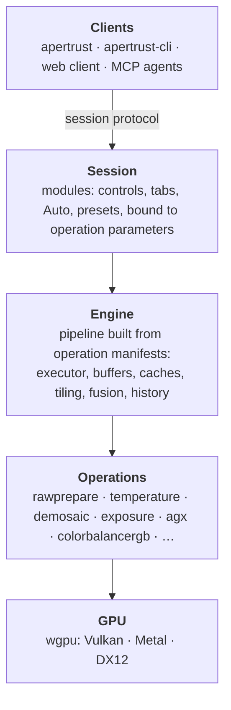
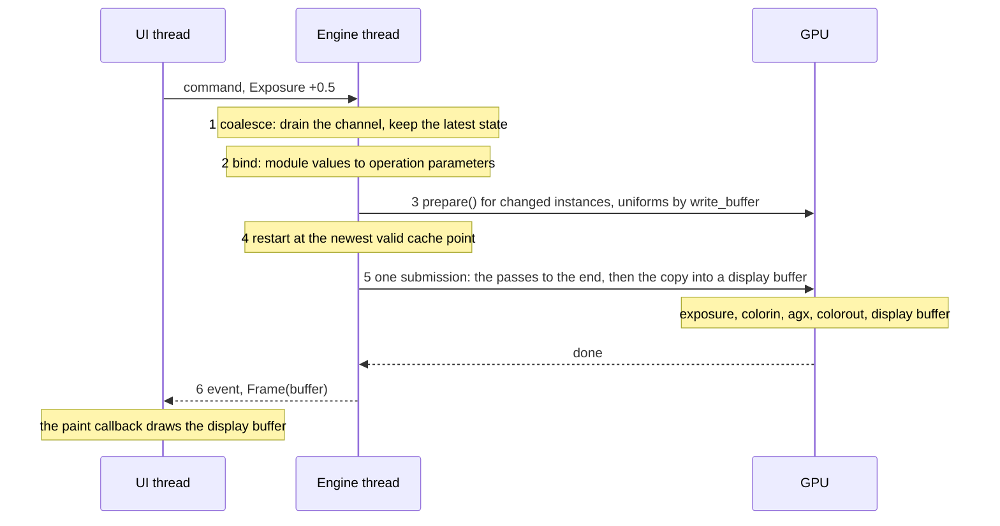
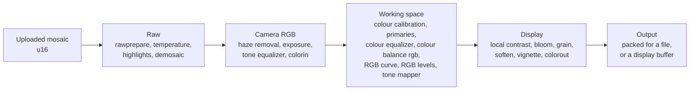
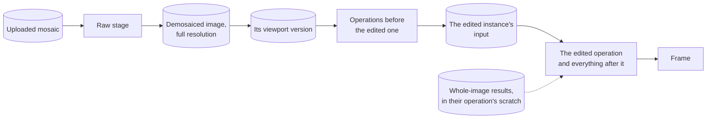
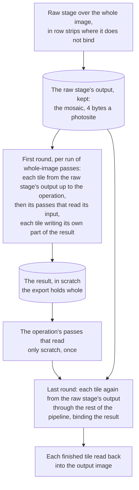
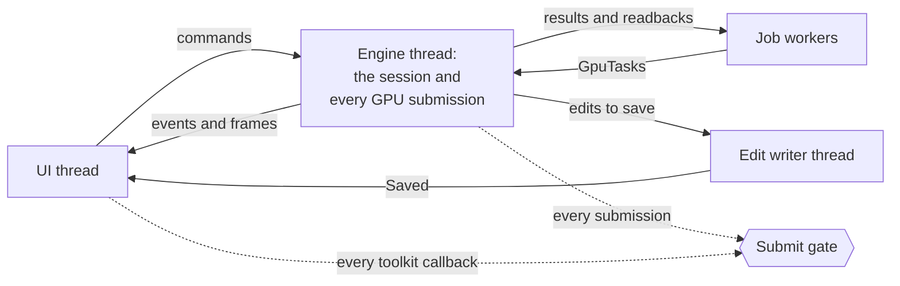
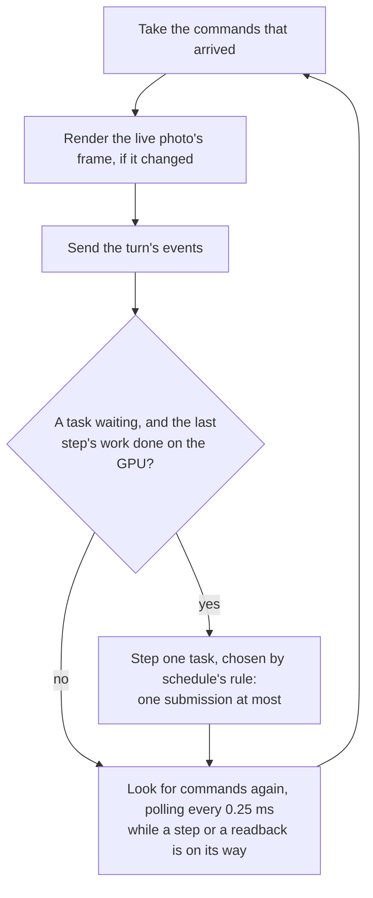

# Engine

The engine turns a decoded raw and an edit into pixels on the GPU: frames for the viewport, their scopes, what operations measure for their modules' panels, files for export, and later masks and gradients. This document describes how its pipeline works.

[decisions/](decisions/README.md) holds the decisions it rests on, and [architecture.md](architecture.md) the design around it. Each crate's state is in [crates.md](crates.md). Statements that follow a recorded decision cite it; the design's own choices are decision 12, summed up under [Choices](#choices).

## Status

The Phase 1 design is built through step 6 of the [build order](#phase-1-build-order). Each part's state:

| Part | State | Sections |
| --- | --- | --- |
| Planning, the viewport and export pipes, caching, export tiles | Built (decisions 12, 13 and 14) | [Planning](#planning), [Pipes](#pipes), [Caching](#caching), [Tiling](#tiling) |
| Modules bound to operations, the session's module commands, `.apxmp` version 1 | Built in `apertrust-modules` and the engine's `edit`, `session` and `sidecar`, a rebuild keeping its kernels and cache points (decision 28); the built-in modules arrive with Phase 2's module panels | [Caching](#caching), [Session and threads](#session-and-threads), [Edits](#edits) |
| Where Phase 2's operations sit | Built and tested, at darktable's places (decision 22) | [Order](#order) |
| Whole-image passes of any size, the tone equalizer's mask among them | Built: at every pipe's scale, in two rounds of tiles after demosaic, keyed apart from their operation's other passes in the viewport (decision 15) | [Pipes](#pipes), [Caching](#caching), [Tiling](#tiling) |
| Scopes | Built: each frame counted on the GPU, read back without waiting (decision 19) | [Scopes](#scopes) |
| Readouts | Planned: what an operation measures for its module's panel, the tone equalizer's mask histogram first (decision 19) | [Readouts](#readouts) |
| Spatial operations after demosaic | Planned: each declares its reach, export tiles are worked backward through them, with an untiled fallback (decision 13) | [Regions](#regions), [Tiling](#tiling) |
| Geometry | Built: the `Geometry` interface and the planner's walk, tested on two test-only operations, orientation's groundwork, and orientation (`flip`), the first real geometry. Planned: crop and the warps (decision 16) | [Geometry](#geometry) |
| Jobs | Built: darktable's control jobs in `apertrust-base` and the session's share of the GPU (decision 57) | [Jobs](#jobs) |
| Export jobs | Built: the writers, darktable's size and resample, whole-image passes after a resample, the settings, darktable's variables, File on disk, the job and the dialog's preview. Planned: the rest (decision 56) | [Export jobs](#export-jobs) |
| Opening a photo | Built in the session: in three stages, a picture at once, the values before the decode, then the live frame; decoding on a job worker, kernels kept across photos; in the app, the picture at once and the values read-only until live (decision 77) | [Opening a photo](#opening-a-photo) |
| Several photos in one session | Planned; spike W1 measures it first (decision 37) | [Session and threads](#session-and-threads) |
| Fusion | Open: a Phase 2 spike decides (decision 8) | [Fusion](#fusion) |

## What the engine does

- Holds an open image: the raw on the GPU, its metadata and its edit. With several photos on screen (decision 37, planned), the session holds every photo the window shows: the active one live, the others as stills.
- Turns the edit into operation parameters, through the modules' bindings (decisions 4 and 28).
- Plans and runs renders for each pipe: viewport frames and exports. Runs export jobs beside the viewport, one at a time, and writes their files (decision 56, [Export jobs](#export-jobs)).
- Owns every GPU buffer and texture it uses, and the caches kept between renders.
- Answers session commands with events (decision 17).

It knows nothing about egui or windows. Clients reach it only through session commands (AGENTS.md, engine–UI separation).

**How it is shaped:**

- **A scene-referred, float32, linear pipeline,** an internal graph with a linear presentation to the user.
- **Declarative schemas drive it,** one per operation and one per module. Each operation parameter declares its range, unit, meaning, description and grouping. Each module declares its controls, tabs and Auto, and binds them to operation parameters (decisions 4 and 28). From module definitions come the UI's controls, presets, undo history, the edit format and the MCP tools; operation schemas tell the engine what to validate, migrate and fuse. People and agents operate the same modules through the same interface ([The module layer](#the-module-layer)).
- **Edits** are stored as an ordered, serialisable, diffable list of module values, from which the operations' parameters are derived ([Edits](#edits)).
- **Caching at a few points,** chiefly the input of the operation being edited, so dragging a slider reruns that operation and the passes after it. Caching every node's output cannot fit at 60 MP, where one RGBA fp32 buffer is about 1 GB ([Caching](#caching)).
- **A viewport pipe** at the view's size beside the full-resolution export pipe, and tiling ([Pipes](#pipes), [Tiling](#tiling)).
- **Background work as darktable's control jobs** (decision 57, [Jobs](#jobs)). The session owns one control, steps each job's GPU work one submission after the live frame, and reports jobs as `Event::Job`. Export and a folder's reading are its callers today; thumbnails, stills, import, copy, move, rename and delete are to be, each on darktable's queue.



## Terms

| Term | Meaning |
| --- | --- |
| Operation | One algorithm in the engine, usually a darktable port, with its manifest, schema, `prepare` and Slang source (decisions 4 and 20) |
| Instance | An operation at its pipeline position, for the background or, from Phase 4, for one layer |
| Pass | One compute dispatch of one kernel entry point; an operation runs one or more |
| Whole-image pass | A pass that must see the whole image at the pipe's scale before its operation's later passes run, writing its result, of any size, into the operation's scratch buffers: a statistic's or the tone equalizer's mask grid (decision 15) |
| Readout | What an operation measures of the photo for its module's panel, as darktable's GUI does from its preview pipe: a pass of its own in the viewport alone, outside the operation's passes, whose counts the session reads back and the operation decodes into plain data, such as the tone equalizer's mask histogram (decision 19) |
| Fused group | Consecutive per-pixel passes compiled into one dispatch (Phase 2, decision 8) |
| Stage | A stretch of the pipeline with one data format; an operation's slot names the stage it reads |
| Region | A rectangle in a stage's coordinates, at a scale |
| Reach | The pixels beyond its output region, at the pipe's scale, that an operation's output reads, all its passes together: darktable's tiling overlap, from the parameters and the scale (`Operation::reach`, decision 13) |
| Extent | A stage's image at full resolution; geometry changes it, so stages differ in size (decision 16) |
| Pipe | One kind of render with its own size and plan: the viewport pipe and the export pipe |
| Plan | A pipe's instances, passes, regions and buffers, worked out before it renders |
| Cache point | A buffer kept between renders, with a key that says which inputs produced it |

## The GPU

The pipeline runs on wgpu with kernels written in Slang, compiled ahead of time to WGSL, and stays resident on the GPU (decisions 8 and 9). Without a hardware GPU the same kernels run on a software one ([Software GPUs](#software-gpus)).

**wgpu** gives one API over Vulkan, Metal, DX12 and browser WebGPU (decision 8). It already solves the host-side problem darktable's RFC #22732 proposes to build by hand, and it uses Metal natively on macOS, avoiding the MoltenVK problems vkdt ran into.

**Slang to WGSL** (decision 9). Real modules and generics suit a colour-maths library shared by 60 or more operations, where WGSL has no imports and no generics. Ports read almost line for line like darktable's OpenCL, so review is fast. Automatic differentiation lets the editor fit parameters. Slang's other selling point, one source to SPIR-V and Metal, does not apply here: wgpu and naga already take one WGSL source to every backend.

- Kernels compile to WGSL only, fed to wgpu on every platform.
- The generated WGSL is committed, so diffs show GPU changes and builds need no `slangc`.
- naga validates every generated kernel in CI.

**The kernel spike's result:** speed does not separate the two. Slang's WGSL runs as fast as hand-written WGSL on the M4, the RTX 5060 and the Radeon 780M, and Slang compiled straight to Metal gains nothing on the M4. Slang stands on autodiff, modules and generics. Its autodiff generated gradient kernels for exposure and colour balance rgb on the first try; all six gradients match finite differences to 3e-3 or better over a 10 MP image, once two defects in Slang's generated derivatives were worked around: `pow`'s derivative is zero below 1e-6, and the backward pass recomputes a branch condition that Metal's fast maths can flip.

**Pipeline rules,** from RFC #22732's lesson that redundant copies cost more than the API:

- **GPU-resident:** upload the raw once, keep every intermediate buffer on the GPU, no host round trip between operations. Every operation has a GPU path; a CPU version is only a test reference.
- **Storage buffers by default;** textures only where hardware sampling helps (lens correction, rotation, resampling). Geometry interpolates in its kernel with darktable's interpolators, since hardware filtering's precision differs between GPUs (decision 16).
- **fp32 only.** Any fp64 in a darktable kernel is redesigned, not translated.
- **No NaN checks.** WGSL may assume NaN and infinity never occur; inputs are sanitised at operation boundaries.
- **No write at a run-time index** to a local vector component or array element (decision 10). FXC, the Direct3D 12 shader compiler the engine pins, fails on the vector component, as Windows CI showed; a local array's element, and a vector component in workgroup memory, are refused until tested on Windows. Private variables count as local; workgroup array elements and storage buffers are allowed. `add_at` and `set_at` (`crates/plugin/slang/components.slang`) write a component without indexing. The engine's naga test checks every kernel on every machine, and the engine will check third-party kernels at load.
- **Unified memory:** zero-copy needs wgpu's native mappable-buffers feature; otherwise one staging copy per image.

**Memory bandwidth is the budget** (decision 8). A simple per-pixel operation is memory-bound: its time goes into reading and writing the image, not into its arithmetic, so one full-image pass costs about the same whatever the operation does.

| GPU | One pass at 10 MP | At 60 MP |
| --- | --- | --- |
| RTX 5060 | 0.87 ms | about 5 ms |
| Radeon 780M | 4.6 ms | about 27 ms |
| Apple M4 | about 5 ms | about 29 ms |

Fifteen operations and their layer instances at one pass each would take several hundred milliseconds per full-resolution render on the integrated GPUs. So:

- **Fuse chains of per-pixel operations** (exposure, colour calibration, colour balance rgb, the tone mapper, curves, and their layer instances) into one kernel that reads and writes the image once. Spatial operations (demosaic, denoise, blurs, lens correction) end a chain. Fusion arrives with interactive editing in Phase 2; until then each operation is one pass (decision 22; [Fusion](#fusion)).
- **Every per-pixel kernel** separates its once-per-image setup (such as exposure's scale) from a pure per-pixel function, and both from the entry point, so a fuser can chain the functions. Slang's autodiff wants the same split.
- **Integrated GPUs set the target** (M4, Radeon 780M). While editing, the engine renders at viewport resolution, or only the visible region at 100%; full resolution is for export.
- **To measure:** packed RGB at 12 bytes a pixel instead of RGBA at 16. Alpha passes through every operation unused, and layer masks are separate rasters, so this would cut every memory-bound pass by a quarter. WGSL pads `array<vec3<f32>>` to 16 bytes, so kernels would index a flat `array<f32>`.

**Reusing darktable's modules means porting, not linking.** darktable's iop files mix GTK UI code, introspection-generated parameter structs and OpenCL kernels. Each port takes a module's `process()` maths and translates its OpenCL kernels, which is mechanical and suits agents.

### Kernel languages rejected

- **Plain WGSL:** no imports, no generics, no overloading of user functions, so a shared colour library turns into copy-paste. Above all, no gradients: each operation would need a hand-written backward kernel kept in sync with the forward one, or finite differences at 2N forward passes per gradient (decision 9).
- **CubeCL** (from Burn) and **rust-gpu:** one language for engine and kernels, but less mature, less known to agents, and no help porting darktable's OpenCL.

## A render, end to end

Dragging Exposure's slider:



1. **Coalesce.** Commands arrive faster than frames while a slider moves. The engine drains its channel, applies every command and renders only the latest state (decision 17).
2. **Bind.** The session turns module values into operation parameters (decisions 28 and 32).
   - Each module's binding is a pure function of its own values, the photo's image context at full resolution and `base`, exactly each operation's `Operation::defaults(image)`. It returns the parameters it sets.
   - One function, `apertrust-engine::edit::instances`, adds them to the operations an unedited photo runs, and plans an optional operation only while a binding sets it.
   - Everything that builds instances uses that function, an empty edit giving the defaults: the session, export and the CLI, the sidecar reader, `apertrust-golden`'s whole-pipeline defaults and the engine's tests of the default pipeline.
   - A module is bound with only its controls off their defaults for the photo, and not at all when it has none. So an edit whose modules are untouched, or set back to their defaults, gives exactly the default pipeline, whatever the bindings do.
   - A setting its module does not own, or one its schema refuses, is an error, never applied.
   - Planned (decision 32): a switched module is bound while it is on, with its values off its defaults, possibly none, and its operation is planned then whatever the binding returns. While it is off it is not bound, so an edit whose switched modules are off gives exactly the default pipeline.
3. **Prepare.** For each instance whose parameters changed, `prepare` computes its uniforms and tables on the CPU, as darktable's `commit_params` does: usually a few hundred bytes, uploaded with `write_buffer`.
4. **Restart point.** Each cache point's key covers everything upstream of it. The render starts from the newest cache point whose key still matches, so dragging exposure starts from the demosaiced image and the raw stage does not run.
5. **Encode and submit.** One command encoder records one dispatch per pass (per fused group from Phase 2), from the restart point to the end. The last pass writes the pipe's output. The same encoder copies it into whichever of the session's two display buffers it did not publish last, with the passes' timestamps for the CPU. So a frame is one submission (`Pipeline::render_then`): one turn at the submit gate a window holds while its surface is reconfigured (`GpuContext::submit`, decision 18; [Session and threads](#session-and-threads)).
6. **Present.** The engine waits on its own thread and names that display buffer in an event. The UI's paint callback reads it pixel for pixel, or scaled while the window resizes (decision 18), while the engine renders the next frame. The queue the threads share orders the drawing after the copy (decision 17, `apertrust-engine::session`).
   - Once a client asks for the scopes, the next submission counts the frame. Its reading follows in an event of its own, never waited for (decision 19, [Scopes](#scopes)).
   - A readout a client asks for, the tone equalizer's mask histogram, is counted inside the render where its key changed, and its reading follows the same way (decision 19, [Readouts](#readouts), planned).

A drag never re-plans: it re-runs part of an existing plan with new uniforms. At viewport size (2400×1600) one pass costs about 1.3 ms on the M4, 1.7 ms on the Radeon 780M and 0.3 ms on the RTX 5060 (the viewport spike).

## Data

**Stages and formats.** Each stage has one data format, and an operation's slot names the stage it reads (decision 21). The stages are decision 22's, at darktable's places ([Order](#order)).



| Stage | Runs | Format | At 60 MP |
| --- | --- | --- | --- |
| Raw | rawprepare, temperature, highlights, demosaic | The mosaic: `u16` as uploaded, one `f32` per photosite after rawprepare | 120 MB, then 240 MB |
| Camera RGB | haze removal, exposure, the tone equalizer, colorin | RGBA `f32`, from demosaic | about 1 GB |
| Working space | colour calibration, RGB primaries, the colour equalizer, colour balance rgb, RGB curve, RGB levels, the tone mapper (AgX) | RGBA `f32`, linear Rec2020, from colorin | about 1 GB |
| Display | local contrast, bloom, grain, soften, vignette, colorout | RGBA `f32`, linear Rec2020 and display-referred, from the tone mapper | about 1 GB |
| Output | packing | RGBA `f32` from colorout, packed to the export's 8 or 16 bits, on the CPU after readback unless spike X1's numbers call for the GPU (decision 56), or copied into a display buffer the viewport draws from (decision 17) | — |

- Storage buffers are used throughout, the viewport's display buffers included (decision 17). Textures only where hardware sampling helps (lens correction, rotation, resampling).
- Geometry interpolates in its kernel as darktable does, never with hardware filtering, whose precision differs between GPUs ([Geometry](#geometry), decision 16).
- Packed RGB at 12 bytes per pixel would cut every memory-bound pass by a quarter, and is still to be measured (decision 8). Phase 1 uses RGBA `f32`, and measures it against packed RGB before fusion fixes the layout (decision 12).

**Kernel bindings.** A pass lists exactly what it binds (decision 21). By convention:

| Binding | Holds |
| --- | --- |
| 0 | input |
| 1 | output |
| 2 | uniforms |
| 3 to 7 | read-only tables |
| 8 and 9 | derivative buffers |
| 10 on | the operation's scratch buffers |

`Pass::per_pixel` binds 0 to 2 and its tables, as every kernel's `main` does. Raw-stage passes read and write mosaics instead of `float4`. Each operation's passes share the scratch buffers it asks for, sized in bytes (decision 21).

**The pass header.** The uniform header is 48 bytes (decisions 12 and 14) and carries the pass's region:

- its size;
- its origin, the corner of its operation's output region in its stage's image at the pipe's scale;
- its full size, that stage's extent at full resolution: the developed image's, or after a geometry its output's (decision 16);
- the scale;
- for a pass in row strips (below), where the windows of its input and output that the engine binds start.

Operations whose maths depends on position (the CFA pattern, vignetting, lens correction, gradients) then compute the same values in a tile, a region, a strip or the whole image.

**Images larger than one binding** (decision 14). A GPU binds only so much of a buffer at once: lavapipe 128 MiB, WebGPU's default as much, WARP 2047 MiB, the M4 all of it. Buffers stay whole, since wgpu makes buffers of up to 2 GiB on lavapipe and WARP.

- **Row strips.** A pass whose input or output is larger than one binding runs in row strips, if it says how (`Pass::strips`): the rows of its image each row of its invocations covers, the multiple of rows its strips keep, and the rows above and below a strip it reads.
- **Each strip is one dispatch,** binding the window of each image the strip reads or writes, its offset aligned to the GPU's `min_storage_buffer_offset_alignment`. The pass header carries the strip's first row as its origin and each window's first 32-bit word as `input_base` and `output_base`; the kernel indexes the whole image less them.
- **Only what does not fit is split.** The planner sizes the strips to the binding and splits only the passes whose images do not fit, so a GPU that binds everything plans as before.
- **Bands of rows.** A pass that binds only scratch, which stays whole, may say how too, as highlights' dilation of its masks does. It then runs in bands of its rows wherever its operation's output does not fit, each band as many rows as a strip binding that image's rows has, binding no window; its kernel finds its rows from the header's origin. So a job's export, which plans strips of a step's size, cuts it into steps as it cuts the passes beside it.
- The raw stage's passes say how. Demosaic runs whole or in tiles of its own. A plan that would bind more than the GPU allows does not fit, and an export or the viewport tiles it.

**Image context.** What `defaults` and `prepare` see besides the parameters (decision 21). `apertrust-engine::raw` builds it from the decode; `prepare` also receives the image it gets, and returns the one it produces.

- The developed image's size and the pipe's scale.
- For a raw, the camera's metadata: sensor size, CFA pattern, black levels, white point, as-shot white balance, D65 matrix, crop, exposure bias and a DNG's linear response limit.
- The camera's identity as darktable's: `make`, `model` (the main name, an alias resolved from rawler's embedded camera files), `alias` (the name the file's camera has) and `iso` (darktable's `exif_iso`, 0 if unrecorded), by which denoise finds its noise profile (decision 24). Each is in darktable's spelling where darktable's differs from rawler's (decision 27).
- The camera's white balance presets from darktable's `wb_presets.json` (`white_balance_presets`, darktable's `dt_wb_data` for the camera in the file's order, looked up by `apertrust-raw`, decision 27).
- The lens corrections the raw carries (`lens_correction`, darktable's four types as darktable stores them, decision 25).
- For `prepare` alone, the pipe's output profile as matrices to and from XYZ D50, `None` meaning the working profile (decision 26).

## Order

Every operation has one place, its slot: the stage it reads and a number (decisions 21 and 22). The planner sorts by stage, then number. Users can neither reorder operations nor add instances outside layers (decision 34).

The order is darktable's v5.0 order (`src/common/iop_order.c`, `v50_order`) throughout in the first pass (decision 22). Each built operation's slot, whether an unedited photo runs it, its place in darktable and the module that drives it are in [crates/operations/order.md](../crates/operations/order.md), a table of its own because `crates/operations/tests/order.rs` reads it and holds it to the manifests.

**Rules** (decision 22):

- An operation keeps darktable's v5.0 number where it keeps darktable's place, and otherwise takes a number between its new neighbours in darktable's list, its spec saying why.
- darktable's place is its position in the list, which is darktable's real order, not its number. Where the two disagree, as lut3d's 36 does, listed after filmic rgb (46.0) and before colisa (47.0), the operation takes a number between its list neighbours, as a departure would, so the numbers keep rising. lut3d's falls between 46.0 and 47.0, chosen if it is ported.
- No two operations share a slot, and the numbers rise with the stages, so the number alone gives the order. `crates/operations/tests/order.rs` holds both, and every built-in operation to this table: its slot and whether an unedited photo runs it, read from the table itself, and `KERNELS` in the same order. A third-party plugin whose slot breaks either rule will be refused at load.
- `apertrust_operations::KERNELS`, documented as in pipeline order, is reordered with the manifests.
- darktable's other operations at 28.5 take numbers after colour calibration, in darktable's list order, when they are ported. RGB primaries, the last of them, is 28.9; diffuse or sharpen, censorize, negadoctor and blurs, which come before it, take numbers between 28.5 and 28.9.

**Fused runs** (Phase 2, decision 8). Spatial and whole-image passes end a run of per-pixel ones. At darktable's place, camera RGB 24.0 (decision 22), the tone equalizer's mask passes need exposure's output whole after the downscale. Its correction then fuses with colorin, colour calibration and everything after it to colorout: one break, after exposure.

### The default pipeline

An unedited colour raw runs nine operations in darktable's order, as a linear chain (decision 22); the graph arrives with layers in Phase 4. The others take their places among them and run only while a module sets them; the diagram shows those Phase 2 adds, dashed. The table above holds every operation with darktable's positions.

```mermaid
flowchart LR
    subgraph raw["Raw: mosaic, one f32 channel"]
        direction LR
        rawprepare["rawprepare 1"] --> temperature["temperature 3"] --> highlights["highlights 4<br/>inpaint opposed"] --> demosaic["demosaic 8<br/>RCD, Markesteijn 1-pass"]
    end
    subgraph camera["Camera RGB, RGBA f32"]
        direction LR
        exposure["exposure 21"] --> toneequal["tone equalizer 24"] --> colorin["colorin 28"]
    end
    subgraph working["Working space, Rec2020"]
        direction LR
        calibration["colour calibration 28.5"] --> balance["colour balance rgb 41.5"] --> curve["rgb curve 42"] --> levels["rgb levels 43"] --> agx["agx 45.5"]
    end
    subgraph display["Display"]
        direction LR
        grain["grain 65"] --> vignette["vignette 68"] --> colorout["colorout 70"]
    end
    output["Output<br/>read back per tile, quantised,<br/>JPEG or PNG with darktable's sRGB profile"]
    demosaic --> exposure
    colorin --> calibration
    agx --> grain
    colorout --> output
    classDef optional stroke-dasharray: 5 5
    class toneequal,balance,curve,levels,grain,vignette optional
```



- **Defaults:** each operation takes darktable's scene-referred defaults. Colour calibration runs on every colour raw, with temperature "as shot to reference" (decision 27); colour balance rgb runs only while its module is used, as in darktable (decision 32).
- **Slots:** every slot is unique, and the numbers rise with the stages, so the number alone gives the order (decision 22).
- **Passes:** one per operation until fusion. A pass takes about 1.3 ms at viewport size and 27 ms at 60 MP on the M4.
- **Buffers:** the mosaic as one f32 channel (240 MB at 60 MP), RGBA f32 after demosaic (about 1 GB). The engine owns every buffer and frees the old one before allocating its replacement.
- **Two resolutions:** full, for export and the 100% view, and viewport, downscaled right after demosaic (decision 12), tile by tile where full resolution does not fit (decision 14).
- **Exports at a size** are resampled as darktable resamples them, with lanczos3 after demosaic, or with high quality resampling before colorout (decision 56; [Export jobs](#export-jobs)). Without high quality, the operations after the resample cover the stage at the export's scale; haze removal is planned to come before the resample, at full resolution (decision 15).
- **Caches:** the demosaiced image, which only raw-stage settings invalidate; its viewport version; and the input of the operation being edited. The full-resolution cache is optional under a memory budget: a viewport in tiles keeps the raw stage's output instead (decision 14).
- **Tiles:** an export tiles when an image exceeds the memory budget or the adapter's buffer limits (decision 13). Regions propagate backwards from each tile, so tiles overlap by the downstream operations' reaches, each from its parameters and the pipe's scale; demosaic writes the region the operations after it need; the operations up to one run whole where no tile takes its reach. Whole-image passes run over the whole image first: in the raw stage before the tiles and, after demosaic, in a first round of tiles of their own, the tiles sized without the scratch the export holds for them (decisions 12, 13 and 15).
- **Strips:** where an image is larger than the GPU binds at once, the passes before the tiles run in row strips, each binding a window of the whole buffer, and a statistic stays the whole image's (decision 14).
- **Orientation:** export will apply the image's orientation with the flip operation, on by default with the EXIF orientation, as darktable's is, once orientation is ported (decision 16).

## Planning

A plan is built when the structure changes:

- an image opens;
- an operation joins or leaves, because a module left its defaults or returned to them, or a switched module turned on or off (decision 32);
- a layer is added (Phase 4);
- a pipe's size, scale or region changes.

A parameter change re-plans only when `prepare` returns a different list of passes, for example when highlight reconstruction changes method.

1. **Instances.** The operations an unedited photo runs (`Manifest::default_enabled`), and every other operation while a module's binding sets one of its parameters or, planned (decision 32), while a switched module owning one of its parameters is on. They come in slot order: stage, then number ([Order](#order); decisions 21 and 22). At one slot, instances run by layer, background first (decision 34).
   - A module at its defaults sets nothing, so an untouched module leaves the plan as it was (decision 28).
   - A switched module that is off is never bound, so it leaves the plan as it was too. One that is on adds its operation at the operation's defaults for every control at its default, which are darktable's and the module's (decision 32).
   - A test holds the operations with `default_enabled` set to exactly decision 22's eight, colour calibration (decision 27) and orientation, darktable's on every image, which at no rotation runs no pass and leaves the plan. Colour balance rgb stays optional, as in darktable, so its module's first step adds it and its gamut mapping (decision 32).
   - In Phase 1 the chain is linear; layers make it a graph in Phase 4.
2. **Passes.** Each instance's parameters resolve over its defaults for the image.
   - **An operation with nothing to do leaves the plan.** One after the raw stage that returns no `Geometry`, runs no pass and returns its input unchanged as its output is not planned, as darktable's `commit_params` disables a piece with nothing to do (orientation at no rotation). So a photo the right way up plans exactly as it would without orientation, its plan's fingerprints and cache keys unchanged.
   - Its `prepare` returns the image it produces, its passes with their kind (per-pixel, spatial with a radius, or whole-image), tables and bindings, and its scratch buffers. Once regions are worked backwards (step 3), `prepare` is told its output region and sees its input region through `ImageDesc`'s extent and origin (decisions 13 and 16).
   - **The output profile** (decision 26). Before any `prepare`, the planner asks every instance for `Operation::output_profile(params)` and puts the last answer, colorout's from its `type`, into the image context as the pipe's output profile. Filmic rgb's v6 and v7 and AgX's "export profile" read it.
   - In the viewport and in stills it is the edit's, never the display's (principle 2, as darktable's darkroom would not).
   - An export's chosen profile replaces colorout's `type` in that export's instances only, as darktable's export does, so the same answer gives it.
   - With no colorout, as in the golden harness's one-instance plans, it is `None`, the working profile.
   - A tiled export plans its parts before the tiles, and its first rounds' tiles, which leave colorout out, with the whole export's profile, which the planner keeps where no instance of a plan answers.
3. **Regions**, worked out backwards from the pipe's output region (below), after the extents forward and the scale from the output's, through any geometry ([Geometry](#geometry), decision 16), and through each operation's reach, which `Operation::reach` gives from its parameters and the pipe's scale before `prepare` runs (decision 13, planned).
4. **Fused groups** (Phase 2): runs of per-pixel passes between spatial ones.
5. **Buffers.** Each operation writes to a working buffer of the region it produces (decision 16), reusing one that fits and is not its input, so a run of same-sized operations alternates between two. Scratch buffers are per operation; cache points get buffers of their own; nothing is allocated during a render.
6. **Cache points** ([Caching](#caching)).

Planning is a pure function of the edit's structure, the image context, the pipe and the GPU's limits (`pipeline::Limits`: the largest binding and buffer, the offset alignment and the budget). It returns the plan as plain data, so it can be tested without a GPU. Each pass's dispatches are part of it: one, or one per row strip with the windows it binds (decision 14).

## Regions

Regions propagate backwards at planning, as darktable's `modify_roi_in` does (decision 12). Each pass maps the region it must produce to the input region it needs:

- **Per-pixel:** the same region.
- **Spatial:** the region grown by the operation's reach on every side and clipped to its stage's image (decision 13).
  - The reach is `Operation::reach(params, image)`: the pixels beyond its output region that its output reads, all its passes together, at the pipe's scale, as darktable's `tiling_callback` gives its overlap from the parameters and `roi->scale`. By default it is the manifest's fixed radius times the scale, rounded up (demosaic's 12, highlights' 1).
  - Non-local means' reach is P + R, its patch radius and its offset table's largest offset after darktable's `scatter`: 16 for test 0027, about 4,700 at darktable's soft limits.
  - A pass's `PassKind::Spatial` radius is its own reach, informational: a sum of passes' radii would overstate a separable filter's.
  - Raw-stage regions are aligned to the CFA pattern: 2×2 for Bayer, 6×6 for X-Trans.
- **Whole-image** (`PassKind::WholeImage`; decision 15): the whole image at the pipe's scale, never a visible region, for every pass that computes the result: what prepares its input, partial results and their combination for a statistic, a grid and its filters for the tone equalizer's mask.
  - The result stays in the operation's scratch buffers, whatever its size: 16 bytes for highlight reconstruction's statistic, about 4 MB for the tone equalizer's grid at 2400×1600 and 60 to 135 MB at 61 MP. It is counted in the plan's memory like any buffer and kept under a key of its own ([Caching](#caching)), so a region or a tile only reads it.
  - Where the image is larger than one binding, the passes that read it run in row strips. Those writing a partial result per workgroup run in strips of whole workgroup rows, each workgroup's result written at its index in the whole image, so the result stays the whole image's (decision 14).
  - **Runs.** After demosaic an operation's whole-image passes form runs: each run is the passes that read its input, then those that read only its scratch. Each run becomes one first round of an export's tiles ([Tiling](#tiling)); the bindings say which pass is which. In the raw stage, before any tile, runs do not matter: highlight reconstruction's mask and sums read the mosaic, its dilation and combination only scratch, and all run whole or in strips.
  - **Uniforms.** A whole-image pass's uniforms and tables hold only what it reads, never a parameter only its operation's later passes use (the tone equalizer's band curve), so changing that leaves its key unchanged. Highlight reconstruction's passes share one block, which is right there, since every parameter it has feeds its statistic.
  - **Grids.** A grid's buffers are float2 halves, never float4, 8 bytes a cell at most. The grid's line passes walk whole lines and cannot run in strips, so each grid buffer must fit one binding: at a downscaling of 4, on lavapipe, up to about 268 MP ([Limits and errors](#limits-and-errors)).
  - **Image-shaped scratch.** A full-resolution intermediate is scratch laid out as an image, to be bound in row strips like one (decision 15, extending decision 14): a pass binds one window of it, whose first word the pass header carries in one of its two reserved words. Until that is built such scratch is bound whole ([Tiling](#tiling)).
- **Geometry** (Phase 3: lens correction, rotate and perspective, orientation, crop; decision 16): the operation's `Geometry` maps the region, as darktable's `modify_roi_in` does ([Geometry](#geometry)). A whole-image pass before a crop covers crop's window.

**The declared size** (decision 23). rawprepare keeps every valid photosite, the active area, and the image the pipeline produces is the manufacturer's declared size (rawler's default crop). So demosaic reads real neighbours at the edges: with regions, the output region is the declared area, and backward propagation gives demosaic the border it needs. Until regions backward after demosaic are built, demosaic writes only the declared area.

**What is built** (decision 13): regions serve export tiles.

- A tile's operations see its region in the image context. The planner grows it by the sum of their manifests' radii, aligns it to the colour pattern and clips it to the image, so a tile meets the image's real edges where it reaches them.
- The engine's `region` pass copies that part of the image the tiles start from into a buffer of the tile's own.
- Demosaic writes exactly the tile, so no operation after it gets a grown input yet.

**Planned: regions backward after demosaic** (decision 13). This extends the walk geometry built ([Geometry](#geometry), What is built).

- Each operation after demosaic gets its output region from the next one's input region, and its own input region is that grown by its reach and clipped to the image.
- Demosaic writes the grown region, the tile's copy covering it plus demosaic's 12, aligned to the colour pattern as now.
- Each `prepare` is told its output region, as demosaic is told a tile's, and sees its input region through `ImageDesc`'s extent and origin. The pass header's origin and full size are its output region's origin and its stage's extent, and buffers are sized to regions, both built with geometry.
- A spatial kernel indexes its input from absolute coordinates less its input's origin and treats only the image's edges as edges, from the header's full size. It computes each output pixel in an order fixed relative to that pixel, never sums slid across a workgroup, so its tiles equal the untiled image bit for bit wherever a tile or a workgroup begins.
- The viewport needs nothing more for now: after its downscale every operation covers the whole image at the viewport's scale, where a grown region clips to the image. The 100% view takes the same walk (Phase 2).

Phase 1 needs regions for export tiles. Phase 2 adds the 100% view, which renders only the visible part of the image at full resolution, plus its margins. Without regions, that view of a 60 MP image would cost about 27 ms per pass on the M4 and the Radeon 780M.

## Geometry

Decision 16. Four of Phase 3's darktable ports change an image's geometry, all after demosaic: lens correction (camera RGB 13), rotate and perspective (15), orientation (16) and crop (24.5). darktable gives such a module four hooks (`src/develop/imageop.h`):

- `modify_roi_out` and `modify_roi_in`, which map regions;
- `distort_transform` and `distort_backtransform`, which map points for masks, pickers and on-photo tools;
- and `distort_mask`, which warps a raster mask.

### The interface

An operation that moves pixels returns a `Geometry` from its parameters and the image context (`Operation::geometry`, `None` by default). It holds darktable's maps as pure CPU functions in f32, so output sizes match darktable's exactly:

- `extent`: its output image at full resolution, from its input's (`modify_roi_out` at scale 1);
- `input_region`: the input region an output region needs, at the pipe's scale, its interpolator's margin included, clipped to the input (`modify_roi_in`);
- `forward` and `backward`: a point at full resolution, input to output and back, or none where it has no image on the other side (`distort_transform`, `distort_backtransform`).

Its kernel evaluates the same map per pixel in Slang, and a test holds the two together on a grid.

- **`ImageDesc`** carries its stage's `extent`, the buffer's `origin` in that image at the pipe's scale, and that stage at the pipe's scale, `scaled_extent` (decision 15). So `prepare` sees its input region; it is told its output region once regions backward after demosaic are built ([Regions](#regions)). A geometry kernel takes both origins in its own uniforms.
- **The pass header** keeps its 48 bytes, its origin and full size the instance's own: its output region's origin and its stage's extent. So a position-dependent operation after a crop, such as vignette, sees the cropped image, as darktable's does.
- **`ImageContext`** has the pipe's kind (`ImageContext::pipe`, `PipeKind`; crop aligns an export's size, as darktable's does). Planned: the focused module, a view state the session sets for the viewport only, since crop and rotate and perspective show the uncropped image while focused, as darktable's `dt_iop_has_focus` makes them.
- **A translation** of its input region, crop or any geometry at its identity, returns no passes: its output is its input's buffer, the origin moved.

### Planning with geometry

This amends Planning's steps 3 and 5:

1. **Extents forward,** at full resolution, from the developed image through each geometry, as darktable's `dt_dev_pixelpipe_get_dimensions`. The last is the output image: the viewport fits it, an export writes it.
2. **The scale** from the output extent: the fitted viewport's panel over it, at most 1; an export's 1, or its size over it.
3. **Regions backward** from the pipe's output region ([Regions](#regions)), each geometry by its `input_region`, down to the viewport's downscale or an export tile's copy, whose footprints over demosaic's whole image at the scale give their own input exactly ([Pipes](#pipes)).
4. **Buffers** are sized to the regions they hold, not to images.

### Where it runs

After the viewport's downscale, at the pipe's scale, as every later operation does and as darktable's distortion modules process at `roi.scale`: the downscale produces only the region of demosaic's image the geometry needs. An export runs it at scale 1, or at its size.

Geometry never runs at full resolution before the downscale, which would be a 61 MP warp on every drag. Folding the downscale into the first warp, one resampling fewer but coupled to every geometry operation, is a later optimisation to measure.

### Interpolation

darktable's warp interpolator, bicubic by default ("pixel interpolator (warp)"; bilinear and lanczos2 its other choices), computed in the kernel in fp32 from storage buffers, from a Slang module the warps share.

Never hardware filtering:

- its weights are the implementation's: Vulkan guarantees 4 bits of sub-texel precision, Direct3D 12 requires 8;
- WebGPU filters `rgba32float` only with the optional `float32-filterable` feature;
- it offers only bilinear.

So it would break the same image on every computer and miss darktable's interpolator. Textures read without filtering may still pay for their 2D-tiled caches in warps: measured first, adopted only if faster on every backend with identical results.

### Strips and tiles

A geometry pass takes no row strips. A warp's input rows vary from strip to strip, and a 90° turn reads every input row for any output row, which decision 14's fixed halo cannot describe.

Its regions are cut by the export's tiles and, in the viewport, sit after the downscale at the viewport's size. A tile's input region comes back through the geometry, and the tiles halve until every region fits the binding and the budget. A tiled export stays bit-identical to the untiled one, since a warp computes each coordinate from absolute output pixels.

### The bounds

Decision 25, planned before the first warp's kernel. darktable's warps sample only their input region:

- lens correction's `_process_md` clamps each position to it and mirrors taps at its edges;
- rotate and perspective's `compute_pixel4c` mirrors at it and writes 0 outside it;
- an untiled export computes that region from the whole output's requirement, so it can end inside the image.

Every pipe does the same at its scale:

- **The untiled requirement.** For each geometry instance the planner works out the region of its output the untiled plan of the same pipe and scale asks for: the whole output, or what a later geometry asks, crop's window. It uses the walk the whole-image passes below need.
- **The bounds** are its `input_region` of that requirement. `prepare` is told the bounds beside its own regions (proposed: a field of its input's `ImageDesc`, the image's own region where nothing tiles), and the kernel clamps and mirrors at them. Untiled, the instance's input region is the bounds.
- **A tile's input region** holds every tap its output pixels read once their positions are clamped to the bounds, and lies inside them. darktable's `modify_roi_in` of the tile alone can stop one tap short: sweep extremes 10.9 and 20.1 give a last column of 21, where bicubic's last tap is 22. So a geometry gives a tile's region with the bounds in hand (proposed: a method beside `input_region`, by default `input_region` of the tile clipped to the bounds, right for a map without interpolation).
- Each warp's test holds every tap of every tile inside it, on tile grids off the workgroup grid.
- The bounds are never the visible region: the 100% view takes the untiled whole output's, as an export does.

### Whole-image passes before a crop

A whole-image pass covers the region the untiled whole output needs at the pipe's scale: the whole image when no geometry follows it (decision 15), crop's window when a crop does, as darktable's export computes the tone equalizer's mask on the cropped area. Never the visible region.

### Drags

A geometry control's drag re-plans, since its extent, and so the scale and the regions upstream, can change. It restarts from demosaic's full-resolution cache point through the downscale.

- While Crop or Rotate and perspective has focus the viewport shows the uncropped image, so a crop drag never changes the scale.
- Spike G1 measures a rotation drag on the Sony 7R V on the M4 and WARP. If a step takes longer than a frame, the downscale's region grows by a margin snapped to a grid, so small changes keep it.
- Editing an operation after the geometry, as Exposure, restarts at its input as now: the warps do not rerun.

### Points

The engine maps them, composing each geometry instance's maps between any two places in the plan, as darktable's `dt_dev_distort_transform_plus` does: the original image (demosaic's output at full resolution), any instance's input or output, and the frame. Planned:

- `Command::MapPoints` answers a query.
- Each frame carries the output extent, its region and scale, and, while the chain after the focused module is affine, that module's input-to-frame map.
- A picked area goes back to its operation's input by its corners and their bounding box, as darktable's picker does.
- The crop frame is drawn in crop's input coordinates through the frame's affine map.
- Layers' masks and retouch's shapes are kept in the original image's coordinates and mapped forward to their slot, a raster mask warped by the operation's own kernel on one channel, as darktable's `distort_mask` does.

### What is built

`apertrust-plugin` has `Geometry` (`extent`, `input_region`, `forward`, `backward`) and `Operation::geometry`, `None` by default; orientation's `flip` is the first built-in operation that returns one. `ImageDesc` has `extent` and `origin`, which the planner sets for every RGBA image; a mosaic's is (0, 0), since it lies on the sensor in no stage. `Extent` is a stage's image at full resolution and at the pipe's scale, which `input_region` is given.

The planner (`pipeline::regions`) asks every instance for its geometry.

- **Without geometry,** a plan is planned exactly as it would be with no geometry support at all. A test holds six such plans to fingerprints (Bayer and X-Trans exports, an export in row strips, a tile, and the viewport whole and in tiles), and every key to the same formula, since `hash_desc` hashes no `extent` or `origin`. A geometry's key adds the region it reads and the stage it makes, which every later key chains.
- **With a geometry,** the planner finds each stage's extent forward from the developed image, the scale from the output's (`fit` of the output extent in the viewport, 1 in an export and its tiles), and each operation's output region backward from the pipe's output region, the whole output or a tile of it. A geometry's input region comes from `input_region`; every other operation's is its own output region, since none reaches past it until the reach is added to the same walk ([Regions](#regions)).

Then:

- **Sizes at the scale.** Every stage's size at the viewport's scale is its extent times the fitted scale, rounded as `fit` rounds the output. The planner hands it to `input_region` with the extent, rather than each geometry computing darktable's `buf_in × scale`. Rounded once, a quarter turn swaps the sides exactly, and the viewport of a turned photo is the export downscaled, up to the order of its sums, where the downscale's footprints are whole pixels. Elsewhere a turned box's footprints fall a pixel apart at their edges, since integer division rounds one way, so there the two differ as any downscale does. The header's scale stays the output's width over its extent.
- **Where the first region comes from.** In an export and its tiles, demosaic makes exactly the region the first operation after the raw stage reads, as it makes a tile's (`ImageContext::region`), and a tile copies that region grown by its operations' radii. In the viewport the downscale still makes the whole developed image at the scale, its cache point, and the engine's `region` copy cuts the first region out of it where that is less, at the viewport's size; an RGBA input is cut the same way.
- **Each operation's place.** Its output region's corner at the scale is the header's origin and its stage's extent the header's full size (`PlannedOperation::origin` and `extent`), so a position-dependent operation after a geometry sees its own stage. `prepare` sees its input region in its `ImageDesc` but is not yet told its output region, which `prepare`'s signature would need in every operation crate. A geometry returns an image of its output region's size, which the planner checks (`PlanError::Region`) and places. Regions backward after demosaic settle how `prepare` is told its output region, since a spatial operation's output region is its input region less its reach; rotate and perspective uses the same means (decision 16).
- **A translation** returns no passes: its output is its input's buffer, the origin moved, the planner checking that it keeps its input region's size. The edit cache never restarts at it, since a restart's copies run in an operation's passes.
- **Buffers by region:** each operation writes a working buffer of its output region's size, one reused only where the size and format fit.
- **Tiles** cut the output's extent (`Plan::extent`), each tile's plan working its region back through the geometries. An RGBA input, a tile's after a split past a geometry, starts from its own stage's extent, and its copy finds the tile's region from the input's own origin in that stage.
- **Whole-image passes after a geometry** cover their stage's extent at the pipe's scale (orientation's groundwork, decision 16). Bloom, soften, the colour equalizer, the tone equalizer and haze removal take it from one helper, `ImageContext::whole_image`, rather than from the image context's size and region.
  - The planner gives every RGBA image its stage at the pipe's scale, `ImageDesc::scaled_extent`, set in `push` as `extent` is, and `whole_image` returns it in every pipe (decision 15): the stage up to the viewport's downscale or an export's resample, the fitted size after the downscale, with geometry each stage's `Extent::scaled`, and the resample's output after it.
  - In an export a tile holds the part of its input's `extent` at its `origin`, which the pass header's origin carries to the kernel. The viewport's operations after the downscale are never tiled.
  - The stage is never told by a scale of 1: the viewport's scale comes from the width alone, so an image twice as tall as wide in a viewport a pixel shorter has a scale of 1 and a height downscaled.
  - `scaled_extent` is hashed in no key, so plans without a resample keep their bytes and keys. A test plans each whole-image operation in an export, its tile, the viewport whole and in tiles, and after a quarter turn, against the same plans with `prepare` given the stage by the pipe's kind (`crates/engine/tests/geometry.rs`).
  - Local contrast takes its input as the whole image and never runs in tiles, an export running it whole with everything before it.
  - A tile's RGBA input after a split past a geometry, as after local contrast, lies in that geometry's stage, which the tile's plan takes from the input's `extent` though none of its own operations moves pixels. A plan without geometry has the developed image there, so its bytes are unchanged.
  - The planner also works the whole output, untiled, back through every geometry, so each operation knows whether that output needs all of its stage.
- **The edit cache** is sized for the largest image after its start and takes an operation's input by its bytes, not by its width and height as `ImageDesc::fits` compares them. So a quarter turn of a photo that is not square, which swaps them, keeps it. Without geometry every image after the start is the start's size, so the plans keep their bytes.
- **Refused** (`PlanError::Geometry`):
  - a geometry's pass that asks for row strips;
  - an RGBA input whose extent is not set, as one described from a mosaic's description is;
  - whole-image passes before a geometry that keeps only part of their stage, crop's window, which decision 16 has them cover (crop, below).
- **An identity leaves the plan:** an operation that moves no pixel and runs no pass, keeping its input as it is, is not planned, as darktable's `commit_params` disables a piece with nothing to do. Orientation at no rotation is one, so a photo the right way up plans as it did before orientation.
- **Not yet:** `Command::MapPoints` and the frame's map, `ImageContext`'s focused module, the interpolators, and every warp. Orientation (`flip`) is the first real geometry; the session reports the output extent with the values (`Values::extent`), which the viewport fits (`Values::viewport_size`).

### Still to build

In this order (decision 16):

1. **Regions backward after demosaic** (decision 13; [Regions](#regions)): the reach, demosaic writing the grown region, the untiled fallback, and `prepare` told its output region, extending the walk above.
2. **Orientation**, on by default, puts a geometry in the plan of every photo its EXIF or its edit turns; a photo the right way up leaves it out, as darktable disables its piece. Built ([ports/flip.md](ports/flip.md)):
   - the flip operation and its module;
   - the session's frame predicted from the output extent: `Values::extent` and `Values::viewport_size`, in place of `Photo::viewport_size`.

   Still to build:
   - haze removal's full-resolution estimate with geometry after the operation (decision 15). The planner offers `ImageContext::full_resolution` only in a plan without geometry, so on a photo orientation turns haze removal's viewport falls back to its own scale, up to 5.0 mean ΔE2000 from the export downscaled at test 0166's strength; a photo the right way up has no geometry and keeps it. Haze removal at camera RGB 14 comes before orientation at 16, and its estimate reads the whole developed image the downscale reads, which a geometry after it leaves as it is until crop. So the condition widens to geometry after the operation, with a test that the full-resolution part's result with the test-only quarter turn after it equals the one without, bit for bit.
3. **Crop.**
   - The viewport's downscale first writes only the first region, with an output origin in its uniforms, on a path taken only with geometry, so plans without one keep their bytes. Until then the downscale makes the whole developed image at the fitted scale, which a tight window brings near full resolution: with a half-size window lavapipe refuses a 61 MP viewport, whose developed image at that scale binds more than 128 MiB. The refusal names the viewport by its frame, not by the developed image at its scale.
   - It lifts the refusal of whole-image passes before it, the tone equalizer's (camera RGB 24.0) and haze removal's (14.0), which decision 16 has cover crop's window. Their scratch is laid out as their whole stage, and their kernels place each pixel at the pass header's origin in it, the window's corner, so covering the window alone changes their setups and kernels.
   - An export's first rounds need its geometries. A first round's tile plans hold only the instances up to its operation (`instances_through` in `export.rs`), dropping every geometry after it, while the tiles' regions are in the output's coordinates, after them all. No whole-image operation in a first round has a geometry after it yet, the tone equalizer before a window being refused; once crop lets it run before the window, those plans would read their regions in the wrong stage.
4. **The bounds** (decision 25), before the first warp's kernel.
5. **Rotate and perspective,** with spike G1.
6. **Lens correction,** its embedded-metadata method first, its data read by `apertrust-raw` (decision 25; `docs/ports/lens.md`), lensfun's later (decision 5).

### Tests

In `crates/engine/tests/geometry.rs`, with two test-only operations: a window at crop's place, a translation that runs no pass, and a quarter turn at orientation's place whose own kernel turns its input region as darktable's flip turns its buffer.

- The regions backward through both in an export, a tile and the viewport, and the keys moving with the window.
- An export through both against their `backward` maps restated on the CPU, pixel for pixel, and `forward` back.
- Tiled exports through the default pipeline bit-identical to the untiled one, Bayer and X-Trans.
- The viewport of a turned and windowed photo fitted at a half, within 1e-6 of the export downscaled by the viewport's footprints, the same sums in another order (4.8e-7 at most on the M4, 4 units in the last place).
- A tile's copy from an RGBA input that starts inside its stage.
- Bloom, soften, the colour equalizer and the tone equalizer after the quarter turn, and all but the tone equalizer, which comes before it, after the window, on an RGBA image against the same operation on the image turned or windowed on the CPU: bit for bit in an export, whole and in two rounds of tiles, and in the viewport at a half within 1e-6, the image's values making its sums exact in any order (bit for bit on the M4).
- The default pipeline with the turn and the tone equalizer tiled, the turn's pass in each tile's plan ahead of the first round, bit-identical to the untiled export.
- A quarter turn keeping the edit cache, the change after it restarting at exposure, past the turn, with the frame a fresh pipeline's bit for bit. Without a GPU (`pipeline.rs`), an enlarging test geometry growing the edit cache to hold its output.
- A viewport whose scale rounds back to 1, a 1:2 image a pixel shorter, laying bloom's scratch out as its input (`tests/pipeline.rs`).
- The refusals above, and a viewport too large to bind named by its frame.
- The plans without geometry above.

## Pipes

| Pipe | Renders | Scale | Phase |
| --- | --- | --- | --- |
| Viewport | The image fitted to the panel's physical pixels, or the visible region when zoomed in | The viewport's size over the image's, up to 1 | 1 fitted, 2 zoomed |
| Export | The whole image, in tiles when needed | 1, or darktable's export scale: resampled after demosaic, after haze removal while it is planned (decision 15), or, with high quality resampling or above 1, before colorout (decision 56, [Size and resampling](#size-and-resampling)) | 1; at a size, built, with and without high quality |
| Still | A photo on screen other than the active one, and the filmstrip's thumbnails: the viewport pipe's plan at the cell's size, rendered once from the saved edit, its frame kept and its pipeline freed (decision 37) | The cell's size over the image's | 2, planned |

### Where the viewport's scale applies

Decision 12. The raw stage and demosaic run at full resolution, and the result is downscaled to the viewport once, as in the viewport spike. Every later operation runs at viewport size, geometry included, the scale taken from the output image's extent after it (decision 16, [Geometry](#geometry)).

The viewport then shows an exact downscale of what export renders up to demosaic. An operation after the downscale runs on the downscaled image, so a nonlinear one differs slightly from its export downscaled: by up to 0.60 mean ΔE2000 at 2400×1600 for a strong tone curve with a contrast stretch on a dark, textured photo (decision 15's measurement; [Open questions](#open-questions)).

**The cost.** A change in the raw stage (black and white levels, highlight reconstruction, the temperature operation) re-runs demosaic at full resolution. That took 57–62 ms on the M4 and 51 ms on the Radeon 780M for the spike's bilinear demosaic, and takes longer for RCD and Markesteijn.

White balance is darktable's white balance module over `temperature` (decision 27), so a White balance drag restarts at the uploaded mosaic, the only cache point before it. Rawprepare, temperature, highlight reconstruction with its statistic, demosaic at full resolution and the downscale run again, then everything at viewport size. From the pipeline timings' per-operation medians, before the viewport-size rest:

| Raw | M4, a frame | Of which demosaic, M4 | Demosaic, RTX 5060 |
| --- | --- | --- | --- |
| 40D, 10 MP | about 40 ms | | 6.1 ms |
| 7R V, 61 MP | 240 ms (rawprepare 4.6, temperature 5.6, highlights 44 ms) | 188 ms | 37.5 ms |
| X-T5, 40 MP X-Trans | 575 ms | 537 ms | 85.2 ms |

Commands coalesce (decision 17), so a drag shows its latest value at that rate. The design holds, the viewport an exact downscale of the export up to demosaic; what is at risk is the quality bar's "the picture follows" on large raws. A spike times the drag through the viewport pipe. If it misses, demosaic's speed (fused steps, neighbourhoods in workgroup memory, narrower planes) is the first engine performance work.

darktable's preview pipe demosaics at reduced size instead, which is faster for raw-stage edits, but its viewport then differs slightly from the export, which principle 2 rules out.

### When full resolution does not fit

Decision 14. When the viewport's full-resolution part needs a binding or a buffer the GPU lacks (lavapipe's 128 MiB holds no more than 8.4 MP of RGBA), or demosaic's full-resolution image, the cache point, would exceed the budget, demosaic and the downscale run tile by tile into the viewport image. Every later operation runs at viewport size, as before.

- **Exact footprints.** The downscale computes its footprints in integers, output pixel o covering source pixels o × source / output up to (o + 1) × source / output, so the planner knows them exactly. The viewport is cut into tiles of whole output pixels, each covering exactly the source pixels their footprints cover, so each tile's downscale adds up what the untiled one does, in the same order.
- **Tile sizes.** Tiles are about as large as the GPU and the budget allow, halving from 8192 pixels of the image, and even in the viewport.
- **One plan.** The tiles are unrolled in the viewport's one plan (`Plan::tiled`): per tile the `region` copy from the raw stage's output, demosaic for the tile's region, and the downscale into its part of the viewport image. Every tile's operation writes the same buffer and shares demosaic's scratch, and each kernel is compiled once.
- **Buffers.** They hold a tile one footprint and one colour pattern larger than the nominal tile, the image over the tiles across and down, since a tile of a viewport cut into n tiles is at most ⌈source / n⌉ + ⌈source / output⌉ wide. A plan says what it uses (`Plan::work_used`, `scratch_used`) apart from what it allocates.
- **Resizing.** A smaller viewport with the same tiles keeps the pipeline when every tile still fits its buffers: always while ⌈source / output⌉ is unchanged, otherwise usually (1198 of 1200 smaller widths on the 7R V at 128 MiB, all 1200 on the X-T5). A larger one rebuilds, its viewport image and edit cache growing, and keeps the raw stage's output (decision 28).
- **Refusals.** A tile must make exactly its part of the image, or planning fails. A viewport image larger than one binding is refused at once, since no tile helps it.
- **Where it tiles.** The M4 and WARP keep the untiled viewport for every raw they have opened; lavapipe tiles above 8.4 MP. On the M4 opened at 128 MiB the viewport is byte-identical to the untiled one, and its first render is faster: 302 to 312 ms in 20 tiles against 361 to 388 ms for the 7R V (the pipeline timings).

### Whole-image passes at each pipe's scale

Decision 15. A whole-image pass after the downscale, such as the tone equalizer's mask, runs over the whole image at the pipe's scale in every pipe, never over a visible region. darktable's preview pipe computes the mask at its own scale, and decision 12 scales every spatial radius the same way.

**Lengths** follow the scale from their full-resolution values.

- The tone equalizer's radius is darktable's, truncated once at full resolution, then times the pipe's scale without rounding where the algorithm takes a float (EIGF's σ). The grid's downscaling and σ on the grid follow from it as darktable derives them.
- Where it needs an integer, the scaled `radius` rounds to the nearest, and what darktable derives from it keeps darktable's own rounding. The guided filter's grid radius stays `radius < 4 ? 1 : (int)(radius / 4.0f)`, so at scale 1 it is darktable's (39 for test 0132's radius of 157).

**An iterated box mean matches its variance** (decision 63). Where darktable applies one box mean of radius R N times (`dt_box_mean` with N iterations, bloom's and soften's eight), its passes below scale 1 take radii r and r + 1, so that Σ r_i (r_i + 1) is nearest N s² R (R + 1), the export's variance at the scale:

- r is the largest whole number with N r (r + 1) ≤ that;
- the first k passes take r + 1, k the nearest whole number to the rest over 2 (r + 1), an exact half to the larger;
- each pass's rows and columns alike;
- at scale 1 every pass is R.

One radius rounded to the nearest would leave soften's blur up to 27 % too wide in σ and its viewport up to twice the target (the box mean's scale spike).

**A branch darktable takes on a length scaled to the pipe follows the full-resolution length** (decision 15). Where darktable chooses between computations that render different images at the same lengths because a scaled length crosses a threshold, every pipe below scale 1 takes the branch the export takes at scale 1. darktable-cli does so at any export size: its high-quality processing, on by default, runs the pipe at full resolution and downscales at the end.

- The colour equalizer blurs a guided filter's chromaticity in place where its grid is not downsampled, which darktable's preview does on test 0159 below a scale of about 0.28 and its export never does. Apertrust blurs in place only where the export's σ is under 3.5 pixels, which halves the viewport's gap at 1/4 and 1/8 (`docs/ports/colorequal.md`).
- A size derived from the scaled length is no branch: a clamp or a rounding computes the same thing at another size, so it keeps darktable's derivation at the pipe's scale, as the grid radius above and the colour equalizer's grid do.
- The test is to run both sides at the same lengths: if they render different images, it is a branch.
- A guard that only keeps a computation defined at a small size, such as a grid at least a pixel wide, stays at the pipe's scale.

**At scale 1,** in an export, its tiles and the 100% view, the mask is darktable's exactly. The 100% view takes the whole image's result at full resolution from a first round of tiles over the whole image, as an export's ([Tiling](#tiling)), held under the key the untiled plan at scale 1 gives it, with no region in it ([Caching](#caching)), and renders its region from it. So it is exact as principle 2 asks, at the cost, on a drag upstream of the operation, of that round: about 0.1 s at 61 MP on the M4 by the pipeline's timings, to measure when the 100% view is built.

**A smaller view** is the same processing at its scale, within a measured target:

- **Measured** (the tone equalizer mask's scale spike) with a restatement of darktable's mask in Python on mire1 and four corpus photos (Nikon, Olympus, Canon and a DNG; 16 to 30 MP), against the export downscaled by the engine's box filter, in ΔE2000 on linear Rec2020 as the harness computes it.
  - Most of the gap is the per-pixel one every nonlinear operation shows after the downscale (decision 12's design, not the mask's). The same edit with the mask compensated as the filter compensates it, then unfiltered, differs by 0.01 to 0.60 mean at 2400×1600, and up to 1.68 at 1/8 on a dark, textured photo with test 0080's strong curve and contrast stretch.
  - With one iteration the filter adds about nothing beyond that, for EIGF with test 0080's contrast compensation (−0.08 to +0.03 at every scale) as for averaged EIGF. Five iterations of EIGF add 0.004 to 0.07 at 2400×1600 and up to 0.30 at 1/8.
  - In exposure, the viewport's correction is within a mean of 0.004 to 0.05 EV of the export's at 2400×1600.
  - Sharing the export's grid with the viewport would remove 0.01 to 0.07 of the gap at 2400×1600, since the rest comes from the blend at the viewport's own pixels.
- **Target,** a test per operation with whole-image passes, on its golden cases' image and the corpus raws.
  - The measure: the viewport's mean ΔE2000 against the export downscaled, less the same comparison with only the per-pixel gap left. In that baseline every value a pixel reads from other pixels (a blur, a filter's coefficients, a grid, a pyramid, a statistic, a gradient) is held at the export's, computed at full resolution and downscaled by the viewport's box filter, and every value computed from the pixel's own and those at the viewport's scale, whichever pass computes it (decision 15). For the tone equalizer it is decision 15's own measure: its mask compensated exactly as the filtered mode compensates it, contrast included, then unfiltered, which it also meets on the shared grid measured above.
  - The bound: at most 0.15 at 2400×1600 and at 1/2, and at most 0.4 at 1/4 and 1/8. At 2400×1600 the viewport also stays within the mean of `Tolerance::DARKTABLE`, 0.767 (measured up to 0.58). No maximum: the per-pixel gap alone reaches 3.6 to 11 at hard edges.
  - The baseline needs a setting only the tests reach, never in the schema, an edit or a module. An operation's own mode without its filtering is not the baseline where it drops more than the filtering: the tone equalizer's `details` = no drops contrast compensation, as darktable's does, and the colour equalizer's mode without its guided filter drops its saturation weights and the gradient's damping (decision 15).
  - The target is provisional for what was not measured (the guided filters' tests 0079, 0130 and 0132, EIGF on the power norm, test 0133, and any later operation) until each is. The port's first measurement on the GPU replaces the restatement's numbers as the baseline, and a rise after that is a regression (the `golden-tests` skill).
  - The corpus measurement comes before the operation's module ships, not before its port merges. The colour equalizer's is on mire1 and the four corpus renders above, at darktable's defaults and test 0159's settings; its measured gap on test 0159's input is the regression bound until then. A miss reopens the tolerance (decision 15).

### Whole-image results at full resolution

Decision 15. An operation whose estimate is not scale-invariant opts in through `Operation::whole_image_at_full_resolution(params)`, false by default. Haze removal does: its estimate at an eighth of the image was up to 4.6 mean ΔE2000 from the export downscaled at strength 0.9.

In every pipe its whole-image results are then computed at full resolution:

- in the viewport from demosaic's full-resolution cache point, kept by their key like every whole-image result ([Caching](#caching)), and, through any operation before it, at full resolution by the 100% view's round (planned, below);
- in an export at a size without high quality by the resample coming after it ([Size and resampling](#size-and-resampling)).

What its later passes read per pixel is downscaled into the viewport's size by the viewport's own box filter, in a pass of the operation's own that shares the engine downscale's arithmetic. Its `main` runs at the viewport's scale reading them, its statistics as they are: haze removal's transmission downscaled, its A0 and depth unchanged. A restatement put that within about 0.2 mean ΔE76 of the export downscaled at a half on test 0166, against 3.4 at the pipe's scale.

Its controls, strength and distance, act only in `main`, so a drag reruns `main` alone. An upstream change or a new photo reruns the estimate at full resolution, about 72 ms at 10 MP on the M4. The tone equalizer and local contrast keep the pipe's scale: they meet decision 15's target there, and their controls feed their whole-image passes.

**What is built.** In the untiled viewport without geometry, an operation that opts in and comes straight after the downscale, as haze removal does after demosaic, is prepared with `ImageContext::full_resolution`, the image the downscale read.

- Its whole-image passes bind it as `Resource::FullResolution` and run over it at full resolution, haze removal's with no copy of it, computing the smallest channel where they read it. The image is demosaic's cache point, or the input for an RGBA one, named by `PlannedOperation::full_resolution`.
- They read that cache point inside the viewport's own plan. A drag of strength or distance runs `main` alone, a new viewport size runs `plane_downscale` and `main` (below), and a raw-stage change or a new photo reruns the estimate at full resolution (`crates/engine/tests/viewport.rs`).
- The operation downscales what its later passes read per pixel itself: haze removal's `plane_downscale` takes the filtered transmission's input to the viewport's size by the viewport's box filter, the engine downscale's integer footprints and f32 sums, since an operation's passes run its own kernel. `plane_downscale` and the engine's downscale share one function, `box_downscale.slang`'s `footprint_mean`, so their footprints and sums cannot part.

**Where it estimates at the pipe's scale instead,** logged under `-d pipe`:

- in a tiled viewport, whose full resolution exists a tile at a time, as on lavapipe above 8.4 MP, where its RGBA image does not bind and haze removal's export is refused too;
- on any GPU whose demosaiced image exceeds the budget, above about 134 MP at the default 2 GB;
- in a plan with geometry, which orientation's work must lift for geometry after the operation, since orientation puts one in every photo's plan ([Geometry](#geometry), Still to build);
- after another operation at the viewport's scale, which the 100% view's round below lifts.

**Memory.** The scratch at full resolution, 24 bytes a pixel of it for haze removal, and 4 bytes a pixel of the viewport, are held in the viewport's plan and counted in its bytes. Its tiling still decides by demosaic's image alone, so a plan over the budget is logged under `-d memory`, as an export's held scratch is (decision 15). The 7R V's 61 MP viewport holds 4700 MiB with haze removal on, 1393 MiB of it that scratch, against the 2048 MiB default; its estimate at the viewport's scale holds 146 MiB. On a first render or an upstream change the estimate costs 418 to 492 ms of GPU time at 61 MP on the M4, its guided filter about 260 to 275 ms of it; a strength drag runs `main` alone, 1.5 ms.

**A resize keeps the estimate** (decision 15). In the viewport an operation prepared with `full_resolution` keeps its whole-image passes in two parts (`WholeImage::full_resolution`, a `FullResolutionPart`). Each is skipped while its own key holds and moved on a rebuild by that key, where every scratch buffer its passes bind is the size the new plan makes.

- **The full-resolution part** is its passes up to the last that binds `Resource::FullResolution`, haze removal's through `guide_result`. It is keyed on the key of the full-resolution image they bind, the operation's ID and version, scale 1, those passes' entry points, kinds, sizes, bindings, uniforms and tables, and the sizes of the scratch they bind: nothing that holds the viewport's size. Their pass header says scale 1 and origin 0, the full resolution they run over.
- **The viewport part** is its later whole-image passes, haze removal's `plane_downscale`, kept under the key of all its whole-image passes together, on the downscale's key.
- So a strength or distance drag runs `main` alone, and a resize runs `plane_downscale` and `main`, keeping the six full-resolution buffers and making the viewport plane again.
- **One part only** where a pass of the full-resolution part binds the input or the output, or has no size of its own and so runs over the viewport's output: the operation keeps one part, keyed as a whole-image result. The split is read from the bindings, so the plugin interface does not change.
- **Exactness.** Skipping the part is exact only if no later pass writes scratch the part writes, which the planner cannot check, since a binding does not say whether a pass writes it. Haze removal's `plane_downscale` writes only its viewport plane, and `main` its output.
- **Rebuilds.** A smaller viewport updates the pipeline in place and a larger one rebuilds it; either way the part's key holds, and a rebuild moves by it only the scratch buffers its passes bind: haze removal's two planes, coefficients, bins, state and partial results, its viewport plane made again. A rebuild tries the whole result first, then the part, and takes the first whose buffers are the size the new plan makes. After a smaller viewport taken in place the viewport plane is still the larger one's, so a rebuild at the smaller size, as when grain joins, moves the part alone and runs `plane_downscale` again.
- **Tested** on the synthetic raws (`a_resize_keeps_haze_removals_estimate`, `a_rebuild_after_a_smaller_viewport_keeps_haze_removals_estimate`): a larger viewport, a rebuild, and a smaller one, in place, run the downscale, `plane_downscale` and `main` and none of the estimate's passes, as does grain joining after a smaller viewport taken in place; a strength drag runs `main` alone and a raw-stage change both parts; every frame is a fresh pipeline's at its size bit for bit. Without a GPU (`pipeline.rs`), two viewport sizes give one full-resolution key and two keys for the whole.
- **Measured** on the M4 with the 7R V's 61 MP raw at strength 0.9: a resize runs 8 passes, where rerunning the estimate takes 31.

  | Resize | Submission to done | Rerunning the estimate | GPU time of the passes | Rerunning, GPU time |
  | --- | --- | --- | --- | --- |
  | 2400×1600 to 2000×1333, in place | 22 to 34 ms | 395 to 463 ms | 33 to 54 ms | 408 to 472 ms |
  | Past every earlier size, a rebuild | 67 to 106 ms | 463 to 584 ms | 40 to 52 ms | 462 to 569 ms |

  The passes' GPU times add up to more than the frame takes, as the downscale and `plane_downscale`, about 20 ms each, read different buffers and appear to overlap.

**How close it comes** (M4, test 0166's settings, a strength of 0.9; `crates/golden/tests/hazeremoval.rs`, ignored, run locally):

| Viewport | 2400×1600 | 1/2 | 1/4 | 1/8 |
| --- | --- | --- | --- | --- |
| Estimate at full resolution | 0.0052 | 0.0079 | 0.0234 | 0.0540 |
| Estimate at the viewport's own scale | 1.333 | 2.136 | 5.033 | 4.610 |

Mean ΔE2000 from the export downscaled. At test 0026's 0.2 the gaps are 0.0005 to 0.0064, where estimating at its own scale gives 0.126 to 0.457.

Decision 15's baseline, every value a pixel reads from other pixels computed at full resolution and downscaled by the viewport's box filter, is this viewport. So the share decision 15's target applies to is 0, and the whole gap, `main`'s per-pixel gap at the viewport's scale, is within the target too.

On the 31 colour mosaics of the raw.pixls.us corpus, each developed up to haze removal by an export and measured at the same settings and boxes (`the_viewport_follows_the_export_downscaled_on_the_corpus`, as soften's), the largest gaps are 0.0284, 0.0095, 0.0298 and 0.0758, the Fujifilm GFX 50S's at 2400×1600 and at an eighth, none over the target. Estimating at its own scale gives up to 2.085, 1.323, 2.094 and 3.909, the Sony ILCE-1's at an eighth the largest.

**Planned: the 100% view's round before it** (decision 15; an engine card before the first of the Denoise (profiled), Lens correction and Chromatic aberrations modules ships). Denoise, at camera RGB 9 once ported, and lens correction and chromatic aberrations at 13 and 13.5, come between demosaic and haze removal; without the round the viewport then falls back to haze removal's estimate at its own scale.

- In the untiled viewport, while haze removal is planned, the planner adds a round: the instances between demosaic and it planned again at scale 1 over the whole image from demosaic's full-resolution cache point, as the untiled export plans them and with that plan's keys. Their output is the image haze removal's full-resolution part binds as `Resource::FullResolution`, whose key it takes.
- The viewport's own chain is unchanged: the downscale after demosaic, those operations at the viewport's scale, then `plane_downscale` and `main`.
- The round feeds only the estimate, so it runs only when the full-resolution part's key misses. A drag of strength or distance, or of anything after haze removal, runs none of it; a drag of denoise runs denoise at both scales and the estimate.
- Its buffers are the viewport plan's, counted in its bytes and logged over the budget (decision 15's rule).
- It is the first round decision 15 gives the 100% view, which will take it whole. Geometry in it, lens correction's, comes with that port, planned at scale 1 as an export plans it, and the round in tiles, for a tiled viewport, with the 100% view.
- The viewport's downscale stays after demosaic: moving it after those operations while haze removal is on would change their viewport rendering as haze removal turns on, run every drag of theirs at full resolution with no way to hold the estimate meanwhile, and still leave the 100% view needing the round.
- The card measures a drag of the operation before haze removal with it on, at 10 and 61 MP on the M4, denoise's once ported (its port times denoise at full resolution too). If such a drag takes longer than a frame, the remedy is decided then: the estimate kept from before a drag of an upstream control and recomputed when it settles, the estimate at the pipe's scale while dragging, or the cost accepted (decision 15). A White balance drag already does at 61 MP, rerunning the raw stage and demosaic, about 240 ms, and the estimate, 418 to 492 ms.

### Local contrast's target

Decision 15's measure applies as meant: its baseline is the per-pixel gap left once the whole-image result is exact, measured with the whole-image passes at full resolution and `main` at the viewport's scale, as above, through a setting only the tests reach. The target applies to the rest. Until that baseline is measured, the port's regression bound stands: 0.5 at an eighth for the bilateral grid at detail 200 % (`docs/ports/bilat.md`).

### Spatial operations at each pipe's scale

Decisions 12 and 15. A spatial operation after the downscale runs at the viewport's scale with its lengths scaled as darktable's export at that size scales them, any branch darktable takes on a scaled length taken from the full-resolution length. It is the same processing at that scale (principle 2), never darktable's preview or darkroom shortcuts.

Non-local means keeps its search radius K and scales its patch radius and offsets by the scale, where darktable's darkroom uses K = max(min(4, K), K·s) and its preview K = min(3, K). Its port times a viewport frame at the defaults and at the soft range's top. A miss is an open question, since darktable's darkroom rule would be a departure for speed.

### Priority

The viewport's latest state renders first.

- An export submits one step at a time, and between steps the engine renders any pending viewport state, so editing stays responsive during an export ([Export jobs](#export-jobs)).
- Stills (decision 37, planned) are background work in the same way: one tile per submission, after the live photo's frame, visible cells first, then the rest of the filmstrip.
- A render whose state is out of date is dropped before its next submission, not finished.

## Caching

The cache sits at the input of the operation being edited (decision 8). A full-resolution RGBA buffer at 60 MP is about 1 GB, so the engine keeps a few cache points, not every pass's output as darktable can.



| Cache point | At 60 MP | Invalidated by |
| --- | --- | --- |
| The uploaded mosaic | 120 MB | A new image |
| The demosaiced image, full resolution | About 1 GB | Raw-stage parameters |
| Its viewport version | About 60 MB at 2400×1600 | The above, or a new viewport size |
| The edited instance's input, at viewport size | About 60 MB | Anything upstream of it |
| Whole-image results, in their operation's scratch | Bytes for a statistic; the tone equalizer's grid about 4 MB at 2400×1600; haze removal's full-resolution estimate 1393 MiB for the 7R V's 61 MP | Anything upstream of them, or their own passes' bytes, never their operation's later passes (decision 15); for a full-resolution estimate, never a new viewport size, which reruns only its downscale (decision 15) |
| A readout's last reading, in the session, keyed as a whole-image result | 2 KiB for the tone equalizer's mask histogram | The same, so a band drag keeps it (decision 19, [Readouts](#readouts), planned) |

### Keys

Each instance's key hashes the previous key, the operation's ID and version, the bytes `prepare` produced (uniforms and tables), the region and the scale (decision 12). Hashing what `prepare` produced rather than the parameters means a change in the image context invalidates what it should, and parameter sets with the same effect share an entry.

### The edited instance

The edited instance is the one the last command changed: the first operation whose key changed since the last render (decision 12). Its input is copied into a viewport-size buffer on the first render after the change, and while the slider moves every render starts there, copying it back.

- Demosaic's full-resolution image and its downscale are working buffers no later operation reuses.
- A change re-plans on the CPU, and a plan of the same structure only rewrites the uniforms and tables that changed.
- On the M4 an exposure change costs about 5.5 ms of GPU time at any image size.

### Whole-image results keep a key of their own

Decision 15. An operation's whole-image passes are keyed apart from its other passes, so a render that restarts at the edited operation skips them while their key still matches.

- **The key** is the one the untiled plan of the same pipe at that scale gives their input, with no region, tile or origin in it (each tile's chain hashes its own region and starts from its own copy, so its keys never match another's), the operation's ID, version and scale, and the bytes those passes alone produced: their uniforms, tables, sizes and entry points, and the scratch sizes.
- **Their uniforms** hold only what they read ([Regions](#regions)), so the band curve is not in them, and a test holds that a band change leaves that key unchanged.
- **The result** stays in the operation's scratch buffers between renders. Dragging one of the tone equalizer's bands, as its own sliders do, is then one per-pixel pass from the edited operation's input; a change upstream of it, or to its mask settings, reruns the mask passes.
- **Where the result lives:** its scratch buffers belong to whoever ran the passes, not to a tile's or a region's chain.
  - An export's two rounds hold them in the export and bind them in every second-round tile as it binds the source image. So a tile pipeline's rebuild (`tiles.update` rebuilds when a tile's strip count differs) never drops them. The second round skips the whole-image passes by construction, planned without them, rather than by comparing keys.
  - In the viewport a rebuild keeps them, as it keeps a cache point whose key and size still match (decision 28's carry-over, which keeps work buffers and the edit cache, extended to whole-image scratch).

**In the viewport** (`PlannedOperation::whole_image`). In the viewport pipe, outside its tiles, an operation's whole-image passes are its passes up to its last whole-image one, any between them included, since they feed it.

- Their key hashes their input's key, the operation's ID, version and scale, its output image, those passes' entry points, kinds, sizes, bindings, uniforms and tables, and its scratch sizes. It holds no origin and no row strips, which change only how a pass dispatches.
- A render, wherever it starts, skips them while the operation's scratch holds that key. A plan of the same shape keeps the scratch where it is, and a rebuild moves the operation's scratch buffers into the new plan by the key, when each is the size the new plan makes, as it moves a cache point.
- Nothing is held beyond the plan's own scratch, so the budget counts it, and it goes when its operation leaves the plan. A changed key runs the passes again into the same buffers.
- Two rules make the skip exact: none of those passes writes the operation's output, which the planner checks, keying nothing otherwise; and a pass after them, a per-pixel one writing scratch for a later pass among them (decision 13), writes only scratch they do not write.
- An export never skips by key: its rounds plan the passes out ([Tiling](#tiling)), and `--runs` reruns everything.
- So a band drag of the tone equalizer runs `main` alone, as a drag of haze removal's strength or distance does (decision 15), and local contrast's detail in its bilateral grid mode. Local laplacian's parameters all feed its pyramid, so it keeps nothing.
- Haze removal's passes over the full-resolution image are a part of their own, keyed on that image, which a new viewport size keeps ([Pipes](#pipes), Whole-image results at full resolution).
- Highlight reconstruction's statistic, in the raw stage, is kept the same way when a render restarts there with its input and its own bytes unchanged.

**Tested** on the synthetic raws (`crates/engine/tests/viewport.rs`):

- a band drag, a strength drag and a bilateral grid detail drag run no whole-image pass after the first frame, the first two across a rebuild when grain joins too;
- a mask setting, the strength's sign, a change upstream and a larger viewport run them again;
- a local laplacian detail drag runs every pass;
- a plan that binds less, its raw stage in row strips and its demosaic in tiles, starts at rawprepare and runs highlight reconstruction's inpainting but none of its statistic's passes;
- every frame equals a fresh pipeline's bit for bit;
- without a GPU (`pipeline.rs`), the key ignores `main`'s uniforms and changes with theirs and with a change upstream.

**Measured** on the M4 with the 7R V's 61 MP raw at a 2400×1600 viewport:

| Drag | Passes | Submission to done | GPU time |
| --- | --- | --- | --- |
| A tone equalizer band, the key kept | 5 | 12.2 to 12.4 ms | 7.2 to 7.3 ms |
| The same, rerunning the mask | 10 | 14.5 to 17.8 ms | 8.3 to 8.6 ms |
| Haze removal's strength, the key kept | 6 | 12.6 to 16.1 ms | 9.1 to 9.9 ms |
| The same, rerunning the estimate | 29 | 33 to 40 ms | 28.9 to 30.5 ms |

### A rebuild keeps what still holds

Decision 28, amending decisions 12 and 17. Every rebuild over the same input, whatever caused it (an operation joining or leaving the plan, a larger viewport, a plan of another shape), keeps the compiled kernels, keyed by kernel and entry point, and every cache point whose key and size still match.

An operation joining after the downscale costs its compilation, once per photo, and a render from the downscale. A larger untiled viewport keeps demosaic's full-resolution image and restarts at the downscale. A rebuild from nothing takes 0.12 to 1.0 s on the M4 at 10 to 61 MP (decision 12), which the first step of a slider off zero must not pay.

**How** (`Pipeline::update`). A plan the pipeline cannot take in place takes the old pipeline apart:

- each cache point of the new plan whose key an old cache point holds gets that buffer, if it is exactly the size the new plan makes for it;
- the edit cache, at its size, is found again by the key of the input it holds, so when grain leaves after a grain drag the render restarts at colorout, which now reads AgX's output;
- every other working and scratch buffer moves to the same place in the new plan if it is the size the new plan makes there, for its memory alone, and the rest are freed before the new ones are made;
- every kernel the pipeline has compiled stays compiled, whether the new plan runs it or not.

**The rules behind it:**

- **The edit cache is a cache point like the others,** found by its key, since its operation's index moves when one joins or leaves. Dropping it would cost the passes between the downscale and the edited operation.
- **A kept buffer is exactly the size the new plan makes,** not merely large enough, so a binding never covers more than the plan was checked against the GPU's limits for. Equal keys give equal images, so this only refuses what should not happen.
- **Every other buffer of the same size at the same place moves too,** its contents never read. A render starts after a cache point, or at the operation whose input the edit cache copies back, and writes every other working buffer before it reads it, and scratch holds nothing from one render to the next. wgpu clears a buffer it has just made at its first use, which would cost the first render after a rebuild 4.4 to 6.1 ms outside its passes on the M4; with the buffers moved it is 0.7 to 1.4 ms, where an exposure change spends about 0.5. A whole-image result moves by its key instead (above), and an operation whose scratch moved for its memory alone runs its whole-image passes again.
- **Kernels live as long as the pipeline,** over one input, so an operation that leaves and joins again compiles nothing. A new photo builds a new pipeline, which takes the kernels earlier photos compiled, so it compiles only what they lack (decision 77, [Opening a photo](#opening-a-photo)); without them every kernel compiles again, 38 to 64 ms on the M4 for these plans with the shader cache warm.
- **Cache points move only within the same photo:** the same image size and camera, as an update in place asks (`Plan::same_shape`), since the pass header carries the image's size outside the keys.
- **The first render after a rebuild captures nothing for the edit cache,** as a new pipeline's does: it cannot tell which operation changed, since the operations' indices moved. The next change captures as usual.

**Measured** on the M4 at a 2400×1600 viewport (`apertrust-cli preview --join OPERATION`, macOS's shader cache warm), at 30 MP (the 5D Mark IV) and at 61 MP (the 7R V). The frames are identical bit for bit.

| Joining | Rebuild and first render | Built from nothing |
| --- | --- | --- |
| Colour balance rgb (Contrast's operation) | 15 to 17 ms in all at either size: 7.1 to 8.8 ms rebuilding, almost all of it compiling its kernel, and 7.7 to 10.3 ms rendering from exposure | 225 to 258 ms at 30 MP, 383 to 469 ms at 61 MP |
| Grain | 37 to 42 ms at 30 MP, 46 to 48 ms at 61 MP, most of it grain's own pass on the GPU | 250 to 282 ms, 523 to 536 ms |

Leaving, or joining again, rebuilds in under a millisecond and compiles nothing. A kernel missing from the shader cache, as after an update that changes it, compiles slower: grain's took 73 and 113 ms, colour balance rgb's 76 ms, which the first step off zero then pays.

### A tiled viewport

A tiled viewport (decision 14) keeps the raw stage's output and the viewport image instead, since its full-resolution image exists only a tile at a time.

- A change after the downscale restarts as untiled.
- A change to demosaic restarts at the tiles, and so does a smaller viewport while its tiles fit their buffers ([Pipes](#pipes)).
- A larger viewport restarts at the tiles, keeping the raw stage's output (decision 28).
- A raw-stage change reruns everything.
- Keys chain across the tiles, no render restarts inside them, and the edit cache never keeps an input of theirs, whose buffers every tile shares.

### Budget

wgpu does not report how much memory a GPU has, so the budget is a setting, `engine.memory_budget` (decisions 12 and 43): 2 GB by default on top of the working buffers, to be tuned on the homelab, from 256 to 65536 MiB.

- The binaries read it from the user data folder; the engine reads no settings file. `apertrust_engine::settings::Options` reads it from the store a binary hands it.
- The CLI hands it to an export's `Tiling::Auto` and to `preview`'s `Limits`. The app hands it to its session, which takes it as it starts (`Session::start`) and plans every photo within it.
- A change applies at the next start. A change from the Settings dialog while the app runs, at the next photo, needs a command the session takes then.
- When an allocation fails, the full-resolution demosaiced image goes first and is rebuilt on demand.
- With several photos (decision 37, planned) the budget is the session's, one for the live pipeline, the stills and one still's render in progress. When an allocation fails the stills go first, since they can be rendered again, then any extra live photo, then smaller tiles.

## Execution

- **One encoder per render.** Uniforms and tables are written with `write_buffer`, then one command encoder records every dispatch from the restart point and is submitted once. A render's result equals the kernels run one by one, bit for bit; on the M4 a 61 MP image takes 32 ms of GPU time per operation.
- **Bind groups** are created at planning, with the plan's buffers, one per dispatch. A pass in row strips has a uniform block and a bind group per strip, and records its strips in one compute pass (decision 14). A render only writes uniforms and dispatches; a new plan of the same shape whose windows moved, the next tile's, recreates only those bind groups.
- **Kernels** are compiled once per entry point, however many passes run it: Markesteijn's 27 passes need 12.
- **Dispatch size** follows the pass's region, or its strip's rows, at 16×16 invocations per workgroup, as every kernel declares.
- **Whole-image passes** (decision 15). WGSL has no float atomics, so a statistic runs in two dispatches: each workgroup writes a partial result, and one workgroup combines them. The partial results and the statistic are the operation's scratch buffers, which its later passes bind; nothing is read back.
  - Inpaint opposed's: a clip mask and its dilation, then sums over 4×4 photosites per invocation and 16×16 invocations per workgroup, about 15,000 partial results at 61 MP, combined by one workgroup of 256.
  - The tone equalizer's mask is a grid instead: a downscale of the image's mask, then filters along the grid's rows and columns, one invocation per line (`docs/ports/toneequal.md`, GPU plan), its result read by its `main` at each pixel's place.
- **Readback** happens only for an export's finished tiles; for the scopes, which count each viewport frame after it, outside the plan, and read their counts back through two staging buffers mapped asynchronously, never waited for (decision 19, [Scopes](#scopes)); and for readouts, an operation's counts for its module's panel, counted inside the viewport's render and read back the same way (decision 19, [Readouts](#readouts), planned). Nothing is read back between operations.
- **Timing.** `GpuTimer`'s timestamp queries time each pass when profiling is on.
- **Submitting** goes through `GpuContext::submit`, never `queue.submit`. It holds the device's submit gate for the submission alone, so a window sharing the device never reconfigures its surface meanwhile (decision 18; [Session and threads](#session-and-threads)).
- **Waiting** for the GPU happens on the engine thread (decision 17), with one exception the shared device brings: a reconfigure of the window's surface waits on the UI thread for everything already submitted (decision 18).

## Tiling

Export tiles when its working set at full resolution would exceed the cache budget or the adapter's limits on buffer and binding size (decision 22).

- **Tiles** are regions of the output image, after any geometry. Backward propagation widens each tile's input by the reaches of the spatial operations downstream, each from its parameters and the pipe's scale (`Operation::reach`, decision 13, planned), maps it back through any geometry (decision 16, [Geometry](#geometry)), and aligns raw-stage tiles to the CFA pattern.
- **Whole-image passes first.** A whole-image pass runs over the whole image before any tile needs its result, and each tile only reads it (decision 15). In the raw stage that is before the tiles: partial results are already per workgroup, so a statistic too large for its buffers splits those passes, not the statistic, in row strips of whole workgroup rows (decision 14). After demosaic, where the tiles have begun, it takes a round of tiles of its own (below).
- **Assembly.** Each finished tile is read back into the CPU-side output image, which `apertrust-export` quantises and writes as JPEG or PNG with darktable's sRGB profile, beside its name and renamed into place (decision 56, [Export jobs](#export-jobs)). TIFF and the other formats come later.
- **Invariant:** a tiled export matches the untiled one bit for bit on the same adapter, checked by a test on an image large enough to tile.



### How an export tiles

`apertrust-engine::export` (decision 13).

- The operations up to the raw stage's last one with a whole-image pass, highlight reconstruction so far, run once over the whole image, and only their output is kept: the mosaic, 4 bytes a photosite. Demosaic and everything after it run tile by tile.
- An export tiles when the whole image would take more than the 2 GB budget or a buffer larger than the adapter binds, in the largest square tiles, halving from 8192, that fit.
- Every tile is planned first. The pipeline is built for the largest, and every other tile only rewrites its uniforms and sizes.
- On the M4 a 61 MP export takes 1.33 s in 6 tiles against 1.68 s whole, with identical files.

### Two rounds of tiles for a whole-image pass after demosaic

Decision 15; the tone equalizer's mask is the first.

- **The first round** runs each tile from the raw stage's output up to that operation and through its whole-image passes that read its input. Each tile writes its part of the result into the operation's scratch, which the export holds whole across every tile and round ([Caching](#caching)). A sample of the tone equalizer's grid at (x, y) belongs to the tile holding (⌊x⌋, ⌊y⌋), which reads one pixel past its right and bottom edges, and every sample is computed once, by the same arithmetic as untiled.
- **Then** the operation's passes that read only scratch run once.
- **The second round** runs the tiles again from the raw stage's output through the rest of the pipeline, planned without the whole-image passes and binding their result.
- The tiled export equals the untiled one bit for bit. Each run of whole-image passes ([Regions](#regions)) takes a first round of its own.
- **The cost** is the stretch from demosaic to the operation run twice: on the M4 at 61 MP about 270 ms (demosaic 188 ms, exposure and colorin 27 ms each, colour calibration about as much) against an export of 1.3 s, more for X-Trans, whose Markesteijn demosaic takes 537 ms at 40 MP. Memory: only the result.

**EIGF iterated.** The tone equalizer's EIGF iterated n times keeps its full-resolution mask in scratch, 4 bytes a pixel. Its first pass writes the compensated mask from the input, and every later whole-image pass reads only scratch, so it is one run, and two rounds in all whatever n.

- That scratch is laid out as an image. The passes that read or write it at full resolution are to run in row strips binding windows of it, as decision 14's strips bind windows of images (decision 15 extends decision 14 to such image-shaped scratch), so that it binds on lavapipe at any size.
- Recomputing the mask in each iteration's downscale instead would take n first rounds, and each pass would bind every earlier iteration's grid, up to 20 of them, more than WebGPU's 8 storage buffers per stage, or one buffer growing with n past a binding.

**The opt-in is the rule** (decision 15; `docs/ports/toneequal.md`, Notes, Tiling). An operation takes the two rounds when it says its passes reading the input write only what each tile owns (`Operation::tiles_whole_image_passes`, false by default) and its whole-image passes are one run: those passes first, then those reading only scratch, then the rest.

- Any other operation with whole-image passes after demosaic runs over the whole image with every operation before it.
- One instance of each operation takes a round, its scratch held by operation ID.
- One run alone is not enough: local contrast is one run whose reduce passes read across tile edges, so it does not opt in and runs whole.

The operations that opt in, each one run:

| Operation | The one pass that reads the input | What it writes into scratch laid out as the whole image | Then, over that scratch alone |
| --- | --- | --- | --- |
| Tone equalizer | the mask's first pass | its tile's part of the grid, or EIGF's compensated mask | the grid's filters |
| Bloom (`docs/ports/bloom.md`, Neighbourhood and scale) | `threshold` | its tile's own lights | sixteen box-mean passes |
| Colour equalizer, with its guided filter (`docs/ports/colorequal.md`, Neighbourhood and scale) | `sample` | its tile's own chromaticity, saturation and lightness | its two guided filters' Gaussians and per-pixel passes; without the filter it has no whole-image passes |
| Soften (`docs/ports/soften.md`, Neighbourhood and scale) | `overexpose` | its tile's own softened RGB, in planes | sixteen box-mean passes |
| Haze removal (`docs/ports/hazeremoval.md`, One run) | `image_copy` | its tile's RGB, also its guided filter's colour guide, with the smallest channel, the one per-pixel plane it can compute without its statistic | 23 passes, the statistics as partial results; its box filters will run in row strips with halos once image-shaped scratch takes strips, and are bound whole until then |

With haze removal, only the raw stage runs whole before its tiles. The 100% view's whole-image results at full resolution come from the same first round ([Pipes](#pipes)).

**Not built:**

- more than one run per operation;
- the image-shaped scratch in row strips, which is bound whole until it is built. So on lavapipe an export iterating EIGF above about 33 MP is refused, naming the pass.
- Bloom's two scratch images, 4 bytes a pixel each, and soften's six planes, as many, leave no tile plan that fits above about 33.5 MP, so `auto_tile` refuses such an export with `ExportError::NoTiles`. Strips would not lift it, since a column's running sum cannot be cut into strips in darktable's order.

### Spatial operations after demosaic

Decision 13, planned. Tiles grow backwards through each operation after demosaic by its reach ([Regions](#regions)), and demosaic writes the grown region.

- The export's search, square tiles halving from 8192 to 64, counts the grown regions.
- Where no size fits the GPU and the budget, the split moves past the spatial operations after demosaic, first to last, until the rest tile. The operations up to there run over the whole image with every one before them, as darktable's tiling gives up ("too many tiles") and runs a module untiled, and as an operation whose whole-image passes take no first round runs (decision 15).
- The result is bit-identical either way. The part run whole is logged where it exceeds the budget, and refused, naming the operation, its reach and the sizes, only where it binds more than the GPU allows ([Limits and errors](#limits-and-errors)).
- Until this is built, the fallback alone holds: an operation after demosaic whose reach is above 0 runs whole with everything before it.

### Whole-image scratch the export holds

Decision 15 (`export::auto_tile`). The tile search sizes each tile's plan without the whole-image scratch the export holds across its rounds, which no tile size changes.

- Each plan is counted less the scratch of the operations that take a first round: the whole image's plan, so an export whose other buffers fit the budget runs whole, in one round, since tiles would save nothing of that scratch, and else each tile's.
- The total, that scratch and the largest plan's other buffers, the whole image's or a tile's, is logged under `-d memory` where it comes to more than the budget. Denoise's wavelets will hold three RGBA images, 48 bytes a pixel, 2.9 GB at 61 MP (darktable's own working set is 80 bytes a pixel); haze removal holds about 2.4 GB.
- On the M4 at the default 2048 MiB: the 7R V's 61 MP export with haze removal holds 2297 MiB beside its 6 tiles; the A6400's 24 MP one runs whole, 916 MiB beside 1589 MiB, 2504 MiB in all; and the E-M1 Mark III's 80.6 MP export with soften, 1845 MiB, under the budget alone, comes to 3151 MiB with its tiles of 1306 MiB (`export: 1845 MiB of whole-image scratch for soften and 1306 MiB for each tile, 3151 MiB, over the 2048 MiB budget`). Counting the scratch against every tile would leave no tile of the 7R V's export that fits the budget.
- Every buffer must still bind, so on lavapipe such scratch above 8.4 MP waits for image-shaped scratch in row strips, refused until then, naming the pass.
- Before the search, every buffer of that scratch is checked against the GPU's binding and largest buffer, since it is bound whole at any tile size. One too large refuses the export, naming the operation, the pass and the bytes (`ExportError::HeldScratch`), rather than trying every tile size for nothing. `--max-binding 128` gives, for the 7R V, `hazeremoval's image_copy binds 918.8 MiB of whole-image scratch at once, which no tile size makes smaller, more than the GPU allows (128.0 MiB)`. Bloom's lights and soften's planes are checked the same way (decision 7).

### At a size

Decisions 15 and 56. Tiles are regions of the output at the export's scale, walked back through the resample ([Size and resampling](#size-and-resampling)).

- A run of whole-image passes before the resample takes its first round in tiles of the image at full resolution.
- One after it, without high quality, takes its first round in the output's own tiles at the export's scale, each grown a pixel right and below within the output and walked back as the last round's are.
- So one export may take both: haze removal's before the resample and the tone equalizer's after it. Each run's tiles are chosen by its operation's place against the resample in the export's plan, `Plan::resample`.

### The viewport tiles too

Where its full resolution does not fit (decision 14; [Pipes](#pipes)), in one plan rather than tile by tile from the CPU, since it reads nothing back. Its tiles begin after the raw stage's last whole-image pass; one after demosaic, such as the tone equalizer's, runs at the viewport's size after them. The export's split counts only the raw stage's whole-image passes; one after demosaic takes the two rounds of tiles above (decision 15).

### On a GPU that binds less

Decision 14.

- The operations before the tiles run in row strips where their images are larger than one binding, and each tile's `region` copy binds only the rows of their output it needs.
- An export checks every tile's plan against the budget and the GPU's limits, halving the tiles from 8192 down to 64 until all fit, and fails with a message if none do.
- A last row or column of tiles narrower than 32 pixels shares its width with the one before, so demosaic always gets the 20 photosites RCD needs.
- Measured on the M4 opened at 128 MiB (`apertrust-cli --max-binding 128`), lavapipe's limit: a 61 MP export runs the raw stage in two strips per pass and the rest in 20 tiles of up to 2048, and the PNGs of the 7R V, the 40D and the X-T5 are byte-identical to the default's.
- A tile's copy runs in strips itself only for sources wider than about 16,000 photosites at 128 MiB. Tiles can then need different numbers of strips, at the image's edges and in its last row of tiles, and the pipeline rebuilds for the tile whose count differs, keeping its kernels (decision 28).

## Session and threads

Decisions 17 and 18. The threads, with channels between them:

- a UI thread;
- an engine thread that owns the session and every GPU submission;
- the job workers, darktable's, which run background jobs' bodies ([Jobs](#jobs), decision 57);
- the session's edit writer thread;
- rayon for CPU-parallel work such as quantising and encoding;
- tokio only for I/O and the server.

Nothing blocks the UI thread but its turn at the submit gate and a reconfigure's own wait for the GPU.



### The submit gate

Decision 18, `apertrust-engine::gpu`. The window's device is the engine's (decision 17), and wgpu-core 30 fails a reconfigure of a surface when another thread submits while it waits for the queue (a wgpu behaviour, not yet reported upstream). So the two take turns.

- **`SubmitGate`,** on `GpuContext`, is held round every submission of the engine's (`GpuContext::submit`). A client that shares the device with a window holds it round every callback of its toolkit, where the surface is reconfigured: the app's `Gated` holds it round each of eframe's, on the app's own winit event loop.
- **Turns.** The thread holding it may hold it again. Other threads take turns in the order they asked, so a submission waits for the callback under way at most, however soon the next one follows.
- **No waiting under the gate.** Nothing waits for the engine thread while holding the gate, except through `SubmitGate::released`, which frees it for the wait and holds it again afterwards, after a panic too. `Session`'s drop joins its thread so, since a client drops it inside a callback.
- **A frame is one turn:** the render, the copy into a display buffer and the timestamps in one submission, with any readout counted in the render and its counts' copy into staging (decision 19). The scopes' count, while a client asks, is a second, so a failure of theirs never costs the frame.
- **An export takes one turn a step,** a tile's readback copied in its submission and mapped as the engine thread polls for its end ([Export jobs](#export-jobs)).
- The CLI and the golden harness hold no window, so the engine finds the gate free.
- **What the UI thread waits for.** Its turn, behind a submission asked for before it: the CPU time of one `queue.submit`. And a reconfigure inside a callback waits, as wgpu-core makes every reconfigure of a shared device wait, for the GPU to finish everything already submitted: a few milliseconds behind an edit at viewport size, more behind a photo's first render, its raw stage about a quarter of a second at 61 MP on the M4. How long one submission may run is open ([Open questions](#open-questions)).
- **Loops inside callbacks.** A loop of its own inside a callback, a modal dialog or a menu's tracking, holds the gate as long as it runs and stops the engine's frames meanwhile. So such loops run from the run loop, outside eframe's callbacks. The dialogs, native modal windows (decision 41), run no such loop: the app's dialog host draws each one's window inside `Gated`'s held callbacks, the Mac's sheets return at once, and Windows' task dialog runs on a thread of its own.
- **Measured** on the M4: with another thread holding the gate in 15 ms slices and no pause between them, a frame comes 12 to 23 ms after its change, against 0.8 to 1.6 ms with the gate free (the pipeline timings). The session's and the gate's tests check the order of turns, not the time, which fails under load: a frame waits while the gate is held, and comes while the next hold, asked at once, lasts.

### Commands

Commands are plain data in the engine and move into the protocol unchanged ([session-protocol.md](session-protocol.md) lists them with their numbering and batching):

- open an image, in three stages ([Opening a photo](#opening-a-photo), decision 77);
- set the viewport's size, scale and region;
- what the scopes count of each frame (`Scopes`, [below](#scopes), decision 19);
- the readouts a client shows, by module (`Readouts`, [below](#readouts), decision 19, planned);
- an export of photos with the dialog's settings, and the dialog's preview (`Export`, `PreviewExport`, [Export jobs](#export-jobs), decision 56);
- a job's cancel (`CancelJob`, [Jobs](#jobs), decision 57), and a failed job tried again (`RetryJob`, decision 72);
- and the module values (decision 28), below.

**Module values:**

- **`SetControl { module, control, value, done }`,** a number, a choice, a boolean or curve points. `done` comes on the last change of a drag, a click or a typed value, so history merges a gesture into one step. Setting a control keeps it (decision 28).
- **`ResetControl { module, control }`,** back to its default for the photo and no longer kept; **`ResetModule { module }`;** **`Reset`,** the whole edit.
- **`CancelGesture { module }`** (decision 42), a slider popup's cancel.
  - A gesture is the run of `SetControl { done: false }` on one module from the first after a completed change. The session keeps the edit and the held view coordinates as they were before it.
  - Any other command on the edit, refused or not, ends the gesture as completed first. A resize, the scopes and a cancel naming another module leave it under way.
  - `CancelGesture` naming the open gesture's module puts both back: every control's value and mark, a switched module's `enabled` (decision 32), follow writes (decision 27) and clamps (decision 30) are as before the gesture, and the frame and the values report it.
  - It is no history step, since history merges a gesture on its `done` and the cancelled one has none. It writes nothing: the edit's writer, handed the restored edit as a completed change is, finds the file holds it (or, for an untouched photo, that no file is due) and reports `Saved` with the cancel's `through`, writing it again only after a failed write.
  - Naming a module no gesture is under way on, it changes nothing, leaving another's under way, and is reported `Saved` with its `through` all the same while the file holds the edit, as every cancel is, so a client's Saved still shows.
  - On a photo open for viewing only it is refused, as every change is. A script that sends `done: false` changes cancels the same way.
- **`Keep { module, control, kept }`:** keeping an untouched control holds it at its default; releasing a set one leaves its value, free for Auto and Match.
- **`ApplyPreset { module, preset, option }`:** an option of a preset row (White balance's Settings) as one change and one history step ([Preset rows and lossless views](#preset-rows-and-lossless-views), decision 2). darktable's presets from a module's presets menu go through the same command (Phase 3).
- **Coordinates.** `SetControl`, `ResetControl` and `Keep` also take a lossless view's coordinate as `control` (White balance's temperature and tint, Colour calibration's hue and chroma), the session writing the stored controls through the module's view ([Preset rows and lossless views](#preset-rows-and-lossless-views)).
- **`Set { operation, param, value }`** only for a parameter no module owns yet, of an operation an unedited photo runs (`default_enabled`). It is refused for an owned parameter and for any parameter of an optional operation, so a value can never wait unseen and appear once a module adds the operation. It leaves the protocol before the first release.
- **Refusals.** A value set by a command is refused when it is out of range or of the wrong kind (decision 21), a number's range being the one its module's values give where it follows other controls (`Module::range`, decision 30), and a choice's option when this photo does not list it (`EditError::NotListed`, decision 30). The edit checks it, given the photo's image context as `apply_preset` is, so the session and the CLI refuse alike. A preset option or a follow write that gives such an option is the module's failure.
- **A switched module** (decision 32, planned) is off, and changes nothing, until a command writes one of its controls: `SetControl` on a control or a view's coordinate, `ApplyPreset` and their follow writes, and Auto and pickers when they come, whatever the value, as darktable's sliders and presets enable a module (`dt_iop_gui_changed`, `dt_gui_presets_apply_preset`).
  - That command turns it on in the same change and history step, with darktable's defaults, the module's, for every control not set; so a script turns one on at its defaults by setting a control to its default.
  - `ResetModule` clears its values and marks and turns it off, where darktable's reset leaves a module on.
  - `ResetControl` takes one control back to its default and leaves an on module on; neither it nor `Keep` turns an off module on.
  - `Reset` turns every module off.

**Events.** Every event the session sends, what each carries and its kind, `Values` with every module's state among them, are listed in [events.md](events.md#the-events-the-session-sends) (decision 59; [Events](#events), below).

### How the session behaves

`apertrust-engine::session`, decision 28.

- **The session takes the modules** as it takes the operations: `Session::start(gpu, operations, modules, build, budget, cache, wake)`, the binaries handing it `apertrust_modules::MODULES` and `apertrust_operations::OPERATIONS` (decisions 17 and 28). It accepts the modules with `apertrust_modules::check::accept`: a parameter belongs to the first module that owns it, and a later one owning it too is left out whole, reported as `SessionError::Module`. A test refuses a built-in module that owns a parameter already owned, unknown or of the wrong kind. The values report the modules crate's `Setting`.
- **`Set` has no `done`,** so it is saved with the next completed change, or when the photo closes or the session ends.
- **A command that changes nothing writes nothing:** a `done` repeating the value already set, or a reset of what is untouched, so a photo opened and reset leaves no file beside it.
- **Saving.** The edit's writer thread reports `Saved { path, through }`, the file and how many commands the written edit includes, and a failed write as `SessionError::Save` with the same two, to the client itself, so `wake` is `Send + Sync`.
  - A client shows Saved only once a write includes every change it sent, and only for the open photo's file.
  - The writer keeps, per file, how many edits are still to write and whether the last write failed. Before the session reads an edit back it waits for that file alone, so reopening a photo reads what was written last.
  - A failed write is written again with the next completed change or when the photo closes, changed since or not.
- **When the client drops its handle,** the edit commands still queued apply, rendering nothing, up to one that opens another photo, which never opens; then the edit is saved.
- **`CancelGesture`** (decision 42). The open photo keeps the gesture under way: its module, the edit and the held coordinates as they were before its first change, and whether that edit differs from the one the writer was handed last, which a hand-over during the gesture updates, as a batch that completes a change and begins a gesture makes one. A cancel puts the three back.
  - Where nothing then needs writing, the session hands the writer the edit as one the file holds. The writer reports it `Saved` with the cancel's `through` and writes it only should the file's last write have failed by then, a held edit in place of one still to write being written.
  - A cancel that finds no gesture is handed over the same way where nothing needs writing, and is otherwise not reported: after a gesture's step or an unowned parameter's `Set`, which no write includes yet, a `Saved` would be untrue.
  - A switched module's `enabled` is not built yet (decision 32); the gesture keeps the whole edit, so it comes back with it once the edit holds it.
- **Commands on the edit.** One list in `session.rs`, `on_edit`, tells the commands on the edit from those that change none (`Open`, `Resize`, `Scopes`, `CancelJob`, `RetryJob`, `Export`, `PreviewExport`, `Library`). The batch reports the values after every command on the edit, and `apply_edit` ends a gesture and refuses a change on a photo open for viewing only for each, and any command on the edit while the photo is not live (`NotLive`, decision 77). A command to come that changes no edit, as `Readouts` will be, must join it, or it ends a gesture under way and is refused on a photo open for viewing only.
- **A module that fails.** A module whose binding sets a parameter it does not own or a value its schema refuses, or panics, as `Base::float` does on a parameter it lacks, is left out of the render, reported as `SessionError::Module` once until it binds again, and the rest of the edit renders. So a saved edit that trips it still opens. `apertrust-cli export` refuses such an edit instead: an export renders the edit as it is or not at all.
- **After a panic** elsewhere in the engine the photo is dropped unsaved, since the batch may have left half an edit; the last completed change has already been handed to the writer.
- **The CLI** runs the same session in-process, sending commands and waiting for their events.

### Opening a photo

Decision 77, built: the session's side in `session/open.rs`, the app's in its mirror (`crates/app/src/mirror.rs`) and its central panel ([gui.md](gui.md#the-central-panels-states)). A photo opens in three stages, so it shows at once, its values within milliseconds, and the live frame once the raw is decoded:

```mermaid
sequenceDiagram
    participant C as Client
    participant E as Engine thread
    participant J as The open's job (a worker)
    C->>E: Open(path)
    E->>E: save and close the photo before; cancel the earlier open
    E->>J: add the job: open, SystemForeground, no progress
    J-->>C: OpenPreview (cached rendered thumbnail)
    J->>E: metadata without pixels, EXIF, sidecar
    E-->>C: Opened(Photo), Values { live: false }
    J-->>C: OpenPreview (embedded picture, if no rendered one)
    J->>J: wait for the decode slot, decode
    E->>E: plan and compile as the decode starts
    J->>E: the raw
    E->>E: upload, render
    E-->>C: Values { live: true }, Frame
```

- **The open's job,** kind `open` on `SystemForeground` with no progress, so never shown (decision 57), keyed by its open's number so a newer open of the same photo is never taken for it. Its body maps the raw once for the whole open (`apertrust_raw::RawFile`), then:
  1. reads the largest of the photo's rendered thumbnails in the cache, stale or not (decision 76): the slots at 1024, 512, 256 and 128 pixels (`ops::thumbnail_slot`), each read whatever its version (`Cache::read_any`), the first whose version starts `ops::RENDERED` taken; it sends it as `OpenPreview`. Until the library's step 6 renders them there are none;
  2. reads the raw's metadata without its pixels (`RawFile::metadata`, rawler's decode with `dummy`), its EXIF and its sidecar, read by the edit writer once its writes handed over before are done (`Writer::read`, as an export's snapshot is), clamped as an opened edit is (`Edit::clamp_read`), and hands them to the engine thread; a raw that is no 16-bit mosaic fails here, before `Opened`;
  3. where step 1 found none, reads the camera's embedded picture at the longer side of the last `Resize` (the whole picture before any), never enlarged, and sends it as `OpenPreview`, or `OpenPreview` with no picture where the raw holds none;
  4. waits for the session's one decode slot (`open::Decodes`) through `Context::wait`, tells the engine thread the decode begins, decodes, gives the slot up, and hands the mosaic to the engine thread, or drops it if the open was cancelled meanwhile. One cancelled as the slot comes to it decodes nothing and hands the slot on.
  - The body looks for its cancel between the steps. A job that ends without handing its mosaic over tells the engine thread as it drops: one dropped from the stack, past 30 thumbnails asked after it, is added again; one that ended early fails its open.
- **Stage 2 on the engine thread.** For the latest open it installs the photo, not yet live, with its edit, its image context and its listed options, and sends `Opened(Photo)` and `Values { live: false }` in the turn they arrive, after the commands sent before. An older open's arriving late is dropped.
- **Kernels.** As an open's decode begins, the engine thread plans its pipeline at the viewport's size from the edit and the image context and compiles its kernels (`pipeline::compile`), so they are ready when the raw arrives; before the viewport's size is given it compiles nothing then. Kernels are kept across photos, keyed by kernel and entry point (`pipeline::Kernels`: a photo's first pipeline takes them, `Pipeline::with_kernels`, and its close gives them back, `Pipeline::into_kernels`; the session keeps its own while the photo's first pipeline builds, so one that fails loses none), decision 37's kernels for the session's life, so a later photo compiles only what the earlier ones lacked.
- **Stage 3.** For the latest open, the mosaic is uploaded and rendered, and that turn sends `Values { live: true }`, then the `Frame` or the render's failure; the frame's `latency_ms` counts from the `Open`. A failure of the decode or the upload is `Failed(Open { open, error })`, after `Opened`: the photo is closed and none is open.
- **The early image context is the decode's.** `apertrust-raw`'s corpus test holds the metadata read equal to the decode's, field for field but the pixels, for every sample. Where they differ on a file, the session takes the decode's, clamps the edit to it again as an opened edit is, its live `Values` reports the values over it, and `-d raw` logs the difference.
- **A photo still opening** is no live photo for an export or its preview: having no change its file lacks, it is read from its file as any other. The export jobs step as beside a live frame from its `Open` on.
- **Read-only until live.** Every command on the edit (`on_edit`), from an `Open` until its live values, is refused as `SessionError::Refused { command, error: NotLive }`, changing nothing and writing nothing; commands not on the edit run as ever. Refused, not queued: a queue would hold commands on the edit while later ones run, so `through` could no longer count what a report includes, or would hold a newer `Open`, which quick switching needs at once. An opening photo has no unsaved change, so closing it writes nothing.
- **Quick switching.** Each `Open` is taken at once and cancels the open before it, a queued job leaving at once (J14), a running body stopping at its next check. One decode runs at a time: the newest open waits for the slot, an older one still waiting is cancelled, and a decode under way for a cancelled open runs to its end, since rawler cannot be stopped mid-decode, its raw dropped and never uploaded. So at most one raw is decoding beside the live one, and only the open holding the slot compiles.
- **The picture is the session's to fetch,** so it comes with no folder open, to every client, at the panel's size and with the open's number. The engine opens no folder by itself (decision 43): the cache is the handle the binary hands the session (decision 76), and the raw is the file the `Open` names.
- **What a client shows meanwhile** is the client's: the app shows the picture unmarked, with no scopes, overlays, readouts under the cursor, zoom past fit or on-photo tools until live, its disabled controls' tooltip saying "Opening …", and a quiet "Rendering…" in the central bar only if the photo is still not live about 1 second after the click ([gui.md](gui.md#the-central-panels-states)).
- **No low-resolution first render** for now: it cannot shorten the decode, the rendered thumbnail already shows the edit's look, and it would be the preview-pipe shortcut decision 63 rejects. It is measured first ([Open questions](#opening-a-photo-1)).
- **Timings,** under `-d perf` for each open, each from the `Open`: `open NAME: picture` with its source and size, `values`, `compiled N kernels as it decodes`, `decode, A to B ms`, `upload` with its own time, and `live`; and `apertrust-raw`'s `read the metadata` with its own. They are to be recorded on a software GPU, lavapipe and WARP when its workflow runs, and on the RTX 5060 and the Radeon 780M as they are reached, for the X-T5 (40 MP X-Trans) and the 40D (10 MP) too: warm and cold file cache, the session's first open and a later one, a local SSD and the NAS. Quick switching is to be timed over 20 photos at 30 a second: the last one's time to live, the decodes run and the peak memory.
  - Pass marks on the M4 from a local SSD: `OpenPreview` within 100 ms where the app's mirror holds no thumbnail; the values within 50 ms of the `Open`; the live frame no later than the one-step open.
  - **Measured on the M4** (Apple M4, 10-core GPU, Metal), the 7R V's 61 MP raw (`Sony/ILCE-7RM5/7RM5-LosslessCompressedLarge.ARW`) from the internal SSD, file cache warm, the session's first open, through `apertrust-cli -d perf preview FILE --width 2400 --height 1600 --beside-export 1 --changes 2`, four runs, the first after a build, its shader cache cold:

    | Stage | From the `Open` |
    | --- | --- |
    | The metadata read | 38 to 44 ms of its own, rawler's decode with `dummy` and its one parse of the metadata, whose EXIF gives the shooting data too |
    | `Opened` and the values | 41 to 42 ms, 86 ms the first run |
    | `OpenPreview`, the embedded 1616 × 1080 | 48 to 49 ms, 94 ms the first run |
    | The decode | 48 to 143 ms, 94 to 200 ms the first run; the kernels, 24, compiled meanwhile on the engine thread in 75 to 98 ms |
    | The upload | 18 to 21 ms, done at 159 to 221 ms |
    | Live: the values and the first frame | 530 to 540 ms, 844 ms the first run, the kernels all reused |

    The one-step open, timed with the same command: 776 to 852 ms from the `Open` to the first frame warm, 1265 ms with its shader cache cold, nothing shown before it. Each stage is within its mark, warm; the metadata read's own 38 to 44 ms are most of the values' time ([Open questions](#opening-a-photo-1)).
- **Tests** (`session.rs`): `an_open_s_events_come_in_order_named_by_its_number`; `a_command_on_the_edit_before_the_photo_is_live_is_refused_and_writes_nothing`, refused before the metadata arrives and after, and taken once live; `a_newer_open_cancels_the_older_whose_decode_runs_alone_and_is_never_uploaded`, the decode held with the slot taken by a test hook, `Command::HoldDecode`, as `HoldFolder` holds a folder; `a_decode_failing_after_opened_fails_the_open`; `an_open_s_picture_is_the_cache_s_rendered_thumbnail_else_the_embedded_one`, the largest rendered one passing over an embedded one the cache holds larger; `a_cancelled_open_waiting_for_the_decode_slot_decodes_nothing`, three photos switched quickly; `reopening_a_photo_while_it_opens_opens_it_again`; `an_open_job_that_ends_early_fails_its_open`; `an_open_job_dropped_from_the_stack_is_added_again`, every worker held and 31 jobs stacked after it; `a_photo_still_opening_is_exported_from_its_file`; `kernels_are_kept_across_photos`, a Bayer photo, an X-Trans one, then a Bayer one compiling nothing; `a_failed_build_leaves_the_kernels_to_the_next_photo`; and, in `apertrust-raw`, `the_metadata_read_equals_the_decode_but_for_the_pixels` over the corpus, ignored without it, which all 40 samples pass. The tests' synthetic raws are `session::open::testing`'s.

### History and undo

History and undo live in the session, as its ordered list of edits (Phase 2). From their first build they are saved in the sidecar as its log of steps and the log's end (decision 47), so reopening a photo brings Undo and Redo back and a crash loses at most the gesture in flight. Compress History and Discard History are the sidecar's ([Edits](#edits)).

- A gesture is merged into one step on its `done`; a cancelled gesture (`CancelGesture`, decision 42) leaves none.
- A command on several selected photos, a rating or Apply edit, is one step, which one Undo takes back on every photo it changed (decision 37).

### Several photos

Decision 37, planned. Spike W1 measures it on the M4, the RTX 5060, the Radeon 780M and WARP before it is built, and a miss reopens it.

The app is one view: its centre shows the active photo or the selected photos side by side (up to 11, and a 12th cell for the rest), and the filmstrip shows the current folder or album.

- **One session per window.** The client tells it the visible cells, `Show(cells)`, each a photo id and a size in physical pixels: the centre's layout, the filmstrip, a slideshow's next slide and a print preview are all lists of cells. Commands name photos by id. The active photo and the selection are the session's, so an assistant sees what the user selected; which layout and which cells are shown is the client's.
- **One live photo,** the active one, with the viewport pipeline and cache points described above. Every other cell is a **still**: the viewport pipe at the cell's size, rendered once from the photo's saved edit, its frame kept and its pipeline freed.
  - A still equals the live frame at the same size, byte for byte on the same GPU, which is a test. So activating a photo shows its still at once, and its live frame replaces it with nothing moving (0.2 to 0.9 s later on the M4).
  - Several live photos are a setting, one for now: each costs 0.8 GB tiled to 4.9 GB untiled.
- **An edit to a photo that is not live** (Apply edit to the selection, a script, an assistant) changes its edit and its sidecar through the same `Edit` functions, without the GPU, then renders its still again. Every photo but the live one shows its saved edit.
- **The scheduler,** on the engine thread: the commands; the live photo's frame, if it changed; then one submission of background work, a step of a job's GPU work ([Jobs](#jobs), decision 57), a still's tile among them, each still a `SystemForeground` job, the newest asked first as darktable's thumbnails; then it looks for commands again, polling every 0.25 ms as for the scopes.
  - A change waits for one background submission at most. A tile of the 7R V's tiled viewport is about 12 ms of GPU time on the M4, where a whole still would be one submission of 152 to 584 ms.
  - Planning stays on the engine thread (0.06 to 0.3 ms a change). **Decoding is off the engine thread,** on a job's worker (decision 57), since a 61 MP decode would hold the thread 135 to 245 ms: the live photo's as it opens in stages ([Opening a photo](#opening-a-photo), decision 77), and a still's to come.
- **Kernels for the session's life,** keyed by kernel and entry point across photos, built with the staged open (decision 77) for the live photo, the stills to share them: without them each new pipeline compiles 23 to 25 kernels in 43 to 303 ms on the M4, and WARP compiles the raw stage's for 34 to 39 s.
- **One budget for the session** ([Caching](#caching)). The cells' stills are RGBA f32, exact, at most the centre's area together, 61 MB at 2400×1600; thumbnails kept by `apertrust-library` may be half floats or 8 bits.
- **How many cells:** the limit is the time to fill them, 2 to 4 stills a second from Bayer raws and 1.5 to 2 from X-Trans on the M4, 12 cells in 3 to 8 s cold and none from cached stills.
- **The library's commands** (choose a folder or album, select, activate, ratings on photos by id), `LibraryCommand` and `LibraryEvent` (decision 54), go through the same session. It serves them from `apertrust-library`, the long ones as jobs of its control on darktable's queues: a folder's reading `UserBackground` and thumbnails `SystemForeground`, each call into a root on that root's queue (decisions 53 and 57). Events add the folder's or album's photos, sent in chunks as a slow folder is scanned, and each cell's still. In process a still is a display buffer, as a frame is; a remote client receives an encoded image.
- **Before a still's render,** a cell shows the photo's rendered thumbnail where the cache holds one, else the camera's embedded picture, else its file name (decision 77). On a software GPU background stills are off if the same-machine comparison confirms they take too long ([Software GPUs](#software-gpus)).
- **Still open:** the stills' display colour when the window moves to another screen ([Open questions](#open-questions)).

## Events

The session answers with events, each a fact or a notice, numbered against the commands, sent through one outbox per session and taken in by one reducer per client (decision 59). [events.md](events.md) is the event API: the two kinds and their topics, every event the session sends, the numbers, the outbox and its `wake`, the order and delivery guarantees, the observers of lower crates, the app's reducer, `-d event`, the differences from darktable, the tests, and what is built and planned. How events reach a remote client, and the commands, are the [session protocol](session-protocol.md).

## Jobs

Decision 57: darktable's control jobs (`src/control/jobs.c`, `progress.c`, `jobs/control_jobs.c`) as closely as the architecture allows, each difference with its reason. Base's part is in `crates/base/src/jobs/`, the session's in `crates/engine/src/jobs.rs` and `session.rs`, and the export is its first caller ([Export jobs](#export-jobs)).

### Base's part: `apertrust_base::jobs`

Behind a `jobs` feature, as `log`, `build`, `folders` and `codegen` are, turned on by the engine and the library, which re-export what clients name, and never by the design system or the golden harness. Standard threads, channels and a condvar, and `tracing`; nothing about images, colour, the GPU or the UI (decision 43).

- **`Control`,** darktable's `dt_control_t` job part: `start(observer)`, `add(queue, job) -> JobId`, `run_now(job)` (darktable's `SYNCHRONOUS`, run on the caller's thread), `cancel(job)`, `state(job)`, `pending()` and `shutdown()`.
- **`Queue`,** darktable's five in its order, with its priorities:

  | Queue | darktable's | Holds | Priority | Order |
  | --- | --- | --- | --- | --- |
  | `UserForeground` | `DT_JOB_QUEUE_USER_FG` | the user's actions: import, move, copy, rename, delete, Apply edit, styles, virtual copies; an export's preview lines | 4 | FIFO |
  | `SystemForeground` | `DT_JOB_QUEUE_SYSTEM_FG` | thumbnails and stills of what is on screen | 4 | a stack of 30, deduplicated |
  | `UserBackground` | `DT_JOB_QUEUE_USER_BG` | a folder's listing and index, Rebuild Cache, clearing the cache (decision 76); later AI batches and tethering | 0 | FIFO |
  | `UserExport` | `DT_JOB_QUEUE_USER_EXPORT` | export; later print | 0 | FIFO, one running at a time |
  | `SystemBackground` | `DT_JOB_QUEUE_SYSTEM_BG` | the thumbnail crawler, rescans, conflict copies, the cache's walk and eviction (decision 76); later scripts' storage | 0 | FIFO |

- **`schedule`,** darktable's `dt_control_add_job` and `_control_schedule_job` restated as pure functions over the queues, held by tables of cases worked through darktable's code:
  - adding to `SystemForeground`: a job equal to a running one is discarded; one equal to a queued one moves that one to the top and the new is discarded; past 30 the bottom one is discarded. Equal as `_control_job_equal`: the same kind and queue, then the same key, darktable's params compared by bytes, or the same description where there is no key;
  - picking: each queue's head in queue order, `UserExport` skipped while an export runs; the head of strictly highest priority wins, so a tie goes to the earlier queue; every other queue's head gains one priority.
- **`Job`:** `Job::new(kind, description, body)`, `kind` a `&'static str` standing for darktable's execute function; `.dedup(key)`; `.progress(title, cancellable)`, darktable's `dt_control_job_add_progress`, so the job shows from the moment it is added, queued; and `.destination(destination)`, `.detail(message)`, `.total(total)` and `.retries(job)`, which its `Added` carries with the title (decision 72).
- **`State`:** `Initialized`, `Queued`, `Running`, `Finished`, `Cancelled`, `Discarded`; darktable's `Disposed` is the drop.
- **`Context`,** what the body is handed: `cancelled()`, darktable's `_job_cancelled`; everything its row shows (decision 72), each a no-op for a job without a progress:
  - `set_progress(done, total)`, darktable's `dt_control_job_set_progress` as items done of an optional total (J18); `set_title(Message)`, its `dt_control_job_set_progress_message`; `set_detail(Option<Message>)`, `None` clearing the line; `set_destination(Destination)`; each through the throttle;
  - `set_outcome(Message)`, the last set kept, and `offer(Offer)`, each offer kept in order, both held until `Ended`;
  - `wait(&Receiver<T>) -> Result<T, Interrupted>`, which waits for another thread's answer and returns at cancel, or when the other side hangs up: the engine's GPU steps, a root's queue (decision 53).
- **The body** returns `Ok(())` or `Err(Failure)`: `Failure { cause, item, file, reason }`, its cause a code, the item it failed on, the file it could not write and the error in plain words. A panic in it is caught and ends the job as failed, cause `panicked` (`Failure::PANICKED`), its text the reason. What it produced for a script travels in its caller's own events (an export's files, a listing's chunks), as darktable's jobs raise signals.
- **`Message`:** an id and named arguments (numbers, text, paths), which the client translates with Fluent (`job-…`, decision 36); base writes no English.
- **`JobEvent`,** darktable's proxy (`added`, `updated`, `message_updated`, `cancellable`, `destroyed`) as plain events to the observer, for jobs with a progress, everything a job's row shows (decision 72): `Added` with its `kind`, `queue`, `title`, `cancellable`, `destination`, `detail`, first `progress` (`done` 0, the builder's total) and the job it `retries`; `Progress { done, total }`; `Title`; `Detail`; `Destination`; `State`; and `Ended` with its `state`, `outcome`, `failure`, the time it ended (`at`, the wall clock as the control ends the job) and its `offers`. The fields are in [events.md](events.md#a-jobs-events); `JobEvent::job()` names the job of any.
  - **The throttle:** each of the progress, title, detail and destination has its own, so one going out holds back none of the others. Each goes out at most every 0.5 s, darktable's `PROGRESS_UPDATE_INTERVAL`, strictly after it as darktable's `_update_progress` compares: the first set at once, a later one held, the held one replaced by a newer, and sent once due. As the job ends the last held of each goes out, in that order, then `Ended`.
  - `Progress::fraction()` is the bar's fill, `done / total` with `done` clamped to `total`, an empty bar for a total of 0, `None` (indeterminate) with no total. `Destination` is `Folder(path)` or `File(path)`; `Offer` is `Retry { items }`, a count.
- **Workers:** `worker 0` to `worker N`, 7 where `available_parallelism` is at least 4, else 4, as `dt_worker_threads` without its memory term.
- **`-d control`:** darktable's lines, `add_job`, `run_job+`, `run_job-` and discards, with the queue and priority, as `_control_job_print`.
- **`shutdown`:** cancellable jobs cancelled, queued ones discarded, running ones that cannot be cancelled finished, the workers joined.

**Where darktable's code says more than the decision,** darktable's is kept unless the table below says otherwise:

- a running job cancelled ends `Cancelled`, its body's failure kept beside it; darktable sets `FINISHED` after every body, cancelled or not;
- a head skipped while an export runs ages too, as darktable's loop raises every head but the winner queue's;
- "cancellable" at shutdown is the progress's: a job without a progress finishes, as darktable's every job does;
- the title, detail and destination are throttled as the progress is, each on its own; darktable throttles only fractions. A held value goes out once due as the body sets any value, or while it waits in `Context::wait`, which polls every 5 ms for a cancel;
- `Context::wait` returns `Err(Interrupted::Cancelled)` at cancel and `Err(Interrupted::Disconnected)` when the other side hangs up;
- `run_now` returns how the job ended, its `Added` with no queue; `Added`'s `command` is the session's (below);
- the observer runs under the control's lock, so the events of each job come in order. It must be quick and never block or call the control, as darktable's proxy runs under its progress lock. A call of the control from it panics rather than deadlocks, and a panic in it is logged under `-d control` and drops that event, never killing a worker or failing the job that sent it.

### The engine's part

- **One control per session,** started by `Session::start`; the CLI's in-process session has its own.
- **The GPU's share** (decision 37). A body hands the engine thread a `GpuTask` (in `apertrust-engine::jobs`: a plan and its state, stepped one submission at a time, its readbacks mapped and polled) and waits for its result through `Context::wait`. Each step is one turn at the submit gate (decision 18); the bound per step is spike X1's ([Export jobs](#export-jobs), Sharing the GPU with the viewport).

The engine thread's turn:



- **`GpuTask`** is a trait, `step(&mut self, gpu) -> Result<Step<Output>, String>`, `Step::Again` or `Step::Done(output)`, which the export's task implements over its plan. A step makes one submission at most and never waits for the GPU.
- **Handing a task.** A body hands one through the `Tasks` the session gives it as it adds the job, with the job's queue: `Tasks::hand`, which returns a `Handed` to wait on later, or `Tasks::run`, which waits at once. The wait is `Context::wait`'s. Its `TaskError` is `Cancelled` at cancel, `Stopped` where the engine dropped the task or has ended, or `Failed` with a step's failure, panic or GPU error in plain words. A task dropped for its job's cancel reads `Cancelled`, which the engine may see before the body does.
- **The inbox.** The tasks reach the engine thread through its inbox, beside the commands, so one wakes it as a command does. The handle's drop sends the inbox its last word, `Stop`, since the jobs' bodies hold it open.
- **Scheduling.** Each step is scheduled as a job of its queue. A task handed is added as `schedule::add` adds a job, at a FIFO's end and on `SystemForeground`'s top, and after each step it is added again, at its queue's priority; `schedule::pick` then takes the head, every other gaining one.
  - So a foreground task takes five steps to a background one's, as darktable's foreground jobs run five to a background one's while both queues stay full, and tasks of one FIFO queue take turns, as darktable's workers run its running jobs side by side.
  - Each task has a number of its own as its key, so the stack's deduplication, which is the jobs', never takes one for another; and the stack's limit of 30 never takes a task that has stepped (J17).
  - One export runs at a time already, so `pick` is never told one runs.
- **One step on the GPU at a time.** After a step the engine waits for its work, and all submitted before it, to finish on the GPU (`on_submitted_work_done`, polled without waiting) before it steps any task again. So at most one step's work is ever on the GPU, and a frame waits for one step at most. A turn sends its events first and steps last, so a frame never waits for the step after it.
- **Cancel and failure.** Before each step the tasks of jobs no longer running are dropped, a cancelled job's among them, so its task never steps again. A step's panic and the GPU's errors for it, caught in error scopes of its own, fail its task alone.
- **The protocol.** `Event::Job { event, command }`: base's `JobEvent`, every one, and on `Added` the number `Session::send` gave the command that started the job, so a client knows its own. `Added` and `Ended` are notices, and each of `Progress`, `Title`, `Detail`, `Destination` and `State` a fact by job (decision 72; [events.md](events.md#facts-and-notices)). The observer reads it from what `Jobs::add` sets around `Control::add`, the job's `Added` coming on the engine thread inside it. The observer keeps the jobs shown, from `Added` to `Ended`, with whether each can be cancelled. `Command::CancelJob { job }` refuses one that cannot be (`SessionError::NotCancellable`), and a job not shown, ended or never with a progress, changes nothing.
  - **Try again (decision 72):** `Command::RetryJob { job }`. A job that offers `Retry` leaves the session, before its body returns, the command its retry runs (`Retries::keep`), an export's `Command::Export` of the photos that failed and those not reached, in their order, with the same settings and places, and beside it their `Numbering`: each photo's `$(SEQUENCE)` and the first export's count of photos, which `Disk::new` adds `_$(SEQUENCE)` by, so the retry writes the files that export would have; so it is kept before its `Ended` reaches a client. The session keeps the latest 64 (`RETRIES_KEPT`), the oldest dropped past them, for its life. `RetryJob` takes one, so it runs once, and runs it as if it were sent then, an export taking each photo's edit as it is at that moment (D12), its job's `Added` naming the `RetryJob`'s number and, built with `.retries(job)`, the job it tries again; one not kept, used already or dropped is refused, `SessionError::NotRetryable`. `-d control` logs each retry kept, dropped and run.
- **The edit writer** stays the session's thread (decision 28), never a job, so a save never waits for a worker and D12's reads stay in order with its writes.
- **Quitting:** dropping the session shuts its control down; the app asks first while a user job runs ([gui.md](gui.md), The jobs window).
- **The session's end.** The edit is saved, then `Control::shutdown` runs on a short-lived thread of its own while the engine thread keeps stepping the tasks the workers hand it until every worker has ended. So a body that cannot be cancelled and still waits for the engine thread finishes, and the drop never hangs.
  - After a panic, saving the edit or stepping tasks at the end, the inbox and the waiting tasks go before the control waits for its workers, so their bodies hear `Stopped`, and the panic goes on once the workers have ended.
  - After a panic elsewhere on the engine thread the inbox is dropped first and the tasks before the control.
- **Callers.** The export is the first job a client starts (`Command::Export`, [Export jobs](#export-jobs)), beside the Export dialog's preview and a folder's reading. The disk cache's `cache-walk` and `cache-evict` are `SystemBackground` jobs with no progress, the latter asked for by `Command::Cache(CacheCommand::Limit(limit))` and by a write past the limit, the former also by `CacheCommand::Sizes`; its `Clear { kind }` is a `cache-clear` job on `UserBackground` with a progress, cancellable ([cache.md](cache.md#through-the-session)). The tests' synthetic job stays behind a test-only command.

### Differences from darktable

| # | darktable | Apertrust | Why |
| --- | --- | --- | --- |
| J1 | A job renders on its worker, OpenCL by device locks | Its GPU work stepped by the engine thread, one step after the live frame | Decisions 17 and 37 |
| J2 | Three reserved workers for the darkroom's pipes | The live photo is the engine thread's own loop | The same |
| J3 | A proxy of callbacks into GTK | `JobEvent`s through the session protocol | The engine–UI rule; remote clients and MCP |
| J4 | The message translated text | An id with arguments | Decision 36 |
| J5 | Workers from threads and memory | From threads alone | Base makes no platform calls; the memory darktable guards is CPU pixelpipe memory, which Apertrust's jobs keep on the GPU under the session's budget |
| J6 | A kicker thread every 2 s | None | A correct condvar loop needs none |
| J7 | Each job throttles its progress | The API, at darktable's 0.5 s | Every caller gets darktable's rate |
| J8 | Progress without a job (Lua) | Every progress a job's | Lua is its one caller; a script's task is a job |
| J9 | Quit waits 5 s, then each running job finishes | Asks first; cancellable jobs stop, others finish, queued ones go | Decision 56's quit alert; a move never stops halfway |
| J10 | A failed store cancels the export | A body ends failed, with its cause as a code, its item, its file and the error in plain words | The jobs window says why |
| J11 | The sidecar writer a never-ending `SYSTEM_FG` job | The session's edit writer thread | A save never queues behind a worker |
| J12 | The background jobs panel | One spinner and a modeless jobs window | The app's design ([gui.md](gui.md), The jobs window) |
| J13 | The Unity launcher's progress, Linux only | No, on any platform | The spinner and the jobs window are enough |
| J14 | A job cancelled while queued stays in its queue until a worker drops it, still counted as pending | It leaves its queue at once and ends cancelled | An equal `SystemForeground` job added after it would move the cancelled one up and be discarded, so a still asked for again would never come |
| J15 | A priority is an `unsigned char` that wraps past 255 to 0 | It saturates at 255 | A head that has waited longest would lose to every other |
| J16 | A job added once control has stopped runs on the caller's thread | It is discarded, ending `Discarded` with its queue reported; `run_now` is the synchronous path | A job added while quitting must not block its caller or outlive the session |
| J17 | Past 30 the stack discards its bottom job, never one that has started, since a running job leaves its queue | A GPU task that has stepped waits in the stack again, so past 30 the oldest task that has not stepped is dropped in place of the bottom, or the new one if every other has stepped; the 30 counts the stepped ones too | A still half rendered must not be thrown away for a newer one |
| J18 | A progress is a fraction, 0 to 1 | Done and an optional total, the fraction their ratio, no total an indeterminate bar | A row says "3 of 12" from the same numbers, and a job that cannot count ahead shows so |
| J19 | The panel shows a message, a bar and cancel | Each job also reports its detail line, its destination, its outcome, its failure's cause, item and file, when it ended and what it offers, Try again a command of the session's (decision 72) | The shell is Apertrust's (decision 2): every client draws a job's row from its events, with no code for its kind |

### Tests

- `schedule` against tables worked through darktable's code: priorities and ageing over mixed queues, ties, one export at a time, the stack's dedup and its limit of 30.
- `Control`: cancel queued and running, `run_now`, a failure or a panic ending a job failed, a panic as `panicked`, shutdown with a job that cannot be cancelled; a counting job as the test caller.
- The throttle (decision 72): its table for each of the progress, title, detail and destination on a clock of its own, the four on one clock each its own; through the control, the first of each at once and the last of each before `Ended`, and a held value sent once due as the body sets another and while it waits; `Added` carrying what the builder set, and `Ended` the outcome, offers and failure the body set and the time the control ended it.
- The session, its caller a test-only GPU job of synthetic submissions, `jobs::testing::Synthetic`, beside a live viewport, a step held where a test needs it by the test's permit:
  - a change waits for one step at most;
  - a cancel takes effect before the task's next step, and a cancel of a job that ended changes nothing;
  - two tasks step in darktable's order and ageing;
  - a job's events reach the client in order, `Added` naming its command, a job reporting its whole row among them;
  - the observer keeps each job shown from its `Added` to its `Ended`, with whether it can be cancelled;
  - a job that panics, or whose step panics, fails or is refused by the GPU, ends failed and the session goes on;
  - the session ends with a job that cannot be cancelled in flight, its task handed and stepped during the shutdown, and refuses `CancelJob` for it;
  - a `SystemForeground` task that has stepped outlasts 31 newer ones, the two oldest that had not stepped dropped (J17);
  - a panic as the jobs end still lets every body hear `Stopped` and the session end.
- Try again (decision 72): the latest 64 retries kept, each taken once (`the_latest_64_retries_are_kept_and_each_is_taken_once`); and, in the export's tests, `RetryJob` exporting the photo that failed alone, its edit as it is then, its `Added` naming `retries`, refused a second time and for a job that offered none (`a_failed_photo_tried_again_exports_alone_once`), and the photos that failed and those not reached after the destination ended a job (`the_retry_of_a_job_its_destination_ended_takes_the_photos_failed_and_not_reached`), each keeping its `$(SEQUENCE)` and the first count's `_$(SEQUENCE)` (`a_retry_keeps_each_photo_s_sequence`, `a_retry_numbers_a_pattern_with_no_variable_as_the_first_export_did`).

## The module layer

`apertrust-modules` describes each module as static data and binds it with a pure function (decision 28). The engine's session runs the bindings, because the edit, its history and `.apxmp` are the engine's and hold module values.

**A definition** holds:

- **an id,** snake\_case and permanent, since it is in every saved edit; a version; whether the module works on layers; whether it has Auto; its controls and its tabs;
- **controls,** what an edit stores: an id, a kind and a unit. A kind is a number with range, step and default; a choice; a boolean; or curve points, only those between the curve's ends, (0, 0) and (1, 1), which the binding adds (decision 31);
- **tabs,** content tabs only, such as a curve's channels or colour balance rgb's master and 4 ways; a module without them has one untitled tab. Each tab holds its rows and its collapsible groups: darktable's collapsible sections, each a title and rows, never another group, whose open state the app's settings keep. Rows darktable shows under every tab sit before or after the tabs. There are no Advanced rows in the first pass (decision 29);
- **rows,** how a tab shows a control. A row may name another control and the values it shows for, as darktable shows a row only for one mode (`Row::When`). A row is one of:
  - a slider, a choice, a toggle, a group label, or a custom widget from the closed registry ([gui.md](gui.md), Module panels from definitions);
  - a **preset row,** White balance's Settings (decision 27), which shows no control of its own: options that each write several of the module's controls, applied by the session as one change, its label the option whose values the controls hold; options the photo lists after its own under a heading with the camera's maker and model; and a tuning of its options addressed like a control and never stored (decision 31);
  - a **view row,** one coordinate of a lossless view of stored controls, White balance's temperature and tint, or a light's hue and chroma over the illuminant's x and y (decision 31);
- **options:** a choice holds every option darktable lists on some photo, each with its permanent id, the unported marked and drawn disabled (decision 29). Which a photo lists is the module's (`Module::options`, below; decision 30);
- **readouts** of its operations that it shows (`Definition::readouts`, each an id and an operation; decision 19), such as the tone equalizer's mask histogram, which a custom row draws. The session resolves a client's ask by module through it, so no client names an operation;
- **words,** message ids that follow from the ids, in a scheme where an id never collides with a fixed part ([gui.md](gui.md)).

**Where a control appears.** Each control appears in one row; or in one row per mode, where darktable labels it by mode or shows it under conditions one `Row::When` cannot join (highlight reconstruction's Noise level under guided laplacians, and under segmentation based with a rebuild mode, one shown at a time); or only in the rows of its lossless views (decision 29).

A number control may also appear in one equalizer row, `Row::Custom` with `Widget::Equalizer`, the tone equalizer's graph of its bands. It is the identity view of controls that have slider rows of their own: it names the controls themselves, has no coordinates and stores nothing, and a drag sends `SetControl` on the bands. It is the one widget `Definition::check` allows as such a second row (decision 31).

**Ranges.** In the first pass a number control's range is darktable's hard range in the units its slider shows, and its slider row carries darktable's soft range, digits and step. Each module's table is audited against darktable's `gui_init` and held to it by `testing::slider_differences` (decision 30). Where darktable's range follows other controls, as AgX's pivot spans black to white relative exposure, the definition's range is the widest any values give, its soft range and step those at the module's defaults, and `Module::range` gives them for the values (below).

**A binding** reads only the module's own values, the photo's image context at full resolution, and `base`, which is exactly each operation's `Operation::defaults(image)`. It never sees a pipe, so the viewport and the export get the same parameters, and never another module, so the order in which controls were used cannot matter. Transfer functions are named pure functions with their derivatives, so the optimiser can fit module values through the kernels' gradients (principle 7).

```rust
pub trait Module: Send + Sync {
    fn definition(&self) -> &'static Definition;
    fn defaults(&self, image: &ImageContext) -> Controls;    // the definition's unless from the photo
    fn owns(&self) -> &'static [Owned];                      // every parameter it owns (decision 4)
    fn bind(&self, values: &ModuleValues, image: &ImageContext, base: &Base)
        -> Vec<Setting>;                                     // empty at the module's defaults
    fn available(&self, control: &str, values: &Controls, image: &ImageContext)
        -> bool;                                             // true unless the photo lacks what it acts on, or another control's value disables it (decision 30)
    fn options(&self, control: &str, image: &ImageContext)
        -> Vec<&'static str>;                                // the ids a choice lists on this photo, in the definition's order; provided: every option (decision 30)
    fn range(&self, control: &str, values: &Controls)
        -> Option<Range>;                                    // a number's range, track and step for the values; provided: the definition's (decision 30)
    fn curve(&self, control: &str, values: &Controls)
        -> Option<Box<dyn Fn(f32) -> f32>>;                  // the curve a curve row or a band graph draws; None: straight lines
    fn curve_width(&self, control: &str, values: &Controls)
        -> Option<f32>;                                      // a band graph's drag reach, its curve's σ; None: darktable's √2
    fn preset(&self, preset: &str, option: &str, tuning: i32, values: &Controls, image: &ImageContext)
        -> Option<Controls>;                                 // a preset row's option at a tuning, for this photo (decision 27)
    fn matching(&self, preset: &str, values: &Controls, image: &ImageContext)
        -> Option<&'static str>;                             // the option the values hold; None: Custom
    fn listed(&self, preset: &str, image: &ImageContext)
        -> Vec<&'static str>;                                // a preset row's options this photo lists after its own, in its order; provided: none (decision 27)
    fn tuning(&self, preset: &str, values: &Controls, image: &ImageContext)
        -> Option<Tuning>;                                   // a preset row's tuning: its value and, while shown, its range; provided: None (decision 27)
    fn view(&self, view: &str, values: &Controls, image: &ImageContext)
        -> Option<Vec<f32>>;                                 // a lossless view's coordinates
    fn unview(&self, view: &str, coordinates: &[f32], image: &ImageContext)
        -> Option<Controls>;                                 // its exact inverse
    fn migrate(&self, from: u32, values: ModuleValues) -> ModuleValues;
}
```

`Setting`, an operation id, a parameter name and a value, is the modules crate's, and the engine reuses it for the values it reports.

**`available`** (decision 30) says whether a control can change anything on the photo, with the module's controls at their values: the edit's over the defaults. Use camera bias cannot on a photo that records no bias, and vignetting's width/height ratio follows automatic ratio. The session asks again after every change and reports it with each control. A panel draws a control that cannot as disabled, while it still takes a value and keeps it; while a change is pending, the app follows it through the same pure function ([gui.md](gui.md), Module panels from definitions).

**`curve` and `curve_width`** (decision 31).

- `curve` gives the curve a curve row draws through a control's points, its output at an input on the row's axes, so the curve drawn is the curve the operation renders. The renderer calls it with the values it shows, so the curve follows a drag at once, and the module's invariant rows hold it to the kernel (the Tone curve's T4). As provided it returns `None`, and the row joins the points with straight lines.
- A band graph, the tone equalizer's, takes its curve from `curve` of its first band: the operation's own, from the fit `apertrust-color` holds for the setup and the graph alike. It is flat while the module plans nothing, and `None` where the fit fails, which the graph draws in the warning colour. A drag settles the bands on that curve after each step, as darktable's does.
- `curve_width`, provided as `None`, gives the width σ of the Gaussians the curve is a sum of, which sets how far the drag reaches; with `None` the graph takes darktable's default, √2.
- Both are pure, and the app calls them guarded, as it calls `view` and `unview`, so a module that panics draws no curve and moves nothing.

**`options`** (decision 30) gives the options a choice lists on this photo, as darktable lists them: demosaic's methods for the sensor, highlight reconstruction's, the photo's own input profiles, as shot in camera on a colour raw.

- **What it gives:** ids of the definition's options, in its order, never empty, holding the photo's default. It reads only the photo, so the session computes it once as the photo opens and reports it with each choice (`ControlState::options`).
- **Commands:** the edit refuses `SetControl` with any other option, so scripts and the CLI can do only what the panel shows.
- **Availability:** a choice whose photo lists only the option it holds is reported unavailable.
- **An option the photo does not list but the edit holds** came from another photo, through a pasted edit or a style. It is kept, read as any option the definition has, and copied as it is. It renders as darktable's darkroom renders that photo, through the operation's fallback or, where only darktable's panel corrects it, through the binding. The panel shows it last, chosen and disabled, "Not available for this photo", until another option replaces it.
- **Ids stay the definition's,** never a position in the photo's list, so an edit means the same on every photo.

**`range`** (decision 30) gives a number control's `Range` for the module's values: `min` and `max`, darktable's hard range; `soft`, what the track spans at rest, darktable's soft range, inside them; and `step`, what a key moves, darktable's for that span. As provided, the definition's, which is the widest any values give, its soft range and step those at the module's defaults. A module overrides it where darktable's `gui_changed` moves a slider's range: AgX's pivot spans black to white relative exposure, its step 0.1 EV at the default 16.5 EV and 0.5 EV past 31.6 EV; crop's margins, each soft bound 0.01 from the opposite margin, when crop comes. It reads the module's values, never its own control's value, and not the photo: the one darktable range that reads the photo, White balance's Finetune, is a preset row's tuning, whose range `Module::tuning` gives. A value a moved range leaves outside is clamped and stored in the same change, and a saved value outside it is clamped with a warning once the photo is known (decision 21); the commands, the clamp and what is built are in [A range that follows other controls](#a-range-that-follows-other-controls).

**`listed` and `tuning`** (decision 27, planned) give a preset row what darktable's white balance list and Finetune show, as `PresetRow::camera` and `PresetRow::tuning` declare them: `listed` the options of the row's `camera` this photo lists, in its order, as darktable's `_generate_preset_combo` makes them from `Camera::white_balance_presets`, drawn after the row's own options under a heading with the camera's maker and model and stored by their permanent ids; `tuning` the value an option applies at and, while the row shows it, its range, as darktable's `gui_update` gives it. `preset` takes the tuning and the module's values, as darktable's `_preset_tune_callback` reads its slider. Their commands and events are in [Planned: a photo's options and a tuning](#planned-a-photos-options-and-a-tuning).

**Preset rows and lossless views** (decision 31). A preset row gets each option's values from `preset`, pure as `bind` and `curve` are, so As shot can be the controls' defaults for the photo, and `matching` says which option the values hold; `ApplyPreset` applies an option as one change, and darktable's presets, in each module's presets menu, go through the same command. A lossless view is `view` and its exact inverse `unview`; `SetControl` addresses a coordinate like a control, and marks and reset belong to the stored controls. Their interface is [Preset rows and lossless views](#preset-rows-and-lossless-views).

**Collapsible groups** are data, like a tab's rows. Whether a group is open is the app's view state, so neither the edit nor the render depends on it (decision 29).

**Base and optional operations.** A manifest's `default_enabled` marks the operations an unedited photo runs: decision 22's eight, colour calibration, whose untouched state is As shot, the camera's illuminant snapped to daylight or Planckian as darktable's `reload_defaults` snaps it (decision 27), and orientation, which darktable enables on every image at auto and which leaves the plan of a photo the right way up. A test holds that set to exactly those ten.

- Every other operation (colour balance rgb, the tone equalizer, RGB curve, RGB levels, vignette, grain and the rest) is planned only while some binding sets one of its parameters, or, once switched modules are built, while a switched module owning one of its parameters is on.
- A module at its defaults sets nothing, so an untouched module leaves the plan, its cache keys and its frames exactly as they were, by construction, not within a tolerance.
- Colour balance rgb stays optional, as in darktable: its gamut mapping acts at any setting, so its module's first step brings it, as darktable's does (decision 32).

**Switched modules** (decision 32, planned). A module darktable leaves off on a new photo declares itself switched (`Definition::switched`); `check::accept` refuses one over an operation every photo runs.

- It is off until a command writes one of its controls: `SetControl` on a control or a coordinate, `ApplyPreset`, or Auto, whatever the value. It is then on, with darktable's defaults for every control not set, its operation planned while it is on, until `ResetModule` turns it off. `ResetControl` and `Keep` never turn it on.
- A module that is off is a no-op, exactly. Its defaults are darktable's, which bind its operation's defaults exactly (`check::switched_defaults`).
- The edit holds the state as `enabled` beside the module's values (`apertrust:enabled="true"`). The session reports `ModuleState::enabled` and counts an on module as edited, so its reset is available. The panel shows no other sign of it, and screen readers hear "Not applied".
- A module always on that drives an optional operation (`testing::Sample`) keeps the rule above.

**Operation parameters with no owner** may be set (`Set`, `apertrust-cli --param`) and are saved only on an operation an unedited photo runs. On any other operation they are refused, and dropped with a warning when an edit is read, so a saved value can never wait unseen and appear once a module adds the operation.

**The layer's product choices** (decision 28):

- edits save themselves after each completed change, with no Save command, and an edit reset to nothing is still written, as an empty version 1 file, as darktable keeps its `.xmp`;
- setting a control keeps it, and the marker releases it, keeping its value; kept and Auto marks are saved with the edit;
- what counts as edited, for Reset and the grid cell's pencil, is values off their defaults and kept or Auto marks, so Reset clears the marks too (planned: today only values count; [gui.md](gui.md), Edit);
- a module always on adds an optional operation only once it leaves its defaults, so where the operation at its defaults is not an identity the first step can change pixels slightly, as darktable's does, measured by the module's invariants;
- a control whose unit has no natural zero (temperature in kelvin) has its default, as shot, as its untouched value;
- the zero invariant, and a switched module's off invariant, are byte-exact;
- version 0 edits lose their owned parameters on opening, with a warning;
- the CLI's `--set` and `--reset` take `MODULE.CONTROL`, and `--param` and `--reset-param` an `OP.PARAM` no module owns.

**A rebuild keeps what still holds** (decision 28): every rebuild over the same input keeps the compiled kernels and every cache point whose key and size still match ([A rebuild keeps what still holds](#a-rebuild-keeps-what-still-holds)).

**One owner per parameter** is declared (`owns`). A test across the built-in modules refuses a parameter owned twice, unknown or of the wrong kind. At run time the session reports such a module as failed and leaves it out, and a binding never sets a parameter it does not own.

**One function turns an edit into instances:** the base operations, with the edit's unowned parameters, and the operations the bindings set. Everything that builds instances goes through it, an empty edit giving the defaults: the session, export and the CLI, the sidecar reader, the whole-pipeline test's defaults in `apertrust-golden`, and the engine's tests of the default pipeline. No code takes every operation in `OPERATIONS` as the default pipeline, since the list holds optional operations too; a test that picks operations on purpose names them.

**The first pass's modules** (decision 2, [modules/README.md](modules/README.md)). Each mirrors one darktable module, so its binding sets one parameter per control, with at most a fixed change of unit and the photo's default as zero.

- Both of darktable's white balances are modules: White balance over `temperature`, and Colour calibration with its CAT tab (decision 27).
- A module's id is its operation's (`exposure`, `toneequal`, `rgbcurve`, White balance's `temperature`).
- **Follow writes** (decision 27): where darktable's GUI writes other parameters with a control to keep one quantity consistent (an illuminant writing `x` and `y`, a coefficient writing White balance's `preset`), the module gives those writes, `Module::follow`, pure, and the session applies them in the same change and history step ([Follow writes](#follow-writes)). darktable's session memory is not mirrored.

**One tone mapper per edit** (decision 33, planned with sigmoid's module). Tone mappers are modules of their own, and exactly one tone mapper operation is planned for the background: the one the edit names, an edit naming none being AgX's, or for a photo with no edit the one a setting chooses. Switching it is one command and one history step; the old tone mapper's values leave the edit, so none waits unseen, and one undo brings them back. Planned with layers: a layer may choose its own tone mapper, any of the three, which replaces the background's within its mask, never stacked on it, and darktable's masked tone-mapper instances import onto such layers.

## Preset rows and lossless views

Decision 2's two row kinds, which store nothing:

- a **preset row**, whose options each write several of the module's controls (White balance's Settings, decision 27);
- a **lossless view**, coordinates that are an exact, invertible change of coordinates of some stored controls: Colour calibration's hue and chroma of the illuminant's `x` and `y`, and White balance's temperature and tint of its coefficients (decision 27).

Their rules are decision 2's ([modules/README.md](modules/README.md), rule 6 and Lossless views); this is their interface. The rows sit on darktable's page, in a tab or a collapsible group like any row, and a row that follows a mode may be one of them (decision 29).

### In the definition

In `apertrust-modules`, beside the controls:

```rust
pub struct Definition {
    // ...as now...
    pub presets: &'static [PresetRow],
    pub views: &'static [View],
}

/// Options that each write several of the module's controls; nothing is stored under it.
pub struct PresetRow {
    pub id: &'static str,                   // permanent, in the controls' namespace
    pub options: &'static [&'static str],   // option ids, in the row's order
    pub controls: &'static [&'static str],  // the controls every option writes
    pub camera: &'static [&'static str],    // options a photo lists after these, under a heading (decision 27)
    pub tuning: Option<&'static str>,       // its options' tuning, addressed like a control (decision 27)
}

/// A lossless view of some stored controls, every one a number.
pub struct View {
    pub id: &'static str,
    pub controls: &'static [&'static str],  // the stored controls it covers
    pub coordinates: &'static [Coordinate], // addressed like controls
}

pub struct Coordinate {
    pub id: &'static str,                   // permanent, in the controls' namespace
    pub min: f32, pub max: f32, pub step: f32,
    pub unit: Option<Unit>,
}

pub enum Row {
    // ...as now; a Slider row may name a coordinate...
    Preset { preset: &'static str, style: ChoiceStyle },
}
```

`Definition::check` adds:

- control, coordinate and preset ids are unique together;
- a view covers only number controls, none twice;
- a preset's controls exist;
- each control appears in one row, or in none and only in the rows of the views covering it (decision 2's widened rule). Besides that, a number control may appear in one equalizer's row at most: the tone equalizer's graph of its bands (`Row::Custom` with `Widget::Equalizer`, a second view of them), the one widget allowed beside the controls' own rows until another needs it;
- each coordinate and each preset row is in one row at most.

**Words.** A coordinate's words are a control's (`module-<module>-control-<coordinate>-label`, `-full`, `-promise`). A preset row's are `module-<module>-preset-<preset>-label`, `-full` and `-promise`, its options `module-<module>-preset-<preset>-option-<option>`, and Custom the shared `preset-custom`.

### In `Module`

Provided methods, pure as `bind` and `curve` are, reading only the module's own values and the image context (`listed` and `tuning` planned with decision 27):

```rust
/// The values option `option` of preset row `preset` writes on this photo at `tuning`, one
/// for each control the row names, each within its range; `None` where this photo cannot
/// have it. `values` are the module's (every control, the edit's over the defaults), for
/// an option that leaves a control as it is; a row without a tuning ignores both
/// (decision 27).
fn preset(&self, _preset: &str, _option: &str, _tuning: i32, _values: &Controls, _image: &ImageContext) -> Option<Controls> { None }

/// The option whose values `values` (every control, the edit's over the defaults) hold,
/// or `None` for Custom. Provided: the first option whose `preset` values equal the row's
/// controls exactly, so As shot, the defaults, matches after a reset, and a value off by
/// a rounding reads Custom rather than a light the photo does not have.
fn matching(&self, preset: &str, values: &Controls, image: &ImageContext) -> Option<&'static str> {
    let row = self.definition().preset(preset)?;
    let tuning = self.tuning(preset, values, image).map_or(0, |t| t.value);
    let listed = self.listed(preset, image);
    row.options.iter().chain(&listed).copied().find(|option| {
        self.preset(preset, option, tuning, values, image)
            .is_some_and(|set| row.controls.iter().all(|c| set.get(c) == values.get(c)))
    })
}

/// The options of the row's `camera` this photo lists, in its order. Provided: none.
fn listed(&self, _preset: &str, _image: &ImageContext) -> Vec<&'static str> { Vec::new() }

/// The row's tuning for `values`: the value an option applies at, its default, and its
/// range while the row shows it. Provided: `None`, a row without a tuning.
fn tuning(&self, _preset: &str, _values: &Controls, _image: &ImageContext) -> Option<Tuning> { None }

pub struct Tuning {
    pub value: i32,              // what an option applies at; 0 where nothing matches
    pub default: i32,            // what a reset gives, the matched option's untuned entry's
    pub range: Option<Range>,    // hard, soft and step while shown (decision 30's `Range`); None: hidden
}

/// View `view`'s coordinates for `values`, in the definition's order.
fn view(&self, _view: &str, _values: &Controls, _image: &ImageContext) -> Option<Vec<f32>> { None }

/// The values of `view`'s controls that give `coordinates`: `view`'s exact inverse.
fn unview(&self, _view: &str, _coordinates: &[f32], _image: &ImageContext) -> Option<Controls> { None }
```

A module that declares a preset row or a view implements them; a test refuses one that declares it and returns `None` for it. A module may override `matching` to compare in its own precision. White balance compares in darktable's 1e-5 (`dt_dev_equal_chroma`), and names user modified, an option no command applies, when nothing else matches (decision 27).

### Commands

In the session protocol:

- **`ApplyPreset { module, preset, option }`** sets the controls `preset` gives as one change and one history step. Each is kept, since choosing an option is the user's own action, kept controls included; the module's other controls stay as they are. An option the photo cannot have, or an unknown one, is refused. It saves as a completed change does.
- **`SetControl { module, control, value, done }` with a coordinate's id:** the session replaces that coordinate in the view's **held coordinates** and writes `unview`'s values into the view's controls, each kept, as one change, the gesture merged into one history step by `done` as for a control.
  - The held coordinates are the view's coordinates when the gesture began, kept by the session while the view's controls hold what it last wrote. So dragging temperature leaves tint exactly where it was however many steps the drag takes.
  - Any other change to those controls (the other view, a preset, a reset, undo, a photo opened) drops them, and the next edit starts from `view` of the stored values.
  - A value outside the coordinate's range, or one whose stored values fall outside the controls' ranges, is refused.
- **`ResetControl` on a coordinate** sets it to its value at the module's defaults, holding the others. Once every coordinate of the view is at its defaults' value, the view's controls are reset exactly, values and marks, so an untouched module stays untouched (decision 28's E0), and a switched module that is on stays on, as any `ResetControl` leaves it (decision 32).
- **`Keep` on a coordinate** keeps or releases the view's controls: marks belong to the stored controls.

### Events

`ModuleState` has, beside `controls`:

```rust
pub presets: Vec<PresetState>,  // each preset row of the definition
pub views: Vec<CoordinateState>, // every coordinate of every view, in the definition's order

pub struct PresetState {
    pub preset: &'static str,
    pub matching: Option<&'static str>,  // None: Custom
    pub available: Vec<&'static str>,    // the options this photo can have
    pub listed: Vec<&'static str>,       // the row's camera options this photo lists, in its order (decision 27)
    pub tuning: Option<TuningState>,     // while the row shows its tuning (decision 27)
}

pub struct TuningState {
    pub id: &'static str,                // the tuning's id, addressed like a control
    pub value: i32,
    pub default: i32,
    pub range: Range,                    // hard, soft and step
}

pub struct CoordinateState {
    pub view: &'static str,
    pub coordinate: &'static str,
    pub value: f32,
    pub default: f32,                    // its value at the module's defaults for the photo
    pub mark: Option<Mark>,              // its view's controls', which views and presets set together
    pub available: bool,                 // a control it moves can change the photo, and so can it
}
```

A remote client, a script or MCP reads coordinates and the matching option from the values and computes nothing. The app also calls `view` and `unview` on pending values, through `apertrust-modules`, so a drag follows at once ([gui.md](gui.md), Module panels from definitions).

`.apxmp` is unchanged: only the stored controls are saved. The CLI's `edit` is to take a coordinate in `--set` as a control, and `--preset MODULE.PRESET=OPTION` with White balance (planned).

### Tests

With the first module that has them:

- every view round-trips: `unview` of `view` within a few f32 units of the stored values over their ranges, and `view` of `unview` within them over the coordinates' ranges;
- every option's values lie within their controls' ranges, and `matching` gives the option back where no two options share their values;
- the session holds the other coordinates exactly through a drag, resets the stored controls exactly once every coordinate is at its default, applies a preset as one history step, and reports coordinates and matches equal to the module's own functions.

### What is built: preset rows

In `apertrust-modules`, `apertrust-engine::edit` and `session`.

- **The definition.** `Definition::presets`, `PresetRow` and `Row::Preset` as above, `Row::controls` giving a preset row none. `Definition::check` refuses:
  - a preset row whose id is not an id or is a control's or another preset row's;
  - one whose options are missing, repeated or not ids, or whose controls are missing, repeated or not the module's;
  - a `Row::Preset` naming a preset row the module lacks, or segmented, since only a list draws Custom and an option disabled;
  - a preset row in two rows. One in no row is allowed, as darktable's presets in the presets menu will be.
- **Words.** `messages::preset`, `preset_option` and `PRESET_CUSTOM` give the words, and `messages::of` lists them, `preset-custom` once for a module with any preset row.
- `Module::preset` and `Module::matching` as above.
- **Applying.** `ApplyPreset` goes through `Edit::apply_preset`, which checks every value the option gives against its control before it sets any, so a refused option changes nothing (a test in `edit.rs` holds the edit equal to its clone).
  - It refuses an unknown preset row or option and one the photo cannot have.
  - The module's own failure, a `preset` that panics, gives a value its control cannot take or gives none for a control the row writes, is `EditError::PresetFailed`, naming the preset and the option, never the user's value, and never closes the photo.
  - With no history yet, an option applied is one change: one render and one write, and none when the controls already hold it, kept.
- **Reported.** `ModuleState::presets` reports each row's `matching` and `available`, computed from the values the state reports. A module whose `preset` or `matching` panics reads Custom with no option available, and a warning in the pipe domain, shown with no `-d`, says so once for the photo.
- **Tested.** `testing::Sample` has a preset row, `look`, over brightness, grain and size: the defaults, coarse grain, and an option only a photo that records an exposure bias can have. The session's tests drive it. `crates/modules/tests/builtin.rs` holds every built-in module's preset rows to the Tests above on its image contexts: on each colour raw some option of every row is available, and every option available has a value within range for each control its row writes, `matching` giving it back, or an option with the same values.
- **The first built-in preset row** is White balance's Settings, its `preset` control in no row of its own, which `Definition::check` allows for a control a placed preset row writes.
- **The row in the panel** ([gui.md](gui.md), Module panels from definitions): a `Choice` showing the matching option or Custom (`preset-custom` in `ui.ftl`), the options the photo cannot have disabled, a choice sending `ApplyPreset`.
- **Still to come:** `--preset` with White balance.

### Planned: a photo's options and a tuning

Decision 27, for White balance's camera presets and Finetune. A preset row may list options per photo and take a tuning, as darktable's white balance list and its Finetune slider share one callback, `_preset_tune_callback(pos, tune)`.

- **In the definition:** `PresetRow::camera`, the options a photo may list after the row's own: every id darktable lists on some camera, each once, none of them among `options`. `PresetRow::tuning`, the tuning's id, unique with the controls, coordinates and preset rows, worded like a control and named by one `Row::Slider`, which the panel draws only while the session reports the tuning.
- **In `Module`:** `listed`, `tuning` and the widened `preset` above. `matching` and `tuning` read the same search, so the label and the tuning shown agree; `listed` reads only the photo, computed once as it opens.
- **Commands:**
  - `ApplyPreset` applies an option at `tuning`'s value, 0 where the row has none, and refuses an option of `camera` the photo does not list (`EditError::NotListed`).
  - `SetControl { module, control: <the tuning's id>, value, done }` takes a whole number in the range reported and applies the matching option at it as one change, each control kept, merged into one history step by `done` as a slider's drag. It is refused while no tuning is shown, while the matching option is Custom or one `preset` gives `None` for, and for a value that is no whole number or outside the range (`OutOfRange`).
  - `ResetControl` on it applies the tuning's default; `Keep` keeps or releases the row's controls, as on a coordinate.
  - A tuning's change runs no follow writes, as darktable's callback writes without `gui_changed`.
- **Events:** `PresetState::listed`, computed once as the photo opens, and `PresetState::tuning`, recomputed after every change, each guarded as `matching` is: a panic lists nothing or reads no tuning, with a warning once.
- **The app's pending display** calls `preset`, `matching` and `tuning` on the values shown, with the image context `Photo` carries, so a Finetune drag moves the coefficients, temperature and tint at once.
- **Tests,** with `testing::Sample` first: a listed option only a photo with white balance presets lists, a tuning over it; `ApplyPreset` at the current tuning; a tuning's drag one history step; its refusals; `PresetState` equal to the module's own functions.

### Follow writes

Decision 27. Where darktable's GUI writes other parameters with a control to keep one quantity consistent, the module gives those writes: a provided method, pure as `bind` is, reading only the module's values and the image context, none by default.

```rust
/// The controls darktable's GUI writes when `control` takes the value `values` now holds
/// (every control, the edit's over the defaults), each within its range: Colour
/// calibration's `x`, `y` and `temperature` when the illuminant changes, White balance's
/// `preset` when a coefficient does. Never `control` itself.
fn follow(&self, _control: &str, _values: &Controls, _image: &ImageContext) -> Controls { Controls::default() }
```

- **The session** calls it after `SetControl` and `ResetControl` (a reset is a change to the default), and for a view's coordinate once for each control the view wrote. It writes what it gives in the same change and history step, each kept, as the command's own controls are; a write that leaves a control as it is changes nothing.
- **Failure.** A value outside its control's range, a control the module lacks or the control the command set is the module's failure, `EditError::FollowFailed`, and nothing changes.
- **Holds.** A hold on a view's coordinates ends when a follow write changes the view's controls, as any other change does: choosing an illuminant moves `x` and `y`, so hue and chroma start again from `view`.
- **Checks.** `crates/modules/tests/builtin.rs` holds every built-in module's follow writes to their ranges on its image contexts. `check` refuses a module whose follow writes name a control it lacks.

**What is built** (`apertrust-modules`, `apertrust-engine::edit` and `session`):

- `Module::follow` as above, and `Controls::iter` to read what it gives.
- **`Edit::follow(before, module, set, image)`.** For each control of `set`, the controls the command wrote (`edit::written`: the control, or a coordinate's view's controls, or a preset row's), whose value moved from `before`, in the definition's order, it takes what `follow` gives with every control the edit's over the defaults, a later control's write over an earlier one's.
  - Every write is checked before any is made, then each is written and kept unless it leaves its control as it is. A write of the control's default for the photo resets it, value and mark, so a change and its reset leave the edit untouched.
  - A write to a control the module lacks or that `set` holds, a value its control refuses, or a `follow` that panics is `EditError::FollowFailed`, naming the control followed, and the edit is `before` again, so the command changes nothing.
  - A control set to the value it holds moves nothing, so follows nothing, as darktable's widgets call `gui_changed` only for a change.
- **In the session** it runs after `SetControl` and `ResetControl`, inside the one change each makes, so a change and its follow writes render once and save once. Its `change_holding` prunes the held coordinates whether the change was refused or not.
- **`ApplyPreset` runs none:** an option's values are the module's own for every control the row writes, as darktable's `_preset_tune_callback` writes its parameters without `gui_changed`, and White balance's Settings writes `preset` itself, which a follow write may not rewrite.
- **`check::sweep`** calls `follow` for each control at each value of its sweep, refusing a write to the control itself, to one the module lacks or outside its range.
- **Tested.** `testing::Following`, Sample with a grain that writes its size, or a write out of range, to a control Sample lacks, to the grain itself, or a panic, drives the engine's tests; Sample itself has none, so the tests that drive it keep their meaning. The session's tests of real follow writes are Colour calibration's, choosing daylight, and White balance's, a coefficient writing user modified while a Settings option writes none (`a_white_balance_coefficient_writes_user_modified_and_a_setting_writes_none`).
- **Not yet:** neither the CLI's `edit`, which reads no image context, nor the app's pending display applies follow writes; the app shows them once the session reports them.

### A range that follows other controls

Decision 30, built; `testing::Sample`'s coarseness, up to 100 % plus the bias, is the worked example. Where darktable's `gui_changed` moves a slider's range, as AgX's pivot spans black to white relative exposure, the module gives a number control's range for its values: a provided method, pure, reading only the module's values, never its own control's value, and not the photo.

```rust
/// A number control's range for the module's values (every control, the edit's over the
/// defaults): what a value may hold, what the track spans at rest, inside it, and what a
/// key moves, as darktable's slider has them. The definition's, as provided; `None` for a
/// control that is no number.
fn range(&self, control: &str, values: &Controls) -> Option<Range> { /* the definition's */ }

pub struct Range { pub min: f32, pub max: f32, pub soft: (f32, f32), pub step: f32 }
```

- **Commands:** `Edit::set_control` refuses a number outside the range for the edit's current values, `ControlError::OutOfRange` with that `min` and `max`, so the session and the CLI refuse alike.
- **The clamp.** After a change's own writes and its follow writes (a set, a reset, a preset option, a view's coordinate, a module's reset), a number its moved range leaves outside is written at the nearer end, kept, in the same change and history step. A write of its default resets it, as a follow write's does. It is one pass, which the sweep holds enough.
  - darktable does the same: AgX's `_update_pivot_x` clamps and stores the pivot, and bauhaus writes a slider's value when its hard range moves. A moved soft range clamps nothing.
  - A clamp of a control the change wrote itself, the command's or a follow write's, is the module's failure, refused as a wrong follow write is.
  - One function in `apertrust-modules` computes the clamp, so the edit and the app's pending display clamp alike. The CLI's `--set` and `--reset` run it too; their follow writes are still to come.
- **Reported:** `ControlState::range`, as above, under `catch_unwind`. A module whose `range` panics or gives one that does not hold (not finite, `min` not below `max`, outside the definition's range, a track outside `min..=max`, a step not above 0) has the definition's, with a warning in the pipe domain once for the photo.
- **The pending display** asks `range` on the values shown where its answer moves from the values before, as it asks `available`, and shows a value clamped through the same function. So a drag of black moves the pivot's track and pushes its handle in the same frame; the session's report stands elsewhere and when it comes.
- **What is built:**
  - `Range`, `Definition::range` (a control's range and step and its first slider row's soft range) and `slider_step` in `apertrust-modules`, which `testing::DarktableSlider` and `slider_differences` use too, the latter comparing a module's sliders at the values it is given;
  - `check::range`, the module's range held to the definition's (`Range::holds_inside`), and `check::clamp`, the one clamp; the sweep's checks over its states (`check::range_problems`);
  - `edit::range`, guarded with `catch_unwind`, which the edit refuses by and the session reports;
  - `Edit::clamp`, run by the session's `change_holding` after every change and by the CLI after each `--set` and `--reset`, refusing with `EditError::ClampFailed`;
  - `Edit::clamp_read`, run as the session opens a photo and as the CLI's `edit`, `export` and `preview` read its edit, never one a newer Apertrust wrote, its warnings in the pipe domain;
  - both passing over a module whose defaults or ranges panic, under `catch_unwind`, the edit then refusing only a value outside the definition's range;
  - `ControlState::range`; `modules::follow_ranges` in the app; and `SliderRow`'s kept span starting again from a moved soft range.

### A view may read the camera

Decision 27. The session's `Photo`, in `Event::Opened`, carries the photo's full-resolution `ImageContext`, boxed, the one every binding sees. So the app's pending display calls `view` and `unview` with the same context as the session; White balance's temperature and tint read the camera's colour matrix.

A view may also have fewer coordinates than the controls it covers, where darktable's model drops a scale (White balance's two over three coefficients). `Definition::check` allows it, `view` of `unview` is exact in the coordinates, and `unview` of `view` gives the controls as darktable's GUI normalises them.

### What is built: lossless views

In `apertrust-modules`, `apertrust-engine::edit` and `session`.

- **The definition.** `Definition::views`, `View`, `Coordinate` and a `Row::Slider` naming a coordinate, as above; `Definition::view` and `coordinate` find them, and `Coordinate::check` takes a number in its range. `Definition::check` refuses:
  - a view whose id is not an id or is another view's, which covers no control, one twice, one the module lacks or one that is no number, or has not one coordinate for each control it covers;
  - a coordinate whose id is not an id or is a control's, a preset row's or another coordinate's, or whose range does not hold together;
  - a coordinate in a row other than a slider, or in two rows;
  - a control in no row of its own unless a view covering it has a coordinate in one. A coordinate in no row is allowed.
- **Words.** `messages::of` lists a coordinate's label, full name and promise as a control's, and the units coordinates use.
- `Module::view` and `Module::unview` as above.
- **Holds.** The session sends `SetControl`, `ResetControl` and `Keep` naming a coordinate to `Edit::set_coordinate`, `reset_coordinate` and `keep_coordinate`. The held coordinates are `edit::Held`, kept with the open photo, by module and view.
  - A hold records the values last written into the view's controls, and lasts while the edit's values for them are exactly those. So any change that leaves those controls holding other values (the controls' own rows, the other view, a preset, a reset) ends it, while one that leaves them as written, a mark or a value set to what it already was, does not.
  - After each change the session drops every hold whose controls no longer match. A photo opened starts with none.
- **`set_coordinate`** checks the value against the coordinate's range (`EditError::Control`), takes the coordinates from the hold or from `view` of every control over the defaults, replaces the one set, and writes `unview`'s values once each is checked.
  - A value outside its control's range is `EditError::Coordinate`, naming the coordinate and the control, so nothing changes.
  - The module's own failure (a `view` or `unview` that panics, gives nothing or not one coordinate for each, or gives no finite number for a control) is `EditError::ViewFailed`, naming the view, and never closes the photo.
  - A coordinate set to the value it already has writes no value and keeps the view's controls, as setting a control keeps it, so the stored values move only when the view is edited.
- **`reset_coordinate`** sets the coordinate to `view` of the module's defaults, holding the others, and removes the view's controls' values and marks once every coordinate equals its default; a coordinate already at its default writes nothing. Sample's pair shows that a reset can be refused: its difference back to −100 % while its sum is off 100 % puts bias past 100 %, so its sum is reset first.
- **Reported.** `ModuleState::views` reports every coordinate: the held value through a gesture, else `view` of the controls the state reports; its default; the mark its view's controls share, `None` where they differ; and whether it can change the photo, `available`. A coordinate is available when some control it moves can change the photo and the module's `available` holds for the coordinate's own id on the values, as White balance's temperature and tint need the camera's colour matrix (decision 30), a panic there counting as available. A view whose module fails is left out of the report, with a warning in the pipe domain once for the photo.
- **Tested with `testing::Sample`.** It has a view, `pair`, of grain and bias as their sum (0 to 200 %) and difference (−100 to 100 %), exact but for a rounding, whose coordinates in range can still put a control out of its own.
  - Its tests hold the round trip within four f32 units at 200 over both ranges, exactly on whole percents.
  - The session's tests hold the difference at exactly −40.3 through a drag of the sum, where `view` of the stored values gives −40.300003; drop the hold on a change through grain's row, a preset or bias's reset; reset per coordinate and together to the untouched edit; refuse out of range; and keep.
- **Built-in views.** `crates/modules/tests/builtin.rs` holds every built-in module's views on its image contexts: each is given at the defaults, each coordinate's default lies within its range, and every point of a grid over the coordinates' ranges, ends included, gives every control the view covers a value within its own. So neither a set nor a reset is refused while the other coordinates are in their ranges: Colour calibration's hue and chroma, with the operation's `x` and `y` widened to their reach (decision 27). Sample's pair would not, at 5,100 of its 10,000 points.
  - One view is exempt from the grid by its id (`GRID_EXEMPT`), with a narrower check in its place: White balance's temperature and tint, darktable's ranges, give coefficients outside the operation's 0 to 8 over part of the grid on each of the test's image contexts and on every corpus camera, 10 to 28 % of it there, at extreme tints.
  - So every temperature is held in range at a colour raw's as-shot tint instead, which holds on the corpus too. The whole grid for it is an ignored test, kept until what the coefficients' range should hold is decided (decision 30; `docs/modules/white-balance.md`, Results), and the session refuses those coordinates (`EditError::Coordinate`).
- **The rows in the panel** ([gui.md](gui.md), Module panels from definitions): a `SliderRow` showing the coordinate's `CoordinateState`, sending `SetControl`, `ResetControl` and `Keep` with its id.
  - The app shows a pending change through `Module::view` and `unview` (`modules::Pending::show` in `crates/app`), the coordinates it shows standing in for the session's held ones. So a drag of one leaves the others exactly as the session holds them, and every other view of the same controls shows the module's view of the values, as `Held` drops its hold.
  - It calls them with the image context `Photo` carries (decision 27), and a test in `crates/app/src/main.rs` holds a White balance temperature drag to the coefficients the camera's matrix gives, not sRGB's.
  - A test in `crates/app/src/main.rs` runs one sequence of changes through `Edit` with `Held` and through the pending display, comparing every control, mark and coordinate after each.
- **Still to come:** the CLI's `--set` taking a coordinate, and a `Row::Custom` widget naming coordinates. The tone equalizer's bands as a curve need none: its graph shows the bands themselves on their own axes, the identity view, so its custom row names the band controls (`Widget::Equalizer`) and sends `SetControl` on them.

## Scopes

The Scopes section's data ([gui.md, The scopes](gui.md#the-scopes)): each viewport frame counted on the GPU and read back without the engine thread ever waiting for it. Decision 19, building on decisions 15 and 17, built in `apertrust-engine::scopes` and the session.

- **Asking.** `Command::Scopes(Option<Graphs>)` says what the scopes count of each frame: with `None`, as until a client first asks, nothing, so a client without scopes pays nothing; with `Some(Graphs { histogram, waveform, vectorscope })`, the three totals and the graphs named. The app's Scopes section asks for the totals while it is in the side panel, open or closed, and for the graph shown while it is open, asking again as the graph, its open state or the tab changes, and with no photo open too, so a photo's first frame is counted as it renders (gui.md). Asking for what the frame shown was not counted for counts that frame again at once, without rendering, so a graph shows as soon as it is chosen.
- **What is counted:** the frame the viewport shows, the whole image at the size that fits it, after colorout and before any rounding to 8 bits, read from the display buffer the frame was copied into. The totals: the pixels counted, those with any of red, green and blue at or below 0, and those with any at or above 1. The histogram: 256 bins for each of red, green, blue and luminance. The waveform: 128 levels in each of 256 columns of the frame for the same four (column `x × 256 / width`, so a frame narrower than 256 leaves columns empty). The vectorscope: 128 × 128 cells over darktable's default plane (below).
- **Bins** are evenly spaced from 0 to 1, a value's bin `⌊v × 256⌋` (`⌊v × 128⌋` for a level), limited to the first and the last, so a value below 0 counts in the first and one at 1 or above in the last, as well as in its clipped total. Multiplying by a power of two is exact, so a value falls in the same bin on every GPU and on the CPU, which is what the tests compare.
- **Luminance** is the encoded relative luminance: the frame read as sRGB, as the window shows it (the viewport's shader decodes it as sRGB), Rec. 709's luminance of its linear light, `G + 0.2126 (R − G) + 0.0722 (B − G)`, encoded again with sRGB's curve as colorout applies it, through `pow0`. A grey takes its own value, since the curve's round trip may not give it back to the last bit, so a grey falls in the same bin in all four channels. When the viewport gets a display profile, luminance follows the display's encoding.
- **The vectorscope** is darktable's default, computed as darktable computes it (`src/libs/scopes/vectorscope.c`, `_vec_process`, commit `20891f6c6f`; decision 2's mirror rule), at 128 cells across where darktable's is 384 pixels:
  - **Samples:** the mean of each 2 × 2 block of the frame from its top left, its four pixels added in darktable's order, a last odd row or column left out, so a frame gives a quarter as many samples as pixels.
  - **The plane:** CIE 1976 u\*v\* against D50 (darktable's `u*v*`, its default type) of the sample read through sRGB, darktable's default histogram profile: sRGB's curve inverted below 1, 0 below 0, and darktable's power law at and above 1, `v^2.2602`, which `dt_iop_estimate_exp` fits to the curve between 0.7 and 1; lcms's sRGB to XYZ D50, from darktable's D65; then xyY, D50 for black, u′v′ and L\*u\*v\* as `dt_xyY_to_Luv` computes them. darktable converts its display-referred frame from the display profile into the histogram profile first; the viewport's frame is already sRGB, the encoding the window shows (Luminance, above), so that conversion has nothing to do, as it has nothing in darktable on an sRGB display. When the viewport gets a display profile, the frame will need converting to sRGB here first.
  - **The scale:** darktable's logarithmic one, its default: a chroma at distance `h` from neutral moves to `ln(1 + 29 h / r) / ln 30 × r`, its hue kept, where `r` is the largest chroma of sRGB's hue ring, the RGB cube's six edges that touch neither black nor white sampled 48 times each: 176.96, at red. The grid's edge is at `r`.
  - **Cells:** darktable's, `(int)(127 × (c / 2r + 0.5))` across u\* and v\*, truncated toward 0; a sample off the grid counts nowhere. The reading lays them out as darktable shows them by default, turned 270° (`plugins/darkroom/histogram/vectorscope/angle`): row after row from the top, u\* pointing up and v\* to the left, so red is at the top, yellow to the left, blue to the right and cyan at the bottom. Neutral falls in darktable's bin 63 on both axes, which the turn makes the reading's row 64, column 64, half a cell off the grid's centre, as in darktable.
  - **Colours:** each cell's colour is the one darktable paints under its counts, `_lib_histogram_vectorscope_bkgd`'s background, made once by the engine (`Plane`): triangles from neutral to each pair of neighbouring samples of the hue ring, every sample but the first moved out to the largest chroma so far, the colour going from one sample's to the other's along the triangle's outer edge, so the same along each ray from neutral; a sample's colour is its XYZ D50 in linear Rec. 709 (`dt_XYZ_to_Rec709_D50`) over its largest channel, handed to the display as it is, as darktable hands it to cairo. A cell takes the background's pixel at the same place, as darktable draws the counts over the background pixel for pixel; the background's centre is half a cell from neutral's bin, so neutral's cell is cyan-blue, as in darktable. Values are 8-bit, rounded. darktable then lightens the colours by 55% towards white where it draws the counts (`CAIRO_OPERATOR_HARD_LIGHT`): drawing, the widget's.
  - **Differences:** sRGB's curve is evaluated where darktable reads a 65,536-entry table of it, and the kernel takes `ln(1 + x)` for `log1pf`, `pow(Y, 1/3)` for `cbrtf` and `sqrt` for `hypotf`: each a few units in the last place, a hundred-thousandth of a cell. The tests compare the GPU's cells with darktable's maths restated on the CPU, `log1p`, `cbrt` and `hypot` included, on samples a hundredth of a cell clear of every edge.
  - **Not yet:** darktable's other planes, JzAzBz's AzBz and the RYB wheel, its linear scale, its angle setting, the colour harmony guide and the colour picker's samples on the plane.
- **NaN and infinity.** The frame holds neither as long as every operation sanitises its input, as AGENTS.md requires: colorout clips negative values to 0 but leaves the top, so a value above 1 is finite unless something before it was not. Were one there, an infinity counts in an end bin and in its clipped total, and a NaN in a bin the GPU chooses and in neither total; the bin is limited after the conversion to an integer too, so no value indexes outside the counts.
- **The kernel** (`crates/engine/slang/scopes.slang`, in `pipeline::KERNELS` for the naga test) is one pass for the totals and whichever graphs are asked, a uniform flag each, so the frame is read once. Each invocation counts 4 × 4 pixels, 16 apart, and a workgroup 64 × 64. Counts are integers, so atomics add them: the totals and the histogram (1,028 words) first in workgroup memory, then each workgroup's non-zero counts into the counts buffer, which the engine clears first; the waveform's 512 KiB and the vectorscope's 64 KiB, larger than workgroup memory, straight into the counts buffer, which holds the totals, the histogram, the vectorscope and the waveform in that order. The vectorscope's samples are a loop of their own: each invocation takes 2 × 2 blocks, 16 blocks apart, so a workgroup takes the 32 × 32 blocks of its 64 × 64 pixels, reading them again, from cache. The plane's matrix, power law and radius come in the uniforms. It is the engine's own pass, after the frame and outside the plan: no derivatives and no golden case. The `slang-kernels` skill's "A count" holds the convention.
- **Readback.** The count is submitted right after the frame's copy into the display buffer, in a submission of its own, so the queue orders it after the copy and nothing the scopes do can fail the frame. The counts (16 bytes for the totals, 4 KiB more for the histogram, 64 KiB more for the vectorscope, the histogram's 4 KiB read with it, and all of them with the waveform's 512 KiB) and the pass's GPU timestamps are copied into whichever of two staging buffers is free, which is then mapped. A staging buffer stays busy from its copy until its reading has been read and it is unmapped. Taking it back sooner would abort its mapping (wgpu-core 30 aborts a pending map on `unmap`) and drop that reading, and during a drag, when each frame comes before the last one's mapping completes, could drop every reading. So two take turns, and while both are busy the counts stay in the counts buffer, each frame's replacing the last's, and the latest is copied as soon as one frees: the last frame's reading always arrives, and earlier ones may be skipped.
- **Polling.** The thread blocks for commands; only while a reading is on its way does it wait for them at most 0.25 ms at a time, as `GpuContext::wait` polls, polling the device without waiting in between. It also looks right after every batch, so a small frame's reading may go out with the frame's own events; `Engine::apply`, which the tests drive, never includes one. A reading goes out as `Event::Scopes(Reading)`, plain data: `through`, the commands the frame it counts includes, as `Frame::through` says; the frame's size; the totals; the histogram and waveform if asked, as `u32` counts by channel, and the vectorscope, its `u32` counts row by row with each cell's colour as `[u8; 3]`, one table every reading shares; the pass's GPU time; and the latency from the count's submission. Readings go out in the order their counts were submitted, so a frame counted again for a graph just asked for comes after its first count. A frame never waits for a mapping, only, on the GPU's queue, for the previous frame's count to finish.
- **Failures.** A meter that cannot be made, a count the GPU refuses (caught in error scopes of its own) or a mapping that fails turns the scopes off for the rest of the session, reported once as `SessionError::Scopes`; the frame is published all the same, and the readings already arrived still go out. Opening another photo drops the readings of the last one's frames still on their way, and so does a GPU error elsewhere in a render.
- **Measured** on the M4 with the 5D Mark IV's 30 MP raw at 2400×1600, during exposure changes for each graph:
  - The count takes 0.64 to 0.67 ms of GPU time for the totals, alone or with the histogram, the frame's 61 MB read once, and 1.25 to 1.27 ms with the waveform, whose atomics go to memory. The engine thread spends under 0.05 ms submitting it.
  - A change rendered right after another takes about that much more, waiting on the queue for the count: +0.63 to +0.66 ms, +0.97 to +1.00 with the waveform.
  - A reading arrives 1.0 ms after its count when nothing else runs (1.7 ms with the waveform), and one change later during a drag.
  - The frame clipped 0.77% of its pixels at black, out-of-gamut colours that colorout clips to 0, and none at white.
  - The vectorscope, measured with `--scopes=vectorscope` while other builds and tests ran (every figure about twice a quiet machine's): 1.19 to 1.57 ms of GPU time with the vectorscope, against 1.17 to 1.42 ms for the totals alone, 1.06 to 1.56 with the histogram and 2.09 to 2.49 with the waveform, so about the histogram's cost and half the waveform's. It is to be measured again on a quiet machine.
- **Later:** the count could read the pipe's output and write the display buffer itself, replacing the copy, so the frame is read once for both and the count costs little more than the copy; and a fused colorout could count as it writes (Fusion). A zoomed viewport will need a small whole-image pipe for the scopes (gui.md).

**Design choices** (decision 19):

| Choice | Decided | Other options |
| --- | --- | --- |
| Where the count runs | After the frame, outside the plan, in a submission of its own after the frame's copy, reading the display buffer | A whole-image pass in the plan (decision 15's kind), whose result stays on the GPU and would still need this readback; counting in colorout's kernel, which ties every operation that ends the pipe to the scopes; the copy's own submission, where a scopes failure would cost the frame |
| When it runs | Only once a client asks, the totals then on every frame | Always, the totals on every frame whether any client shows them, which the app would pay for with nothing to show |
| Passes | One pass for the totals and whichever graphs are asked, flags in its uniforms | A pass per graph, each reading the frame again |
| Adding up | Integer atomics in workgroup memory, each workgroup's non-zero counts then added to the counts buffer; the waveform's straight into it | Partial results per workgroup and a pass combining them, as decision 15's statistics do: for counts, which are integers and need no float atomics, a second pass and 4 KiB a workgroup more for nothing; the waveform in workgroup memory, 512 KiB |
| Bins | `⌊v × 256⌋`, limited to the ends: equal widths, exact on every GPU | The 8-bit code a value rounds to, `round(v × 255)`, whose end bins are half as wide and whose edges depend on how each GPU rounds |
| Luminance's encoding | sRGB, as the window shows the frame, with Rec. 709's coefficients; a grey takes its own value | The output profile's own curve and primaries, which would make the engine read colorout's parameters; luma, the encoded channels weighted (gui.md) |
| Readback | Two staging buffers in turn, the latest counts waiting in the counts buffer while both are busy; picked up by polling between commands | One staging buffer, unmapped to take each frame's counts, which aborts the pending reading and during a drag could drop them all; waiting for the mapping, which decision 17 rules out; a thread of its own polling the device |
| Naming the frame | `through`, the commands the frame includes, on the frame and on its reading | A frame number of its own, a second counter for the same thing |
| A graph asked for | Counts the frame shown again at once | Waiting for the next frame, which leaves the graph empty until the photo is edited |
| A failure | The scopes off for the session, reported once; the frame published all the same | The frame dropped with the count, as a render's GPU error drops it; reporting every frame's failure |
| GPU time | The pass's timestamps copied into the staging buffer with the counts, so a reading carries its own time without a wait | None in the session, timed only by the CLI |

## Readouts

What an operation measures of the photo for its module's panel, as darktable's GUI computes from its preview pipe: the tone equalizer's mask histogram behind its band graph first, RGB levels' and RGB curve's input histograms to come. Decision 19, planned, building on decision 15; the band graph that draws it is its own task ([gui.md](gui.md), Module panels from definitions).

- **darktable** (the reference release, `src/iop/toneequal.c`). With the GUI attached, the preview pipe keeps the module's luminance mask (`thumb_preview_buf`), recomputed only when the pipe upstream or the mask's settings change. The GUI bins it as it draws (`compute_log_histogram_and_stats`, through `update_histogram`): `log2` of each pixel's mask into 512 bins over −10 to +6 EV, `CLAMP((int)(((log2f(L) + 10) / 16) · 512), 0, 511)`; the "deciles", really the 5th and 95th percentiles, the first bin from each end where the population reaches `(int)(N · 0.05f)` and `(int)(N · (1 − 0.95f))`, as EV by `16 k / 511 − 10`; then the 512 bins remapped into the graph's 256 over −8 to 0 EV, `CLAMP((int)(((EV + 8) / 8) · 256), 0, 255)`, each bin's EV from the same formula, so the end bins hold what lies beyond. `area_draw` draws it only while the module is enabled, at 0.96 of the graph's height over `max_histogram`, which only grows until the mask's settings change, and draws a warning at the top right when the last percentile is above −0.1 EV and at the top left when the first is below −7.9. Its wands and its cursor readout read the same mask. RGB levels and RGB curve ask the pixelpipe instead for a histogram of their input on the preview pipe, 256 bins a channel at `(size_t)CLAMP(255 · v, 0, 255)` in the working profile, RGB curve's middle-grey compensated by its option, only while the module is expanded (`request_histogram` with `DT_REQUEST_EXPANDED`; `src/develop/pixelpipe_hb.c`, `_collect_histogram_on_CPU`; `src/common/histogram.c`).
- **The operation declares it** (`apertrust-plugin`):
  - `Manifest::readouts`, the ids it can measure, so the module check knows them without preparing;
  - `Prepared::readouts`, beside the passes: for each id a `ReadoutPass { id, pass, words }`, one pass of its kernel and its counts buffer's size in 32-bit words. The pass binds what the operation's passes bind and the counts buffer as `Resource::Readout`, at a binding of the operation's choosing, writes nothing else, and takes uniforms with only what it reads, so a parameter only its other passes use leaves its key alone. It is never among `Prepared::passes`, so no export, tile, still, golden case, fusion or derivative dispatch sees it, and it has no derivative entry points;
  - `Operation::readout(id, words) -> Option<ReadoutValue>`, provided as `None`: the counts decoded on the CPU into plain data, `ReadoutValue::Histogram(Histogram { range, channels, pixels, percentiles })`, bins evenly spaced over `range` in the unit of what was counted, the end bins holding what lies beyond, each channel darkest first, and each percentile a share of the pixels with its value. It adds up counts and never touches a pixel, as `Module::curve` draws on the CPU and processes none (decision 31), so the GPU-only rule holds.
- **The tone equalizer's `mask_histogram`** (`apertrust-op-toneequal`): its pass counts each pixel's mask as `main` computes it, `mask_value` (the compensated estimate, or EIGF's blend from the grid its whole-image passes left), unclamped, into darktable's 512 bins, the bin limited as a float and as an integer; integer atomics in workgroup memory, each workgroup's non-zero bins added to the counts buffer, 4 × 4 pixels an invocation and 64 × 64 a workgroup, as the scopes count (the `slang-kernels` skill's "A count"). It runs after the whole-image passes, or first without a filter, and before `main`; its uniforms are the mask's block, so a band change leaves its key alone. The decode restates `compute_log_histogram_and_stats` and sends the 256 bins over −8 to 0 EV, the pixels counted, and the 5th and 95th percentiles in EV. The graph's height and its warnings are the widget's drawing, from those.
- **Planning.** In the viewport pipe alone, outside its tiles, every instance whose operation declares readouts has them planned, each with a counts buffer of the plan's own, not one of the operation's scratch buffers, so neither the instance's key nor its whole-image key moves and its scratch is kept. A readout pass sits after its operation's last whole-image pass, or first where there is none, and before the rest.
- **Keys and runs.** A readout's key is a whole-image result's (decision 15, [Caching](#caching)): its input's key in the untiled plan, the operation's id, version and scale, and the readout pass's own bytes (entry point, size, bindings, uniforms). A render runs it where a client asks for it and its key differs from the last one counted, so a band drag counts nothing and a change upstream or to a mask setting counts again; the engine clears its counts buffer first. Asked when its key has no reading, the session renders again from the newest cache point at or before the operation, as a change to it would, the operation's whole-image passes skipped while their key holds, and the frame equals the last bit for bit. Asked when its reading is still current, the session sends its last decoded value again, with no render.
- **Readback** is the scopes' (decision 19): the counts copied, in the render's own submission after its passes, into whichever of the readout's two staging buffers is free, which is then mapped and polled between commands, never waited for, the thread polling while a reading is on its way as it does for the scopes' (Scopes, Polling); while both are busy, the counts wait in their buffer, the latest replacing the last, so the last reading always arrives. The scopes' staging pair becomes one helper both use (`crates/engine/src/readback.rs`).
- **Failures.** A readout pass runs inside the frame's submission, since it reads the operation's input before later passes reuse that buffer. So a render that fails while a readout ran is rendered again without readouts, which are then off for the session, reported once as `SessionError::Readouts`; a mapping that fails turns them off the same way, the frame unaffected. As for the scopes, a readout never costs the frame.
- **Asking.** `Command::Readouts(Vec<ReadoutId>)`, each `ReadoutId { module, readout }`: the readouts the client shows now, replacing the last set; empty, as until a client first asks, counts nothing. Clients name modules, never operations (decision 4): the session resolves a module's readout through its definition (`Definition::readouts`, each an id and an operation, which `check::accept` holds to the operation's manifest and to the parameters the module owns) to the instance its binding plans. A readout no module declares is refused and reported, the others counted.
- **The event.** `Event::Readout(ReadoutReading { module, readout, through, value })`, plain data, after each count whose key changed: `through` names the frame it was counted for, as `Frame::through` does; `value` is `None` while the module's operation is not planned, as while the module is untouched or after its reset, sent when asked and when the operation leaves the plan, so a client draws none, as darktable draws no histogram while the module is off. Readings go out in the order counted; those of a photo that closed never arrive. A reading carries no GPU time: the render's `-d perf` lines time its pass.
- **Cost**, by estimate until the build measures it: about one per-pixel pass at viewport size, 1.3 ms at 2400×1600 on the M4 (A render), with the atomics of the scopes' histogram, whose whole pass takes 0.64 ms (Scopes), each time the mask's key changes; none during a band drag; 2 KiB a reading. The build times an exposure drag with the tone equalizer on, the histogram asked and not, on the M4.
- **Across GPUs.** The mask is computed on the GPU, so a pixel whose mask sits within a few units in the last place of a bin's edge may fall in the neighbouring bin on another GPU; the tests keep values a hundredth of a bin clear of the edges, as the scopes' luminance tests do.
- **How the others fit.** RGB levels' and RGB curve's histograms: a readout `input_histogram` of each operation, its pass counting the operation's input, three channels at darktable's bins, a shared count helper joining `apertrust-plugin`'s Slang once the second is scheduled (decision 65), asked while the module's section is open. The tone equalizer's exposure under the cursor: a readout with an argument, the point mapped back through the geometry before the operation (decision 16's `backward`), which a cursor move must reach without a render, so it needs the mask kept as an image in the viewport, or a restart from the operation per move: decided with the on-photo tools. Its wands: the session reads its latest reading at the click, with the first Auto ([Open questions](#open-questions)). Pickers and the colour checker: readouts with an area. A zoomed viewport's readouts need a small whole-image pipe, as the scopes do.

**Design choices** (decision 19):

| Choice | Decided | Other options |
| --- | --- | --- |
| Where it is computed | A pass of the operation, in the viewport's plan, reading what its passes read | The operation writing its mask into an image the engine counts, 15 MB more at 2400×1600 and a write on every render of `main`; a scope, which counts the displayed frame and cannot compute an operation's mask; the mask read back and binned on the CPU |
| When it is planned | Always in the viewport for an operation that declares readouts, dispatched only while asked | Planned only while asked, a rebuild per ask for the same behaviour |
| When it runs | While asked and its key, a whole-image result's, has changed; asked without a current reading, a render restarting at the operation | Every frame while asked, a band drag included; waiting for the next change, which leaves the graph empty |
| Its counts buffer | The plan's own, outside the operation's scratch | One of the operation's scratch buffers, which would move its whole-image key and lose the grid on the first ask |
| Decoding | The operation's, on the CPU, into plain data | The raw counts decoded by the client, darktable's binning in two places; the remap and percentiles in a second pass on the GPU, for 2 KiB |
| What the tone equalizer sends | darktable's 256 bins over −8 to 0 EV, the pixels, and the 5th and 95th percentiles | The 512 extended bins; booleans for the warnings, which are the graph's drawing |
| A failure | The frame rendered again without readouts, readouts off for the session, reported once | The frame dropped, as a render's GPU error drops it, every frame while the graph shows |
| Asking | `Command::Readouts`, the set shown now, by module | Inside `Command::Scopes`; with every values report; by operation (decision 4) |

## Export jobs

Decision 56, under decision 2's rule, for the Export dialog ([gui.md](gui.md), The Export dialog). What an export writes and where lives in `apertrust-export`, a crate with no GPU: the settings, darktable's size computation, darktable's variables, the file-on-disk rules and the format writers. The engine's session runs the job.

Built:

- the writers ([Writing the file](#writing-the-file)), through which `apertrust-cli export` writes JPEG or PNG, rendered by `export::export_at` ([Tiling](#tiling));
- darktable's size and its resample ([Size and resampling](#size-and-resampling), `docs/ports/finalscale.md`), which `apertrust-cli export --width --height --hq --upscale` takes;
- the export settings ([Settings and presets](#settings-and-presets)), whose format options `apertrust-cli export` takes;
- darktable's variables (`apertrust_export::variables`, `docs/ports/variables.md`);
- File on disk ([Writing the file](#writing-the-file));
- the export job ([The job](#the-job)), through which `apertrust-cli export` runs;
- the dialog's preview (`PreviewExport`, [Commands and events](#commands-and-events)).

The rest is planned.

### The job

- **A `UserExport` job of the session's control** ([Jobs](#jobs), decision 57), darktable's `dt_control_export`: its progress "export images", cancellable, its title "exporting N / M to" the storage per photo, its progress the photos done of their total. It reports its whole row (decision 72): its title darktable's message from 0 as it is added, its photos as its total and done, a detail naming the photo under way, its folder and then its first file as its destination, and at its end its outcome, its first failure and Try again. Its body runs on a job worker, and its renders are `GpuTask`s that the engine thread steps as background work, decision 37's scheduler, built first for exports.
  - The thread takes the commands that have arrived, renders the live photo's frame if it changed, then makes one submission of the export's work, then looks for commands again, polling every 0.25 ms while that submission runs or a readback is on its way, as it does for the scopes (decision 19).
  - A frame never waits behind more than one export submission, and an edit never waits for an export to end.
  - With several photos on screen, stills take the same turn (decision 37), the waiting tasks taking it by darktable's order and ageing ([Jobs](#jobs)): a still's `SystemForeground` step before an export's, the export's gaining a priority each turn it waits.
- **One job at a time,** `UserExport`'s rule, in the order the commands came; a later `Export` waits, its job's state `Queued`.
- **Each photo's edit as it is when Export is pressed** (D12):
  - the live photo's from the session's memory, as the command is handled;
  - every other photo's read from its sidecar by the session's edit writer thread, in order with the writes it was handed, so the snapshot holds every change sent before Export and none after, while a slow folder delays only the job;
  - with each edit, the sidecar's modification time, the photo's change time for Overwrite if changed; a photo with no sidecar has never changed.
- **Each photo, in turn:**
  1. decoded on the job's worker, never on the engine thread, where a 61 MP decode would hold it 135 to 245 ms (decision 37's plan); the live photo's uploaded raw serves its own export, and a photo still opening, not yet live, is decoded as any other (decision 77);
  2. its image context and its edit's instances through `edit::instances`, colorout's `type` set to the export's profile in these instances when it is not Image settings (decision 26). A module whose binding fails fails the photo, as `apertrust-cli export` refuses such an edit; an edit a newer Apertrust wrote exports as this build shows it, its result saying so;
  3. planned as an export at its size ([Size and resampling](#size-and-resampling)), within the session's budget as an export alone is;
  4. rendered as a `GpuTask` in steps ([Sharing the GPU with the viewport](#sharing-the-gpu-with-the-viewport)): always in tiles of at most 1024 × 1024; beside a live frame, the operations before the tiles (the raw stage on a default edit) a step per pass, in row strips of about 8 MP a step each, each new buffer touched first; with no live frame (no photo open or no viewport's size, as in the CLI's session), those in one step. Each finished tile is read back through a mapping the engine thread's polls answer and never wait for, the worker waiting through `Context::wait`;
  5. quantised and encoded inside the worker, and written by the worker through `apertrust_export::disk`, as darktable's store runs on its worker, so neither the engine thread nor rayon waits on a disk ([Writing the file](#writing-the-file)).
- **Failures** are reported in plain words.
  - A photo's own (its raw missing or unreadable, a binding or a render failing, the encoder) is that photo's, and the job goes on, as darktable-cli's loop does.
  - A failure of the destination (the folder cannot be created or written, the disk is full, read-only or gone) ends the job failed, as darktable's export job stops at a failed store (`_control_export_job_run`), since every later photo would fail the same way; the photos after it are reported not reached.
- **Cancel** (`CancelJob { job }`, decision 57) takes effect before the job's next submission: the photo in progress is dropped and its temporary file removed, so nothing is left under its name; the photos written stay; a queued job is removed.
- **Quitting:** dropping the session shuts its control down: the running export is cancelled and the queued ones discarded, as `CancelJob` does. The app asks the person first ([gui.md](gui.md), The Export dialog); the CLI waits for its job.
- **Memory:** the live pipeline and the export's together, which spike X1 measures; a failed allocation follows [Limits and errors](#limits-and-errors).

**How it is built** (`crates/engine/src/export_job.rs`):

- **darktable's job:** kind `export`, cancellable, its title darktable's message, `job-export-photo` (`number`, `total`, `storage` "disk", and per photo `photo`).
- **What it reports (decision 72),** each message an id the client words (`crates/ui/locales`):
  - `Added`: its title at `number` 0; `total` its photos; its destination the path's folder, the text before its last `/` (a root keeping its `/`, `D:/`), where that holds no variable or escape, `~` the person's home as File on disk reads it (`disk::home_for_tilde`); its detail `job-export-queued` with the `count` and the `folder` as typed.
  - For each photo: its `Title`, `Detail` `job-export-now` (`done`, `total`, `photo`), and `Progress` with the photos done, written, skipped or failed; once it is done, `job-export-between` (`done`, `total`).
  - `Destination`: the first file written or left by On conflict, once there is one.
  - At its end: the outcome by its counts and state (`job-export-finished`, `job-export-failed-outcome`, `job-export-cancelled`, with `written`, `skipped`, `failed` and `total`); a `Failure { cause, item, file, reason }`, the failure that ended the job (a photo's of the destination or the engine, its path refused, the edit writer gone), or else the first photo's that failed, with `Cause::id` as its cause, the photo as its item and the file where they are known, the error in plain words as its reason, which makes the job a failed one; and `Offer::Retry` with the photos that failed or were not reached, but not after a cancel, a cancel too late to stop a photo included, nor when the export was refused (its path, or the edit writer gone), which the same settings would meet again. With the offer, the session is left `Command::Export` of those photos, in their order, with the same settings and places, and each photo's `$(SEQUENCE)` and the photos' first count, which `RetryJob` runs, writing the files the first export would have.
  - `Event::Export` stays the record for scripts and the CLI, each photo's start and file and the counts; the app reads none of it.
- **D12's snapshot.** As `Export` is handled, and only where one of its photos is the open one, the open photo's edit, image context, uploaded raw and `Shot` (what the variables read of the raw, kept with the photo) are taken from memory, its change time now where the edit is unsaved.
  - The edit writer is handed a read of every photo's sidecar, which it makes after the writes handed to it before: writes and reads go to it in one queue, consecutive writes of a file still coalesced. The body waits for it through `Context::wait`.
  - The open photo's edit is the one the session holds, so a gesture's value in progress, a drag not yet done, is exported as it stands.
  - A photo whose last save failed is exported from the file on disk, the edit as last written, since the snapshot reads its sidecar.
- **The person's folders and name,** `$(HOME)`, `$(PICTURES.FOLDER)`, `$(DESKTOP.FOLDER)` and `$(USERNAME)`, come with the command (`apertrust_export::Places`, beside the settings), since the engine reads no platform folder (decision 43). The CLI fills them through `directories`.
- **Each photo on the worker:**
  - decoded and uploaded through the session's loader, a panic or a GPU error the photo's failure; its sidecar's text parsed; clamped as an opened edit is; bound, sized (`export_job::size`, shared with the CLI), named and prepared (`Disk::prepare`);
  - rendered by `export::export_handing`: `export_at` with the same plans and renders, planned, compiled, allocated and rebuilt tile by tile on the worker inside error scopes of its own;
  - each render handed to the engine thread as an `export::Submit`, the job's `GpuTask`, in one step. It submits the passes without waiting (`Pipeline::submit_then`, untimed), with the output's copy into a buffer the CPU maps where a tile is read back, asks for that buffer's mapping and hands the pipeline back; the engine thread does nothing else for the export;
  - the poll that finds the step's work done, which the engine thread makes before it steps again, answers the mapping too, and the worker waits for it through `Context::wait` (`export::Hand::wait`), so a readback takes no turn of its own;
  - then quantised, encoded and written into the target by the worker, single-threaded, and renamed.
- **Cancel and the engine's end.** A cancel seen after the render or the encoding drops the target, removing its file. The engine stopping under a render (`TaskError::Stopped`) fails the photo with `Cause::Engine` and ends the job, as a destination's failure does.
- **Results.** `ExportStatus::Done`'s `Written` carries the tiles and whether a newer Apertrust wrote the edit; `Failed` a `Failure` (a `Cause` the client words, the file, the message).
- **Not yet:** the pipeline kept from photo to photo, so that a rebuild keeps its kernels (decision 28); rayon inside the encoding; colorout's `type` for a profile other than Image settings (the settings carry no profile yet); and the tiles' own GPU times in the perf line (`exported N tiles in X ms` alone).

### Sharing the GPU with the viewport

Each submission is a turn at the gate (decision 18), so a window's reconfigure waits for one export submission at most, and a frame waits for one step at most. The bound on a step comes from spike X1.

A whole render as one step would bound nothing: on the M4 the raw stage alone is about 55 ms of GPU time at 61 MP (rawprepare 4.6, temperature 5.6, highlights 44 ms) and demosaic 188 ms over the whole 7R V image (the pipeline timings), against an exposure change's 5.5 ms (decision 12).

**Spike X1** measures, in a headless session on the M4, the RTX 5060, the Radeon 780M and WARP, with the 7R V's 61 MP and the X-T5's 40 MP X-Trans exported at full size and at 2048 pixels while Exposure is dragged at 2400×1600 in the same session:

- each export submission's GPU time by kind: the raw stage, a tile at 512, 1024 and 2048 pixels, a slice of consecutive passes;
- a change's latency, its median, 95th percentile and worst, with and without the export;
- the export's time beside the drag against alone, and the CPU's time decoding and encoding;
- the peak GPU memory of the live pipeline and the export together;
- each tile's readback, RGBA f32 against 8 and 16 bits packed on the GPU.

The pass mark: a change's latency within its latency alone plus one export submission, at most about 12 ms of GPU time on the M4, decision 37's bound for a still's tile. Spike W1 then holds stills to the same bound.

**The M4's results** (`apertrust-cli preview --beside-export`, 10 to 61 MP, whole and tiled; the other GPUs and sizes still to run). With a whole render as a step (90 ms at 10 MP to 0.6 to 0.9 s at 40 and 61 MP), or the raw stage over the whole image (18 to 119 ms), the mark is missed. A tile of 1024 takes 4.8 ms (13.4 for X-Trans), the raw stage's single passes up to 45 ms. So a job's export is cut into steps as below. Quantising stays on the CPU until the discrete GPUs are measured.

- **Tiles of at most 1024.** The job always tiles, `Tiling::AtMost` with `export_job::LARGEST_TILE`, 1024: square tiles of at most 1024, or the smaller ones the budget's search finds, never a whole render. So the same raw takes the same tiles whatever the budget, but where the budget asks for less. `export_at`'s direct path, the CLI's `--runs` and `--tile`, keeps its own tiling, and the files are the same, a tiled export equalling an untiled one bit for bit.
- **A render is one step, its readback included.** The step ends at its submission, and the worker waits for the mapping. That saves the readback a turn of its own, which cost the export 11 to 34 ms a step beside a drag, without a second readback buffer or an order to keep.
  - Measured on the M4: the worst latency beside an export is 21 to 26 ms on the 40D, against 91 to 98 ms with whole renders as steps, and 90 to 167 ms on the 7R V, against 290 to 505 ms, its raw stage setting it. The export is 12 to 13% slower beside a drag on the 40D and 29 to 32% on the 7R V, whose 70 tiles each wait for a frame.
- **The operations before the tiles, a step per pass.** The raw stage on a default edit, or with bilat or filmic rgb, which run whole with everything before them, demosaic and more. Each pass that takes row strips runs in strips whose windows bind at most `export_job::STRIP_BINDING`, 32 MiB, 8 Mi photosites of the f32 mosaic, a step per strip.
  - These are decision 14's strips, planned with the binding the job's `Hand::strip` gives, so they change only how a pass dispatches. `Pipeline::parts` and `submit_part` make one dispatch a submission, in the order one submission records them.
  - Highlights' chroma (`opposed_chroma`), one workgroup, takes no strips and is one step whole.
  - **Touching new buffers.** Before the first dispatch that binds a work or scratch buffer the pipeline made, a step clears its first 256 bytes (`Part::Touch`). A new buffer's first use on the GPU, Metal making it resident, took 116 to 491 ms of the first strip that bound it. A buffer no render has used holds wgpu's zeros, so the clear changes nothing, and scratch is made with `COPY_DST` for it.
  - On the 7R V, 48 steps. The handed export equals the direct one bit for bit, on the synthetic photo in strips of 24 KiB and on the 7R V and the X-T5 in the job's strips (an ignored test).
  - Measured on the M4: the worst latency beside an export is 38 to 64 ms on the 7R V, against 100 to 184 ms with the stage in one step, and 28 to 44 ms on the X-T5, against 84 to 102 ms, its longest step the dilation or a touch, 25 to 57 ms. The export is 8% slower alone on both, about 0.1 s, not from the steps' number, since larger strips gain nothing back, and 9 to 15% beside a drag.
- **Highlights' dilation in bands.** `opposed_dilate`, which binds only its masks, runs in bands of its rows by the rule for such passes ([Data](#data), Images larger than one binding), its kernel counting its rows from the header's origin. In the job's strips it takes eight steps on the 7R V and five on the X-T5. It reads each of its 45 entries once for the three colours, the same bits, so its whole pass takes 6 ms at 61 MP on the M4. Beside a drag its steps take 1 to 12 ms, against 16 to 81 ms for the whole pass in one step; the longest steps are the touches and the tiles' renders (spike X1).
- **With no live frame to share the GPU** (no photo open, or no viewport's size, as in the CLI's in-process session), the job runs the operations before the tiles in one step and its tiles as they are: `Hand::strip` gives no strip where the session's `live_frame` is off. It is read as each photo's operations before the tiles are planned, so a photo opened under way changes the next photo's, not the render under way. Measured alone through the job: the render is 14% faster on the 7R V and 10% on the X-T5 than stepped, the files unchanged; the stepped stage loses its time to the waits between steps, up to 2 ms each, and to the tiles' kernels compiling only after its last part, 54 to 86 ms with the GPU idle.
- **Planned: a long tile's render split.** Where a tile's render is longer than the bound, it splits into submissions of consecutive passes, a pass in row strips by its strips (decision 14), each under the bound. The buffers stay on the GPU between them, as they do between operations, so nothing more is read back.

### Commands and events

Plain data, as the session's other commands are, moving into `apertrust-protocol` unchanged. Photos are named by path until the library's `PhotoRef` comes (decisions 37 and 54).

```text
Command::Export { photos: Vec<PathBuf>, settings: ExportSettings, places: Places }   its job's Added names this command's number
Command::CancelJob { job }                                          any cancellable job (Jobs)
Command::RetryJob { job }                                           a failed job's offer, its photos left (decision 72)
Command::PreviewExport { photos: Vec<PathBuf>, settings: ExportSettings, places: Places }

Event::Job { event, command }               the job's whole row (Jobs, decision 72): added, its states, progress, title, detail and destination, its end
Event::Export { job, status }
  Started { index, source }                 a photo begins
  Done { index, result }                    Written { path, width, height }
                                            Skipped { path, why: Exists | NotChanged }
                                            Failed { error }, in plain words
  Finished { written, skipped, failed, not_reached, cancelled }
Event::ExportPreview { through, preview }   the dialog's lines, for the latest PreviewExport
```

- **`ExportSettings`** is `apertrust-export`'s, the dialog's settings as plain data: the storage (File on disk: the path pattern and On conflict); the format and its options (JPEG: quality and chroma subsampling; PNG: bit depth and compression); the size (its mode, width and height in pixels, dpi, the scale as darktable's text, Allow upscaling, High quality resampling); the profile and intent; Store masks; the style and its mode; later the metadata.
- **A preset is the client's to read:** the engine opens no file (decision 43), so the CLI's `--preset NAME`, the dialog and later the server and MCP read `presets/export.toml` and send its settings.
- **`PreviewExport`** runs as a `UserForeground` job with no progress (decision 57), an older one cancelled as a new one comes, never on the engine thread, since a NAS can take seconds to say which files exist; the latest answer wins.
  - It expands the active photo's name in full and the others' from what is known without decoding them (their file, folder and sequence).
  - It counts the files already there by On conflict's rule, and reports the active photo's output size, the pattern's errors (D8) and the folder's preflight.
  - The preflight asks that the nearest folder that exists on the path be one the program can write, and reports a missing volume (`/Volumes/NAME` on the Mac, a drive letter on Windows, a folder under `/media` or `/run/media` on Linux) as a disk that is not connected. It advises; the export reports what actually fails.

**How the preview is built** (`crates/engine/src/export_preview.rs`, `Disk::foresee` and `disk::preflight` in `apertrust-export`):

- **The job.** `Event::ExportPreview { through, preview }` is sent by a `UserForeground` job with no progress, on a job worker, `through` the command's number.
  - The session keeps the latest preview's job and cancels it when a new command comes (a `UserForeground` queue has no deduplication, so a cancel is the supersede).
  - A cancelled preview sends nothing; a preview that had already answered has, so a client keeps the answer with the highest `through`. No GPU is used.
  - Dropping the session waits for a preview that is running, since a job without a progress is not cancelled by the shutdown (decision 57, J9), and its body is a few file-system calls.
- **The open photo is the active photo.** It is taken from the session's memory as the command is handled, like an export's live photo, only if it is among `photos`. Only its size is reported (`ActiveSize`): the output as `apertrust_export::size` computes it from its extent after every geometry, or the D8 problem, a side too large for the format, a size that leaves no pixel, a photo whose edit does not bind. Another photo's extent needs a decode, which the preview never makes.
- **What is read of the other photos.** No image is decoded. A probe expands the path with and without values no photo has, to see whether it uses the shooting data a file records and, apart, what only a decode gives (the camera's name as the decoder reads it, the ISO, the exposure bias, the image's sizes). `apertrust_raw::read_exif_file`, the metadata alone, is read for each photo only if the path uses the first. For the second the open photo has them, and another photo's `PhotoName::exact` is false, those variables showing empty.
- **The names.** For each photo, in order, its file with the extension of the format (`Fate::File`: the number added for Create unique filename included, whether a file is under the plain name, and `Action`: write, number, overwrite or skip with the reason) or `Fate::NoName`.
  - The files the photos before it take count as there for the next, as the export writes them one after the other. They are compared case-folded on macOS and Windows, whose volumes fold case by default, so two photos whose files differ only in case are one file there as the export's `exists()` sees them, and exactly elsewhere (`disk::Claimed`; chosen by platform, not asked of the volume, and Unicode normalisation is not folded).
  - Overwrite if changed is advisory for the open photo. It uses the change time the export uses (D12), the open photo's unsaved edit as now and a photo's saved edit from its sidecar's time, but reads that time directly as metadata when the preview runs, not in order with the edit writer's pending writes. So a write still queued for the open photo can make the preview's answer differ from the export's; the export decides.
  - `ExportPreview::counts` totals them for the line under On conflict; `sequence_added` is darktable's rule (several photos and no variable in the path).
- **D8 and D7.** The path is parsed as the person typed it before `Disk::new` sees it, so an error's place is in their text and a leading `~` does not move it: `PathProblem::Empty` or `Pattern(PatternError)` (unknown variable with its nearest name, not closed, no operation, nested too deep), with no names after it. `not_here` lists the variables of the path with no value here (D7), once each.
- **The preflight** (`disk::preflight`), once for each folder the files go to, in the order they come: `Ready`, `Creates { from }` (the nearest folder that exists), or `Blocked { at, why }` with `NotConnected` (the volume under `/Volumes`, `/media/USER` or `/run/media/USER`, or a drive letter, is missing), `NotAFolder`, `ReadOnly` or `Unreadable`.
  - It reads metadata and creates nothing.
  - A relative folder whose first part is missing is made in the current folder, which is asked as any other folder (writable, or `Blocked`). A link that leads nowhere on the way, which the export's `create_dir_all` fails at, is `Blocked` with `NotAFolder`.
  - A folder counts as writable if any write bit is set on Unix, and always on Windows, where a folder's read-only attribute means something else. It does not see an access control list, another user's ownership or a read-only mount.

### Size and resampling

As darktable computes it (`src/libs/export.c`, `src/control/jobs/control_jobs.c`, `src/imageio/imageio.c`'s `dt_imageio_export_with_flags` and darktable-cli's `src/cli/main.c`), in `apertrust-export`'s `size`: a pure function of the settings, the format's largest side and the photo's output extent at full resolution, after any geometry (decision 16), W × H, in f64 where darktable computes in double and f32 where it computes in float.

1. **The limit, in pixels.** In pixels, the width and height. In cm `ceilf(cm × dpi / 2.54)` and in inches `ceilf(in × dpi)`, in f32, stored as pixels as darktable stores `width` and `height`, the print fields showing them back at two decimals (pixels × 2.54 / dpi, `%.2f`). By scale, no limit, and the factor read from darktable's text as `dt_imageio_resizing_factor_get_and_parsing` reads it (`,` or `.` for the decimal point; `a/b`, and `/b` for `1/b`; 0 or empty is 1), the field filtered and tidied as `_scale_changed` and `_scale_optim` do.
2. **With Allow upscaling in the dialog, a side left at 0 becomes 100 times the other** (darktable's export module's `MAX_ASPECT_RATIO`). darktable-cli has no such rule, and the CLI keeps it: its side at 0 takes the photo's own, so along it the scale is at most 1 (`Request::dialog`).
3. **The format's largest side caps a limit that is set,** as darktable-cli caps it: JPEG 65535, PNG 2147483647, File on disk none. A side left at 0 stays no limit. darktable's export module takes the format's largest side as the limit instead; as it turns upscaling off at 0 × 0 (`dt_control_export`) and fills a single side at 0 a hundred times the other first, the one effect is on a photo larger than the format's largest side, a JPEG past 65535 pixels, which its module fits within it, where Apertrust refuses (step 6), as darktable-cli exports at full size. That is not mirrored (decision 56, `docs/ports/finalscale.md`).
4. **The scale,** as `dt_imageio_export_with_flags` computes it: a side with no limit takes the extent's; the largest scale allowed is 100 with upscaling, darktable's `fmin(100, …)` without its memory term, which would make the size depend on the computer, and 1 without; `scale = min(limit_w / W, limit_h / H, largest)`, and by scale `min(factor, largest)`.
5. **The output** is `floor(scale × W)` by `floor(scale × H)`, and the operations after the resample see `scale` itself, as darktable's pipe passes it to every module. `$(WIDTH.EXPORT)` and `$(HEIGHT.EXPORT)` keep darktable's own rounding (`roundf` in float, `_init_expansion`), which can differ from the file by one: mirrored.
6. **A side larger than the format's largest** refuses the export before it starts (D8): the dialog says so at the field, and the CLI exits with the message.

**The resample** is darktable's `dt_interpolation_resample` (`src/common/interpolation.c`). For each output row and column it takes the taps of darktable's scaling interpolator, its preference "pixel interpolator (scaling)" (`plugins/lighttable/export/pixel_interpolator`) at its default, lanczos3, made by `_maketaps_lanczos` with darktable's fast sine and normalised as its resampling plan normalises them; it applies them across, then down, in f32; at a scale of 1 in f32 it copies, as darktable's does. The plan is computed on the CPU and bound as tables; the kernel is the engine's own, `crates/engine/slang/resample.slang`, beside the viewport's downscale, with no derivative entry points. darktable's preference is not drawn; its other interpolators can come with the Settings dialog's Processing page.

- **Without High quality resampling, below 1:** after demosaic, where darktable's demosaic resamples when its output is smaller (`dt_iop_clip_and_zoom_roi`): the raw stage and demosaic at full resolution, every later operation at the export's scale. That is the viewport's structure, so decisions 15 and 63 apply to it as to every pipe below 1: the scaled export follows the full-size export, as darktable-cli's, high quality by default, does, rather than darktable's export module where an operation's branch or estimate follows its scaled lengths. While haze removal is planned the resample comes after it (decision 15), so its estimate and `main` run at full resolution, the full-size export's, and its output is resampled (below, Whole-image passes after the resample).
- **With High quality resampling, or above 1:** at darktable's finalscale place, display 69.4, between vignette and colorout, every operation before it at full resolution and colorout at the output size, as darktable's `hq_process` (`high_quality || scale > 1`).
- **At a scale of 1:** no resample.
- **Tiles** are regions of the output image, as now (decision 13). The resample has a region map, the span of each output pixel's taps in its plan, so the planner walks a tile back through it as through a geometry (decision 16), and a tiled export equals an untiled one bit for bit at any scale and in both places.
- **The viewport keeps its box filter** (decisions 12 and 14): its target is the export downscaled by that filter (decision 15), not darktable's resampled export.

**What is built** (`docs/ports/finalscale.md`): `apertrust_export::size` and `pipeline::Resample`, which `Pipe::Resampled` and an export's tiles carry.

- **The plans.** The resample's plans are made in f32 on the CPU (`crates/engine/src/resample.rs`), each axis's input the region darktable's pipe gives it, a row or column short of the image at times. Its two passes run across into scratch and then down, each pixel's sums in darktable's order. Its tables are padded to darktable's most taps a pixel, so the tiles of one size bind tables of one size.
- **Splits.** A split just before the resample takes it into the operations before the tiles.
- **First rounds before the resample** run in tiles of the image at full resolution, none larger than the region the largest output tile walks back to less its taps' reach, before the last round's tiles of the output walk back through the resample.
- **A scale of 1 in float but not in double:** the output's part of the image is cut out, as darktable's resample copies it.
- **Refused,** each a plan error: an operation that moves pixels at a size. Its stages' sizes at the export's scale are settled with geometry's next step ([Geometry](#geometry), Still to build).

**Whole-image passes after the resample** (decision 15, built; `docs/ports/finalscale.md`). darktable's export without high quality runs every module after demosaic over the whole image at `processed_width` × `processed_height`, its `buf_in` at full resolution, as Apertrust's operations after the resample see it.

- **The stage at the export's scale.** The planner gives every RGBA image its stage at the pipe's scale as `ImageDesc::scaled_extent`, after the resample its output, `Resample::output`, darktable's double floor, and `ImageContext::whole_image` returns it in every pipe ([Geometry](#geometry), What is built). Computing it from the f32 scale would be a pixel off: on the D5100 at 640, 640 × 423 against darktable's 639 × 423.
- **The radii** follow `ImageContext::scale`, the export's f32 scale after the resample: each setup's lengths are the full-resolution ones times that scale under decisions 15 and 63, as in every pipe. darktable's own formulas at the scale differ (the tone equalizer's radius truncated after scaling, bloom's and soften's one `ceilf` radius for eight passes, the colour equalizer's branch on the scaled σ). So these operations differ from darktable-cli `--hq false` by design, measured below; whether to follow darktable there is an open question ([Open questions](#open-questions)).
- **Haze removal** (decision 15). Without high quality the resample comes after the last planned operation whose `Operation::whole_image_at_full_resolution` is true, haze removal at camera RGB 14, and straight after the raw stage while none is, its input lengths still demosaic's, `max(8, (int)(out / scale))`. Haze removal then runs whole at full resolution, estimate and `main`, on the path built for high quality, and its output is resampled. An operation ported between demosaic and haze removal (denoise, lens correction, chromatic aberrations) runs at full resolution in such an export while haze removal is on; the 100% view's round revisits that ([Pipes](#pipes), Whole-image results at full resolution).
- **The resample's place.** `resample_place` puts the resample, without high quality, after the last planned instance whose `whole_image_at_full_resolution` is true, its parameters resolved, and after the raw stage while none is; with high quality at finalscale's place. `AtSize` holds that place, the builder resampling before the instance there, and a tile's RGBA input is past the resample only where it is the place of the tile's first instance.
- **`Plan::resample`** records the operations the resample adds: its pass, the copy at a scale of 1, or none. So `split_at_size` takes a split inside them into the operations before the tiles, and `past_the_resample` compares a run's index with their end. A run's side is decided by its place in the plan, not by comparing extents, which holds at a scale of 1 only by coincidence. The copy a pixel short of 1 counts as the resample too, so local contrast and filmic rgb, which run whole before the tiles, run over the output there, and a tiled export a pixel short of 1 equals the untiled one.
- **First rounds:** `export_at` gives each run of whole-image passes its own first round in tiles of its own scale. Before the resample, tiles of the image at full resolution; after it, the output's own tiles at the export's scale with the export's resample, each grown a pixel right and below within the output and walked back through the resample, as the last round's are. One export may take both, haze removal's at full resolution and the tone equalizer's at the export's scale.
- **Local contrast and filmic rgb's reconstruction,** which take no first round, run whole with everything before them, the resample included. On a GPU binding 2 MiB at once they fail, since they run whole with demosaic, whose 6 MB image does not bind (decision 13's fallback).
- **No operation's setup or kernel changes:** bloom, soften, the colour equalizer, the tone equalizer and haze removal take the whole image from `whole_image`, local contrast and filmic rgb their input, and all their lengths from the scale.
- **Tests:**
  - each whole-image operation's plans without a resample against the same plans with `prepare` given its stage by the pipe's kind, and the plans at a size without haze removal, or with high quality, held to fingerprints with their keys, tiles from an RGBA input with high quality and past the copy a pixel short of 1 among them (`crates/engine/tests/geometry.rs`);
  - `whole_image` in each pipe (`apertrust-plugin`);
  - the D5100 at 640 through each whole-image operation, planned as an export of the output alone at the export's scale, and a tile past the resample; and the plan of haze removal and the tone equalizer at 640, haze removal first at a scale of 1, planned and keyed as in the full-size export, then the resample and the tone equalizer at the export's scale, and with high quality the resample after both (`crates/engine/tests/pipeline.rs`);
  - the side of the resample a run is on by its place in the plan, which only a scale of exactly 1 tells from comparing extents and no export shows, as both rounds then make the same tiles and pixels (`export.rs`'s own test);
  - in `crates/engine/tests/tiles.rs`: an untiled export at 0.5 and 1/3 through each operation, changed by it; tiled equal to untiled bit for bit at 0.5 and 1/3, Bayer and X-Trans, in tiles of 24 × 20, 37 × 29 and one tile, for the tone equalizer, bloom, soften and the colour equalizer in two rounds and local contrast and filmic rgb in one; the four on a raw of 752 × 500 and one of 756 × 504 X-Trans under a 16 MiB budget and on a GPU binding 2 MiB at once, every export in several tiles; an export through haze removal and the tone equalizer at 0.5 and 1/3, changed by haze removal, tiled equal to untiled in three rounds, Bayer in tiles of 24 × 20 and 37 × 29, and Bayer and X-Trans of about 750 × 500 under a 16 MiB budget; at a scale of 1, with the tone equalizer and with both, the export equal to the full-size export, and tiled, and a pixel short of 1, equal to untiled; and a pixel short of 1, local contrast and filmic rgb tiled equal to untiled.
- **The measurement.** `apertrust-golden pipeline`'s `--add` takes the golden cases of the tone equalizer, haze removal, the colour equalizer, bloom, soften and local contrast; `--darktable-hq BOOL` sets darktable's side's `--hq`, by default `--hq`'s; and each line reports the 99th percentile too. The D5100, 7R V, X-T5 and R5 at 2048 and 1000, `--hq false` on both sides and against darktable's `--hq true`, are in `docs/ports/finalscale.md`'s Results without a bound, each gap explained by its decision:
  - local contrast and the per-pixel paths are darktable's export without high quality to rounding;
  - haze removal's test 0166, bloom and soften follow darktable's export with high quality, within 0.40 of what resampling after demosaic costs with no operation added;
  - the tone equalizer's filters and the colour equalizer's guided filter differ from both, by their radius's rounding and the in-place choice;
  - test 0026's haze removal differs by its compatibility mode, at full size too.

  They become golden cases once their tolerances are set.

### Writing the file

In `apertrust-export`, on the job's worker (decision 57).

- **Quantised** as darktable does: `roundf(CLAMP(v × 255, 0, 255))` and `roundf(CLAMP(v × 65535, 0, 65535))`, halves rounded away from zero, which the gamma module's `fminf(roundf(255 × fmaxf(v, 0)), 255)` matches. On the CPU, as `apertrust-cli export` does, and onto the GPU in the export's last pass if spike X1's readback times call for it ([Data](#data), Output).
- **JPEG** through jpeg-encoder 0.7.1, pure Rust, "(MIT OR Apache-2.0) AND IJG", its IJG licence allowed and acknowledged in `CREDITS.md`, setting what darktable's `src/imageio/format/jpeg.c` sets in libjpeg:
  - quality 5 to 100 (95) through libjpeg's `jpeg_set_quality`: the Annex K tables scaled by 5000 / q below 50 and 200 − 2q above, rounded and clamped to 1 to 255, jpeg-encoder's own formula, so the tables are libjpeg's exactly;
  - chroma subsampling Auto as libjpeg's default 2×2 with darktable's changes, vertical 1 above 90 and horizontal 1 above 92, so 4:4:4 at the default 95; or 4:4:4, 4:4:0, 4:2:2 or 4:2:0 as chosen;
  - optimised Huffman tables (`optimize_coding`); baseline; JFIF density in dots per inch from darktable's `metadata/resolution`, 300, or the print dpi in the cm and inch modes (`_dimensions_type_changed`); the ICC profile in APP2 markers;
  - not mirrored: `metadata/resolution` is no setting of Apertrust's. The density follows `export.size.mode` and `export.size.dpi`, exactly as darktable's export module keeps `metadata/resolution` (`_dimensions_type_changed`, `_print_dpi_changed`), so the dialog and the CLI give the same density. darktable-cli reads `metadata/resolution` from darktablerc as it stands, so there `--conf metadata/resolution=N` sets the density in any mode, where Apertrust has no way to set it in the pixels and scale modes, which take 300;
  - not mirrored, since jpeg-encoder has neither: libjpeg's DCT method by quality (float above 95, fast integer below 50) and its input smoothing below 80. A decoded file against darktable's at qualities 95, 85, 70 and 50 is measured and reported, with no bound set yet;
  - measured on the corpus's Nikon D5100 (the M4, jpeg-decoder reading both), each encoder's file against its own program's 8-bit PNG of the photo, since the two programs crop it differently (4928 × 3264 against darktable-cli's 4946 × 3280). The files are larger below 80, where libjpeg smooths:

    | Quality | PSNR, Apertrust | PSNR, libjpeg | File, Apertrust | File, libjpeg |
    | --- | --- | --- | --- | --- |
    | 95 | 40.98 dB | 40.92 dB | 6.22 MB | 6.27 MB |
    | 85 | 36.57 dB | 36.65 dB | 1.77 MB | 1.79 MB |
    | 70 | 35.67 dB | 35.75 dB | 1.01 MB | 0.99 MB |
    | 50 | 34.91 dB | 34.98 dB | 0.65 MB | 0.63 MB |

  - with optimised tables jpeg-encoder writes a scan for each component where libjpeg writes one for all three. libjpeg and the Mac's ImageIO read both, while zune-jpeg 0.5.15, the image crate's decoder, misreads it where chroma is subsampled, below 93 at Auto (a zune-jpeg bug, not yet reported upstream), so the tests decode with jpeg-decoder. Its other differences from libjpeg's file change no pixel: JFIF version 1.02 against 1.01, component ids 0 to 2 against 1 to 3, and the frame header (SOF0) before the quantisation tables (DQT), where libjpeg writes it after them.
- **PNG** through png 0.18.1 (MIT OR Apache-2.0, already in the workspace), as darktable's `png.c` writes it: RGB at 8 or 16 bits, 16-bit samples big-endian; compression 0 to 9 (5) as zlib's level, through flate2's Rust backend (`DeflateCompression::Level`), so the bytes differ from libpng's and the pixels do not; a cICP chunk, (1, 13, 0, 1) for sRGB; the profile in iCCP, named by its description; no pHYs.
- **The ICC profile** is darktable's sRGB output profile as `_colorspaces_create_srgb_profile` builds it with lcms2 (`src/common/colorspaces.c`): ICC 2.4, D65 white and sRGB's primaries, the parametric curve {2.4, 1/1.055, 0.055/1.055, 1/12.92, 0.04045}, description and model "sRGB", copyright "Public Domain", its device maker "Apertrust" where darktable's says "darktable".
  - It is written by Apertrust as lcms2 saves darktable's (`apertrust-export`'s `profile`): version 2.4, marked embedded, lcms2's header and tag order, the description, model and maker as `desc` and the copyright as `text`, the media white, the chromatic adaptation and the colorants from `apertrust-color`'s restatement of lcms, one `curv` of 4096 samples the three channels share, as lcms2 keeps a parametric curve in a version 2 profile, the chromaticities (`chrm`), and every tag padded to four bytes.
  - Its header names no preferred CMM, platform or creator, zero as the ICC specification allows, where darktable's names lcms2 as the CMM and the creator and, as the platform, the one lcms2 was built for (`APPL` on macOS and Linux, `MSFT` on Windows): Apertrust uses no lcms, and the building machine's platform says nothing of the reader's (D6 and D7's rule).
  - It is built once a process, as darktable builds its profiles once (`dt_colorspaces_init`), so every export of a run carries the same creation time, and exports from two runs differ in those bytes: a comparison of export files across runs decodes their pixels.
  - `crates/export/tests/profile.rs` holds it to the profile darktable-cli embeds byte for byte, but for those 12 bytes, the maker's name and the creation time; "Apertrust" and "darktable" have the same length, so the size and offsets agree.
  - It is not written by moxcms, the colour management library (decision 5): its encoder (0.8.1 and 0.9.1) writes only version 4, its texts multi-localised, with no `chrm` and its tags unpadded, so the device model and maker after "Public Domain" would start two bytes off the boundary the ICC specification asks for.
- **No EXIF or XMP yet:** darktable writes the raw's EXIF, edited by `dt_exif_read_blob` (`src/common/exif.cc`), and XMP by `dt_exif_xmp_attach_export` under the Metadata group's flags. Both come with the export's metadata (planned), XMP through `apertrust-library`'s `sidecar` XMP layer and EXIF through a pure-Rust writer chosen then (decision 50).
- **The name,** as darktable's disk storage names it (`src/imageio/storage/disk.c`, `store`):
  - with more than one photo and no `$` in the pattern, `_$(SEQUENCE)` is appended; a leading `~` is the home folder (`dt_util_fix_path`);
  - the pattern's variables are expanded by darktable's `src/common/variables.c`, ported whole (its names, legacy aliases, operators and `[n,m]` parameters, with D7's names) in `docs/ports/variables.md`;
  - a result ending in a separator takes `$(FILE_NAME)` after the original pattern; the format's extension follows (`jpg`, `png`);
  - an unknown variable, with the nearest name; a variable not closed, by its `)`, a substitution's `/` or a parameter's `]`; a character after a name that is no operation; variables nested more than 64 deep; or an empty path refuses the export before it starts (D8), where darktable expands an unknown variable to nothing, leaves a variable it cannot close as text and drops the character (`apertrust_export::variables::PatternError`; the empty path File on disk's).
- **On conflict,** darktable's four:
  - **Create unique filename:** `_01`, `_02` and on before the extension (`_%.2d`), the first that is free;
  - **Overwrite;**
  - **Overwrite if changed:** a photo whose file is newer than its edit is skipped, the file's modification time in whole seconds against the edit's change time taken at Export, as darktable compares the file with its `change_timestamp`, so a photo never edited keeps its file;
  - **Skip:** a file already there is kept.
- **The folder** is created with its parents at the photo's turn, as darktable's `g_mkdir_with_parents`.
- **Written beside its name, then renamed into place:** each file goes into a temporary file in the same folder, `.~NAME.EXT.XXXXXX.tmp`, made exclusively by tempfile (MIT OR Apache-2.0), synced, then renamed.
  - Replacing for Overwrite and Overwrite if changed; never replacing for Create unique filename and Skip, through tempfile's `persist_noclobber` (a rename with no replace on Linux and the Mac, a hard link where that is refused, `MoveFileExW` without replacing on Windows), a name taken meanwhile taking the next free one, or skipping. Where a file system has no such rename, FAT and some SMB, CIFS and NFS shares among them (the answer is "not supported", "invalid" or a refused hard link, whatever its kind), `Target::finish` checks that the name is free, then renames, taking the next free number or skipping as before: darktable's own window, logged once under `-d pipe`. A file system that refuses the plain rename too gives that error as the photo's.
  - So a NAS or a cloud folder only ever holds a complete file under a photo's name; a failure, the disk full or gone, removes the temporary file and reports the photo; and a temporary file that a killed process leaves is told by its name. darktable writes the file in place.

**How it is built** (`apertrust_export::disk`):

  - `Disk::new` takes the pattern, On conflict, the number of photos and the home folder, and refuses an empty path and a pattern `Pattern::parse` refuses before any photo; `Disk::prepare` makes the folder, applies On conflict, and either says to skip the photo, before it is rendered, or gives a `Target`: the temporary file, made in the folder at that point, which proves the folder can be written where darktable calls `g_access`. The caller writes into `Target::file` and `Target::finish` syncs and renames; a target dropped first removes the file. A skip is checked before the folder's writability, where darktable checks the folder first. `Disk::foresee` applies the same rule through the same `resolve` without making anything, for the dialog's preview (`Foreseen`, `Action`), and `disk::preflight` asks of a folder without making it ([Commands and events](#commands-and-events)).
  - A pattern that expands to nothing for a photo, or still to a folder after `$(FILE_NAME)` follows it, is that photo's error (`NoName`), where darktable would read before the start of an empty text and loop.
  - `~name`, another user's home, is left as written: only `~` and `~/…` are the home folder (as `apertrust-base`'s folders have it), where darktable looks the user up.
  - The temporary file has the permissions a file made in the usual way has (0666 less the umask), not tempfile's 0600. A rename that Windows refuses, access denied or a sharing violation, is tried again 10 times, 50 ms apart; elsewhere a refused rename is final. That retry is untested here, as it needs Windows.
  - `Error::destination` is true for a folder that cannot be made or written and a rename or sync that fails with the disk full, over quota, read-only or the folder gone, for a job to stop at. The encoder writes as it encodes, so those errors also surface in the encoder's own: `apertrust_export::Error::destination` says so of an I/O error, bare or inside the JPEG's or the PNG's, and `apertrust-cli` stops at either.
  - The temporary file's name repeats at most 242 bytes of the final name, so a final name of up to 255 bytes has a temporary file too, and one that is longer fails at the rename, as that photo's error.
  - Overwrite if changed compares the file's time in whole seconds with the change time given, which `apertrust-cli export` takes from the `.apxmp`'s modification time; no sidecar, a photo never edited, keeps its file.
  - **Differences from darktable, disk storage:**
    - `-o` is optional (darktable-cli requires it) and falls back to `export.disk.path`.
    - Overwrite replaces the file by a rename where darktable writes in place: a symlink at the name is replaced rather than written through, hard links to the old file break, and the old file's mode, owner and extended attributes are not kept.
    - `~\` is the home folder on Windows, where darktable reads it as a user name.

**Later formats,** each a piece of work of its own (listed only):

- In pure Rust: TIFF (the `tiff` crate; darktable's floating-point predictor to check), OpenEXR (the `exr` crate; DWAA, DWAB and HTJ2K to check), lossless WebP (`image-webp`), AVIF (`ravif` over rav1e; darktable's bit depths, subsamplings and lossless mode to check, rav1e's assembly, built by an assembler or a C compiler, left off), PDF (`pdf-writer`), PFM, PPM and XCF (written as darktable writes them, with no library), Copy (the raw and its `.apxmp` copied).
- Needing C or C++, each an exception to decision 5's rule: lossy WebP (libwebp), JPEG XL beyond lossless (libjxl; `zune-jpegxl` encodes lossless only), HEIF (libheif with an HEVC encoder), JPEG 2000 (OpenJPEG).

### Settings and presets

The engine reads neither (decision 43): the app and the CLI read them and send plain `ExportSettings`.

- **The dialog's last settings** are settings of a third owner, `export`, in `data/settings.schema.toml` (decision 45), generated by `apertrust-export`'s `build.rs` as the engine's are by its own. The app writes them as the dialog changes, which keeps them as darktable keeps its conf, and the CLI reads them. There is one per darktable conf key the dialog holds, under darktable's defaults, their kinds and ranges darktable's:

  | Setting | darktable | Default |
  | --- | --- | --- |
  | `export.storage` | `plugins/lighttable/export/storage_name` | File on disk |
  | `export.disk.path`, `export.disk.on_conflict` | `plugins/imageio/storage/disk/file_directory`, `…/overwrite` | `$(FILE_FOLDER)/apertrust_exported/$(FILE_NAME)` (D6), Create unique filename |
  | `export.format` | `plugins/lighttable/export/format_name` | JPEG |
  | `export.jpeg.quality`, `export.jpeg.subsample` | `plugins/imageio/format/jpeg/quality`, `…/subsample` | 95 (5 to 100), Auto |
  | `export.png.bit_depth`, `export.png.compression` | `plugins/imageio/format/png/bpp`, `…/compression` | 8, 5 (0 to 9) |
  | `export.size.mode`, `.width`, `.height`, `.dpi`, `.scale` | `plugins/lighttable/export/dimensions_type`, `width`, `height`, `print_dpi`, `resizing_factor` | In pixels, 0, 0, 300 (72 to 9600), "1" |
  | `export.size.upscale`, `export.size.high_quality` | `…/upscale`, `…/high_quality_processing` | No, No |
  | `export.masks` | `…/export_masks` | No |
  | `export.profile`, `export.intent` | `…/icctype`, `…/iccintent` | Image settings, Image settings |
  | `export.style`, `export.style_mode` | `…/style`, `…/style_append` | None, Replace history |
  | `export.ask_before_overwrite` | `plugins/lighttable/export/ask_before_export_overwrite` | Yes |

  Each key comes with the work that uses it: the formats' other keys with their formats, the storages' with theirs, the metadata's with the metadata. `export.ask_before_overwrite` is the overwrite alert's "Don't ask again", built: the app keeps it apart from the dialog's settings (`Settings::ask_before_overwrite`). No Settings page shows it yet, as darktable's preferences show theirs; it is changed with `--conf` or the file.

  **What is built** (`apertrust_export::settings`): fifteen of them, the table's rows from `export.disk.path` to `export.size.high_quality` and `export.profile`, and `export.ask_before_overwrite`, true. `export.storage`, `export.masks`, `export.intent` and the style's two come with the work that uses them.

  - darktable's numbers are numbers here, kept whole, and its options choices by ids of their own, in darktable's order.
  - For On conflict, JPEG's subsampling and the size's mode the number darktable keeps for one is its place: On conflict `create_unique_filename`, `overwrite`, `overwrite_if_changed` and `skip`; JPEG's subsampling `auto`, `444`, `440`, `422` and `420`; the size's mode `pixels`, `cm`, `inch` and `scale`.
  - The format is `jpeg` and `png`, darktable's names, and PNG's bit depth `8` and `16`, the enum darktable declares.
  - The profile is `image_settings` and `srgb`, Output colour profile's ids, in darktable's list's order. darktable keeps -1 for image settings and otherwise the profile's `dt_colorspaces_color_profile_type_t` value (`DT_COLORSPACE_SRGB`, 1), listing its export profiles in `out_pos` order, so that number is no place.
  - Where darktable declares no default (`overwrite`, `subsample`, `upscale`, `resizing_factor`), its conf reads none, so 0 and false, which they mirror; the scale's `"1"` reads as darktable's none does and is what its reset and its first export write.
  - A JPEG's density is the print dpi in the cm and inch modes and 300 in the others, as darktable's export module leaves `metadata/resolution` (`_dimensions_type_changed`).
  - The tests hold every default, range and choice to darktable's.
- **Presets** are the person's own, darktable shipping none, in the user data folder's `presets/export.toml` (decision 43's `presets/`): a `version` and a table per preset keyed by its name, holding the `export.*` keys without their prefix, read by the settings' rules (an unknown key or a value its kind cannot read warned of and the default taken), written by the app through the store's merge-write, listed by name, case ignored, as darktable's presets menu lists them. One file, rather than one per preset, so that names need no escaping and "Web" and "web" stay two, as darktable has them, on file systems that ignore case. Module presets, Phase 3's, may follow the same form in files of their own; that is theirs to decide.

### The CLI

`apertrust-cli export FILE... [-o PATTERN]` starts a session in-process, sends `Export` and prints each photo's line as its `Event::Export` comes, until the job's `Ended`, exiting with an error when one failed.

- **darktable-cli's options** where it has them: `--width` and `--height` (0, no limit), `--hq` (true, darktable-cli's default, where the dialog's is no) and `--upscale` (false); `--out-ext` and `--icc-type` planned.
- **The format.** `-o`'s extension chooses the format as darktable-cli's does (`jpg` or `jpeg`, `png`), over `export.format`; the rest of it is the path pattern, with darktable's variables.
- **Settings.** Its store is opened on the engine's and the export's registries, and `--conf export.…` is checked against them. It takes the format's options from the user data folder's `export.*` settings (`apertrust_export::settings::format`), as darktable-cli reads them from darktablerc, a JPEG's density with them, `--conf export.…` over them for one run, and logs each under `-d settings` with where it came from. Planned: `--preset NAME`, reading `presets/export.toml`, the flags over its settings.
- **The size** comes from `--width`, `--height`, `--hq` and `--upscale` alone, with darktable-cli's defaults, never from `export.size`, as darktable-cli reads none of darktablerc's size keys.
- **File on disk** (`apertrust_export::disk`): `-o` is the path pattern over `export.disk.path`, as darktable-cli's output is darktable's pattern, its extension the format's and no part of the name. A folder that exists is `FOLDER/$(FILE_NAME)`, the format then `export.format`'s, where darktable-cli's is JPEG. `export.disk.on_conflict` is acted on, and each file is written beside its name and renamed into place.
- **The variables' values** come from the raw, its EXIF and the run (`apertrust_engine::names`), the job filling them the same way. darktable's variables are `apertrust_export::variables`: `Pattern::parse`, `expand` and `not_here`, `Values`, `list`; `apertrust_raw::read_exif_file` reads the shooting data.
- **Failures,** as darktable-cli's loop: a photo that fails is reported and the rest go on, the status 1 if any failed. A failure of the destination (`disk::Error::destination`, or `apertrust_export::Error::destination` for the encoder's write, a full disk or a read-only file system found as the file is written) stops the run, the photos after it reported not reached, as decision 56 has the job do.
- **The name, and so a skip,** comes before the photo is rendered: the GPU is made, the raw uploaded and the plan walked first, since the variables name the sizes.
- **Rendering directly.** With `--runs` (any value; `--runs 1` is the `timing` workflow's export, tiled as it needs and timed), `--tile`, `--skip`, `--set` or `--param` it renders each photo directly, outside the job, for the timings and the harness, since the job takes each photo's edit as it is saved (D12), where `--set` and `--param` change it for the run. The job's files equal the direct path's, every PNG chunk but the profile's creation time, stamped once a process (checked with the D5100, the 5D Mark IV and the X-T5 as 8-bit PNGs).
- **Differences from darktable-cli:** `-o` is optional and falls back to `export.disk.path`; Overwrite replaces by rename (a symlink at the name is replaced, hard links break, the old file's mode, owner and extended attributes are not kept); `~\` is the home folder on Windows.

### Export tests

- `size` against a table restating darktable's arithmetic: each mode, the cm and inch rounding, fractions and decimals, Allow upscaling with one side at 0, the format's cap.
- The resample against a Rust restatement of `dt_interpolation_resample` and `_maketaps_lanczos` on synthetic images, down and up; a tiled export equal to an untiled one at scales 0.5, 1/3 and 2, in both places, Bayer and X-Trans.
- A scaled export against darktable-cli's at the same size, `--hq` true and false, on the corpus: measured and reported, then proposed as a golden case with its numbers.
- Without high quality, each operation with whole-image passes after the resample (decision 15): its whole image the resample's output, the D5100 at 640 covering 639 × 423; tiled equal to untiled with first rounds at the export's scale and, with haze removal, at full resolution in the same export; plans without a resample unchanged byte for byte; and each operation's golden case added to both sides against darktable-cli at the same size, `--hq false` and against darktable's `--hq true`.
- The writers: libjpeg's tables at every quality, the sampling factors for every quality and choice, a decoded PNG equal to the quantised render, the profile's tags against darktable-cli's.
- The disk: each conflict mode in a temporary folder, a name taken meanwhile, no temporary file after a failed or cancelled write, a folder that cannot be written.
- The job (decision 57): its states through `Event::Job`; three photos beside a live viewport; a change sent after Export absent from the file (D12); a cancel mid-photo; a second job queued; a destination failure stopping the job, and a photo's failure not.

## Edits

An edit holds module values with module versions, and the modules' bindings derive operation parameters from them (decisions 4 and 28).

### Version 1

`.apxmp` version 1 (decision 28) holds:

- **each module the edit touches,** in the session's order: its id, its version, the controls set, as attributes in a control namespace (numbers in their shortest exact form, choices by option id, booleans, curve points as `x,y` pairs separated by spaces), and its marks, lists of the kept controls and of those Auto set;
- **operation parameters,** as version 0 writes them, only where no module owns them yet and only on operations an unedited photo runs;
- planned (decision 32): `apertrust:enabled="true"` on a switched module that is on, absent meaning off, an addition to version 1. A switched module that is off holds no value off its defaults: the edit's functions keep it so, and reading repairs a file that breaks it, a switched module with such a value but no `enabled` read as on with a warning. `enabled` on a module this build does not switch, or with any other value, makes the photo view-only, as a newer Apertrust's edit does.

An untouched control or module is left out, and nothing derived is stored. The namespaces are `https://apertrust.org/ns/xmp/`, `.../xmp/control/` and `.../xmp/param/` (decision 48).

**How it is built** (`apertrust-engine::edit` and `sidecar`; the file's text, its structure, version and build record in `apertrust-library::sidecar`, decision 54, which knows no module):

- `sidecar` turns its `Document`'s entries into an `Edit` with the module definitions, migrating, clamping and warning, and an `Edit` into entries.
- An `Edit` holds module values by module id and unowned parameters by operation id, in fields only the engine writes. Its changes are checked where they are made (`Edit::set_control`, `reset_control`, `reset_module`, `keep`, `apply_preset`, `set_param`, `reset_param`), so the session and the CLI refuse the same things.
- Version 1 is written in the layout above, its controls in a `control:` namespace beside `param:`; version 0 is still read.
- A saved module version older than the definition's is migrated (`Module::migrate`), a control the current version lacks reaching the migration read by the shape of its text (a number, `true` or `false`, or points). An option's id cannot be told apart that way, so a migration that renames an option will need the older definition.
- `apertrust-cli edit` changes the file with `--set` and `--reset` on `MODULE.CONTROL` and `--param` and `--reset-param` on an unowned `OPERATION.PARAMETER`; `export` takes `--set` and `--param` on top of it, and `preview` starts from it.

### Reading

Reading never loses the photo:

- an unknown module or control, or an unreadable value, is left out with a warning;
- a number out of range is clamped with a warning, out of the range its module's values give too once the photo is known (decision 30), so the photo still opens (decision 21);
- an older module version is migrated, a newer one read by name with a warning (and the photo opened for viewing only, below);
- a parameter of an optional operation, or one a module owns, is dropped with a warning;
- a version 0 file opens with its unowned parameters, its owned ones dropped with a warning, and is saved as version 1;
- a choice is read against the definition, never the photo: an option the definition has that this photo does not list (from another photo's edit, pasted or written by hand) is kept, saved as it is and rendered as darktable's darkroom renders that photo (decision 30).

A value set by a command is rejected when out of its parameter's range (decision 21).

### Version 2

Decision 47, planned ([library.md](library.md#version-2)).

- The sidecar holds the photo's name, its fingerprint (decision 53) and the build, then its virtual copies, one at first, each with a random id, a number and a name, its **history** as a log of steps and the log's end (darktable's `history_end`), its snapshots and its clock vector.
- A step is one gesture, a `done` change: a random id, a hybrid logical clock, and each module it touched with the values version 1 writes for it, or `off` for a reset that turns a switched module off (decision 32), with the ratings, reject, labels, keywords and metadata it set and a batch's id.
- The edit the session binds is, for each module, its values at its last step up to the end, otherwise its defaults.
- Version 1 reads as one virtual copy whose history is one step holding its modules; version 0 still opens.
- Decision 43's rules hold: anything a save would drop, metadata included, makes the photo view-only (decision 52).
- The format's text layer is `apertrust-library`'s `sidecar` module (decision 54), which is to gain the comparison of two copies; the engine keeps the typed reading with the module definitions.

### Saving

Decision 28. The session saves the edit after each completed change (a `done` value, a reset, a keep), and a change never marked done when the photo closes, another opens or the session ends.

- **A writer thread of its own** takes the edit and writes only the latest edit it has, so a slow disk or a network share never delays a frame.
- **The safe write** (decision 53): a hidden, unique temporary beside the file, `apertrust_base::fs`'s `.~NAME.XXXXXX.tmp`, flushed and synced, then renamed into place, a rename Windows refuses retried ten times 100 ms apart. Nothing is written when the bytes are the same.
- **A cancelled gesture** (`CancelGesture`, decision 42) is handed to the writer as a completed change. The writer writes nothing when the file already holds the edit it puts back, as after any gesture that followed a completed change, and reports it saved.
- A written edit is reported saved. A failed write is reported as `Failed`, the edit stays in memory and the next change tries again, or **`RetrySave`**, a client's Try again, which writes it again after a failed write and does nothing otherwise, leaving a gesture under way.
- **`Close`,** File › Close's, saves what the photo's edit still needs, a change never completed or a write that failed, as a photo left for another is saved, then drops the photo and cancels an open under way; nothing more is sent of it.
- **Planned:** the writer reads the file again first when it changed since this machine read it, comparing the two copies by decision 52's rule.
- Saving by itself, the saved marks and dropping version 0's owned parameters are the module layer's product choices (decision 28).

**An edit set back to nothing is still written,** as a version 1 file with no modules and no parameters, rather than deleted, as darktable keeps its `.xmp`. Resetting an edit that is already empty writes nothing, so a photo never edited gets no file.

### Edits a newer Apertrust wrote

Decision 43 ([settings.md](settings.md#edits-in-another-user-data-folder)). Reading as above, a save writes only what this build knows, so an older build would drop a newer module version's values and any module it does not know, as between two machines on different versions sharing a NAS. So such an edit is never overwritten (`apertrust-engine::sidecar` and `session`):

- **Newer is told by what the edit holds** (`sidecar::Newer`), never by comparing builds' versions, which development builds on different branches do not order:
  - a file version above this build's, read as version 1 lays it out;
  - a module version above its definition's, or one that is no whole number, its controls read by name;
  - a module this build neither has nor lists as retired, left out;
  - and, once [What a save may drop](#what-a-save-may-drop) is built, anything else a save would drop.
- **Such a photo opens for viewing only** (`sidecar::ViewOnly`). The session renders what this build reads, says which build wrote the edit in `Photo::view_only`, reports no control and no preset option available, refuses every command that would change the edit with `SessionError::ViewOnly` (Apply edit too, once it comes), and never writes the file, neither as the photo closes nor as the session ends. The app draws the controls and the sections' resets disabled (`Section::reset`), takes Reset away, shows View only where Saved sits, and says in the line under the photo which version wrote the edit.
- **A known limit:** the edit is told newer only as the photo opens, so a newer build that writes it while this one has the photo open, an editable one, loses what it wrote at this one's next change. The read before every write (planned, decision 52) ends it, finding the newer edit and turning the photo view-only.
- **A version that is no whole number,** a layout this build cannot know, still refuses to open, `SidecarError::Version` naming it.
- **The build that wrote it.** Every edit records the build in `x:xmptk` (`Apertrust 0.0.0+412~g1a2b3c4`), decision 44's version, not `Cargo.toml`'s. The binaries hand their version, `apertrust_base::program!().version`, to `Session::start` and `sidecar::write`, and the engine never reads it itself.
- **Retired modules.** A module Apertrust has retired, which an older build wrote, is listed in `apertrust_modules::RETIRED`, empty until RGB curve replaces the Tone curve, and dropped with a warning, so it never makes a photo view-only. A module that takes a retired id again leaves the list.
- **The CLI.** `apertrust-cli edit` refuses such a file whatever its flags, `--clear` included, naming the build, and leaves it as it is; `export` and `preview` render what they read, with a warning.

### Where edits are kept

Decision 47. Beside the photo by default, as built, or, for a library that keeps its edits in its own folder, in `.apertrust/edits/<root id>/<path>.apxmp` there, mirrored by path, as the root's id file says; never decided by the user data folder.

- The session is to take the sidecar's path from `apertrust-library` (planned); until then it reads and writes every sidecar beside its photo.
- Folder mode on a root whose edits a library keeps reads and writes them there, saying so, and opens the photos view-only when that library cannot be found ([library.md](library.md#where-edits-live)).

### What a save may drop

Decision 43, planned ([settings.md](settings.md#edits-in-another-user-data-folder)): nothing the edit holds. Whatever this build would leave out makes the photo view-only, as a newer Apertrust's edit does. At an edit's own versions this narrows the reading above: the photo still opens with what this build reads, but for viewing only.

- **View-only,** besides a newer file or module version and an unknown module:
  - at a module's own version, or none: a control it lacks, a mark on one, a value it cannot read (an option it lacks), one it refuses (an option or control not ported), and a number out of range. An option the definition has that the photo does not list is none of these: the photo stays editable (decision 30);
  - an operation it lacks; a schema version above its own; at its own schema, or none, a parameter it lacks or a value it cannot read or keep;
  - an entry repeated, and any element or attribute, in any namespace, it does not write.
- **Left out with a warning, the photo editable:** a retired module; what an older module or schema version held that this one lacks; a parameter a module owns; an optional operation's parameters; anything in version 0.
- **Versions rise for a removal or a change, never for an addition.** That covers a module's version, an operation's schema version and `sidecar::VERSION`, raised for a control, option or parameter removed or renamed, a range narrowed, a default changed, a meaning or binding changed, or a layout an older build would misread.
  - The migration keeps the look. While no released edit can hold the value, it may instead drop it with a warning: Exposure becomes version 2 for the Contrast and Pivot it dropped at version 1.
  - A module that becomes switched raises its version (decision 32), a value at its default now rendering otherwise. Its migration turns the older version's edit on where a value was off that version's defaults, writing them where darktable's differ (Vignetting's other of brightness and saturation at 0), and drops the values of one that rendered nothing, so each edit binds what it bound.
  - A record of each module's stored controls and of the operation parameters an edit can store holds the rule, as does a committed version-1 sidecar written back byte for byte (`tool-bindings`, `new-plugin`). The parameters an edit can store are those no module owns, of operations an unedited photo runs.

### Version 0

Phase 1's `.apxmp` version 0 held operation parameters with their schema versions, with no compatibility promise (decision 22); it is still read (decision 48). It is XMP beside the photo, `IMG.ARW.apxmp`: an `apertrust:version`, then one `rdf:Description` per operation the edit touches, its ID, schema version and the parameters it sets as `param:` attributes, choices by name. Its text layer is `apertrust-library::sidecar`'s, under `apertrust-engine::sidecar`'s typed reading (decision 54); exiftool reads it as XMP.

### Defaults

Without an edit, operations take darktable's scene-referred defaults (decision 21):

- temperature "as shot to reference" where the camera has a colour matrix, so that colour calibration white balances;
- colour calibration's illuminant snapped to a daylight or Planckian light, as darktable's `reload_defaults` snaps it;
- exposure +0.7 EV with exposure-bias compensation, from the camera's metadata in the image context, except that it does not compensate for highlight preservation (decisions 21 and 62).

Colour balance rgb is not among them: darktable's scene-referred defaults leave it off, and so does Apertrust, so the whole-pipeline test runs it on neither side (decision 32). The whole-pipeline test compares exactly those defaults, which it writes into darktable's history, with Apertrust's crop and levels from rawler's camera data written there too (decision 23).

### The tone mapper

Decision 2, planned with sigmoid's port. Each edit records its tone mapper's module, AgX's when it names none, as every edit before sigmoid does. Exactly that tone mapper operation is planned, and for a photo with no edit the one a setting chooses, `engine.tone_mapper`, which the binaries read and hand to the session (decision 43). Switching the tone mapper of an edited photo is one command and one history step.

**The Tone curve's values.** Edits holding the Tone curve's `tone_curve` values, written only in development, lose them with a warning once it becomes RGB curve, `tone_curve` then a retired module (decision 43), so such a photo stays editable.

## Fusion

Chains of per-pixel operations become one kernel, so a chain reads and writes the image once (decision 8). Each operation keeps its per-pixel function pure and separate from its entry point, so a fuser can chain them.

A per-pixel pass may bind scratch, writing a transformed image for a later pass, and is then never fused: the fuser takes only per-pixel passes that bind input, output, uniforms and tables, which their bindings show, so no kind of pass is needed for it (decision 13).

A geometry's pass, as orientation's (`flip`), is never fused either: it reads another pixel than the one it writes, though its kind is per-pixel, so the fuser takes no pass of an operation that returns a `Geometry` (decision 16), and a run ends at it as at a spatial pass.

Phase 1 runs one pass per operation (decision 22). Fusion arrives in Phase 2, and how fused kernels are made is open ([Open questions](#open-questions)):

- **Ahead of time in Slang (recommended).** `build-kernels.sh` generates one kernel per run of per-pixel operations between spatial ones, calling each operation's per-pixel function behind a uniform switch. Slang then differentiates the fused function as a whole, so optimisation gets fused derivatives for free. The fixed order (decision 34) keeps the number of runs small; layer instances (Phase 4) become a loop over an instance list in a storage buffer.
- **At run time in WGSL.** At planning, the engine stitches the operations' generated per-pixel functions into one shader. Any combination fuses, but derivatives have to be chained pass by pass, with every intermediate stored.

A Phase 2 spike decides, measuring both against the unfused Phase 1 pipeline.

## Later phases

- **Layers and masks** (Phase 4). The engine expands each layer into instances at the positions of the operations its modules drive: background first, then layers bottom to top ([layers.md](layers.md#sequencing)). An instance blends its output with its input by the layer's mask times its opacity, in the same pass.
  - Range masks are evaluated once per layer on the background-only image, at a reference point after colour calibration, the tone equalizer coming before it at darktable's 24.0 (decision 22). So the background-only image there becomes a cache point and the plan becomes a graph.
  - Mask shapes are kept in the original image's coordinates and mapped forward through the geometry to their slot, a raster warped by the geometry's own kernel (decision 16).
- **AI nodes** (Phases 4 and 6). A model's input and output are GPU buffers in a fixed layout behind the transfer interface; for now that means a copy to ONNX Runtime and back ([ai.md](ai.md#zero-copy-between-onnx-runtime-and-the-pipeline-not-now)).
- **Derivatives** (the matching slice, Phase 3's first engine work, decisions 1 and 11; the other optimisation features in Phase 6). Optimisation runs its own pipe at about 512 px.
  - The forward passes keep each instance's input, the `_backward` entry points run in reverse order, and a reduction sums each parameter's per-pixel gradients.
  - Chaining through operations needs each kernel's derivatives with respect to its input pixel, which no kernel exports yet ([agx.md](ports/agx.md)).
  - An operation with whole-image passes has the derivatives of the pass that writes its output (the tone equalizer's `main`), dispatched with that pass's bindings and the derivative buffers over the scratch its forward passes left; the golden harness's gradient check uses the same dispatch (decision 15).
  - **Decision 11:** a gradient slot is declared only for a parameter whose derivative that dispatch gives exactly, against finite differences of whole renders (the tone equalizer's bands, the bilateral grid's detail, haze removal's strength and distance). Local laplacian's parameters feed its pyramids, so its slots stay undeclared until pyramids of its curve's four parts make detail, shadows and highlights exact, when its controls are to be fitted.
  - Input derivatives through a whole-image operation hold its whole-image results constant, their error measured against finite differences at 512 px and recorded per operation. Forward-mode tangents through its whole-image passes (`_forward_diff` over tangent scratch, at most four directions) are built only where that error, or a parameter the slice must fit, needs them. In that order, within the slice.

## Data files

A top-level `data/` folder, as darktable's, holds darktable's data files verbatim under darktable's names, and the data files several crates or readers outside Rust read (decision 45). The settings schema, `data/settings.schema.toml`, was the first. darktable's `wb_presets.json` comes with White balance's camera presets (decision 27), and `noiseprofiles.json` with Denoise (profiled), each added with its first consumer.

- **Provenance:** `data/README.md` gives each file's provenance and licence (for darktable's: the tag, the blob, the size and the SHA-256) and what reads it. A test in the crate that embeds a darktable file holds its SHA-256, so a later release's file is a deliberate change.
- **Embedded once:** each file is embedded at build time, with `include_str!` or by a build script, by the crate that parses it. Other crates reach what it parsed through that crate or the image context. `wb_presets.json` is to be parsed by `apertrust-raw`, which puts the decoded camera's presets in the image context (`Camera::white_balance_presets`), where the temperature operation's defaults and the White balance module read them (decision 27).
- **Never read from an installed folder,** unlike darktable's `share/darktable`: a binary's results depend on its build alone (principle 2). darktable's `--noiseprofiles FILE`, for profiling a camera, may become a flag later.
- **Elsewhere:** themes, icons, fonts and locales stay in `apertrust-ui`, the design system that owns them (decision 36); kernels stay in their operation crates (decision 20).

## Limits and errors

- **Adapter** (decision 43). wgpu's high-performance choice, or the first adapter whose name holds the text `engine.adapter` or a binary's `--adapter` gives (`GpuOptions::adapter`, `gpu::AdapterChoice`).
  - A setting that names none is warned of and wgpu's choice taken, as decision 7 has it; a flag that names none is an error.
  - The app's window takes it through eframe's adapter selector (`gpu::choose_adapter`), after a restart. One named that cannot draw to the window is said so, and wgpu's choice taken, in the order wgpu-core 30's `request_adapter` sorts adapters, which a test holds against wgpu's own on the machine's adapters.
- **Limits.** The engine requests the adapter's own limits (`gpu::device_descriptor`), lower if `GpuOptions` asks: a smaller binding and a larger offset alignment, so tests and `apertrust-cli --max-binding` render on any machine as on a GPU that binds less (decision 14). Plans respect the maximum buffer size, binding size and workgroup count per dimension: row strips cover a pass whose image is larger than one binding, tiling what does not fit otherwise. A pipeline refuses a plan that binds more than its GPU allows, naming the operation and the sizes.
- **Out of memory.** A failed allocation drops cache points, then tiles smaller, then reports to the user.
- **Device lost.** The engine recreates the device, uploads the raw again and re-plans, and tells the user if it cannot.
- **NaN and infinity.** Each operation sanitises its input at its boundary, inside its own kernel, never in a separate pass (AGENTS.md).
- **Diagnostics** (decision 44): the engine logs the adapters it finds and the one it uses (`-d gpu`), each plan (`-d pipe`), its buffers (`-d memory`) and every timing (`-d perf`), one short line each within 100 columns, a list's items (each pass's time, each buffer) under `-d verbose`. It warns, whatever the switches, when something still works but worse.

### Software GPUs

Decision 7. wgpu runs the same WGSL on a software GPU, a driver that implements the graphics API on the CPU: lavapipe, Mesa's Vulkan driver, on Linux, and WARP, the software Direct3D built into Windows. Every Mac that runs a current macOS has Metal. There is no CPU code path: the kernels, buffers and plan stay the same, the image matches within fp32 rounding, and CI runs every GPU test on lavapipe and WARP.

- The engine takes a hardware adapter when there is one and the software one otherwise, in the app and the CLI alike. The opened-image event reports a `DeviceType::Cpu` adapter, so the app can say editing will be slow.
- Interactive editing needs Vulkan, Metal or DX12 on real hardware.
- The pipeline is timed on lavapipe and WARP at viewport size and for a 60 MP export. If viewport editing is too slow there, the app says so and points to the CLI for batch work.
- Untested: wgpu's OpenGL backend, which has compute from OpenGL 4.3, for GPUs without Vulkan.
- **Rejected:** a CPU version of every operation, which doubles each port and its gradient checks and drifts from the GPU path, as darktable's CPU and OpenCL code do in places; and Slang's CPU target, which means compiling its generated C++ or shipping LLVM (decision 5).

**Bindings.** A software GPU may bind less at once than a hardware one. lavapipe binds 128 MiB, which a 61 MP raw's float mosaic exceeds; the hardware GPUs measured bind 2047 MiB (an RTX 5060 and a Radeon 780M on Vulkan) or 4095 MiB (the M4). So a pass whose image is larger than one binding runs in row strips, each binding a window of the whole buffer, and the viewport's demosaic runs in tiles (decision 14, [On a GPU that binds less](#on-a-gpu-that-binds-less)).

**What does not fit even in strips and tiles is refused,** naming the pass and the sizes. Decision 7 accepts that only because no hardware GPU measured binds as little. The refusals below are accepted as exceptions on decision 7's list, though some reach ordinary raws. Image-shaped scratch bound in windows (decision 15), planned engine work before Phase 3's exit, lifts those of local contrast, bloom, soften, the colour equalizer, filmic rgb and haze removal; the others stay accepted limits. A later port's refusal on a software GPU joins the list under the same rule, stated in its spec with the pass and the sizes, while its port and module go ahead.

| Refused on a software GPU | Why | Decision |
| --- | --- | --- |
| On lavapipe, a raw of about 300 MP, its highlight masks staying whole, and a viewport above about 8.4 MP, just over 4K; on lavapipe and WARP, a raw above 536 MP, its float mosaic larger than the largest buffer | They do not fit even in strips and tiles | 7 |
| The tone equalizer with the smoothing diameter typed below about 0.1% of the image, outside the slider's soft range, where the grid nears full resolution: above 16.7 MP at a radius of 1, 67 MP at 2 and 151 MP at 3 | The grid buffer cannot bind: its line passes walk whole lines and cannot run in strips, each grid buffer float2 halves | 15 |
| The tone equalizer at any diameter above about 268 MP | The grid's statistics take half a byte a pixel, just under the 300 MP above | 15 |
| Haze removal above about 8 MP, on lavapipe | Its whole-image copy of 16 bytes a pixel, which no tile makes smaller | 15 |
| An export above 8.4 MP with a spatial operation after demosaic whose reach, above about 1,400 pixels at 128 MiB, leaves no tile of 64 pixels that binds | The operations up to it run whole and cannot bind. Non-local means reaches that only near its soft range's top (search radius 30 with scattering above about 0.3, or 20 with scattering near 1). Recorded remedy: the offsets in groups, each binding only the window they reach, a restructure | 13 |
| Bloom and soften above about 33.5 MP | Their column passes walk each whole column's running sum in darktable's order, so no window of rows serves them | 7 |
| Filmic rgb's highlight reconstruction above about 8.4 MP, rising to about 37 MP for a 3:2 image with decision 15's windows | Its float4 scratch; its vertical B-spline reads 2^scales rows each way | 7 |
| The colour equalizer with its guided filter, the module's default, above about 16.8 MP (2²⁴ pixels), reaching 29 of the 31 colour mosaics rawler decodes in the corpus | Its float2 scratch images bind whole because its column passes walk whole columns, so `auto_tile` finds no tile plan (`ExportError::NoTiles`), as the 100% view will be refused once built; the fitted viewport binds | 15 |
| Denoise's wavelets above 8.4 MP, and an export iterating the tone equalizer's EIGF above about 33 MP | Until image-shaped scratch takes row strips, it is bound whole ([Tiling](#tiling)) | 15 |

Transposed line passes, each column made a row by a block transpose on decision 15's windows and walked whole in row strips, would lift the column-walking refusals (bloom, soften, filmic rgb's and the colour equalizer's) with darktable's sums unchanged. They are the recorded remedy and come with the ports that need them, as non-local means' offsets in groups do.

On hardware GPUs filmic's reconstruction, two input-reading runs, runs everything before it whole in an export, about 8.9 GB at 61 MP by estimate, more than an 8 GB card. It is to become one run and opt in to the first round of tiles, as haze removal does, measured on the RTX 5060 first (decision 7).

A still takes minutes on WARP, so background stills are off on a software GPU if the same-machine comparison on Linux (lavapipe) and Windows (WARP) confirms that one takes too long there. The centre then shows the live photo and the stills already cached, or the camera's JPEG, and the app says why. That is an accepted exception to the quality bar's "the same features on each", decided by that measurement (decision 37).

## Testing

- **Operations:** golden cases (ΔE2000 against darktable-cli), the gradient check and invariant tests. An operation whose `prepare` returns more than one pass or any scratch buffer runs its cases as a one-instance plan of the engine, its derivative entry points dispatched by the engine over the scratch its forward passes left (decision 15; the `golden-tests` skill).
- **The raw stage** (decisions 21, 23 and 26):
  - the photosite-colour passthrough check matches darktable within 1e-6 on Bayer and X-Trans raws;
  - rawprepare's kernel matches darktable within 7.2e-7 on 30 of 33 raws (`raw-run`). Its defaults are rawler's crop and levels, which differ from darktable's own on most cameras (`raw-defaults`); black levels are the stored ones, and the camera data is rawler's, its errors fixed upstream;
  - temperature and demosaic: the image description carries darktable's buffer-descriptor state, and demosaic writes the declared crop from planes of the whole mosaic. Through demosaic the raw stage matches darktable to a mean of 1e-8 to 1e-7;
  - highlight reconstruction's inpaint opposed, the first reduction, matches darktable's CPU loops within 2e-6 on synthetic mosaics, and darktable itself on the 29 corpus mosaics whose decoders and camera matrices agree.
- **The engine,** on any adapter, CI's software GPUs included:
  - planning, without a GPU: slot order, regions, buffer assignment; no two built-in operations sharing a slot, the numbers rising with the stages, and every built-in operation at its slot in [crates/operations/order.md](../crates/operations/order.md) (decision 22, `crates/operations/tests/order.rs`); row strips and their windows; the 7R V's and the X-T5's exports fitting lavapipe's 128 MiB (`crates/engine/tests/limits.rs`);
  - a render from a restart point equals a full render, bit for bit;
  - a tiled export equals an untiled one, bit for bit, Bayer and X-Trans, in the tests and on real raws, through a rotation and a turn too (decision 16; through a test-only quarter turn and window, built, `geometry.rs`);
  - geometry (decision 16): extents and regions through each geometry on the CPU, against darktable's numbers for its module; each geometry's kernel against its CPU map on a grid; points forward then back within a pixel; the viewport fitted to the output extent. Built for the test-only window and quarter turn (`crates/engine/tests/geometry.rs`; [Geometry](#geometry), Tests), each port adding darktable's numbers for its module, with the operations with whole-image passes after them rendering as on the turned or windowed image and the edit cache kept through the turn; and a plan without geometry planned unchanged, keys included;
  - on the same adapter opened to bind less at once, at offsets aligned to 256 bytes, an export, its raw stage in row strips, equals the untiled one bit for bit, Bayer and X-Trans, at 512 KiB (`tiles.rs`). So do highlight reconstruction's statistic and output, which also match darktable's loops, at 40 KiB (`highlights.rs`), and a tiled viewport, which also restarts where a change does, at 512 KiB (`viewport.rs`) (decision 14). The viewport's tiles fall on the downscale's footprints, checked pixel by pixel without a GPU;
  - a cache key changes when something upstream changes, and only then. A whole-image result's key ignores its operation's later passes, so changing only those restarts after the whole-image passes, and the frame equals a full render bit for bit (decision 15; in the viewport, `viewport.rs` and `pipeline.rs`, [Caching](#caching));
  - an export whose whole-image pass comes after demosaic, in two rounds of tiles, equals the untiled one bit for bit, on tiles that cut the tone equalizer's grid samples at odd places (decision 15);
  - planned with the reach (decision 13): an export with a spatial test operation after demosaic, its reach from its parameters, equals the untiled one bit for bit at small tiles that start off the workgroup grid, and a reach larger than the image takes the untiled fallback with the same output. Built: the tile search sizes tiles beside whole-image scratch larger than the budget (decision 15);
  - a whole-image operation's viewport against its export downscaled, within the target in [Pipes](#pipes) (decision 15).
- **The module layer** (decision 28):
  - the operations with `default_enabled` set are exactly decision 22's eight and colour calibration (decision 27), colour balance rgb staying optional (decision 32);
  - an edit with every module at its defaults gives the same instances as no edit, and the same frame byte for byte. Planned (decision 32): so does one whose switched modules are off, a kept mark included, while a switched module turned on at its defaults plans its operation at the operation's defaults;
  - a control moved and then reset gives a frame byte-identical to the untouched one;
  - an operation joining after the downscale or leaving, and a larger viewport, untiled and tiled, render without running the raw stage before its first cache point again, compile only a joining operation's kernel, once, and equal a fresh pipeline's render bit for bit, while a change before a cache point arriving with a join reruns from there (`viewport.rs`);
  - the session and export turn one edit into the same instances, through the one function;
  - `Set` on an optional operation's parameter is refused, and one saved is dropped on reading;
  - a version 1 edit reads back exactly, and an export from it equals one with the same values set by commands, byte for byte.
  - **Built,** on any adapter (`apertrust-operations`' tests for the nine; the engine's `edit.rs`, `sidecar.rs` and `session.rs` on a synthetic Bayer raw with `apertrust_modules::testing::Sample`): the nine; an untouched module's frame, and one with its controls set to their defaults, equal to a direct render through decision 22's eight operations and colour calibration named by hand; derived parameters rendering as set directly; a control moved and reset, a module reset and the whole edit reset rendering the untouched frame; `Set` refused on an owned or optional parameter; the version 1 round trip and version 0's warnings; a reset writing, and a change that changes nothing not; a change never done saved when another photo opens or the session ends, and the commands still queued when the client drops its handle; a failed write reported with the edit kept and written again when the photo closes; a module whose binding fails left out of the render while the rest renders; an operation joining after the downscale or leaving, and a larger viewport, rendering without the raw stage (`viewport.rs`).
  - **Measured** with the CLI on the corpus's EOS 5D Mark IV raw: an export from a version 1 edit, and from a version 0 one, equals one with the same `--param` values, byte for byte; exiftool reads version 1, module entries included.
- **The scopes,** on any adapter, CI's software GPUs included, so their workgroup atomics run on lavapipe and WARP (`crates/engine/tests/scopes.rs`):
  - the count on the GPU equals the same count on the CPU exactly, totals, histogram and waveform, on a grey ramp over every bin from below 0 to above 1 and on colours clipped every way, their luminance kept a hundredth of a bin clear of the edges where a GPU's two chained power functions and the CPU's could round apart;
  - only the totals unless a graph is asked;
  - with both staging buffers busy, the latest frame's counts wait and arrive, an earlier one's replaced;
  - readings of a closed photo dropped.
  - In the session (`session.rs`): nothing counted until a client asks; then every frame's totals, the histogram only while asked and at once when asked, matching the frame read back; each frame published with its mapping not yet completed, which waiting for it would have completed, so no frame waits for its reading; a drag with no reading picked up between frames gets the last frame's reading; a count the GPU refuses reported once, the frames going on uncounted; a session's thread finds a reading with no command after the frame.
- **Readouts** (decision 19, once built), on any adapter, CI's software GPUs included:
  - the tone equalizer's decode against a restatement of darktable's `compute_log_histogram_and_stats` in Rust, exactly, its edge cases included (fewer than 20 pixels, every pixel below −10 or above +6 EV);
  - the `mask_histogram` pass's 512 counts against a CPU count of the mask its Rust references compute, without a filter and with EIGF, on synthetic images whose masks lie a hundredth of a bin clear of the edges, the counts adding up to the pixels;
  - a readout planned only in the viewport, never in an export, its tiles or a one-instance harness plan, and the instance's and whole-image keys unchanged by it;
  - a frame with a readout asked equal to one without, bit for bit;
  - a band drag running no readout pass, a mask setting or an exposure change running it again;
  - an ask with no current reading restarting at the operation once, then not again for the same key.
  - In the session: nothing counted until asked; an untouched module's readout `None`; a reading after its first step, its 256 bins adding up to the frame's pixels and its percentiles inside −10 to +6 EV, `through` a frame's; `None` again after a reset; an ask with the reading current answered without a render.
- **Exports** (decision 56): darktable's size, the resample, tiled and untiled at a scale, the writers, the disk's rules and the job, as [Export tests](#export-tests) lists them.
- **Several photos** (decision 37, with spike W1, once built): a still equals the live frame at its size byte for byte; a change waits for at most one background submission; kernels are compiled once a session, across photos; a batch command is one undo step on every photo it changed.
- **Modules** (decision 28, the `tool-bindings` skill): each invariants table's rows as tests in `crates/modules/tests`, on a synthetic ramp on any adapter and a corpus raw locally.
- **The whole pipeline** (Phase 1's exit, decisions 22, 23 and 62): the raw.pixls.us samples both decoders read as colour mosaics through Apertrust's pipeline with their defaults, never a saved edit, compared as the engine renders them, before `apertrust-cli export` rounds them to 8 bits, with darktable-cli's 16-bit render of the same parameters, Apertrust's crop and levels included, ΔE2000 per image over the declared crop in the output profile (`apertrust-golden pipeline`). Writing Apertrust's crop, levels and parameters into darktable's history keeps darktable's own camera data out of the comparison (decision 23). Colour calibration's parameters, As shot snapped as darktable snaps them, are written into darktable's history too, with temperature "as shot to reference" on both sides (decision 27), and colour balance rgb runs on neither side. The raw stage is also checked on its own against darktable with the same parameters (`raw-run`). Of the 29 samples, 27 match darktable to a mean ΔE2000 of 0.001; Sony's two lossy ARWs wait for rawler's dither-seed fix (decision 23).
- **Performance:** a change at viewport size and a 60 MP export, on the homelab GPUs and on lavapipe and WARP (decision 7). The hand-run `timing` workflow (`.github/workflows/timing.yml`) times both on lavapipe and WARP, with the 7R V's 61 MP sample. WARP is timed (the pipeline timings). On lavapipe, which binds at most 128 MiB at once, the export and the viewport run in row strips and tiles (decision 14); its timings wait for the workflow's next run.

## Phase 1 build order

Steps 1 to 6 are built, each described in the section about its part:

| Step | What it built | Where |
| --- | --- | --- |
| 1. Split `apertrust-kernels` | `apertrust-color`, `apertrust-plugin` with the pass header, a crate per operation, and the preview kernels in the engine (decision 20) | [crates.md](crates.md) |
| 2. The core | The `Operation` trait, a plan for one pipe and its executor (`apertrust-engine::pipeline`), and `apertrust-cli export` | [Planning](#planning), [Execution](#execution) |
| 3. The ports | rawprepare, temperature, demosaic (RCD and Markesteijn), colorin, colorout and highlight reconstruction, with image formats, explicit bindings, scratch buffers, image defaults and camera metadata (decision 21): decision 22's eight operations | [Data](#data), [Testing](#testing) |
| 4. The viewport pipe and caching | `Pipe::Viewport`, cache points and restarts (decision 12); `apertrust-cli preview` and the app on the engine thread (decision 17) | [Pipes](#pipes), [Caching](#caching) |
| 5. Regions and tiling | Exports tiled from demosaic on (decision 13) | [Regions](#regions), [Tiling](#tiling) |
| 6. `.apxmp` version 0 | Read and written (decision 48) | [Edits](#edits) |

Still to do:

7. **The whole-pipeline test and the timings,** lavapipe and WARP included: Phase 1's exit criterion. The test passes 27 of its 29 samples, Sony's two lossy ARWs waiting for rawler's dither-seed fix (decision 23; [Testing](#testing)). The timings on lavapipe and WARP come from the `timing` workflow, run by hand: a 61 MP export, tiled as the adapter needs, and exposure changes at viewport size. WARP is timed; lavapipe's waits for the next run (decision 14; [Testing](#testing), Performance).

## Choices

| Choice | Decided | Rejected |
| --- | --- | --- |
| Regions | Propagated backwards at planning, as darktable's `modify_roi_in`; export tiles and the 100% view need them (decision 12) | Always the whole image at the pipe's scale |
| Geometry | A `Geometry` of darktable's region and point maps, pure CPU functions; extents forward, the scale from the output's, regions backward; after the downscale at the pipe's scale; interpolation in the kernel, no hardware filtering; no strips, tiles instead; points mapped by the engine (decision 16) | Geometry as a closed list of transforms; a coordinate map computed on the GPU; warps at full resolution before the downscale; hardware bilinear sampling; strips with computed windows; maps computed in the app |
| Geometry's planner | Stage sizes at the viewport's scale rounded once by the planner and given to each geometry; demosaic making an export's or a tile's first region; plans without geometry, and their keys, unchanged; whole-image passes after a geometry reading their stage from `ImageDesc::scaled_extent` through one helper, `ImageContext::whole_image`; a tile's RGBA input in its own stage; the edit cache sized for the largest image after its start, holding any by its bytes (decision 16, [Geometry](#geometry), What is built) | Each geometry rounding `buf_in × scale` itself, which can leave a quarter turn's sides a pixel off the fitted output; `extent` and `origin` hashed in every key, which changes every plan's keys; telling the viewport from an export by a scale of 1, which a viewport whose scale, taken from the width, rounds back to 1 also has; each operation computing its stage at the viewport's scale itself, which can round apart from the planner's; the edit cache compared by width and height, which takes no input after a quarter turn |
| Viewport demosaic | Full resolution, then downscaled, so the viewport matches export up to demosaic (decision 12), a White balance drag running it again since White balance is darktable's module over `temperature`, its frame time to be measured (decision 27); tile by tile, on the downscale's integer footprints, where full resolution does not fit (decision 14) | Demosaic at reduced size, as darktable's preview pipe does; demosaic in row strips; per-tile pipelines |
| Pixel format | RGBA `f32` in Phase 1; packed RGB measured before fusion (decision 12) | Packed RGB from the start |
| Cache keys and budget | Keys hash what `prepare` produced; a 2 GB default budget, tuned on the homelab (decision 12) | Keys hash the parameters |
| Uniform header | 48 bytes, carrying the pass's size and origin, the full size and the scale (decision 12), and where the windows a strip binds start (decision 14) | Region data in each operation's own parameters; window bases after the operation's parameters, in strippable passes only |
| Images larger than one binding | Passes in row strips, each binding windows of whole buffers, statistics kept whole-image; the viewport's demosaic in tiles (decision 14) | The raw stage tiled from CPU uploads; a buffer split across bindings; a 16-bit float mosaic; refusing the image |
| Whole-image passes | One kind for every pass that needs the whole image, a small statistic or a large grid, its result in the operation's scratch, counted in the plan's memory and keyed apart from the operation's other passes; after demosaic, two rounds of export tiles (decision 15) | A kind of its own for large results; everything up to the operation run whole; the operation's input assembled whole between the rounds |
| Output profile for operations | The pipe's output profile as matrices in the image context, reported by colorout through `Operation::output_profile` before any `prepare`; the edit's in the viewport, an export's chosen one in that export (decision 26) | The engine reading colorout's parameters by id; the display profile in the viewport; the working profile everywhere |
| Spatial operations after demosaic | A reach from the parameters and the pipe's scale (`Operation::reach`, darktable's tiling overlap), called before `prepare`; tiles worked backward through every operation after demosaic, which writes the grown region; the operations up to one run whole where no tile takes its reach, as darktable's tiling gives up; planned after geometry's walk, which it extends (decision 13) | Per-pass radii from `prepare`; a general region map for every operation; a fixed manifest radius at the defaults' reach; the input of non-local means in image-shaped scratch in a first round; refusing the export |
| Whole-image scratch in a tiled export | Held across rounds and counted in the plan, the tiles sized without it, the total logged over the budget (decision 15) | Counting it against every tile, which finds no tile for 2.9 GB at 61 MP; refusing the export |
| Whole-image results in the viewport | Computed over the whole image at each pipe's scale, their lengths the full-resolution ones times the scale, so the 100% view is exact and smaller views are within a measured target (decision 15); a branch darktable takes on a scaled length taken from the full-resolution length, and the target's baseline the per-pixel gap with every value a pixel reads from other pixels held at the export's, per step (decision 15); an iterated box mean's passes taking radii r and r + 1 below scale 1, so that its variance is the export's at the scale (decision 63); an operation whose estimate is not scale-invariant (haze removal) computing them at full resolution, the estimate keyed on the full-resolution image so a resize keeps it, its downscale on the viewport's, the split read from the bindings, and the operations before it reaching it through the 100% view's round at scale 1 (decision 15) | The export's grid for every view; a grid at a fixed resolution shared by every pipe; darktable's preview branches; an operation's own unfiltered mode as the baseline; one radius for every pass of an iterated box mean, rounded or matching the variance; a Gaussian or a fractional box below scale 1; the full-resolution estimate rerun on every resize; its downscale rerun on every drag; the split declared by the operation; the viewport's downscale moved after the operations before haze removal |
| Fusion | Open: a Phase 2 spike decides, with kernels compiled ahead of time in Slang favoured for fused derivatives | WGSL stitched at run time |
| Order | darktable's v5.0 order throughout in the first pass, the tone equalizer at camera RGB 24.0 and RGB curve, then RGB levels, at 42 and 43 before the tone mapper (decision 22); every slot unique, the numbers rising with the stages (decision 22) | The tone equalizer after colour calibration and RGB levels, then RGB curve, after AgX; darktable's numbers kept under a later stage |
| Optional operations | Planned only while a module's binding sets them, so a module at its defaults leaves the plan unchanged; no unowned parameter of theirs is set or saved; every rebuild over the same input keeps the compiled kernels and the cache points that still match (decision 28); a switched module's while it is on, from the first write of one of its controls to its reset, its `enabled` in the edit (decision 32, planned) | Every operation always planned with an identity setting or an `enabled` parameter; `prepare` returning no passes; a full rebuild when an operation joins; an `on` control; the module on while the edit holds a value for it |
| Rebuilds | Cache points moved by key at exactly the size the new plan makes, the edit cache found again by its input's key, every other buffer of the same size at the same place moved for its memory, every kernel kept for the pipeline's life (decision 28; [Caching](#caching)), and for the session's with several photos (decision 37, planned) | Dropping the edit cache; any buffer large enough; making every buffer but the cache points again |
| Export jobs | Built (decisions 56 and 57, [Export jobs](#export-jobs)): a `UserExport` job of the session's control, one at a time, its body on a job worker, its renders stepped by the engine thread after the live frame, one submission at a time, cut into steps by spike X1's results; each photo's edit taken as Export is pressed, read in order with the edit writer's writes; decoding and writing on the worker, quantising and encoding inside it; a photo's failure that photo's, a destination's stopping the job | A job thread or a second device submitting beside the viewport; each photo's edit read at its turn, as darktable does; stopping at every failure, as darktable's export job does, or at none, as darktable-cli does |
| Jobs | Built (decision 57, [Jobs](#jobs)): darktable's control jobs in `apertrust-base`'s `jobs` module: its five queues, priorities with ageing, the deduplicated stack, one export at a time, states, progress and cancel, its workers; the GPU's share stepped by the engine thread after the live frame | A crate of its own; the API in the engine; GPU jobs as state machines on the engine thread; workers submitting themselves |
| Export size and resampling | darktable's computation exactly, 0 no limit as darktable-cli has it, without darktable's memory cap; darktable's `dt_interpolation_resample` with lanczos3 after demosaic, or with high quality or above 1 at finalscale's place before colorout; tiles walked back through the resample's region map (decision 56) | The format's largest side as the limit with upscaling, as darktable's export module takes it; the viewport's box filter for exports; resampling the finished full-size export always |
| Whole-image passes after an export's resample (decision 15) | The stage at the pipe's scale given by the planner to every RGBA image as `ImageDesc::scaled_extent`, after the resample its output, and returned by `whole_image` in every pipe; the radii from the export's scale under decisions 15 and 63, unchanged; without high quality the resample after haze removal while it is planned, so its estimate and output are the full-size export's; each first round of tiles at its operation's scale ([Size and resampling](#size-and-resampling)) | A field of `ImageContext` set per operation; the stage from the f32 scale, 640 × 423 where darktable makes 639 × 423; a `PipeKind` for an export at a size; haze removal estimating from the image the resample read with `main` at the export's scale, or at the export's scale as darktable-cli `--hq false` does; high quality processing whenever haze removal is on; everything up to such an operation run whole; the resample moved whenever the export tiles |
| Writing an export | JPEG through jpeg-encoder with libjpeg's tables and darktable's subsampling, PNG through png, darktable's sRGB profile written by Apertrust as lcms2 saves it, version 2.4; quantised as darktable rounds; a temporary file beside the name, synced and renamed, never replacing for unique names and Skip (decision 56) | The image crate's JPEG encoder, 4:4:4 only; a C library; moxcms's profile encoder, version 4 only, with no `chrm` and unpadded tags; writing in place, as darktable does |
| Opening a photo | Built (decision 77, [Opening a photo](#opening-a-photo)): three stages, the best picture in hand, unmarked, the values from the sidecar and the raw's metadata before the decode, then the live frame in one swap; one `open` job on `SystemForeground`, one decode at a time; commands on the edit refused until live | One step on the engine thread; a preview mark; edits queued until live; a low-resolution first render before measuring |
| Several photos | Planned, until spike W1 measures it: one session per window; the active photo live, every other cell a still rendered once from its saved edit by the viewport pipe at the cell's size, its pipeline freed; background work one tile per submission after the live frame, a still a `SystemForeground` job (decision 57); decoding off the engine thread; kernels for the session's life; one budget, stills dropped first; live photos a setting, one for now (decision 37, [Session and threads](#session-and-threads)) | A session per visible photo, each with its own thread and pipeline; several live pipelines now |
| Edits | `.apxmp` version 1: module values with their versions and marks, operation parameters only where no module owns them and only on operations an unedited photo runs, written by a writer thread after each completed change (decision 28) | Version 0 kept longer; derived parameters stored beside module values; writing on the engine thread |
| Sharing the device with a window | One submit gate: every submission of the engine's holds it, and the window's toolkit holds it round every callback, where it reconfigures the surface; turns in the order asked; a frame one turn (decision 18, [Session and threads](#session-and-threads)) | Gating only the callbacks that may reconfigure; catching wgpu's failed reconfigure; a patched wgpu-core; a second device for the engine; submitting from the UI thread; a turn for each of a frame's render, copy and timestamps |
| Scopes | Once a client asks, each viewport frame counted after it, outside the plan, by integer atomics in one pass; the counts read back through two staging buffers in turn, the latest waiting while both are busy, picked up by polling between commands; a failure turning the scopes off, never the frame (decision 19, [Scopes](#scopes)) | A whole-image pass in the plan; partial results combined by a second pass; one staging buffer; waiting for the mapping; the totals counted for every client |
| Readouts | What an operation measures for its module's panel: a pass of its own in the viewport's plan, outside its passes, dispatched while a client asks by module and its key, a whole-image result's, has changed; read back as the scopes are; decoded by the operation into plain data; a failure turning readouts off, never the frame (decision 19, [Readouts](#readouts)) | The operation's mask written into an image the engine counts; a scope; the mask read back to the CPU; a rebuild per ask; counting every frame |

## Open questions

What is still undecided in the engine, by part. Each says what the engine does meanwhile.

### Pipeline

- **Fusion:** fused kernels compiled ahead of time in Slang, favoured for fused derivatives, or WGSL stitched at run time? A Phase 2 spike measures both against the unfused pipeline (decision 12; [Fusion](#fusion)). Either way a geometry's pass, as orientation's (`flip`), which reads another pixel than the one it writes, is never fused: it ends a run, as a spatial pass does.
- **The fitted viewport's tone equalizer mask** is computed at the viewport's own scale, within a measured target: the filter's share at most 0.15 mean ΔE2000 beyond the compensated mask unfiltered at 2400×1600 and a half, 0.4 at a quarter and an eighth, provisional for the cases not measured ([Pipes](#pipes)). The export's grid would cost about 0.1 s at 61 MP on the M4 on every change upstream of it. Is the target right? The 100% view is exact.
- **Whole-image results in the viewport still to measure** (decision 15):
  - the operations between demosaic and haze removal (denoise, lens correction, chromatic aberrations) reaching haze removal's estimate through the 100% view's round, an engine step before the first of their modules ships, and its cost: a White balance drag already reruns the raw stage and demosaic, about 240 ms at 61 MP on the M4, and the estimate, 418 to 492 ms;
  - a tiled viewport (lavapipe's above 8.4 MP, any GPU's above about 134 MP at the default budget), where haze removal still estimates at the viewport's scale until the round runs in tiles with the 100% view;
  - local contrast's target, on its per-pixel-gap baseline;
  - the colour equalizer's target, on that baseline stated per step, on mire1 and four corpus renders at darktable's defaults and test 0159's settings, before its module ships. Until then its gap on test 0159's input (0.32, 0.37, 0.81 and 0.62 mean ΔE2000 from 2400×1600 to an eighth on the M4) is its regression bound.
- **Denoise in the viewport** (decision 15): non-local means' frame at darktable's export rule, timed by its port at the defaults and the soft range's top; darktable's darkroom rule would be a departure for speed. And denoise at full resolution inside haze removal's estimate, through the 100% view's round, measured when the round is built, its remedy decided then.
- **The viewport's per-pixel gap:** every nonlinear operation after the viewport's downscale (decision 12) differs from its export downscaled. With a strong tone curve and contrast stretch a restatement measured 0.01 to 0.60 mean ΔE2000 at 2400×1600, and up to 1.68 at an eighth, on a dark, textured photo, in scene-linear values. Whether the viewport should render above its size and downscale at the end is a question for the whole pipeline, to measure on its output after AgX.
- **Derivatives through whole-image operations** (decision 11): the frozen approximation's error per operation, measured with the matching slice; whether any operation needs forward-mode tangents.
- **Spike G1** (decision 16): a rotation drag through rotate and perspective on the Sony 7R V, on the M4 and WARP, from demosaic's full-resolution cache point through the downscale and the warp. If a step takes longer than a frame, the downscale's region grows by a margin snapped to a grid, so small changes keep it.
- **A White balance drag's frame time** (decision 27): it reruns the raw stage and demosaic at full resolution, about 240 ms a frame at 61 MP and 575 ms at 40 MP X-Trans on the M4. A spike times it through the viewport pipe on the M4, the RTX 5060 and the 780M at 10, 40 and 61 MP; if it misses the quality bar, demosaic's speed (fused steps, workgroup memory, narrower planes) is the first engine performance work.
- **How long one submission may run** (decision 18). A reconfigure of the window's surface waits on the UI thread for everything submitted, so a resize during a photo's first render waits for the rest of it: its raw stage takes about a quarter of a second at 61 MP on the M4, and minutes on WARP. A dialog window's surface, configured as it opens, waits the same way (decision 41). Work split into submissions of bounded GPU time bounds that wait. Background stills render one tile per submission, about 12 ms on the M4, which spike W1 measures; an export steps one submission at a time after the live frame, its bound set by spike X1. A photo's first render is still open.
- **Spike W1** (decision 37): a headless session rendering stills in the background, a tile per submission, while exposure changes on the live photo are timed. It measures a change's latency with and without them (the pass mark: the change alone plus at most one background submission, about 12 ms on the M4), stills a second, peak buffers, kernels compiled once a session, and a still byte-identical to the live frame at its size, on the M4, the RTX 5060, the Radeon 780M and WARP, before several photos are built. A miss reopens the design ([Session and threads](#session-and-threads)).
- **Spike X1** (decision 56): an export beside the viewport, in one headless session on the M4, the RTX 5060, the Radeon 780M and WARP. The 7R V and the X-T5 are exported at full size and at 2048 pixels while Exposure is dragged at 2400×1600, measuring each export submission's GPU time by kind, a change's latency with and without it, the export's time against alone, peak memory, and each tile's readback in f32 and packed. The pass mark: a change within its time alone plus one submission of at most about 12 ms on the M4. Results in [Export jobs](#export-jobs).
- **Readouts beyond the tone equalizer's histogram** (decision 19): a zoomed viewport's, which, as the scopes, need a small whole-image pipe; once crop is ported, whether the mask histogram counts the crop, as darktable's does, or the whole image its mask covers; a readout with an argument, the tone equalizer's exposure under the cursor, which needs the mask kept as an image in the viewport or a restart from the operation per cursor move, decided with the on-photo tools.

### Opening a photo

- **A low-resolution first render** between the values and the live frame (decision 77): not built. It is measured first, from the first live frame's time split by pass (`Frame::timings`) on the M4, the RTX 5060, the Radeon 780M and lavapipe: it could save at most the raw stage's and demosaic's share, less their cost at a quarter of the pixels, never the decode. It is proposed as a decision of its own only if that saving is above 250 ms on a hardware GPU for a photo with no rendered thumbnail.
- **The metadata read on Linux and network folders** (decision 77): rawler's `RawSource::new` populates its whole mapping as it is made on Linux, so there the values wait for the whole file, about 120 MB for the 7R V. The timings on Linux and the NAS say whether a mapping that is not populated is needed, asked upstream. On the M4 the read itself takes 38 to 39 ms of the values' 41 to 42 warm for the 7R V, rawler's decode with `dummy` and its one parse of the metadata: whether to ask rawler for a lighter metadata read is decided on the other cameras' timings.
- **Compiling kernels off the engine thread:** compiling holds the engine thread, 43 to 303 ms a new pipeline on the M4 and 34 to 39 s for the raw stage's on WARP, so a newer open's values wait behind it. Kernels kept across photos (decision 77) leave this to a session's first open; whether compiling moves to a worker is decided on the timings.

### Software GPUs

- **Background stills on a software GPU** (decision 37): off there if the same-machine comparison on Linux (lavapipe) and Windows (WARP) confirms that a still takes too long ([Software GPUs](#software-gpus)), as an accepted exception to the quality bar's "the same features on each". The comparison (`tools/compare-cpu.sh`: darktable's CPU path against Apertrust on lavapipe and on the real GPU) decides it.

### Modules

- **Auto:** how does a module's Auto turn the image statistics it needs (the picked area's mean, the tone equalizer's mask histogram) into values? The statistics are readouts, measured on the GPU and read back by the session (decision 19; [Readouts](#readouts)), the tone equalizer's wands reading its mask histogram's percentiles. Where the solve runs (a module function the session calls with its latest reading, as `bind` is called), what a wand does when the reading is not current, and whether a value it writes is rounded to its slider's step, since a percentile may fall a bin (1/32 EV) apart on two GPUs, are settled with the first module whose Auto is built (`docs/ports/channelmixerrgb.md`, Illuminant detection, picker and colour checker; `docs/ports/toneequal.md`, Planned).
- **Controls a photo cannot use** are drawn disabled through `Module::available`, still taking a value; a failing invariant bound is kept in an ignored test while CI checks what holds (decision 30).
- **Exposure and the module renderer:** Exposure darktable's slider, its default the photo's; Black level as an offset over the photo's black; the invariants table's recommendations taken; Compensate camera exposure's default and its disabled row; darktable's decimals; no picker quad yet (`docs/modules/exposure.md`, Design choices); sections open by default; quads not drawn until their tool runs; Brightness left out rather than drawn as a disabled row ([gui.md](gui.md), Module panels from definitions). Contrast, Pivot and Brightness are Colour balance RGB's (decision 2).

### Export

- **Exports against darktable's files** (decision 56): a scaled export against darktable-cli's at the same size, `--hq` true and false, and a decoded JPEG against darktable's at qualities 95 to 50, measured and reported without a bound, then proposed as golden cases with their numbers and tolerances. Three groups of proposed cases, with the operations with whole-image passes after the resample and Apertrust's export without high quality against darktable's with it, are in `docs/ports/finalscale.md`, Results.
- **Lengths after an export's resample without high quality** (decisions 15, 56 and 63): each setup's lengths are the full-resolution ones times the export's scale, as in every pipe, where darktable's own formulas at the scale differ (the tone equalizer's radius truncated after scaling, bloom's and soften's one `ceilf` radius, the colour equalizer's branch on the scaled σ). Whether to follow darktable there is open; meanwhile they differ from darktable-cli `--hq false` by design, measured in [Size and resampling](#size-and-resampling) and `docs/ports/finalscale.md`.

### Several photos

- **Smaller items of the one view** (decision 37), settled when each is built: what Undo takes back after a batch once another photo is active; the stills' display colour when the window moves to another screen.
