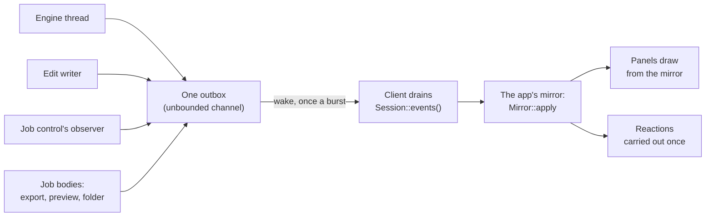

# Events

The engine answers its clients with events: a photo opened, the values after a change, a frame to show, a job's progress, an edit saved, a failure. This document describes the event API: what each event means, how events are sent, numbered, ordered and delivered, and how a client takes them in. How a client sends commands, and how events travel to a client in another process, is the [session protocol](session-protocol.md).

**Status.** [Decision 59](decisions/0059-one-event-system.md) records the design, with the options considered.

- **Built:** the session's side, in `crates/engine/src/session.rs` and `crates/engine/src/session/outbox.rs`; the app's reducer, in `crates/app/src/mirror.rs`; and the library's first events, a folder opened and listed and its photos' thumbnails, in `crates/library/src/ops.rs`, the session and `crates/app/src/folder.rs`.
- **Built for decision 72:** base's job events, every field of a job's row, and their throttle ([A job's events](#a-jobs-events)); the export reporting its whole row through them; the session carrying them, each of a job's values a fact by job; the app folding them into its rows, in `crates/app/src/jobs.rs`.
- **Planned:** `CollectionChanged`, notices for the user and the remote protocol ([What is planned](#what-is-planned)).

## The idea

One event system serves every layer: the session, the jobs and the library. Each client has one place where events enter.

There is no event bus. Nothing subscribes, and no code runs inside the code that caused an event. A client applies each event to its mirror of the engine's state at its next look, and draws from the mirror.

## Facts and notices

Every `Event` is one of two kinds, which `Event::topic()` returns as a `Topic`:

- **A fact**, `Topic::Fact(Fact)`, states the whole current state of one topic and supersedes the earlier fact of the same topic. The latest fact of a topic is enough: a client may overwrite what it holds with each one, and a remote client may be sent only the latest ([Remote clients](session-protocol.md#remote-clients)). A fact always carries its whole topic, never half of it.
- **A notice**, `Topic::Notice`, reports something that happened once. A client takes in every notice.

The topics, `Fact`, as built:

| `Fact` | Its event |
| --- | --- |
| `Values` | `Event::Values` |
| `Frame` | `Event::Frame` |
| `Scopes` | `Event::Scopes` |
| `ExportPreview` | `Event::ExportPreview`, the latest answer kept |
| `Progress(job)` | a job's `JobEvent::Progress`, by job |
| `Title(job)` | a job's `JobEvent::Title`, by job |
| `Detail(job)` | a job's `JobEvent::Detail`, by job |
| `Destination(job)` | a job's `JobEvent::Destination`, by job |
| `State(job)` | a job's `JobEvent::State`, by job |

Each of a job's values is a topic of its own, since each event carries only its own ([A job's events](#a-jobs-events)).

Planned facts: a readout, by module (decision 19); the selection and the active photo (decision 37); and a page of the collection shown, by page.

## The events the session sends

Every variant of `Event` today, with its kind. "Through" is the number of commands it includes ([Numbers](#numbers)).

| Event | Kind | Numbers | Sent by | What it carries |
| --- | --- | --- | --- | --- |
| `Opened(Photo)` | notice | `Photo::open`, the open's number | engine thread | the path, the camera's name, the size at full resolution, decode and upload times, `view_only` when a newer Apertrust wrote the edit (decision 43), the shooting data for the caption, and the photo's image context (decision 27) |
| `Values(Values)` | fact | `through` | engine thread | every module's state, the unowned parameters and whether anything is edited (below) |
| `Frame(Frame)` | fact | `through` | engine thread | the display buffer to show (decision 17), its size, the GPU timings and the latency from the first command it answers |
| `Scopes(Reading)` | fact | `through`, the frame's | engine thread | what the frame holds, counted for the scopes, about a frame after it (decision 19; [engine.md](engine.md#scopes)) |
| `Saved { path, through }` | notice | `through` | edit writer | the file written, as the edit stood after `through` commands |
| `Job { event, command }` | fact or notice by `event` | `command` on `Added` | job control's observer | a job with a progress (decision 57; [engine.md](engine.md#jobs)): `Added` (notice), its values as facts by job, `Ended` (notice), everything its row in the jobs window shows ([A job's events](#a-jobs-events)) |
| `Export { job, status }` | notice | `job` | the export job's body | the export's record for scripts and the CLI: each photo's `Started` and `Done` with its result, then `Finished` with the counts ([engine.md](engine.md#export-jobs)); no client draws a row from it (decision 72) |
| `ExportPreview { through, preview }` | fact | `through`, the `PreviewExport`'s | the preview job's body | the Export dialog's lines: each photo's file and what On conflict would do, the pattern's errors, the active photo's size, each folder's preflight |
| `Library(LibraryEvent)` | notice | `open`, the number of the `Library` command that opened or closed the folder | the folder's job body and each thumbnail's, through the library's observer; `Closed` the engine thread | `Opened { name, folder }`; `Subfolders { names }`, once, before the photos; `Listed { photos, done }`, chunks of at most 256 photos, the last `done`; `Taken { times }`, the photos' capture times, after the last chunk; `Failed { reason }`; `Closed`; `Thumbnail { photo, size, image }`, one for each thumbnail asked for ([below](#the-librarys-events)) |
| `Failed(SessionError)` | notice | `open` or `command` where it answers one | any | an error, in plain words ([Failures](#failures)) |

**What `Values` holds** (decisions 17, 27, 28 and 30). For each module, in the modules' order:

- its controls, each with its value, its default for the photo, its marks (kept, Auto) and whether it can change the photo (`Module::available`, recomputed after each change; a choice whose photo lists only the option it holds is unavailable);
- for a number, its range, track and step for the module's values (`ControlState::range`, from `Module::range`; the definition's where the module's code panics or gives one that does not hold, warned of once);
- for a choice, the options this photo lists (`ControlState::options`, computed once as the photo opens; every option where the module's code fails, warned of once);
- each preset row's matching option (`PresetState`) and each view's coordinates (`CoordinateState`, [engine.md](engine.md#preset-rows-and-lossless-views));
- whether the module is edited.

Then come `settings`, the parameters no module owns of the operations an unedited photo runs, over the photo's defaults; `edited`, whether anything differs from its default (today marks alone do not count; planned, kept and Auto marks count too, so Reset clears them); and `through`. Planned (decision 32): whether each module is on, `ModuleState::enabled`, and a switched module counting as edited while on.

Jobs with no progress, the export preview among them, send no `Job` events.

Planned events: `Readout`, what an operation measured for its module's panel, after a render whose readout key changed, `None` while the module's operation is not planned (decision 19; [engine.md](engine.md#readouts)); the library's other events, `CollectionChanged` first ([below](#lower-crates-report-through-an-observer)); `Notice { message, photo }` for the user ([below](#notices-for-the-user)); and, with several photos, each cell's still (decision 37).

## A job's events

Decision 72: each job reports everything its row in the jobs window shows, so a client folds its events into the row with no code for any kind of job ([gui.md](gui.md#the-jobs-window)). The events are base's `JobEvent` (`apertrust_base::jobs::progress`), which the session sends as `Event::Job { event, command }`; their API for a job's body is in [engine.md](engine.md#bases-part-apertrust_basejobs).

- **Built:** every event and field below, in base, with the throttle and the end's time.
- **What each job reports today:** the export its whole row ([engine.md](engine.md#the-job)): its total, folder and queued detail as it is added, its title, detail and photos done per photo, its first file, and at its end its outcome, the failure that ended it or else its first photo's, and `Retry` unless cancelled or refused, its retry left with the session; every other job its title, progress and failure.
- **What the session sends:** every event below as `Event::Job`, `Added` and `Ended` notices and each other a fact by job (`Fact::Progress`, `Title`, `Detail`, `Destination` and `State`, each naming the job), so a remote client's coalescing keeps the latest of each value of each job.
- **What the app does with them:** its mirror folds them, each event setting its part of its job's row, an export and a folder's reading through the same code ([gui.md](gui.md#in-the-app)); Try again on a failed row sends `RetryJob`, and the new job's row takes the old one's place.

| Event | Field | What it is |
| --- | --- | --- |
| `Added` (notice) | `job` | The job's number, from 1 within the session, never reused |
| | `kind` | What it does, `export`, `folder`, `import`: the row's icon, by the design system's table |
| | `queue` | darktable's queue, `None` for `run_now` |
| | `title` | Its title, a `Message`, darktable's message: "Exporting 0 / 5 to file on disk", "Reading 2026-10 Lisbon" |
| | `cancellable` | Whether `CancelJob` stops it, darktable's `cancellable` |
| | `destination` | Where its results go, if it says: `Destination::Folder(path)` or `File(path)` |
| | `detail` | The line under the bar while it waits, if it gives one: "Next in line: 5 photos, to ~/Pictures/Exports" |
| | `progress` | `Progress { done, total }` as it starts: `done` 0, `total` where it knows it |
| | `retries` | The ended job it tries again, for one a `RetryJob` started |
| `Progress` (fact) | `done`, `total` | Items done, and of how many (`Option<u64>`): the bar fills at `done / total`, `done` clamped to `total`; with no total the bar is indeterminate |
| `Title` (fact) | `title` | Its new title, darktable's `message_updated`: "Exporting 3 / 12 to file on disk" |
| `Detail` (fact) | `detail` | The one line under the bar, `Option<Message>`, `None` clearing it: "3 of 12 done · now IMG_2044.ARW" |
| `Destination` (fact) | `destination` | Where its results go now: an export's first file written |
| `State` (fact) | `state` | `Queued`, `Running`, or `Cancelled` while a running job stops |
| `Ended` (notice) | `state` | `Finished`, `Cancelled` or `Discarded`; a discarded job leaves no row |
| | `outcome` | The ended row's title, `Option<Message>`: "10 of 12 exported"; without it the client words the title with the state |
| | `failure` | `Option<Failure>`; set exactly when the job failed |
| | `at` | When it ended, the wall clock as the control ended it (`SystemTime`; milliseconds since the Unix epoch in the remote protocol) |
| | `offers` | `Vec<Offer>`, what it can do once ended: `Retry { items }`, sent back as `Command::RetryJob { job }` |

- **`Failure`** is `{ cause, item, file, reason }`: `cause` a code a client words with Fluent as `job-cause-<cause>` (the export's are `Cause::id`'s, `panicked` for a panic); `item` the photo or file it failed on, `file` the file it could not write, each `Option<PathBuf>`; `reason` the error in plain words, for the log and a client with no words for the code.
- **`Message`** is an id and named arguments, numbers, text or paths, worded by the client with Fluent (decision 36), as now.
- **The throttle** is darktable's 0.5 s for each of `Progress`, `Title`, `Detail` and `Destination`, each on its own, the first and the last always; the outcome and the offers go out in `Ended`, after the last of them.
- **`Progress::fraction()`** is the bar's fill for a client: `done / total`, `done` clamped to `total`, an empty bar for a total of 0, `None` with no total.
- **Try again.** A job that offers `Retry` has left the session what it runs, an export the photos that failed and those not reached with the same settings. The session keeps the latest 64. `RetryJob { job }` runs it as if sent then; its job's `Added` names `retries: Some(job)`, and a client puts its row in the old one's place. A retry is used once; one not kept is refused, `NotRetryable`.

## Numbers

Every command has a number, which `Session::send` returns: 1 for the first, then up by one each. An event that includes or answers commands names them, so a client knows which of its commands an event reflects and never compares arrival times:

- `through` on `Values`, `Frame`, `Scopes`, `Saved` and `ExportPreview`: how many commands it includes. It never decreases on each of `Values`, `Frame` and `Scopes`, nor on `Saved` for one file. A client shows a value it has just sent until a `Values` includes that command, so a slider never jumps back (decision 17).
- `open` on `Opened` and on `SessionError::Open`, the `Open` command's number, so a client drops what an earlier open sent. On every `LibraryEvent`, the number of the `Command::Library` it answers: an open's for what that open found, a close's on its `Closed`, so a client keeps the number of its latest library open or close and drops the rest.
- `command` on a job's `Added`: the number of the command that started the job, so a client knows its own job; for a job a `RetryJob` started, that command's, with `retries` naming the job it tries again (decision 72). The rest of a job's events name the job.
- A refused command names itself: `SessionError::Refused { command, error }`. It changed nothing. An edit refused, a change on a photo open for viewing only, a job that cannot be cancelled and a job with no retry kept are refusals.

## One outbox per session

Every thread of the session sends through one `Outbox` (`session/outbox.rs`), each holding a clone:

- the engine thread;
- the edit writer;
- the job control's observer;
- the job bodies that report themselves: an export's `Export`, a preview's `ExportPreview`, and a folder's reading's `Library`, through the library's observer;
- later, the library's root queues.

No code in the session keeps a channel or a `wake` of its own.

- `Outbox::send(event)` sends one event; `Outbox::send_all(events)` sends a batch in order as one burst. The engine thread sends each batch's events with one `send_all`.
- **`wake` is coalesced.** `Session::start` takes `wake`, a `Fn() + Send + Sync` closure: the app makes it `egui::Context::request_repaint`, the CLI a channel's send. The outbox calls it only when the client may not have looked since the last call, which a flag records: the send that wakes sets it, and the client's drain clears it. A burst from any number of threads wakes the client once, and the first send after a drain wakes it again. The flag is cleared before the drain reads, so an event sent during a drain wakes the client again and is never left unseen.
- **The client drains** with `Session::events()`, which never waits: one loop of `try_recv` until the channel is empty, oldest first, so an event sent between two looks is taken by the next, never lost. Once every outbox has gone, the drain adds one `SessionError::Stopped`, once.
- **After the client drops its handle**, nothing more is sent, as darktable ignores signals once its control has stopped.

## No send blocks

The channel is unbounded, and no producer waits on a client. Its volume is bounded by the work: one `Values` and one `Frame` a batch, a scopes reading a frame while asked, and a job's progress at most every 0.5 s (decision 57).

A job that needs the person's answer is to send a notice naming its question, and wait for the answering command through `Context::wait`, which a cancel ends. None does yet.

## Order and delivery

- **The channel orders every send.** One producer's events arrive in the order it sent them.
- **Within a batch** (the commands the engine thread took together, [session-protocol.md](session-protocol.md#numbers-and-batches)): an `Opened` or a command's `Failed` comes in the commands' order; then the `Values` after them; then the batch's `Frame`, or the render's failure; then any scopes readings that arrived, a frame's reading always after its frame. A GPU error during the batch drops its frame, and its `Failed` comes after the batch's other events, before the scopes readings.
- **A job's events come in order**, since the observer runs under the control's lock. Its `Added` is sent as it is added, before a worker can take it, so its body's own events, such as an export's, come after it.
- **Across producers only the numbers order events.** The writer's `Saved` may arrive before the `Values` it includes.
- **In process every event is delivered exactly once, in order.** Nothing is coalesced in process: a client applies each fact over the last.

## One event per change

A command on many photos sends one notice naming them; a listing sends chunks; progress comes at most every 0.5 s.

An event says what changed and why, as darktable's `COLLECTION_CHANGED` passes its reason and property. It carries what a client shows (the values, a job's progress and detail, the changed photos' ratings), so no client asks again for each item. The one exception is planned: a collection's photos, which a client reads by page after `CollectionChanged`.

## Failures

`Failed(SessionError)` carries errors in plain words, which the app shows and the CLI logs. Those that answer a command are wrapped with its number:

- `Open { open, error }`: an `Open` that failed; the photo before it is closed, its edit saved, and none is open.
- `Refused { command, error }`: a refused command, `error` being `Edit`, `ViewOnly`, `NotCancellable` or `NotRetryable`.

The others stand alone:

| Error | What it means |
| --- | --- |
| `Module` | A module left out of the session at its start, or out of the render until it binds again |
| `Save { path, through }` | A write that failed; the edit stays in memory and is written again |
| `Plan`, `Compute`, `Gpu` | A render that failed; the frame is not shown |
| `Scopes` | The scopes off for the rest of the session, never the frame |
| `Panicked` | A bug; the photo is dropped unsaved |
| `Stopped` | The engine thread has ended |

## Who sends and who receives

| Thread | Sends | Receives |
| --- | --- | --- |
| Engine | its batch's events and scopes readings, readouts later, through the outbox | commands and its jobs' GPU tasks (the inbox) |
| Edit writer | `Saved`, a failed save | the edits handed to it |
| Job workers | `Job` events through the control's observer; their bodies' own (an export's `Export`, a preview's `ExportPreview`, a folder's reading's `Library` events) through the outbox | `Context::wait`'s answers, later |
| Library's threads, a root's queue (decision 53; planned) | `Library` events through its observer | its calls |
| UI | commands | every event, drained in `App::logic` ([gui.md](gui.md#a-frame)) |
| Server, tokio (later) | each connection's commands | the events, fanned out per connection ([session-protocol.md](session-protocol.md#remote-clients)) |

## Lower crates report through an observer

A crate below the engine knows nothing of `Event`. It takes an observer closure, and the session wraps what it hears into an event and sends it through the outbox:

- **Base's jobs**, built: `apertrust_base::jobs::Control::start` takes a `Fn(JobEvent) + Send + Sync` observer, which runs under the control's lock and so must be quick. The session's observer notes which jobs can be cancelled, adds the starting command's number to `Added`, and sends `Event::Job`.
- **The library**, its first operation built (decision 54): `apertrust_library::ops::open` takes a `Fn(LibraryEvent) + Send + Sync` observer and a cancel closure, and the session's folder job hands it one that wraps each event into `Event::Library` and the job's `Context::cancelled`; `ops::thumbnail` takes the same two, from each thumbnail's job. Each `LibraryEvent` carries the number of the open or close it is about. Planned: one `CollectionChanged` per change with darktable's reason and property, a fact or a notice by its kind.

### The library's events

Built, in `crates/library/src/ops.rs` and the session's `Command::Library`.

The library's design and its whole API, built and planned, are in [library.md](library.md#the-api).

`Command::Library(LibraryCommand::Open(Source::Folder(path)))` adds a cancellable job, kind `folder`, on darktable's `UserBackground` queue, as darktable reads a film roll. Its message is `job-folder` with its `folder` argument, so its progress comes as `Event::Job`, its `Added` naming the command. It cancels the reading of the folder opened before.

Its body lists the folder and reads its sidecars (`Index::build`, 16 at a time), then sends, in order:

1. `Opened { open, name, folder }`, once the folder is listed and its sidecars read: its last part as its name and the path as asked for. A folder the listing finds missing, a file in its place, one that cannot be read or one that goes while it is listed sends `Failed { open, reason }` in its place, ending the open.
2. `Subfolders { open, names }`, once: the folder's subfolders, hidden ones left out, a link to a folder counted as one, empty where there is none. They are sorted as the system's file browser sorts them (`listing::browser_order`: spaces, punctuation and symbols, then digits, then letters, case left aside, a run of digits by its number). This approximates the system's collation. Rust's standard library decomposes no character, so an accented letter sorts after every unaccented one rather than by its base letter, and no language's own order of its letters is followed.
3. `Listed { open, photos, done }`, in chunks of at most 256 photos (`ops::CHUNK`) in name order, the last `done`; an empty folder sends one, empty and done. Each `Photo` has its file name, size and modified time and its `edit`: `None` (no sidecar, or one with nothing in it), `Edited`, `ViewOnly(Newer)` (decision 43), or `Unreadable(reason)`.
4. `Taken { open, times }`, once the last chunk is sent: when each photo was taken, one for each photo listed in the listing's order, the camera's clock from the raw's EXIF (`apertrust_raw::read_exif_file`, DateTimeOriginal with its milliseconds, never the pixels), read 16 at a time, `None` where a raw holds none or cannot be read. The photos show first, sorted by their files' modified times, and the grid panel is sorted once when the times come ([gui.md](gui.md#the-grid-bar)). A reading cancelled before then sends none.

**Cancelling.** The cancel closure is asked between calls into the folder, while the listing is waited for, and before each event. A cancelled reading returns at once. A listing stuck in a call into a network share is left to end on its own thread, so it holds neither a job's worker nor the session's end. The cancelled reading sends nothing more, no chunk says `done`, or no `Taken` follows the last, and its job ends cancelled.

A reading that fails still ends its job finished: the failure is told by the `Library` event. `Command::Library(LibraryCommand::Close)` cancels the reading and answers `Closed { open }` at once from the engine thread, naming the close. Opening a folder opens no photo; `Command::Open` does.

**Thumbnails.** `Command::Library(LibraryCommand::Thumbnails { photos, size })` asks for the open folder's `photos`, each by its file name, at most `size` pixels on their longer side, the first the most wanted. Each is a job of its own, kind `thumbnail`, on darktable's `SystemForeground` queue, as darktable's thumbnail loads: with no progress, so it shows in neither the spinner nor the jobs window; deduplicated by the open, the photo and the size; added from the last, so the first asked sits on the stack's top and is read first. One asked again while queued moves to the top, one being read is not read twice, and past 30 the oldest not yet begun is dropped, which a client covers by asking again for a photo that comes back into sight. Its body reads the raw's embedded picture (`apertrust_raw::read_preview_file`, without decoding the mosaic) and sends one `Thumbnail { open, photo, size, image }`, naming the open of its folder: `image` is the picture as 8-bit RGBA, upright, its pixels shared (`Arc<[u8]>`), or `None` where the raw holds none that can be read, which is said too so the client asks no more. A new open or a close cancels the thumbnails not yet sent, and each body asks its cancel before it reads and before it sends; with no folder open the command reads nothing.

**All seven are notices.** Each is about one open and comes once: a chunk is part of a listing, never the whole of a topic, `Subfolders`, though whole, is sent once an open, as `Opened` is, and a thumbnail answers one ask. A thumbnail is one event per photo rather than per command, since each is its own job of darktable's queue and its pixels are large; a remote client is to receive it encoded. The remote protocol's `Sync` is to send the open folder's listing again to a client that joins late ([session-protocol.md](session-protocol.md#remote-clients)).

Today the whole folder is listed and its sidecars read before the first chunk. Chunks sent as the listing goes are planned with bulk listing (the library's step 7, [roadmap.md](roadmap.md#the-librarys-steps)).

## In the app: one reducer

Built ([gui.md](gui.md#a-frame)). Events enter the app in one place, `Mirror::apply(event) -> Vec<Reaction>` in `crates/app/src/mirror.rs`, free of egui and tested by feeding it events.

- **Draining.** `App::drain`, first in `App::logic`, takes the session's events and applies each. eframe runs it while the window is minimised too, so a save or a job's end is taken in while nothing is drawn.
- **Drawing.** Panels draw from the mirror each frame. A cache derived from it compares a generation number the mirror raises: the grid panel's thumbnails' textures compare the folder's (`FolderState::generation`), raised with every change of the folder or its thumbnails.
- **Reactions.** What must happen once in reply to an event, the reducer returns as a `Reaction`, which `App::drain` carries out: `Reaction::Jobs(Show)`, the jobs window opening as the person's own job starts or updating, its rows a fold of `Event::Job` alone once decision 72 is built ([gui.md](gui.md#in-the-app)); `Reaction::Preview { through, preview }`, an export preview handed to the Export dialog; and `Reaction::FolderOpened` and `Reaction::FolderFailed`, for the recent folders. Later a notice's toast or a live region's announcement.
- **Refusals.** A refusal's command number drops that command's pending value and the save it would have waited for. `Saving` keeps the set of unsaved command numbers, so a refused change never leaves "Not saved yet" behind.
- **Stale events.** The mirror drops what an earlier open left on its way (`PhotoState::stale`).
- **The app's own state.** The app's own changes, a theme, a setting, a tab, are its state, with no event.

**The library's events in the app** (`crates/app/src/folder.rs`, held by the mirror). The mirror keeps the number of the latest library command and drops every `LibraryEvent` naming another. It accumulates the photos from `Listed` chunks until `done`, then takes the capture times from `Taken`, and keeps the order the grid panel draws, the grid bar's sort of the listing (`FolderState::order`), worked out again as each of them comes and as the sort changes. A `Failed`, or the folder's job ending `Cancelled`, ends the open; the job's id is noted from its `Added`, whose `command` is the open's number. `Opened` and `Failed` come back as reactions for the recent folders, and the folder's job never opens the jobs window. Each `Thumbnail` is kept with the listing by photo and size, its picture or `None`, with the generation it came at, so the thumbnails go with their folder.

## Notices for the user

Planned, with the library's step 12 ([roadmap.md](roadmap.md#the-librarys-steps)): `Event::Notice { message, photo }`, for what the person should hear of that is no job. It carries a message id with its arguments (decision 57), never translated text.

It shows as darktable's `dt_control_log` shows its messages: a short message over the photo, for 5 s and 1 s more per 40 characters, and a history behind a button with an unread dot ([gui.md](gui.md#the-jobs-window)).

## `-d event`

`-d event` (`signal` an alias, darktable's name for its domain; `apertrust_base::log::ALIASES`) logs each event sent with its kind, its numbers and its topic, and each drain with its count and kinds, a run of one kind counted (`Saved ×2, Failed`). With `-d verbose` it also logs, once a second while events are sent, how many of each kind were sent, to catch a storm.

## Against darktable

darktable's signals were read at the tag (`src/control/signal.c`, `signal.h`, `control.c` and their raise and connect sites).

| # | darktable | Apertrust | Why |
| --- | --- | --- | --- |
| S1 | One global bus, `DarktableSignals`, 51 signals; any code connects handlers, disconnected at its cleanup | No bus: the session's events go to one reducer per client | The engine–UI rule; immediate mode redraws from state; nothing left connected (#15662) |
| S2 | A raise on the GUI thread runs its handlers inside the raise (`g_main_context_invoke_full` on the owning thread) | An event is applied at the client's next drain, never inside the code that caused it | #4584's deadlock; the lock order `develop.c:1416` works round |
| S3 | `DEVELOP_MODULE_REMOVE`, `IMAGE_EXPORT_TMPFILE` and `LOCATION_CHANGED` stop a worker until the GUI has run | No producer waits on a client; a question is a notice and an answering command | Decisions 17 and 18; a remote client may never answer |
| S4 | `dt_control_signal_block_by_func` round a module's own raise | The numbers: a client knows its own change by `through` and shows its pending value until a report includes it (decision 17) | The block works only through S2's re-entrancy |
| S5 | Signals carry ids; each handler reads the database and caches again | Events carry what a client shows; a collection's photos read by page | #4584, #9042; a remote client cannot re-read cheaply |
| S6 | Six handlers per thumbnail (`thumbnail.c:1463`) | The grid draws from the mirror | #5381 |
| S7 | Some changes raised per image | One event per command or batch, chunks, progress at 0.5 s | #7111, PR #8080 |
| S8 | No stated order between signals | [Order and delivery](#order-and-delivery)'s guarantees, held by tests | `color_picker_proxy.c:355`'s FIXME |
| S9 | `dt_control_log`'s translated text, a ring of two | `Notice` with a message id and arguments (decision 57), shown as darktable shows its log | Decision 36 |
| S10 | Redraw signals by area, `CONTROL_REDRAW_ALL`, `_CENTER`, `NAVIGATION_REDRAW` | `request_repaint`; egui draws the whole frame | Immediate mode |

Kept from darktable:

- one event per thing that changed, named as darktable's where they map:
  - `COLLECTION_CHANGED` as `CollectionChanged`, with its reason and property;
  - `SELECTION_CHANGED` as the selection's fact;
  - `IMAGE_INFO_CHANGED` as `PhotosChanged`;
  - `FILMROLLS_IMPORTED` as an import job's end;
  - `DEVELOP_MIPMAP_UPDATED` as a still's or a thumbnail's arrival;
  - `DEVELOP_PREVIEW_PIPE_FINISHED` and `DEVELOP_UI_PIPE_FINISHED` as `Frame` and `Readout`;
  - `CONTROL_PICKERDATA_READY` as a picker's readout;
- a worker's events queued for the GUI thread, as `G_PRIORITY_HIGH_IDLE` queues them;
- nothing sent after shutdown;
- `-d signal`.

## Tests

- **The session, built.** In `session.rs`: `every_event_states_whether_it_is_a_fact_or_a_notice`, every variant's kind through an exhaustive match, so a new variant must state its kind, every `JobEvent` among them, sent by jobs that report their whole row, each job's five values facts of its own, and `-d event`'s line naming each kind; `a_batch_s_refusal_comes_before_its_values_and_its_values_before_its_frame`; `through_never_decreases_over_a_drag`, over the values, frames, scopes readings and saves; `a_job_s_events_reach_the_client_in_order_its_added_naming_its_command`, one job reporting its whole row and one its title and progress alone; `the_observer_keeps_each_job_shown_from_its_added_to_its_end`, with whether it can be cancelled, its other events leaving the map as it was; and the refused cancel numbered in `a_session_ends_with_a_gpu_job_that_cannot_be_cancelled_in_flight`. In `outbox.rs`: `no_event_is_lost_while_three_threads_send_and_a_fourth_drains`, `a_burst_wakes_the_client_once_and_a_send_after_a_drain_again`, `nothing_is_sent_once_the_client_drops_its_handle` and `a_drain_s_kinds_count_runs`.
- **The app's reducer, built:** event sequences in, the mirror and its reactions out, with no egui (`crates/app/src/mirror.rs`'s tests: a drag, a frame replacing the last and clearing a failure, refusals with and without an earlier unsaved change, a failed save, a failed open with stale events dropped, a scopes failure, a job from added to ended, the engine stopping, the preview floor, opening another photo).
- **The library, built.** In `crates/library/src/ops.rs`: `an_open_reports_the_folder_its_subfolders_and_every_photo_with_its_edit` (every edit state, subfolders sorted with the hidden one left out, chunks in order, done once), `an_empty_folder_sends_one_empty_chunk_done`, `a_missing_folder_or_a_file_fails_without_opening`, `a_cancel_between_chunks_ends_the_open_with_no_chunk_done`, `a_cancel_while_the_folder_is_read_sends_nothing` and `a_cancel_returns_at_once_while_a_call_into_the_folder_is_stuck` (a listing held by `listing::stall`, a test hook); `listing::tests::names_sort_as_a_file_browser_lists_them`. In `session.rs`: `a_folder_opens_as_a_job_whose_events_name_the_open` and `a_second_open_cancels_the_first_and_a_close_the_second`, and each `LibraryEvent`'s kind in `every_event_states_whether_it_is_a_fact_or_a_notice`. In `crates/app/src/folder.rs`: the reducer's side, among them `a_second_open_drops_the_first_one_s_late_events`, `a_close_empties_the_folder_and_drops_what_the_reading_still_sends` and `a_reading_cancelled_through_its_job_ends_the_open_with_no_reason`. Planned: one `CollectionChanged` per change.
- **A job's events, built in base (decision 72):** the throttle's table for each of the four values and the four on one clock (`crates/base/src/jobs/progress.rs`); the control sending the first and last of each before `Ended` and a held one once due, as the body sets another or waits, `Ended` carrying the outcome, offers, failure and time, and a panic as `panicked` (`crates/base/src/jobs/tests.rs`). The export's, in `crates/engine/src/export_job.rs`: its events in order, from `Added` with its title at 0, total, folder and queued detail to `Ended` with its outcome (`an_export_s_events_come_in_order`); its failure's cause, photo and file and its `Retry` (`a_refused_readback_render_fails_the_photo_and_writes_no_file`, `a_photo_s_failure_is_its_own_and_the_destination_s_ends_the_job`); no `Retry` after a cancel or a refusal (`a_cancel_mid_photo_leaves_no_temporary_file`, `a_cancel_after_a_failed_photo_offers_no_retry`, `a_refused_export_offers_no_retry`). Try again through the session: `RetryJob` exporting the photo that failed alone, its edit as it is then, its `Added` naming `retries`, refused a second time and for a job that offered none (`a_failed_photo_tried_again_exports_alone_once`); the photos that failed and those not reached, in order, after the destination ended a job (`the_retry_of_a_job_its_destination_ended_takes_the_photos_failed_and_not_reached`); the latest 64 kept, each taken once (`session.rs`, `the_latest_64_retries_are_kept_and_each_is_taken_once`). The app's fold, in `crates/app/src/jobs/tests.rs`, events in and rows out: an export's whole sequence (`an_exports_events_fold_into_its_row`) and a folder's reading through the same code (`a_folders_reading_folds_through_the_same_code_and_never_opens_the_window`), a failure in words with its retry, a cancel ended cancelled or, with a failure, failed, and the window opening only for a user queue's job this app started; Try again sending `RetryJob` once and the new row taking the failed one's place (`try_again_sends_retry_job_and_its_row_takes_the_failed_one_s_place`), and a refused one leaving the row failed (`a_refused_try_again_leaves_the_row_failed_and_is_not_waited_for`).
- **The remote protocol, planned:** [session-protocol.md](session-protocol.md#tests).

## What is planned

- **`CollectionChanged`**, with darktable's reason and property, with the first change to a collection ([Lower crates report through an observer](#lower-crates-report-through-an-observer)).
- **Notices for the user**, `Event::Notice { message, photo }` and its place in the app, with the library's step 12 ([Notices for the user](#notices-for-the-user)).
- **The remote protocol**, with the server or MCP, whichever comes first ([session-protocol.md](session-protocol.md#remote-clients)).
