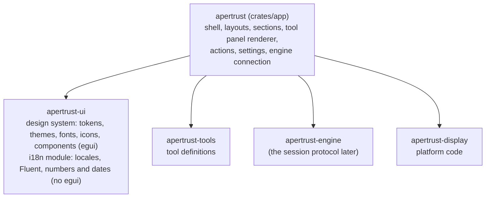
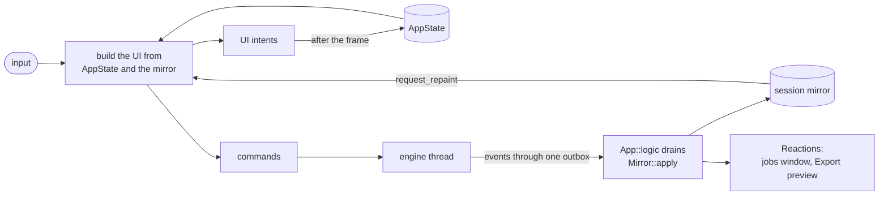
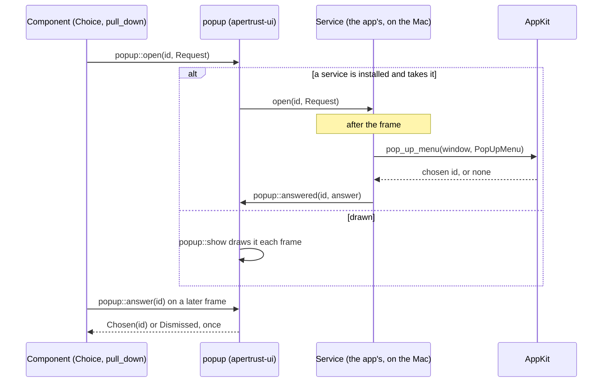
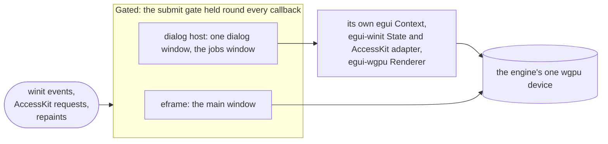
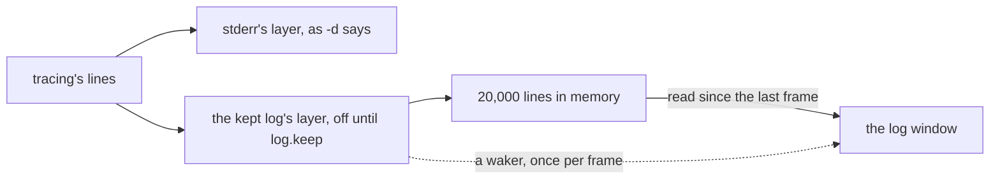
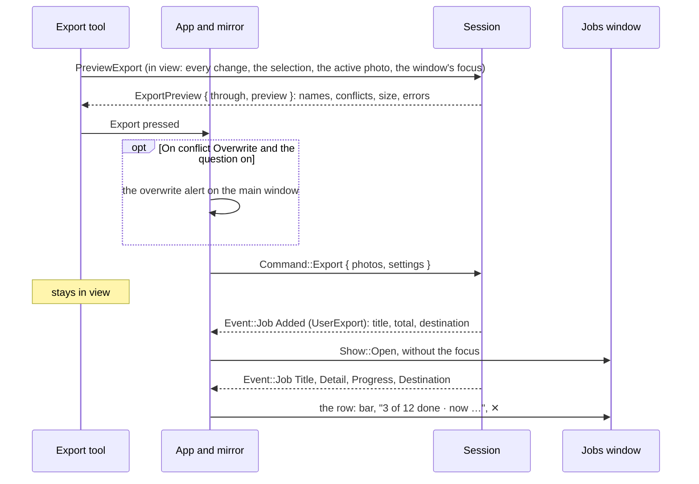
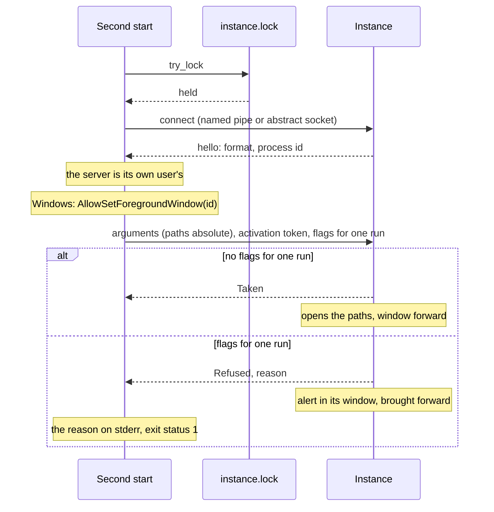
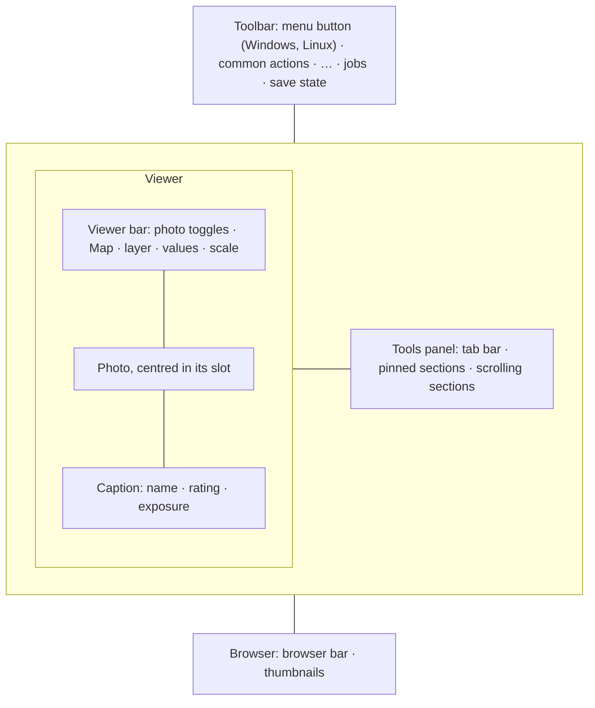
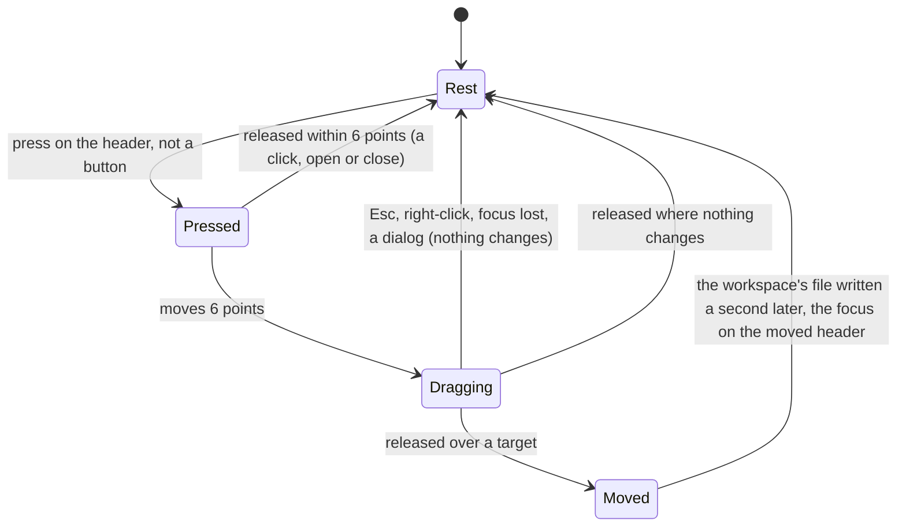
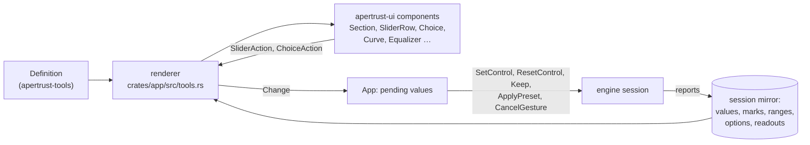

# GUI

How the desktop app's interface is built: from reusable parts, themed, translated, accessible and tested.

[decisions/](decisions/README.md) holds the decisions it rests on: egui for the desktop and the web browser (decision 35), the threads (decisions 17 and 18), the fonts (decision 36), tools over operations (decision 4) and one view (decision 37). This document holds the design built on them, decided in decision 36. The `desktop-architecture` and `ui-conventions` skills turn it into working rules.

What the interface looks like and how it behaves is designed on the [UI wireframe](https://claude.ai/artifact/V4r2xReSqn344AQstUgeiK); this document is how that design becomes code. Where the two differ, the wireframe is newer, until its decisions are folded in here.

## Contents

| Part | Sections |
| --- | --- |
| How it fits together | [What is built](#what-is-built), [Goals](#goals), [Why egui](#why-egui), [Display colour](#display-colour), [Layers](#layers), [A frame](#a-frame) |
| Foundations | [Design system](#design-system) (tokens, themes, components, [rules for interface code](#rules-for-interface-code), [on-photo overlays](#on-photo-overlays)), [Translation](#translation), [Touch mode](#touch-mode) |
| The window and the platform | [The window frame and menus](#the-window-frame-and-menus), [The menu bar](#the-menu-bar), [Popups](#popups), [Dialogs and alerts](#dialogs-and-alerts), [Sheets](#sheets), [The Export tool](#the-export-tool), [Instances and windows](#instances-and-windows), [The start window](#the-start-window) |
| The panels | [The shell](#the-shell) (the layouts, selection, workspaces, the Toolbar, the Tools panel, the photo frame, the viewer bar, the caption, the Browser), [Tool panels from definitions](#tool-panels-from-definitions) ([one tool model](#one-tool-model)) |
| Controls | [Slider values and choices](#slider-values-and-choices), [Painted widgets](#painted-widgets): [the curve](#the-curve), [the equalizer](#the-equalizer), [the scopes](#the-scopes) |
| Keys and settings | [Keyboard and actions](#keyboard-and-actions), [Settings and workspace](#settings-and-workspace) |
| Quality | [Accessibility](#accessibility), [Testing](#testing), [Performance](#performance) |
| The plan | [Build order](#build-order), [Product choices](#product-choices), [Choices](#choices), [Open questions](#open-questions) |

## What is built

Steps 1 to 5 of the [build order](#build-order) are built, step 6 has its renderer and its tools, and steps 7 to 9 their first parts:

- `apertrust-ui` with the tokens, the four themes, the fonts, the icons and the gallery, photographed in every theme and in the pseudo-locale ([Design system](#design-system)).
- Translation, with British and American English, Ukrainian, Polish and the pseudo-locale, and the check for literal strings ([Translation](#translation)).
- The controls in `crates/ui/src/components`: the slider row, icon button, segmented control, choice list, colour swatches and value field, with AccessKit on in the app and interaction tests for each ([Components](#components)).
- The painted widgets: [the curve](#the-curve), [the equalizer](#the-equalizer) and [the scopes](#the-scopes) (the histogram, the waveform, the RGB parade and the vectorscope). The app's Scopes section is pinned in the editing tabs and fed by the engine's counts for all four.
- The section frame (header, buttons, [the header's tooltip](#the-headers-tooltip), tabs, plain and collapsible groups, peeking with H), and [a tool's presets](#a-tools-presets) from its header's presets button and the Tools panel's tab bar, body and edge ([Tool panels from definitions](#tool-panels-from-definitions), [The Tools panel](#the-tools-panel)).
- The shell's parts: `Toolbar`, `ViewerBar` and `Browser`, with interaction tests and a snapshot at a full window's width ([The shell](#the-shell)).
- The app as that shell, with one raw open: the engine renders it on its own thread through the viewport pipe, every ported operation from the saved edit, and a paint callback draws each frame pixel for pixel (decision 17), scaled only while the window resizes (decision 18); the scale's zoom from Small to 1600%, 100% the detail pipeline's render, panning by the pointer and by Alt with the arrows, the position marks, and the photo a focus stop while zoomed, the zoom carried across photos and kept through Orientation's turns ([The zoom](#the-zoom), its five steps).
- The tool panel renderer (`crates/app/src/tools.rs`), which draws any processing tool's section from its definition, with every tool of the first pass built so far; every tool's header and ⋯ drawn from its `ToolDefinition`, and each utility's page by its `UtilityTool` ([one tool model](#one-tool-model), decision 93), Export's section still by `export.rs`.
- The actions registry and the [default keyboard map](#the-default-keyboard-map) in `crates/app/src/actions.rs`, and what can be placed on the Toolbar, tools' items among it ([Customising the Toolbar](#customising-the-toolbar)), in `crates/app/src/toolbar.rs`.
- The cursors (decision 104; [cursors.md](cursors.md)): Select, Pan and Pick with White balance, Exposure's two, Colour calibration and Colour balance RGB's four hue pickers on the Toolbar's well, a tool's advanced pickers, as Colour balance RGB's fulcrums', having none, their keys, Esc, A held and K, and their pointers on the photo, in `crates/app/src/cursors.rs`; the well shows the picker that is on, whichever door turned it on (104.5); each picker cursor is the second door to its tool's picker, sending the same `On` (104.6); its area carries its tool's label and the pointer its badge (104.7).
- [The settings file](#settings-and-workspace), `settings.toml`, in the user data folder (decision 43).
- The Mac's [window frame](#the-frame) and native [menu bar](#the-menus), and the frames of Windows and Linux with the menu button and its drawn menu (decision 39), on the first piece of [the popup service](#popups) (decision 40).
- The dialog host, with Settings, the jobs window, the log window and the system's alerts ([Dialogs and alerts](#dialogs-and-alerts), [The log window](#the-log-window)); the Export tool, a section of the Photos tab ([The Export tool, as built](#as-built)).
- Folder mode's first parts: File › Open Folder… and Open…, drag and drop onto the window, View › Collections, Collections' Folders in the Photos tab, the Browser's cells and the Viewer's empty states ([File](#file), [The Browser](#the-browser), [The Viewer's layouts](#the-viewers-layouts)); Open Recent, File › Close, reopening what was open last and [the start window](#the-start-window); selecting several photos in the Browser and Select's Select All, Select None, Invert Selection and Select Unedited ([Selection and the active photo](#selection-and-the-active-photo), [Select](#select)).

Still to come:

- Settings › Shortcuts and darktable's actions for every control (decision 98, [Actions after darktable](#actions-after-darktable)), the actions the menus add ([what arrives when](#what-arrives-when)), and on Windows Alt pressed and released alone and native hit testing (decision 39).
- With the viewport: before and after, and the values under the cursor; the clipping overlays on the photo (the rest of step 8).
- Decision 42's slider popup and the rest of [their cards](#slider-values-the-build-in-cards).
- [One tool model](#one-tool-model) (decision 93): Export's page as setting rows (the header and ⋯, one page drawer for every tool, the utilities on the page model and Export on the tool model are built).
- The rest follows the build order.

winit's default app menu on macOS is off (`with_default_menu(false)` on the app's own `EventLoop` builder, since eframe runs on the app's loop and ignores `NativeOptions::event_loop_builder`): the menu bar built from the registry takes its place.

## Goals

- **One component per idea.** A slider, a section or a tab strip is written once and used everywhere: in every tool, every layout of the Viewer and, later, the web browser. Changing it changes every screen, as on the wireframe.
- **Nothing a user might want different is hard-coded:** colours, sizes, words and keys come from themes, translations and the keyboard map.
- **The engine boundary holds** (decision 17, `desktop-architecture`): widgets emit commands, and the UI draws from the engine's latest events.
- **The principles' quality bar:**
  - every action can be reached by keyboard;
  - screen readers work as far as egui allows;
  - the interface scales;
  - no frame waits for the engine to render: at most for a submission under way, and a resize for the GPU (decision 18).
- **The same code in the web browser** (decision 35): nothing in the UI assumes a local file system, threads or a local GPU.

## Why egui

One egui codebase serves the desktop app and the desktop web browser (decision 35), in two modes, Standard and Touch, Touch planned for tablets after Phase 3 and a phone's layout a later design ([Touch mode](#touch-mode), decision 94). [session-protocol.md](session-protocol.md#web-tablets-and-remote-access) holds how the web browser and tablets reach the engine.

**Why egui.** The image is drawn by a wgpu paint callback in the same frame as the UI: no compositing of two technologies, no IPC for pixels, and on-image overlays are more painting. Custom widgets (curves, the tone equalizer, colour wheels, scopes) suit its painter API. It compiles to wasm with production-ready web support, which settled the choice over Iced once desktop and web share one UI.

Rejected:

- **Tauri with web panels:** a webview viewport is weak on Linux, where WebKitGTK lacks WebGPU, and a native viewport beside a webview in one window is the riskiest piece on Wayland.
- **Iced:** richer theming and an enforced message architecture, but web support is not first-class.
- **Slint:** designer-friendly and touch-ready, but weaker for custom-drawn widgets and viewport integration.
- **GPUI:** polished, but its own renderer means no shared wgpu buffers, and no web target.

**What egui requires of us:**

- A design system before agents write panels: colour and spacing tokens, typography, standard panel, slider and section components. This document designs it, with themes, translation, actions, accessibility and tests (decision 36).
- Architectural discipline: widgets only emit session-protocol commands.

**Why one UI for desktop and web browser.** Apps that look the same everywhere either run one web codebase, as Figma's desktop app wraps its web app (the route rejected here for viewport and Linux reasons), or build separate UIs on a shared design system, which a large company can afford and a single developer cannot. One major editor's desktop and web versions are close while its phone and tablet versions differ: the dividing line is the input model, not the platform.

**Web support compared:** egui runs in production on the web (Rerun's viewer); Iced's web target is not first-class; Slint's wasm build is aimed at demos; GPUI has none. Accepted costs of a canvas-drawn web UI: weaker accessibility, no native text selection, a multi-megabyte wasm download, less web browser integration.

## Display colour

The viewport has two output modes behind one abstraction: app-managed as the baseline everywhere, system-managed where the OS supports it.

1. **App-managed:** the engine converts to the display's ICC profile, using moxcms, and outputs 8- or 10-bit, as darktable does. It works everywhere, X11 included.
2. **System-managed:** the engine hands the OS linear float16 tagged with its colour space, and the compositor maps it to the display. The only route to real HDR and EDR headroom.

| Platform | wgpu backend | System-managed path |
| --- | --- | --- |
| Windows | DX12 (Vulkan alternative) | FP16 scRGB swapchain; Windows converts to the display |
| macOS | Metal | `CAMetalLayer`, rgba16Float, extended linear Display P3, EDR |
| Linux | Vulkan | Wayland colour-management protocol where the compositor supports it; none on X11 |

wgpu does not expose surface colour-space control on every backend, so `apertrust-display` reaches through to the native layer: per-platform code behind one function per need, outside the engine because it needs the window, in an FFI crate allowed `unsafe`.

- For colour it has one function, `tag_window`, which tags the macOS window's Metal layer sRGB or Display P3 every frame. wgpu leaves the layer untagged, and macOS then shows it unmanaged, so a P3 display oversaturates the UI and the image. Elsewhere it does nothing yet.
- The system-managed paths land there in Phase 7.
- With egui, UI colours are authored in sRGB and need converting when the surface is extended-linear, or panels look oversaturated on P3 displays.

**The output profile operations see** (decision 26). In every pipe but an export with a profile of its own, operations that gamut-map against the output profile (filmic rgb's v6 and v7, AgX's "export profile") see the edit's output profile, Output colour profile's, which colorout writes, never the display's, as darktable's darkroom would. The viewport then computes what the export does (principle 2), and the display path converts colorout's output to the display, soft-proofing the export. Today the viewport draws its display buffer as sRGB, right for the default sRGB output; the conversion from any other profile is needed before the Output colour profile tool lets an edit choose one.

## Layers



| Crate | Owns | Depends on |
| --- | --- | --- |
| `apertrust-ui` | The design system: tokens and themes, fonts, icons, components and the gallery. In its `i18n` module: the locale, Fluent message bundles and plural rules, and the formatting and parsing of numbers, units and dates | egui; Fluent and ICU4X for `i18n` |
| `apertrust` (app) | The shell, the Viewer's layouts and the sections; the tool panel renderer; the actions registry and keyboard map; settings; the connection to the engine | ui, tools (the definitions it draws, and the list it hands the session, decision 28) and protocol (the engine until the protocol exists), display |

- **`apertrust-ui` knows nothing of photos, tools or the engine.** Its slider doesn't know it sets Exposure; it reports that it moved, and the app turns that into a session command. That is what lets the gallery, the tests and the web browser use components on their own.
- **Translation is a module of `apertrust-ui`**, `apertrust_ui::i18n`, which doesn't use egui.
  - Nothing outside the GUI translates yet, and a crate with a single user would protect no boundary.
  - When the CLI or the server first needs translated text, the module moves out unchanged into its own crate, `apertrust-i18n`, so they can use it without egui.
- A crate is added when its first real code lands (AGENTS.md).

## A frame



- **AppState** is the UI's own state: the Viewer's layout, the workspace and its tab shown, which sections are open, scroll positions, a tool being peeked at with H, open dialogs. Part of it persists in [settings](#settings-and-workspace).
- **The session mirror** is the engine's state as its latest events reported it: the active photo and the selection (decision 37), tool values and their marks (kept, set by Auto), layers, history and scope data. Widgets read it.
  - Events write it, with one exception: a value a widget has just sent shows in its place until a report includes that command (each report says how many commands it includes). So a slider never jumps back to a value reported late (decision 17).
- **Outputs are plain values.** A UI intent changes AppState once the frame is drawn, so a frame never reads half-updated state. A command goes to the engine and comes back as an event.
- **Transient interaction state** (a drag in progress, a value field's draft) may live in egui's memory under the component's id. It never holds a value the engine owns.

### Events enter in one place

Events enter the app through the mirror (decision 59; [engine.md](engine.md), Events): `apply(event) -> Vec<Reaction>` in `crates/app/src/mirror.rs`, free of egui and tested by feeding it event sequences.

- **Drained in `App::logic`,** which eframe runs while the window is minimised too, so a save or a job's end is taken in while nothing is drawn.
- **No event bus, no subscriptions.** darktable's signals that ask a widget to redraw or re-read (`CONTROL_REDRAW_*`, `COLLECTION_CHANGED`'s 22 handlers, a thumbnail's six) need nothing here, since every panel draws from the mirror each frame.
- **Derived caches** compare a generation number the mirror raises: the Browser's thumbnails' textures compare the folder's, raised whenever the folder or its thumbnails change, and each texture the generation its thumbnail came at. The grid's layout is to do the same.
- **Reactions.** What must happen once in reply to an event, the reducer returns as a `Reaction`, which the app does as it drains (`App::drain`): the jobs window opening as the person's own job starts (decision 57, `Reaction::Jobs`), a preview handed to the Export tool (`Reaction::Preview`), and later a live region's announcement or a notice's toast (planned with `Event::Notice`).
- **Refusals.** A command the session refused names its number (`SessionError::Refused`), so the mirror stops showing the change it was sent for and stops waiting for a save it would have caused.
- **What the mirror holds:** the photo, the values with the pending changes over them, the frame, the scopes' reading, whether the edit is saved, the jobs, the failure the Viewer shows, the open folder with its photos' thumbnails, and the Export tool's floor for previews.
- **The app's own changes** (the theme, a setting, a tab, the hovered photo) are AppState, changed by intents after the frame, with no event. A setting the engine reads goes to it as a command.

### The edit, saved

The app hands the session `apertrust_tools::TOOLS` with the operations (decision 28). It mirrors each tool's controls with their values, defaults and marks beside the parameters no tool owns yet.

- **The save state** in the Toolbar's middle, after the jobs spinner, shows only when a save goes wrong, as the session saves the edit by itself. While saving works it shows nothing: no Saved, no tick.
  - **Saving…,** in `text_secondary`, only while a write of the open photo's edit is still unconfirmed about two seconds after it started (`mirror::SAVING_AFTER`), as on a slow network folder. A write starts with a change that completes (a `done` value, a reset, a keep, a preset's option); a gesture's changes wait for it. The two seconds come from a repaint the app asks for, never a thread. A completed change the values report shows changed nothing writes nothing, so none is waited for.
  - **A failed write** shows the warning sign and "Not saved" in `warning`, a focusable button, until a write succeeds. Its tooltip and its description say why ("Not saved: …"). A click asks the system's alert, "The edit isn’t saved", with the reason, Try Again, the default, and Cancel; Try Again sends `RetrySave`, which writes the edit again after a failed write and does nothing otherwise. The message over the photo stays until a write succeeds.
  - **A photo open for viewing only** shows nothing there: its caption says so (decision 43).
  - **Screen readers** hear an assertive live region: "Not saved: <reason>" when a write fails, and "Saved" when one succeeds after a failure. Nothing is announced on every save, nor for a photo left whose write failed, which the Viewer tells.
  - **Quitting** waits for a write of the edit under way (`alerts::Guard`, Quit's own wait, the window's close button held meanwhile, on the Mac only where nothing is open in the main window, since with something open it does what Close does). If that write, or the last one, failed, the open photo's or the photo left's, the quit alert asks: "Quit without your last changes?", "Your last changes couldn’t be saved: <reason>", followed by what a yes does to any job running, with Quit Anyway and Cancel, the default.
- **Pending values.** `App::set_control` sends a control's value and shows it, kept, until a report includes it; a reset, a keep or a tool's reset shows at once in the same way. The tool renderer calls them.
- A parameter a tool owns is the tool's alone: `Set` on it is refused.

## Design system

`apertrust-ui` (decision 36): tokens and themes, fonts, icons and components, knowing nothing of photos, tools or the engine.

### Tokens

Every colour, size and duration a component uses is a token: a named value in the theme, named by its role, never by its look. Components read tokens and hold no literals.

| Group | Tokens | Notes |
| --- | --- | --- |
| Colour | Surfaces (surface for the Toolbar and the bars, panel, raised, sunken); the scrim under About and, once designed, the splash screen, and the drop shadow round hosted windows on Wayland (decision 41); text (primary, strong, secondary, disabled); border, divider, separator; menus' neutral hover and the text on it, faint edge and shadow (`menu_hover`, `text_on_menu_hover`, `menu_edge`, `menu_shadow`); the outline of a control that is only an outline at rest, an unticked checkbox (`control_outline`, 3:1 on `panel` and `sunken`; `text_secondary` under the pointer); the plate of a button with words, at rest, under the pointer and pressed, and its edge, none but in high contrast (`button`, `button_hover`, `button_pressed`, `button_edge`; an icon-only button has no plate, high contrast's `button_edge` outlining it under the pointer, decision 81); a text button's words on its plate under the pointer (`text_on_button_hover`, 4.5:1 on `button_hover`: `text` but in the grey theme, where it is `text_strong`; a theme that changes `text` sets it too); a ticked checkbox's fill in its three states and its tick (`check`, `check_hover`, `check_pressed`, `check_mark`); accent, with a primary button's hover and press (`accent_hover`, `accent_pressed`), accent text (an icon-only button's icon while held down, decision 81), focus ring, selection, and the value field's neutral selection; slider track, fill, handle (with its hover and drag looks); kept marker; scroll bar thumb (with its hover and drag looks); a histogram behind a graph (`graph_histogram`); warning, error, success; shadow and highlight clipping; mask overlay; the on-photo overlay's line and the black under it (`overlay_line`, `overlay_halo`); the close button's hover in Windows' caption style (`close_hover`, `text_on_close_hover`); the circle behind a caption button in Linux's style, under the pointer and held down (`caption_plate_hover`, `caption_plate_pressed`: `text` at 15 and 30% over `surface`, as libadwaita's window controls; 3:1 against `surface` in high contrast, where nothing else marks the button's edge); the colour labels, darktable's five; a scrim over thumbnails | Authored in sRGB (`ui-conventions`) |
| Photo surround | The background around the photos in the Viewer, in Photo and in the slideshow | Neutral grey only (a* = b* = 0), so it never tints how colour is judged |
| Surround text | Text on the photo surround: the caption under the photo, its file name, exposure and the marks of its rating and labels | Checked at 4.5:1 against the surround, which the light theme's mid grey fails with the panels' secondary text |
| Typography | Body 13, small 12, caption 11, title 14, section title 15 (a tool's header), heading; Regular, Medium and SemiBold (decision 36), headings and group titles Medium, SemiBold only where it marks a choice ([below](#quieter-icons-lighter-headings-2-point-borders)) | Points, before scaling |
| Spacing | A scale: 2, 4, 6, 8, 12, 16, 24; between a section header's buttons 4 (`section_button_gap`) | Density picks the scale |
| Sizes | Row 26, control 22, a tool row's field 18, icons 14 and 16, section header 30, its buttons 14 wide (`section_button`), panel line 24, Toolbar 44, slider row 37, its track strip 16, marker 16, value 54; the Settings dialog's row 32 (`setting_row`), its controls 24 (`setting_control`) in a 260 column (`setting_column`), its switch 32 × 18 with a 12 knob (`setting_switch_width`, `_height`, `_knob`) | [How the rows are laid out](#how-the-rows-are-laid-out); `control` stays for the bars, the headers, segmented controls and egui's own widgets, `field` is the rows' |
| Shape | Radii 3, 4 and 5; menus and the popup service's lists, a choice's included, 8 (`menu_radius`), tooltips and About 6 (`popup_radius`); hairlines 1, a popup's faint edge a half point (`popup_hairline`), a full point in the high-contrast theme; panel separators 2 (`separator_width`); slider track 4; the ground between a checkbox, a text button or an icon button and its focus ring, 1 (`focus_gap`), and the ring, 1.5 (`focus_width`, read by the components' shared ring and the on-photo overlay's) | |
| Header tooltip | Its widths, the room it needs beside the panel, its padding, line heights and grid (`about`) | [The header's tooltip](#the-headers-tooltip) |
| On-photo overlay | The line 1, the black under it 3, a dash and its gap 4, a square handle 10, the least half-pixel 4 (`overlay`) | [On-photo overlays](#on-photo-overlays) |
| Elevation | A soft shadow and faint edge for menus, drawn popups, tooltips and About; `menu_shadow` and `menu_edge`, offset, blur and spread in `elevation` | A dialog's window on Wayland has the host's drawn border and shadow; elsewhere the system's shadow (decision 41); the high-contrast theme's popup edge is full-strength and a full point |
| Motion | Durations for hover, opening and closing | Zero when the user or the system asks for reduced motion |

Colours that are data are not tokens: a hue track shows real hues, and a scope shows the photo's channels.

### Themes

A theme is a full set of token values, stored as TOML in `data/themes` and embedded by `apertrust-ui`.

- **Four built-in themes are compiled in:** dark (the default), grey, light and high contrast, offered in that order. A user's theme file extends one of them and overrides any of its tokens (`extends = "dark"`).
- **The default theme is a neutral dark grey.** The wireframe is drawn light so that it is easy to read; its colours show roles, not the theme.
- **One grey, parted by separators:** the Toolbar, the bars, the Tools panel and, in the dark theme, the photo's surround share one tone (#2D2D2D), and regions and sections part by `separator`, a line or band darker than the surfaces (#191919), not by lighter rules or steps of tone. Wells and the Tools panel's tab strip are a step darker (`sunken`), menus and popovers a step lighter (`raised`); dialog windows, the jobs window and Linux's alert among them, sit on `panel`. The light theme follows the same structure with its own greys; high contrast keeps black with grey separators. The grey theme parts the Toolbar and the bars from the Tools panel by a step of tone as well as by separators.
- **The grey theme,** after darktable's `darktable-elegant-grey`, keeps neutral greys only, R = G = B: the photo's surround middle grey, L\* 50 (#777777), its caption black (4.7:1); the panels a step darker, L\* 35 (#525252), with soft light text (#D8D8D8, 5.5:1), the Toolbar and the bars a little darker again (#4C4C4C), menus darker than the panel (#4A4A4A), as darktable's grey tooltips are; a text button's plate #5E5E5E, lifting to #666666 under the pointer with its words in `text_strong` (5.0:1). The status colours and the accent's text are lighter than the dark theme's, to pass on grey.
- **Why a middle-grey surround:** ISO 3664 and ISO 12646 ask for a neutral surround, ISO 12646 at most 20% of white's luminance (#777777 is 18%); darktable's darkroom is middle grey in every theme.
- **The accent is Rust amber** in every theme, and rare ([Product choices](#product-choices)): `accent` #DC7028 in the dark theme, #E69255 in grey, #D66A20 in light and #E48A47 in high contrast; each theme tunes `accent_text`, `focus_ring` and the accent's states to pass its checks.
- **Every theme is checked when it loads:**
  - text against its background, for WCAG AA contrast (4.5:1, and 3:1 for large text and controls), a button's words on its plate in each state, a primary button's on `accent`, `accent_hover` and `accent_pressed`, and `text_secondary` on `hover` and `list_chosen`, and `text` on `list_chosen`, among them;
  - the chosen line's band, `list_chosen`, apart from the band under the pointer, `hover`, and from the grounds lists are drawn on, `panel` and `sunken` (Settings' pages), by at least 1.08:1, so a list's chosen line is told from the one pointed at and seen on any of them: in the dark and grey themes the chosen band is darker than the panel and `sunken`, and `hover` a step lighter than the panel, in the light theme both are darker, the chosen band more, and in the high-contrast theme both are lighter, the chosen band more;
  - a ticked checkbox's fill against `panel`, `raised` and `sunken`, pressed against `panel`, and its tick on it in each state and on `text_disabled`, at 3:1; where the theme edges plates, `button_edge` against `panel` and `raised` at 3:1;
  - a menu's chosen line: its `menu_hover` band apart from `raised` in every theme, `text_on_menu_hover` on it at 4.5:1; in the high-contrast theme and any theme extending it, the band 3:1 against `raised`, its text at 7:1 and `text_disabled` on it at 3:1, each problem named once;
  - the photo surround, for neutrality;
  - the slider row's height, at least its top line, its track's strip and the padding under them (`sizes.field + sizes.track_strip + spacing.xxs`); what is left is its padding above, a point in the built-in themes.

  A failing theme still loads, with a warning that names the token. The built-in themes run the same check in CI.
- **Switching is live.** The app replaces the theme stored in egui's context and maps it onto egui's `Style` for the few egui widgets used directly (text fields, scroll bars, menus). No restart.
- **What a theme changes:** the colours; type sizes; density (compact or comfortable spacing); radii and strokes; the photo surround's lightness; overlay colours, which users with colour vision deficiency can choose; motion.
- **What it doesn't:**
  - the Tools panel's tabs and sections, which are the user's workspaces, each kept in a file of its own (decision 96);
  - the components' shapes; the slider's marker is the user's own setting, not a theme's (decision 75);
  - the typeface (decision 36);
  - colours that are data.
- **The interface's scale** is a setting rather than a theme value: egui's zoom factor on top of the system's scale.

#### Quieter icons, lighter headings, 2-point borders

An interface for photo editing must not be too contrasty, so:

- **Icons sit a step darker than text.** An icon in a button is drawn in `text_secondary` at rest.
  - An icon-only button (`IconButton`) draws it in `text_strong` under the pointer and while on, and in `accent_text` while held down ([below](#checkboxes-text-buttons-and-icon-buttons), decision 81).
  - Other icons in controls, a section's chevron and the viewer bar's and the scopes' own buttons, are drawn in `text` while the pointer is over them, they are pressed, a key has focused them or their menu is open (`icon_colour` and `icon_lit` in `components/mod.rs`).
  - In a button with a word, every Toolbar item while Toolbar Labels is on ([The Toolbar](#the-toolbar), decision 92), only the icon is `text_secondary`; the word keeps `text`.
  - An icon button that is on shows its filled icon in `text_strong`, a disabled icon `text_disabled`, and the warning sign and the accent stay as they are.
  - Data marks (stars, Reject, colour labels, a cell's marks), the Tools panel's tab icons (already secondary at rest), the window's caption buttons and the kept marker are not part of this.
- **Headings are Medium, not SemiBold:** dialog titles (About and its pages, Settings, the Import sheet), a group's 11-point capitals (`PlainGroup`, `CollapsibleGroup`), the jobs window's row titles and tool and section titles. SemiBold is kept where it marks a choice: the chosen tab, a dropdown filter's matches, the active photo's name.
- **The borders between the window's panels are 2 points** (`shape.separator_width`, beside `hairline`, in `separator`'s colour): the Toolbar's bottom edge, the viewer bar's, the Browser's edge towards the photo (`BrowserEdge`) and the Tools panel's (`PanelEdge`, its grab zone unchanged). Lines inside a panel, between tools, groups and bands, stay one hairline.

### Fonts and icons

- **IBM Plex Sans** is compiled in (decision 36), in Regular, Medium and SemiBold. It has every letter of the Ukrainian and Polish alphabets. Fonts for other scripts are in [Translation](#translation).
- **IBM Plex Mono** Regular is compiled in for the log window's lines alone ([The log window](#the-log-window)), in a family of its own (`fonts::MONO`); egui's monospace family stays Plex Sans. It has Latin and Cyrillic, and Plex Sans draws the Greek it lacks.
- **Icons are SVG files**, one colour (`currentColor`), in `crates/ui/assets/icons`, whose README gives the rules. They are rendered with resvg, pure Rust, at the exact pixel size they are drawn at, cached, and tinted with a token colour, so they follow the theme and stay sharp at any scale. A designer can edit or replace them in any vector tool.
  - **Lucide is their foundation** ([lucide.dev](https://lucide.dev), release 1.70.0): most are Apertrust's own files derived from Lucide's icons, each naming its source and licence in its first line, ISC or, for those Lucide derived from Feather, MIT, with Lucide's notices in `LICENSE-Lucide` beside them (decision 64). They are adapted where needed: the zoom magnifiers are mirrored, the lens at the top right and the handle at the bottom left. Where Lucide has no icon that reads as the thing, one is drawn for Apertrust in Lucide's style on its 24-unit grid: the four darktable group tabs, the quads' line, Copy edit's and Apply edit's arrows out and in, the scopes' graphs, log scale and clipping overlays, and the filled forms of the group tabs. `Icon::file` maps each of Apertrust's icon names to its file in one place. Windows' caption buttons, the app's icon on the menu button and its caret keep their own drawing; Linux's caption buttons are drawn for Apertrust after the shapes of Adwaita's symbolic window icons, on Lucide's grid at 16 points, none of Adwaita's files copied.
  - **Their weight:** every line is 1.25 points wide at every size (`icons::STROKE`, Lucide's `absoluteStrokeWidth`), the files' 2-unit stroke set as each icon is rendered, so a 10-point chevron is as heavy as a 22-point tab, since Lucide's own 2 units, scaled with the icon, leave the 10- and 12-point icons faint. The Toolbar's actions alone are heavier, 2 points, as heavy as their words below (`IconButton::stroke`); the cursors in the well keep 1.25. Round caps and joins, outlines at rest, and a filled form (`*-filled.svg`) only where an icon shows a state: the Tools panel's chosen tab and a toggle of the viewer bar that is on, its outline's shapes filled with the lines that cross them cut out.
  - **Binary only:** every part of an icon is solid or an outline at full opacity, never a half-tone.
  - **One colour:** every icon is drawn in one colour, the tab icons among them, darktable's module-group shapes too ([The tabs](#the-tabs-by-editing-stage)).
- **`Picture`** draws an SVG in its own colours, as About's full logo.

### Components

`apertrust-ui` holds every component the wireframe uses:

- **Controls:**
  - icon button, text button and checkbox ([below](#checkboxes-text-buttons-and-icon-buttons)), segmented control, combo, menu; a combo, a menu or a context menu opens through the popup service, native on the Mac for plain lists ([Popups](#popups), decision 40);
  - tooltip, carrying the control's promise and its shortcut;
  - value field: typed values in the locale's number format, units accepted; a slider's, in its edit state, a number only, for now ([The value field](#the-value-field));
  - text field and path field (`TextField`, `PathField`): a one-line text well, every edit reported whole, a hint and an error outline; the path field with its list of variables ([The Export tool](#as-built));
  - the slider popup, darktable's fine control, a kind of the popup service drawn on every platform (decision 42, [The slider popup](#the-slider-popup), planned);
  - colour swatches, channel toggles;
  - the cursors' well (`CursorWell`, decision 104; [cursors.md](cursors.md#the-well)): a `sunken` track of one button per group of cursors, a face choosing the group's active cursor and a chevron opening its list of cursors and settings, no plates, the chosen icon in `accent_text` and heavier; built in the gallery, and on the Toolbar between two empty strips (`Toolbar::cursors`).
- **Rows and frames:**
  - the slider row, in two lines ([how the rows are laid out](#how-the-rows-are-laid-out)): the label and marker, the row's buttons and the value, read-only with its unit at rest and a field while edited (decision 42), over a track the content's full width. Its handle is the marker the user chooses, Triangle, Circle or Square, Square by default, and stays whole at the track's ends (decision 75); under the pointer it brightens, and while dragged it keeps its fill and size with an accent border just inside its edge (`slider_handle_hover`, `slider_handle_active`), the circle and the square adding a short centre line in the accent, while the value stays in the text colour; the cursor stays the arrow; the curve's handles look the same. It shows the kept and Auto markers, the fill from the default, colour tracks and the Match tick, and spans darktable's soft range where it has one, widening to show a value beyond it;
  - the boolean's row (`ToggleRow`), one line: its label, the photo's value after it, and the design system's `Switch` at the end, the whole row the target; the action row (`ActionRow`), one text button;
  - the dropdown row, always one line, Blended in tool panels, the Export tool and the Import tool and Boxed elsewhere (decisions 42, 86 and 90, [Choice rows: two styles](#choice-rows-two-styles));
  - the section frame (`Section`): a header 30 points high with chevron, title and action icons, centred vertically, and no summary when closed; underlined `Tabs`, each as wide as its name, their padding and then their names shrinking when they do not fit; groups, one parent of two kinds holding their rows (decision 100): plain groups (`PlainGroup`), darktable's section labels, and collapsible groups (`CollapsibleGroup`), darktable's collapsible sections (decision 29), a group first in its container drawing no space above it; the body; peeking while H is held (`Section::peek`);
  - the Tools panel's `TabBar` (icon tabs, a tab with nothing behind it yet drawn disabled, never chosen, saying it is to come, » and ⋮ menus), `PanelBody` (pinned sections, a band, scrolling sections, a quiet scroll bar, `quiet_scroll`, and a section's header kept over its scrolling body, `PanelBody::header`, with a hairline and a soft shadow under it while the body scrolls under it) and `PanelEdge`; a section's header drawn apart, `Section::show_header`, its body with `section_body`, laid out as `Section::show` lays them. Planned with the Tools panel's layout (decision 83, [Moving, pinning and floating sections](#moving-pinning-and-floating-sections)): the draggable header (`Section::draggable`), the drop targets of `PanelBody` and `TabBar` with the insertion line, and the floating panel's frame.
- **Painted widgets:** colour wheels (ring, puck, saturation and luminance arcs), [the curve](#the-curve), [the equalizer](#the-equalizer)'s bands, hue curve, [the scopes](#the-scopes) (histogram, waveform, parade, vectorscope, with their controls on hover), the Browser's thumbnails (`GridCell`), layer rows.
- **Shell parts:** `Toolbar`, `ViewerBar`, `Browser` with its browser bar, the panels' edges (`PanelEdge`, `BrowserEdge`), `PhotoFrame` and `PhotoCaption`, a dialog window's content frame (its header where the platform draws none, its body and its row of buttons, decision 41), the alert's drawn body (`AlertBody`), the jobs spinner and window's content (`Jobs`), notifications.

**How a component works:**

- Each is a builder with a `show(ui) -> Output` method: given its value, it draws itself and reports what the user did.
- It reads the theme and the locale from egui's context.
- It reports its role, label and value to AccessKit.

**The gallery** (`cargo run -p apertrust-ui --example gallery`) shows every component in every state: rest, hover, focus, pressed, disabled, kept, Auto and Match. It has a switcher for the theme, the locale and the scale.

- It is the code's counterpart of the wireframe's Controls and Sections boards.
- A component is built there before any panel uses it.
- The snapshot tests photograph it whole, in every theme and in the pseudo-locale: its top 8000 points and, below, the rest (`gallery-<theme>-end`), since a GPU makes no texture over 8192 pixels a side.

### Rules for interface code

Standard is built now and Touch mode later ([Touch mode](#touch-mode)), so every component and panel follows four rules that keep Touch an add-on (decision 94). A review sends back code that breaks one; existing code that breaks one is fixed as it is next changed.

1. **No hard-coded sizes in components.** Every height, width and gap comes from a theme token (`sizes.row`, `sizes.field`, `sizes.control` and the rest), so Touch mode is a second set of token values.
2. **Nothing reachable only by hover.** A tooltip may explain; it is never the only way to do or find something.
3. **No action only on a right-click, a double-click or a modifier key.** Each also has a visible control or a menu item, as every context menu item already has (decision 91).
4. **Sliders and pickers only through their components,** `SliderRow`, `PickerButton` and the like, never drawn by hand for one tool, so their touch behaviour is one change in one place.

### Checkboxes, text buttons and icon buttons

One model for the three controls, as the wireframe's "Controls · checkboxes, text buttons and icon buttons: states and places · decided" and "Controls · checkboxes, text buttons and icon buttons in dark, light and high contrast · decided" frames draw them. Built in `crates/ui/src/components`: `Checkbox`, `Button` and `ToolButton`, drawn from one plate, and `IconButton`, drawn with none (decision 81), all with one focus ring (`plate.rs`), each taking a `ButtonState` to be drawn in one state whatever the pointer does, as the gallery's strip of states shows them in each theme.

- **Elevation.** What you fill in is a well, `sunken` (value fields, text fields, Boxed choices, lists). What you press, a checkbox or a button with words, is a plate, `button`, a step apart from `sunken`, `panel` and `raised` alike, so the plate is the same in every place and no place overrides it. In the light theme the plate is grey (#D8D8D2), a step darker than the ground, since its wells and menus are white.
- **Hover and press.** Under the pointer a plate lifts a step (`button_hover`), a text button's words on it in `text_on_button_hover`; pressed it dips a step back towards the ground (`button_pressed`). No border appears on either.
- **High contrast.** Every ground is black there, so every plate has a 1-point edge, `button_edge`, white, and `text_disabled` while disabled, and an icon-only button under the pointer is outlined with it; the other themes' `button_edge` is transparent, no edge.
- **Focus** is one ring for the three: 1.5 points of `focus_ring` with a point of ground, `shape.focus_gap`, between it and the control, shown only after a key (`FocusVisible`). It never changes the fill, so amber marks no press.
- **Disabled** keeps the shape: the words, the icon and a box's edge in `text_disabled`, a ticked box filled `text_disabled`. A disabled primary button is drawn as a disabled default one, so amber always means it will act. A disabled text button or checkbox is the design system's widget allocated in egui's disabled scope, so it keeps its tooltip and takes no focus, and painted at full strength, its tokens dimming it. A control inside a disabled parent is drawn by the same rules.

| Control | Rest | Under the pointer | Pressed | Disabled |
| --- | --- | --- | --- | --- |
| Checkbox, unticked | Empty, a `control_outline` edge | `button_hover`, edge `text_secondary` | `button_pressed`, edge `text_secondary` | Empty, edge `text_disabled` |
| Checkbox, ticked | `check`, the `check_mark` tick | `check_hover` | `check_pressed` | `text_disabled`, the tick kept |
| Text button | `button` | `button_hover`, words `text_on_button_hover` | `button_pressed` | `button`, words `text_disabled` |
| Primary button | `accent` | `accent_hover` | `accent_pressed` | As a disabled text button |
| Quiet button | None | `button` | `button_pressed` | None |
| Icon button | No plate, the icon `text_secondary` | The icon `text_strong`; high contrast's `button_edge` outline | The icon `accent_text` | The icon `text_disabled` |

- **The checkbox** (`Checkbox`, in Linux's alert and the log window's filters): a 14-point box at the start, `radius_small`, a 1-point edge, its label after it, both the target. A ticked box is neutral, never amber, its tick 1.5 points.
- **Text buttons** (`Button`): 22 points high (`sizes.control`), 8 points at each end, `radius`, body text; at least a given width with its words at its start (`Button::width`), and the keys that do the same at its end in `text_secondary` (`Button::keys`), as the Viewer's Open Folder… and Open… under a folder that failed. Default, a plate, for dialogs' rows, the jobs and log windows, the log's newer-lines button, About, the Viewer's cards, a tool's action row (`ActionRow`); primary (`Button::primary`), amber with `text_on_accent`, one in a dialog: Export's Export and an alert's default. A destructive button's words are `text`, as any button's: its words say what it does.
- **Quiet buttons** (`ToolButton`): a plate only while touched, so a row of them is no wall of boxes. The Toolbar's items are icon buttons, labelled or not, with no plate (decision 92).
- **Icon buttons** (`IconButton`) draw no plate in any state; the icon says it all (decision 81, the wireframe's "Controls · icon-only buttons: no plates, the filled icon for On" board).
  - At rest the outline icon in `text_secondary`; under the pointer the same icon in `text_strong`, high contrast adding its 1-point `button_edge` outline round the button, kept while it is held down; held down, the icon in `accent_text`, feedback only, never a state; focused by a key, the focus ring; disabled, `text_disabled`.
  - On, a toggle that is on, a quad's picker in use and a button whose menu is open, shows the icon's filled form in `text_strong` (`Icon::filled`): the viewer bar's toggles, the pipette and the quads' line. An icon of lines and dots alone has no shape to fill and shows On by `text_strong` alone, as under the pointer: ⋯, ⋮, », ☰, ＋ and Sort, each a button whose menu hanging from it shows that it is open, and which tells screen readers so (`pull_down`). Every toggle has a filled form.
  - The hit area is the whole button; nothing grows on hover.
  - The jobs spinner, drawn apart from `IconButton`, keeps the quiet plate.
  - The cursors' well (decision 104) draws no plates either, but shows its chosen cursor by its icon in `accent_text`, not a filled form: a choice of where a press on the photo acts, not a toggle ([cursors.md](cursors.md#the-well)).
- **egui's own widgets left,** the gallery's selectable chips, a list's line, take the plate through the theme: `Theme::apply` maps egui's rest, hover and active onto `button`, `button_hover` and `button_pressed`, its words under the pointer onto `text_on_button_hover`, `button_edge` on the pressed one alone, so a chip or a line at rest or under the pointer has no edge. egui draws a focused widget as active, so these show focus as pressed. Collections' folder lines are list lines: the rows' `hover` band and their focus ring.
- **Not yet on the plate,** still on `hover` with the old ring: Not saved in the Toolbar, the window's caption buttons, the viewer bar's zoom and layer menu, the scopes' overlay buttons, and a section header's toggle ring.
- **Tokens' roles:** `hover` is the rows' band alone (a choice row, a slider's value, a list's line); `accent_subtle` is behind something selected, never a press.

### Switches and boolean rows

A boolean's row reads label at the start and control at the end, as every row in a tool does: the quiet `Switch` at its end, never a box before the words. `ToggleRow` draws it, `Switch` is the control; Linux's alert and the log window's strip of filters keep their `Checkbox`.

- **The row** is 24 points (`sizes.panel_line`), the label at the content's start edge. A photo's value follows it in `text_secondary`, `spacing.xs` after it and never cut, as Exposure's "Compensate camera exposure −⅔ EV"; the label is cut with … before the value, whole in the tooltip. The switch sits at the row's end, its right edge a field's inset (5 points) from it, where a slider's value and a choice's chevron end, and the words end at least `spacing.m` before it. The whole row is the target, with the `hover` band a choice row has.
- **The switch** is `sizes.switch_width` × `sizes.switch_height` (26 × 14), a fully rounded track with no border and a `sizes.switch_knob` (8-point) knob 3 points in, at the left when off and the right when on. It is never the accent: on and off differ in lightness, in the track or the knob, in every theme, at rest and disabled, as well as in the knob's side.

| State | Track | Knob |
| --- | --- | --- |
| Off | `sunken` | `control_outline`, left |
| On | `button` | `text_strong`, right |
| Under the pointer, off | `sunken` | `text_secondary` |
| Under the pointer, on | `button_hover` | `text_strong` |
| Pressed, off | `button_pressed` | `text_secondary` |
| Pressed, on | `button_pressed` | `text` |
| Disabled, off | `sunken` | `text_disabled`, left |
| Disabled, on | `button` | `text_disabled`, right |

The high-contrast theme, whose `sunken` and `button` are one black and `control_outline` and `text_strong` one white, draws on as its ticked checkbox is, so the two read apart: a `check` track (`check_hover` under the pointer, `check_pressed` pressed) with a `check_mark` knob; disabled on is a `text_disabled` track with a `sunken` knob. Off, pressed off and hover off are the table's. Disabled on takes `button`, where `raised` and `sunken` are both white in the light theme, so a disabled switch's two states differ there too.

- **Focus** is the shared ring, 1.5 points of `focus_ring`, on a track in its state's colours. A bare `Switch` rings its track, with `shape.focus_gap` of ground; a `ToggleRow` rings the whole row, 4 points past the content at each end, as a choice row and a sheet's rows do, and its switch has no ring of its own. The high-contrast theme, whose plates have an edge, gives the track `button_edge` (`text_disabled` while disabled), since its `sunken` and `button` are one black.
- **Keys and readers.** Space toggles the focused row. To screen readers it is a `Switch` with its checked state, named by the full label and the photo's value, its promise its tooltip.
- **Where.** Every `Row::Toggle` of a tool, through the renderer; the Settings dialog's booleans have a switch of their own, a size up, and a list of options there is chips ([The Settings dialog](#the-settings-dialog)). A row that has a button after it, such as a tool's guides row, is given the width left of the button. `ToggleRow` never draws the Export tool's Allow upscaling, High quality resampling and Store masks: darktable's choices of No and Yes.
- **Not yet:** the kept marker, which goes after the value ("… −⅔ EV ●") once toggles have one; Touch mode's larger switch (decision 94).

### On-photo overlays

One language for every mark drawn on the photo: pickers and their samples, masks' shapes, gradients, the brush, retouch's shapes, guides and their labels. It is darktable's line, from its picker drawing (`src/views/darkroom.c:331-470`), the wireframe's "On-photo overlays · one language" frame. The design system's `overlay` module draws it, given the photo's rectangle on screen and the marks in the photo's coordinates; nothing else draws a line of its own. Built with the pickers ([pickers.md](pickers.md#on-the-photo), 79.4), before any mark on the photo; the picker's marks, `PickerMarks` (79.5), draw with it, and the app draws the active picker's marks over the photo with them (79.6); masks' overlays (Phase 4) will use the same primitives.

- **The line:** 1 point of white at 80 % over 3 points of black at 40 %, so it reads on any photo, light or dark, and needs no colour. Its ends and corners are square, and a rectangle's lines fall on the screen's pixels.
- **Three weights:**

  | Weight | Drawn | For |
  | --- | --- | --- |
  | Normal | The line | What is active: the picker's area or point, the shape being edited |
  | Selected | Twice as thick, and a mark twice as large | What the pointer or the list points at |
  | Secondary | The line dashed, 4 points on and 4 off | What is shown but not edited: stored samples, other shapes |

- **Two handles,** stroked with the same line, never filled with interface colour:
  - **squares,** 10 points across, for what bounds or resizes: an area's corners, a shape's bounding box;
  - **circles** for points and for what turns: a point picker, a gradient's pivot, a rotation.
- **Colour on the photo** only where it is the photo's: a picker's sampled colour at the point's centre ([pickers.md](pickers.md#on-the-photo)); and a mask's display colour. Nothing else is coloured.
- **The focus ring** is the only interface colour on the photo: the theme's ring round the mark that has the keyboard's focus, as on any control.
- **Labels** on the photo, a guide's, a shape's or the active picker's area's naming its tool (decision 104; [pickers.md](pickers.md#on-the-photo)), keep to the same rule: white over the line's black, no interface colour.
- **The pointer's badge** while a picker is on (decision 104): the picker's cursor icon beside the pointer, the system crosshair, 12 points, stroked as the line is, `Overlay::icon` ([pickers.md](pickers.md#on-the-photo)).
- **Sizes are in points,** darktable's logical pixels (`darkroom.c:434`, `:795`, `:4375`), the same at every zoom, except where a mark measures the frame's own pixels in points, as a point picker's half-pixel does ([pickers.md](pickers.md#on-the-photo)). This is the one place the overlay's sizes are stated.
- **At every zoom** (built): marks and guides are placed in the photo's coordinates, so they stay on the same part of the photo as it zooms and moves; their lines and handles keep their sizes in points, as above. The app clips them to the part of the photo shown, never drawing on the surround or the caption. A key that moves a focused mark out of the part shown moves the view just enough to show it again, the mark with its reach round it, as a focused control is scrolled into view (`PhotoPicked::reveal`, `zoom::revealed`).
- **Tests:** snapshots of each weight and handle over light, dark and busy photos in every theme, the line's contrast held by a test over white and black.

**Built** in `apertrust_ui::overlay`, painting only, with no clip of its own (and darktable's guides through it, `apertrust_ui::guides`, [Guides](#guides)):

- **`Overlay::new(painter, photo, zoom)`:** the photo's rectangle on screen and the zoom, the points one frame pixel spans, from which the half-pixel comes (`Overlay::half_pixel`); `to_screen` maps the photo's coordinates, 0 to 1, onto the screen.
- **`Mark`,** one mark's parts at a `Weight` (`Normal`, `Selected`, `Secondary`): `line` through points, an area's `rect`, a `square` handle, the four `corners` of an area, a `circle` of a radius in points and a `crosshair`. `Overlay::stroke` draws every part's black, then every part's white, so the white runs unbroken where parts cross, as darktable strokes one path; where two parts' blacks overlap they darken each other, which darktable's single path does not, since egui strokes each part alone.
- **Ends, corners and pixels:** an open line's ends and each dash's are square, half the line's width past their points, as cairo's square cap, less half a screen pixel that egui's feather fills, so the end falls sharp on a pixel's edge; a closed line's corners are mitred. Every point falls on a pixel's centre for a line an odd number of pixels wide and on its edge for an even one, as darktable puts its one-pixel line on a pixel's centre (`darkroom.c:382`). A secondary mark's white is dashed from its first point, its black solid.
- **`Overlay::point`,** a point picker's mark, `Point::Active` or `Point::Stored`, with the colour it sampled, by [pickers.md](pickers.md#on-the-photo)'s rules; its crosshair is never dashed, as darktable dashes only areas. `Overlay::reach` gives how far it reaches.
- **`Overlay::label`:** the small text in `overlay_line`, anchored at a point in the photo's coordinates and moved by an offset in points. Its black is `overlay_halo` drawn at eight offsets of a point round the text: where the copies overlap, next to the letters, they stack to near black, up to 98 % where all eight do, and only the outer edge is the token's 40 %, so a label's black is darker than the line's, which keeps small text readable on a light photo.
- **`Overlay::mark_label`:** a mark's label, the active picker's area's or point's, drawn as `Overlay::label` and placed by [pickers.md](pickers.md#on-the-photo)'s rules with their fallbacks inside the part shown, none while the mark is wholly out of it (`label_place`, unit-tested).
- **`Overlay::icon` and `Overlay::badge`:** an icon stroked as the line is, its white 1 point over its black 3; the pointer's badge, the picker's icon at the small text's size 12 points below and right of the pointer, flipped near the right or bottom edge (`badge_place`).
- **`Overlay::focus_rect` and `focus_circle`:** `shape.focus_width` of `focus_ring` round a focused area with its corner handles, or round a circle, a point's reach, outside the black with `shape.focus_gap` of photo between, as the point or the area takes the focus ([pickers.md](pickers.md#on-the-photo)). The caller draws it while the mark has the keyboard's focus; like every focus ring it shows only after a key, not after a click (`FocusVisible`).
- **Tokens:** `overlay_line` (#FFFFFFCC) and `overlay_halo` (#00000066), the same in every theme; `overlay.line` 1, `overlay.halo` 3, `overlay.dash` 4, `overlay.handle` 10 and `overlay.half_pixel` 4, from `darkroom.c:344-345`, `:365`, `:392` and `:437-447`.
- **In the gallery,** six rows over a light, a dark and a busy photo made in code: the three weights, the handles, the point marks, a point's centre with a frame pixel 10 points across, labels over secondary marks, and the focus ring round an area and a point. The Pickers section adds the label in place, focused, near each edge and in the corner, a point's both ways, and the badge flipped. Snapshots: the gallery's in every theme, `overlay-dark` at twice the size (`crates/ui/tests/overlay.rs`), and the labels and badges at 100 % and 200 % (`crates/ui/tests/picker_label.rs`); the overlay's colours are the same in every theme. The line's contrast is tested over every grey from black to white: its white at least 2:1 from its black, and one of them at least 2:1 from the ground (2.4:1 and 2.3:1 at their least).

## Translation

The interface is in British English, as the docs are (colour, grey, centre, customise), with Ukrainian and Polish translated from the start and American English in its own spelling ([Product choices](#product-choices)).

- **Fluent** (Project Fluent, the `fluent-bundle` crate):
  - Messages carry variables, plurals and selectors, which translators control for their own language: `{ $count -> [one] one photo *[other] { $count } photos }`.
  - Each locale has its `.ftl` files in `crates/ui/locales/<locale>/`. British English (`en-GB`) is the source; Ukrainian (`uk`) and Polish (`pl`) are translated from the start.
  - American English (`en-US`) is an overlay of British English: its files hold only the messages whose words it spells differently (color, gray, center, normalize, canceled, license), with the same variables, and every other message is British English's. darktable's module names, American upstream, are darktable's there: Color balance RGB. A system language of `en-US` chooses it; every other English chooses British English. Numbers are written as in British English.
- **Every user-visible string is a message id.** Components and the app look text up by id (`tr(ctx, "tool-exposure-control-contrast-label")`), so no English literal reaches the screen. `tools/check-ui-strings.sh`, run in CI, fails on a literal passed to a label, button, heading or tooltip in the interface's code.
- **Message ids say where a string lives:** `tool-exposure-title`, `tool-exposure-control-contrast-label`, `tool-exposure-control-contrast-promise`, `action-copy-edit`, `error-raw-unsupported`. A tool's ids follow its definition ([Tool panels from definitions](#the-section-and-its-words), decision 28).
- **The engine never translates.** Its errors are codes with arguments, and the UI owns the words. Log lines and the startup banner (decision 44) stay in English, because they are for diagnosis.
- **The locale** is the system's at first start, can be changed in settings, and switches live. The settings file keeps it once the user chooses one; until then the interface follows the system's language.
- **Numbers and units follow the locale.**
  - The decimal separator and grouping come from CLDR data through ICU4X (`icu_decimal`; its Unicode-3.0 licence is allowed by `deny.toml`).
  - Value fields accept both the locale's separator and the point. A slider's field takes one of them, a comma in English being no separator and ignored, while it takes a number only (decision 42). Once darktable's expressions come, its field and popup read a comma as the point in every language, as darktable's calculator does.
  - Negative values keep `−` (U+2212), and a slider whose range spans zero signs its values, zero "+0.00" (decision 42).
  - A slider's value shows its unit through `unit-<unit>-value`, each language placing it; Ukrainian and Polish write darktable's "50%" and "px" ([Units and signs](#units-and-signs)).
  - Dates and times (history, metadata) use `icu_datetime`: built for History's tooltips, `Translator::format_date_time`, CLDR's short date with the year whole and the time to the minute, on the local clock ("21/10/2026, 17:52" in British English, "21.10.2026, 17:52" in Ukrainian and Polish).
- **Room for longer languages.**
  - Labels sit in fixed columns and are shortened with an ellipsis, with the full text in the tooltip. The short-labels rule keeps English labels to a word or two, which leaves room.
  - **The Tools panel's tab names,** under their icons, are set as the other labels are: as written, in sentence case, Regular, at the caption size. They fit their tiles: when one is too wide, all of them shrink together, half a point at a time and by two points at most, and a name still too wide ends in an ellipsis. Wrapping has no room in the tile's 52 points under the icon, and an ellipsis alone would cut real names such as Корекція.
  - The Default workspace's names fit at the caption size in English, Ukrainian and Polish; the pseudo-locale's at 9 points, the most they may shrink, each whole in its tile but Geometry's, 40% longer, which ends in an ellipsis, as tests check. Every tab's name counts, those under » too, so the size stays put as the panel narrows and tabs move into it. The full name stays in the tooltip and for screen readers.
  - A pseudo-locale (accented, 40% longer, bracketed: `[Ëẋƥöšüŕé ~~~]`) runs in the gallery and the snapshot tests, to catch clipped text and strings that escaped translation.
- **Ukrainian and Polish test the hard cases from the first day.** Both write a decimal comma, and both change a noun's form after 1, after 2 to 4 and after 5 or more ("1 photo", "2 photos" and "5 photos" each differ), so they test the number format and Fluent's plurals. IBM Plex Sans has every letter of both alphabets.
- **Scripts.**
  - egui 0.37 shapes text (harfrust) but has no bidirectional layout.
  - The bundled IBM Plex Sans covers Latin (Vietnamese included), Cyrillic and Greek, so those languages work now. CJK works with a fallback font.
  - Right-to-left languages wait for bidirectional layout in egui. Until then, layout code speaks of start and end rather than left and right, as the Tools panel's placement already does, so mirroring stays a contained change.
- **Fonts for other scripts:** the matching IBM Plex family (Plex Sans JP, KR, SC, TC, Arabic, Hebrew, Devanagari and Thai, all OFL), loaded from the app's resources only for a locale that needs it, to keep the binary small. IBM Plex Sans itself stays compiled in (decision 36).
- **Workflow.**
  - English messages change with the code, and Ukrainian and Polish change with them: the tests fail on a message missing from a language, on a translation English no longer has, and on a translation whose variables differ from English's. At run time, a message a translation lacks still falls back to English.
  - Before a release, a native speaker reviews each language's new messages; `crates/ui/locales/README.md` says which are still drafts.
  - Other languages come from contributors, on a platform that reads Fluent (Weblate does), once the repository is public.

## Touch mode

Planned for tablets in the mobile phase (decision 94), its design on the wireframe's Tablet page. The interface has two modes, Standard and Touch, with the same tabs, tools and sections, rows, actions registry, selection and session commands. Touch mode changes sizes, spacing and gestures, and makes two named layout adaptations that present the same parts: the Tools panel as a bottom sheet in portrait, and the Photos tab's Select mode with its batch bar. A phone's layout is a later, separate design.

- **The setting:** Settings › General › Interface, Automatic, Standard or Touch (`interface.mode`), applied at once; View › Touch Mode (`touch-mode`) switches between Touch and Standard. Standard is the default on Windows, macOS and Linux, Automatic a choice there; Touch is the default on Android. Automatic picks Touch on a device with a touch screen and no pointer.
- **Sizes:** targets of at least 44 points, rows about 1.7 times Standard's, from Touch's own token values ([rules for interface code](#rules-for-interface-code)).
- **Sliders:** a sideways drag anywhere on the row moves the value from where it is; a tap changes nothing, and a vertical move scrolls. A long press opens [the slider popup](#the-slider-popup) at touch size, with its own keypad.
- **Lists:** a finger sliding across the options previews each, and lifting chooses, in place of the preview on hover.
- **Pickers:** a tap picks a point, a drag an area; two fingers zoom and pan.
- **Context menus:** a long press opens the same menus a right-click does ([Context menus](#context-menus)).
- **The photo:** a swipe at Fit does nothing.
- **Portrait:** the Tools panel becomes a bottom sheet.
- **The Photos tab:** a Select mode, in which a tap or a slide selects photos, with a batch bar.

## The window frame and menus

The Toolbar runs to the window's top edge on every platform and is the window's title bar. How it works, and how the menus work, is decision 39's:

- one menu model built from the actions registry;
- native in the Mac's menu bar;
- drawn by egui on Windows and Linux, opened from one menu button at the Toolbar's very start, the app's icon or ☰, with no row of titles.

What the menus hold is [the menu bar](#the-menu-bar)'s. Built: the frames of the Mac, Windows and Linux, the Mac's menu bar, and the menu button of Windows and Linux with its drawn menu. Windows' Alt pressed and released alone and its native hit testing are still to come.

### The frame

| Platform | Frame | The Toolbar's caption parts | Empty areas of the Toolbar |
| --- | --- | --- | --- |
| macOS | A full-size content view, a transparent title bar, the title hidden | The traffic lights, AppKit's own buttons, centred vertically in the Toolbar, 62 points with its labels and 44 without; the Toolbar starts after them | A drag moves the window; a double-click does what the system's setting says (`AppleActionOnDoubleClick`: zoom, minimise or nothing) |
| Windows | Decorations off, winit's undecorated shadow and Windows 11's rounded corners | Minimise, maximise or restore, and close at the end, drawn by the app | A drag starts the system's move, with Aero Snap at the screen's edges; a double-click maximises or restores; a right-click opens the toolbar menu, the system menu on Alt+Space and a right-click on the menu button (decision 92) |
| Linux, X11 and Wayland, every desktop | Decorations off: neither GNOME, KDE nor an X11 window manager draws a title bar | Minimise, maximise and close at the end, drawn by the app in Linux's style, after libadwaita's window controls: 24-point round buttons apart from one another, a circle behind one only under the pointer; the same on every desktop until its own layout is read from the settings portal | A drag hands the move to the window manager or compositor, its edge tiling included; a double-click maximises or restores; a right-click opens the toolbar menu, the compositor's window menu on its own key (Alt+Space on GNOME) and a right-click on the menu button, none on X11 (decision 92) |

#### Every platform

- **`Toolbar` stays platform-free.** It is told its leading inset, whether to draw caption buttons and in which style (`CaptionStyle`), and whether the window is maximised. It reports a drag starting or a double-click on its empty areas, a right-click anywhere on it but the caption buttons, with what is under it, for the toolbar menu (`ToolbarAction::ContextMenu`; decision 92), but one on the menu button while it is the title bar, for the window's menu (`ToolbarAction::WindowMenu`), and the caption buttons' clicks, which the app turns into viewport commands (`StartDrag`, `Maximized`, `Minimized`, `Close`). On Windows it will also report the rectangles the hit map needs.
- **The window never moves by its background** (`with_movable_by_background(false)`), so dragging a slider never moves it.
- **A move starts when a drag does,** not on the press, so a double-click on the Toolbar stays a double-click. The drag must go egui's click distance, 6 points, or the press be held 0.8 s; the window then trails the pointer by that much (a 40-point drag moved it 31 to 32 points on the M4).
- **What counts as empty** is read from the pointer, not from a widget under the bar, which would take from each control egui's 5-point margin, within which a near press goes to the closest control. The Toolbar's controls with that margin, disabled ones included, are not empty areas: a drag or a double-click on a greyed-out Undo does nothing. Its title and the status slots at its end, while they show nothing or Saving…, are empty areas; the save warning and the jobs spinner are not, and nothing under a popup over the bar is. Each new press may move the window again, since the system's window drag can swallow the last release.
- **The window keeps its title,** hidden in the Mac's frame, for Mission Control, the Window menu, the taskbar and screen readers. With a user data folder other than the default, it ends with the folder's name, "Apertrust — work" (decision 89; [Instances and windows](#instances-and-windows)).
- **Scale.** Everything the frame draws is in points, so it follows a monitor's scale; on Windows winit applies the system's suggested rectangle on `WM_DPICHANGED`.
- **The minimum window size** is 960 by 600 pixels on every platform, wider where what the Toolbar never folds needs more at a large interface size ([Narrowing](#narrowing)). Planned: 500 by 600 once the shell gives way, so Windows 11's half and third snap zones take the window (Microsoft asks for 500 effective pixels or less), and macOS's and the Linux desktops' tiling gain too. The quarter zones need a height of about 520 on a 1080-pixel screen, which 600 keeps out.
  - Below 960 points the shell gives way: the Toolbar's actions go under » as they stop fitting, the menu button of Windows and Linux never folding while shown (decisions 39 and 92), in the order [the Toolbar](#the-toolbar) gives, Undo and Redo the last to go into ».
  - How the Tools panel narrows, hides or lies over the photo in a narrow window is an open design item.
  - The minimum is lowered in code (`WINDOW_MIN`) only once the shell gives way, so no window ever shows a broken layout.

#### The Mac's frame

- **The traffic lights** are moved by `apertrust-display`, since winit cannot place them, and moved again after every layout AppKit makes: a resize, leaving full screen, a change of scale. It reports where they end, so the Toolbar's inset is measured, never a constant. In full screen they leave with the title bar, and the Toolbar starts at its edge.
  - **Where:** the close button's centre as far from the window's left edge as from its top, 31 points in the 62-point bar with labels and 22 in the 44-point bar without, as AppKit places them in its taller toolbars; the others at AppKit's spacing; the Toolbar's content after a margin as wide as the one before them.
  - **How:** `apertrust_display::place_window_buttons`, called each frame before the Toolbar is drawn, since every such layout brings egui a frame. It makes the title bar's container as tall as the Toolbar in the window system's points (`Toolbar::height` times the interface's scale, 62 or 44 as the labels are on or off), so the buttons sit at its centre and still take clicks, and returns the room they take, which the Toolbar's start inset takes in place of its margin.
  - **After AppKit's own layouts.** AppKit puts the buttons back in its own 32-point title bar's place whenever it tiles the title bar: on every step of a zoom's or a resize's animation, while egui draws no frame, and after leaving full screen. So two methods are replaced at run time that always run: the `layout` of the title bar's container, a private AppKit class (`NSTitlebarContainerView`), which comes before anything is drawn; and winit's window's `setFrame:display:`, a partial fallback should that class be renamed, since with `display:YES` the step may already be drawn with the buttons in AppKit's place.
  - **Only on the views it knows.** It touches nothing unless the views are as AppKit has built them since OS X 10.10: the container straight in the frame view that holds the window's content view. Otherwise the buttons stay where AppKit put them, and the Toolbar is still the title bar, its inset measured from where they are, or 78 points when the window cannot be reached; the window can always be moved. No oldest macOS is set yet, so the views need checking on the oldest one the app will support.
- **Only the empty areas move the window.** Under a transparent title bar AppKit moves the window from any view that lets it, and winit's view does.
  - `apertrust_display::content_never_moves_window` gives winit's view class (`WinitView`, by name) a `mouseDownCanMoveWindow` at run time that says yes only while `apertrust_display::start_window_drag` runs, and replaces winit's `mouseDown:` to keep each press's mouse-down for that drag, winit's own then called.
  - For a drag that began on an empty area, the app calls `start_window_drag` at the end of its frame, before eframe paints, in place of egui's `StartDrag`. It calls AppKit's `performWindowDragWithEvent:` with the press's own mouse-down, as AppKit asks; else the left-button event it is handling; else a mouse-down built at the pointer, since winit's `drag_window` passes whatever event is current.
  - The system may then keep the press's release from the app, so the app hands egui one on the next frame; egui would otherwise think the button down and show no tooltip until the next click.
  - An upward drag that crosses its 6-point threshold inside AppKit's own title strip (32 points on macOS 27) may not move the window, since AppKit may ask the view under the pointer there whether it may. Whether `start_window_drag` settles that is for the hand checks below, with `-d gpu`, which logs the event each move was handed off with.
- **The double-click setting** is read at each double-click. macOS 15's Fill is taken as zoom, which fills the screen for a window with no size of its own; `AppleMiniaturizeOnDoubleClick`, the setting before OS X 10.11, is read where `AppleActionOnDoubleClick` is unset. The zoom is started from the run loop, after the frame (below).
- **The window's animations draw each step,** as native apps do: a zoom, its way back and a live resize, the content laid out and drawn at every size, not the last frame stretched.
  - AppKit animates a zoom within the call that starts it, and called from inside winit's event handling, as egui's `Maximized` is, it lets winit deliver no resize nor redraw until it ends. So a double-click's zoom is started from the run loop (`apertrust_display::zoom_window`), and eframe then draws each step, presenting with the window's own transaction while it resizes (egui-wgpu's `macos-window-resize-jitter-fix`).
  - On the M4 at 2× a step takes under the animation's 16.7 ms, the surface's reconfigure included.
- **Checked by hand on the M4,** macOS 27.2: centred at 100% and 110%, through a zoom and back, gone in full screen with the Toolbar starting at its edge, back in place after it. A move to a display of another scale is not checked yet.

#### The photo while the window resizes

The engine's photo is not rendered for each step of a resize: the app holds the size it sends until the window has kept its size for 150 ms (`Bounds`, decision 18), since a render each step could not keep up. It holds it the same way while the Tools panel's edge moves, dragged or held under a key ([The Tools panel](#the-tools-panel)).

- **Meanwhile the last frame is shown scaled,** bilinearly, to the size the next will have (`Values::viewport_size`, the photo as its edit shows it, turned where its orientation turns it), so the photo follows the window and the sharp frame then takes its place with nothing moving.
- **Zoomed** (built; [The zoom](#when-the-room-or-the-photo-changes)): Fit, Fill and Small are worked out again for the new room; a percentage keeps its scale and the photo's point at the view's centre, kept inside the photo's edges. Meanwhile the last frame is shown at the scale the next will have, a mode's worked out again for the new room and a percentage's unchanged, about that centre, and an edge the room uncovers is drawn from the overview, the whole photo's small frame, scaled up, until the size is sent and the sharp frame arrives.
- **The submit gate.** Each step reconfigures the window's surface, which wgpu-core 30 fails, with a panic, should another thread submit meanwhile. What is guaranteed (decision 18): no submission of the engine's overlaps a reconfigure of the window's surface, on any platform, the one eframe makes at the first event after a resize included. Every reconfigure is inside an eframe callback, and the app holds the engine's submit gate round each (`Gated`).
- **What is not guaranteed:** the holds take turns in the order asked (`SubmitGate`), so each thread waits for the other.
  - A submission of the engine's waits for the eframe callback under way, however long it runs. A loop of its own inside a callback, a modal one included, would stop the engine's frames until it returned, so such loops run from the run loop, outside eframe's callbacks, as the Mac's popups do (decision 40).
  - A frame takes one turn, its render and its copy for the window in one submission, and the scopes' count a second while they are shown. Zoomed past Fit, a change takes the detail's passes, after any whole-image round's tiles in submissions of their own, and the fitted passes in a frame of their own after it ([engine.md](engine.md#the-zoomed-view)).
  - On the UI thread, as decision 18 narrows decision 17's rule that it waits for nothing, a callback waits for a submission asked for before it, a moment, and a reconfigure inside it for the work the engine had already submitted, up to one render's GPU time. Holding the size during a resize keeps that work small.
- **Measured on the M4:** with another thread holding the gate in 15 ms slices and no pause between them, a frame of the session test's synthetic photo came 12 to 23 ms after its change, against 0.8 to 1.6 ms with the gate free, and 70 to 110 ms when a frame took four turns.

#### Windows' and Linux's frames

- **Windows keeps its own window management.** With decorations off, winit keeps the window captioned, sizeable and with its system menu as far as Windows knows, and only answers `WM_NCCALCSIZE` so that the whole window is client area. So Win+arrows, Win+Z, Alt+Space and Alt+F4 stay the system's, and a move started from the Toolbar (`StartDrag`, which posts `HTCAPTION`) is the system's move, with Aero Snap and Snap Assist.
- **The caption buttons** on Windows and Linux are drawn in each system's style (`CaptionStyle`), which the app chooses for its platform (`CAPTION_STYLE`). Each is an AccessKit button with its translated name (Minimise, Maximise or Restore, Close), in the Toolbar's place in the focus order.
  - Built in `apertrust-ui`, used by the app on Linux: `Toolbar::caption_buttons` draws them after everything else, also last in the focus order, and `Toolbar::maximised` turns Maximise into Restore. They report `Minimise`, `MaximiseOrRestore` and `Close`; a right-click on them asks for nothing.
  - **Windows' style,** as Windows 11's: each 46 points wide and as tall as the Toolbar, side by side at its very end, so the three take 138 points. The close button's hover is `close_hover`, with its icon in `text_on_close_hover`: Windows' red and white in every built-in theme, the high-contrast and light ones included. The other two take `hover`. The fills stop above the bar's bottom line, and the focus ring is drawn inside the button, which meets the window's edges. The icons are drawn with 1-unit strokes in a 10-unit box, thinner than the other icons, like Windows' caption glyphs (`crates/ui/assets/icons/README.md`).
  - **Linux's style,** after libadwaita's window controls, on every desktop, X11 and Wayland: each 24 points square, centred on the Toolbar's height, 62 or 44 points, 13 points apart and the last 12 from the Toolbar's end, so the three take 110 points. These are libadwaita's measures: its 24-point circle inside a 34-point button with 5 points round it, buttons 3 points apart and the header bar's 7-point end padding; egui's 5-point margin round a control stands for the button's own. Nothing is behind a button at rest; under the pointer a 24-point circle of `caption_plate_hover`, held down `caption_plate_pressed`; close the same as the others, never red. The glyphs are 16-point symbolic icons after Adwaita's `window-minimize`, `window-maximize`, `window-restore` and `window-close`, at the other icons' 1.25-point stroke: in `text_secondary` at rest, as the Toolbar's own icons rest, and in `text` on the circle. The focus ring goes round the circle.
  - **The empty areas between and round them** stay the title bar in either style: on Linux the 3 points between two buttons' margins, and the Toolbar above, below and after them, take a drag that moves the window and a double-click that maximises, as the Toolbar's other empty areas do.
  - A dialog's close, where the host draws its frame (`platform::caption_style`, from the platform egui reports, as `draws_frame` is), and [the start window](#the-start-window)'s are drawn in the same style, a close alone kept as far from its strip's end as the Toolbar's last (`CaptionStyle::end_margin`).
  - A right-click anywhere on the Toolbar but the caption buttons and the menu button opens the toolbar menu on its release, as egui's context menus open (decision 92). One on the menu button, while the Toolbar is the title bar, opens the window's menu at the pointer, as on a title bar's icon (`TitleBar::Menu`, winit's `show_window_menu`), where the system has one.
- **Resizing** on Windows and Linux starts from 6-point bands along the window's edges, inside it (`ViewportCommand::BeginResize`), with the resize cursors. With decorations off, winit's window has no border outside it, and Wayland draws no shadow round a window that decorates itself, which winit gives no way to add.
- **Maximised on Windows,** the window fills the monitor's work area, so the taskbar stays in sight. Whether an auto-hidden taskbar still appears when the pointer reaches its edge is one of the checks below.
- **Windows is built in two steps.** First through egui alone, as above. Then native hit testing from `apertrust-display`, so that hovering the maximise button shows Windows 11's snap layouts flyout and the system draws its own resize border.
  - Either a subclass answering `WM_NCHITTEST` from a hit map the app publishes each frame (`HTCAPTION` over the empty areas, `HTMAXBUTTON` over the maximise button, the edges), in physical pixels from the frame drawn at the current scale, or a transparent child window over the button. A check on Windows 11 chooses between them.
  - The subclass also hands the maximise button's non-client hover, press and release to egui, so it is drawn like the other two.
  - winit answers no `WM_NCHITTEST`, and without `HTMAXBUTTON` there Windows shows no flyout (Microsoft's guidance); Win+Z and dragging to the edges snap all the same. Windows is first-class once the second step is in.
- **Linux's frame** is built in the app (`CAPTION_BUTTONS`), on X11 and Wayland alike: decorations off, the Toolbar the title bar with the caption buttons at its end, Restore while egui's viewport info says the window is maximised, and no Toolbar in full screen.
  - Minimise and Maximise or Restore send `Minimized` and `Maximized`. Close runs the Quit action, so the app leaves as on any close, its settings written.
  - A drag from the empty areas sends `StartDrag`, so the compositor or window manager moves the window, its edge tiling included, and the next frame gets the release it may keep (`release_after_drag`). A double-click maximises or restores.
  - A right-click opens the toolbar menu (decision 92); the compositor's window menu stays on its own key, Alt+Space on GNOME, and on a right-click on the menu button, and X11 has none.
  - The resize bands, `RESIZE_BAND` (6 points) inside each edge and a corner where two meet, are off while the window is maximised or in full screen. A press in one is taken from egui's input before the frame (`resize_press`), so no control under the band sees it, and sends `BeginResize`. Over them, with no button down, the resize cursor replaces any a widget asked for.
  - Checked by hand on GNOME on Wayland; not yet on KDE or an X11 window manager.
- **Linux's later steps:** the desktop's button layout and title-bar actions read from the settings portal (GNOME shows close alone by default, elementary puts it at the start); X11's window menu through `_GTK_SHOW_WINDOW_MENU`, which Mutter and KWin answer.
- **The system's title bar as a setting,** Use the system's title bar, on Windows and Linux, off by default: decorations back on, live (`ViewportCommand::Decorations`), the caption buttons gone, the menu button still at the Toolbar's start. It serves tiling window managers, where caption buttons mean nothing, and anyone the drawn frame fails. It is kept in settings.
  - GNOME on Wayland draws no decorations, so with the setting on it gets winit's Adwaita frame instead of the bare fallback frame from smithay-client-toolkit. That is the frame's variant without a title, `wayland-csd-adwaita-notitle`, a Linux-only feature of winit that unifies into eframe's: five crates (sctk-adwaita, tiny-skia, tiny-skia-path, arrayref, strict-num), MIT and BSD, which `cargo deny` accepts.
  - The full frame, `wayland-csd-adwaita`, draws the title with ab_glyph, whose font parser ttf-parser `cargo deny` refuses as unmaintained (RUSTSEC-2026-0192, no fixed release); the Toolbar shows the title anyway.

### The menus

- **One model,** `MENUS` in `crates/app/src/menus.rs`: a static tree of menus, each a list of groups that lines separate, each group a list of action ids, submenus or lists the app's state fills, and on the Mac the system's items. It names actions by id, as a workspace's `toolbar` list does for the Toolbar, so the registry still declares each action once. Every menu and submenu has a message id.
- **What an item shows** comes from the registry and the frame's `State`:
  - its text, the action's message;
  - its key, the first one the keymap gives it, as `Shortcut::spell` writes it;
  - enabled when the action can run and its scope is active, so the view's items rest while a dialog or a sheet is open, and while a dialog is open so does every item that opens a dialog, a file dialog or About, Quit staying (decision 41, [Dialogs and alerts](#dialogs-and-alerts));
  - a check mark for a toggle and for the chosen one of a set, from state the registry gains for them.
- **The registry also gains Cut, Copy, Paste and Select All** (`cut`, `copy`, `paste`, `select-all`): the first three for the Edit menu, available only while a text field has focus, and Select All for the Select menu, available while a text field has focus and while a photo of the folder open is not selected (built for Select All). Their keys are the clipboard's, which egui takes on Windows and Linux before any action sees them. They are actions rather than the Mac's predefined editing items, which send `cut:`, `copy:` and the rest to the first responder: winit's view answers none of them.
- **Kept up to date** each frame: the app works out what every item should show from the keymap, the `State`, the focus and the locale, and on the Mac calls muda only for what changed (`set_text`, `set_enabled`, `set_checked`, `set_accelerator`). Choosing a language in Settings renames every menu at once.
- **A choice comes back** through muda's event handler on the Mac, a closure that sends the item's id down a channel and calls `request_repaint`, so it wakes egui as an engine event does; elsewhere as the popup service's answer to the menu button's menu. The app runs them through `Shell::run`, as it runs clicks and keys, checking that each can still run: on the Mac in `App::logic`, which eframe calls before each frame and alone while the window is minimised or hidden, so a choice runs then too.

#### The Mac's native menu bar

Through muda: built once the window exists, on the main thread, and handed to AppKit (`init_for_nsapp`). winit's default menu is turned off.

- **The system's items.** Services, Hide, Hide Others, Show All, and the Window menu's Minimise, Zoom and Bring All to Front are muda's predefined items: the system's own, not registry actions. The Window and Help menus are handed to AppKit (`set_as_windows_menu_for_nsapp`, `set_as_help_menu_for_nsapp`), which lists the windows and adds Help's search field.
- **Every other item is a registry action,** About, Settings and Quit among them. About is Apertrust's own dialog on every platform, with its full logo, its version as the startup banner gives it, and its credits and licence ([Help](#help)), where muda's predefined About would show macOS's panel. Cmd+Q leaves through the app's own exit path, which writes the settings and the edit; muda's predefined Quit sends `terminate:` and would skip it.
- **`NativeMenus`** in `crates/app/src/menus.rs`, made in `App::new` once the window exists, builds a muda `Submenu` per menu `MENUS` has on the Mac, each action's item with the action's id as its muda id. It hands the bar to AppKit and the Window and Help menus as such, and sets muda's event handler.
- **Each frame,** after the actions have run, `update` sets what changed:
  - the words when the language changes;
  - the enabled state (`Action::enabled`: the action can run and its scope is active);
  - the key, the keymap's first unless `Focus::keeps` gives it to the focused widget, as muda's `KeyAccelerator` of the logical key (Cmd for the command key, Control for a Mac's Control key).

  muda 0.21 leaves a key equivalent in place when given none, so an item losing its key is taken out and put back at its place, which builds it afresh. That relies on AppKit only appending its own items to a menu, so muda's index of the item among its children stays its index in the `NSMenu`.
- **A held key.** A choice's id comes down a channel with whether a key's repeat chose it, read from AppKit's current event in the handler (`apertrust_display::handling_key_repeat`). AppKit performs a key equivalent on every repeat of a held key, so a press action's choice by a repeat is dropped and only a repeat action (`Trigger::Repeat`) runs again (`menus::runs`).
- **The choices run in `App::logic`,** through `Shell::run`, which runs an action only while it is enabled. eframe calls `logic` before each frame, and alone while the window is minimised or hidden, so a choice such as Quit never waits for the window to show.
- **While a text field has focus,** the items hold none of the keys `Focus::keeps` gives the field, but Undo, Redo and Select All keep Cmd+Z, Shift+Cmd+Z and Cmd+A: AppKit performs them, Undo and Redo read Undo and Redo, and they hand the field those keys again, through `raw_input_hook` ([who owns the keys](#who-owns-the-keys)).
- **Still to do:** `Keymap::load` and Settings refusing the Mac's own keys, Cmd+H, Option+Cmd+H and Cmd+M, which no default takes.
- **What it holds now,** the actions the registry declares ([what arrives when](#what-arrives-when) lists what is still to come):
  - the app menu, titled Apertrust, with About, Settings, Services, Hide, Hide Others, Show All and Quit;
  - File with Open…, Open Folder…, Open Recent, Import, Export…, Export Again, Close and Close Window;
  - Edit with Undo and Redo, Copy Edit, Apply Edit and Copy or Apply Parts, then Reset Edit and Discard History…;
  - Select with Select All, Select None, Invert Selection and Select Unedited, then Previous Selection;
  - Photo with Next Photo and Previous Photo;
  - View with Collections, Tools Panel Tab (tabs 1 to 5), Workspace (Default, Essentials, then a person's own, the one shown checked), Interface Size (Larger, Smaller, Normal Size), Jobs and Full Screen;
  - Window; Help, with AppKit's search.

  Disabled until built: Import, Copy Edit, Apply Edit and Copy or Apply Parts. Not placed, on purpose: the Edit view's action, which joins the menus as Photo's once there is a second layout, F6's two actions, H's peek and Restart, which Settings' Restart now and the start notice's Try again run (decision 82). An item's words are its action's message for now, so "Settings", "Quit", "Reset", "Copy edit" and "Tools panel tab 1", but for Undo and Redo, which name their step ("Undo Exposure"); the `.menu` and `.mac` attributes, title case and the tabs' own names, and check marks come later.
- **The app menu's title.** Run without a bundle, macOS titles it with the binary's name, "apertrust". The build embeds `crates/app/assets/macos/Info.plist`, whose `CFBundleName` is Apertrust, in the binary's `__TEXT,__info_plist` section (`crates/app/build.rs`), so the menu bar reads Apertrust.
  - The Dock and the app switcher keep "apertrust" until the app runs from a bundle, and no public API renames it: LaunchServices names an unbundled app after its executable's file and reads nothing of the embedded plist. `CFBundleDisplayName` or `CFBundleIdentifier` there, `NSProcessInfo.setProcessName`, `setprogname` and argv[0] change nothing, before the app starts or once its window is open; a symlink named Apertrust renames LaunchServices' entry but not the Dock's, which follows the link to the file.
  - Run from inside a minimal `Apertrust.app`, its Info.plist naming Apertrust and its `Contents/MacOS/apertrust` a symlink to the built binary, the same binary reads Apertrust in LaunchServices, the Dock and the menu bar, its stderr still the terminal's. The packaged Apertrust.app names it for users; in development only such a bundle would.
- **macOS adds its own items,** as [what the platforms provide](#windows-and-linux) expects: AutoFill, Start Dictation… and Emoji & Symbols in Edit, and the tiling items in Window. It would add Enter Full Screen (Globe+F) to View too, beside the app's Full Screen: `apertrust_display::no_system_full_screen_item`, called in `main` before the event loop exists, registers its `NSFullScreenMenuItemEverywhere` default as false for the run, never written to the app's defaults, and it stays out.
- **Checked on the M4** (macOS 27.2) through System Events: every menu and item in place, keys and enabled states as the registry has them, Next Photo and Previous Photo losing Space and Delete once F6 gave a tab the focus, View holding no second full-screen item, and Quit, pressed through accessibility with the window minimised, quitting at once. A held key is not checked yet.

#### The menu button on Windows and Linux

One menu button at the very start of the Toolbar (decision 39), with the look and keys [the menu bar](#the-menu-bar) gives it. The Mac has no menu button: its menus are the native menu bar's, and its Toolbar starts with Import… after the traffic lights.

- **The button** never folds while shown, so the menus cost neither height nor a line of their own. It is drawn one of two ways, as the setting Menu button chooses (`toolbar.menu_button`, Settings › General › Interface, Windows and Linux only, applied at once; [Settings and workspace](#settings-and-workspace)):
  - **Apertrust icon,** the default, on the UI wireframe's board "Toolbar · the menu button as the app's icon": the app's icon, the macOS icon's rounded square in one colour with the Slider A cut out of it (`Icon::AppIcon`, `app-icon.svg`), 20 points, then 3 points and a caret ▾, an 8-point chevron of 1.3-point lines (`Icon::Caret`), in a button 30 points high with 5 points each side, 41 wide. It is drawn as the Toolbar's icon buttons are (decision 81), with no plate: `text_secondary` at rest, `text_strong` under the pointer and while its menu is open, `accent_text` while held down, and high contrast's `button_edge` round it under the pointer.
  - **Menu icon:** ☰, an icon button like the Toolbar's », 30 points square (`Icon::Menu`, `menu.svg`).
  - Either way it is the same button: named Menu to screen readers, with its menu popup, expanded or not, its tooltip "Menu (F10)", its keys, its place and its anchor. A person may hide it through the workspace's file (decision 92, [Customising the Toolbar](#customising-the-toolbar)): F10 and Alt with an access key still open the menu, hung from the toolbar's start, as will Alt alone on Windows once built, and View › Panels and the toolbar menu offer Show Menu Button, which puts it back at the list's start. `Toolbar` draws it and reports `Menu`, as it reports its caption buttons.
- **The menu:** one, drawn in the theme, listing the top-level menus of `MENUS` (File, Edit, Photo, Select, Layer from Phase 4, View, Help) as submenus, with items, a shortcut column, check marks, separators, submenus and disabled items. AccessKit's menu roles, so Narrator and Orca read them as menus.
  - It is a pull-down from a button through [the popup service](#popups) (decision 40), drawn on Windows and Linux as every popup is there, so one drawn menu serves it and every other pull-down; there is no `MenuBar` component.
  - The popup service knows nothing of actions: the app turns `MENUS` into a request of entries with string ids and gets back the id chosen.
  - The web browser draws the same.
- **Keys:** F10 opens it at its top, as GNOME's apps open theirs, and on Windows Alt pressed and released with nothing else too. Alt with a top-level menu's access key opens the menu button's menu with that menu expanded (Alt+F at File, Alt+E at Edit, Alt+S at Select), as apps with a hidden menu bar do. The items inside have no access keys, and a letter moves to the next item starting with it.
- **Built on Windows and Linux,** but for Windows' Alt pressed and released alone:
  - `Toolbar::menu_button` draws the menu button first, as `Toolbar::menu_button_style` says (`MenuButtonStyle::Icon` or `Menu`, the app passing the setting each frame), drawn on while its menu hangs from it, in `text_strong`, neither drawing having a filled form, reported to AccessKit as a button with a menu popup, expanded or not, its tooltip and shortcut F10. It reports `ToolbarAction::Menu` on a press, or on ↓ while focused, and a press while the menu is open closes it. `Toolbar::menu_popup` is the popup's id and `menu_anchor` the button's rectangle as last drawn.
  - The app turns `MENUS` into the request each time the menu opens (`menus::request`): the menus Windows and Linux have, each a submenu titled by its message with its `&`. Its items are as the Mac's: the action's words, enabled exactly when it can run where it is, the keymap's first key as the platform spells it whatever has the focus, since the registry reads every key there. Full Screen and the Tools panel's tabs carry check marks (`Action::checked`, from `State`'s `full_screen` and `panel_tab`). The Mac's own items are left out, and with them the Window menu.
  - The id chosen names its action (`menus::chosen`) and runs after the frame through `Shell::run`, as clicks do.
  - The `menu` action, F10 on Windows and Linux (`Platforms::NotMac`), opens the menu at its top, or closes it where it is open, and is in no menu itself.
  - Alt with a letter opens it at the top-level menu with that access key (`actions::access_key`), before any widget sees the press, from anywhere but a dialog. The letter the press typed on the current layout is tried first, ф on a Ukrainian keyboard, then the key's own Latin letter. The press and its text are taken out of the frame; AltGr, which egui never sees as Alt, and a key's repeat open nothing.
  - The menu closes when a key runs an action while it is open, or a dialog opens. Every item's words are the action's message for now, as on the Mac, but Undo's and Redo's, which name their step.
  - Checked by hand on GNOME on Wayland.
- **muda is not used on Windows.** Its Win32 menu bar lives in the window's non-client area, which the integrated frame removes, and cannot be placed inside the Toolbar. That also drops its `unsafe` setup, the `TranslateAcceleratorW` hook its accelerators need in winit's message loop, and its dark painting through undocumented messages; the drawn menus follow the theme and the interface's scale, which a Win32 menu bar does not. muda is a dependency of the app on macOS only.

### Who owns the keys

- **The registry owns every key.**
  - On the Mac the native menu carries each placed action's keys, from the keymap, as its key equivalents, and its events run the registry's actions. AppKit matches those keys by its own rules before the window sees them, so for them its matching takes the place of the registry's.
  - Windows and Linux have no native accelerators: the registry reads every key, and the drawn menus only show them.
  - While a drawn popup is open it takes the plain keys and typed text first, before the registry reads them (decision 40): every press without Ctrl, Cmd or Alt but the F-keys, so a letter typed to find an item never runs an action. F-keys and keys with a modifier stay the registry's.
  - The slider popup takes the arrows with Ctrl, Option on the Mac, Page Up, Page Down, Home and End, and the clipboard's Paste, too. Any other key with Ctrl, Cmd or Alt, or an F-key, closes it, putting the value back, and then runs (decision 42).
- **The focused widget keeps its keys, menus or not.** While a widget has focus, the native menu holds no key equivalent that `Focus::keeps` gives that widget: a text field every plain key, and Cmd with A, C, V, X, Z, Y, the arrows, Home, End, Backspace and Delete; a slider or a button its arrows, Space, Enter and the rest. This holds whichever comes first in AppKit, the menu or the view. The editing actions are the exception, below.
- **The editing actions act on what has focus,** as the Mac's Edit menu does.
  - Undo, Redo, Cut, Copy, Paste and Select All keep their keys while a text field has focus and act on the field: egui's `RequestCut`, `RequestCopy` and `RequestPaste`, and Cmd+Z, Shift+Cmd+Z and Cmd+A added to the next frame's input through `raw_input_hook`.
  - Without a focused field, Undo and Redo act on the photo's history and Select All on the photos once they can be selected, while Cut, Copy and Paste are disabled. Copying an edit is Copy Edit's, with its own keys, so Ctrl+C never has two meanings.
  - The drawn menus do the same when an editing item is chosen with a field focused. The app remembers the field when a menu opens, since opening it moves egui's focus, and gives focus back when it closes.
  - Built for Undo and Redo (step 9.4), and Select All: while a text field has the focus they keep their keys on the Mac's items (`menus::edits_the_field`), and Undo and Redo read Undo and Redo; performed by AppKit or chosen from a menu, they add egui's own Cmd+Z, Shift+Cmd+Z or Cmd+A to the next frame's input through `raw_input_hook` (`actions::field_keys`). On Windows and Linux the registry leaves the field its keys. The menu button's menu opened by F10 gives the field the focus back before its choice runs. Still to do, with Cut, Copy and Paste in step 7: the menu button's menu opened by a click remembering the field, since the press takes the focus from it first.
- **A change** on Settings › Shortcuts or by visual mapping (decision 98, planned) changes the keymap, and the native menu follows on the next frame. A key muda cannot express stays with the registry, and its item shows none.
- **An item will show a key equivalent** (decision 98, planned) only for a plain key at its action's default element and effect, and only where the key acts at press: a key that waits for a double, triple or long press, or for a click or a move, is the dispatcher's alone, and its item shows none ([Which shortcut runs](#which-shortcut-runs)).
- **Keys kept from actions,** as [the menu bar's rules](#rules) list them. `Keymap::load` and the Settings dialog refuse them, as they refuse the clipboard's keys.
  - On the Mac: Cmd+H, Option+Cmd+H and Cmd+M, which the system's menu items hold, and Shift+Cmd+/, Ctrl+Cmd+Space and Cmd+\`, which macOS acts on.
  - On Windows and Linux: F10, which opens the menu button's menu; Alt with a letter, which opens it at the top-level menu whose access key that is (decision 39); and Alt+F4 and Alt+Space.
  - Built on Windows and Linux: `Keymap::load` refuses Alt with a letter for every action (`opens_menu`, "opens the menus") and keeps F10 from every action but the menu's.
- **AltGr and the exact-modifier rules** hold on Windows and Linux. AltGr arrives without Alt, so it never opens a menu by an access key, nor counts on Windows as Alt pressed and released alone. The Mac has no AltGr, and its native menu's keys follow AppKit's matching.
- **A hold action is a menu item only at its toggle effect,** but for a cursor: Help › Shortcuts Overview toggles the overview (decision 98), and a cursor's item in its group's list runs `on`, choosing it (decision 104); H's peek, which means something only while held, is in no menu. Repeat actions repeat from a key equivalent as from the registry.

### Checks

- **Unit tests:** the tree against the registry (every id in it, none twice, no hold action but the overview and the cursors' list items, every press action placed or listed as left out); every default key as muda's accelerator; the keys suspended for each kind of focus equal to `Focus::keeps`; the editing actions' routing with and without a focused field; the refused keys on each platform.
- **Interaction tests** with `egui_kittest`: the menu button, drawn either way, and its menu through AccessKit (F10, and on Windows Alt alone; Alt with an access key opening the menu at its top-level menu, in each language; the arrows into and out of a submenu, Enter running the action, a disabled item doing nothing, a check mark, focus back on close), built for Linux in `crates/ui/tests/menu.rs` and the app's tests, Alt alone waiting for Windows; `Toolbar`'s caption buttons and the reports from its empty areas; snapshots in every theme and the pseudo-locale.
- **On the M4 by hand,** since native menus do not run headless: L, Space and the arrows typed into a value field with every menu in place; Cmd+Z in a field undoes its text, and outside one does what the registry says; Cmd+Q and the Dock's Quit write the settings and the edit; Cmd+H hides; AppKit adds no second full-screen item; Cmd+Z and Cmd+1 on Ukrainian and French layouts; a language switch renames the menus; the photo while a menu is open.
- **On a Mac by hand, for its frame,** since AppKit's drags and layouts do not run headless:
  - dragging from empty areas at every height of the bar, upwards and downwards, with a mouse and with a Force Touch trackpad, with `-d gpu` on, and never from a button, the margin round one, or a disabled one;
  - after a window move, drags from a Toolbar button, a slider and the photo, the window staying where it is: `performWindowDragWithEvent:` hands the move to the Window Server and returns, so a drag region it kept while winit's view said yes would move the window later. Should moves from empty areas still fail, keeping that yes until the release is the next idea;
  - tooltips showing again at once after a window move;
  - a double-click on an empty area under each setting of Desktop & Dock: Zoom, Minimise, Do Nothing and Fill, the zoom and its way back smooth, the controls laid out at every step and the photo following, then sharpening, with nothing jumping;
  - Fill from the green button's menu, and a live resize from each edge and corner with a mouse and with a trackpad, as smooth, the buttons staying centred, the photo still opening, a slider being dragged, and just after;
  - the window's title still in Mission Control, the Window menu and VoiceOver;
  - full screen and back, and a move to a second display of another scale;
  - the oldest macOS the app will support, once one is set.
- **On Windows 10 and 11 by hand:** dragging, Aero Snap at the edges, Win+arrows, Win+Z, the double-click, the toolbar menu on a right-click, the window menu on Alt+Space and on the menu button's right-click, Alt+F4, resizing at every edge and corner, a move between monitors at 100% and 150%, a maximised window on a second monitor, an auto-hidden taskbar; with the second step, the flyout.
- **On GNOME on Wayland, KDE on Wayland and an X11 desktop by hand:** no title bar drawn by the desktop; dragging, with the desktop's edge tiling; Super-key snapping; the double-click; the toolbar menu on a right-click; the desktop's own window menu on its key, Alt+Space on GNOME, Alt+F3 on KDE, and on the menu button's right-click, on Wayland; resizing; the menu button and its menu by the pointer, F10 and Alt with the access keys. GNOME on Wayland passes the frame and the menu button's menu; KDE and X11 are not checked yet.

## The menu bar

Apertrust has full application menus on every platform. How they work, one model from the actions registry, in the Mac's native menu bar and drawn by egui on Windows and Linux, opened there from one menu button at the Toolbar's start, the registry owning every key, is decision 39's, in [the window frame and menus](#the-window-frame-and-menus). This section is what they hold and how they behave to the person using them. They take the place of winit's default macOS menu.

**From the jobs** ([principles.md](principles.md)). The menus add no capability: every item runs an action the registry declares, with the key and availability its button has. What they add is one place where every action can be found by name, reached by keyboard from anywhere and read by screen readers (principle 6; the quality bar's Accessible). On macOS, the Help menu's search finds any item by its name, in the interface's language.

| Job | Where the menus serve it |
| --- | --- |
| 1. Develop a photo | File › Open; Photo › Next Photo and Previous Photo; View's zoom; Edit › Undo and Redo |
| 2. Fix one part | Layer › New Layer, the same list as the viewer bar's and the Layers panel's (Phase 4) |
| 3. Make a series consistent | Edit › Copy Edit, Apply Edit on every selected photo, Copy or Apply Parts; Select › Select All, Select Unedited, Previous Selection |
| 4. Reproduce a look | Edit › Save Edit as Style; Photo › Match a Photo |
| 5. Trust the result | View › Zoom to 100% (the exact view, principle 2), Clipping Warnings, Before and After; File › Export |
| 6. Hand off the routine | Photo › Auto |

The Toolbar's groups map onto the menus: Import and Export to File; Reset, Undo, Redo, Copy and Apply to Edit; and the viewer bar's toggles, the Map toggle among them, to View. Settings has no button in the Toolbar: it is in the app menu on macOS and last in Edit elsewhere, with Ctrl+,.

### The tree

The menus: Apertrust (macOS), File, Edit, Photo, Select, Layer (Phase 4), View, Window (macOS), Help. They are the same whatever the Viewer shows. macOS first; [Windows and Linux](#windows-and-linux) differ only where their table says. In the tables:

- **Item:** the English words, in title case, as English menus are on every platform (sentence case everywhere else in the interface); → opens a submenu; a row of — is a separator. Only the top-level menus carry access keys (decision 39): on Windows and Linux Alt with one opens the menu button's menu with that menu expanded.
- **Action:** the registry id the item runs, or "macOS's" for an item macOS performs itself.
- **Keys:** the defaults, as in [the keyboard map](#the-default-keyboard-map), where Ctrl means Cmd on macOS. A menu shows the first one for its platform.
- **Now:** *built* runs today; *declared* is in the registry and drawn disabled until it is built; *new* is an action the registry gains, with when it arrives.

#### Apertrust

macOS only: the app menu, which macOS titles with the app's name.

| Item | Action | Keys | Now |
| --- | --- | --- | --- |
| About Apertrust | `about` | — | Built |
| — | | | |
| Settings… | `settings` | Ctrl+, | Built |
| — | | | |
| Services → | macOS's | — | macOS |
| — | | | |
| Hide Apertrust | macOS's | Cmd+H | macOS |
| Hide Others | macOS's | Option+Cmd+H | macOS |
| Show All | macOS's | — | macOS |
| — | | | |
| Quit Apertrust | `quit` | Ctrl+Q | Built |

#### File

| Item | Action | Keys | Now |
| --- | --- | --- | --- |
| Open… | `open` | Ctrl+O | Built, for raws |
| Open Folder… | `open-folder` | Ctrl+Shift+O | Built, after Open…: the platform's folder dialog, asynchronous as the open dialog is, starting in the open folder, else the open photo's, else Pictures; the folder chosen goes to the session as `Command::Library(Open(Folder))` |
| Open Recent → the last ten folders, and from Phase 5 Libraries, opened, newest first, the start window's list; —; Clear Menu | `open-recent-1` to `open-recent-10`, by place; `clear-recent` | — | Built, on the Mac's bar and in the menu button's menu (`crates/app/src/recents.rs`, `menus.rs`'s `Entry::Recents`) |
| — | | | |
| New Library… | `new-library` | — | Phase 5, with Libraries (decision 101) |
| — | | | |
| Import… | `import` | Ctrl+I | Declared; a sheet ([The Import sheet](#the-import-sheet)): by copy into a folder in Phase 3, step 20a (decision 85) |
| Add Folder… | `add-folder` | — | Phase 5, in a Library (decision 101) |
| Export…; Export 12 Photos… with several selected | `export` | Ctrl+E | Built on the Mac, Windows and Linux, revealing the Export tool, whose button exports every selected photo, else the active one, and focusing that button ([As built](#as-built); decision 90) |
| Export Again; Export 12 Photos Again with several selected: the current export settings, at once, as darktable's Ctrl+E does | `export-again` | Ctrl+Shift+E (decision 90) | Built, for every selected photo, else the active one ([Export Again](#export-again)) |
| Print… | `print` | Ctrl+P | New, with the Print sheet, after Phase 5 (decision 37) |
| — | | | |
| Show in Folder; on macOS Show in Finder | `show-in-folder` | — | New, Phase 2, with folder mode |
| — | | | |
| Close | `close` | Ctrl+W on Windows and Linux; none of its own on the Mac, where Cmd+W is Close Window's, which does what Close does on the main window | Built: [the start window](#the-start-window) takes the main window's place |
| Close Window, macOS only | `close-window` | Cmd+W | Built: the key window, a dialog's own, the start window, or the main window as Close |
| Exit on Windows, Quit on Linux | `quit` | Ctrl+Q | Built |

- **The ways in** are Open Folder…, Open… and, from Phase 5, New Library…, with Open Recent, [the start window](#the-start-window) and drag and drop. **A photo opened, by any route, opens alone** (decision 46): Open…, raws dropped, Open With and a double-click on a raw or its edit, and `apertrust FILE` open [one photo](library.md#one-photo), never in the recents and with no folder tree; only Collections' Open This Folder then opens its folder in folder mode. Folder mode opens from a folder: Open Folder…, a folder dropped, a recent, the start window, Collections' Folders and `apertrust FOLDER` ([library.md](library.md#folder-mode)). A click on a photo in the Browser opens no file: it makes that photo active in the folder open, which stays open. A raw of the folder already open, opened by Open…, a drop, Open With, a double-click or `apertrust FILE`, opens alone too, the folder closed.
- **Open…** takes one or more raws. They open in [one photo](library.md#one-photo), the chosen ones together, from one folder or several, the Browser showing just them and the first active, as Open With does. No file is a library (decision 101). **Open Folder…** shows a folder, the photo shown following it as When the folder changes, in [Collections](#collections), says. The two are the same on every platform: Open Folder… chooses a folder, Open… a file, though the Mac's dialog could take both, so neither dialog ever lacks the button its name promises. Import… is not how a photo opens in folder mode: Open… and Open Folder… open in place, and Import… copies.
- **Drag and drop** onto the main window opens what is dropped, on every platform: a folder as Open Folder… does; raws as Open… does, every raw dropped together in one photo, from any folders; an edit, `IMG.ARW.apxmp`, as its photo beside it would. The first path that opens decides: a folder opens folder mode, the first of several folders; a raw or an edit opens one photo with the other raws and edits dropped; a file Apertrust cannot open is refused with a message, and nothing is dropped while a modal dialog is up. The window shows where it lands while something is dragged over it.
- **Open…, as built,** is the platform's open dialog for one or more raws, showing the formats the decoder reads (`session::raw_extensions`) and nothing else; a name typed into it is told as a drop of it would be, one that is no raw refused with the drop's alert. It starts in the open folder, else the open photo's, else the Pictures folder. Collections' ＋ and the Viewer's empty state run it too.
  - The first raw chosen opens in place of the photo open: the session saves the edit of the photo left, if anything in it is not on disk yet, and reads the new photo's from beside it. Should that last write fail, the Viewer says so, naming the photo left, over the photos opened after it until another is asked for.
  - The raws chosen open alone, together, the first at once; no folder is listed behind them, and a folder open is closed. Open With and a drop of raws do the same.
  - Cancelling does nothing; a raw that cannot be opened says why over the Viewer, as one from the command line does, and the next Open… starts in its folder.
  - While one photo opens, what the session still sends of an earlier open is dropped, so a raw chosen before the one chosen first has arrived is the only one shown and edited.
  - The dialog never stops the window or the engine (decision 18): on the Mac it is AppKit's open panel as a sheet on the window, on Windows the system's dialog, on Linux the desktop's file chooser through the XDG desktop portal, never GTK (`crates/app/src/dialogs.rs`, rfd's asynchronous dialog).
- **Drag and drop, as built** (`crates/app/src/dropped.rs`), reads egui's dropped and hovered files, which winit gives on macOS, Windows and X11; winit has none on Wayland yet.
  - What each path is, a folder or a file, is asked of the disk on a thread of its own, never the interface's, as the recents are checked, and the drop opens a frame later. The paths are asked in order until one opens: a folder; or a raw, by its extension, with every raw dropped after it, from any folders, opened alone together as Open…'s are. An edit is asked as its photo, the name without its lower-case `.apxmp`, as the listing pairs them (`sidecar::photo_for`).
  - Where nothing opens, a system alert says why and names what it talks about: that an edit's photo is not in its folder, naming the edit and, in the message, the photo, or else that only folders and raw photos open, naming the first thing dropped, a `.aplibrary` as any other file (decision 101); with OK, which Return and Escape press. A file that opens nothing beside one that opens says nothing.
  - Under a modal dialog, a sheet, a modal window, an alert, About or the open dialog, nothing dropped is taken, nor once it has been looked at if one opened meanwhile.
  - While something is dragged over the window, the photo and the Browser are outlined inside their edge, 2 points (`separator_width`) in `focus_ring`, over what is drawn there; nothing shows under a modal dialog. Whether what is dragged would open is not known until it is dropped, since the disk is never asked while it hovers.
- **Close Window** closes the key window: a dialog's own window when it has the focus; the start window, as its close button does; and otherwise the main window, where it does what Close does, and so does the main window's close button on the Mac (`close_window_runs` in `crates/app/src/main.rs`). With nothing open on the main window, the moment Open With's files are looked at, it ends Apertrust as Quit does, through the same exit, closing any dialog first. Neither loses a change: they wait for the edit's last write (principle 3). It rests under a modal dialog over the main window, as AppKit's does under a sheet, unless a dialog's own window has the focus, which it then closes. eframe ends with its root window, so the Mac's app hides its window rather than closing the last.
- **Close** closes what is open, the photo, folder or Library, and the main window with it, after the edit's last write, and shows [the start window](#the-start-window). On Windows and Linux the main window's close button still quits, as Quit does. What was open last is forgotten with it, where it is the folder closed, so the next start reopens nothing; closing a photo opened alone leaves it.
  - Built: the photo closes through the session (`Command::Close`, which saves what its edit still needs, as any photo left is saved), the folder through the library (`LibraryCommand::Close`), and the main window becomes the start window in the same frame, never drawn with nothing open. It is disabled with nothing open, on a dialog's own window and under a modal dialog.
- **Only a root enters the recents:** a folder opened as a way in, the folder the person opened, Open This Folder's among them. A folder chosen in Collections' tree is a view inside the root and never does, and a photo opened alone never does (decision 46).
- **Open Recent** lists the last ten folders opened, and from Phase 5 Libraries, newest first, never holding an edit: the start window's list, never one photo opened alone. They are the recents, kept in `state.toml` beside `settings.toml`, since the settings hold no photo ([settings.md](settings.md#the-settings-schema)), the one list Collections' recent folders and the start window read too. Whether each is there is checked off the interface's thread as the main window shows and again as it gains the focus. Each is named by its label, its open kind and its name, "Folder: 2026-10 Lisbon", as Collections names it, where the start window shows its name with its kind at the row's end. Folders, and from Phase 5 Libraries, are the open kinds, what a window holds, which one photo opened alone is not. Clear Menu empties it, leaving what was open last. Entries are not checked as the menu opens, since a NAS can be slow: one a check has found gone is drawn disabled; one whose opening failed this run stays enabled, its tooltip saying why, so choosing it tries again. With none, it holds only Clear Menu, disabled. A choice opens the folder its item showed, even where the list has changed since the menu was drawn.
  - Built the same on the Mac's bar and in the menu button's menu: each item is the folder's label, its name with the folders it is in, nearest first, as far up as it takes to tell it from another recent ("Folder: Selects — Lisbon", "Folder: Selects — Shoot — a"), from one function for every open kind (`OpenKind::label`); the menu button's menu's tooltip gives its path, after why it cannot be opened where it cannot, and the Mac's menus show no path. A choice opens the folder as Open Folder… does, the one its item showed: the paths are kept as the menu button's menu is built and as each frame fills the Mac's bar. The registry holds an action for each place, `open-recent-1` to `open-recent-10`, with no keys by default; on the Mac the submenu is built afresh only when what it shows changes.
- **Open…** opens photos alone and **Open Folder…** folder mode. A Library opens from Collections, Open Recent or the start window, and on another computer from the offer on opening its home folder; a window holds one photo, folder or Library at a time (decisions 46 and 101).
- **New Library…** (Phase 5) makes a Library, a named collection of folders, asking for its name and where to keep it, This computer, the default, or In one of its folders ([library.md](library.md#a-library)).
- **Import…** opens a sheet ([The Import sheet](#the-import-sheet), decisions 37 and 85). In Phase 3 it is darktable's copy & import: photos copied from a card or a folder into a destination folder named by darktable's patterns and variables, under `$(PICTURES_FOLDER)/Apertrust`, then opened. A folder already on the disk is opened, or added to a Library, as it is. Until Phase 3 photos open through Open…, Open Folder… and Collections' Folders.
- **Add Folder…** (Phase 5) adds a folder to the open Library as it is, writing nothing into it (decision 101).
- **Move to… and Copy to…** (Phase 3, the library's step 19) move or copy the selected photos, with their edits, to any folder: a rename on one volume, a checked copy across volumes, verified before the original is removed ([library.md](library.md#move-to-and-copy-to)); their places in the menus are drawn with the step.
- **Export…** reveals the Export tool, last in the Photos tab, and focuses its button, which exports every selected photo (decision 90); **Print…** opens a full-window sheet on them ([Dialogs, sheets and the slideshow](#dialogs-sheets-and-the-slideshow)). With more than one selected, Export's words say how many. Ctrl+E reveals it and Return then exports, where darktable's Ctrl+E exports at once with the current settings; **Export Again** does that, on Ctrl+Shift+E.

#### Edit

| Item | Action | Keys | Now |
| --- | --- | --- | --- |
| Undo, naming the step: Undo Exposure | `undo` | Ctrl+Z | Built (step 9.4) |
| Redo, naming the step | `redo` | Ctrl+Shift+Z; Ctrl+Y on Windows and Linux | Built (step 9.4) |
| — | | | |
| Cut | `cut` | Ctrl+X | New, with the menu bar (decision 39) |
| Copy | `copy` | Ctrl+C | New, with the menu bar |
| Paste | `paste` | Ctrl+V | New, with the menu bar |
| — | | | |
| Copy Edit | `copy-edit` | Ctrl+Shift+C | Declared; Phase 3 |
| Apply Edit; Apply Edit to 12 Photos with several selected | `apply-edit` | Ctrl+Shift+V | Declared; Phase 3 |
| Copy or Apply Parts… | `copy-apply-parts` | — | Declared; Phase 3 |
| Save Edit as Style… | `save-style` | — | Built (decision 106) |
| — | | | |
| Reset Edit | `reset` | None, as darktable's discard history has no default key | Built |
| Discard History… | `discard-history` | None, as darktable's discard history has none | Built (step 9.8) |
| —, Windows and Linux | | | |
| Settings…, Windows and Linux | `settings` | Ctrl+, | Built |

- **The editing items follow focus** (decision 39): while a value field has focus, Undo, Redo, Cut, Copy, Paste and Select › Select All act on it, and Undo and Redo read Undo and Redo alone. Otherwise Undo and Redo name the step as History names it ("Undo Exposure · Sky") and read Undo, disabled, when there is none; Select All selects the photos once photos can be selected ([Select](#select)); and Cut, Copy and Paste are disabled, since copying an edit is Copy Edit's, with its own keys, so Ctrl+C never has two meanings.
- **What the edit's items act on** (decision 37): Copy Edit copies the active photo's edit; Apply Edit and Copy or Apply Parts… apply to every selected photo, one batch that one Undo takes back; Reset Edit resets the active photo alone.
- **Reset Edit and Discard History…** (decision 78; [history.md](history.md#what-makes-a-step)): Reset Edit, like the Toolbar's Reset and the History header's ↺, is one step that resets the edit, holding every tool it reset, the log kept. Discard History…, built with the library's step 9.8, is darktable's discard: it clears the history and resets the edit, asking first with Don't ask again (darktable's `ask_before_discard`, kept as `history.ask_before_discard`), and is undone within the session. Where the host shows no alert yet, on Windows ([Dialogs and alerts](#still-to-build)), it is drawn disabled wherever it would ask, its tooltip saying why and that turning the setting off discards without asking, as Export's On conflict › Overwrite is; with the setting off on an edit that reads whole it runs. It is in Edit and the History section's ⋯ options menu, never a button in the History header nor in the photo's right-click menu, and it is the one history command an edit view-only because part of its history cannot be read allows.
- **What counts as edited,** for Reset Edit, the Toolbar's Reset and the grid cell's pencil: values off their defaults, and kept or Auto marks. Reset clears the marks too, and a photo with only marks shows the pencil. Planned: today only values count, so a kept mark alone leaves Reset unavailable.
- macOS adds AutoFill, Start Dictation… and Emoji & Symbols at the end; they stay, since Dictation is an input method some people need.

#### Select

The selection's items, a menu of their own named after darktable's select tool, so Edit holds what changes the photo's edit.

| Item | Action | Keys | Now |
| --- | --- | --- | --- |
| Select All | `select-all` | Ctrl+A, darktable's | Built: a focused field's text; else every photo of the folder open, or every photo opened alone, the active photo staying (`All`) |
| Select None | `select-none` | Ctrl+Shift+A, darktable's | Built: no photo, the active one closed and none opened (`Clear`) |
| Invert Selection | `invert-selection` | Ctrl+Shift+I, since darktable's Ctrl+I is Import's | Built: the folder's photos, or the photos opened alone, not selected (`Invert`) |
| Select Unedited | `select-unedited` | None, as darktable's select untouched has none | Built: the folder's photos with no edit, as their cells' pencils say, or the photos opened alone with none, as the session reads their sidecars (`Unedited`) |
| — | | | |
| Previous Selection | `previous-selection` | Ctrl+Shift+D (decision 90) | Built: the selection before its last change, with its active photo, swapping with it (`Previous`) |

- **Select All follows focus,** as Edit's editing items do (decision 39): while a value field has focus it selects the field's text. The Mac's item keeps Cmd+A, and Windows and Linux leave Ctrl+A to the field; chosen from the Mac's bar or from the ☰ opened by F10, it hands the field that key (`menus::edits_the_field`, `actions::field_keys`). Otherwise it selects the photos. The ☰ opened by a click remembering the field is planned ([Who owns the keys](#who-owns-the-keys)).
- **The selection's items** are darktable's select all, select none, invert selection and select untouched, the session's commands (decision 37), each disabled where it would change nothing: Select All with every photo selected, Select None with none selected, Invert Selection with no folder of photos open and no photos opened alone, Select Unedited with every photo of the folder edited; among photos opened alone, whose edits the app does not know, Select Unedited is enabled with any once the photo open is live. Select None is disabled with the active photo alone too, where it would only close it, which is File › Close's; a click on the Browser's empty space clears that case too ([Selection and the active photo](#selection-and-the-active-photo), The pointer). Select None leaves no active photo. Invert Selection always leaves the active photo out, and Select Unedited where its pencil says it has an edit (among photos opened alone, which have no pencils, where its edit as it stands has one): it closes, and once the session tells the new selection its first photo in the Browser's order opens, or none where nothing is selected.
- **Previous Selection** (decision 90) goes back one level, to the selection as it was before its last change, with its active photo: the way back from a stray click that drops a large selection, beyond darktable. One level only. It is disabled while there is no earlier selection, and it is no history step and never saved; the earlier selection is the session's, as the selection is (decision 37).
  - **A change** is the set of selected photos changing, by any of the session's selection commands (a click on empty space, Select None, a Ctrl-click) or by an open selecting a photo alone (a click outside the selection). The active photo moving within the same photos, as → and ← and a click on a selected photo move it, is none, nor is a command that changes nothing, so Previous Selection never steps back one photo. A change from no photo, as the first photo's open, leaves the earlier selection as it was, so Previous Selection stays disabled once a photo opens or reopens on a folder with nothing selected.
  - **It swaps:** the selection it replaces becomes the earlier one, so a second Previous Selection goes forward again.
  - **The active photo** comes back with it, opened as a click opens one where it is not the photo open, or closed where there was none. Photos gone from the collection since (deleted, moved out, the folder listed again without them) are left out; where the active photo is one, the nearest of those put back in the listing's order is active, the later of two as near, or none.
  - **No earlier selection** once another folder or the photos opened alone open, or the collection closes. While a Previous Selection sent waits for the session's answer, the item rests, so a second press never goes back to what the first replaced.
  - **Screen readers** hear the browser bar's count as it changes, as after any gesture.

#### Photo

| Item | Action | Keys | Now |
| --- | --- | --- | --- |
| Next Photo | `next-photo` | Space, → | Built: with several selected, the next selected photo in the Browser's sort; else the folder's next, or the next of the photos opened alone in the order opened, selected alone. Disabled at the end |
| Previous Photo | `previous-photo` | Backspace, ← | Built, as Next Photo the other way |
| — | | | |
| Auto → each tool that has Auto, by its title | `auto-<module>` | — | New; each item drawn disabled until its tool's Auto runs |
| Take Snapshot | `snapshot` | — | New, with snapshots (principle 3; no phase yet) |
| — | | | |
| Rotate Left, Rotate Right | `rotate-left`, `rotate-right` | — | New, Phase 3, through Crop's orientation |
| Flip Horizontal, Flip Vertical | `flip-horizontal`, `flip-vertical` | — | New, Phase 3, through Crop's flip |
| — | | | |
| Rating → None, 1 to 5 stars, the rating checked; —; Reject, checked while set | `rating-0` to `rating-5`, `reject` | 0 to 5; X ([the caption](#the-caption-under-the-photo)) | New, Phase 3 |
| Colour Label → Red, Yellow, Green, Blue, Purple, each checked while on | `label-red` to `label-purple` | F1 to F5 | New, Phase 3 |
| — | | | |
| Match a Photo… | `match-photo` | — | New, with Match's interface (Phase 6) |
| New Variant | `new-variant` | — | New, with variants (no phase yet) |

- **Auto is generated** from the tool definitions that have it (decision 28): Rotate and perspective; darktable's white balance and color calibration have none, their pickers taking its place (decision 27), and Exposure has none, its automatic mode its one automatic way (decision 88). It acts on the layer being edited. The tool header has no Auto button, so this menu is where a tool's Auto will be.
- **Rating and Colour Label** act on every selected photo, as their keys do (decision 37); their check marks show the active photo's, which also decides which way Reject and a label turn ([Selection and the active photo](#selection-and-the-active-photo)). **Next Photo** and **Previous Photo** move through the selection when several are selected.
- **Rotate and Flip** send Orientation's tool commands (decision 2), so a script sends the same. They have no default keys: the usual Ctrl+[ and Ctrl+] need AltGr or Option on German and French keyboards.

#### Layer

Phase 4: the menu appears with Layers, and its keys are set with their design. Its shape:

- New Layer → the one list of new layers that the viewer bar's Layer menu and the Layers panel's + also show: Subject, Sky, the AI background target, People, an object picked on the photo; Brush, Linear Gradient, Radial Gradient, Range; Full Image.
- Duplicate Layer, Delete Layer, Rename Layer…; Move Layer Up, Move Layer Down.
- The layers, the Image layer first, the one being edited checked.
- Show Mask Overlay, checked while it shows (O is kept free for it).

#### View

| Item | Action | Keys | Now |
| --- | --- | --- | --- |
| Photo, checked when shown | `layout-photo` | — (E is left free) | Declared as the Edit view's action, `view-edit`, with E, to be renamed and lose its key; in the menu with the Map, once there are two layouts |
| Map, checked when shown; chosen again, back to Photo | `layout-map` | Shift+M | New, with the Map and its toggle on the viewer bar, after Phase 5 |
| — | | | |
| Zoom In | `zoom-in` | Ctrl+= (or Ctrl++ where + has its own key) | Built between Small and Fit, enabled at Small, and in the viewer bar's zoom menu; past Fit with the zoom's second step |
| Zoom Out | `zoom-out` | Ctrl+− | Built as Zoom In, enabled at Fit |
| Zoom to Fit, checked while fitted | `zoom-fit` | Ctrl+0 | Built |
| Zoom to 100%, checked at 100%; chosen again, back to Fit | `zoom-100` | Z | Declared with Z, drawn disabled until the viewport zooms past Fit, and in the viewer bar's zoom menu |
| — | | | |
| Before and After | `before-after` | Chosen with Compare; `\` is kept free for it but needs AltGr on German and French keyboards | New, Phase 3 |
| Clipping Warnings | `clipping` | J | New, Phase 2, with the clipping overlays (step 8) |
| Guides → Guides, checked while on; —; Grid, Rules of thirds, Metering, Perspective, Diagonal method, Harmonious triangles, Golden sections, Golden spiral, Golden spiral sections, Golden mean (all guides), the one in use checked; —; Flip → None, Horizontally, Vertically, Both, the one in use checked | `guides`; `guides-grid` to `guides-golden-mean`; `guides-flip-none` to `guides-flip-both` | G for Guides | Built (decision 92, [Guides](#guides)); the flips disabled while the type takes none |
| Proof Margin | `proof-margin` | — | Built on the viewer bar; the action is new |
| Background → Black, Very dark, Dark, Medium, Light, White, the one in use checked | `background-black`, `background-very-dark`, `background-dark`, `background-medium`, `background-light`, `background-white` | — | Built, with the Viewer's right-click menu ([The background](#the-background)) |
| Show All Selected | `show-selected` | — | New, Phase 3, with selecting several photos |
| — | | | |
| Slideshow | `slideshow` | — | New, with the slideshow; no phase yet (decision 37) |
| — | | | |
| Search Photos… | `grid-search` | Ctrl+F, kept for it and unassigned until it is built; Find Tool… has Ctrl+Shift+F (decision 96) | Planned: in the menu bar alone, with no button on the browser bar |
| Sort By → Capture Time, File Name, Edited, Rating, the one in use checked; —; Ascending, Descending, one checked | `sort-capture-time`, `sort-file-name`, `sort-edited`, `sort-rating`, `sort-ascending`, `sort-descending` | — | New, Phase 2, with the browser bar; Rating in Phase 3 |
| Thumbnail Size → Small, Medium, Large, Extra Large, the one in use checked | `thumbnails-small`, `thumbnails-medium`, `thumbnails-large`, `thumbnails-extra-large` | — | New, Phase 2, with the browser bar |
| Show Labels, checked while the thumbnails show their captions | `show-labels` | — | Built, also in the browser bar's options menu |
| Browser Position → Left, Right, Bottom, the one in use checked | `browser-position-left`, `browser-position-right`, `browser-position-bottom` | — | New, Phase 2, with the browser bar's options menu |
| Tools Panel Position → Left, Right, the one in use checked | `tools-panel-position-left`, `tools-panel-position-right` | — | Built, also the Tools panel's ⋮'s Position ▸; drawn disabled, "Set by --conf for this run", while `--conf` sets `tools_panel.position` |
| — | | | |
| Collections | `show-collections` | L | Built: chooses the first tab shown holding Collections, the Photos tab in the Default workspace; pressed again, nothing; where no tab shown holds it, reveals it in the Hidden tab, open and scrolled to (decisions 37, 73 and 96) |
| Tools Panel Tab → each tab by its name, the one shown checked | `panel-tab-1` to `panel-tab-12`; the menu lists `panel-tab-1` to `-7` today, the Default workspace's seven, and tabs 8 to 12 of a workspace with more have their actions only, a click and a key kept in settings, until the menu lists the workspace's tabs by name; then `panel-tab-hidden`, the Hidden tab, enabled while it shows (decision 96) | Ctrl+1 to Ctrl+5; in the Default workspace the sixth and seventh, Raw and History, none; the Hidden tab none | Built (decisions 38 and 96) |
| Workspace → each workspace by its name, the current one checked; —; Restore Defaults; with the visual editor, Save as Workspace…, Rename Workspace…, Delete Workspace… | `workspace-<id>`, made from the workspaces read as the app starts, `restore-workspace`; `save-workspace`, `rename-workspace`, `delete-workspace` | — | Built: the workspaces (decision 96's step 2); Restore Defaults step 5; the other three Phase 3 ([Workspaces](#workspaces), decision 96) |
| Panels → | | | |
| Tools | `tools-panel` | — | New, Phase 3, proposed. No item hides the Browser |
| Tab Names | `panel-tab-names` | — | Built in the tab bar's ⋮; the action is new |
| Customise Tabs… | `customise-tabs` | — | New, drawn disabled until Phase 3's visual editor for workspaces, which it opens (decision 96) |
| Show Menu Button, while the menu button is hidden, on Windows and Linux | `show-menu-button` | — | Built (decision 92); also in the toolbar menu, and F10 reaches it with the menu button hidden |
| Toolbar Labels, checked while on | `toolbar-labels` | — | Built (decision 92); also in the toolbar menu and Settings › General |
| Customise Toolbar… | `customise-toolbar` | — | Built, drawn disabled, "Customise Toolbar comes in a later version", until its window is built (decision 92) |
| Reset Toolbar | `reset-toolbar` | — | Built (decision 92): takes the `toolbar` list out of the workspace's file, so the Toolbar is the build's default again; enabled while the file holds one, drawn disabled, "Set by --conf for this run", while `--conf` sets `workspace`; also in the toolbar menu |
| Dock All Floating Panels | `dock-all` | — | New, with the floating panels in Phase 3 (decisions 83 and 96); also in the Tools panel's ⋮ |
| Interface Size → Larger, Smaller, Normal Size | `scale-up`, `scale-down`, `scale-reset` | None by default; Settings sets the size too | Built, with no keys: Ctrl+=, Ctrl+− and Ctrl+0 are the photo's zoom's |
| Touch Mode, checked while on | `touch-mode` | — | New, with Touch mode in the mobile phase (decision 94); Settings › General sets it too |
| — | | | |
| Jobs | `show-jobs`: the jobs window with its rows, finished ones too, or brought to the front ([The jobs window](#the-jobs-window)) | Ctrl+Shift+J | Built, every platform |
| — | | | |
| Enter Full Screen and Exit Full Screen on macOS; Full Screen, checked, on Windows and Linux | `full-screen` | Ctrl+Cmd+F on macOS; F11 | Built |

- **The photo's zoom** has the keys macOS and commercial raw editors give a document's zoom, and Zoom to 100%, the view where the screen is the export (principle 2), has the single key Z. In Photo they zoom the photo, Ctrl+= and Ctrl+− through the zoom menu's scales in order of scale ([Zooming](#zooming)) and Z to 100% and back to Fit, both at the point under the pointer when the pointer is over the photo. Planned: with several shown each cell keeps its own zoom, and they zoom the cell under the pointer, else the active photo's. With Shift they are to zoom every cell together, at the same point of each photo: Shift+Z, Ctrl+Shift+0, Ctrl+Shift+− and Ctrl+Shift+=, which a US keyboard's Ctrl++ is ([Photo's cells](#photos-cells)). Those keys are bound now to actions of their own in no menu, `zoom-100-all`, `zoom-fit-all`, `zoom-out-all` and `zoom-in-all`, which with the one photo shown do what the plain ones do. The zoom menu's other scales, Small, Fill and 50% to 1600%, are actions of the viewer bar's menu alone, with no default keys, and moving a zoomed photo is Alt with the arrows, in no menu ([The zoom](#the-zoom)).
- **The layouts** join the menu with the Map and its toggle on the viewer bar, once there are two: a choice of one is no choice. Map, chosen again, goes back to Photo, as its toggle and Shift+M do and as Zoom to 100% goes back to Fit. Choosing one changes only the Viewer (decision 37).
- **Collections** chooses the first tab holding Collections, as L does, wherever the workspace puts it; where no tab shown holds it, both reveal it in the Hidden tab, shown for the moment while Show Hidden Tools is off (decision 96, [Hidden tools](#hidden-tools)). L is darktable's key for its lighttable, whose part Collections plays.
- **Workspace** switches the Tools panel's tabs and the Toolbar's items (decisions 92 and 96), nothing else: Default and Essentials by their messages, then a person's own by its file's `name`, else its id, the one shown checked. Its items list the workspaces read as the app starts; the same list joins the tab bar's menu and the Tools panel's ⋮ with step 5.
- **Slideshow** plays the selected photos when several are selected, else the folder or album from the active photo.
- **Clipping Warnings** is one item and one key, J, for both of the photo's clipping overlays: checked while both are on; choosing it turns both on, or both off when both are on. The scopes' corner toggles set each alone. One state, three places.
- **Tools Panel Tab** lists the first seven tabs, those under » too: today the Default workspace's seven, a workspace's eighth to twelfth having their actions alone; only the first five have keys, Ctrl+1 choosing the first tab whatever the workspace, Photos in the Default workspace.
- **Sort By, Thumbnail Size, Show Labels and Browser Position** run the browser bar's actions ([The browser bar](#the-browser-bar)), and their checks show what the browser bar's menus show. **Tools Panel Position** runs the same actions as the Tools panel's ⋮'s Position ▸ ([Its position](#its-position)). **Search Photos** is planned in the menu alone.
- **The theme and the language** are not in the menus: they are settings, one Ctrl+, away.

#### Window

macOS only: the menu AppKit fills once it is the app's Windows menu.

| Item | Action | Keys | Now |
| --- | --- | --- | --- |
| Minimise | macOS's | Cmd+M | macOS |
| Zoom | macOS's | — | macOS |
| From macOS 15: Fill, Centre, Move & Resize →, Full Screen Tile → | macOS's | macOS's | macOS |
| — | | | |
| Bring All to Front | macOS's | — | macOS |
| — | | | |
| The window, by its title: the active photo's file name, or Apertrust with none, so the list says which photo | macOS's | — | macOS; the title is new |

#### Help

| Item | Action | Keys | Now |
| --- | --- | --- | --- |
| Search, macOS only, at the top | macOS's | Shift+Cmd+/ | macOS |
| Apertrust Guide | `guide`: the Guide's start page ([Help and the Apertrust Guide](#help-and-the-apertrust-guide)) | — | Planned (decision 97) |
| Show Log | `show-log`: the log window, logging on or off ([The log window](#the-log-window)) | — | Built, every platform |
| — | | | |
| Keyboard Shortcuts | `keyboard-shortcuts`: Settings, at Shortcuts | Ctrl+? on Windows and Linux; none on macOS, where Cmd+? is the search | Phase 2, decision 98's step 3 |
| Shortcuts Overview | `shortcuts-overview`: darktable's accels window, toggled ([Tooltips, feedback and the overview](#tooltips-feedback-and-the-overview)) | — | Phase 3, decision 98's step 9 |
| Map Shortcuts | `map-shortcuts`: visual mapping, checked while on ([Visual mapping](#visual-mapping)) | — | Phase 3, decision 98's step 7 |
| —, Windows and Linux | | | |
| About Apertrust, Windows and Linux; in the app menu on macOS | `about` | — | Built; drawn on Windows and Linux with their menus |

#### Help and the Apertrust Guide

Planned (decision 97). Help opens the Apertrust Guide, a website of its own at `guide.apertrust.org`, built from `apertrust/apertrust-guide`, in the system's browser.

- **Topics.** The app names a topic, the path of the Guide's page that answers it: a tool's is `tools/processing/<id>` for a processing tool and `tools/utility/<id>` for a utility tool, from its kind and id, with nothing declared, as `tools/processing/exposure` and `tools/utility/export` (`ToolDefinition::help` overrides it); every other place names its own, `browser`, `viewer`, `workspaces`, `settings/<page>`, `dialogs/<id>`. A topic in a release is never renamed: a page that moves keeps its old path among its front matter's `topics`, and the Guide leaves a redirect there, so the app needs no change.
- **The URL:** `{help.url}/{version}/{language}/{topic}/` for a topic, as `https://guide.apertrust.org/1.0/uk/tools/processing/exposure/`, and `{help.url}/{version}/{language}/` for the start page, the version `X.Y` for a release build and `development` for any other, the language the interface's, `en` for both Englishes.
- **Where:**
  - Help, last in every Tools panel tool's ⋯, after the layout's items, a line before it (`section-help`); the Import tool's ⋯ takes none, the sheet's Help being the button at its footer's start ([Sheets](#the-footer));
  - Apertrust Guide in the Help menu (`guide`);
  - Help last in the browser bar's options and in the Tools panel's ⋮;
  - a Help button at the footer's start in Settings and in a dialog that needs one;
  - the `help` action for what has the focus, with no default key, since F1 to F5 are the colour labels.

  The photo's and a thumbnail's right-click menus have none.
- **The first time,** the app asks whether to open the Guide online, naming its address, and remembers the answer for that address.

#### About Apertrust

A dialog of Apertrust's own on every platform (decision 39): a modal over a scrim (`scrim`), about 440 points wide, built in `crates/app/src/about.rs`. With a future splash screen, it is the one exception to decision 41's native modal windows, and the same on every platform, where macOS's About panel would show the bundle's own fields.

- **Its page:**
  - the full logo, 260 points wide and centred, in its own colours, never tinted (`apertrust-logo.svg`, ink letters, in the light theme; `apertrust-logo-dark.svg`, paper letters, in the dark, grey and high-contrast themes), rendered with resvg at the pixel size it is drawn at, as the icons are (`Picture`);
  - "Version" and the version as the startup banner gives it, from the app's `apertrust_base::program!()` (decision 44), 14 points in Medium; a click on the line, or Enter or Space while it has the focus, copies the version alone, as `--version` prints it (`0.2.0+12~gabc1234`), for a bug report. Under the pointer the line shows the hand and the tooltip "Click to copy the version"; after a copy a tooltip at the line says "Version copied" for 1.5 seconds, and screen readers hear it, politely. To them the line is a button named by its words;
  - in secondary text, "Copyright © 2026 Apertrust developers." and "Free software under the GNU General Public License, version 3 or later.";
  - two buttons centred under them, Credits and Licence.

  No Close button, no Copy Details, no GPU and no component on this page.
- **Closing it.** A click anywhere but on the version line and the two buttons closes it, on the dialog or outside it, and so does Esc, but never the second click of a double-click, whose first opened it or went back to it.
- **Focus.** Nothing has the focus as it opens, so no button is drawn highlighted; Tab reaches the version line first, then Credits, and the control that had the focus as it opened has it back when it closes: what the menu it was chosen from gave the focus back to (`About::open`). Screen readers hear a dialog named About Apertrust.
- **Credits and Licence** are one step in, about 560 points wide: a back button (a left chevron) and the title, over text scrolling in about 440 points.
  - `CREDITS.md` is drawn as Markdown by `egui_commonmark`, its title left out, since the header gives it, its links opening in the system's web browser. The repository's `LICENSE` is drawn in the body font with its line breaks kept: Plex Mono is the log window's alone.
  - Both texts are compiled in; `tools/credits.sh` writes `CREDITS.md`'s list of components from `Cargo.lock`, and CI checks it is current.
  - There a click outside closes the dialog and a click inside does not; Esc or the back button goes back to About.
  - The focus follows a step taken by keyboard, to the page's back button and back to the button that opened the page, and never a click.
- **In a smaller window** every page shrinks to fit it, with a margin round it.
- **The `about` action** opens it, from the app menu on macOS and from Help on Windows and Linux; the Toolbar has no button for it ([The Toolbar](#the-toolbar)).

### Windows and Linux

The menus open from one menu button at the very start of the Toolbar, the app's icon or ☰ (decision 39; the Toolbar is the window's title bar). It opens one menu whose items are the menus, **File, Edit, Photo, Select, Layer (from Phase 4), View, Help**, each a submenu, with the access keys &File, &Edit, &Photo, &Select, &Layer, &View and &Help in English: Alt with one opens the menu with that submenu expanded. There are no titles. Built on Windows and Linux, the menu button and F10 opening it, but for Windows' Alt pressed and released alone ([The menu button on Windows and Linux](#the-menu-button-on-windows-and-linux)). Each menu holds what macOS's does, except:

| | macOS | Windows | Linux |
| --- | --- | --- | --- |
| The menus | The system's menu bar, at the top of the screen | Drawn by Apertrust, opened from the menu button at the start of the Toolbar | The same as Windows |
| About | The app menu | Help, last | Help, last |
| Settings… | The app menu | Edit, last | Edit, last |
| Quit | The app menu: Quit Apertrust | File, last: Exit | File, last: Quit |
| Close Window | File, Cmd+W | — (the caption's close button) | — |
| Services, Hide, Hide Others, Show All | The app menu | — | — |
| A Window menu | Yes | — | — |
| Full screen | Enter Full Screen and Exit Full Screen | Full Screen, checked | Full Screen, checked |
| Showing the photo's file | Show in Finder | Show in Folder | Show in Folder |
| Redo's key shown | Shift+Cmd+Z | Ctrl+Y, listed first on Windows | Ctrl+Shift+Z |
| Keyboard Shortcuts | No key | Ctrl+? | Ctrl+? |
| Reaching the menus by keyboard | Ctrl+F2 (the system's), or VoiceOver | F10; Alt pressed and released alone, as Windows does (planned); Alt and a top-level menu's letter, the menu opening at it; the menu button by F6 and Tab | F10, as GNOME's apps have it; Alt and a top-level menu's letter; the menu button by F6 and Tab |
| Access keys | None | On the top-level menus in the menu button's menu, underlined while Alt is held | The same as Windows |
| Keys spelt | By macOS, with its glyphs: ⌘⇧Z | As the tooltips spell them | As the tooltips spell them |

- **A narrow Toolbar:** the menu button never folds while shown, and the menus need no room of their own, so the Toolbar gives way only by its actions and words ([the Toolbar](#the-toolbar)); every app action hidden under » (decision 92) is also in the menus; a tool's action folded into » is always in its tool, and in a menu where the tool declares one (decision 91). This matters since the window's minimum width is to be 500 points, for Windows' snap zones, where today it is 960 (decision 39; how the Tools panel gives way in a narrow window is an open design item, [Open questions](#open-questions)).
- **Inside an open menu,** typing a letter moves to the next item whose name starts with it, and Enter runs it, as menus without item access keys do on Windows; screen readers announce the item.

**What the platforms provide.** macOS performs Services, Hide, Hide Others, Show All, Minimise, Zoom, its tiling items, Bring All to Front, the window list and the Help search, and adds AutoFill, Start Dictation… and Emoji & Symbols to Edit; these stay, Dictation included. It can also add full-screen and tab-bar items of its own to View: the menu has its own full-screen item, and Apertrust's windows have no tabs, so neither may appear (decision 39's checks). Windows keeps the window menu, Alt+Space, outside the menus. On Linux Apertrust draws everything.

### Rules

**Built from the registry** (decision 39, The menus).

- Every item but the platform's own runs an action by id. Its words come from the action's message, its keys from the keymap (the user's own included), its availability from the action, so an item, its button, its tooltip and its key never disagree. A menu holds no key, word or condition of its own.
- An action only a menu offers (About, Close Window, Open Recent and Clear Menu, Show in Folder, Select None, the Panels items, Keyboard Shortcuts) is still in the registry, so it can take a key and the keyboard map lists it.
- Never in a menu: what is held (H, peeking), what moves focus (F6 and Shift+F6, like Tab) and a focused widget's own keys. Keyboard Shortcuts lists them.
- Lists come from the app's state: the Tools panel's tabs by their names, the tools with Auto from their definitions, the recent folders, later the layers.

**Enabled, disabled, absent.**

- An item is enabled exactly when its action can run where it is. An action of the view is disabled while a modal dialog or a sheet is open, as its keys rest then, and so, while a dialog is open, is every action that opens a dialog, a file dialog or About, one dialog at a time; the editing items act on a field focused in the dialog, and Quit closes it as its Cancel first (decision 41). One that means nothing in the current layout is disabled in it (Guides in Map). It is drawn disabled, never hidden, as buttons are (`ui-conventions`).
- An item is absent only when its action is not declared yet, when it belongs to another platform, or when its top-level menu has nothing declared (Layer until Phase 4). So the Phase 2 build shows few disabled items: a later item appears when its action is declared. One exception: the layouts' items appear only once there are two layouts, as the viewer bar's Map toggle does, though Photo's action is declared before (decision 37). A layout not built is in neither.
- The chosen item of a set (the layout, the tab, the workspace, the panel's side) is checked and stays enabled; choosing it again does nothing, but for Map, which goes back to Photo as its toggle on the viewer bar does.
- Items act on what their buttons and keys act on (decision 37): the edit's items on the active photo; the rating, the reject, the labels, Apply Edit and Export on every selected photo, saying how many ([Selection and the active photo](#selection-and-the-active-photo)).
- The menus are the same whatever the Viewer shows, as a key means the same in every layout.

**With no photo open,** every menu is there.

- Enabled: Open, Open Folder, Open Recent, Settings, About, Quit, Close Window, Collections, Tools Panel Tab, Workspace, Panels, Interface Size, Jobs, Full Screen, Keyboard Shortcuts and the platform's items.
- Disabled: what acts on a photo, which is Export and Export Again (but where a photo is selected with none open, which they export), Show in Folder, Undo and Redo, the edit's items, the whole Photo menu, the zoom, the overlays and the browser bar's items.
- The empty Viewer offers Open… and Open Folder… with their keys, as the platform writes them (Cmd+O on the Mac) and as the person has set them; without a key, the sentence stops after the item ([The Viewer's states](#the-viewers-states)).

**Marks and words.**

- A check mark on an item that turns something on: Guides, Proof Margin, Clipping Warnings, Before and After, Show All Selected, Zoom to Fit and Zoom to 100%, the Panels toggles, Full Screen on Windows and Linux, later Reject and each colour label that is on. And on the chosen one of a set, as macOS marks both: the Viewer's layout, the tab, the workspace, the panel's side, the Browser's sort, its direction and the thumbnails' size, later the rating and the layer. Commands have none: Zoom In and Out, the interface's size, Undo.
- An item's words never change with the state, so it stays where the hand and the Help search expect it, with three exceptions: Undo and Redo name the step; macOS's Enter Full Screen becomes Exit Full Screen; and with more than one photo selected, Apply Edit and Export name how many they act on ("Apply Edit to 12 Photos", "Export 12 Photos…"), so the count shows before the click (decision 37). Their first words stay, so the Help search still finds them.
- An item ends in "…" when it opens something that asks for more before it acts: Open…, Open Folder…, Import…, Export…, Print…, Settings…, Copy or Apply Parts…, Save Edit as Style…, Customise Tabs…, Search Photos…, Save as Workspace…, Rename Workspace…, Delete Workspace…, Match a Photo…, Rename Layer…. About and Keyboard Shortcuts ask nothing, so have none.

**Keys** (decision 39, [Who owns the keys](#who-owns-the-keys)).

- A menu shows an action's first key for the platform, as its tooltip does, and follows a change in Settings at once; planned, only a plain key at the action's default element and effect that acts at press ([Who owns the keys](#who-owns-the-keys), decision 98).
- Showing a key never takes it from a narrower scope: with a button focused, Space presses the button and not Next Photo; in a value field, Ctrl+Z undoes typing. On the Mac the native menu holds no key the focused widget keeps; on Windows and Linux the registry reads every key and the menus only show them.
- Keys kept from actions (decision 39): on the Mac Cmd+H, Option+Cmd+H and Cmd+M, which the system's items hold, and Shift+Cmd+/ (the Help search), Ctrl+Cmd+Space (Emoji & Symbols) and Cmd+\`, which macOS acts on; on Windows and Linux F10, which opens the menu button's menu, Alt with a letter, which opens it with the top-level menu of that access key expanded (decision 39), and Alt+F4 and Alt+Space, which the system acts on.
- On Windows (planned), Alt pressed and released with nothing else opens the menu button's menu, as F10 does, where Windows would focus a menu bar's first title; Alt held with another key never does this: Alt with a menu title's letter is that menu's access key, as Alt+F opens File, and Alt with any other key, as a header's Alt+↑, opens nothing.
- macOS's menus draw keys with its glyphs in the system font, so they differ from the tooltips' words, which IBM Plex Sans needs. The menus look as every Mac menu does; the tooltips stay readable.

**Feedback, undo and focus.** An item gives the feedback its button or key gives, and is undone as they are: Reset Edit is a history step once history exists, and a batch (a rating or Apply Edit on several photos) is one change, which one Undo takes back. The viewer bar's toggles, the layouts and the workspaces change only what is shown and are not steps. A menu never waits for the engine: Undo's step and every enabled state come from the session mirror. When a menu closes, focus returns to the control that had it.

**Theme.** No light menus over a dark interface: on the Mac the app's appearance follows its theme (dark for the dark, grey and high-contrast themes, light for the light one), so the menus, the title bar's traffic lights and the file dialogs match; on Windows and Linux the drawn menus use the theme's tokens.

**What a script sees.** Nothing new. A menu is one more way to run an action: the items that send session commands (Reset Edit, Undo and Redo, Auto, Copy and Apply, Rotate and Flip) send what their buttons send, and History records them the same way. The selection is the session's (decision 37), so Select All and Select None are commands too; the layouts, the viewer bar's toggles and the workspaces are interface state, which the session never sees.

#### The drawn menus

The menu button's menu on Windows and Linux, drawn by the popup service as its pull-downs are (decisions 39 and 40), and later the web browser's. The menu button takes the Toolbar's icon buttons' colours, the app's icon or ☰ ([The menu button on Windows and Linux](#the-menu-button-on-windows-and-linux)); its menu opens under it on `raised` with 8-point corners, a half-point `menu_edge` (a full point in the high-contrast theme) and the soft `menu_shadow`, and scales with the interface, which native menus do not. A submenu opens beside its line, towards the end where it fits, else towards the start. Built on Windows and Linux.

| State | Looks | Does |
| --- | --- | --- |
| The menu button at rest, under the pointer, focused | As the Toolbar's other icon buttons: no plate, the app's icon in `text_strong` under the pointer | Opens the menu on a click, Enter, Space, ↓ or F10; while it is open, a click or F10 closes it |
| Open | The menu button in `text_strong`, with no plate; the menu under it, listing the menus as submenus | ↓ and ↑ move through its items, wrapping round, separators skipped; → opens a submenu and ← closes it; Esc closes a level, and the last returns focus to what had it; plain keys and typed text are the menu's alone (decision 40); a key with a modifier or an F-key that runs an action closes it, and so does a dialog opening |
| Item under the pointer or keys | A 5-point-cornered `menu_hover` band, never the accent, which the popup service's lists, a choice's included, share with its text; its words, key and marks in `text_on_menu_hover`, which is `text_strong` in the dark, grey and light themes; the high-contrast theme's band is white with black text, as the system's own high-contrast mode draws it, a disabled line on it in `text_disabled` (3.4:1) | A click, Enter or Space runs it; a letter moves to the next item starting with it |
| Disabled | Disabled text | Still reached by the keys and read as unavailable, so screen-reader users learn it exists; does nothing |
| Checked | The `check` icon at its start, since IBM Plex Sans may lack ✓ | Read as checked |
| Submenu | A chevron at its end | Opens on →, Enter or Space, or once the pointer has rested 0.2 s on its line, which also closes another level's submenu, so the pointer can cross other lines on its way; ← closes it. The pause is a constant (`PAUSE`), not a motion token: it reads intent, and nothing moves |
| Key | At its end, in 12-point secondary text | — |
| Separator | `menu_edge`, with 5 points above and below and an 8-point inset | Skipped by the keys and never focused, but read as a separator, so screen-reader users learn it exists |
| A top-level menu's access key | Underlined while Alt is held | Alt with the letter, from anywhere, opens the menu button's menu with that menu expanded |
| An item with an alternate (`popup::Item::alternate`): none in the app's menus now, History's Truncate History being an item of its own (decision 93) | The alternate's words, state and tip in its place while Alt (Option on the Mac) is held, the line keeping the focus and the menu as wide as either, as macOS's alternate items; on the Mac AppKit's own (`NSMenuItem.alternate`) | A click or Enter with it held chooses the alternate; Alt+Enter is the way where an X11 window manager takes Alt with a press to move the window |
| A press outside | — | Closes every level, gives no focus back, since the press goes on to what it landed on, which takes the focus itself; the press is not swallowed |

Tab closes an open menu, giving the focus back. The focus is on the chosen item, so Orca and Narrator read it, in a menu with its name: the items are menu items, a check box where one can be checked, and a submenu's says it opens a menu and whether it is open. Native menus are read by VoiceOver itself.

#### Translation

- **The top-level menus' names** are messages of their own, each with its `&`, never shown, and `&&` an ampersand that is: `menu-file`, `menu-edit`, `menu-select`, `menu-photo`, `menu-layer`, `menu-view`, `menu-window`, `menu-help`. Submenus need none: `menu-open-recent`, `menu-auto`, `menu-rating`, `menu-colour-label`, `menu-new-layer`, `menu-tools-panel-tab`, `menu-workspace`, `menu-panels`, `menu-interface-size`, `menu-sort-by`, `menu-thumbnail-size` and `menu-background`. The items macOS performs but Apertrust names are messages too: `menu-services`, `menu-hide-app`, `menu-hide-others`, `menu-show-all`, `menu-minimise`, `menu-zoom-window` and `menu-bring-all-to-front`.
- **An item that runs an action** reads the action's message (`action-<id>`), with attributes where a menu says it differently: `.menu`, the menu's words; `.mac` where macOS's differ; `.windows` where Windows' differ from Linux's. A missing attribute falls back to the next, then to the message, so translators keep one message per action in step. Undo and Redo use `menu-undo-step` and `menu-redo-step`, with `$step`. Auto's items are the tools' titles, and its action's name for the keyboard map is `action-auto`, "Auto: { $tool }", which no language has to decline.

  ```ftl
  action-reset = Reset
      .menu = Reset Edit
  action-quit = Quit
      .mac = Quit { app-name }
      .windows = Exit
  ```

- **The app's name is never translated:** About, Hide and Quit take `{ app-name }`.
- **File's word is also a Fluent term,** `-file-menu`, and `menu-file` is `&{ -file-menu }`, so a sentence that names the menu uses the term and shows no `&`. Fluent keeps terms and messages under one name, so the term's is another.
- **The top-level menus' access keys** are each language's own letters, as Windows and KDE use them.
  - Ukrainian's are Cyrillic, and Alt with the key that types the letter on the current layout opens the menu button's menu at that menu (egui reports a Cyrillic key as its physical key, so the app recovers the letter).
  - A Polish access key is a letter typed without AltGr, never ą, ć, ę, ł, ń, ó, ś, ź or ż.
  - Items inside have none; the type-ahead works on their words.
  - Built: &File, &Edit, &Photo, &Select, &View, &Window and &Help; &Файл, &Редагування, &Знімок, В&ибір, &Перегляд, &Вікно and &Довідка, since Вікно has В; &Plik, &Edycja, &Zdjęcie, Z&aznaczenie, &Widok, &Okno and Po&moc, since Zdjęcie has Z and Plik P.
  - Tests fail when a top-level menu has no access key, when two share one in any language, Window's included, when one needs AltGr in Polish, or when a translation lacks an attribute English has; `crates/ui/locales/README.md` tells translators.
- **The menu button's name** for screen readers and its tooltip, with F10 beside it, whichever way it is drawn: Menu, the message `toolbar-menu`, beside »'s `toolbar-more`; Меню in Ukrainian and Menu in Polish.
- **Switching the language** renames the menus at once (decision 39). macOS writes its own items (Services' contents, Dictation, Emoji & Symbols, the tiling items, the Help search) in the language it picks for the app from those the bundle declares, en-GB, uk and pl (`CFBundleLocalizations` in `packaging/macos/Info.plist`). When the user chooses a language in Settings, Apertrust also sets its own `AppleLanguages`, so macOS's items match from the next start; until then they may differ.
- **The menus' names,** as drafts for the native review (`crates/ui/locales/README.md`), with the platforms' own words; the access keys are the translators':

  | Menu | en-GB | uk | pl |
  | --- | --- | --- | --- |
  | File | File | Файл | Plik |
  | Edit | Edit | Редагування | Edycja |
  | Select | Select | Вибір, as Select All's Вибрати все says it | Zaznaczenie, as Select All's Zaznacz wszystko says it |
  | Photo | Photo | Знімок, as the interface says photo | Zdjęcie |
  | Layer | Layer | Шар | Warstwa |
  | View | View | Перегляд, macOS's word; Windows says Вигляд | Widok |
  | Window | Window | Вікно | Okno |
  | Help | Help | Довідка | Pomoc |


### What arrives when

Keep each slice to what exists.

| When | Items |
| --- | --- |
| Built on the Mac, with its native bar | The app menu; About; Settings; Quit; Close Window; Open… (`open`, Ctrl+O, first in File: raws, opened alone together with the first active, closing the folder); Open Folder…; Export… and Export Again; Reset Edit; Collections; Tools Panel Tab; Workspace, its items check items, filled afresh as Open Recent is; Interface Size; Jobs; Full Screen; the Window menu; Help's search. Drawn disabled: Import, Copy Edit, Apply Edit, Copy or Apply Parts, and View's zoom items |
| Built on Windows and Linux | The menu button and its drawn menu, holding what the Mac's menus hold but the Mac's own items and its Window menu, with check marks on Full Screen, the Tools panel's tabs and the workspace shown; the `menu` action, F10 |
| Still in step 7 | Cut, Copy and Paste for value fields; Proof Margin; Panels › Tab Names; Customise Tabs, drawn disabled until Phase 3's visual editor (decision 96); new actions `cut`, `copy`, `paste`, `proof-margin`, `panel-tab-names` and `customise-tabs`, with the platforms' keys kept from actions; Windows' Alt pressed and released alone |
| Built in step 9c | Open Recent with Clear Menu, and Close, on the Mac's bar and in the menu button's menu |
| Built in the library's step 9.4 | Undo and Redo, naming the step, on the Mac's bar and in the menu button's menu |
| Built with selecting several photos | Select All, for a value field and for the photos, Select None, Invert Selection and Select Unedited, on the Mac's bar and in the menu button's menu |
| Built with the Select menu | Select, between Photo and View, holding those four items, moved from Edit, then Previous Selection; Invert Selection on Ctrl+Shift+I |
| Built with Previous Selection | Select › Previous Selection on Ctrl+Shift+D, on the Mac's bar and in the menu button's menu |
| Built with moving through the selection | Next Photo and Previous Photo, on the Mac's bar and in the menu button's menu |
| Later in Phase 2 | Show in Folder, with folder mode; Search Photos, Sort By and Thumbnail Size, with the browser bar (step 9); the zoom items, with the scale's zoom; Clipping Warnings, with the overlays (step 8) |
| Built in decision 96's step 2 | View › Workspace with its workspaces, on the Mac's bar and in the menu button's menu |
| Phase 2, decision 96's steps | Workspace ▸'s Restore Defaults (step 5) |
| Built with creating a style (decision 106) | Edit › Save Edit as Style…, on the Mac's bar and in the menu button's menu, opening Create a Style… ([Creating a style](#creating-a-style)) |
| Phase 3 | Save as, Rename and Delete Workspace, with the visual editor for workspaces; Sort By › Rating; Export on Windows and Linux; Copy Edit, Apply Edit, Copy or Apply Parts; Before and After; Show All Selected; Rotate and Flip; Panels › Tools Panel and the side; Rotate and perspective's Auto; Rating and Colour Label, with the caption's controls; Import, a sheet, by copy in folder mode, with step 20a (decisions 46 and 85); Move to… and Copy to…, with the library's step 19 (decision 101) |
| Phase 2, decision 98's step 3 | Help › Keyboard Shortcuts, opening Settings at Shortcuts |
| Phase 3, decision 98's steps 7 and 9 | Help › Map Shortcuts and Help › Shortcuts Overview |
| Phase 4 | The Layer menu |
| Phase 5 | New Library and Add Folder, with Libraries (decision 101) |
| Phase 6 | Match a Photo; an assistant's connection, placed with its design |
| Phase 7 | The web browser's menus: the menu button and its drawn menu, without Quit, Close, Close Window, Show in Folder or Open Recent, and with no default key the web browser keeps (Ctrl+W, Ctrl+N, Ctrl+T, Ctrl+Q) |
| No phase yet | Photo and Map, with the viewer bar's Map toggle; Slideshow; Print… (decision 37) |

## Popups

Native popup menus on the Mac for plain lists and context menus; drawn everywhere else, and every popup on Windows, Linux and in the web browser (decision 40). That matches [the window frame and menus](#the-window-frame-and-menus).

**Built:**

- The drawn service's pull-down, for the menu button's menu on Windows and Linux, the Toolbar's » and the Tools panel's » and ⋮; and the dropdown, `Choice`'s list, drawn with darktable's type-to-filter (decision 42).
- Every popup in the app goes through the service, as a plain list with no checkbox or other control inside, so that each can be drawn natively on the Mac:
  - the Toolbar's » lists the folded actions with their keys, disabled where they cannot run;
  - the Tools panel's » lists the tabs that do not fit, one that cannot be chosen disabled with its "to come" tip;
  - ⋮ holds Find Tool… with its keys (decision 96, [Finding a tool](#finding-a-tool)), Show Hidden Tools ([Hidden tools](#hidden-tools)), then Workspace ▸, View › Workspace's submenu (the one shown checked, each running its `workspace-<id>`, disabled while `--conf` sets `workspace`), Position ▸, View › Tools Panel Position's Left and Right (the one in use checked, disabled while `--conf` sets `tools_panel.position`), a line, then Show tab names, an item with a check mark, and Customise tabs…, drawn disabled until the visual editor. The app hands the component its items before the tab bar's own (`TabBar::items`, built by `menus::tools_panel` as the menus build theirs, a choice in them reported as `TabBarAction::Chosen` with its action's id), and a dot's words (`TabBar::dot`). Planned, the tab bar's menu's other items join them, Reset Tab, Processing Order and Workspace ▸'s Restore Defaults (decision 96), and Dock All Floating Panels in Phase 3 (decision 83), and Help, last, opening the Guide at `workspaces` (decision 97).

  Each is opened by its button, or ↓ on it, and closed by a second press or Esc, with the focus back on the button, which stays lit while its menu is open (`components::pull_down`, `popup::button_menu`).
- A heading among a menu's lines (`popup::Entry::Heading`): words over the items under it, in the caption's size and `text_secondary`, never chosen and skipped by the keys and the pointer, a label to screen readers, on the Mac a disabled line; the cursors' well's lists put one over each choice ([cursors.md](cursors.md#group-settings)).
- On the Mac, the native service, which shows every one of them, ⋯, », ⋮ and `Choice`'s list, as AppKit's menu, in the main window and in a dialog's (below). Windows and Linux keep the drawn ones.

Context menus are built as a pull-down at the pointer, or under the control from the keys (`components::context_menu`), native on the Mac as every pull-down is: the photo, a thumbnail, the surround, the Browser's empty space, the browser bar, Collections' folder rows and a History step have one. Where context menus open and what tools add to them is [Context menus](#context-menus) (decision 91). Not built: the slider popup, darktable's fine control, drawn on every platform (decision 42; [The slider popup](#the-slider-popup), planned in [its cards](#slider-values-the-build-in-cards)).

| Popup | macOS | Windows, Linux, web browser |
| --- | --- | --- |
| A dropdown for a value (`Choice`: colour calibration's Adaptation, say) | Native: the chosen item over the box's text, as the Mac's pop-up buttons place it, at least as wide as the box, with AppKit's type-select in place of darktable's filter | Drawn under the box or a Blended row's option, its end edge on theirs, filtered as darktable's is while you type (decision 42) |
| A slider's fine control, darktable's popup (decision 42) | Drawn | Drawn |
| A pull-down from a button: the Toolbar's », the Tools panel's » and ⋮, the viewer bar's layer menu, a section's options | Native, under the button | Drawn |
| A context menu: on the photo, a thumbnail, a History step, a layer | Native, at the pointer for a right-click or Control-click, at the control from the keyboard | Drawn; also Shift+F10 and the Menu key |
| What previews on hover: presets, styles | Drawn | Drawn |
| Anything with controls, colour, thumbnails or a search field: colour pickers, swatches, a filtered list | Drawn | Drawn |
| Tooltips | Drawn | Drawn |

- **The menu button's menu** on Windows and Linux is a pull-down from a button too, its items the menus as submenus, drawn as every popup is there (decision 39). The Mac has no menu button, its menus being the native menu bar's.
- **Customise tabs, Phase 3's visual editor for workspaces (decision 96), is a dialog,** not a popup: its menu item ends in "…", since it asks for more before it acts, so it is a native modal window (decision 41).
- **Inside a dialog's window** popups work as in the main window: a drawn one stays inside the dialog's window, so a long list there scrolls; on the Mac a native one opens over it.
- **A native popup is a plain list:** items of text, enabled or not, a check mark when one is on or chosen, an action's shortcut from the keymap, separators and submenus. Anything else is drawn.
- **Hover previews stay drawn,** on the Mac too: the quality bar's "preview on hover" needs the photo to repaint while the pointer moves over the items, and the item under the pointer reported, which a native menu does not give winit.
- **Words** are the component's translated messages, so a popup opened after a language switch speaks the new language.



### One service

`apertrust-ui::popup` holds plain data: a request (an anchor rectangle in points, the kind, the items, a name for screen readers) and an answer (the id chosen, or none when the popup is dismissed). A component opens a request through the service it finds in egui's context, keeps the request's id in egui's memory, and reports the answer on the frame it arrives, as a click. It never opens a list itself.

- **The drawn service,** in `apertrust-ui`, is the default, from the theme's tokens, at the interface's scale. The gallery, the tests and the web browser use it.
  - It does not draw with egui's `Popup` (decision 40): egui 0.37's menus have no type-ahead, open a submenu with no pause and take no keys from the rest of the frame.
  - Each open level is an egui `Area`. An egui plugin takes the last popup opened's keys out of each frame's input before egui reads it, every press without Ctrl, Cmd or Alt but the F-keys and every typed text, so nothing under it sees them; F-keys and keys with a modifier stay the app's.
- **The functions,** free functions over state in egui's memory:
  - `popup::open(ctx, id, Request)` opens a request under an id the caller chooses, in place of any open under it, and takes the focus;
  - `popup::show` draws every open popup and takes the pointer. The app calls it once a frame, on every platform (the plugin cannot draw: egui deadlocks in a debug build on a widget under the pointer drawn while a plugin runs). A second call in a pass does nothing, so a component that opens a popup may call it to have it drawn and answered in the pass it opens in: `Choice` does, so a window that draws one, as a dialog's own context does, needs no call of its own;
  - `popup::answer` gives `Chosen(id)` or `Dismissed` on the frame it arrives, once, gone once read;
  - `close`, `is_open` and `anchor` serve the control the popup hangs from.

  A popup the last pass neither opened nor drew closes, answering `Dismissed`, and takes no keys.
- **A `Request`** holds:
  - the kind (`Kind::PullDown` and `Kind::Dropdown` so far);
  - the anchor and a name for screen readers;
  - the entries: `Item` (an id, its words, its keys, a check mark, whether it is enabled and a tip for the pointer), `Separator`, and `Submenu`, a top-level one's `&` its access key, which `Request::access_key` finds;
  - `expanded`, a top-level submenu open as it opens;
  - `opener`, the control the focus goes back to as it closes (`Request::opened_by`), which `Choice` and `components::pull_down` set to their row and button. A press leaves egui's focus on nothing, so what had it as the popup opened is no target.
- **`popup::Service`,** a trait the app installs in an egui context with `popup::install`: `takes(&Request)`, whether it shows a request itself, `open(id, Request)` and `close(id)`.
  - `popup::open` hands it a request it takes, keeping only the anchor and where the focus goes back, so `is_open` and `anchor` answer as for a drawn one, and draws any other.
  - The service answers with `popup::answered(ctx, id, answer)` between frames, which asks for a repaint. The next frame's `popup::answer` gives it, once, as a drawn popup's, and the focus goes back to the opener, chosen or not.
  - `close` and `dismiss` answer `Dismissed` at once and tell the service, whose late answer is then dropped.
  - `apertrust-ui` knows nothing of AppKit. With no service installed, in the gallery, the tests and on Windows and Linux, everything is drawn.
- **Answers come later in both:** a drawn popup stays open across frames, and a native one answers through `popup::answered` and a repaint, on the next frame. `Choice::show` keeps its signature.

### The native popups

- **The app's service** on macOS (`crates/app/src/popups.rs`) is installed on the main window's context in `App::new` and on each dialog window's by the dialog host. It takes both kinds, every one a plain list, and only holds a request. Once the frame ends, `popups::show` turns each into `apertrust_display::PopUpMenu` and hands it to `apertrust_display::pop_up_menu` with the window the context draws.
  - `PopUpMenu` is plain data of the display crate's own, which depends on nothing of ours: the titles, the enabled and on states, the tips, separators and submenus, a top-level submenu's `&` taken out, the anchor in the window's points (the egui points times the interface's scale), the dropdown's checked option as the item over the control, the keys the keymap spells parsed back into a key equivalent, and the appearance.
  - The answer comes back through a callback on the main thread once the menu has closed, which calls `popup::answered`. A menu that cannot be shown is dismissed and logged under `gpu`.
- **The menu,** from `apertrust-display` with AppKit directly (`crates/display/src/popup_menu.rs`):
  - an `NSMenu` built from the request: the translated titles, `autoenablesItems` off so the request's enabled states stand, the on states, separators and submenus, an action's shortcut as the item's key equivalent (spelt by AppKit with its glyphs), at least the control's width, access keys stripped;
  - shown with `popUpMenuPositioningItem:atLocation:inView:`, with the chosen item as the positioning item for a dropdown and none for the others. The location is the control's top-left with an item over it, its bottom-left without, in winit's flipped view;
  - the font `menuFontOfSize:` at the system font's size times the interface's scale, so a dropdown reads at the size of its control.
- **Opened after the frame, from the run loop.** `pop_up_menu(window, PopUpMenu, chosen)` builds the `NSMenu` in the frame and schedules the call on the main run loop in its default mode, as the sheets are ([Dialogs and alerts](#dialogs-and-alerts)). So it runs once the event under way is handled, outside winit's handler and so outside the gated callbacks: the engine keeps submitting while the menu is open, and winit's callbacks during it hold the gate as always (decision 18).
  - winit registers its observers and wake-up source in the run-loop modes a menu tracks in, but queues the events that arrive while its handler runs, so a menu opened inside a frame would freeze the window until it closed.
  - Whether the window keeps repainting while a menu is open is for a hand check on the M4. If not, it holds still while a plain list is open, which costs nothing, since nothing in the list depends on the photo.
- **The menu runs nothing.** Every item's target is one object of a class of the crate's own, whose `chosen:` notes the item's tag, its id's index. So a key equivalent AppKit takes while the menu is open only chooses its item, whose action the app then runs. Once AppKit's call returns, `chosen` is called with the id, or none; were the action ever sent after the call returned, it would be read on the run loop's next turn.
- **Not muda's context menus,** which are `unsafe`, cannot place the chosen item over the control, report no highlighted item and answer through the menu bar's one channel. muda stays for the menu bar.
- **Appearance.** The app's appearance follows the theme: light for the light theme, dark for the dark, grey and high-contrast ones, so native popups, the menu bar's menus and the file dialogs match. AppKit gives its high-contrast menus when the user has Increase Contrast on; Apple asks apps not to set those appearances themselves, so the high-contrast theme's native popups are only as contrasty as macOS's. Built for the popups alone: each menu and submenu is given Aqua or Dark Aqua from the theme as it opens. The app's own appearance, for the menu bar and the file dialogs, is not set yet.

### Focus and keys

- **Native popups.** The window stays key while a native popup is open, so egui's focus stays where it was. It goes back to the popup's opener as the answer arrives, chosen or not, since a press that opened it left the focus on nothing. VoiceOver moves into the menu and back. Inside a native popup AppKit gives the arrows, type-select, Return and Escape.
- **Drawn popups** keep the drawn menus' keys ([the menu bar](#the-menu-bar)) and give focus back to the opener on close by the keys or a choice, a press outside leaving it where the press puts it. The drawn dropdown adds darktable's filter, and the slider popup its own keys ([The slider popup](#the-slider-popup)).
- Space, Enter or ↓ opens a focused `Choice`.
- A context menu also opens through AccessKit's show-context-menu action, where egui passes it on.
- In a dialog's window, Escape is the dialog's unless a text field has the focus (`dialog_host::typing`), so a choice its list gave the focus back to does not keep it. On Windows and Linux, where Escape closes Settings, its Find a setting, empty, keeps none: the dialog gives Escape up for that frame (`Asks::gives_escape`), and the host closes by its own binding, plain Escape alone; the Mac's Settings window has no Escape to close it ([The Settings dialog](#the-settings-dialog)).

### Context menus

Decision 91; its first slice is built. A right-click menu opens only in a named place, and tools add items to it as data. Every item is an action of the registry, the app builds every menu, and no tool runs code in a menu.

**The places.** `Place` in `apertrust-tools` holds only the places open to tools' items: `Photo`, `Thumbnail` and `Options`. The app's own list, `menus::Place`, is `Open` for those three and a variant for each place of the app's alone, added with its place's menu, `Surround` first; a tool's item cannot name one, its type having none:

| Place | Tools' items | The app's items | When |
| --- | --- | --- | --- |
| The photo | Yes, at most two a tool; History's Reset first, Orientation ▸ | Export…; Background ▸ ([The background](#the-background)) | Built |
| A thumbnail, in the Browser or a cell in Photo | Yes, at most two a tool; History's Reset first | Export…; Show in Folder once built | Built in the Browser; Photo's cells planned |
| A tool's ⋯ (`Options`), its own section only | Yes, at most four | Reset, Copy Settings and Paste Settings (with Copy and Apply Parts, Phase 3) in `EDIT`; the layout's items, Pin Tool or Unpin Tool, Move Tool Up and Move Tool Down, Move Tool to Tab ▸ and Remove Tool, or Show Tool in Tab ▸ alone for a hidden tool ([Moving, pinning and floating sections](#moving-pinning-and-floating-sections)), in `LAYOUT`; then Help, last ([Help and the Apertrust Guide](#help-and-the-apertrust-guide)) | Built: Reset where the tool has ↺, Copy Settings and Paste Settings on a processing tool, drawn disabled until built (`APP_ITEMS`); the layout's items (decision 96), added by the app after the tool's own (`menus::layout_items`); Help planned (decision 97) |
| The surround (`Surround`) | No | View › Background's items | Built |
| The browser bar | No | Show Labels, Position ▸; Help, last, planned (decision 97) | Built |
| Collections' folder rows | No | Show in Folder, Open | Built |
| The Browser's empty area (`Browser`), between and after the cells, all of it with no photos | No | Select All, Select None, —, then the browser bar's options, Show Labels and Position ▸, from the list the browser bar builds its own from | Built |
| A History step (`Step`), a default step among them | No | Go to Step, Show Tool, —, Compress up to Here, Truncate after Here, each acting on the step ([history.md](history.md#the-history-tab)) | Built |
| The jobs window's rows (`Job`) | No | Cancel, Show in Folder, Copy Error, each only where its job allows it ([The jobs window](#the-jobs-window)) | Built |
| The Tools panel's tab bar (`TabBar`), a tab's icon or its empty end | No | Find Tool…, Show Hidden Tools, Workspace ▸ (ending in Restore Defaults), —, Reset Tab, Processing Order; the same items in the Tools panel's ⋮ ([The tab bar's menu](#the-tab-bars-menu)) | Decision 96's step 5 |
| A layer, the scopes | No | — | With them |
| The Toolbar, an item or its empty areas (`Toolbar`) | No | The toolbar menu: Hide "Undo", Show Menu Button, —, Toolbar Labels, Customise Toolbar…, Reset Toolbar ([The Toolbar](#the-toolbar), decision 92); on an item with a menu of its own, its items, —, then the toolbar menu's: Guides' types, —, Flip ▸, —, Hide "Guides" and the rest ([An action's own menu](#an-actions-own-menu)) | Built |

A place opens to tools' items only by a decision of its own, which adds it to `apertrust-tools`' `Place`.

**A tool takes no right-click.**

- Its header, its body and its controls open no context menu. Its presets come from the header's presets button, and its own menu is the header's ⋯, a pull-down from its button.
- A control keeps its own gesture, which is never a menu: a slider's right-click opens darktable's fine control ([The slider popup](#the-slider-popup)), and a picker button's takes an area ([pickers.md](pickers.md#the-picker-button)).
- The rows of a list a tool shows may have their own menu, as places of their own: Collections' folders, the Keywords list, History's steps, layers. The Colour picker's stored samples keep darktable's right-click load and store.

**Items.**

- Each item is a registry action ([Keyboard and actions](#keyboard-and-actions)), so it can be given keys, is in the menu bar or its tool too, is enabled and checked from the state, and the native menu only reports which was chosen.
- A tool's own actions, each `Action` end item of a line row of every tool (decision 107, [Line rows and end items](#line-rows-and-end-items)), become registry actions as the app starts (`actions::tool_actions`); planned, each of an action's variants too:
  - made once into a `OnceLock` beside the static `ACTIONS`, they are found by every lookup by id: the keymap, the keys settings keep, the context menus and the Mac's menus;
  - each has the id `tool-<tool>-<action>` and the action's full name as its words (`tool-<tool>-action-<action>-full`), and none has a default key;
  - each is available while the photo takes edits, live and not open for viewing only, on the main window with no modal dialog over it; planned, an end item's also only while the tool's availability rule allows it, as its button is drawn (decision 107);
  - one that runs, a button's, runs as its button does: `Change::Action` on the values shown, `ProcessingTool::action`, then a `SetControl` for each control it writes, one change; an unported one (`ActionEnd::unported`) never runs until what it runs is built, AgX's three with decision 107's second step.
- A utility's items are registry actions it has already: History's Reset is `reset`.

**Declared as data.**

- Every item, the app's included, is a `MenuItem { place, section, order, entry }`, its `entry` a `MenuEntry`: `Action(id)`, or `Submenu { title, actions }`, one level deep.
- Every tool declares its items in one field, `ToolDefinition::menus` ([One tool model](#one-tool-model), decision 93): a processing tool's, each action one of its own; a utility's, in `utility::UTILITIES`, each a registry action. The app declares its own in `menus::APP_ITEMS`.
- **A submenu** holds from one to eight actions (`MOST_IN_SUBMENU`), the declarer's own, each once, in order, under `title`, a message id; it counts as one item towards its place's limit. Its children follow the item rules, each hidden or disabled as an item is and showing no keys, and a submenu left with no child shown is hidden. Orientation's Orientation ▸ holds its four buttons. Background ▸ is the app's `Submenu { title: "menu-background", actions: [View › Background's ids] }`, and an app test keeps it equal to the menu bar's `BACKGROUND`.
- **`section`** is one of the `Section` constants in `apertrust-tools`, shared by the app and the tools, whose value sets the section's place in a menu, 1000 apart: `EDIT` 1000, `EXPORT` 2000, `VIEW` 3000, `HISTORY` 4000, and `LAYOUT` 9000 for ⋯'s layout items. A tool's or a utility's item takes a section from `EDIT` up to, not including, `LAYOUT`, named or its own, so its items fall between the app's editing items and the layout's, last. In `EDIT`, order 100 is Reset's (the app's in ⋯, History's on the photo and a thumbnail), so a tool's item there takes order 200 or more and Reset stays first. The app's own items are exempt.
- **`order`** places an item within its section, 100 apart (100, 200, 300…), lower first. The gaps leave room to insert an item without renumbering. "Order", not "weight" or "priority", whose direction is ambiguous.
- A tool with nothing to add declares nothing.
- `ProcessingDefinition::check` refuses an unknown action, an action twice in one place, a submenu's children included, a submenu of none or more than eight, more items than the place's limit (`check_menus`), and a section from `LAYOUT` up or under `EDIT` (`MenuSection`) or an `EDIT` order under 200 (`MenuOrder`; `check_section`). An app test holds the utilities to the same rules, History's Reset alone at `(EDIT, 100)`, and to the registry's actions.

**Building a menu,** `menus::context(place, target)`:

1. Every item for the place, the app's and the tools', is sorted by `(section, order)`. The surround's holds View › Background's items alone, read from `BACKGROUND`. The Browser's empty area's holds Select All and Select None, a line, then the browser bar's options, read from `BrowserBarAction::OPTIONS`, the list the browser bar builds its own options menu from, so the two hold the same items (`menus::browser_items`). It draws an item that cannot run disabled, as the menu bar does, so with no photos Show Labels rests there, as View › Show Labels does, where the browser bar's own menu keeps it; like the browser bar's, it shows no keys.
2. A separator falls wherever `section` changes; a section with no item shown, empty or all hidden, leaves no line.
3. A test fails on two items with the same `(section, order)` in one menu, built as it shows: the photo's and a thumbnail's with every tool's items, and each tool's and utility's ⋯ with the app's items and its own. Two tools may share a `(section, order)` in their own ⋯.
4. In the photo's and a thumbnail's menus an item whose action cannot run on the target is hidden, whatever stops it; one that waits only for the photo to become live, as while the photo open is still opening, is shown disabled. ⋯, a pull-down from a button, keeps the pull-down's rule: an item that cannot run is drawn disabled with its tip.
5. A submenu goes one level deep, and the photo's and a thumbnail's menus show no keys.
6. A test holds the photo's and a thumbnail's menus, every item of every tool shown, to at most 16 items, a submenu's children each counted; an item past that needs a decision.
7. An item a tool adds to either menu is listed on its tool's page.

**The target:**

- **On the photo:** the active photo, with the point under the pointer in the photo's coordinates as pickers take them, none from the keys; an action that needs a point is hidden without one. Export… there is File › Export…'s: it reveals the Export tool, whose button exports the selection, and its words say how many.
- **On a thumbnail:** the selection, which always holds its photo. Opening its menu, by a right-click on its picture, its rating's row or its file name, or from the keys on its focused cell (a right-click on its empty space opens the Browser's own menu), opens its photo first unless it is the active one ([Selection and the active photo](#selection-and-the-active-photo)): a photo in the selection keeps it, one outside it is selected alone. So Reset, which acts on the active photo alone, acts on the photo the menu was opened on, and while several are selected it is hidden, as any item that acts on one photo alone is. Export… stays shown with several selected, saying how many ("Export 12 Photos…"); it reveals the Export tool, whose button exports the selection.
- **In ⋯:** its tool. **On the surround and the Browser's empty area:** the app.

**Opening.**

- A right-click opens a menu, as does a Control-click on the Mac; on a focused element, Shift+F10, the Menu key and AccessKit's ShowContextMenu do too (`components::context_menu`). It opens at the pointer, or under the element from the keys, natively on the Mac and drawn elsewhere.
- While a picker is on, the photo's right-click is the picker's: on a stored sample of a kind it takes, while samples are shown on the photo, it loads that sample (planned, 79.14), else it resets an area as darktable's, the viewer bar naming it and Delete its key, and the photo's menu does not open ([pickers.md](pickers.md#on-the-photo), decision 104); later a mask's while one is being drawn.
- The photo is a focus stop only while it overflows its area, zoomed in too far to show whole, and keeps no keys of its own then ([The zoom](#the-zoom-by-keyboard-and-to-screen-readers)), so its menu has no key; a focused thumbnail's opens with Shift+F10 and the Menu key, and the Browser's own, on its empty area, with them on the browser bar's Sort or Zoom, the Browser focused with no cell focused, or with AccessKit's ShowContextMenu on Sort, Zoom or its list. A long press on touch and pen opens it in Touch mode, planned ([Touch mode](#touch-mode)).

**While it is open** (`context_popup` in `main.rs`):

- A drawn menu opened while its photo waits to go live, the photo's or a thumbnail's while the photo open is still opening, shows the waiting items disabled, and is rebuilt in place, at the same anchor with the same opener, once the photo is live.
- The photo's and a thumbnail's menus act on the photo asked for as they opened: when another photo becomes the one asked for, by a drop, Open… or an open asked for earlier, the menu is dismissed, taking no answer.
- The Mac's native menu is modal: nothing changes while it is open, and it keeps what it opened with.

**Every item is reachable without a right-click:** in the menu bar, in its tool's section or ⋯, in the Tools panel's ⋮ for the tab bar's (decision 96), or by its keys. A right-click menu is a shortcut. A tool's action has its button by construction, and a test holds each utility's item to a menu bar item.

**Built, the first slice:** in `apertrust-tools`, `Place`, `Section`, `MenuItem`, `MenuEntry`, `ToolDefinition::menus` and their checks, `UTILITIES` in `utility`; in the app, the generated tool actions, `menus::Place` with `Surround`, `Target`, `menus::APP_ITEMS` and `menus::context(place, target)`, the photo's menu and a thumbnail's with the two behaviours while one is open; History's Reset on the photo and a thumbnail, Orientation ▸ on the photo, so the photo's reads Reset, —, Export…, —, Background ▸, Orientation ▸ and a thumbnail's Reset, —, Export…, Reset hidden while several are selected; a thumbnail's opens its photo first unless it is the active one, keeping a selection that holds it. Discard History… is in no context menu. A picker is no menu item: picking at the pointer is a picker cursor's (decision 104, [cursors.md](cursors.md#on-the-photo)). A History step's menu is built through the same builder, the app's alone (`menus::Place::Step`, `Target::Step`): its four items are registry actions acting on the step its line asked for it on (`State::step`), drawn disabled with their tips as ⋯'s are.

**⋯, built** (`menus::options`, decisions 91 and 93), a pull-down from its button, an item that cannot run drawn disabled with its tip:

- **The app's items first, in `EDIT`, Reset at order 100, Copy Settings at 110 and Paste Settings at 120, below a tool's own, which start at 200:** Reset, `section-reset`, where the header has ↺, every processing tool and History and Export, none for Scopes and Collections; enabled as ↺ is and running as ↺ does, the header carrying it out (`tools::header`, `tools::pressed`), so no key runs it until a tool's reset gets its keys (decision 98). Then, on a processing tool alone, Copy Settings and Paste Settings (`section-copy-settings`, `section-paste-settings`), drawn disabled with "Coming in a later version" until they are built (Phase 3, with Copy and Apply Parts).
- **The tool's own items** at `Place::Options`, at most four, History's Compress History, Truncate History, Create a Style… and Discard History….
- **The layout's items last** (`menus::layout_items`).

So Exposure's reads Reset, Copy Settings, Paste Settings, —, Pin Tool, Move Tool Up, Move Tool Down, Move Tool to Tab ▸, Remove Tool; History's Reset, —, Compress History, Truncate History, Create a Style…, —, Discard History…, then the layout's.

### Checks

- `egui_kittest` with the drawn service.
- A recording service for the requests components make and their answers (`crates/ui/tests/service.rs`), and the request's conversion to AppKit's menu as unit tests (`crates/app/src/popups.rs`).
- On the M4 by hand, since the menu cannot be shown headless: a dropdown's placement, Boxed and Blended, a pull-down (⋯, », ⋮), a context menu at the pointer, Escape, type-select, a disabled item's tip, check marks and key equivalents, a choice in the Export tool and in Settings, VoiceOver in and out, each theme and Increase Contrast, a language switch, the interface's scale, and an engine frame arriving while a popup is open.
- On Linux, the menu button's menu and every popup still drawn.

## Dialogs and alerts

Every dialog is a proper system modal window, and every confirmation the system's own dialog, on macOS above all (decision 41). About and a future splash screen while the app loads are the only exceptions ([below](#the-exceptions-about-and-the-splash-screen)). The look of each dialog is drawn on the wireframe first.

**Built:**

- The dialog host, `crates/app/src/dialog_host.rs`, on every platform: every dialog is built one way ([How a dialog is built now](#how-a-dialog-is-built-now)).
- Settings: a modeless window of its own on the Mac, a modal window of the host on Windows and Linux.
- The sheet on the Mac, started from the run loop: Save as Preset… and Rename… of [a tool's presets](#a-tools-presets) use it.
- The jobs window, modeless ([The jobs window](#the-jobs-window)).
- The alerts on the Mac, `NSAlert` as a sheet, and on Linux, Apertrust's drawn alert in a dialog window, with Export's overwrite question and the quit alert as their first confirmations ([The alerts](#the-alerts)).
- Wayland's parent relationship, with modality kept by the app. Windows' owner disabling and X11's native modality are [still to build](#still-to-build).

### The dialog windows

| | macOS | Windows | Linux, X11 | Linux, Wayland |
| --- | --- | --- | --- | --- |
| Customise tabs, the prompts for a name | A sheet on the window, the Mac's own form for a task on it | An owned window, its owner disabled while it is open | A dialog window transient for the main window, its modal state set | A toplevel whose parent is the main window, its modality kept by the app |
| Settings | A window of its own, modeless, leaving the main window taking input, as Apple's Settings windows are | As above | As above | As above |
| The frame | A sheet has none; a window AppKit's title bar, minimise and zoom dimmed, as Apple asks of Settings | Decorations off, the system's undecorated shadow and Windows 11's rounded corners, and the host's strip, with the window's title and its close, no icon (decision 69) | Decorations off and the host's strip (decision 69) | As X11 |
| Who keeps the main window's input from it | AppKit | Windows, the owner being disabled | The app, as X11 leaves it to the client | The app, as the protocol leaves it to the client |
| Where it opens | A sheet where AppKit puts it, centred over the window with the whole window dimmed behind it, AppKit's own look (macOS 27 hangs no sheet under the Toolbar); Settings' window where the user last left it, kept in settings, and centred on the main window the first time or where that place is on no screen now | Centred on the main window, inside its monitor's work area | The same, unless the window manager places it | Where the compositor places it: Mutter and KWin centre a modal dialog on its parent |

- **Settings is modeless on the Mac:** a native window of its own that leaves the main window taking input, as Apple's own Settings windows are, since every change is kept as it is made, with nothing to confirm. Its key, Ctrl+, (Cmd+, on the Mac), brings the open window to the front rather than opening a second. Every other dialog is modal.
- **Sheets** follow Apple's guidance: "a sheet helps people perform a scoped task that's closely related to their current context", and the Settings item "opens your custom settings window".

#### The host

The app hosts its dialog windows beside eframe's main window, in a dialog host of its own in `crates/app`. eframe 0.37 neither hands the app an egui viewport's window, which a parent or a sheet needs, nor gives one an AccessKit adapter (egui pull request #8810 would add the adapter).



- `Gated`, which holds the engine's submit gate round every eframe callback (decision 18), creates a dialog's winit window when the app asks, hidden, with what winit takes at creation: the owner on Windows (`with_owner_window`), the dialog type on X11.
- Each window gets an egui-winit `State` with an AccessKit adapter of its own, made before the window first shows, and an egui `Context` of its own with the app's fonts, theme, language and interface scale. It also gets a surface and an egui-wgpu `Renderer` on the engine's one device, from eframe's `RenderState`.
- `Gated` routes the window's events, its AccessKit requests and its repaints, sent as eframe's `UserEvent::RequestRepaint` under a viewport id of the host's, to the host and never to eframe. After eframe's `about_to_wait` it keeps the earlier of the two repaint times.
- The window takes its content's size at the interface's scale, measured as it is drawn: its first frame is drawn hidden, at that size, before it shows. A dialog may instead say the person resizes it (`Dialog::resize`, a least size and the size it opens at): its window is resizable from that least, its content takes the window's size, and the size it is left at goes to the app as it closes (`Dialog::sized`). Only the log window does ([The log window](#the-log-window)); on Linux, where the host draws the frame, it resizes from bands inside its edges, as the main window does there.
- So every reconfigure of a dialog's surface runs while the engine cannot submit. Like every reconfigure on the shared device, it waits for the GPU to finish what the engine has submitted, so a dialog opened during a photo's first render appears once that render's work is done: up to about 0.4 s at 61 MP on the M4, and 1 s in the first run after a build, minutes on WARP (decision 18's open question).
- A dialog repaints on its own, not with the main window's frames, and the main window keeps showing the engine's frames behind it.
- **Revisit** once eframe gives every viewport an AccessKit adapter (egui pull request #8810) and the app a viewport's window: the content functions then move onto immediate viewports unchanged, and the host goes.

#### What `apertrust-display` adds

Where winit cannot:

- **On the Mac, sheets:** presenting a window as a sheet (`beginSheet:completionHandler:`) and ending it (`endSheet:`), the sheet where AppKit puts it, centred.
  - Neither returns at once: AppKit animates the sheet in and out in a run loop of its own, 177 to 206 ms on the M4. So `begin_sheet` and `end_sheet` schedule them on the main run loop in its default mode (`performInModes:block:`, as the zoom is scheduled), outside winit's handler, where they hold no gate and winit goes on delivering the windows' events. Each calls back once AppKit's call has returned.
  - That relies on `performInModes:block:` waking the run loop as it schedules the block, which it does: the block runs at once while the loop sleeps, where `CFRunLoopPerformBlock` alone would wait for the next event.
  - The host keeps the sheet's window until `endSheet:` has returned and reports the dialog gone only then, so Quit, which waits for it, never closes the main window with the sheet still on it. A close asked while the sheet slides in waits for it to arrive.
  - The phases are one pure function, `dialog_host::step`, held by tests, the close during the slide-in among them.
- **On the Mac too, `keep_out_of_tabs`:** a dialog's own window is never tabbed (`NSWindowTabbingModeDisallowed`), so with System Settings' "Prefer tabs when opening documents" set to Always, Settings never opens as a tab of the main window. No app-modal window is needed.
- **On the Mac, `show_without_focus`,** which shows the jobs window in front without making it the key window.
- **On X11** (planned), `WM_TRANSIENT_FOR` and `_NET_WM_STATE_MODAL` before the window maps, through x11rb.
- **On Wayland,** `set_parent` sets `xdg_toplevel.set_parent` through wayland-client over winit's display and toplevels. It does not set xdg-dialog-v1's modal hint: Mutter's attached modal presentation moves the parent with the dialog and can resize a full-screen parent. The app keeps the parent's input instead, and both windows move independently.
- **Windows** needs nothing more than winit's own `with_owner_window` and `set_enable`. The owner is enabled again before the dialog is destroyed, so activation goes back to it.

#### Content, buttons, focus and keys

- **Content.** A dialog's content is a function of `&mut Ui` drawn with the design system's components, so the host draws it in its window, the web browser over the page and the tests in a harness of their own. A trait stands for the host, as `OpenDialog` stands for the open panel, so the app's tests record which dialog opens without a window.
- **Buttons** sit at the end of the dialog's last row in the platform's order: on the Mac the default button last, as Cancel, then Export. Screen readers and Tab meet them in the order they are seen, since they are laid out from the row's start (`dialog_host::buttons`); egui's right-to-left layout would meet them backwards.
- **Focus.** A dialog opens with the focus in it, on its first control or on none, as its design says, and gives the focus back to the control that opened it when it closes. A modeless one gives it back only where the main window's focus has not moved since it opened, since the main window takes input beside it.
- **Keys.**
  - Escape cancels it, closing an open popup in it first, and so does Cmd+. on the Mac. Enter presses its default button, unless the focused control takes Enter: a button presses itself.
  - Settings on the Mac follows Apple's Settings windows instead: it has no Close button, Escape does nothing, and Cmd+W, File › Close Window, closes it, as its own close button does. Windows and Linux keep their Close button. It is a standard window, so a click on the main window brings that in front of it; Cmd+, or the Window menu brings it back. Minimise and zoom are dimmed.
  - Tab and F6 stay inside it. The view's keys rest (`State::dialog`).
- **Scale.** Each window takes its own monitor's scale, times the interface's, the main window's zoom factor, which is set on every dialog's context. A dialog moved to another monitor follows that monitor's scale, through `WM_DPICHANGED` on Windows.
- **Accessibility.** Each dialog window has its own AccessKit adapter and tree, its content under a node of role Dialog named by its title, since egui's root node has no name (egui issue #8785). The window's title is the dialog's, translated.
- **Size and place** come from the dialog's design and are never kept between runs, but for Settings' window on the Mac and the jobs window. Those open where the user last left them, kept in settings (`settings_window.position` and `jobs_window.position`, each with its scale factor) and restored on its monitor as the main window's place is; centred over the main window the first time or where that place is on no screen now.

#### The menus while a dialog is open

- **One dialog at a time.** The view's items rest. So does every action that opens a dialog, a file dialog or About, so one dialog is open at a time, as Apple asks of sheets, while a modal one is up: a sheet, a modal window of the host's (Settings' on Windows and Linux), About over the window, or the open dialog asking (`State::modal`).
- **View › Jobs stays:** the jobs window is modeless beside any dialog, so the jobs stay in reach under a sheet or the quit alert that waits for them.
- **Help › Show Log stays:** the log window is modeless beside any dialog, so the log is in reach under a sheet or an alert.
- **Close Window** rests then too, as AppKit's does under a sheet, unless a dialog's own window has the focus: it acts on the key window.
- **A modeless Settings window** leaves them all to run, as Apple's apps do: Open… and About open over the main window beside it.
- **Quit while the open dialog asks** waits for its answer: AppKit's panel hangs on the main window as a sheet, and a Quit under it would take the panel away and leave the window open, the app running on.
- **While a modeless dialog's own window is the key window,** Settings' on the Mac (`State::dialog_window`), the items that act on the main window or its photo rest as well, since AppKit rests an item whose target is not in the key window's responder chain: the Tools panel's tabs, Full Screen, which the Settings window cannot take, Reset Edit, and Undo and Redo on the photo; later Export and the edit's items with them.
  - The Interface Size items stay, since they scale every window, and so do the app's own: About, Settings, Open…, Close Window, which then closes the Settings window, and Quit.
  - The menus only: the main window's own controls, its Toolbar's Reset among them, are drawn as they are with the main window focused, since a window's controls act on that window whichever has the focus, as AppKit checks a toolbar's items against their own window.
- **The editing items,** Undo, Redo, Cut, Copy, Paste and Select All, act on a text field focused in the dialog. Built for Undo and Redo: while a dialog's own window has the focus their items hold no key, so AppKit hands Cmd+Z and Shift+Cmd+Z to the dialog's field; choosing them from the menu for that field is still to do.
- **Quit** closes the dialog as its Cancel and leaves through the exit path, and a close of the main window that ends the app does the same: its close button on Windows and Linux, whose close is held until the dialog has gone (`ViewportCommand::CancelClose`, then Quit), and on the Mac Close Window with the main window the key window, or its close button, with nothing open there. On the Mac with something open they do what Close does, and under a modal dialog the close button rests, as Close Window does.
- AppKit disables menu items while an app-modal window is up unless their target works when modal; no app-modal window is used, so muda's are not measured under one.

### How a dialog is built now

One helper builds every dialog and modal window, on every platform, without duplicated code: the dialog host's `Dialog` trait (`crates/app/src/dialog_host.rs`). A dialog is a type that implements it once, and the host knows nothing else of it:

- `id`, its stable name, which tells one dialog from another and names it in the log; `title`, translated, which its window takes and screen readers read. A dialog's title belongs to its window's frame, the Mac's title bar or the strip of Windows and Linux, and its content draws one only where the frame has none, the Mac's sheet; an alert's body starts with its own, as every platform's alerts do;
- `form(os)`, the form it asks for: `Sheet` (attached to the main window, which takes no input until it goes), `Modal` (a window of its own, centred on the main window, which takes no input until it goes) or `Modeless` (a window of its own beside the main window, both taking input, opening where it was last left);
- `look`, the colour its window is cleared to and the margin round its content; every dialog's window takes its content's size, measured as it is drawn, but the log window's, which says how it is resized (`resize`, `sized`);
- `keys(os)`, what Escape, Cmd+W and Cmd+. do in its window (each closes it as its Cancel), the host applying them after the content, so a field typed in or a list of its own keeps Escape;
- `show(&mut Ui)`, its content, returning what it asks of the app (`Output`), whether it closes, and whether a list of its own holds Escape;
- `placed`, what the app keeps of where its modeless window was left, for the dialogs whose place is kept.

The host draws any dialog the same way (`dialog_host::draw`, which the tests run in a harness of their own). Each platform's part of each form is in one place, `dialog_host::platform`: `platform::form` decides the form a dialog gets on each platform, a pure function tested for macOS, Windows and Linux on any host, and `platform::attributes` what its window is made with.

| Dialog | Asks for | macOS | Windows | Linux | Escape, Cmd+W, Cmd+. |
| --- | --- | --- | --- | --- | --- |
| Export | Sheet | AppKit's sheet | Modal | Modal | All three close it |
| Save as Preset…, Rename Preset | Sheet | AppKit's sheet | Modal | Modal | All three close it, Escape from the name field too |
| Settings | Modeless on the Mac, Modal elsewhere | Modeless, where it was last left | Modal, with Close | Modal, with Close | Escape alone, but on the Mac, where none (Cmd+W is Close Window's) |
| The jobs window | Modeless | Modeless, where it was last left | The same | The same | None (Cmd+W is Close Window's on the Mac) |

| Form | macOS | Windows | Linux, X11 | Linux, Wayland |
| --- | --- | --- | --- | --- |
| Sheet | AppKit's sheet, from the run loop | As Modal | As Modal | As Modal |
| Modal | A window centred on the main window (a sheet AppKit refuses becomes one) | The same, owned by the main window (winit's `with_owner_window`): above it, minimised with it, no taskbar button of its own | The same, of the dialog window type (winit's `with_x11_window_type`) | The same, placed by the compositor |
| Modeless | A window where it was last left, or centred | The same | The same | Placed by the compositor |
| Frame | The system's | The host's, as Linux's, on the system's undecorated shadow | The host's: no decorations, a 32-point strip with the window's title centred, but an alert's, and the close button, in the main window's caption style | The same as X11 |

- **The frame on Windows and Linux** ([0069](decisions/0069-dialogs-on-windows-and-linux-framed-by-the-host.md); `platform::draws_frame`, `dialog_host::draw`): the strip is drawn after the content, as wide as it, in the dialog's colour, with no icon. Its close (`components::caption_button`, named Close) closes the dialog as its Cancel and comes last in the focus order. The window's title is centred on it, on one line in the body's size, Medium and `text_strong`, 12 points (`spacing.l`) clear of the strip's start and of the close: moved towards the start where centred it would reach the close, and cut with … where the room is too short (`frame_title`). It is only painted, so a press on it is the strip's, and it adds no node to the screen readers' tree, where the window is named by its title already. An alert's strip has no title, since its body starts with it (`Dialog::role`). A drag on its empty part, the title included, moves the window (`drag_window`), the next frame getting the release the system may keep (`release_after_drag`), and on Linux a right-click opens the window menu (`platform::window_menu`); on Windows it does nothing, since winit's own menu there would offer Minimise and Maximise. A dialog's window takes its content's size, the strip's height included; the host moves the window's minimum and maximum with it, since Wayland's winit holds a fixed-size window at its first guess.

- **Under a sheet or a modal window** the app keeps the main window's input from it on every platform (`raw_input_hook`, `under_modal`), and `State::modal` rests every action that opens a dialog. On Wayland every hosted window, modal or modeless, has a hairline border and a drop shadow in the `scrim` colour around a transparent outer margin (`platform::shadowed`, decided once from the main window, since X11 or Wayland is known only at run time), which the window's least and kept sizes leave out (`chrome`); a window the person resizes resizes from its edge to just inside its card (`resize_band`). The main window itself is not dimmed. X11 has none, since the transparent margin can show black without a compositing manager. Windows' dialogs, undecorated, keep the system's undecorated shadow and Windows 11's rounded corners (`platform::attributes`), as the main window does. A press on the main window, or its taking the focus, brings a modal window forward (`Dialogs::raise`), as a system's modal window does: Linux's drawn alert when one asks, never the dialog under the Mac's `NSAlert`, which would lose the front to it. On Wayland, where winit's `focus_window` does nothing, the window asks the compositor to activate it (`request_user_attention`, an xdg-activation request), which a compositor may only mark as wanting attention; the same brings a modeless window forward when the user asks for it again. The focus goes back to the control that opened it.
- **Under Linux's drawn alert** the window it rose from, Export's when Export asked, takes no input, as the main window under a modal one: the host still draws, sizes and scales it, but hands it no pointer, keyboard or screen reader input (`under_alert`), ignores its close, and a press on it or its taking the focus brings the alert forward. An alert over the main window leaves it to `raw_input_hook`. Quit and Close Window do nothing while it asks (`AppDialogs::quit`), as under the Mac's `NSAlert`. Its window's node is the alert dialog, named by the title once (`Dialog::role`, `AlertBody::in_alert_window`). An alert whose window cannot be made answers `Answer::Failed`, which the app treats as an alert that could not be shown: a Quit it asked for leaves.
- **Not built yet** ([below](#still-to-build)): Windows' owner disabled while a dialog is open (`set_enable`), and X11's `WM_TRANSIENT_FOR` and `_NET_WM_STATE_MODAL` (winit 0.30's parent window is a child confined to the parent, not a transient), for `apertrust-display`. Export shows as that modal window on Windows and Linux, as Settings does; Wayland's parent relationship is built, with modality kept by the app.
- **The app's keys in a dialog's own window.** A dialog's window has no keymap, so `dialog_host::draw` hands up the presses it left alone (`Output::Keys`, never Escape, Cmd+W or Cmd+. where its keys take them). `take_dialogs` reads them with the app's keymap (`actions::read_from_dialog`), the dialog's focused widget keeping its own keys and `State` with the dialog open deciding what rests; what is left runs as from the main window. Ctrl+Q in Settings' window on Windows and Linux closes it, then quits.
- **Focus after a modal window.** A modal window that goes gives its parent the focus back (`focus_window`) where the system may not: the main window, or the dialog a Linux alert rose from. Windows gives it to the owner.
- **Adding a dialog:** a type implementing `Dialog` beside its content's tool, its outputs a variant of `dialog_host::Output`, handled in `take_dialogs`; opened with `AppDialogs::open` from an action in `run_action`; tested through `dialog_host::draw` and, for the app, the `FakeHost` of `main.rs`'s tests. Never an `egui::Modal`.

### The alerts

- **One alert service** of plain requests, answered on a later frame as the popup service answers. A request holds a title, a message and buttons, each with its words and its role: the default, which Return presses (the first unless the request names another, and it may be the cancel); the cancel, which Escape presses, and Cmd+. on the Mac; and a destructive one, marked as such. An alert is modal to the window it rises from, the main window or a dialog.
- **The words** are Fluent messages handed over as text: a button never takes the system's own OK or Cancel, which follow the system's language rather than Apertrust's.

| | macOS | Windows | Linux |
| --- | --- | --- | --- |
| The alert | `NSAlert`, as a sheet on the window it rises from (`beginSheetModalForWindow:completionHandler:`), from `apertrust-display` | The task dialog (`TaskDialogIndirect`), owned by that window, on a thread of its own as rfd runs it, so neither the window nor the gate waits | Apertrust's own alert in a dialog window, in the theme, on every desktop |
| The title and message | Its message text and informative text | Its main instruction and content, the app's name as its caption | Drawn by `apertrust-ui`'s alert body |
| The destructive button | `hasDestructiveAction` | Its words say it | Its words say it, in `text` on a button's plate, as any button's |
| The keys | Set on each button, not left to AppKit, which gives Escape to a button titled Cancel in its own language | The cancel's id `IDCANCEL`, so Escape and the close box cancel | As every dialog's |
| Needs | objc2-app-kit's `NSAlert` and block2, in the lock already | Common Controls 6, named in a manifest the app's build embeds through the linker (`/MANIFESTDEPENDENCY`); windows-sys's controls | Nothing more than the dialog windows |

- **Not rfd's message dialogs:** on the Mac they set no destructive button nor a translated Cancel's Escape; on Windows they give no main instruction and make the first button the default; on Linux they run zenity, a GTK program of its own, with no parent, missing from many KDE and minimal installs and from a Flatpak's sandbox, and a zenity that cannot run answers Cancel, so a confirmation could never be confirmed. rfd stays for the file dialogs.
- **Windows' task dialog stays light** in the dark themes, as it does in every app.

#### Built on the Mac and Linux

The confirmations: Export's overwrite question, the quit alert, the failed-save retry and Discard History… ([Edit](#edit); [history.md](history.md#in-the-app)); and one that only tells, a drop that opens nothing ([File](#file), Drag and drop).

- **The request** is plain data in `apertrust-ui` (`alert::Request`: a title, a message and buttons, each with its words and a `Role`, Default, Cancel or Destructive), egui-free.
  - The buttons are listed in the order of their answers, the one that goes ahead first. The default, which Return presses, is the first unless the request names another (`Request::default_button`), and it may be the cancel, which Escape presses too. Destructive only marks a button; at most one button is the cancel.
  - A platform puts the default where it puts it, whatever the order listed (the Mac at the row's end).
  - `Request::check` refuses a request with no button, with a default that is no button or with two cancels. The answer is the index of the button pressed, in the list.
- **The drawn body,** `components::AlertBody`, is a function of a `Ui` for the platforms that have no alert of their own: a title, the message, an optional suppression box and the buttons at the row's end in the platform's order (`ButtonOrder`: the default last on the Mac and Linux, first on Windows, the others in the order listed), Return for the default button and Escape for the cancel unless a button has the focus (Return still presses the default with the suppression box focused, as `NSAlert`'s does, and Space ticks it), an AlertDialog node named by the title unless the window it is drawn in is that node. Linux draws it in a modal window of the dialog host, above the main window, and the answer or dismissal goes back once the window has gone.
- **`NSAlert`,** `apertrust_display::begin_alert`:
  - the title as its message text, the message as its informative text;
  - the default button added first (`NSAlertFirstButtonReturn`, which AppKit shows at the row's end) and the others as listed, the answer mapped back to the request's index;
  - each button's key equivalent set here: Return on the default, Escape on the cancel, none on the others, so AppKit's own rule for a button titled "Cancel" in English never applies; `hasDestructiveAction` on a destructive one;
  - a button that is both the default and the cancel, as the overwrite question's Cancel, takes Return as its key equivalent and Escape from a helper: a button of no size in the alert's window, whose key equivalent is Escape and whose action clicks the cancel (`escape_too`), since a button has one key equivalent. The helper is a hand check;
  - shown as a sheet from the run loop, as `begin_sheet` is, on the dialog's own sheet while one is up (a window with a sheet already would queue the alert behind it) and else on the main window. It calls back on the main thread with the index pressed, or none if the response is none of the buttons'. Elsewhere it returns false and asks nothing.
  - The host (`Dialogs::ask`, `Dialogs::answer`) keeps the answer for the app, which takes it before the next frame, `App::logic`.
- **The words** are Fluent messages in three languages (`alert-*`): the overwrite question ("Export in overwrite mode?", Overwrite, destructive and with no key, and Cancel, the default, which Return and Escape both press) and the quit alert ("Quit while a job is running?", Quit and Cancel), whose message says what a yes does: only stoppable jobs stop, or some stop and the app waits for the rest, or it only waits. After a failed write of the edit it is "Quit without your last changes?", Quit Anyway and Cancel, the default ([The edit, saved](#the-edit-saved)).
- **The overwrite question.** With On conflict Overwrite, Export pressed (the button) does not start: `Asked::confirm`, and the app asks over the main window. A yes sends the export, the Export tool staying as it is; a no or an alert taken away leaves it as it was.
  - **When it asks is darktable's rule** (`disk.c`, `ask_user_confirmation`): On conflict Overwrite and the setting on, whether or not a file is there, and never for Overwrite if changed (`export::asks_before` is the whole rule).
  - The preview's count of files that would be replaced (`Counts::overwritten`) does not decide; it draws the line under On conflict.
  - Overwrite is enabled in On conflict, and an On conflict of Overwrite from the file or `--conf` does not stop Export.
- **Don't ask again,** darktable's `ask_before_export_overwrite`, kept as `export.ask_before_overwrite`, true at first.
  - The request may carry a suppression box (`Request::suppression`, its words a Fluent message in three languages, `alert-overwrite-suppress`: "Don’t ask again", "Більше не питати", "Nie pytaj ponownie"); the quit alert has none.
  - `begin_alert` shows it as `NSAlert`'s suppression button, unticked, with the request's words, and calls back with the answer and whether it was ticked. The host turns the two into `Answer::Pressed(i)` or `Answer::Ticked(i)`; an alert taken away is `Dismissed` whatever the box held.
  - `alerts::Question` decides, as it does for Discard History…: a yes with the box ticked turns the setting off; a no with it ticked does nothing, since the person did not go ahead. While it is off, the tool's Export (`App::ask_overwrite`) and Export Again send the export as a yes would, and ask nothing.
  - The setting is kept apart from the tool's `export::Values` (`Settings::ask_before_overwrite`), since the tool does not edit it and its Default settings must not turn the question back on.
  - With `--conf` giving the setting, the alert shows no box (`overwrite_request(ctx, held)`), since ticking it would do nothing: the run keeps asking, and the file is not written (`Question::overwrite(.., held)`, from `Keeper::overridden`; the store refuses the write anyway).
  - **Turning it back on:** Settings has no page or group for it yet (it holds the theme and the language), so for now it is `--conf export.ask_before_overwrite=true` for a run or the file's `[export] ask_before_overwrite = true`. Which page shows it, as darktable's preferences do under security, is still to be designed.
  - Linux's drawn body shows the same box, unticked, and reports its state with the button pressed; a dismissal reports none of it.
- **The quit alert.** `alerts::Guard` decides for Quit, Close Window on the main window and the window's close button where they end the app (on the Mac only with nothing open in the main window), held while a job the user started runs or the edit is not on disk. Asked with the start window hidden on the Mac, it shows the window again first, as the alert is a sheet on it.
  - A write of the edit under way is waited for first; Quit runs again once it is confirmed or has failed. A failed write asks, as a job does ([The edit, saved](#the-edit-saved)).
  - With no such job and the edit saved, the app leaves at once. Such a job is one of the mirror's `Running`: a queued or running job on `UserForeground` or `UserExport`, whichever client sent it, or an export the app sent that is not yet added; a background or system job never counts.
  - With one, it closes any dialog first, then asks once, and holds while the alert is up. A yes cancels the jobs that can be stopped (`CancelJob`, as Cancel does) and the app leaves once none of the user's jobs runs, waiting for those that cannot be stopped and those asked to stop. A no or a dismissal stays, and the next Quit asks again.
  - Where the platform shows no alert, quitting asks nothing.
- **Checks:** unit and kittest tests for the request, the body and its box, the strings in every language, the guard's phases, `Mirror::running`, the Export tool's decisions and the app's, with a host that records the alerts and is answered as a person would. The native alert cannot be shown in a unit test: it needs a window, the main thread and a run loop, so its look, keys and placement are hand checks on the Mac and Linux.
- **Not built:** the other confirmations (Delete Workspace… in Phase 3 among them), and Windows' task dialog.

### The exceptions: About and the splash screen

- **About** stays Apertrust's own modal over the window on the `scrim` token, closed by a click anywhere ([Help](#help)).
- **A splash screen** while the app loads is Apertrust's own too, drawn as About is; its design waits until one is wanted.
- The same `scrim` token colours the drop shadow round hosted windows on Wayland.

### The log window

Help › Show Log (`show-log`): this session's log as the terminal writes it, for an issue, without a terminal. Apertrust's own addition: darktable has no log window. The UI wireframe's LogWindow and SettingsDiagnostics frames are its design.



- **Logging off,** the default, the window says "No log is being kept", that lines are kept from the moment logging is on, and offers **Open Diagnostics settings…**, which opens Settings on General. The menu item is never disabled with no reason. Off, nothing listens and nothing is kept, so it costs nothing.
- **Logging on,** Settings › General › Diagnostics' **Keep a log of this session** (`log.keep`): the lines are kept in memory for this session only, from that moment, never written anywhere by themselves. They are the terminal's, the seconds since start, the domain and the line (decision 44), for the domains **Log** (`log.domains`) ticks, any domain `-d` turned on for the run, and warnings and errors always; Verbose adds `trace!`'s detail. A repeated line is kept once, with how often, as on the terminal. As keeping starts, the startup banner comes first.
- **The window** is a modeless window of the dialog host in a slot of its own, `Slot::Log`, beside the dialog and the jobs window, following the main window's theme, language and scale; its place is kept as the jobs window's is, `log_window.position` and `log_window.scale_factor` (`Output::LogPlaced`).
- **Its size** is the person's: the one dialog they resize (`Dialog::resize`). It opens at 960 by 466 points the first time, the filters on one line and 380 points of lines, is never made smaller than 560 by 320, and opens next at the size it was left at, `log_window.size`, in whole points without the frame the host draws on Linux (`Output::LogSized`).
- **The filters,** a bar of checkboxes at its top: Warnings and errors, then each of Log's options, wrapping onto further lines where the window is narrow, each box whole. They filter only what is shown, among what is kept, and change no setting. A domain not kept is drawn disabled, unticked, its tooltip "Not kept: turn it on in Settings › General › Diagnostics".
- **The lines** take all the width and all the height the filters and the footer leave, at least three rows, in IBM Plex Mono at `text.small` and in columns: the seconds right-aligned in ten characters, as wide as the terminal writes them, the domain in ten, as long as the longest, `[settings]`, the line cut with "…" at the end; 20 points a row; warnings in `warning` and errors in `error` on a faint band of their colour. Drawn row by row, only those in view (`quiet_scroll_rows`, over egui's `ScrollArea::show_rows`), each a label to screen readers, inside a region of the log role named Lines. Past 20,000 lines the oldest go, and the first row says how many.
- **Following the end:** while the view is at its end, new lines scroll it with them; scrolled up, it stays put, and a text button over the lines, "↓ 3 newer lines", goes back to the end.
- **The footer,** one line however narrow the window: where it is short the note gives way first, then the counts are cut with "…", and the two buttons are never cut. It holds the counts, in the language's number format, "1,284 lines kept · 1,107 shown · this session only, in memory", the note "Lines name your files and folders.", **Save to file…** and **Copy to clipboard**. Both take the lines shown as plain text, each as the terminal writes it. Save asks through the platform's save dialog (`dialogs::Saving`, rfd's, as the open dialog is), offering `apertrust-log-<the session's start, YYYY-MM-DD-HH-MM>.txt`, in Downloads the first time and then in the folder the last save went to (`log_window.folder`), and writes the file on a thread of its own, a failure a warning under `control`.
- **Repaints:** the window reads the lines kept since its last frame into a copy of its own, never holding the log while it draws. A line kept wakes it through a waker the host hands it as its window is made (`Dialog::wake_with`), once until it next reads; nothing else draws it again.

**Built** (`crates/app/src/log_window.rs`, `apertrust_base::log::Kept`): all of the above, tested in kittest (the empty state and its button, the filters, Copy's text, following the end and the pill, the layout at the least size and at a large one, snapshots in the dark theme). Not built: Cmd/Ctrl+F to find in the lines, Cmd/Ctrl+C on selected lines, the newest line announced politely to screen readers while followed.

### Still to build

Spike D1 tried one native modal test dialog through the host, on every platform. The host, the Mac's sheets and alerts, Wayland's modality and Linux's drawn alerts are built on its result. What is left, in order:

1. **Windows' modality.** Settings is in the host, a modal window owned by the main window (`with_owner_window`), the app taking the main window's input; left: the owner disabled while it is open (winit's `set_enable`), enabled again before it goes.
2. **Customise tabs,** the visual editor for workspaces, in the host, in Phase 3 (decision 96).
3. **The alerts on Windows:** the task dialog with its manifest. Until then the host shows no alert there (`platform::shows_alerts`): Export lists On conflict's Overwrite disabled, saying why, and rests while it is chosen; Discard History… is disabled wherever it would ask, saying why (`alerts::discard_runs`).

X11 keeps the dialog window type and the app's input blocking. Its `WM_TRANSIENT_FOR` and `_NET_WM_STATE_MODAL` are later work, when a concrete compatibility problem calls for them.

Import and Print are full-window sheets inside the main window, drawn by the design system rather than the dialog host (decisions 37, 41 and 86; [Sheets](#sheets)): they take the window's size for their thumbnails or the page preview, and are places to work rather than dialogs. Export is a tool of the Photos tab ([The Export tool](#the-export-tool), decision 90), and a dialog of the host until the tool replaces it.

## Sheets

Import… opens a sheet, full-window inside the main window (decision 86, planned): a sheet bar, the Browser's grid with check boxes, a column holding one tool, Import, and a footer. Its content is [the Import sheet](#the-import-sheet)'s; the frame is general, so Print may take it when it is designed. Export is not a sheet but a tool of the Photos tab ([The Export tool](#the-export-tool), decision 90). The wireframe's Import sheet board draws it.

- **Drawn by the design system** on `panel`, the same on every platform: never one of AppKit's sheets, nor a window of the dialog host. It covers the window below the Toolbar.
- **Built in this order** ([roadmap.md](roadmap.md#export)): the setting rows, shared with the Export tool; the sheet frame; then Import's first slice; then the rest, presets and the larger look among them.

```text
┌ Toolbar: its actions at rest; the jobs spinner and the window's controls live ─────────────────────┐
├ sheet bar ─────────────────────────────────────────────────────────────────────────────────────────┤
│ Import · EOS_DIGITAL  412 photos, 198 imported before  Select new  Select all  Select none         │
│                                          Checked only   Sort: Capture time ⌄  Zoom ⌄  Hold W …     │
├ grid ───────────────────────────────────────────────────────┬ column, 440 ─────────────────────────┤
│ ☐ Saturday 8 November · 8 photos, imported before           │ ▾ Import                ↺  ☰  ⋯      │
│ ┌────┐ ┌────┐ ┌────┐  dimmed, with their mark               │   SOURCE ────────── Card: EOS_DIGITAL│
│ ☑ Saturday 15 November · 16 photos, 14 checked              │   DESTINATION ─────────────────────  │
│ ┌────┐ ┌────┐ ┌────┐ ┌────┐                                 │   Import name   [Wedding         ]   │
│ │  ✓ │ │  ✓ │ │    │ │  ✓ │                                 │   Folder                             │
│ └────┘ └────┘ └────┘ └────┘                                 │   [$(PICTURES_FOLDER)/Apertrust] ⌄ ▢ │
│ ☑ DSCF1029  ☑ DSCF1030  ☐ DSCF1031  ☑ …                     │   Subfolder                          │
│                                                             │   [$(YEAR)$(MONTH)$(DAY)_$(JOB…]  ⌄  │
│                                                             │   NAMING, METADATA, FILTERS, …       │
├ footer, 52 ─────────────────────────────────────────────────┴──────────────────────────────────────┤
│ ?  209 of 412 photos · 6.2 GB of 412 GB free → …/20261115_Wedding, a new folder                    │
│    Copies only; nothing on EOS_DIGITAL is changed.     ☐ Keep open   [Close] [Import 209 photos]   │
└────────────────────────────────────────────────────────────────────────────────────────────────────┘
```

### A sheet's regions

| Region | Where and how big | Holds |
| --- | --- | --- |
| **The sheet bar** | Across the whole sheet, as tall as the viewer bar, its 2-point separator under it | The heading, the sheet's name and its source ("Import · EOS_DIGITAL") in 16-point Medium, then its counts in `text_secondary`; the Select buttons; Checked only; Sort; Zoom; the hint "Hold W to look closer", whose tooltip says it in full |
| **The grid** | The rest of the sheet's width, between the bar and the footer | The Browser's grid component ([The cell](#the-cell)), its cells, Sort, Zoom and keys, with check boxes as its choosing, and day headings |
| **The column** | 440 points by default, resizable at its edge (`PanelEdge`) from 296 to 600, and to no more than half the sheet where that leaves more than 296: 296 is the floor, below a 592-point sheet too; kept (`import.column_width`, owner `app`) | The Import tool, scrolling with the quiet scroll bar in its end margin |
| **The footer** | 52 points across the sheet, a hairline above | A Help button at its start, as Settings' footer has ([Help and the Apertrust Guide](#help-and-the-apertrust-guide)); the summary on two lines; Keep open, Close and the primary button at its end |

- **The column sits on the Tools panel's side,** the right or the left as the Tools panel is ([Its position](#its-position)), the grid taking the rest of the window beside it: opening a sheet, a tool appears where tools were, and reading down the column ends above the primary button. With the Browser at the right or the bottom, the column still follows the Tools panel.
- **Why 440:** the export rows were measured at 415 points (the path row, Polish's print size row at 407), and Import's path rows, their labels above their fields, are as wide; at 320 the default patterns are cut, Subfolder's `$(YEAR)$(MONTH)$(DAY)_$(JOBCODE)` losing the part that varies. A 1280-point window still leaves the grid about 840 points, seven Medium cells across.
- **The interface scale** multiplies all of it.

### Choosing photos

**The checks are what goes,** not the window's selection, in which a plain click selects one alone and would drop hundreds of chosen photos; the Browser's gestures do the analogous, safe thing instead.

| Input | On the picture | On the check box | On a day heading's check box |
| --- | --- | --- | --- |
| Click | Makes it the sheet's active photo, the rows' tooltips following; the checks unchanged | Turns its check on or off; makes it the last touched | Checks every photo of that day, or unchecks them all when all are checked |
| Ctrl-click (Cmd on a Mac) | Turns its check on or off and makes it active | As a click | As a click |
| Shift-click | Checks every photo from the active one to it; never unchecks; the active photo stays | Sets every cell from the last touched to it as the last touched was set | As a click |
| Double-click | Nothing; the larger look is W held | — | — |
| Drag, right-click | Nothing | — | — |

- **At opening** the new photos are checked, or all of them with Select only new photos off ([The Import sheet](#the-import-sheet)), and the first of them is the sheet's active photo, the grid scrolled to it; with none checked, the first photo listed is. The checks are dropped on Close; with Keep open on, the sheet clears them as its copies are now imported.
- **The sheet's active photo is its own:** it never changes the window's active photo or selection.
- **The Select buttons,** quiet text buttons as darktable has them, act on the cells shown: **Select new**, exactly the photos not imported before, darktable's "select new"; **Select all**; **Select none**. Below about 520 points of grid width they fold into one **Select ▾** pull-down holding the same items.
- **Checked only,** a toggle (Lucide's `list-checks`, filled while on), hides the unchecked cells to review exactly what goes, off at each opening.
- **Day headings,** while sorted by capture time: one over each capture day, its date in Medium and its counts in `text_secondary` ("Saturday 15 November · 16 photos, 14 checked", "8 photos, imported before"), with a three-state check box at its start, checked, unchecked or a dash for some.
- **The model** is plain data in `apertrust-ui`, `Checks`: the checked set, the active photo and the last touched, unit-tested.

### The larger look

While **W** is held with no text field being typed in and no list or menu open, or the bar's "Hold W to look closer" is held down by the pointer or a finger (the same action in Touch mode, decision 94), darktable's lighttable preview, the active photo's embedded picture fills the grid's area, its line under it: "DSCF1037.RAF · 15 Nov 14:02 · checked · Space toggles".

- **← and →** move to the previous and the next photo, as the grid's order has them; **Space** turns the photo's check on or off.
- **Letting go** shows the grid at the photo last shown, now the sheet's active photo.
- **Return stays Import,** and the sheet's other keys rest while W is held.

### A sheet's cell

The Browser's `GridCell` ([The cell](#the-cell)), at the sheet's Zoom (`import.thumbnails`, Medium by default, the Browser's four sizes):

- **The picture,** fitted in its square; a photo imported before is at half strength while unchecked, with its mark, so what was imported before reads at a glance and never by colour alone.
- **The caption,** always shown: the check box at its start, then the file name cut in its middle. A cell is at least as tall as its caption needs.
- **The rings:** the sheet's active photo's 3-point `frame_ring`; no selected ring, the checks being the choice here; the focus ring outside.
- **The marks,** at the picture's bottom right on `thumb_scrim`: the destination mark, a photo imported before.
- **The tooltip:** the file name, the capture time, the file's modified time, the size and the camera, and where a photo imported before is.
- **Only the cells in sight are drawn,** so 5,000 photos cost what a screenful does.

### The column

The column holds one tool, Import, drawn by every tool's header and page drawer from its `UtilityDefinition` (decision 93; [One tool model](#one-tool-model)), so a row looks and behaves in the sheet as in the Tools panel ([How the rows are laid out](#how-the-rows-are-laid-out)).

- **The header,** 30 points, as every tool's: the title, ↺, the presets button and ⋯. No on switch and no peeking with H: nothing in a sheet edits a photo.
  - **↺** applies Default settings, written at once: every setting the tool owns but Source's place and folder, which it leaves as they are, to darktable's default, Folder to the default folder (`import.default_folder`, Settings › Import's Base folder); drawn at rest when they are all at their defaults.
  - **The presets button** holds the tool's presets ([Presets: the Import tool's](#presets-the-import-tools)).
  - **⋯** holds the tool's own items, `ToolDefinition::menus`, opened from its button alone, the header taking no right-click ([Context menus](#context-menus), decision 91); drawn disabled while none applies.
- **Its parts are collapsible groups** (`CollapsibleGroup`), each opening and closing on its own, their open state kept as a tool's groups are; a closed group shows a short summary after its title, in `text_secondary` ("Card: EOS_DIGITAL", "No rating").
- **A tool belongs to one place** (decisions 86 and 90): the Tools panel's tools and utilities, Export among them, or the Import sheet, whose one tool is Import, declared with each tool. The Import tool never appears in the Tools panel: no workspace, visual editor, drag, Move Tool to Tab or drop on a tab's icon can put it there, neither the Hidden tab nor Find Tool… lists it, and a workspace's file naming it skips it ([Workspaces](#workspaces), [Moving, pinning and floating sections](#moving-pinning-and-floating-sections)). None of the Tools panel's tools appears in the sheet. The Import tool's Metadata is a group of it, not a tool. A test walks every tool and checks each list holds only its place's.
- **Its states:**

| State | Shows |
| --- | --- |
| A group closed | Its title, its line and its summary |
| A group open | Its title and its rows |
| At its defaults | ↺ at rest |
| A problem in a row | Its field outlined and its warning button; a closed group with a problem opens and scrolls into view once, as the problem appears |
| A group not built yet | Drawn disabled and closed, "Comes in a later version" in its tooltip |
| A preset pointed at | The preset's values in its rows, the banner under the header |

#### A sheet's rows

- **Every row is a tool setting's row** (`Row::Setting`, [Tool panels from definitions](#tool-panels-from-definitions)), since the sheet's settings are kept in `settings.toml` and never in an edit, which is what a tool's own settings are; the Export tool's rows are the same ([Its layout](#the-tools-layout)):
  - choices Blended ([Choice rows: two styles](#choice-rows-two-styles)), unbuilt options and rows disabled, saying why in their tooltips, never hidden;
  - a boolean a switch row (`ToggleRow`, 24 points, its switch at the row's end where a choice's chevron ends; [Switches and boolean rows](#switches-and-boolean-rows)); the Export tool's own booleans are darktable's choices of No and Yes;
  - no kept marker on any row, nothing here being an edit: a slider's marker place stays empty, so its label, value, track and handle stay where a tool's are, with no ○ under the pointer, no marker focus stop and no `ToggleKeep`;
  - no history and no Undo step: a change is a setting written at once; Cmd+Z in a field undoes typing only;
  - a slider's reset as a tool's: a double-click on its label or track, or Delete on it, puts back darktable's default (the Export tool's Quality 95); a choice is reset by its tool's ↺. Delete in a size field sets 0, in Scale 1.
- **No free text in the Import tool:** no note rows. What the session says about a row, the sample path, a new folder or an existing one with its count, the date used, the clashes, is the row's tooltip and its accessible description; a disabled row's reason is its tooltip; a problem is the row's warning button. The footer's summary shows the free space, the destination and whether its folder is new, so nothing is in a tooltip alone.
- **Plain groups** where darktable has section labels inside a group (Import's Metadata, the Export tool's Metadata group), drawn as a tool panel draws them (`PlainGroup`: 8 points above, none as its container's first row, and 2 between its title and its rows; decision 100).
- **A focused Blended choice** takes Return to open its list, and a focused slider its fine-control popup (decision 42), as in a tool; the sheet's Return presses the primary button only where neither, nor a button, is focused.
- **To screen readers and the keyboard** each row and header is what it is in a tool panel: a header a Button, a group's title a Button with its expanded state, a choice a ComboBox, a slider a Slider with no marker stop, a boolean a Switch with its checked state, a row's tooltip its description, a warning button a menu button named by its problem, a problem announced once as it appears.

#### The rows the tool panel lacks

Each is built from what the tool panel already draws and added to the design system with gallery snapshots, once for the sheet and [the Export tool](#the-export-tool); none is a new look.

| Row | Drawn as |
| --- | --- |
| A slider with no kept marker | The tool's slider row, its marker's place left empty; a tool's settings' sliders use it too |
| Path | One 24-point line: the label at the start; 12 points; `PathField` taking the rest, in the value field's look (`sunken`, 18 high, the small radius, the small text, 5 points inset); then, where the row has them, 4 points and its warning button, its ⌄ of choices, an `IconButton` 18 × 18 with no plate opening a menu, and the folder `IconButton`, 18 × 18 with no plate (decision 81), where a quad sits. The variable list hangs under the field, part of the row. **The Import tool's form,** the wireframe's: the label on a line of its own, then the next line `PathField` taking the content's width less, after it, its warning button, its ⌄ and its folder button where it has them, so a long pattern keeps its varying part in sight at 296 points; the Import tool's other rows stay one line. The Export tool's form, darktable's, has no visible label: `PathField` the content's width less the folder button at its end, centred on the line. `PathField` is one line everywhere: a path longer than it scrolls inside it and never wraps ([The tool's layout](#the-tools-layout)) |
| Warning button | The 12-point warning sign as an `IconButton`, 18 × 18 with no plate, at the row's end before its other buttons, in `warning`, or `error` where the problem stops the job; its tooltip says the problem, and its menu holds the fix, such as **Use $(MONTH)** or **Date the names by the day taken too**. The Import tool's form of a problem |
| Note | The Export tool's: a line the session says under a row, the small text, 12 points on 16-point lines, from the content's start edge, wrapping at its width and anywhere in a path; `text_secondary`, `warning` for what may surprise and `error` for what stops the job, those two with the 12-point warning sign at the start and the text hanging after it; 0 above, 4 below. A problem's fix is an `ActionRow` under it, such as **Use $(FILE_NAME)**. The Import tool has none |
| Field | One 24-point line: the label at the start, the field's end on the content's end edge: a number in a value field (54 points, wider only when its text needs it, right-aligned), a text in a 180-point field; the label cut first, never the field |
| Size | One 24-point line: the label at the start; at the end `ValueField` (54) · 4 · × · 4 · `ValueField` (54) · 4 · the unit, and in the print modes · 8 · @ · 8 · `ValueField` (54) · 4 · dpi; ×, @ and the units in the small text, `text_secondary`; the last unit's ink ending 5 points from the row's end, where slider values and choice chevrons end. Over the format's limit the field is outlined in `error`. Where the row is narrower than it needs, its label goes on a line above the fields |
| Indented toggle | `ToggleRow` with its label 20 points in, so it lines up under its parent's label, its switch at the row's end as any |

- **The tool's body has the tool panel's 12-point sides,** the header's chevron at 8, so at 440 points the rows are 415 wide and stretch with the column, as a tool's rows do in a widened Tools panel: labels at the start, values, options and chevrons on one end column 5 points in. The scroll bar lies in the end margin, so rows never move when it appears.
- **Rows stack with no spacing,** each carrying its own padding, as in the Tools panel: 4 under the header, 4 above each collapsible group's row, none where it is the first; 8 before a plain group, none as the first row under a group, and 2 between its title and its rows. The hover band runs 4 points past the content at each end, and the focus ring goes round the whole row.

### Presets: the Import tool's

The Import tool's presets hold the settings the tool owns, as darktable's import module's presets do; a preset never holds the source (Source's place and folder) or the checks, nor the sheet's own settings, Keep open, the column's width and the grid's zoom.

- **The presets button** in the tool's header, as every tool's: its list, then Save as Preset…, Update "Wedding card", Rename… and Delete…, darktable's "delete preset?" and "update preset?" as alerts, and later Import and Export of preset files.
- **Its list,** drawn on every platform since it previews on hover: **Default settings** first, built in, setting the tool to darktable's defaults; then the built-in presets (decision 85); then the person's own, a ✓ on the one matching.
- **Pointing at a preset** shows its settings in the tool, with a banner under its header ("Showing By capture date. Click to use it."), and the footer's summary follows, until the pointer leaves the list (the quality bar: presets preview on hover). ↑ and ↓ preview from the keyboard; Return or Space chooses; F2 renames.
- **Where they are kept:** each a file of its own, `presets/import/<Name>.appreset` in the user data folder, the two built in from `data/presets/import/`, read by the client, so the CLI reads the ones the sheet stores (decision 106).
- **Until presets are built,** the presets button is drawn disabled, its tooltip "Presets come in a later version".

### The footer

- **A Help button** at its start, the round ? as Settings' footer has, opening the topic `import` in the Apertrust Guide (decision 97).
- **The summary,** two lines:
  - the first in `text`: the count, then the size or the format and size, then the destination cut in its middle, home as `~` ("209 of 412 photos · 6.2 GB of 412 GB free → ~/Pictures/Apertrust/20261115_Wedding, a new folder"), so what a tooltip says is never the only way to see it (decision 94's Touch mode): the free space, the destination with the date it carries, and whether it is a new folder, several (", 2 new folders by the day taken") or an existing one (", already there: 86 photos"); its tooltip the destination whole and the disk ("6.2 GB of 412 GB free on Macintosh HD", on a share "on Photos NAS"); with nothing checked, "No photos checked";
  - the second, smaller: while the primary button is disabled, why ("Still listing EOS_DIGITAL", "Subfolder: unknown variable $(MONT)."); else what may surprise before anything happens, in `warning` with the warning sign, photos imported before that will be copied again ("380 of these were imported before; they will be copied again."); else the sheet's reassurance ("Copies only; nothing on EOS_DIGITAL is changed.").
- **Keep open** (`ToggleRow`; `import.keep_open`, owner `app`, off by default and kept), before the buttons, as darktable's import dialog has "keep this window open" by its buttons: with it on, the sheet stays after the job starts, and the second line confirms each start ("Started: 40 photos → …/client") until the next change.
- **Close and the primary button,** in the platform's order (`dialog_host::buttons`): the Mac and GNOME Close then the primary, Windows and KDE the primary first. Close, not Cancel, since the settings were kept as they changed and Cancel would read as cancelling a job a press started.
- **The primary button** ("Import 209 photos"), the accent button, is disabled while nothing is checked, while Import's listing or check runs, or while a problem stands. It stays focusable; its reason is in its tooltip, in the footer's second line and its accessible description, naming the row it comes from.

### Keys

| Key | Where | Does |
| --- | --- | --- |
| Ctrl+I (Cmd+I on a Mac) | The window, nothing modal up | Opens Import… |
| ←, →, ↑, ↓, Home, End | A cell focused | The Browser's: move the focus and the sheet's active photo, the rows' tooltips following, the grid scrolling to keep it in sight |
| Space | A cell focused | Turns its check on or off |
| Shift+Space | A cell focused | Sets every cell from the last touched to it as the last touched was set |
| Shift with the arrows | A cell focused | Moves and checks the cells passed |
| Ctrl+A, Ctrl+Shift+A | The grid focused | Select all, Select none |
| W, held | Anywhere but a text field being typed in or an open list or menu, whose keys come first | The larger look; ← and → move, Space checks, letting go returns to the grid |
| Return | Anywhere but a text field being typed in, an open list, or a focused button, choice or slider, which take it themselves: a button presses itself, Close among them | The primary button, when enabled; a focused cell included |
| Ctrl+Return (Cmd+Return) | Anywhere in the sheet but an open list, whose keys are its own | The primary button, when enabled |
| Esc, Cmd+., Cmd+W | The sheet | The innermost first (a list, a menu, the variable list, a field being typed in), then the sheet, keeping its settings and dropping its checks |
| Alt+↓ | A path field focused | Opens its ⌄ |
| F6, Shift+F6 | The sheet | Three regions: the bar and the grid, landing on the active cell; the column; the footer |

- **The sheet opens** with the keyboard focus on the grid's active cell and no focus ring until a key is pressed, so the arrows, Space and Return work at once; with a card as its source, the focus is in Import name, its text selected, unless Import name is disabled, when it stays on the grid's active cell ([The Import sheet](#the-import-sheet)). Tab and F6 stay inside the sheet.
- **Access keys,** on Windows and Linux: &Import, &Close, &Keep open.

### Modality

- **While a sheet is open,** the view's keys and the Toolbar's actions rest, drawn at rest, not greyed, and the menus that act on the view are disabled; the window can still be moved, resized, minimised and closed.
- **The jobs spinner stays live,** and View › Jobs still opens the jobs window, so a running import or export is watched while the next import is set up.
- **One sheet at a time;** Export… and Export Again rest under it, as the view's actions do. An alert the sheet asks is the main window's: an `NSAlert` sheet on the Mac, a task dialog owned by it on Windows, Apertrust's alert on Linux; its Cancel returns to the sheet as it was.
- **Closing the window** with a sheet open closes the sheet first; Quit asks only when a job runs, as always.

### Screen readers

- The sheet is a region named by its heading, "Import, EOS_DIGITAL", under a dialog-role node.
- The grid is a list named by its source, count and checks ("EOS_DIGITAL, 412 photos, 209 checked"); each day heading a group named by its day, its check box "Check every photo of Saturday 15 November" with its mixed state; each cell a list item named by its file, its check box a CheckBox "Import DSCF1033.RAF", described by the destination mark's words.
- The larger look is announced politely as each photo shows: its name, its capture time and whether it is checked.
- The bar is a toolbar ("Import grid bar"), Checked only a toggle button; the Import tool is a section, as in the Tools panel.
- A problem is announced once, assertively; the checked count politely, at most every 0.5 s.

### Sizes and small windows

| Window | The sheet's room, less the Toolbar, the bar and the 52-point footer | Column | Grid |
| --- | --- | --- | --- |
| 1440 × 900, a 13-inch Mac | About 768 high | 440 | About 1000 wide: eight Medium cells |
| 1280 × 720, Windows at 150 % | About 540 high | 440; the column scrolls | About 840: seven Medium cells |
| 960 wide | — | 440 | About 520: four Medium cells; the Select buttons fold into Select ▾ |
| 800 wide | — | Narrows from 440 towards 296 once the grid is down to two cells | Two cells or more |
| 500 × 600, the planned least window (decision 39) | About 468 high | 296 | The 204 left: two Small cells, shown at Small without changing the kept Zoom; Checked only, Sort and Zoom as icons, the W hint an icon button (Lucide's `scan-eye`) held as the hint is |

- **The column and the grid scroll on their own;** the bar and the footer always stay in view.
- **The footer narrows** by cutting the summary's path, keeping its count and size; Keep open, Close and the primary button are never cut, and Keep open keeps its words.

## The Export tool

Export is one utility of the Tools panel, the last of the Photos tab's tools, holding darktable's export module row for row (`src/libs/export.c`, `export_metadata.c`, `src/imageio/storage/*.c` and `format/*.c` at the reference release) and acting on the selection, as darktable's module does in the lighttable's side panel (decision 90, planned, Phase 3). It edits nothing: its values are the `export.*` settings, never the edit, its history or the sidecar. Its first parts are [built](#as-built): the section with the dialog's rows in their groups, the path on one line with its folder button, the header's ↺ and presets, For sharing and Full size JPEG built in, the Summary group, the warnings, the Export button in each of its states and a failed export's line, Export… and Ctrl+E revealing it with its button focused, and its keys; the preview's rule and the presets' hover preview are planned. The wireframe's Export board is to be redrawn as the tool.

- **Export… and Ctrl+E (Cmd+E) reveal it** and focus its button, so Return exports ([Keyboard and screen readers](#keyboard-and-screen-readers)). File › Export Again does darktable's export at once with the current settings, on Ctrl+Shift+E (Cmd+Shift+E) ([Export Again](#export-again)).
- How it is built, the export job in the engine's session, darktable's size and resampling, the writers and the file on disk, is decision 56's ([engine.md](engine.md), Export jobs).
- **Its page is a utility's declaration** (decision 93; [One tool model](#one-tool-model)): a `UtilityDefinition` drawn with every tool's header and page drawer (step 93.6, built): groups of setting rows naming the `export.*` settings by key with its `export-*` words, bound by the app to `apertrust-export`'s settings; its size in pixels a line of fields (`Row::Fields`) of `export.size.width` and `export.size.height`; Target storage, the path line, the print and scale lines, the groups to come and the end custom rows `export.rs` draws; its ↺ Default settings, and its presets, presets of every `export.*` setting its page stores, the custom rows' included, in the pull-down every tool's presets share, processing and utility alike, as darktable's are (`presets.c`, `gui/presets.c`), each an `.appreset` file (decision 106).
- darktable's labels are lower case; the tool writes them in sentence case and British English ("B&W as greyscale").
- Anything not built is drawn disabled, saying why. Its later parts, metadata among them, are in [the phases](#the-phases).



### Its place and what it acts on

- **The Photos tab's last section,** id `export`, after Collections, Filters, Keywords, Metadata and Styles (decision 73). A person moves, pins and floats it as any section (decision 83), but **every workspace keeps it, never hidden:** the visual editor, a drag and Move Tool to Tab may move it to another tab, where it then is, but none leaves it in no tab: ⋯ › Remove Tool is disabled for it, and the editor removes no tab while it is Export's only one; a workspace's file that leaves it out, `export` in its `hidden` included, gets it back at the end of the Photos tab where the Photos tab is among the tabs shown, else of the first tab shown that holds tools, else of the first tab (decision 96). So Ctrl+E always has a place to reveal it.
- **A utility:** no on switch, no kept markers, no history step; a change is a setting written at once, Cmd+Z in a field undoing typing only.
- **It exports the window's selection, else the active photo** (built): with several selected, every one in the Browser's order, the folder's or the photos opened alone in the order opened, the selection staying as it was. A view-only photo, whose edit a newer Apertrust wrote or whose history cannot be read, is left out and counted in a warning: the photo open by its own state, a folder's other photos by their pencils. The other photos opened alone have no pencils, their edits unknown to the app, so none of them is left out: the export job exports one that is view-only as this build reads its edit, its result saying so, or fails it where the edit cannot be read ([engine.md](engine.md), Export jobs).
- **No per-photo marks** on the Browser: the warning gives the counts. Marks are revisited in the usability pass after Phase 3.

### The tool's layout

At the Tools panel's 320 points the rows are 296 wide, and they stretch with the panel up to 600. Every row is a tool setting's row (`Row::Setting`): choices Blended ([Choice rows: two styles](#choice-rows-two-styles)), Allow upscaling, High quality resampling and Store masks among them, darktable's choices of No and Yes, sliders with their marker's place left empty, a double-click or Delete resetting one row (Quality back to 95), unbuilt rows and options disabled, saying why. The rows the tool panel lacks, the path, note, field and size rows and the indented toggle, are [the sheet's](#the-rows-the-tool-panel-lacks), built once for both, but for the Path row's form here, darktable's: no visible label, the path field the content's width with the folder button at its end.

```text
▾ Export                              ↺  ▤  ⋯
  Storage options ─────────────────────────
  Target storage              File on disk ⌄
  [ …/apertrust_exported/$(FILE_NAME)   ] 🗀
  On conflict       Create unique filename ⌄
  Format options ──────────────────────────
  File format                 JPEG (8-bit) ⌄
  Quality                                 95
  ━━━━━━━━━━━━━━━━━━━━━━━━━━━━━━━━━━━━━━■━
  Chroma subsampling                    Auto ⌄
  Global options ──────────────────────── ⌄
  Set size            In pixels (for file) ⌄
  [   2048 ] × [   2048 ] px
  Allow upscaling                       No ⌄
  High quality resampling               No ⌄
  Store masks                           No ⌄  (disabled)
  Profile                   Image settings ⌄
  Intent                    Image settings ⌄  (disabled, D10)
  Style                               None ⌄  (disabled)
  Metadata ────────────────────────────── ›  (disabled)
  Multi-preset export ─────────────────── ›  (disabled)
  Summary ─────────────────────────────── ⌄
       Preset  Default settings
    File name  IMG_2041.jpg
         Size  6000 × 4000 px
      Profile  Image settings
       Format  JPEG, quality 95
  Destination  ~/Pictures/apertrust_exported
  ⚠ Replaces 1 file already there
  [              Export 1 photo             ]
  Export failed: 11 of 12           Show jobs
```

| Row | At 320 | At 600 | In the four languages |
| --- | --- | --- | --- |
| Target storage, File format, Set size, Profile, Intent, Style | One line | One line | Fit |
| On conflict | One line, the label and the option sharing the width at their widest | One line | Ukrainian's "У разі конфлікту" and "Перезаписати, якщо змінено" take about 270 of 284: they fit at 320, and both are cut below about 300 |
| Chroma subsampling | One line | One line | Ukrainian's "Субдискретизація кольору", about 150, fits |
| Path | One line, no visible label, as darktable's: `PathField` the content's width less the folder `IconButton` (Choose folder), which opens the system's folder chooser, at its end, centred on the line; a longer path scrolls inside the field, never wraps; Return sets the value. Its tooltip gives the resolved file name, "IMG_2041.ARW → …/IMG_2041.jpg" (`export-name`) | One line | The default pattern, about 290 points, scrolls inside the field at 320 in every language, the caret's end in view while typing |
| Size, in pixels | One line at 240, 320 and 600, with no label at any width (Set size above names the unit): `[w] × [h] px`, a line of fields (`Row::Fields`), the fields sharing the row's width, folding into labelled rows only below its fields' least width, which no width of the Tools panel is | One line | The fields shrink to fit; nothing runs past the row in any language |
| Size, in cm or inches | One line at 240, 320 and 600, with no label at any width: `[w] × [h] cm @ [dpi] dpi` (`in @`), the resolution's field its number's width where there is room | One line | At 240 all three fields shrink alike, their numbers clipped inside them |
| Scale | A field row, its field 80 points | The same | — |
| Allow upscaling, High quality resampling, Store masks | One line, darktable's choices of No and Yes | One line | Polish's "Przepróbkowanie wysokiej jakości", about 185, and Ukrainian's "Передискретизація високої якості" fit |
| Problems under a row (the path's, the size's) | Wrap, a path anywhere | Mostly one line | Every problem wraps in Ukrainian and Polish; the panel scrolls |
| Group titles | Fit | Fit | Ukrainian's "Експорт за кількома шаблонами", about 218, is cut at 240 |
| The Summary | A group like Global options: a labelled list, one row 22 points high per line, the labels right-aligned in a column as wide as the longest, the values after it, each cut at its end with … (the destination in its middle) | The same, the values longer | Ukrainian's "Призначення" and Polish's "Miejsce docelowe" make the label column about 90, so a value is cut earlier; none runs past the panel at 240 |

These widths are the design's estimates; the tool's tests hold every row inside the panel at 240, 320 and 600 points in British English, Ukrainian, Polish and the pseudo-locale ([The build, in steps](#the-build-in-steps)).

### Its groups

Five groups under darktable's labels in sentence case, in darktable's order: two plain groups, always open, as darktable's section labels are, then three collapsible groups (`CollapsibleGroup`, decision 29), the two kinds of one group (decision 100):

| Group | darktable's | Rows | Kind and at first |
| --- | --- | --- | --- |
| **Storage options** (`export-storage-options`) | storage options | Target storage; the storage's rows: File on disk's Path, its resolved file name in its tooltip, and any problem; On conflict | Plain, always open |
| **Format options** (`export-format-options`) | format options | File format; the format's rows ([Each format's rows](#each-formats-rows)), JPEG's Quality and Chroma subsampling by default; until metadata, File format's tooltip says "This version writes no EXIF, location or copyright into exported files." | Plain, always open |
| **Global options** (`export-global-options`) | global options | Set size, whose tooltip says what the photo will be and, in the print modes and by scale, what the fields come to; the size row or Scale; Allow upscaling, High quality resampling and Store masks; Profile, Intent, Style, and Mode while a style is chosen | Collapsible, open at first |
| **Metadata** | the ☰'s preferences, "edit metadata exportation" (D4) | General settings, a plain group holding its toggles; Per metadata settings, a plain group holding the Redefined tag / Formula table | Collapsible, closed at first; disabled until metadata, its tooltip "Exported files carry no metadata yet; it comes in a later version" |
| **Multi-preset export** | multi-preset export | A toggle per preset of the person's own; Start batch export | Collapsible, closed at first; disabled until presets |

- **Storage options and Format options are plain groups,** a title over the rows they hold with no chevron, never closed, so where and what Export writes is always in view; drawn as a tool panel's plain group (`PlainGroup`), a section label as darktable has them. Storage options, the tool's first row, draws no space above it, so it starts 4 points under the header, as every tool's first row does (decision 100). To screen readers each is a group labelled by its title.
- **Global options starts open,** the one exception to decision 29's "closed at first" (decision 90): the size is the next thing an export depends on, and closing it is the person's choice. Metadata and Multi-preset export start closed, as decision 29 has it. The collapsible groups' open state is kept in `[edit.groups.export]`, planned to move to `[tools_panel.groups.export]`.
- **A collapsible group, while closed,** shows the dot after its title when a setting in it is off its default, its tooltip and its description the count ("Global options: 2 set"); to screen readers each is a Button with its expanded state and "2 set". The plain groups have no dot, being always open.
- **The rows' dependencies hold in any order,** being by value: the format list follows the storage, a storage's recommended size sets the size, Copy disables Global options.
- **`export.ask_before_overwrite`** is the overwrite alert's ([The alerts](#the-alerts)); no row draws it.

### Its header and presets

- **The header has ↺, presets and ⋯** (decision 90), where another utility has ⋯ alone and History ↺ and ⋯. ↺ applies **Default settings**: every export setting at darktable's default, those of a storage or format not shown included, but `export.ask_before_overwrite`, which no preset sets, and any setting `--conf` holds for the run, whose reset the store refuses ([settings.md](settings.md)); drawn at rest while they all are at their defaults. ⋯ holds Reset, as ↺, then the section's layout items, as every section's (decisions 83 and 91).
- **Presets are reached through the header's presets button alone,** with no preset row (decision 90): its list, then Save as Preset…, Update "…", Rename… and Delete…, darktable's "delete preset?" and "update preset?" as alerts, as every tool's. The preset in use, or Custom (`preset-custom`) when the settings match none, is the Summary's Preset row ([the tool's end](#the-tools-end)).
- **The list:** Default settings (D2), then **For sharing** (JPEG, 2048 × 2048 px, sRGB) and **Full size JPEG** (JPEG, no size limit, sRGB), the rest of each at darktable's defaults (D17), then the person's own, ✓ on the one matching; Default settings from the tool's definition, and the rest each a file of its own, the person's `presets/export/<Name>.appreset` in the user data folder and the two built in from `data/presets/export/` (decision 106), read by the client, so the CLI reads the ones the tool stores.
- **Pointing at a preset** (presets' phase 2), or ↑ and ↓ in the list, shows its values in the rows with a banner under the header, "Showing For sharing. Click to use it." (`export-preset-showing`), the Summary following, until the pointer leaves the list, or the list closes or loses the keyboard focus, whichever comes first (D3). Return or Space chooses; F2 renames.
- **Choosing one** (decision 106) sets every setting the page stores to the preset's value, or to its default where the preset lacks it, but `export.ask_before_overwrite` and any setting `--conf` holds for the run, which keep theirs, written through the settings store as the rows write, with no history step: Export edits no photo. A setting `--conf` holds counts as the preset's for its ✓ and the Summary.
- **Save as Preset…** writes `presets/export/<Name>.appreset` with every setting the page stores, but `export.ask_before_overwrite` and those `--conf` holds, as `setting:` values by their full keys; its name may not be Default settings', a built-in's as shown, or another of the person's. **Update** writes the settings now over the preset, keeping its description and any setting of the file the new ones lack, a newer build's among them. Update, Rename… and Delete… act on the person's preset applied or saved last, as every tool's do ([A tool's presets](#a-tools-presets)). With no user data folder the presets button is drawn disabled, as a processing tool's is.

### The tool's end

It scrolls with the tool, never pinned. The Summary is a group after Multi-preset export; below it come the warnings, the button and a failed export's line, 8 points between them, then the tool's usual 8.

```text
  Summary ─────────────────────────────── ⌄
       Preset  For sharing
    File name  IMG_2041.jpg
         Size  2048 × 1365 px
      Profile  sRGB (web-safe)
       Format  JPEG, quality 95
  Destination  ~/Pictures/2026-10 Wedding/apertrust_exported
  ⚠ Replaces 3 files already there
  [            Export 12 photos            ]
  Export failed: 11 of 12           Show jobs
```

- **The Summary is a collapsible group,** a `CollapsibleGroup` like Global options, **open at first**, its state kept as `summary` under `export` in `edit.groups` (`[edit.groups.export]`). It holds a labelled list of what an export would write, never the settings' explanations; it is drawn only while a photo can be exported, so with no photo open, or only a view-only one, the end is the button alone.
- **Its rows** are one line each, 22 points high, the labels in `text_secondary` right-aligned in a column as wide as the longest, the values in `text` after it, 8 points on:
  - **Preset:** the preset in use, Default settings, a built-in or the person's, the first the settings match, or Custom when they match none.
  - **File name:** the name the session resolved for the photo, "IMG_2041.jpg", with the extension of the format now chosen, so a change of format shows at once; where it is a guess, or the session has not answered yet, the pattern's file part and the extension as written, "$(FILE_NAME).jpg".
  - **Size:** the size the session worked out, "6000 × 4000 px"; in cm or inch the physical size first, "20.00 × 13.33 cm (2362 × 1574 px)", the numbers in the language's decimals; "—" until there is an answer, or where the size is a problem.
  - **Scale:** only where Set size is By scale, "50%".
  - **Profile:** the Profile row's value.
  - **Format:** the format with its one number, "JPEG, quality 95", "PNG, 8 bit".
  - **Destination:** the folder the files go to, "~/Pictures/apertrust_exported", cut in its middle.
  - The labels are `export-summary-label-preset`, `-file-name`, `-size`, `-scale`, `-profile`, `-format` and `-destination`. The photo count is the button's and what On conflict does is the warning, so neither has a row.
- **A value too long for its row** is cut at its end with … (the destination in its middle, where its end, the folder's name, is what says it), and whole in the row's tooltip. None runs past the panel at any width or in any language.
- **To screen readers** each row is a label reading as "File name IMG_2041.jpg", the whole value whatever is painted; the group is a button with its expanded state.
- **The warnings,** in `warning` with the warning sign: "Replaces 3 files already there", or "Replaces at least 3 files already there" where some photos' names are known only as they are exported (`export-warn-replaces`, `export-warn-replaces-at-least`); "1 view-only photo left out" (`export-view-only-left-out`). A problem that stops the export is an `error` note at its own row. They sit outside the Summary, shown with it closed.
- **The button, Export 12 photos** (`export-button`): the primary `Button`, the content's full width, its words centred (a new `Button` option), 26 points high (`sizes.row`), access key &Export.
- **Its states and the line under it:** the line is only a failed export's.

| State | The button | The line under it |
| --- | --- | --- |
| Nothing to export | Disabled, and that is all: no reason, no Summary, no warnings | — |
| A problem stands | Disabled; the path's or the size's problem as its reason (`export-why-path`, `export-why-size`), or, where the path gives no file name for any photo, `export-no-name` | — |
| Every photo view-only | Disabled, saying why: "A newer Apertrust wrote these edits.", or that their history cannot be read, naming the edit's file | — |
| Idle, or an export running | Enabled; a second press within 0.5 s ignored | — |
| The last export failed | Enabled | "Export failed: 11 of 12" in `error` and Show jobs, a quiet button opening the jobs window, until the next export or until the row is dismissed |
| Windows, until its alert is built | As above; On conflict's Overwrite listed disabled, saying why, as built | — |

- **Pressing Export,** in order: the overwrite alert, the main window's, when On conflict is Overwrite and the question is on ([The alerts](#the-alerts)); then W10 (Phase 6); then `Command::Export` with the photos in the Browser's order, each photo's edit taken as it is then and the settings as they stand (D12), so a change during a job reaches only the next. Cancel in an alert leaves everything as it was.
- **After an export** the tab, the selection and the focus on the button stay as they were. The jobs window opens without taking the focus (decision 57), where it shows the progress, and a notice says when it ends ([Exporting, and after](#exporting-and-after)). The tool draws no progress of its own.


### Exporting, and after

- **The overwrite alert** is as built: "Export in overwrite mode?", Don't ask again, Overwrite, Cancel the default; the main window's.
- **Export Again** exports the window's selection with the settings as they stand, whatever the last job's result: after a failure or a cancel it exports all of them again, and the job's Try again exports only those not written. A photo open for viewing only is left out, as the tool leaves it: the menu's item rests where nothing is left to export, of the selected photos or else the photo open (`State::exportable`), and `App::ask_export` sends nothing for it; an export held for the overwrite question loses on a yes a photo that has turned view-only meanwhile, and is dropped only where no photo is left.
- **A notice when each export ends,** since the jobs window closes itself after a clean end: "Exported 12 photos to apertrust_exported" when every photo was exported, otherwise its row's own result, "Export failed: 11 of 12 photos exported" or "Export cancelled: 3 of 12 photos exported"; with Show in Finder, kept in the notices' history (the library's step 12; [The jobs window](#the-jobs-window)).

### Mistake guards

- **The wheel:** only a focused export row takes it, never another under the pointer, by the setting's rule: while the wheel scrolls the Tools panel, Option+scroll (Ctrl+scroll on Windows and Linux) over the focused row, otherwise a plain scroll there too ([The scroll wheel over a row](#the-scroll-wheel-over-a-row)).
- **Stale settings:** the Summary sits over the button, open at first, its first row the preset in use; Ctrl+E reveals the tool rather than exporting; Storage options and Format options never close, and a closed collapsible group shows the dot of a setting off its default; the settings are taken as Export is pressed.
- **A stray click dropping the selection:** the count is in the button, the browser bar says "12/212", and Select › Previous Selection (Ctrl+Shift+D) takes the selection back one level ([Select](#select)).

### darktable's controls and where they live

#### Header, storage, global options and buttons

| darktable | In the tool | Options | Default | When |
| --- | --- | --- | --- | --- |
| Header: reset button | The header's ↺, which applies **Default settings**, built in, the list's first (D2) | — | — | Built, in the dialog's Presets column; ↺ with the tool |
| Header ☰: presets, store new preset.., update preset X, edit this preset.., delete this preset | The header's presets button: the list, ✓ on the matching preset, Custom when none does; Save as Preset…, Update, Rename…, Delete… | For sharing and Full size JPEG built in (D17), then the person's own; darktable ships no built-in export presets (`init_presets` only migrates) | — | Built |
| Header: the preset's name after the title (`has_preset_label`) | The Summary's Preset row, the preset or Custom | — | — | Built |
| Header ☰ › preferences... ("edit metadata exportation" dialog) | The **Metadata** group (D4), rows below | — | Closed | With metadata |
| storage options › target storage | Storage options › Target storage | LaTeX book template, File on disk, Send as email, Website gallery, in darktable's order; Piwigo left out (D5) | File on disk | File on disk only |
| file on disk › path and select directory | Path field, with no visible label, and the folder button (the system's folder chooser) at its end; the resolved file name in its tooltip | darktable's variables (D7) | `$(FILE_FOLDER)/apertrust_exported/$(FILE_NAME)` (D6) | Built |
| file on disk › on conflict | On conflict; what happens to the files already there is the warning, never a line under the row | Create unique filename, Overwrite, Overwrite if changed, Skip | Create unique filename | Built; Overwrite with its alert |
| website gallery › path, title | The same two rows when chosen | — | `$(HOME)/apertrust_gallery/img_$(SEQUENCE)`, "Apertrust gallery" (darktable's renamed, D6) | Later |
| LaTeX book template › path, title | The same two rows | — | Empty | Later |
| send as email | No rows; darktable recommends 1536 × 1536; every format but Copy | — | — | Later |
| Piwigo (accounts, server, user, password, login, status, visible to, album, new album title, parent album, filename pattern, on conflict) | Left out (D5) | — | — | — |
| format options › file format | Format options › File format; each format's rows below | AVIF, HEIF, JPEG (8-bit), JPEG 2000 (12-bit), JPEG XL, OpenEXR, PDF, PFM, PNG, PPM (16-bit), TIFF, WebP, XCF, Copy (darktable's order, Copy last) | JPEG (8-bit) | JPEG and PNG |
| global options › set size | Global options › Set size | In pixels (for file), In cm (for print), In inch (for print), By scale (for file) | In pixels | Built |
| width × height px | Two fields, ×, px | 0 = no limit | 0 × 0 | Built |
| print width × height cm/in @ dpi | Fields, unit, @, dpi | dpi 72–9600 | 0.00 × 0.00 @ 300 | Built |
| "which is equal to W × H px" | In the Set size row's tooltip, in the cm and inch modes | — | — | Built |
| scale | Scale field | Integer, decimal or fraction ("1/2"); 0 or empty = 1 | 1 | Built |
| (none) | The active photo's output size, in every mode (D9), in the Set size row's tooltip and the Summary's Size row | — | — | Built |
| allow upscaling | Allow upscaling | A choice of No and Yes | No | Built |
| high quality resampling | High quality resampling | A choice of No and Yes | No | Built |
| store masks | Store masks | A choice of No and Yes; only TIFF, OpenEXR and XCF can | No | Disabled until layers (Phase 4) |
| profile | Profile | Image settings, then darktable's 12 export profiles; ICC files later | Image settings | Image settings and sRGB only |
| intent | Intent | Image settings, Perceptual, Relative colorimetric, Saturation, Absolute colorimetric | Image settings | Disabled (D10) |
| style and its styles button | Style, a dropdown | None, then the person's styles | None | When styles exist (Phase 3) |
| mode (shown only with a style) | Mode, shown only with a style | Replace history, Append history | Replace history | With styles |
| start export (Ctrl+E) | The tool's end: **Export 1 photo** or **Export 12 photos**; Ctrl+E reveals it, Return presses it, and Export Again (Ctrl+Shift+E) does darktable's Ctrl+E (D18) | — | — | Built: Export 1 photo, or the count of the selected photos it takes, those left out as view-only not counted, with Export… and Ctrl+E revealing the tool and focusing it, Ctrl+Return pressing it from anywhere in the tool; Export Again, on the Mac, Windows and Linux, on Ctrl+Shift+E |
| multi-preset export (collapsible) and start batch export | The **Multi-preset export** group: a box per preset of the person's own, then Start batch export, disabled until a box is ticked | — | Closed, none ticked | With presets |
| metadata › general settings | Metadata, under General settings: EXIF data, Metadata, Geo tags, Tags, then indented Private tags, Synonyms and Omit hierarchy (disabled while Tags is off), Hierarchical tags, Develop history | "Only embedded" only for storages other than disk, as in darktable | Ticked: EXIF data, Metadata, Geo tags, Tags, Develop history | With metadata |
| metadata › per metadata settings | Metadata, under Per metadata settings: a "Redefined tag / Formula" table with + and − | An empty formula drops the tag; `=` forces the EXIF value | Empty | With metadata |

Develop history embeds Apertrust's own edit, the `.apxmp`'s contents, not darktable's history. Until metadata is built an exported file carries its ICC profile and, for JPEG, its density, but no EXIF or XMP, which darktable's export writes by default (decision 56).

#### Each format's rows

darktable's `gui_init` and defaults.

| Format | Rows: options (default) |
| --- | --- |
| JPEG (8-bit) | Quality 5–100 (95); Chroma subsampling: Auto, 4:4:4, 4:4:0, 4:2:2, 4:2:0 (Auto) |
| PNG | Bit depth: 8 bit, 16 bit (8); Compression 0–9 (5) |
| TIFF | Bit depth: 8, 16, 32 bit (float) (8); Pixel type: Unsigned integer, Floating point (Unsigned; shown only at 16 bit); Compression: Uncompressed, Deflate, Deflate with predictor (with predictor); Compression level 1–9 (6; hidden when uncompressed); B&W as greyscale: No, Yes (No). Stores masks |
| WebP | Compression: Lossy, Lossless (Lossy); Quality 0–100 (95; lossy only); Image hint: Default, Picture, Photo, Graphic (Default). At most 16383 px a side |
| JPEG XL | Bit depth: 8, 10, 12, 16, 32 bit (float) (8); Pixel type (16 bit only); Quality 4–100 (95); Encoding effort 1–9 (7); Decoding speed 0–4 (0). darktable's commented-out encoding colour profile is not drawn |
| AVIF | Bit depth: 8, 10, 12 (8); B&W as greyscale (No); Tiling: On, Off (On); Compression: Lossless, Lossy (Lossy); Quality 0–100 (90; lossy only); Chroma subsampling: Auto, 4:4:4, 4:2:2, 4:2:0 (Auto; lossy only) |
| HEIF | Bit depth: 8, 10, 12 (8); Compression: Lossless, Lossy (Lossy); Quality 0–100 (50; lossy only); Chroma subsampling: Auto, 4:4:4, 4:2:2, 4:2:0 (Auto; lossy only) |
| OpenEXR | Bit depth: 16 bit (float), 32 bit (float) (32); Compression: Uncompressed, RLE, ZIPS, ZIP, PIZ, PXR24, B44, B44A, DWAA, DWAB, and HTJ2K256 and HTJ2K32 with a newer OpenEXR (PIZ). Stores masks |
| PDF | Title (empty, placeholder "untitled"); Paper size: A4, A3, Letter, Legal or typed (A4); Page orientation: Portrait, Landscape (Portrait); Border (0 mm); dpi 1–5000 (300); Rotate images (No); Embed ICC profiles (No); Bit depth: 8, 16 (8); Compression: Uncompressed, Deflate (Deflate); Image mode: Normal, Draft, Debug (Normal). All photos in one PDF; darktable hides "pages" (a TODO), so it is not drawn |
| JPEG 2000 (12-bit) | Quality 5–100 (95); DCP mode: Off, Cinema2K 24FPS, Cinema2K 48FPS, Cinema4K 24FPS (Off) |
| PFM, PPM (16-bit) | No options |
| XCF | Bit depth: 8, 16, 32 bit (float) (32). Stores masks |
| Copy | darktable's label: "Do a 1:1 copy of the selected files … The global options below do not apply!" The raw is copied with its `.apxmp` (D11) |

Kept from darktable:

- **The format list follows the storage.** Website gallery takes JPEG, PNG, WebP, AVIF and JPEG XL; Send as email takes every format but Copy.
- **Changing storage applies its recommended size,** such as email's 1536 × 1536.

### As built

The Export tool: `crates/app/src/export.rs`, with its end in `export/end.rs` and its tests in `export/tests.rs`, the Photos tab's last section, after Collections (`photos_tool`, `data/workspaces/default.toml`). Export is no dialog: the dialog host serves Settings, the jobs and log windows, Linux's alerts and the prompts. Its rows take the wheel only while focused (`UtilityTool::wheel`). Not built yet: the preview's "in view, with focus" rule, the presets' hover preview and the later groups.

- **Revealing it.** File › Export… and Ctrl+E (Cmd+E) (`export`) reveal it, enabled with a photo open or a selection to export and no modal dialog, on every platform: `Shell::reveal` chooses the first tab holding it, the Photos tab in the Default workspace, opens the section and scrolls it to the top of the panel, and the button takes the focus (`Export::reveal`, called by `photos_tool`), so Return exports. Nothing opens over the window. Where the host shows no alert yet, on Windows ([Dialogs and alerts](#still-to-build)), On conflict's Overwrite, which asks first, is listed disabled with its reason in the tooltip, and Export rests while a kept Overwrite is chosen. Linux's drawn alert asks above the main window. Every workspace holds it, never hidden: where no tab shown lists it, at the end of the Photos tab where that is shown, else of the first tab shown that holds tools, else of the first tab (decision 96).
- **Its header** is a utility's: the title Export, then ↺, which applies Default settings (disabled while they are in place), the presets button, opening its presets (below), and ⋯, holding Reset and the layout's items; closed at first, as its declaration says and every processing tool's does, Export… and Ctrl+E opening it, its state kept as `export` in `edit.sections`. The field `App.export` lives as long as the app; its values are the `export.*` settings and nothing of the edit.
- **Its groups,** in darktable's order: Storage options and Format options, plain groups holding their rows (`PlainGroup`) that never close; Global options, a `CollapsibleGroup` open at first, its state kept as `global` under `export` in `edit.groups` and, closed, the dot and "N set" for the settings in it off their defaults, its setting rows', its line of fields' and the print and scale lines' counted by the page drawer, the last as `Values::set_in_size` counts them: the width, the height, the resolution and the scale in every mode, but for the width and the height in pixels, which the fields count, so the resolution and the scale count there too, though they are not shown; Metadata and Multi-preset export, collapsible, closed and drawn disabled. File format's tooltip says that this version writes no EXIF, location or copyright. No row has a line of explanation under it: explanations are tooltips, the summary and the warnings say the results, and only a problem that stops Export keeps its line, in `error`.
- **Its rows** are the Tools panel's controls, laid out as a tool's ([How the rows are laid out](#how-the-rows-are-laid-out)) inside the section's 12-point sides, 296 points wide in the 320-point panel: every choice a Blended `Choice`, one line that cuts its label and option where they do not fit, Allow upscaling, High quality resampling and Store masks too, a choice of No and Yes each (`export-option-no`, `export-option-yes`; the settings stay booleans, No false and Yes true), Quality and Compression `SliderRow`s, one-line rows 24 points high with no spacing between them, the option, a slider's value and the size rows' unit ending 5 points from the row's end, a field's box at it. The size row has no label, Set size above it naming the unit: `ValueField`s on one line, `[w] × [h] px`, a line of fields (`Row::Fields`, drawn by `FieldsRow`) of the width and height settings, or `[w] × [h] cm @ [dpi] dpi`, `Widget::ExportSize` (`size_line`), 6 points between its parts, the × and the words in `text_secondary`, the fields the row's width less those and the gaps, shared alike and the resolution's by its number's width where there is room, all shrinking at the narrowest panel. To screen readers the row is a group named "Size in pixels", "Size in centimetres" or "Size in inches", its fields "Width, in cm", "Height, in cm" and "Resolution, in dpi". What the size comes to, "which is equal to 119 × 237 px", is the Set size row's tooltip and description, never a line under the fields. The scale is a `TextField` at the end of a one-line row with its label (`end_row`), its label above where they do not fit. The line in pixels stays one line with no label at every width the Tools panel takes, 240 to 600 points, where its fields fit at their least width, so it never folds; the centimetre and inch lines and the scale stay `Widget::ExportSize`, since their fields show lengths worked out from the stored pixels and the resolution, which a field naming one setting cannot show (decision 107).
- **The path** is one line, the `PathField` taking the width less the folder `IconButton` at its end; it has no visible label, is named "Path" to screen readers, and scrolls inside the field, whose width is the row's less the button and the gap, never the text's. The button is drawn on the field's line by `PathField::beside`, so the list of variables, which opens under the line while the caret stands after `$(` and a name's letters, never lands between them and moves nothing across. The file name the session resolved, "IMG_2041.ARW → ~/Pictures/apertrust_exported/IMG_2041.jpg", is its tooltip and its description, with the sequence rule and the variables with no value here; a name only a decode can give, for a photo that is not the open one, stays as the pattern is written, "filled in as it is exported". A problem that stops Export is an `error` note under it, with its fix.
- **The folder button** is darktable's "select directory" (`src/imageio/storage/disk.c`, `button_clicked`), named and tipped "Choose folder" (`export-choose-folder`), a Button to screen readers. A click, or Return or Space while it is focused, opens the system's folder chooser, rfd's `pick_folder` as Open Folder… does, over the main window (decision 41), titled "Select Folder" (`export-choose-folder-title`) and able to make a folder; "Select as Output Destination" (`export-choose-folder-accept`) waits for a platform rfd lets the app name its accept button on, none yet. It is disabled, as the field is, while `--conf` gives the path. The rule is `export/folder.rs`'s:
  - **It opens** at the path as written, `~` expanded, where that is a folder; else at the folder part before its last separator, where that is one; else at the home folder. Whether each is a folder is asked of the disk on a thread of its own (`folder::Looking`), as a drop is, so the chooser opens a later frame and a slow share never holds one.
  - **The folder chosen** becomes the path, followed by the file part kept as written: what follows the last separator, a separator inside a variable (`$(FILE_NAME/a/b)`) not counting, or `$(FILE_NAME)` where the path was a folder alone. With `$(FILE_FOLDER)/darktable_exported/$(FILE_NAME)` and the Desktop chosen, it is `~/Desktop/$(FILE_NAME)`: under the home folder written `~/`, as the Summary shows it.
  - **Separators:** on Windows the folder's backslashes become `/`; elsewhere a backslash in a folder's name is escaped as `\\`, darktable's rule, so variables stay unambiguous.
  - **Cancelled,** nothing changes. Chosen, it goes through the path's value, `export.path` (`Export::choose_folder`, `App::export_destination`), so the preview, the Summary's Destination and the warnings follow as for a path typed.
- **Its rows, by name:** Target storage (File on disk the one that can be chosen), Path, On conflict, File format (JPEG and PNG; darktable's other twelve listed and disabled), JPEG's Quality and Chroma subsampling or PNG's Bit depth and Compression, Set size's four modes (width × height in pixels, in cm or in inch with the resolution kept as the physical size, or the scale text), Allow upscaling, High quality resampling, Profile (Image settings, sRGB, the other eleven of darktable's twelve disabled). Drawn disabled, each saying "Coming in a later version" (or why) in its tooltip: Store masks, Intent, Style, Metadata and Multi-preset export.
- **The settings** are `export::Values`, the fifteen `export.*` settings, read from the app's store, whose registries hold the export settings beside the app's and the engine's, so `apertrust --conf export.…` is read too. The shell keeps them in `Settings::export` and the tool says when its custom rows change them (`Asked::changed`) and takes its setting rows' changes as `main.rs` routes them back, refusing a key `--conf` gives, and the shell keeps its values as they then stand. A key `--conf` gives (`Export::given`, from `Keeper::overridden`) is drawn disabled at its value, saying "Set by --conf for this run", its setting row or its custom row's field alike, the path, the width, the height, the resolution and the scale, and Default settings keeps its value; Export's press is decided from those (`export::press`), so a change to Overwrite in the frame Export is pressed in asks first; `Values::settings` turns them into the session's `ExportSettings`.
- **The feedback** is the session's. While the tool is open and the Photos tab shown, `PreviewExport` is sent for the photo open on the first frame, and again when the settings or the photo change, when it becomes live, when its edit changes and when an export job of the user's ends, never while the tool is closed or on another tab (`export::Previews`, `App::preview_export`; `export::preview_command`). Showing it again, or another photo, sends a first preview that drops the answer held and the answers to earlier commands (`Mirror::previews_from`). The answer comes back as `Reaction::Preview` to `Export::receive`, which shows it only where its `through` is the latest request's or later (`Export::sent`, noted as `App::preview_export` sends each), never older than the answer held, so a slow answer to an earlier request is dropped. The request names the photo open alone, the first of the answer's names and the one its size is for, so it sends no `focus` yet.
- **Its presets** (decision 106; `presets.rs`, `Export::apply`): the header's presets button, given its folder by `Shell::head` as every tool's, opens the pull-down every tool's presets share (`presets::pull_down`), built by `UtilityTool::presets` as it opens: Default settings, For sharing and Full size JPEG (`preset-export-for-sharing`, `preset-export-full-size-jpeg`), embedded by `apertrust_library::presets::builtins` from `data/presets/export/`, then the person's, read then (`presets::read_settings`), ✓ on each the settings match. A choice comes back as `Drawn::preset` and the app carries it out (`App::preset`, `App::export_preset`): Default settings, a built-in or the person's applied, the person's presets read again, the settings kept by the shell as a row's change; Save as Preset…, Rename…, Update and Delete through a processing tool's dialogs and alerts (`NameDialog`, `alerts::update_preset_request`, `delete_preset_request`), the files written by `presets::save_settings`, `update_settings`, `rename_settings` and `delete_settings`, whose settings are `Export::preset_settings`. The person's presets are read as the app starts and after each change of the folder (`Export::set_presets`), for the Summary's Preset row.
- **The end** (`export/end.rs`) is [the tool's end](#the-tools-end), its Preset row naming the preset in use, or Custom (`Export::preset_name`). The button counts the photos it exports, the selected ones besides the photo open coming as `export::Others` (`export_others` in `main.rs`), and the warning every view-only one left out; the Summary and the files-replaced warning still follow the photo open's preview, so the warning counts that photo's file alone, not the other selected photos', and the size, name and folder problems that hold Export off are that photo's, none where it is left out, while the path's own problems are every photo's:
  - **The Summary** is a `CollapsibleGroup` after Multi-preset export, titled `export-summary-title`, its state kept as `summary` under `export` in `edit.groups`, open at first (`SUMMARY_OPEN`), drawn only for `Photo::Ready`. `summary_rows` makes its rows from the settings, the session's answer and the translator; `summary_list` draws each in a 22-point row, the labels in one right-aligned column, a value cut at its end with … (`cut_end`) or a destination in its middle (`middle_cut`), whole in the row's tooltip, each a label to screen readers ("File name IMG_2041.jpg").
  - **The warnings,** in `warning` with the sign: "1 view-only photo left out", and "Replaces 3 files already there", or "Replaces at least 3 files already there" where a name is a guess.
  - **The button** is the primary `Button`, the content's full width and a row high (`sizes.row`), its words centred (`Button::centred`, `Button::height`). Where Export cannot run it is held off (`Button::held_off`): drawn disabled, said disabled to screen readers, still a stop for the keyboard, its reason its tooltip and its description, its presses ignored (`Button::show_pressed`); with nothing to export, no photo open and none selected, it is plainly disabled, with no reason: "A newer Apertrust wrote these edits.", "The history in IMG_2041.ARW.apxmp can’t be read.", the path's or the size's problem, or Overwrite on a platform with no alert. A second press within half a second is ignored; with Overwrite the start is noted when the held export is sent on a yes, not when the question is asked, and not on Cancel. Its access key is not built.
  - **The line under it** is a failed export's alone: the jobs mirror keeps the last export it saw (`jobs::Mirror::failed_export`), and while that one failed, "Export failed: 11 of 12" shows in `error` with Show jobs, a quiet button that runs View › Jobs, until the next export starts or the row is dismissed (Clear Finished included, which brings back no earlier failure). There is no line for a start, a running job, a queued one or the same photos again.
- **`TextField` and `PathField`** in `apertrust-ui` (`components/text_field.rs`): the path field's list of darktable's variables with their descriptions is part of the row, shown while the caret stands after `$(` and the letters of a name. A click inserts one closed, ↓ ↑ and Enter choose, Escape closes the list alone.
- **Export** sends `Command::Export` for the selected photos, else the photo open (`selection::exported`), and nothing while the app is quitting; with On conflict Overwrite the export of the photos asked for when it is pressed is held through the overwrite question, as Export Again's, so a yes exports those photos even if another has opened, less one that has turned view-only meanwhile (`export_again::without`), and nothing where none is left; it closes nothing, the tool and the tab staying as they were, and the jobs spinner and window show the job.
- **Not built, and drawn so:** the profile carried to the session (`ExportSettings` has none: both choices export Output colour profile's sRGB, the only one an edit can have); the presets' hover preview and the difference line (with presets' phase 2 and decision 26); every row the table above puts later.
- **Tests:** interaction tests and snapshots (320 and 600 points wide: dark, light, an error under the path, Ukrainian, Polish and the pseudo-locale; the end with a warning and a failed export in dark and light; 240 wide in cm; its presets' pull-down open with For sharing in use, dark and light, `export-presets-*`), its presets' items, For sharing's settings and the Summary naming it, a change making it Custom, a setting `--conf` gives kept by a preset and left out of one saved, and Save, Update, Rename and Delete, in a harness that draws the section as the Photos tab does (`PanelBody`); in `main.rs`, Export… and Ctrl+E revealing it from another tab, its place last in the tab and every workspace holding it; in `apertrust-ui`, the button's two options and the presets button of a utility's header and its pull-down.

### Feedback

The tooltips of the path field and the Set size row, the Summary's file name and size and the warnings come from the session (`PreviewExport`, [engine.md](engine.md), Export jobs), so a remote client sees the server's files. The tool sends it on a change of a setting, the selection or the active photo, as it comes into view, when the window regains the focus and when an export job ends, its files changing what is already there; never while it is closed or out of view. It keeps the number of its latest request and shows an answer only when its `through` is that number or later, dropping one to an earlier request that arrives after a change (built). Its `focus` is the window's active photo, or the first photo exported where the active one is left out, as a view-only photo is, so they always describe a photo that goes (planned with the preview of the whole selection, whose order the sequence follows, so the focus cannot simply come first; as built the request names the photo open alone, which needs none). Export never waits for an answer: they are advice, and the job reports what actually happens, as Export Again's does. An answer for another photo is never shown: the tool drops it before drawing once another photo opens (`Export::retire`). On a change of settings the built tool keeps showing the last answer until the new one comes, the Summary's file name taking the format's extension at once; never showing one for older settings or another selection, the path's tooltip and the warning over the button going empty meanwhile, keeping their height, is planned.

- **File names,** in the path field's tooltip and its description to screen readers, not in a note, since the Summary already says where the files go (decision 90):
  - the `focus` photo's name, the active photo's or the first exported, and where its file will go, for example `IMG_2041.ARW → ~/Pictures/2026-10 Wedding/apertrust_exported/IMG_2041.jpg` (`export-name`, `~` for home), so a pattern with variables can be checked;
  - with several photos and no variable in the path, darktable's rule adds `_$(SEQUENCE)`, and the tooltip says so (`export-sequence-added`);
  - the variables with no value here (D7, `export-not-here`), and a path that gives no file name (`export-no-name`);
  - for PDF, "all in one PDF".
  - The "and 11 more" line, `export-names-more`, is a line of the path field's tooltip.
- **The pattern's problem** (D8) in `error`, with the session's nearest name and **Use $(NAME)**, offered only while the place it names still holds that name; then the folder's preflight.
- **On conflict** has no line: a replace is the warning at the end, and a file saved under a number or skipped says nothing, as the Summary's file name is the name the session resolved.
- **Output size,** the `focus` photo's (planned, once it may be other than the open one: planned from its saved edit over its raw's dimensions, read without decoding the image), in the Set size row's tooltip and the Summary's Size row: "IMG_2041.ARW will be 2048 × 1365 px.", with "not upscaled" or "full size" where that applies; the size problem is the one line a row keeps, in `error`.
- **Each photo's file and what On conflict does with it** give the counts in the warning over the button; no mark is drawn on the Browser (decision 90). As built the preview covers the photo open alone, so with several selected the warning counts its file, where the export takes that photo, and not the others' (planned, with the preview of the whole selection). A photo whose name is not exact (`PhotoName::exact`, its path using what only a decode tells) claims no file and is left out of the counts, which then say "at least"; where it is the `focus`, the path's tooltip says its name is known once it is exported, and the Summary shows the pattern's file name.
- **The warning over the button** says in `warning` how many files will be replaced.
- **Hover preview** (with presets): pointing at a preset, or ↑ and ↓ in the list, shows its settings in the rows, with a banner, until it is chosen, the pointer leaves the list, or the list closes or loses the keyboard focus.

### States

| State | What shows |
| --- | --- |
| No photo open | The rows live, being settings; no Summary; the button disabled; the tooltips of the path and the size empty |
| One photo | "Export 1 photo"; the Summary's file name is that photo's |
| Several selected | "Export 12 photos" |
| A view-only photo | Left out, counted in the warning; all of them view-only, the button disabled, saying why, a newer Apertrust's edits or a history that cannot be read |
| Defaults | The Summary's Preset row reading Default settings; ↺ at rest |
| Menu open | The Mac's pop-up menu; unbuilt options greyed, "Coming in a later version" |
| Typing `$(` | The variable list with darktable's descriptions; a click inserts one |
| Folder error | The path outlined in `error`: "Can't write to "/Volumes/Photos NAS/Exports": the disk isn't connected…"; Export greyed (`aria-disabled`, the reason in its tooltip); a closed group holding it opens and scrolls into view once |
| Pattern error | "Unknown variable $(FILE_NAM). Did you mean $(FILE_NAME)?" with **Use $(FILE_NAME)**. A missing ")" or an empty path is caught the same way; Export disabled |
| darktable-only variable | The path field's tooltip saying it expands to nothing; Export still allowed |
| Size over the format's limit | The field outlined: "WebP is at most 16383 px a side."; Export disabled |
| Unbuilt format | Its rows shown; Export disabled: "TIFF comes in a later version." |
| Copy | darktable's label; Global options drawn disabled, saying why |
| W10 alert | `NSAlert`: "Update the out-of-date AI erase before exporting?": **Update and Export** (default), Cancel, Export as Shown; "filling" and "not filled" alike |
| Overwrite alert | "Export in overwrite mode?", "Don't ask again" (darktable's "ask before exporting in overwrite mode"), [Overwrite] (destructive) [Cancel] (default) |
| Delete or update a preset | darktable's "delete preset?" and "update preset?" as alerts |
| Running | The tool as it was, with no line of its own; the jobs spinner on the Toolbar, after the cursors' well, and the jobs window, opened by the job's start ([The jobs window](#the-jobs-window)): the export's row with its bar and ✕, "3 of 12 done · now IMG_2044.ARW", "To" the folder, Show in Finder |
| Finished | The export's row, "12 photos exported", "To" the folder and the time, Show in Finder; cleared by Clear Finished. A notice, "Exported 12 photos to apertrust_exported" with Show in Finder (with the library's step 12) |
| Failed | "Export failed: 11 of 12 photos exported", its icon the warning sign; the reason in `error` ("IMG_2051.ARW: the disk is full"); Try again, Show in Finder, Dismiss |
| Cancelled | "Export cancelled: 3 of 12 photos exported", the files written kept; cleared by Clear Finished |

- **A failure** (decision 56): a photo's own failure, such as a raw that cannot be read, is that photo's, and the export goes on, as darktable-cli's loop does. A failure of the destination, a folder that cannot be created or written or a disk that is full or gone, stops it, as darktable's export job stops, since every later photo would fail the same way. Try again exports the photos that failed and those it did not reach, with the same settings, each photo's edit as it is when Try again is pressed: the export offers it, and the session keeps what it runs (`RetryJob`, decision 72).

### Keyboard and screen readers

- **Ctrl+E (Cmd+E)** and Export… choose the tab holding Export, or raise its floating panel (decision 83), open the tool, scroll its end into view and focus the button with the focus ring. Return then presses it; Esc gives the focus back to where Ctrl+E found it.
- **Ctrl+Return (Cmd+Return)** anywhere in the tool presses Export while it is enabled; Return on a row keeps its own meaning (a choice opens its list, a slider its popup, a path field sets its value) and never exports.
- **Export Again** is Ctrl+Shift+E (Cmd+Shift+E) ([Export Again](#export-again)).
- **Tab order:** the header and its buttons; Storage options' rows and Format options' rows, their titles no stop, the path field then its folder button; Global options' header, then its rows while open; Metadata's and Multi-preset export's headers, then their rows while open; the Summary's header, its list no stop; the button; Show jobs. F6 is the Tools panel's, as for any section. The button's access key is &Export.
- **Screen readers:** the tool is a section named "Export"; Storage options and Format options each a group labelled by its title; the path field named "Path", with no label drawn, its description the resolved file name, then the folder button, "Choose folder"; Global options, Metadata and Multi-preset export each a Button with its expanded state and, while closed, "N set" as its description; the Summary a Button named "Summary" with its expanded state, its rows labels read as "Size 2048 × 1365 px"; the button named "Export 12 photos", its description the warnings, or why it is disabled. A polite live region says only the end of an export; a problem is announced once, assertively; a change of the count is never announced.

As built (`Export::keys`, `Export::reveal`; the keys are the tool's own, no actions of the registry):

- **Ctrl+E (Cmd+E) and Export…** reveal it, its header scrolled to the top of the panel, and focus the button; Return then presses it.
- **Ctrl+Return (Cmd+Return)** presses Export from wherever the focus is in the tool, but in an open list, as the button would: never while it is held off or disabled, and a second press within half a second ignored. The focus moves to the button as a click there takes it, so a value being typed is given first and exported.
- **Esc** closes a dropdown's list or the path's variable list, and a field being typed in keeps it; elsewhere in the tool it gives the focus back to what had it before Export… revealed the tool, once, or to the Viewer, letting it go. The tool judges Esc by where the focus stood as its last frame ended, since egui lets go of it as Esc's frame starts.
- **Return on a row** keeps the row's meaning and nowhere exports; Tab goes through its rows in the order they read.

### Export Again

File › Export Again (`export-again`, Ctrl+Shift+E, Cmd+Shift+E on the Mac) is darktable's export with the current settings, with no dialog and without revealing the tool, for the window's selection as it is when Export Again is pressed ("Export 12 Photos Again"), else the photo open then, whatever is open when a question is answered. The item names its count, so what it acts on is in view.

- **darktable's own.** darktable's Ctrl+E is its export button's `_export_with_current_settings` (`src/libs/export.c`): it asks the storage for its confirmation (File on disk's "export in overwrite mode?") and then exports with the conf as it stands. There is no separate "export again" command; this does the same from the `export.*` settings the tool shows.
- **Declared** in `actions.rs` after `export` in File (`menus.rs`), on Ctrl+Shift+E (Cmd+Shift+E; decision 90), with the message `action-export-again` ("Export Again", "Експортувати ще раз", "Eksportuj ponownie"). Available whenever the export takes a photo, the selection's or the open one, with no modal dialog or alert up.
- **It follows darktable's rule,** as the tool's Export does: with On conflict Overwrite and `export.ask_before_overwrite` on, it asks with the overwrite alert (`Purpose::Overwrite`), whether or not a file is there, holding the export in `export_again::Again` until the answer. A yes sends the export; a no or a taken-away alert sends nothing. With Overwrite if changed, Create unique filename or Skip, or the setting off, it sends the export at once (`export::asks_before`).
- **Nothing waits for the session,** so there is no preview to number and no stale answer to drop. A path or size problem is not read from a preview: the export job fails with its cause, which the jobs window shows.
- **Under the quit alert,** confirmed or held, it does nothing (logged under `-d gpu`), so no job starts uncounted by the quit alert's yes.
- **Files:** `crates/app/src/export_again.rs`, `actions.rs`, `menus.rs`, `main.rs`, `export.rs` (`asks_before`), `crates/ui/locales`.
- Its overwrite alert stays the main window's, as the tool's is.

### The jobs window

How background jobs are shown (decisions 57 and 72; [engine.md](engine.md), Jobs). darktable's background jobs panel (`libs/backgroundjobs.c`) gives each job its message, a bar and a cancel button where it is cancellable. Apertrust keeps those three and shows them as one spinner in the Toolbar and a modeless window of stacked rows. Its other parts are Apertrust's shell, which decision 2 does not mirror. It shows every job with a progress, an export's and the library's alike.

- **One spinner** on the Toolbar, after the cursors' well and before the save state, only while a job with a progress is queued or running; never one per job. It is a button in the Toolbar's Tab order, named "Jobs" with the count in its value ("2 running"), so its name stays as jobs come and go, with a polite live region at a job's start and end. It has a slot of its own, one button wide and a group's gap (`spacing.m`) before the save state's, kept whether it shows or not, so neither a job coming and going nor a save moves it or anything else, and, having no words, it never folds.
- **At rest** the spinner's place is empty, with no tick: the finished rows wait in the window. After a failure the warning sign stays in its place until the failed row is dismissed or tried again.
- **A click on it** (or on the warning sign) opens the jobs window; a click while the window is open brings it to the front. View › Jobs (`show-jobs`, Ctrl+Shift+J) does the same at any time, the spinner shown or not, so the finished rows are always a key away.
- **The jobs window** is a modeless window of the dialog host (decision 41), beside the main window as Settings is on the Mac, never blocking it, restored where the user last left it. One row per job, newest first, each part told by the job itself ([A row](#a-row-and-where-each-part-comes-from)).
- **It opens itself when a job the user started starts:** an export, an import, a copy, a move, a rename or a delete, darktable's `UserForeground` and `UserExport` queues. Closing it never stops a job.
- **It closes itself when it opened itself and those jobs end well:** about 2 seconds after the last job it opened for finishes, so its outcome is seen, unless any of them failed or was cancelled, or the user touched it: clicked in it, typed in it, or brought it to the front with the spinner or View › Jobs. While the pointer is over it, or a row's menu is open, it waits, and the 2 seconds start again once the pointer leaves or the menu goes. On the Mac, where it opens without the focus, its taking the focus is a touch too, which a click, a move by its title bar or Cmd+` gives it. Opened from the spinner or View › Jobs, it stays until closed. Its finished rows stay for the next time it opens.
- Other jobs, a folder's reading and rescans, turn the spinner and show in the window, newest on top with the others, but never open it.
- **Thumbnails never show.** Each is a job of its own on `SystemForeground`, with no progress or message, so neither the spinner nor the window knows of it.
- **When a job ends,** its row stays, finished, failed or cancelled, until it is cleared: finished and cancelled rows together by Clear Finished, a failed row only by its own Dismiss, so a failure is never cleared unseen.
- **Cancel** sends `CancelJob { job }`; a job that cannot be cancelled has no ✕, as darktable's delete has none.
- **A row's menu** (decision 91): a right-click on a row, its buttons and failure line included, or Shift+F10 or the menu key on a focused row, opens the app's own menu; on the Mac a Control-click does too, off the row's buttons and failure line, which take it as their own click, a right-click opening it on them. Each item shows only where its job allows it: Cancel while it is queued or running and can be stopped, as its ✕ does; Show in Folder, named as the row's button is (Show in Finder, Explorer or Files), once it has written a file, which it shows selected in its folder, a cancelled or failed job's too; Copy Error once it failed, copying the failure as the row says it. A row with none, a job that ended without writing a file and did not fail, has no menu and is no Tab stop. Each is reachable without a right-click, as decision 91 asks: Cancel is the row's ✕, Show in Folder its Show in Finder, and Copy Error's words are the failure line, which can be selected and copied with the platform's copy key.
- **Try again** sends `RetryJob { job }`, for a failed job that offers it, and goes from the row as it is sent, so it is asked once; the new job's row takes the failed one's place. Should the session refuse it (`NotRetryable`, a retry older than the latest 64), the row stays failed, with no Try again, and the refusal is logged as any refused command.
- **Quitting:** Quit or Close Window while a user job runs asks first, with an alert of its own; confirmed, cancellable jobs stop as Cancel stops them, and the rest finish ([The alerts](#the-alerts)).
- **No progress bar while editing:** no edit ever waits on a job.
- **Windows and Linux:** the window is the same there; showing it without taking the focus waits for their modality.
- **Notices that are not jobs,** which the library sends (a diverged photo's second virtual copy, a rename re-paired, an album's move resolved), are shown as darktable shows `dt_control_log`'s messages: a short message over the photo, for 5 s and 1 s more for every 40 characters, and a history of them behind a button with an unread dot, as darktable's log history button (`libs/tools/log_history.c`). The event, `Event::Notice` with a message id and arguments, is planned with the library's diverged copies (decision 59).

#### A row, and where each part comes from

Decision 72: each part of a row comes from one of the job's own events ([events.md](events.md#a-jobs-events)), so the row is the same for every kind of job and every client. The app's fold of them and the look below are built ([In the design system](#in-the-design-system), [In the app](#in-the-app)).

| Part | Shown | From |
| --- | --- | --- |
| Icon | A small icon on a 28-point tile at the row's start; the warning sign, in `warning`, once it failed | `Added`'s `kind`, by the design system's table, a generic icon for a kind it does not list; `Ended`'s `failure` |
| Title | Medium text: "Exporting 3 / 12 to file on disk", "Reading 2026-10 Lisbon"; once ended, "Export failed: 11 of 12 photos exported", "12 photos exported" | `Added`'s `title`, then each `Title`; once ended, `Ended`'s `outcome`, or without one the title with the state's word ("Finished: …") |
| Bar | While it is queued or running: filled at `done / total`, empty while it waits; a moving segment where there is no total, as a folder's reading has none | `Added`'s `progress`, then each `Progress` |
| ✕ | Cancel, at the bar's end, only while a cancellable job is queued or running; gone once a cancel is asked | `Added`'s `cancellable`, while `State` is `Queued` or `Running` |
| Detail | One small line under the bar: "3 of 12 done · now IMG_2044.ARW"; while queued, "Next in line: 5 photos, to …", or "Waiting for other jobs" where the job gives none; none once ended | `Added`'s `detail`, then each `Detail` |
| To | "To ~/Pictures/Exports/2026-10 Lisbon", a file's folder; once finished or cancelled, the time after it, "· 14:02"; not while queued, whose detail names the place | `Added`'s `destination`, then each `Destination`; `Ended`'s `at` |
| Failure | One line in `error`, in place of To, text that can be selected and copied: "IMG_2051.ARW: the folder ~/Pictures/out is read-only" | `Ended`'s `failure`: its item and file named, its cause worded by Fluent as `job-cause-<cause>`, its `reason` where this build has no words for the code |
| Show in Finder | Explorer, Files: reveals the destination, a file selected in its folder | any destination, while it runs and after |
| Try again | On a failed row | `Ended`'s `offers`, `Retry` |
| Dismiss | On a failed row, after Try again and Show in Finder | `Ended` with a `failure` |

- **The look,** as the wireframe's "Jobs window · stacked rows, spinner only while running":
  - The rows are stacked on a `sunken` list, parted by a faint line, newest first.
  - The bar is 8 points tall and fully rounded, `accent` on a track a step darker than `sunken` with a faint edge. A waiting job's is empty. No percentage is written: screen readers hear the bar's value.
  - The ✕ is centred on the bar, 8 points after its end, the bar shortened for it: it stops what the bar shows. It only ever cancels; no ended row has one.
  - Details are small text in `text_secondary`, a failure in `error`; the row's buttons are ordinary buttons under them, in the Tab order.
  - The footer holds **Clear Finished**, enabled while there is a finished or cancelled row, which takes all of them away. It never takes a failed row.
- **The window** is as tall as its rows, up to five. With a sixth the list scrolls at the height of its first five, with the app's quiet scroll bar (`quiet_scroll`), and the footer stays in view.

#### In the design system

`crates/ui/src/components/jobs.rs`, `Jobs`, tested in `tests/jobs.rs`. Its job data is a row of any job, `Job`; its actions `ActivityAction`, with `RowMenu`, and `FileManager`.

- **`Job`** holds the row's parts, each as the job sent it: `kind`, `phase`, `title` (`JobMessage`), `done` and `total` (`Job::progress`; `Job::fraction` is their ratio, none with no total), `cancellable`, `detail`, `destination` (the folder as the app wants it read), `outcome`, `failure` (`JobFailure`: item, file and cause, worded; `failure_line` words it as the row does), `retry`, `ended_at`, `menu`, whether the app gives its row a menu, and `file`, whether its destination is a file it has written. Every row is drawn alike from them, the look above ([A row](#a-row-and-where-each-part-comes-from)):
  - the tile, 28 points on `surface`, with the kind's icon in `text` at 16 points from the design system's table, `kind_icon`: `export`, `import` and `folder` have their own (Export, Import, Folder), and any other kind the generic one, Settings' gear, so a new kind shows with no client code; once failed, the warning sign in `warning`;
  - the title in Medium `text_strong`: once ended, the outcome, or without one the title with the state's word (`jobs-finished`, `jobs-failed`, `jobs-cancelled`: "Finished: …"); an export's failed outcome says so ("Export failed: 11 of 12 photos exported"), as its cancelled one does;
  - while queued or running, the bar line, a control high (22): the bar, 8 points, fully rounded, `accent` on a `separator` track with a `divider` hairline edge, and the ✕, `IconButton` with the `Close` icon, a control square, 8 points after the bar's end where the job can be cancelled, named "Cancel" (`jobs-cancel`) for every kind, its tooltip "Stop this job"; with no total, an indeterminate segment, 30% of the bar, crossing it 0.6 times a second;
  - the detail, the "To" line with the time it ended once finished or cancelled (`activity-folder-at`, "· 14:02" on the local clock), or the failure in `error` (`activity-failure…`, naming the item and file where it has them; `failure_line`), all small in `text_secondary` but the failure, which is selectable text, copied with the platform's copy key;
  - the buttons, left-aligned under the lines, the design system's text buttons, whose plate stands a step above the `sunken` list as above the window's `panel`: Show in Finder where it has a destination and is not queued; on a failed row, Try again where it offers a retry, before it, and Dismiss after it.
- **The list** is a `sunken` frame (`radius_large`), rows parted by a `divider` hairline, inside `quiet_scroll`; with more than five rows it is as tall as the first five measured on the frame before (a row not measured yet draws the frame again at once, `request_discard`). The footer under it holds Clear Finished at its end, reporting `ActivityAction::ClearFinished`, enabled while a row is finished or cancelled (`JobPhase::cleared`).
- **The spinner,** `Jobs::spinner` through `Toolbar::jobs`: a 30-point icon button, the same at every fold, drawn while a job is queued or running or a failed one is left.
  - It turns while one is queued or running, a ring with an arc of 1.6 radians at 0.9 turns a second, repainting every 16 ms. egui has no reduced-motion setting, so it holds still where the theme's motion tokens have zeroed `animation_time`; so does an indeterminate bar's segment.
  - With nothing queued or running, it shows the warning sign in `warning` while a failed row is left, and nothing otherwise.
  - It is named "Jobs" and its value says "2 running", "1 running, 1 waiting", "1 waiting" or "1 failed" (Ukrainian and Polish say "Виконується: 2", "Uruchomione: 2", avoiding plural forms), so the name is stable and the count is in the value. The tooltip is "Jobs: 2 running".
  - A press is `ToolbarAction::Jobs`, also while the window is open, for the app to bring it forward.
- **The live region** is in the tree whenever the Toolbar has the spinner, empty while there is no job. It remembers each job's phase in egui's memory and, as a job is first seen or leaves queued or running, says its start ("Started: Exporting 0 / 12 to file on disk", "Started: Reading 2026-10 Lisbon") or its end, by the row's title once ended ("12 photos exported", "Failed: Reading 2026-10 Lisbon"). Never as progress moves; cleared when the last job is cleared. It says the start of a job that takes an ended one's place.
- **The window's content,** `Jobs::window(&mut Ui) -> Option<ActivityAction>`: a group named "Jobs", a row per job, newest first by id whatever order they come in, and the footer.
  - Each row is a group named by its translated title, with its bar while queued or running (a progress indicator named by the title, its percentage as the value, none while indeterminate), its lines and its buttons.
  - The ✕, the row's buttons and Clear Finished are in the Tab order, in reading order, newest row first, each row's ✕ before its buttons, Clear Finished last while it is enabled. The ✕ is named "Cancel" for every kind of job; the row's group names the job.
  - **A row with a menu** (`Job::menu`, decision 91) is a Tab stop of its own before its ✕, ringed while it has the focus (`focus_ring_centred`). A right-click anywhere on it, its buttons and failure line included, or the Mac's Control-click off them asks for its menu at the pointer, and the menu key, Shift+F10 or a screen reader's ShowContextMenu on the focused row under it: `ActivityAction::Menu(RowMenu { job, at, row })`, the row the menu's opener. The app builds the menu and opens it. A row with none takes no right-click and is no Tab stop.
- **Messages** are `JobMessage { id, args }`, translated with Fluent from `crates/ui/locales`: each job's title, detail and outcome ids (`job-export…`, `job-folder`, `job-import`, `job-delete`), and `job-cause-<cause>` for a failure. The window knows no engine type and no platform: the app names the file manager.

#### In the app

`crates/app/src/jobs.rs`, `crates/app/src/dialog_host.rs`, `crates/app/src/main.rs`.

- **The mirror,** `jobs::Mirror`, is a part of the app's mirror (`mirror.rs`, decision 59's reducer), which folds `Event::Job` into the design system's `Job` rows, built each frame (`Mirror::view`) in the language then.
  - It starts empty and holds only what this run's events named, so the window is seeded with no old jobs; an event of a job it never saw changes nothing.
  - **The fold** (decision 72): each event sets its part of its job's row ([A row](#a-row-and-where-each-part-comes-from)), with no code for any kind of job, an export and a folder's reading through the same code. `Added` makes the row, in the place of the job it `retries`; `Progress`, `Title`, `Detail` and `Destination` each set theirs; `State` `Cancelled` takes the ✕ away until the end; `Ended` sets the outcome, the failure, the time and the offers and drops the detail line, and with `Discarded` takes the row away. Its phase is queued, running, finished, cancelled, or failed where `Ended` carries a failure, cancelled or not. `Event::Export` is not read.
  - **A command awaiting its job:** an export or a `RetryJob` the app sends is noted by its number (`Mirror::starting`) until the `Added` that names it, or its refusal (`Mirror::refused`), so quitting waits for it; nothing else of the command is kept.
  - **Try again:** a row keeps its job's retry offer (`Job::retry`), and the window draws Try again on a failed row that has one.
  - **When the engine stops** under its jobs, every row still queued or running ends failed, cause `engine`, so quitting waits for nothing.
- **When the window opens itself** is `Mirror::apply`'s answer, `Show::Open`: for a job added to `UserForeground` or `UserExport` whose `Added` names a command the app sent. Every other job answers `Show::Update` and only shows in the window if it is open. The spinner's click and View › Jobs are `Show::Front`: it opens the window or brings it to the front, with the focus. View › Jobs, the registry's `show-jobs`, sets a flag of the shell's that `run_action` hands to `jobs::refresh` with the rows as they stand, as Settings goes to the host.
  - An automatic open does not take the focus from the window the user is working in: on the Mac the host shows it with `apertrust_display::show_without_focus` (`orderFront:`), since winit's `set_visible(true)` is `makeKeyAndOrderFront:`. Windows and Linux show it as winit does until their modality is in.
  - An open asked twice before the window is made keeps the stronger focus. An open asked while the window is open, or asked and not yet made, goes to the window (`jobs::Window::again`): a click on the spinner keeps it open, and another automatic open adds the jobs it opened for to those it waits for.
- **The close** is the window's own: `Mirror::apply` notes each job that answers `Show::Open`, which `Mirror::opened` hands to `jobs::refresh`, and the window opened for them (`Window::opened_for`) asks the host to close it (`Asks::close`) `CLOSE_AFTER`, 2 seconds, after it first sees them all finished, the time counted by a repaint it asks for (`request_repaint_after`), never a thread. A job of them failed or cancelled, a press or a key in it, or, on the Mac, its focus, keeps it open for good; the pointer over it holds the count until it leaves, and so does a row's menu from the frame it is asked for until it goes, however it was asked for. A job it did not open for, a folder's reading, never holds it.
- **The window** is `jobs::Window`, a `Dialog` of the dialog host, a modeless window in a slot of its own beside the dialog's (`Slot::Jobs`). So it stays open while Settings opens, closes alone and has its own repaints, AccessKit tree and place; at most one dialog and one jobs window at a time.
  - It is 440 points wide inside its margin (`spacing.m`) and as tall as its rows up to five, then the list scrolls above a footer that stays in view, both drawn by `Jobs::window`. It follows the main window's theme, language and interface scale while it stays open.
  - Its place is kept as its own, `jobs_window.position` and `jobs_window.scale_factor` in settings, the host reporting `Output::JobsPlaced` as it closes; centred over the main window the first time. Where Quit closes the window, its place reaches the keeper before the app leaves (`settle`).
  - Closing it, with its close button, Cmd+W while it has the focus or Quit, stops no job. Close Window closes the window with the focus; Quit, and the main window's close where it ends the app (on the Mac only with nothing open there), close both, and the app leaves once they have gone.
  - `AppDialogs::shown` reports the dialog's form with the focus of either window, so the view's keys rest while the jobs window has it.
- **A row's menu** (decision 91; [Context menus](#context-menus)): what it holds is `Mirror::items`, an `actions::JobItems` from the row (Cancel while it can be stopped, Show in Folder where its destination is a file written, Copy Error once it failed), and `Job::menu` says the row has one. Its ask comes back as `Output::Jobs(ActivityAction::Menu)`; `Mirror::act` answers `Do::Menu` with the items, the app builds the menu as every menu, `menus::context` at `Place::Job` with `Target::Job(items)` (`jobs::row_menu`), and hands it to the window (`AppDialogs::jobs_menu`, `Window::open_menu`), which opens it as it is next drawn, the focus going back to the row. Its items are registry actions with no key, `job-cancel`, `job-show-in-folder` and `job-copy-error`, available only where `State::job` says, so they never run from a key. The window does the choice for its job where its row, as it holds it when the choice comes, still allows it: Cancel while it can be stopped and Show in Folder while its destination is a file written (`Job::file`), as the ✕ and Show in Finder do, Copy Error copying `failure_line` itself once it failed.
- **The buttons** come back as `Output::Jobs(ActivityAction)`, and `Mirror::act` says what to do:
  - the ✕ sends `CancelJob`;
  - Show in Finder reveals the destination: a file with `open -R` on the Mac, `explorer /select,` on Windows, its folder through `xdg-open` elsewhere, or a folder opened;
  - Try again sends `RetryJob` (`Do::Start`, so quitting waits for its job), the row's offer taken as it is sent;
  - Dismiss takes a failed row away, and Clear Finished every finished and cancelled row.
- **Not built:** Windows' and Linux's focus handling.

### What a script sees

- **Commands:** `Export { photos, settings }`, with the settings the tool edits, and `PreviewExport`, naming the photo whose name and size it gives in full (`focus`, planned with the preview of the whole selection), `CancelJob { job }` (decision 57) and `RetryJob { job }` (decision 72). Everything the jobs window shows comes as `Job` events, and each photo's result, its file and size, as `Export` events ([engine.md](engine.md), Export jobs).
- **A preset** is named by the client, which reads it and sends its settings, since the engine reads no file (decision 43): `apertrust-cli export --preset NAME` does, and the server and MCP will too.
- **Presets** live in the user data folder, `presets/export/<Name>.appreset`, one file each, so the CLI reads the ones the tool stores (decisions 56 and 106), with For sharing and Full size JPEG built in (decision 90).
- **Export's settings** are the `export.*` settings in `settings.toml`, kept as darktable keeps its conf. `apertrust-cli export` takes its format's options and On conflict from them, as darktable-cli takes them from darktablerc, `--conf export.…` over them for one run.

### The profile under the mirror rule

- Global options has darktable's own Profile and Intent rows.
- **Image settings,** the default, is colorout's Export profile, Output colour profile's, so the export matches the view and its gamut warning.
- **Another profile** overrides it for that export only: it reaches colorout's `type` in that export's instances and never the edit (decision 26).
- **The difference line:** once more profiles can be chosen, a line says "Differs from Raw › Output colour profile, sRGB (web-safe): the view and its gamut warning show that one."

### Deviations from darktable

Export sits in the Tools panel, as darktable's export module sits in its side panel, acting on the selection; beyond that:

| # | Deviation | Why |
| --- | --- | --- |
| D1 | The header's presets menu is a list that previews, and the preset in use, or Custom, starts the summary over the button rather than following the title; whole-export presets only, as darktable's | The preset in use read where the export is pressed |
| D2 | **Default settings**, built in, at the top of the list, which the header's ↺ applies as darktable's reset button does | Going back to darktable's defaults is a preset like any other |
| D3 | Pointing at a preset shows its settings before it is chosen | The quality bar: presets preview on hover |
| D4 | Metadata preferences inline as a group of the tool, not a dialog of their own | A dialog for half of Export's settings hides them |
| D5 | Piwigo left out | It uploads photos, which principle 3 rules out |
| D6 | Default folder `apertrust_exported` (the gallery's title and folder likewise) | darktable's name would be wrong |
| D7 | Variables keep darktable's names. `$(DARKTABLE.NAME)` and `VERSION` read as Apertrust's, and `$(APERTRUST.NAME)` and `VERSION` are added. Those with no value here (OPENCL.ACTIVATED, WORKSPACE.LABEL, IMAGE.ID, the VERSION family) expand to nothing, the path field's tooltip saying so | Patterns copied from darktable keep working |
| D8 | An unknown variable, a missing ")", an unwritable folder or a size over the format's limit stops Export with a message at the field; darktable expands to nothing, fails at export time or reverts the field | Principle 2 |
| D9 | New feedback: the resolved file name in the path field's tooltip, a line saying what on conflict does with existing files, the active photo's size in every mode | Seeing the result before exporting |
| D10 | Intent drawn disabled at Image settings: with matrix profiles and no ICC files it changes nothing | Decision 30's practice |
| D11 | Global options drawn disabled while Copy is the format | Decision 30's practice |
| D12 | Each photo's edit taken as it is when Export is pressed; darktable reads each photo's history when its turn comes | Predictable over clever |
| D13 | The overwrite confirmation a system alert, Cancel the default, "Don't ask again" darktable's preference | The platform's replace convention |
| D14 | Progress, Cancel and result in the jobs window, opened by the Toolbar's spinner and by the job's start, not darktable's background jobs panel at the left panel's bottom (decision 57) | Jobs seen wherever the person is working |
| D16 | Storage options and Format options stay darktable's section labels, always open; global options becomes a collapsible group, open at first, as Metadata and Multi-preset export are, closed at first (decision 90) | Where and what Export writes is always in view; the rest closes away, a closed group still showing that it is set |
| D17 | Two presets built in, For sharing (JPEG, 2048 × 2048 px, sRGB) and Full size JPEG (JPEG, no size limit, sRGB), where darktable ships none (decision 90) | A small file for sharing, and back to full size, in one choice each |
| D18 | Ctrl+E reveals the tool and focuses its button, Return then exporting; Export Again, on Ctrl+Shift+E, does what darktable's Ctrl+E does (decision 90) | A key that writes files shows the settings first |

Decision 56 adds three of the engine's, none of them seen in the tool but as a result:

- **0 is no limit,** as darktable-cli and darktable's own description of the setting have it ("or 0 if no scaling should be done"). darktable's export module takes the format's largest side as the limit for a size left at 0. As it turns upscaling off at 0 × 0, the one effect is on a photo larger than the format's largest side, a JPEG past 65535 pixels, which it fits and Apertrust refuses (D8), so it is not mirrored (`docs/ports/finalscale.md`). Its largest scale, which shrinks with the computer's memory, is not mirrored either, as it would make one edit export at different sizes on two computers (principle 2).
- **Each file is written beside its name and renamed into place,** where darktable writes it in place, so a NAS or a cloud folder never holds a part file under a photo's name.
- **The profile's maker is Apertrust's:** the sRGB profile embedded in each file is darktable's, every colour tag as darktable writes it, its device maker "Apertrust" where darktable's says "darktable", as D6 and D7 rename darktable's name where it would be wrong. By the same rule its header names no preferred CMM, platform or creator, where darktable's names lcms2 as both and the platform of the machine that built darktable (`APPL` on macOS and Linux, `MSFT` on Windows): Apertrust uses no lcms, and the platform says nothing about the reader's.

The JPEG writer is jpeg-encoder, the pure Rust encoder that sets every option darktable's JPEG writer sets, licensed "(MIT OR Apache-2.0) AND IJG", its forward DCT the Independent JPEG Group's. The FSF lists the IJG licence as compatible with the GPL; it asks that the documentation of a binary say the software is based in part on the IJG's work, which `CREDITS.md` and About do. IJG is allowed in `deny.toml`.

### The phases

Export is Phase 3's.

1. **The first build:** File on disk with the path, on conflict and the name preview; JPEG and PNG; all four Set size modes, Allow upscaling and High quality resampling; Profile with Image settings and sRGB; the jobs window with progress, cancel and result; the overwrite and quit alerts; Export Again. The engine's part: an export at a size, with darktable's resample; the JPEG and PNG writers; darktable's variables and File on disk; the job API and the export job, sharing the GPU with the viewport ([engine.md](engine.md), Export jobs).
2. **The Export tool** (decision 90), after the setting rows: the tool in the Photos tab, its groups, every row a tool setting's row, Blended choices, Default settings, the tool's end and Ctrl+E's reveal, the dialog removed; before presets, so presets and metadata are built in the tool.
3. **Presets:** the header's presets with the hover preview, the preset's name in the summary, For sharing and Full size JPEG, and Multi-preset export.
4. **Metadata,** and Style once styles exist.
5. **Later:**
   - other formats as encoders allow: lossy WebP, JPEG XL, HEIF and JPEG 2000 need C or C++ libraries, each an exception under decision 5 that is not made, while pure Rust encoders exist for the rest ([engine.md](engine.md), Export jobs);
   - more profiles, after decision 26's display conversion and file tagging;
   - Intent with ICC files;
   - Store masks (Phase 4);
   - the other storages;
   - W10 (Phase 6).

### The build, in steps

Each step one deliverable, reviewed before the next. Steps 1 to 6, 8a, 8b and 9 to 14 are built and described above and in [engine.md](engine.md), Export jobs: the writers (1), the export size and resample (2), the settings (3), the variables (4), File on disk (5), the job API and the export job (6), the submissions' first bound (8a, 8b), the preview (9), the host's sheet and modal window (10, 11), the jobs window (12), the alerts (13) and Export Again (14). What is left:

- **7. Spike X1, an export beside the viewport** ([engine.md](engine.md), Export jobs), through `apertrust-cli preview --beside-export`: measured on the M4; the RTX 5060, the Radeon 780M, WARP and exports at 2048 pixels still to run. Out of scope: changing the scheduler beyond a switch for the measured slices.
- **8c. A tile's passes split** into steps where one tile's render runs longer; quantising moves onto the GPU only if X1's readback on the discrete GPUs calls for it. Out of scope: stills.
- **T. The Export tool** (decision 90), before presets, so presets and metadata are built in it; the wireframe's Export board is redrawn as the tool first ([roadmap.md](roadmap.md#export)):
  - T1, built. Export is a tool of the Photos tab, its rows reflowed to the Tools panel, Export… and Ctrl+E revealing it, for the active photo.
  - T2. The tool as decision 90 designs it: its groups, Storage options and Format options plain, Global options collapsible and open at first, Metadata and Multi-preset export collapsible, closed and drawn disabled; ↺ and Default settings; the tool's end with its states; Export… and Ctrl+E's reveal, Ctrl+Return, Export Again on Ctrl+Shift+E; the wheel on the focused row; `PreviewExport` sent while the tool is in view, its `focus` the active photo. Snapshots dark, light, an error, Ukrainian, Polish and the pseudo-locale at 320 and 600. Out of scope: presets, metadata, the notice (with step 12), several photos (Phase 3's selection).
- **15. Windows' alert:** the task dialog is not built ([Dialogs and alerts](#still-to-build)), so Overwrite waits for it there.
- **16. Presets,** built but for the hover preview and F2's rename, as every tool's (decision 106): `presets/export/<Name>.appreset` through `apertrust-library`'s `presets`, For sharing and Full size JPEG built in from `data/presets/export/` (D17); the header's presets with ✓, the preset's name in the summary, Save as Preset…, F2's rename, darktable's "delete preset?" and "update preset?" as alerts; `apertrust-cli export --preset NAME`; then, with presets' phase 2, the hover preview and its banner (D3).
- **17. Multi-preset export:** its group and Start batch export, one job per ticked preset, queued in their order.
- **18. Metadata:** the group (D4), and the Format note about metadata gone; darktable's EXIF and XMP writing (`dt_exif_read_blob`, `dt_exif_xmp_attach_export`), EXIF through a pure-Rust writer chosen then, XMP through `apertrust-library`'s XMP layer (decision 50); Develop history the `.apxmp`.
- **19. Style,** once styles exist.
- **The old wireframe code:** `UtilityModule.dc.html`'s `export` section, the old simplified dialog, is unused and is to be removed from the wireframe.

#### Hand checks on the Mac

No test can make these:

- **The alerts.**
  - The overwrite alert and the quit alert rise as a sheet on the main window, centred, the window dimmed.
  - The overwrite alert shows "Don’t ask again" ("Більше не питати", "Nie pytaj ponownie") unticked; the quit alert shows no box. The box shows under the message, not over the buttons or clipped.
  - A yes with the box ticked exports, and Export asks nothing the next time, also after a restart, `[export] ask_before_overwrite = false` in the file; so does File › Export Again. A no with it ticked asks again next time. With `--conf export.ask_before_overwrite=true` the overwrite alert shows no box, and the file is not written.
  - Return presses Cancel in the overwrite alert and Quit in the quit alert. Escape and Cmd+. press Cancel in every language, the overwrite alert's too, whose Cancel is both the default and Escape's (the helper button, `escape_too`; if Escape fails in Ukrainian or Polish the helper is the first suspect). Cancel stands at the row's end and Overwrite before it, in the destructive style, without a Return ring.
  - With On conflict Overwrite and no file there Export still asks, and with Overwrite if changed it never does.
  - VoiceOver reads the title, the message and the buttons; the main window takes no click or hover under the quit alert.
  - A yes to the overwrite alert starts the job, the Export tool staying as it is; a no leaves it as it was. A yes to the quit alert stops an export after the photo being written and the app leaves, and the files written stay. Cmd+Q asks, and so do Cmd+W and the red close button on the main window with nothing open; with a photo or folder open they do what Close does and ask nothing. Quit while the overwrite alert is up waits for it.
- **Export Again.** Enabled with a photo open and dimmed with none, while an alert is up, and in the Settings window. With On conflict Overwrite the alert rises as a sheet on the main window whether or not a file is there; a yes starts the job, the spinner and the jobs window showing it; Escape, Return or Cancel starts nothing and the files stay. With Overwrite if changed, Create unique filename or Skip it never asks and starts the job at once. It uses the settings Export… last showed, also after a restart. With an unknown variable in the path the job fails and the jobs window says why. Binding a key to it in settings works.

## The Import sheet

Planned, Phase 3's step 20 in slices 20a to 20c (decision 85; [roadmap.md](roadmap.md#the-librarys-steps)). darktable's copy & import (`src/libs/import.c` at the reference release), row for row under Apertrust's words, on the sheets' frame ([Sheets](#sheets), decision 86): the source's photos in the Browser's grid, checked to import, beside one tool, Import. Its library side, the listing, the check against the destination and the copy job, is [library.md](library.md#import-in-folder-mode)'s. The wireframe's Import sheet board draws it.

- **Opened by** Ctrl+I (Cmd+I), File › Import…, the Toolbar's Import…, Collections' Import… (decision 90), [the start window](#the-start-window)'s Import… and a camera card's banner ([A card opened as a folder](#a-card-opened-as-a-folder)), while no dialog or sheet is up. The Import tool lives in the sheet alone; the Tools panel has none (a Tools panel tool holding import's defaults is an [open question](#open-questions)). One photo and folder mode alike: Import never acts on what is open, and opens the destination as After import says, by default as the first photo lands.

```text
┌ sheet bar ───────────────────────────────────────────────────────────────────────────────────────┐
│ Import · EOS_DIGITAL  412 photos, 198 imported before   Select new  Select all  Select none  …   │
├──────────────────────────────────────────────────────────────┬───────────────────────────────────┤
│ ☐ Saturday 8 November · 8 photos, imported before            │ ▾ Import                ↺  ☰  ⋯   │
│   dimmed cells, each with its mark                           │   SOURCE ─────── Card: EOS_DIGITAL│
│ ☑ Saturday 15 November · 16 photos, 14 checked               │   DESTINATION ────────────────────│
│   the new photos: the picture, ☑ and the name                │   Import name   [Wedding        ] │
│                                                              │   Folder                          │
│                                                              │   [$(PICTURES_FOLDER)/Apertr…] ⌄ ▢│
│                                                              │   Subfolder                       │
│                                                              │   [$(YEAR)$(MONTH)$(DAY)_$(JO…] ⌄ │
│                                                              │   NAMING ─────────────────────────│
│                                                              │   METADATA ─────────── No rating  │
│                                                              │   FILTERS ─────── Show imported   │
│                                                              │   AFTER IMPORT ───────────────────│
├──────────────────────────────────────────────────────────────┴───────────────────────────────────┤
│ ?  209 of 412 photos · 6.2 GB of 412 GB free → …/20261115_Wedding, a new folder                  │
│    Copies only; nothing on EOS_DIGITAL is changed.     ☐ Keep open   [Close] [Import 209 photos] │
└──────────────────────────────────────────────────────────────────────────────────────────────────┘
```

### Its grid

- **The bar:** the heading "Import · EOS_DIGITAL" then its counts ("412 photos, 198 imported before"; while listing, "Listing EOS_DIGITAL… 1,240 so far", then "Checking against ~/Pictures/Apertrust… 2,400 of 5,000"); **Select new**, darktable's, Select all and Select none; Checked only; **Sort**, by capture time (the default, ascending, as darktable sorts) or file name; **Zoom**; "Hold W to look closer".
- **The cells** are the sheets' ([A sheet's cell](#a-sheets-cell)): the camera's embedded picture, upright, asked for only for the cells in sight and kept in the cache by fingerprint, the file name in a box until it comes; the caption's check box and file name; a tooltip with the file name, the capture time, the file's modified time (darktable's column, with its warning that they may differ), the size and the camera.
- **Day headings** (20a), while sorted by capture time: "Saturday 15 November · 16 photos, 14 checked", with a three-state check box for its photos.
- **Imported before:** Lucide's `circle-check` at the picture's bottom right on the thumbnail scrim, in `text_on_thumb_scrim`, as the pencil sits in the Browser, the picture dimmed while unchecked; its tooltip names where the copy is, "Imported before: 20261108_Studio/20261108_0042.CR3". Such a photo is left unchecked; checked by hand, it is copied again, unless the same file is at its destination, where it is skipped, as Folder's tooltip says; the footer counts only those copied again. Where its candidate is a cloud file not on the disk, the mark says "Probably in …", unchecked, until that file is there.
- **At opening,** once the listing and the check end, the photos not imported before are checked, or all of them with Select only new photos off, and the first of them is the sheet's active photo, or with none checked the first photo listed.
- **The larger look** (20b): W held, as [Sheets](#the-larger-look) has it, the embedded picture filling the grid's area.
- **What is not done yet:** in 20a only raws are listed, and the heading counts what is left out, "40 raws · 860 other files not imported in this version". A raw and its JPEG (20b, with photo groups) are one cell marked "+JPEG", checked together; one whose raw was imported before and JPEG not is marked "JPEG not imported", checked as new, and only its JPEG is copied.

### The Import tool

One tool, Import, its header the title, ↺, the presets button and ⋯ ([The column](#the-column)), its parts collapsible groups in this order. Every row is a sheet's setting row ([A sheet's rows](#a-sheets-rows)), each boolean a switch row; a change is an `import.*` setting written at once. No row has a note under it: what a note would say is the row's tooltip, and a problem is its warning button.

| Group | Row | Default | Setting | Slice |
| --- | --- | --- | --- | --- |
| **Source** (open; closed, "Card: EOS_DIGITAL") | Places: Cards and drives first, each mounted volume by its name, a card with the card icon; then Pictures, Home and the person's own places; darktable's ＋, − and ↺ by the list's label | The card, where one is in; else the place last used | `import.place`, `import.places`, `import.show_home`, `import.show_pictures`, `import.show_mounted` | 20a |
| | Folders: Collections' tree of the chosen place, at most 8 rows tall; a card's shows `DCIM` chosen. A folder on a fixed disk: its tooltip "These photos are already on this computer", and ⋯'s Open Folder Instead | The folder last used | `import.folder` | 20a |
| | Include subfolders (darktable's "recursive directory"); on and disabled for a card, its tooltip "A card's DCIM is always listed whole" | Off | `import.include_subfolders` | 20a |
| | Select only new photos (darktable's "select only new images") | On | `import.select_new` | 20a |
| **Destination** (open) | Import name (darktable's "import job") | `no_name` | `import.job_code` | 20a |
| | Folder (darktable's base folder): the path row, its label above the field, with its ⌄ and folder button | `$(PICTURES_FOLDER)/Apertrust` | `import.base_folder` | 20a; the ⌄'s recents 20c |
| | Subfolder (darktable's "filmroll name"): the path row, its label above the field, with its ⌄ | `$(YEAR)$(MONTH)$(DAY)_$(JOBCODE)` | `import.subfolder` | 20a; the ⌄'s recents 20c |
| **Naming** (open) | Keep original file name | Off | `import.keep_original_name` | 20a |
| | File name: disabled while the original name is kept, its tooltip saying so; else its tooltip the sample name, "DSCF1033.RAF → 20261115_0001.RAF", and how a taken name is continued | `$(YEAR)$(MONTH)$(DAY)_$(SEQUENCE).$(FILE_EXTENSION)` | `import.file_name` | 20a |
| **Metadata** (closed, "No rating") | Initial rating: No rating, 1 to 5 stars | No rating, where darktable's is 1 star | `import.initial_rating` | 20b |
| | Ignore EXIF rating | Off | `import.ignore_exif_rating` | 20b |
| | Apply metadata; the rows below disabled while off | Off | `import.apply_metadata` | 20b |
| | darktable's metadata fields, each a field row with "from XMP" as a small check box at its end | Empty; from XMP as darktable's | `import.metadata.<field>`, `import.metadata.<field>_from_xmp` | 20b |
| | Keywords, comma-separated, with the Keywords tool's completion and "from XMP" | Empty; from XMP on | `import.keywords`, `import.keywords_from_xmp` | 20b |
| **Filters** (closed, "Show imported") | Ignore non-raw files, with the count it leaves out in its tooltip; in 20a on and disabled, its tooltip "Non-raw files come in a later version" | Off, darktable's | `import.ignore_non_raws` | 20b |
| | Show already imported | On | `import.show_imported` | 20b |
| | Date taken, from and to | Empty | — | After Phase 3 |
| **After import** (open) | Open the destination: When the import starts (darktable's), When it ends, No | When the import starts | `import.open_destination` | 20a |
| | Eject the card; Verify the copies | Off | `import.eject`, `import.verify` | After Phase 3 |

- **Until 20b,** Metadata and Filters are drawn disabled and closed, "Comes in a later version" in their tooltips.
- **⋯** holds **Open Folder Instead** (20a), enabled while the source is a folder on a fixed disk: it opens that folder where it is and closes the sheet.
- **Presets** (20c), the tool's ([Presets: the Import tool's](#presets-the-import-tools)): Default settings, then **Original names** and **By capture date** (darktable's own patterns are Default settings), which sets Subfolder to One for each day taken and the file name to `$(EXIF.YEAR)$(EXIF.MONTH)$(EXIF.DAY)_$(SEQUENCE).$(FILE_EXTENSION)`; then the person's own. None holds the place, the folder or the checks.
- **Never offered:** erasing the card, moving the photos or overwriting a file (principle 3).
- **Later groups,** after Phase 3: **Backup**, after Destination, the same subfolders and names under another folder, each copy checked with Move to…'s verified copy (step 19); **Adjustments**, a style applied to each photo as it lands.
- **The sheet's own settings** (places, the folder, the folder last imported into, the menus' recents, the column's width, Keep open and Zoom) are the app's, never shown in Settings. Settings › Import shows darktable's four preferences, Base folder (`import.default_folder`, the default folder), Subfolder, File name pattern and Keep original file name, and **When a card is connected** (`import.card_connected`: Do nothing, Mark Import, the default, or Open Import; 20c).

### Destination

Three rows, darktable's import job, base folder and subfolder, in that order, each a value that changes from import to import.

- **Import name** first, darktable's import job, `$(JOBCODE)`: the value that changes on almost every import. With a card as the source, the sheet opens with the cursor here, its text selected. Its tooltip: "Fills $(JOBCODE) in the folder and file names". Disabled when no folder or file name pattern uses `$(JOBCODE)`, its tooltip "No folder or file name uses the import name".
- **Folder,** darktable's base folder, a path row with its ⌄ and the folder button. Its tooltip: the sample path, "DSCF1033.RAF → ~/Pictures/Apertrust/20261115_Wedding/20261115_0001.RAF"; a new folder or an existing one with its count, "A new folder in Apertrust", "2 new folders in Apertrust", "Into 2026-10 Lisbon, already there: 86 photos"; that nothing is replaced, "Never replaces a file: a name taken gets _01; a photo already there is skipped"; and the clashes, "2 are already there with an edit of their own; their edits on EOS_DIGITAL stay there", from 20b "1 has a different JPEG there; it stays as it is". Its ⌄ sets Folder, and changes Subfolder only where an item below says so:

  | Heading | Items | Slice |
  | --- | --- | --- |
  | New subfolders in | The default folder, `import.default_folder`, Settings › Import's Base folder, "Apertrust · ~/Pictures · default"; then the recent base folders, each with its place ("Studio share · NAS"). Picking one while Subfolder is empty also puts back One for each import | 20a; the recents 20c |
  | Into an existing folder, no subfolder | The folder open now, "2026-10 Lisbon · open", where one is; the folder last imported into, "20261108_Studio · imported into · 8 Nov"; then the recent folders. Picking one also empties Subfolder, which its accessible name says: "2026-10 Lisbon, into an existing folder, empties Subfolder" | 20a; the recents 20c |
  | — | Choose a folder…, the system's folder chooser | 20a |

- **Subfolder,** darktable's subfolder pattern, worked out for each photo, so `$(EXIF.YEAR)` and its kin make one folder for each day taken; empty is straight into the folder, its hint "None: straight into the folder". Its tooltip says which date it uses: "One folder for this import, dated today, 15 November", or "One folder for each day taken". Its ⌄, radio items each with its pattern under its name, sets Subfolder alone:
  - **One for each import**, "default", `$(YEAR)$(MONTH)$(DAY)_$(JOBCODE)`, dated today as darktable's;
  - **One for each day taken**, `$(EXIF.YEAR)$(EXIF.MONTH)$(EXIF.DAY)_$(JOBCODE)`;
  - **Named after the import**, `$(JOBCODE)`;
  - **None: straight into the folder**;
  - then, under Recent, the patterns last typed (20c).
- **The dates mixed:** while Subfolder dates its folders by the day taken and File name its names by today, Subfolder carries a warning button, its tooltip "Folders are dated by the day taken, names by today", its menu one item, **Date the names by the day taken too**, which puts `$(EXIF.YEAR)`, `$(EXIF.MONTH)` and `$(EXIF.DAY)` in File name for today's.
- **No Override today's date row:** One for each day taken dates the folders from the photos themselves. `import.date_override` and the CLI's `--date` stay for scripts; the sheet never shows or sends it (decision 85).
- **The menus only set the rows:** a script sees `import.job_code`, `import.base_folder`, `import.subfolder` and `import.date_override`, and the CLI's flags.
- **The destination stays as it was** between imports, as darktable's; the footer always names it.
- **No folder is made** until a photo is about to land in it, just before its first photo's temporary is written there, and one the import made that is left empty is removed, as darktable removes an empty film roll's folder.

### Problems

Each is a warning button on its row, its tooltip saying what is wrong and its menu holding the fix; one that stops the job is in `error`, outlines its field and disables Import with its reason, the footer's second line naming the row.

| Problem | Row | Its fix |
| --- | --- | --- |
| An unknown variable, "Unknown variable $(MONT). Did you mean $(MONTH)?" | Folder, Subfolder or File name | **Use $(MONTH)** |
| A folder that cannot be made or written | Folder | Choose a folder… |
| A destination that is the source, lies inside it, or is anywhere on a card the source is on | Folder | Choose a folder… |
| Not enough space, "Needs 6.2 GB; 4.1 GB is free on Macintosh HD." | Folder | Choose a folder… |
| The dates mixed, in `warning`, not stopping the job | Subfolder | **Date the names by the day taken too** |

### Starting it, and after

- **Import 209 photos** (Return, Ctrl+Return) sends the checked photos; the copy takes them in the order of their paths, as darktable's does. The sheet closes, unless Keep open is on, when its checks clear, each photo of the listed source is marked imported as it lands, from the `Imported` events of the imports the sheet sent from that listing alone, by their numbers, another import's changing nothing, a card of the same name included, the source is checked again when the job ends, and the next card is listed as one comes in; a photo of an import queued or running shows "Being imported", its check box disabled and left out of Select new and Select all until its job ends, so a second press never copies it twice. The jobs window opens itself, as for every job the person starts ([The jobs window](#the-jobs-window)).
- **The job's row:** "Importing 214 photos", "120 of 214", "now DSCF1120.RAF", the destination with Show in Finder; at its end "214 photos imported", or "Import stopped: EOS_DIGITAL was removed. 120 of 214 photos imported." with Try again, or "Import cancelled: 120 of 214 photos imported".
- **The destination opens** as the first photo lands, by default, as a way in with no photo opened, and the Browser fills as the photos land in the folder it shows; the photo being edited has its edit saved, as every change is, and closes. Where the patterns make several subfolders, their deepest common folder is the one opened, with the first subfolder chosen in Collections' tree: the folder the Browser shows fills as its photos land, and each other subfolder lists its photos when chosen, as any folder does.
- **At the end, a notice** (step 12): "Imported 214 photos into 20261115_Wedding", with **Back to 2026-10 Lisbon** where the import replaced what was open, which opens it again with its active photo, IMG_2041.

### A card opened as a folder

A card, a volume with a `DCIM` folder at its top, opened with Open Folder…, a drop or Collections, or any folder inside one, opens view-only: no rating, label, edit or sidecar is written, so a card browsed as a folder is never written to, not only in Import. A banner says "EOS_DIGITAL is a camera card: shown for viewing only. To work on these photos, import them.", with **Import…**, which opens the sheet with the card chosen.

### States

| State | Grid | Footer's second line |
| --- | --- | --- |
| No source | "Choose where to import from.", Source open; "A phone connected by cable doesn't show here yet: copy its photos to a folder first." | "Choose where to import from."; Import disabled |
| Listing, then checking | Cells arriving; the bar's progress words, then the marks appearing | "Still listing EOS_DIGITAL"; Import disabled |
| Ready | The new photos checked, the first active, those imported before dimmed with their mark | "Copies only; nothing on EOS_DIGITAL is changed." |
| Photos imported before checked | Their marks on checked cells | In `warning`: "380 of these were imported before; they will be copied again.", counting only those not skipped as already at their destination |
| An empty card or folder | "No photos on EOS_DIGITAL."; with subfolders and Include subfolders off, "Turn on Include subfolders to list its 3 folders." | Import disabled |
| All already imported | Every cell marked, none checked, "All 412 photos on EOS_DIGITAL are already imported." over the grid | "No photos checked"; Import disabled |
| A share waiting | "Waiting for Photos NAS…" with the seconds, and Choose another place (decision 53) | Import disabled |
| The source gone | "EOS_DIGITAL was removed."; the place leaves the list | Import disabled |
| A problem | The row's warning button and, where it stops the job, its field outlined | The reason, naming the row |
| Keep open, just started | The checks cleared, the copies marked as they land | "Started: 209 photos → …/20261115_Wedding" |

### Keys and screen readers

- **Keys:** the sheets' ([Keys](#keys)); Ctrl+I opens it, Ctrl+A and Ctrl+Shift+A are darktable's select all and none, and W held is darktable's preview.
- **Screen readers:** the sheets' ([Screen readers](#screen-readers)): the grid named "EOS_DIGITAL, 412 photos, 209 checked", each check box "Import DSCF1033.RAF", described by its capture time and, where it is, "imported before". Places and Folders are lists, Folders a tree as Collections'. Each row's tooltip is its description: the sample path Folder's, the date used Subfolder's, the sample name File name's. Polite live regions: the listing's end ("412 photos listed, 209 new, checked"), the card's arrival.

### darktable's words

darktable's labels in sentence case and British English; "image" becomes "photo", "film roll" and "directory" become "folder" (decision 46), "base directory" Folder, and "import job" becomes Import name, `$(JOBCODE)` kept. Its copy & import (Ctrl+Shift+I) is Import… (Ctrl+I); its "add to library…" is Open Folder…, and Add Folder… with a Library (Phase 5, decision 101); its camera import, tethering and mounting are later, with libgphoto2 (decision 5). Its first-time alert about the base folder is left out, since the footer always names the destination; its Override today's date row is left out, as above; its Lua widgets are left out with Lua. The deliberate differences are decision 85's.

## Instances and windows

Decision 89. The app runs **one process and one main window per user data folder,** its canonical path. The window holds one place, a folder, a Library (Phase 5) or photos opened alone (decisions 46 and 101), or none, when it is [the start window](#the-start-window). Every open replaces its place, one from outside as one from inside. The CLI stays a separate process, with no lock. Built, but for the switch test's measurement, which waits for Windows.

### The lock

- **`instance.lock`** in the user data folder, held for the whole run with `File::try_lock`. The start that takes it is the instance; the system releases it when the process ends, a crash included. The file holds nothing else.
- **It guards against two writers** on every platform, whether or not a channel exists.
- **No lock and no hand-off** for `--help`, `--version` and `--list-adapters`. Restart now releases the lock and the channel before it starts the next process, so that process becomes the instance (decision 82).

### A second start

| Platform | The channel | A second start |
| --- | --- | --- |
| Windows | A named pipe, `\\.\pipe\apertrust-<hash>`, created as the first instance of its name, open to the user's own account alone | Hands off, and only to a server whose process runs as the same user (`GetNamedPipeServerProcessId`, then the process's token) |
| Linux | An abstract Unix socket, `apertrust-<uid>-<hash>` (`std::os::linux::net`): no file, so no directory to check, no stale socket after a crash and no path length limit. The instance refuses a connection from another user (`SO_PEERCRED`) | Hands off, after reading the server's credentials the same way; to another user's server it sends nothing, says so on stderr and exits with status 1, so a user who takes the name first can only stop the hand-off, never receive paths |
| macOS | None: LaunchServices delivers Open With, a double-click and a Dock drop to the running app as its open-documents event, and activates it | Refused: "Apertrust is already running with this folder" on stderr, exit status 1 |

`<hash>` is the first 16 hex digits of BLAKE3 over the canonical path.



On Windows and Linux:

- **The hand-off comes first:** a start takes or checks the lock and hands off as soon as it has read its command line, set up the log and found its folders, before the settings, the GPU or a window, so a second start lives only milliseconds.
- **The instance** binds the channel right after taking the lock, before its first window opens. Hand-offs arriving before that window shows join its own command line into one open, each opening as it would after the one before: raws join raws, and a folder, or raws after a folder, replace what came before, so raws are never lost to a folder handed in before them.
- **The message:** a format version; the arguments, their paths made absolute against the second start's working folder, so Windows' drive-relative paths such as `C:IMG_1.ARW` resolve as it meant them; its activation token; its flags for one run. The answer is Taken or Refused, with the reason. **Another format,** another build on the folder, is refused, saying another version is running.
- **No answer:** a second start that cannot connect while the lock is held retries for 2 s, then says on stderr that the instance is not answering, and exits with status 1.
- **No paths,** a launcher's click: the window comes forward.
- **Windows' Explorer:** Open With is offered for one file alone. Several files reach the app through Send To, one start with every file, or through Open where Apertrust is a type's default: the verb's `MultiSelectModel=Document` starts a process per file, each handing off (`Player` would start one with the first file alone), up to 15 files, Windows' limit for a command-line verb with `Document`, more going through Send To. The instance joins hand-offs arriving within 500 ms of the one before into one open, its own command line included, and while it is starting every hand-off joins. **The switch test** opens 15 raws with Open, Apertrust the type's default, on Windows 11, the app closed and running, and records the largest gap between the hand-offs' arrivals at the instance, the gap the join times; Send To cannot stand in, being one start. Above 250 ms, Explorer's `DelegateExecute` verb, one call for the whole selection, replaces the join before the first release.
- **Linux's desktop entry** passes every file in one start.
- **Focus:** `AllowSetForegroundWindow` on Windows, with the process id the instance sends first; `XDG_ACTIVATION_TOKEN` on Wayland and `DESKTOP_STARTUP_ID` on X11 ([packaging.md](packaging.md#opening-a-raw-from-the-system)).

### Flags for one run

`--safe-mode`, `--conf`, `-d`, a `--cache-dir` naming another folder than the instance's, and any such flag the app gains refuse a start while an instance runs on its folder:

- **on Windows and Linux,** the instance's alert, in its window brought forward, "Apertrust is already running with this folder", says to quit it first and start again; the same words go to stderr, and the start exits with status 1. On Windows the alert is planned, waiting for [the system's alerts](#dialogs-and-alerts) there; until then the window comes forward and stderr says it;
- **on macOS,** the stderr refusal above.

They are never dropped, and never run a second instance on the folder.

### Another user data folder

A different `--user-data-dir` is another instance, side by side with the first, of **the same application**: its own process and lock, but one app id, icon, Dock and taskbar grouping and file associations.

- **On Windows and Linux** opens from outside start with no folder given, so they reach the instance on the folder such a start uses: `APERTRUST_USER_DATA_DIR`'s where the desktop session sets it, else the platform's.
- **On macOS** an instance on another folder takes an open-documents event LaunchServices delivers to it, as any instance does. It starts from a terminal: `open -n -a Apertrust --args --user-data-dir DIR`, or the binary.
- **Its window's title ends with the folder's name,** "Apertrust — work", "IMG_2041.ARW — work"; the default folder's shows none (built after the app's name, the title naming no photo yet).
- A separate application, with its own identity, is Apertrust Nightly alone ([settings.md](settings.md#user-data-folders)).

### The step

One pull request ([roadmap.md](roadmap.md#the-window-and-the-shell)): the lock, the channel on Windows and Linux, the message, the hand-off before anything else, the joins while starting and the 500 ms join on Windows with the switch test, the activation token, the refusals on macOS and of flags for one run, and the folder's name in the title.

## The start window

Built in Phase 2, with folder mode, for folders; Libraries join it in Phase 5 (decision 101). Its design is the [UI wireframe](https://claude.ai/artifact/V4r2xReSqn344AQstUgeiK)'s Start window frame; its code `crates/app/src/start.rs`, with when it shows and its window in `crates/app/src/main.rs`.

**The app never opens with nothing loaded.**

- **At its start** it reopens what was open last, the folder or Library, its last photo active. The setting Reopen what was open last (`library.reopen_last`, on by default; Settings › General's Start group, [The Settings dialog](#the-settings-dialog)) turns it off. What was open last is kept with the recents, in their state file ([File](#file)); one photo, never in the recents, never becomes it and is never reopened (decision 46): a photo opened alone, by any route, leaves what was open before it to be reopened.
  - Built for folders: a folder opened in folder mode, a way in, becomes what was open last, written to `state.toml`'s `[last]` as it opens; as the app ends, while that folder is still Collections' root, the folder of its tree active then, where it is another, and the photo active, opening or open but never one whose open failed, are added. File › Close of that folder takes it out; a photo opened alone never touches it. At the start, with no path on the command line and no file from Finder, the root opens at once, the folder of its tree is chosen once the root has opened, as a click in the tree chooses it, and the photo opens once its folder's listing holds it, unless a photo was asked for meanwhile (`reopen` and `reopened` in `crates/app/src/main.rs`). Quitting before that ends keeps what was kept whole.
- **With nothing to reopen,** on the first run, after File › Close, or with the setting off, the start window shows in place of the main window. Built: whenever nothing is open, a folder or a photo, the main window is the start window (`shows_start`), and the main window again once something opens; the main window shows with nothing open only while the command line's paths or Finder's files are looked at as the app starts, and under the alert refusing them, saying "No folder open" ([The Viewer's states](#the-viewers-states)).
- **When the last one cannot be found,** nothing waits. A Library opens with its folders that are away marked so, browsed where they are kept offline ([library.md](library.md#keep-available-offline)); a folder that is gone shows the start window, its entry marked missing; a folder on a slow share opens and says it is waiting, as any does (decision 53). Built: nothing is asked of the disk at the start; the folder's reading fails as any does, and the folder is then closed, the main window, which showed it being read, becoming the start window, its recent marked with the reason.
- **The command line wins:** its paths are taken as a drop's (decision 46): `apertrust FILE...` opens [one photo](library.md#one-photo), the files together, `apertrust FOLDER` folder mode. None of them reopens the last or shows the start window; a refusal is the refused alert in the window, its reason also on stderr, the start window showing once it is answered. `--in-folder`, which Open With's registrations passed on Windows and Linux, is accepted and ignored until the first release is tagged ([packaging.md](packaging.md#opening-a-raw-from-the-system)). A file that is no raw or edit is refused, as a path that is not there is; no file is a library (decision 101). Finder's files arriving while the start window shows open into the main window, as a way in from it does.

**What it holds,** in two columns under a 40-point strip that runs across the top: the first third on `sunken`, parted from the rest by a `divider` rule `separator_width` wide, as the Settings dialog's pages column is, and the other two thirds on the window's ground.

- **The first column,** left-aligned 24 points in from its sides, holds what a splash screen would, after darktable's: the app's full logo in its own colours, 220 points wide, as About draws it, ink letters on a light theme and paper ones on a dark; under it the version, cut at its `~` as darktable cuts it ("0.1.0+197"), in `text_secondary` at 15 points; "© 2026", small, in `text_secondary`; and what the app is, "A free, non-destructive" over "raw photo editor", in `text_secondary` at 16 points, the copyright and those words wrapping within the column where a translation is longer. The room under them is empty. At its foot are the ways in.
- **The ways in:** New Library…, Open Folder… and Import… (planned, step 20a; [The Import sheet](#the-import-sheet)), a quiet list with no plate, each row 26 points high, a 16-point icon and its words: the library's and the folder's icons, and Import's. Import… opens the sheet over the empty shell at the main window's size, and its import opens the destination as After import says. A row takes `hover` under the pointer and the focus ring after a key; until then its icon is a step quieter, in `text_secondary`, its words in `text`. The last ends level with Open. New Library… makes a Library, a named collection of folders, in Phase 5, as its action does (decision 101).
- **The other two thirds:** "Recents" and the list, and under it at the right Open, the accent button, alone, which opens the recent chosen.
- **Recents:** the folders, and from Phase 5 the Libraries, opened, newest first, the list Open Recent holds ([File](#file)), each with its kind's icon, its name and its path, the chosen one on `accent` with its icon and words in `text_on_accent`. One that is missing is marked so, with Locate… and Remove from the List. Whether an entry is there is asked once the window shows, off the interface's thread and on its folder's queue with decision 53's deadlines, so a slow share never holds the window; an entry not yet answered is unmarked.
- **Planned:** a start-up status line in the room in the first column, saying what slow work runs as the app starts, once the pipeline cache and a GPU warm-up job exist; empty at rest.

- **Built:** the two columns, the first's logo (`about::logo`), its version from the build (`apertrust_base::program!`, cut by `start::short_version`), its copyright and words (`start-copyright` and `start-tagline`, translated), and the ways in, with the icons `library` and `folder`. The recents are Collections' recent folders (`Shell::recent_folders`), checked off the interface's thread as the window shows, as it gains the focus and as it becomes the start window; the first is chosen, and a click chooses another, a double-click opening it. Each row is the folder's icon, its name over its path, written from `~` under the home folder, and its kind, "Folder", at its end; one a check found gone says "Not found" in `warning` before its path, and one whose opening failed this run "Could not be opened", each with Locate… and Remove from the List in place of its kind, as Collections' recents have them. Open is disabled while a recent found gone is chosen; one whose opening failed tries again, as Open Recent's does. With none, the list says "Nothing opened yet". New Library… is drawn disabled until Phase 5, its tooltip saying it comes in a later version; Open Folder… runs File › Open Folder…; a recent opened, Open Folder…'s answer, Open… and a drop on the window open into the main window. Snapshots `start-window-dark` and `start-window-light`.

**Keys:** the list takes ↑, ↓, Home and End, Enter opens the recent chosen, and Escape closes the window, as its close button does. Tab follows the reading order, the first column then the second. Screen readers hear each recent's kind, name and path, and "missing" where it is.

- **Built:** the chosen row alone takes the focus, which keeps ↑ and ↓ for the list, so Tab goes from it to a missing row's buttons, then to Open, and Shift+Tab back to the ways in; Enter on a button presses it. Screen readers meet the logo, the version, the copyright, the words and the ways in before the recents. The list is a list box named Recents, each row an option named by its name, selected while chosen, and described by its kind and its path, and for a missing one why it cannot be opened ("This folder is no longer there."). The app's keys work as on the main window, its menus' Open…, Open Folder…, Settings… and Quit among them; what acts on the main window or its photo rests, as on a modeless dialog's window with the focus (`in_start`). Under a modal dialog or alert, About among them, its keys are that dialog's.

**Closing it:** on the Mac the app keeps running with no window shown, its menu bar still there, and a click on its Dock icon shows the start window again; on Windows and Linux closing it quits, as Quit does. File › Close closes the main window and shows the start window ([File](#file)).

- **Built:** on the Mac its close button, Escape and Close Window hide the window, the app running on with its menu bar; a click on the Dock icon, a menu's choice that opens something there and Finder's files show it again. The Dock's click reaches the app through `apertrust-display`, which gives winit's application delegate `applicationShouldHandleReopen:hasVisibleWindows:`, since winit 0.30 has none, as it gives it the open-documents event. Quit leaves, and Close Window and the close button rest under a modal dialog or alert. On Windows and Linux the app draws a close button at the end of its strip, and closing it runs Quit.

**Its window** is the main window in its start state, at the start window's size, 820 by 520 points at the interface's scale, drawn with the design system's tokens and components. On the Mac its menu bar is the app's, every item that needs something open drawn disabled. It changes nothing of the one view (decision 37): the main window draws only the start window while nothing is open, and the shell again once something does, its Tools panel, tabs and settings as they were.

- **Why the main window:** Wayland gives an app no way to hide a window and show it again, so a window of its own would leave the empty main window beside it there; and the main window already has what the start window needs, the file dialogs as a sheet on it, drops, the menus and keys, the window frame and screen readers. The dialog host's windows are for dialogs over the main window, and egui's viewports have no AccessKit (decision 41).
- **Not built:** typing in the list to find a recent by its name, as the wireframe's frame has it.
- **Its size and place:** as it becomes the start window, the window leaves full screen or its maximised state, then takes the start window's size, neither resized nor maximised, its zoom button disabled, centred where the main window was; as the interface's scale changes, its size follows. As something opens, the main window takes back its own size, place and maximised state, which settings keep and the start window never changes: the window's placement is not kept while it is the start window, nor until it has the main window's size back. At the start the window is made at whichever size it opens as, the start window's centred on the main window's kept place, or in the screen's middle the first time; where Finder's files turn out to be there, it takes the main window's before it first shows. With no place kept, as on the first run, the main window that follows it is centred on its monitor, never past its edge. On the Mac its window buttons sit in the 40-point strip at its top, where a drag moves the window. The frame drawn as the window changes between the two may show for one frame at the size it had (a hand check below).

**Hand checks** of the start window, each on the platforms it names, since the test harness has no window:

- The Mac: closing it, then a click on the Dock icon shows it again; while it is hidden, Finder's files and Open Recent open into the main window, Settings opens its own window with the start window still hidden, and Quit leaves, showing it first only where the quit alert asks.
- Every platform: a first run with no place kept, the start window in the screen's middle and the main window after it centred on that monitor, never past its edge.
- Leaving a maximised main window, and on the Mac a full-screen one, by File › Close: the start window at its size, centred where the main window was; and back to the main window maximised.
- A change of the interface's scale in Settings while the start window shows: its size follows.
- Wayland: the start window's size, and the main window's own size back once something opens.
- Windows: Settings from the start window as a modal window owned by it, Escape and its Close; the strip's close quits.
- VoiceOver, Narrator and Orca on the list: Recents, each recent's name, kind and path, and why a missing one cannot be opened.
- The one frame at the old size as the window changes between the main window and the start window, which is to be unnoticeable.

## The shell

Apertrust is **one view** (decision 37): one window whose regions stay what they are whatever the person is doing.

- The Tools panel's Photos tab chooses the photos; its other tabs edit one photo's pixels.
- The Viewer shows one of its layouts and changes only when the person asks.
- Import, Print and the slideshow open over the view and give it back as it was; Export is a tool in the Tools panel (decision 90).

So neither the Tools panel's tabs nor what a key or a button acts on changes with what the person is doing.



### The names of the parts

The parts are named by their role, not by where they sit, so a name stays true wherever the part is (decision 95). **Panels** are the window's main regions, and **bars** are strips inside a panel.

- **Toolbar:** along the window's top edge, and its title bar.
- **Tools**, the **Tools panel** in prose and in a label where "Tools" alone would read as the tools themselves ("Tools panel width"): the current workspace's tabs and their tools, on the right or the left.
- **Viewer:** the active photo, the selected photos side by side, or the map.
- **Browser:** the current folder's or album's thumbnails, along the bottom or in a column at the left or right. "Browser" alone is the part; a web browser is written "web browser".
- **Viewer bar:** the thin bar along the Viewer's top.
- **Browser bar:** two icon buttons, Sort at its start and Zoom at its end, and between them how many photos are selected of those shown, "3/120": at the bottom a narrow column at the Browser's left end, the buttons stacked and the count a stacked fraction; at the left or right a row across the panel's top ([The browser bar](#the-browser-bar)). No name of the folder shows in it.
- The **caption** under the photo in the Viewer, and the Tools panel's **tab bar** and **sections**. The Browser is a grid of **cells**.
- **Floating panel:** a section floating over the Viewer, belonging to no tab (decision 83, planned).
- **Collections:** the Photos tab's first tool, choosing what the Browser shows ([Collections](#collections)).

The names are written as names, capitalised as the tabs and tools are; the bars in lower case. They are also the names screen readers hear for the regions F6 moves between ([Keyboard and actions](#keyboard-and-actions)) and the words of View › Panels, where the panel of tools is Tools; the Tools region's own name is planned, its tab list and its edge named meanwhile (`tools-panel-tabs`, `tools-panel-width`). The code takes them:

| Part | In `apertrust-ui` | In the app | Its messages |
| --- | --- | --- | --- |
| Toolbar | `components::toolbar`, `Toolbar`, `ToolbarEntry`, `ToolbarButton`, `ToolbarAction`; the themes' sizes `toolbar` and `toolbar_labelled` | `fn toolbar`, `toolbar::listed`, the workspace's `toolbar` | `toolbar`, `toolbar-menu`, `toolbar-more` |
| Tools panel | `components::tools_panel`; the themes' size `tools_panel` | `fn tools_panel` | `tools-panel-tabs`, `tools-panel-width`, `menu-tools-panel-tab`, `settings-group-tools-panel` |
| Viewer | | `fn viewer`, `settings::Viewer` | |
| Viewer bar | `components::viewer_bar`, `ViewerBar`, `ViewerBarAction` | | `viewer-bar` |
| Browser | `components::browser`, `Browser`, `BrowserAction`, `BrowserOutput`, `BrowserPosition`; its edge `BrowserEdge` | `fn browser`, `fn browser_edge`, `settings::BrowserSettings` | `browser`, `browser-height`, `browser-width`, `browser-position`, `menu-browser-position` |
| Browser bar | `BrowserBarAction` | | `browser-bar`, `browser-bar-options` |
| Collections | | `library::Collections`, `ActionId::SHOW_COLLECTIONS` | `section-collections`, `action-show-collections`, `collections-*` |

"Panel" alone, the kind, keeps its name (`PanelTab`, `PanelEdge`, `PanelBody`, `TabBar`), and so does "grid" where it names the cells (`GridCell`, `grid-cell-*`, `grid-rows`, `grid-sort`). Their settings are `tools_panel.*`, `viewer.*` and `browser.*` ([Settings and workspace](#settings-and-workspace)); a theme file that still names the old sizes, `top_bar` and `side_panel`, loads, the old name read as the new one.

The model's words:

- **one view** for the model;
- **layout** for what the Viewer shows: Photo and later Map;
- **workspace** for a named set of the Tools panel's tabs with their tools, the tools it hides and the toolbar's items, each kept in a file of its own, built in or the user's own, switched only when the person asks ([Workspaces](#workspaces), decision 96);
- **Folder**, **Album**, **Smart album** and **Group** for what Collections shows.

### The regions

| Region | Holds |
| --- | --- |
| Toolbar | The window's title bar, from its top edge ([The window frame and menus](#the-window-frame-and-menus)). At its start: the traffic lights' place on the Mac; the menu button, the app's icon or ☰, on Windows and Linux; the common actions (Import, Export, Cull, Reset, Undo, Redo, Copy, Apply). At its end: the jobs spinner, an assistant's connection and the save state; the caption buttons on Windows and Linux. No layout switcher and no Settings button ([below](#the-toolbar)) |
| Viewer | The current layout ([below](#the-viewers-layouts)): in Photo, the active photo or the selected photos side by side; later in Map, the photos on a map. "No photo selected" when no photo is active. Floating panels lie over it (decision 83, planned) |
| Viewer bar | The thin bar along the Viewer's top ([below](#the-viewer-bar)). In Photo: the photo's toggles, ending with Before and after; immediately after them the Map toggle (later); the layer menu, the values under the cursor, the scale. In Map: the photo's toggles where they are, drawn disabled, the Map toggle where it is, then Map's own controls |
| Caption | One line under the photo, on the surround, as wide as the photo and part of its block in the Viewer's slot ([below](#the-photo-frame)): the file name with its marks at its start; the photo's reject, rating and colour labels in its middle; the exposure at its end ([below](#the-caption-under-the-photo)) |
| Tools panel | The current workspace's icon tabs, the Photos tab first, the same whatever the Viewer shows; then pinned sections, then sections that scroll; on the right or the left; as wide as the user drags its edge ([below](#the-tools-panel)) |
| Browser | The current folder's or album's thumbnails along the bottom, except under the Tools panel, or in a column at the window's left or right, with the browser bar at its left end at the bottom and along its top at a side ([below](#the-browser-bar)). Shown in every layout, Map too, and never hidden; one line of thumbnails or several ([below](#the-browser)) |

- **A layout** (Photo; Map later) implements one trait: what the Viewer shows and the viewer bar's contents after the Map toggle. Everything else is the shell's and stays as it is when the layout changes: the photo's toggles and the Map toggle, the Browser, the Tools panel and its tabs, the keys and what they act on, the caption, the Toolbar and the menus. A new layout adds what the Viewer shows and the end of the viewer bar, and nothing more.
- **Over the view** ([below](#dialogs-sheets-and-the-slideshow)): Settings and Customise tabs are dialogs, each a native window of its own (decision 41, [Dialogs and alerts](#dialogs-and-alerts)). About is Apertrust's own modal over the window. Import and Print are full-window sheets ([Sheets](#sheets)), and the slideshow plays full screen. Each is modal, and the view's keys rest under it ([Keyboard and actions](#keyboard-and-actions)). Export is not over the view but a tool of the Photos tab ([The Export tool](#the-export-tool)), modal to nothing.
- **Everything in the Tools panel is a tool** (decisions 4 and 93): a processing tool, such as Exposure, or a utility tool, "utility" for short, such as the Photos tab's Collections, Scopes or History. A **section** is the Tools panel's block a tool is shown in, its header with its body.
  - Every section has its tool's id, a title message, header actions and a body.
  - The Tools panel lays out two lists of section ids per tab, its pinned sections and the rest, and a workspace is its tabs with those lists, the tools it hides and the sections that float over the Viewer, kept in its own file (decisions 83 and 96). Dragging a section's header, its ⋯ menu, keys, the workspace's file and Phase 3's visual editor all edit the current workspace's, so any section can sit in any tab, pinned or not, be hidden, or float ([Moving, pinning and floating sections](#moving-pinning-and-floating-sections)). The order is display order only, never the processing order.
- **A processing tool's section is generated** from its definition (decision 4, `ui-conventions`). Every tool's header, ⋯ and page are drawn from its `ToolDefinition`, the page by one page drawer, a utility's own widgets custom rows its app module draws, Export's settings setting rows naming their keys in full ([One tool model](#one-tool-model), decision 93).
- **Keys** have one scope for the view, so a key means the same in every layout; a key that means nothing in a layout is unavailable there (H outside Photo).

### The Viewer's layouts

The Viewer shows one of its layouts and changes only when the person asks for it (decision 37): the viewer bar's Map toggle, Map's key, the View menu, or a command that says so, such as "Show on map". Choosing a tab, opening a section or moving a slider never changes it.

The Toolbar has no layout switcher. A small Map toggle on the viewer bar, immediately right of the photo's toggles, shows the map; Photo is what shows while it is off ([The viewer bar](#the-viewer-bar)). There is no Grid layout either: the Viewer shows Photo, or the map while Map is on, and the Browser shows under both.

| Layout | Shows | When |
| --- | --- | --- |
| Photo | The active photo; or, with several selected, the selected photos side by side in a grid of 3 by 4 or 4 by 3 cells, its orientation following the Viewer's shape: up to 11 photos, the 12th cell saying "N more photos" when more are selected | One photo in Phase 2; the selected photos in Phase 3, when culling is Photo with the Browser and the caption's ratings |
| Map | The photos that have a location, on a map | After Phase 5, no phase yet; only on an explicit request |

#### Photo's cells

- **The grid:** 4 columns by 3 rows while the Viewer is wider than tall, 3 by 4 otherwise, chosen again as the window or the Tools panel changes the Viewer's shape.
- **Fewer photos take fewer, larger cells,** laid out to show the photos largest for their shapes and the Viewer's: two side by side, or one over the other in a tall Viewer; up to four in 2 by 2; up to six in 3 by 2; up to nine in 3 by 3; then the whole grid.
- **Order and marks.** The cells follow the folder's or album's order. Each photo is fitted on the surround, its file name and stars under it, read only. The active photo's cell is outlined in the accent; the others are all selected, so they need no mark.
- **More than 11 selected.** The cells show a page of 11, the one holding the active photo. They stay put while the active photo moves among them, and the page turns when → or ← takes the active photo past its end. The 12th cell says "N more photos", N those not shown. It is a label only and does nothing when clicked: → and ← reach the photos beyond it.
- **Zoom,** planned with the Viewer's zoom. Each cell keeps its own zoom: the scale and the zoom keys act on one photo, the cell under the pointer, else the active photo's, and the other cells stay as they are. With Shift the same zoom acts on every cell together, at the same point of each photo, so a burst's sharpness compares at 100%. Ctrl is Cmd on the Mac.

  | Action | One photo | Every cell |
  | --- | --- | --- |
  | 100% | Z | Shift+Z |
  | Fit | Ctrl+0 | Ctrl+Shift+0 |
  | Zoom out | Ctrl+− | Ctrl+Shift+− |
  | Zoom in | Ctrl+= | Ctrl+Shift+= |
  | Pointer | A pinch, Ctrl+scroll | Shift+pinch, Ctrl+Shift+scroll |
  | The viewer bar's zoom menu | An entry chosen | An entry chosen with Shift held |

  - **Ctrl++** is Ctrl+Shift+= on a US keyboard, so there it zooms every cell, and one photo zooms in with Ctrl+=: a shortcut that names Shift exactly wins over the extra Shift a + allows ([Keyboard and actions](#keyboard-and-actions)). Where + has its own key, Ctrl++ zooms one photo.
  - With one photo shown, Shift changes nothing: there is one cell.
  - **Shift+Z** goes back to Fit only when every cell is at 100%; otherwise it takes every cell to 100%, so the cells always end at one scale.
- **Live and still.** The active photo's cell is live; the others are stills rendered from their saved edits after it, so the active photo never waits for them (decision 37). Until its still arrives, a cell shows the photo's rendered thumbnail where the cache holds one, else the camera's embedded picture, else a placeholder with its file name, as principle 2 asks, unmarked (decision 77).
- **Show all selected photos,** the viewer bar's toggle and View › Show All Selected: on, Photo shows the selected photos; off, the active photo alone however many are selected. On by default.

#### Culling and the map

- **Culling** (Phase 3) is Photo with the Browser and the caption's ratings, with no Grid. The Browser chooses and selects, Photo shows the active photo or the selected ones side by side, and the caption, the keys and the Photo menu rate, reject and label.
  - The browser bar's sort comes with the Browser ([The browser bar](#the-browser-bar)); Search Photos, by file name, is planned in the View menu.
  - Filters, by rating and the rest, come with the Filters tool in Phase 3, over the open folder's index (decision 73); searching across a Library's folders arrives with the saved index in Phase 5.
- **Map** (later) shows only on an explicit request: its toggle on the viewer bar, immediately right of the photo's toggles; View › Map; its key, Shift+M, since M is the gradient shape's; or "Show on map" in a section that needs the map. A tab or a section never shows it. The toggle or Shift+M, pressed again, goes back to Photo.
  - Its sections (a photo's location, assigning one to the selected photos) work without the map shown, so the keyboard reaches all of them.
  - In Map, photos are placed by dragging them from the Browser onto the map, the Browser showing in Map as in Photo, or by finding a place and choosing "Assign to 5 photos".
  - The first time it is shown, it asks before any map tile is fetched, since tiles tell their server where the photos were taken (principle 3). Offline tiles come first: a Natural Earth basemap shipped with the app and regional PMTiles files the person adds. Online tiles, as darktable has them (OpenStreetMap and other sources, cached on disk), stay off until the person turns them on (decision 37).

#### The Viewer's states

The app never opens with nothing loaded: it reopens what was open last, or shows [the start window](#the-start-window) in place of the main window, so the main window always holds a photo, a folder or a Library. The states, the same in every layout:

| State | Viewer | Viewer bar | Caption | Tools panel | Browser |
| --- | --- | --- | --- | --- | --- |
| A folder with no raws | "No photo selected", one line in the middle with no card, as with photos and none active | Hidden | Empty | Sections drawn disabled; Collections' Folders as in folder mode | "No photos available" under a struck-through photo, and "Choose a subfolder in Collections." where the folder has subfolders, at its height, its edge still working |
| Photos, none active | "No photo selected", one line in the middle with no card | Drawn disabled, but for the Map toggle (later), since the map needs no active photo | Empty | Tools at their defaults, drawn disabled, under one line, "Select a photo to edit" (the line to come); Scopes as it was, open or closed, its graph empty and drawn disabled | Shown |
| The active photo opening | In the click's frame, the largest thumbnail the app already holds for it; then the session's picture (`OpenPreview`): its rendered thumbnail, else the camera's embedded picture, else "Opening IMG_2041.ARW". Each picture is scaled to the place the photo takes: from the photo's values on, the place the live frame covers, letterboxed where its shape differs; before them, the picture's own shape fitted to the room. A 128 or 256 pixel thumbnail held from the click may then step as the values arrive, by up to about 23 or 8 pixels, and a photo smaller than the room shrinks to its own size then; the swap to the live frame never moves it. The picture's shape is the photo's within a pixel only from 1024 pixels on; no mark over it; no scopes graph, clipping overlays, values under the cursor, zoom or on-photo controls until it is live. A zoom carried from the photo before ([The zoom](#when-the-room-or-the-photo-changes)) shows the picture at that zoom and centre, in the whole photo's rectangle, letterboxed where its shape differs, cut to the photo area and kept inside the photo's edges as the live frame will be, so the swap still moves nothing: before the values, the picture's shape at the size of the photo before, whose longer side it takes, as a burst's photos share it, then the photo's extent, a step of up to a pixel of the picture; where none of the picture falls in the photo area, as a square crop's 3:2 picture at the crop's edge at 800%, "Opening IMG_2041.ARW"; never a progress bar (decision 77; built: the mirror's `Picture`, drawn by the Viewer at the zoom it opens at, Rendering… as the viewer bar's status) | Shown; only if the photo is still not live about 1 second after the click, a quiet "Rendering…" beside its other contents, gone with the live frame | Its name, then its shooting data with its values | As with none active from the click on; then, milliseconds later, its values from its sidecar, drawn disabled, read-only; never blank | Shown |
| It turns live | The live frame replaces the picture in one swap, with nothing moving: drawn at full strength from its first frame, the scopes, values and on-photo controls on at once, the picture fading out over it in 120 ms (`fade::FADE`), eased out, its texture dropped as it ends; with the system's reduce motion on (read on macOS and Windows, not on Linux) or the theme's motion tokens at zero, as for the spinner, a cut. Only this swap fades: an edit, a resize, a re-render, a failed render and one photo replaced by another are cuts, and a new photo asked for ends a fade at once; then the scopes and the overlays | Shown | Its name and shooting data | Its values, enabled in the same frame as the swap | Shown |
| It fails to open | Its message over the Viewer | Shown | Its name | As with none active | Its thumbnail marked |
| It fails to render | Its message over the last frame | Shown | Its name | Its values, live | Shown |
| Zoomed, its view on its way | The last sharp frame scaled to the new zoom, and the overview scaled up where it does not reach, at once; then the view's frame in one cut ([While the view renders](#while-the-view-renders)) | Shown; only if the view is still not sharp about 1 second after the input, "Rendering…" | Its name and shooting data | Its values, live | Shown |
| Zoomed, a slider dragged upstream of a whole-image operation | The overview, the whole photo's small frame of each change, scaled up over the whole photo area; the sharp frame in one cut once the slider is let go ([While the view renders](#while-the-view-renders)) | Shown; no "Rendering…" for the drag | Its name and shooting data | Its values, live | Shown |

**Built** in `crates/app/src/library.rs` (`empty_state`): the states as a card in the middle of the slot, but nothing open, a folder with no raws and no photo chosen, each one quiet line.

- With nothing open the start window takes the main window's place. The main window shows with nothing open only for a moment, a fallback: while Open With's files are looked at as the app starts, and under the alert refusing them. The Viewer then says "No folder open", one line in the middle in the surround's text colour, with no card.
- A folder being read says "Reading …"; a failed one "Could not open …: why", with the library's reason, or "Reading … was cancelled" when the jobs window's Cancel stopped it.
- An open folder with photos and none open says "No photo selected", one line in the middle of the Viewer with no card around it: Open Folder… reaches that state already in Phase 2.
- An open folder with no raws says the same, "No photo selected", one line with no card and no buttons; the Browser says why.
- No photo is opened for the person on a folder's opening but the one When the folder changes, in [Collections](#collections), says.
- The folder's reading turns the jobs spinner but never opens the jobs window.

**What a script sees:** the layout, the cells' arrangement and Show all selected photos are interface state, which the session never sees.

### Selection and the active photo

With several photos selected, the rating, reject and label keys, Apply Edit and Export act on every selected photo, saying how many, and one Undo takes the change back (decision 37). The sliders and Reset act on the active photo alone. No toggle makes the sliders edit every selected photo.

- **The active photo,** none or one, is what the Tools panel edits and shows (its tools, scopes, layers and history), what the caption and the window's title name, and what the Browser marks with its thicker ring.
- **The selection** is a set of the session's collection, the current folder's or album's photos or the photos opened alone, which holds the active photo whenever there is one. Selected photos are marked neutral, by a thin ring in the icons' grey, the active photo by a thicker one, never the accent ([The cell](#the-cell)).
- **Both are the session's** (decision 37), not the interface's, so a script or an assistant reads and sets them with the same commands, and an assistant's note says how many photos it changed (principle 8).
- **Built:** the session's half. `Command::Selection` sets the photos, adds or removes one, selects a range from the active photo in the client's sort, all, none, the inverse or the unedited photos, or goes back to the selection before its last change, which it keeps; opening a photo outside the selection selects it alone, and a command that leaves the active photo out closes it; a folder listed again keeps the selection by photo. The session tells it as `Event::Selection`, which the app's mirror keeps (`Mirror::selection`; [session-protocol.md](session-protocol.md#the-selection), [events.md](events.md#the-selection)).
- **Built in the Browser:** its pointer's rows below, Ctrl+Space, the cells' rings, the browser bar's count and what screen readers hear. Ctrl-click on the active photo takes it out, which closes it as File › Close does, then opens the nearest selected photo in the Browser's order, the later of two as near; with none selected, no photo is active. Each gesture shows at once, before the session answers, and the next one reads what it did (`Mirror::selecting`). Among photos opened alone, the session's collection too, a click on empty space selects nothing as in a folder, and Ctrl and Shift-click do nothing yet. Select's Select All, Select None, Invert Selection, Select Unedited and Previous Selection ([Select](#select)) and the keys that move through the selection are built; the batch actions are planned.

| Action | Acts on | What it says |
| --- | --- | --- |
| Sliders, Auto, presets, styles, layers, H, Reset Edit | The active photo | History names the step |
| Copy Edit, and the copying half of Copy or Apply Parts | The active photo's edit | — |
| Apply Edit, Apply Parts | Every selected photo | "Apply Edit to 12 Photos" in the menu and the button's tooltip; then "Edit applied to 12 photos · Undo" |
| Rating, reject and labels, from the keys, the caption or the Photo menu | Every selected photo | "3 stars on 12 photos · Undo" |
| Export… | Every selected photo, else the active one; the selection stays as it was | "Export 12 Photos…"; the Export tool's button and summary say it too |
| The slideshow | The selected photos when several are; else the folder or album, from the active photo | — |
| Print… | Every selected photo | The sheet's title |
| Show in Folder | The active photo | — |

- **The count shows before anything acts:** the browser bar shows how many are selected of the photos shown, "12/212" ([The browser bar](#the-browser-bar)), and the batch items name the count in their words and tooltips, so nothing acts on more photos than the person can see they chose.
- **One Undo** takes a batch back: applying an edit to 12 photos, or rating them, is one batch, its steps listed in each photo's History ("Applied from IMG_2041", "Rating: 3 stars, 12 photos"). Once another photo is active:
  - Undo acts on the active photo's history, as History shows it. When the step it reaches is a batch's, it takes the batch back on every photo of it where that step is still the last, whichever of them is active, so right after a batch one Undo takes it all back.
  - A photo edited since keeps the batch under its own steps, and the notice says so: "Rating taken back on 11 of 12 photos; IMG_2045 has changed since". Undo on that photo takes back its own steps first, then the batch on it alone.
  - With a photo outside the batch active, Undo acts on that photo's own steps. The batch is taken back from any of its photos, or from the notice's Undo while it shows, which does what Ctrl+Z would on the batch's photos.
- **A toggle across several photos follows the active one:** X rejects every selected photo unless the active photo is rejected, when it clears the reject on all; a label's key does the same; a click on the active photo's current star clears the rating on all.

**The pointer:**

| Input | In the Browser | On a cell in Photo |
| --- | --- | --- |
| A click on a photo's picture | Makes it active; a photo of the selection keeps the selection, so a click moves through several selected, and any other is selected alone | Makes it active; the selection stays |
| Ctrl-click (Cmd on a Mac) | Adds the photo to the selection, the active photo staying as it is, or removes it; removing the active photo makes the nearest selected one active, or none; among photos opened alone, nothing yet | Removes it from the selection, and so from the cells |
| Shift-click | Selects the range from the active photo to it; the active photo stays, so the Viewer does not jump while a range grows; among photos opened alone, nothing yet | — |
| Double-click, or Enter | As a click: that photo active, the selection staying where it holds it | That photo alone |
| A click on empty space: between the cells, after the last to the Browser's edge, in a cell's square round a fitted picture, or on its caption outside the rating's row and the file name | Selects nothing, as darktable's lighttable does: the active photo closes as File › Close does, its edit saved, and none opens, even with the active photo alone selected, where Select None is disabled; with nothing selected and no photo open, nothing. Ctrl-click (Cmd on a Mac) and Shift-click there do nothing, so a missed Ctrl-click never drops a selection | Nothing |
| Right-click | The context menu ([Context menus](#context-menus)) opens the photo first, as a click does, and acts on the selection | The same |
| A right-click on empty space: between and after the cells, in a cell's square round a fitted picture, on its caption outside the rating's row and the file name, all of the Browser with no photos | The Browser's own menu: Select All, Select None, then the browser bar's options ([Context menus](#context-menus)) | — |

- **The keys,** the same in every layout:
  - → and Space, ← and Backspace: with several selected, the active photo moves through the selection in the Browser's sort, which stays; with one, to the next or previous photo of the folder or album, selected alone; at either end they stop, Next Photo or Previous Photo disabled, and with no active photo they open the first or the last (built for a folder and for photos opened alone, in the order opened);
  - Shift with the arrows extends the selection in the Browser;
  - Ctrl+Space (Cmd+Space or Control+Space on a Mac, since Spotlight holds Cmd+Space) adds the focused cell's photo, the active photo staying, or removes it, as Ctrl-click does;
  - Ctrl+A selects every photo the folder or album shows, Ctrl+Shift+A none, which leaves no active photo; Select › Invert Selection is Ctrl+Shift+I, and Select Unedited has no key by default ([The menu bar](#select); built);
  - with the Browser focused, it keeps its arrows, Home, End, Space and Enter, as a focused control does.
- **Screen readers:** the Browser's thumbnails are a list that allows several to be selected (built). Each item is named by its file name, its rating, labels and whether it is edited in its description ("IMG_2041.ARW"; "3 stars, red label, edited"; [The cell](#the-cell)), reports whether it is selected, and the active photo is the current one. A cell in Photo is named the same way.
- **When:** selecting several in the Browser is built; Photo's cells and the batch actions arrive in Phase 3, with the ratings.

### Workspaces

A workspace is its tabs, each tab's tools, the tools it hides and the toolbar's items, built in or the person's own, each kept in a file of its own (decision 96; built: the model, the Default and Essentials workspaces, a person's own by a file, `workspace` and the tab in `state.toml`, and switching from View › Workspace). It is switched only when the person asks, and never with the Viewer's layout.

- **What one holds:** its tabs in order, each with its id, title and icon; each tab's pinned tools and the rest, in order; the tools it hides, shown only in the Hidden tab ([Hidden tools](#hidden-tools)); the sections that float, and the tab each left (decision 83, Phase 3); and the Toolbar's items (decision 92, built, [Customising the Toolbar](#customising-the-toolbar)). Not the Tools panel's width nor a floating panel's place and width, which suit a screen rather than a task; not a section's open state, the Viewer's layout, the theme or the keys; never a photo or an edit.
- **Built in,** each a data file in the repository's `data/workspaces/`, in the format below, embedded by the app and read as a person's own is (`crates/app/src/layout.rs`, `Layout::defaults`), the one source of its tabs and tools; with no file in the user data folder until a person first changes one:
  - **Default,** id `default`, `data/workspaces/default.toml`, the one shown where settings name none: Photos, Adjust, Detail, Geometry, Effects, Raw and History, the tools grouped by editing stage between Apertrust's own two (decision 38; [The tabs](#the-tabs-by-editing-stage)), with Scopes and Layers pinned in the editing tabs. It opens on Adjust.
  - **Essentials,** id `essentials`, `data/workspaces/essentials.toml`, for the tools most edits need: Photos (Collections, Export); Adjust, Scopes pinned over White balance, Exposure, AgX, Tone equalizer, Colour balance RGB and Orientation; History. Every other tool is in no tab, so hidden, still processed: a workspace decides only what is shown. It opens on Adjust ([The Essentials workspace](#the-essentials-workspace)).
  - **No darktable workspace:** a person who wants darktable's module groups writes them as a workspace of their own (decision 38).
  - **Photos,** in Phase 3, for culling and sorting (the wireframe's "Photo · culling · Photos workspace" frame): the Photos tab first, holding Collections and the photo's camera data with Scopes pinned, and opening there; Adjust next, for White balance and Exposure; then the rest.
  - **Map,** with the map: the Photos tab first, holding the Location section; then the rest.
- **The file,** `<user data>/workspaces/<id>.toml`, one format for a built-in's and a person's own, its id the file's name:

  ```toml
  version = 1
  name = "Portraits"                  # a person's own; a built-in's is its message
  hidden = ["vignette", "grain"]
  seen = ["collections", "export", "scopes", "history", "temperature", "exposure", "…"]
  toolbar = ["import", "export", "undo", "redo"]

  [[tabs]]
  id = "photos"

  [[tabs]]
  id = "skin"
  title = "Skin"
  icon = "adjust"

  [pinned]
  skin = ["scopes"]

  [order]
  photos = ["collections", "export"]
  skin = ["temperature", "exposure", "colorbalancergb"]
  ```

  - `version` is the format's own, apart from `settings.toml`'s; a newer one is read for what the build knows and never overwritten, and one that is not TOML is set aside as `<id>.toml.bak`.
  - A tab id a build knows, a built-in workspace's tab (Default's and Essentials', `photos` and `history` among them), takes its title from Fluent (`tab-<id>`) and its icon from that built-in's file, so its words follow the language; a built-in's file names the id and the icon, never a title. A `title` or `icon` a workspace's file writes for such a tab overrides them. A person's own tab has the title written, the same in every language, and one of `apertrust-ui`'s icons by name, Lucide's `square` where it names none or one unknown (built: `grid`, until `square` joins the icons). At most 12 of the file's tabs show; the Hidden tab, when shown, comes after them, chosen by `panel-tab-hidden`; `hidden` is its id, reserved. Export, where no tab shown holds it, goes to the end of the Photos tab where that is among the tabs shown, else of the first tab shown that holds tools, else of the first tab. A tab past the twelfth counts as absent: the tools only it holds show in the Hidden tab, unwritten into `hidden`, and no new tool is placed there.
  - `[pinned]` and `[order]` hold each tab's tools by tab id; `hidden` the tools in no tab; `seen` every tool the build that wrote the file knew. A bundled file lists no `seen`: its lists are its defaults. A built-in's name is its message (`workspace-default`), translated, and its file writes no `name`; a person's own file names itself with `name`, its id shown where it has none.
  - **Read** as the app starts, the layout shown worked out then, never per frame (`layout::resolve`); a file listing no tab is refused with a warning, as is one not TOML, set aside as `<id>.toml.bak`, or `<id>.toml.1.bak` and on where an earlier one is kept; either way a built-in's defaults apply, and a person's own named in settings opens Default with a warning.
  - **Written whole** (built, step 4: `layout::Files`), through the safe write, on a thread of its own, once the layout has stood still for a second after any change, a drop included, and at once when another workspace is chosen and on exit; each write reads the file again first, applying the moves to it as it is on disk, so a hand edit made meanwhile stays, with its keys this build does not know. Ids this build does not know keep their places, and a list for a tab the file no longer lists is never changed. A move between tabs is skipped where the tab it left no longer holds the tool and another tab shown does, so no tool is in two tabs; where the edit hid it, the move is applied, placing it once. Remove Tool still hides a tool wherever a hand edit put it. A write that fails, or finds the file listing no tab for a moment, is tried again with the next move, at the next switch and on exit. A newer build's file is never written, one written after the app read it included, which the writer reports, waking the window (`Files::newer`): the first move in such a workspace this run, or a write finding it so, as it is found or as the workspace is shown again, says, in one line over the Tools panel's sections and to screen readers, that a newer Apertrust saved the layout so changes to it won't be kept, and the moves last for the session. One damaged since it was read is set aside and written from the last write, or a built-in's bundled file, a write that fails then tried again without losing its moves. A person's own set aside before its first write this run has neither: its moves are kept until a valid file is put back at its path, then taken at the next switch of workspace, as at the next move or on exit. A built-in's file deleted by hand while the app runs is written again from its bundled file with the moves not yet written, as if it had never been written; a person's own whose file is gone is not written again. Nothing moved, nothing is written. The file is written in `toml`'s pretty form, one list item a line; a comment written in it by hand is lost at the next write (keeping comments needs `toml_edit`, not used yet). A file a person adds by hand while the app runs is read at the next start; a workspace the visual editor makes (Phase 3) is registered at once, its `workspace-<id>` made then, so it can be chosen without a restart.
- **A built-in's file** is written whole the first time a person changes it (built, step 4), from its bundled file with the change applied, `seen` naming every tool the build has and `toolbar` left out unless the change is the Toolbar's (decision 92); until then, the built-in follows each build's defaults. **Restore Defaults** in Workspace ▸ (planned, step 5) deletes the file, so the one shipped applies again. A person's own workspace is made by writing a file; the visual editor makes one in Phase 3.
- **A new build's new tool,** one that neither `seen`, `hidden` nor any tab's lists name, goes into each tab whose id is one of its default tabs (the workspace's own for a built-in, Default's for a person's own), after its nearest preceding default neighbour there; with none, it is hidden. A tool `seen` names that is in no tab is hidden. Export is never hidden.
- **Switching** (built, step 2): View › Workspace ▸, and the tab bar's menu's Workspace ▸ with step 5, list Default, Essentials, then a person's own by name, the current one checked; each is the action `workspace-<id>`, made as the app starts from the workspaces it reads (`layout::Workspaces`), with no default keys, a key settings keep for one loaded as any action's. Choosing one keeps its id as `workspace` and works out its layout from what was read, with no file read then (`Workspaces::open`); a person's own whose file cannot be read is not listed. Where `--conf` sets `workspace` for the run, the store refusing its change, every item is disabled, its tip saying "Set by --conf for this run" as a Settings row does (decision 43).
  - A switch changes only the Tools panel and the Toolbar (decision 92): the Viewer, the selection and what every key acts on stay. The tab shown is the one last shown in that workspace; a section's open or closed state is the same in every workspace.
  - Nothing switches it but the person: no layout, photo or tab changes the workspace.
- **Changing:** built, the workspace's file, written by hand and read at the next start, and a section's ⋯ menu's items and keys, with its screen readers' custom actions in the AccessKit tree (step 4, which writes the file); planned, dragging a section's header (step 7), and in Phase 3 the visual editor, each changing the current workspace, kept at once. None of it is an edit: no step in the history, never undone by Undo (decision 83).
- **Kept elsewhere:** `settings.toml` keeps the current workspace by id, `workspace`, and Show Hidden Tools, `tools_panel.show_hidden`; `state.toml` keeps the tab last shown in each workspace, `[tab]` ([What the file looks like](#what-the-file-looks-like)).
- **What a script sees:** nothing; workspaces are interface state.
- **When** (decision 96), each step one pull request usable on its own: in Phase 2, built: (1) the workspace model, its files read, Default built in, a person's own by a file, `workspace` and the tab in `state.toml`; (2) switching, with Essentials built in; (3) hidden tools, the Hidden tab and the dot; (4) ⋯'s layout items, Pin Tool, Move Tool to Tab ▸, Remove Tool, Show Tool in Tab ▸, Move Tool Up and Move Tool Down, their keys, screen readers' custom actions in the AccessKit tree, and writing the workspace's file; (6) Find Tool…; planned: (5) the tab bar's menu, Workspace ▸'s Restore Defaults among it; (7) dragging a header. In Phase 3, the floating panels, the visual editor for workspaces (adding, naming and removing tabs, hiding and showing tools, a new workspace, Save as, Rename and Delete Workspace), the Photos workspace. Map's with the map. Each workspace's Toolbar list is decision 92's ([Customising the Toolbar](#customising-the-toolbar)).

### Dialogs, sheets and the slideshow

Import and Print are full-window sheets and the slideshow an action (decisions 37 and 86); Export is a tool of the Photos tab (decision 90). None is a layout: each of the others opens over the view and gives it back as it was. Every dialog is a proper system modal window, and every confirmation the system's own dialog (decision 41). About, and a future splash screen while the app loads, are the only exceptions.

- **A dialog** (Settings, Customise tabs, and the prompts that ask for a name: Save as Workspace…, Rename Workspace…) is a native window of its own, modal to the window it rises from and of ordinary size, its content drawn by Apertrust's components in the theme. How each platform makes it modal is in [Dialogs and alerts](#dialogs-and-alerts).
- **A confirmation** (Export's overwrite question, the quit alert, Delete Workspace… in Phase 3) is the system's alert: on the Mac an `NSAlert`, on Windows the task dialog. Linux has none for an app outside GTK and Qt, so there it is Apertrust's own alert in a dialog window ([Dialogs and alerts](#dialogs-and-alerts)). An alert a sheet asks is the main window's.
- **About** stays Apertrust's own modal over the window ([Help](#help)), and so will a splash screen while the app loads, once one is designed.
- **A sheet** covers the window below the Toolbar, whose actions rest while it is open ([Sheets](#sheets)). Esc or Close closes it and keeps its settings for next time; F6 moves between its regions. It is drawn inside the main window, the same on every platform, not one of AppKit's sheets, which [Dialogs and alerts](#dialogs-and-alerts) calls the Mac's sheets. Import and Print are such sheets, since each takes the window's whole size for its thumbnails or its preview and is a place to work rather than a dialog.
  - **Import** (by copy into a folder in Phase 3, decision 85): the card's or folder's photos, each with a check box that chooses whether it is imported, beside the Import tool. It runs in the background, in the Toolbar's jobs.
  - **Print** (File › Print…, Ctrl+P; after Phase 5, no phase yet): the page preview at its start, with page navigation; at its end a settings column as wide as the Tools panel (printer, paper, layout, margins, size, sharpening, colour, copies, presets); Cancel and Print… at the bottom. Below about 800 points wide, the settings move under the preview.
    - As decision 37 plans it, Print… first writes a print-ready file on every platform (a PDF or TIFF at size, through the printer's profile), and the system's print path follows platform by platform.
    - The preview is the engine's render through the printer profile, its out-of-gamut warning in patterns as well as colour.
    - Editing for the paper stays in the view, through a soft proof, so the sheet holds no editing controls.
- **Export** ([The Export tool](#the-export-tool), decision 90) is no sheet: a utility, last in the Photos tab, acting on the selection, which Export… and Ctrl+E reveal with its button focused. It runs in the background, in the Toolbar's jobs.
- **The slideshow** (View › Slideshow, no default key, since S is kept free for a tool; no phase yet): the selected photos when several are, else the folder or album from the active photo. The window goes full screen and comes back after.
  - Each photo is rendered by the engine at the screen's size, the next while one shows (principle 2); a photo not ready yet leaves the one shown longer.
  - Its keys: → and Space, ← and Backspace; P pauses and resumes; Home and End; Esc ends; the rating, reject and label keys act on the photo shown, one step each, so a cull can happen full screen.
  - A move of the pointer or a key shows a strip for two seconds: "12 of 212", the file name, the stars, the timer (5 seconds by default, kept in settings), Loop and Close. A 300 ms fade between photos, none with reduced motion. Screen readers hear each photo's name and rating.
- **Keys under them:** while a dialog or a sheet is open, the view's keys rest and F6 stays inside it. A dialog's window has the keyboard focus, so its keys are its own; while the slideshow plays, its keys are its own.

### The Toolbar

`Toolbar` in `apertrust-ui`, drawn on the [UI wireframe](https://claude.ai/artifact/V4r2xReSqn344AQstUgeiK)'s board for the Toolbar, whose tweaks show both platforms, both themes and the narrow widths. Built: the order, the groups and the narrowing's steps; the menu button at its start where the app asks for it (`menu_button`, drawn on Windows and Linux), the app's icon or ☰ (`menu_button_style`), which never folds.

**A toolbar a person customises** (decision 92; the list, the overflow, the labels and its menu built). The order below is the default of one list of item ids kept for each workspace, `toolbar` in its file (decision 96). Everything but the caption buttons and the Mac's traffic lights may be moved or hidden: the menu button, the save state, the jobs, an assistant's connection and every action ([Customising the Toolbar](#customising-the-toolbar)).

- **Order.**
  - macOS: the traffic lights; Import…, Export…, Cull (Phase 3), Reset, Undo, Redo; the empty strip that moves the window, in its middle the cursors' well, the jobs spinner ([The jobs window](#the-jobs-window), decision 57), an assistant's connection (Phase 6) and the save state ([The edit, saved](#the-edit-saved)); Guides ([Guides](#guides)); Copy edit and Apply edit.
  - Windows and Linux: the menu button, the app's icon or ☰, with no menu titles (decision 39); the same actions, empty strip with its middle group, and end; minimise, maximise or restore, close.
  - The common actions sit at the start, right after the traffic lights or the menu button; the jobs, an assistant's connection (Phase 6) and the save state, which report rather than act, follow the cursors' well in the empty strip's middle; at the end stand Guides, Copy edit and Apply edit. The actions keep their words, titles and availability. Export and Apply edit act on every selected photo and say how many in their tooltips ([Selection and the active photo](#selection-and-the-active-photo)). Export… reveals the Export tool in the Tools panel and focuses its button, as Ctrl+E does, rather than opening anything over the photo ([The Export tool](#the-export-tool), decision 90).
  - **Fixed slots.** The jobs spinner and the save state each keep a slot of fixed width, the width of its widest form at the current fold step (the save state's: Saving… or the warning with its word, folded "…" or the sign alone; the spinner's: one button), in that order, reserved whether it shows anything or not. So the spinner coming or going, or the save state changing between nothing, Saving… and Not saved, moves neither the other nor anything else in the panel. While a slot shows nothing it is part of the strip that moves the window.
  - **The cursors' well** (decision 104; [cursors.md](cursors.md#the-well)): one sunken well of cursors, one button per group, between two empty strips after Redo, at the start of the middle group, the jobs spinner and the save state after it, which the strips centre in the room between the actions at the start and Guides, Copy edit and Apply edit at the end. It never folds; the actions fold before it. Its Pick face is a second door to each tool's picker (built, 104.5 and 104.6): chosen exactly while that picker is on, from its button or the well, and back to Select, or to the cursor the person chose, as it turns off. The Colour picker's own picker has its own group after Pick, its face the second door to the Colour picker's header button, on Shift+K (planned with that tool, decision 104's 104.8).
  - Slideshow and Copy or Apply Parts are not in the Toolbar: they are in View › Slideshow and Edit › Copy or Apply Parts…. Cull arrives with culling in Phase 3, where what it opens is still to be designed; until then it is drawn on the wireframe only.
- **No layout switcher:** the viewer bar's Map toggle switches the Viewer between Photo and the map ([The viewer bar](#the-viewer-bar)).
- **No Settings button** in the default: Settings is in the app menu on the Mac and on Ctrl+, (⌘,); on Windows and Linux also last in Edit in the menu button's menu ([the menu bar](#the-menu-bar)). Settings… is offered for the toolbar (decision 92).
- **Groups** are told apart by space, never a separator line: the empty strips round the cursors' well between the actions at the start and those at the end, and `spacing.xl`, 16 points, between Guides and Copy edit and, on Windows and Linux, before the caption buttons, against the usual gap between buttons. The menu button stands 8 points before Import, as the actions' groups stand apart.
- **The menu button** on Windows and Linux ([The menu button on Windows and Linux](#the-menu-button-on-windows-and-linux)): the app's icon, its rounded square in one colour with the Slider A cut out of it, and a caret, or ☰, as the setting Menu button chooses.
  - Amber marks what is chosen (the tab underline, the active photo's outline, the active curve point), and the Toolbar is part of the photo's surround, so the app's icon stays neutral, in the icons' colours; the cut shows the A and its marker without colour.
  - No mark of its own and no name beside it: About is in the app menu on the Mac and in Help on Windows and Linux ([Help](#help)), and the Mac's app menu, the window's title and About carry the name. The colour mark, the app icon in colour and the full logo are for where the logo stands alone, away from the photo.
- **Keys and screen readers.** F6 into the Toolbar lands on its first control: the first action that can run on the Mac, Import… where it can, the menu button on Windows and Linux; with the toolbar, whatever item is first, and with nothing focusable F6 skips the region. The menu button is in the Tab order like the other buttons, also opens on F10, and with a top-level menu expanded on Alt and that menu's access key (decision 39). The caption buttons are last. Map's key, Shift+M, goes with the viewer bar's Map toggle ([The viewer bar](#the-viewer-bar)); Photo has none.
- **What a script sees:** nothing new: the actions send the commands their buttons send.
- **A card coming in** (planned, step 20c; decision 85): while a card with photos not imported is in, Import… gains a dot, `accent`, 6 points, at its icon's top end, labels on or off; its tooltip names the card and its new photos ("EOS_DIGITAL: 214 new photos"), and screen readers hear it once, politely. Import then opens with the card chosen. Settings › Import's When a card is connected can make Import open by itself instead ([The Import sheet](#the-import-sheet)). Collections' Import… carries the same dot and tooltip (decision 90).
- **When.** Built: the order and the narrowing's steps; the traffic lights' inset on the Mac ([The frame](#the-frame)); the menu button, in either drawing, and its menu and the caption buttons on Windows and Linux; the cursors' well (`Toolbar::cursors`); the Toolbar drawn from the workspace's list, the well where `cursors` stands in it, the overflow with », the labels under the icons, Toolbar Labels, and Guides with its own menu (decision 92).

#### Narrowing

Built, decision 92's overflow ([Customising the Toolbar](#customising-the-toolbar)): the Toolbar measures its entries at the current scale and language each frame and gives way one step at a time, undoing a step only with 16 points to spare so a resize never flickers. The steps are the same with labels on or off: what does not fit goes under », a labelled action with its word, the ones still shown keeping theirs.

1. the fixed spaces narrow to 8 points, then go one at a time from the end;
2. the actions move into » (`toolbar-more`) one at a time, in reverse reading order, a tool's items before the app's own: Apply edit, Copy edit, Reset and Export…, then Guides and Import…, » fitting in the first one's room. » stands just before the first flexible space, or with none at the end, and lists them in the Toolbar's order with their keys, disabled where they cannot run;
3. the save warning and Saving… lose their words, to the sign and "…", and the assistant's connection its, planned with it in Phase 6 (the jobs spinner has none);
4. Undo and Redo go into » together, and the assistant's connection becomes one button whose menu holds Disconnect, planned with it.

On Windows and Linux the menu button holds the menus at every width.

Where each step starts is measured by a test in every language, with labels on, as a new user has them, and off; the labels only make the actions wider. The status slots are measured at their widest at each step, shown or not, so neither a save nor a job moves the fold. The Mac's columns take the traffic lights' room as 78 points with labels on or off; on a Mac the 62-point bar places them 9 points further right than the 44-point one ([The Mac's frame](#the-macs-frame)), so with labels there each step starts up to 18 points wider:

With labels:

| Step starts below | Mac, English | Linux, English, the app's icon | Linux, English, ☰ | Mac, Ukrainian | Mac, Polish |
| --- | --- | --- | --- | --- | --- |
| The fixed space narrows to 8 points | 797 points | 922 | 911 | 942 | 923 |
| The fixed space goes | 789 | 914 | 903 | 934 | 915 |
| Apply edit goes under » | 783 | 908 | 897 | 928 | 909 |
| Import…, the last before Undo and Redo, goes under » | 533 | 658 | 647 | 618 | 567 |
| The status words fold | 481 | 606 | 595 | 564 | 506 |
| Undo and Redo go under » | 423 | 548 | 537 | 480 | 433 |

Without labels:

| Step starts below | Mac, English | Linux, English, the app's icon | Linux, English, ☰ | Mac, Ukrainian | Mac, Polish |
| --- | --- | --- | --- | --- | --- |
| The fixed space narrows to 8 points | 647 points | 772 | 761 | 674 | 662 |
| The fixed space goes | 639 | 764 | 753 | 666 | 654 |
| Apply edit goes under » | 633 | 758 | 747 | 660 | 648 |
| Import…, the last before Undo and Redo, goes under » | 495 | 620 | 609 | 522 | 510 |
| The status words fold | 461 | 586 | 575 | 488 | 476 |
| Undo and Redo go under » | 403 | 528 | 517 | 403 | 403 |

Linux needs 125 points more than the Mac, 114 with ☰, 49 + 146 − 70: the menu button and the 8 points after it, 49 (38 with ☰, which is 11 narrower than the app's icon and its caret); at the end the caption buttons with the 16 points before them, 154, less the Mac's 8-point end margin they replace, 146; less the 70 points by which the traffic lights' room, 78, is wider than the start's 8-point margin. Each step starts 117 points wider than it would without the cursors' well, which never folds: the well, 101 points for Phase 2's Select, Pan and Pick, and the 16 points before it. The test (`the_toolbar_folds_where_gui_md_says`) holds these numbers, with labels and without, the jobs spinner's slot and the well counted as the app draws them, and checks at 500 points, in every language, as on the Mac and on Linux with either menu button, that the default list and one with every part and twelve more actions placed fold no part and leave 24 points of empty panel. The narrowing test checks at every width down to 500, in every language, that those 24 points are left, counted on both sides of the well together, the menu button included.

Never folded: the menu button on Windows and Linux, the save warning's sign, an assistant's connection, the cursors' well, », the caption buttons, and 24 points of empty panel to move the window by. The middle group, the well at its start, stands centred in the room between the actions at the start and Guides, Copy edit and Apply edit at the end, the status slots counted at their widest, so neither a save nor a job moves the well.

**The window's minimum width** (built, decision 92) is at least what never folds, so the Toolbar never overlaps itself or the caption buttons and keeps its 24 points. The Toolbar measures it each frame at the scale and language in use, every step taken, a hidden part's guard counted as if it showed so a failure never changes it (`Toolbar::least_width`), and the app keeps the window at least that wide at the interface size, never under its own 960 by 600 pixels, setting it again as the list, the interface size or the language changes, and widening a window left narrower, since X11 and Wayland never resize a window to a new minimum themselves: at once, or, before it shows, while it is maximised or full screen or still has the start window's size, once it shows, is restored or has its own, so a window restored from maximised, or one started straight into the main window at a large interface size, is widened too. With every part placed it is the same in every language, the status words folded; on the Mac it narrows as the interface grows, since the traffic lights' 78 points are fewer of the interface's points:

| | Mac | Windows and Linux, the app's icon | Windows and Linux, ☰ |
| --- | --- | --- | --- |
| What never folds at 100% | 319 points | 444 | 433 |
| At 300%, the largest interface size | 267 points | 444 | 433 |
| The window's minimum at 100% | 960 pixels | 960 | 960 |
| At 300% | 960, the 801 fitting | 1332 | 1299 |

A test (`the_least_width_keeps_what_never_folds`) holds the widths at 300%, in every language, and checks that at them no part folds, nothing overlaps and 24 points stay empty.

#### Customising the Toolbar

Built (decision 92): tools' items, `ToolDefinition::toolbar`; the set of what can be placed, `toolbar::placeable` in the app; each workspace's list, read with it and drawn from that set (`toolbar::listed`, `apertrust-ui`'s `ToolbarEntry`), switching with the workspace; the guards but the assistant's; a change to the list written into the workspace's file (`Move::Toolbar`), which the toolbar menu's Hide and Show Menu Button make, and the list taken out of it (`Move::ResetToolbar`), which Reset Toolbar makes; the overflow with » ([Narrowing](#narrowing)); the labels, Toolbar Labels (`toolbar.labels`, `Toolbar::labels`, each action's word `ToolbarButton::label`, the app's `toolbar::word`); the toolbar menu (`menus::Place::Toolbar`, `Shell::toolbar_menu`) and View › Panels' Show Menu Button, Toolbar Labels, Customise Toolbar… and Reset Toolbar; and the window's minimum width raised to what never folds ([Narrowing](#narrowing)). Planned: the Customise Toolbar window, much later.

**The list.** One ordered list of item ids per workspace. The caption buttons and the traffic lights are not in it; the toolbar fills the room between its start inset and its end.

| Platform | The default, today's order |
| --- | --- |
| macOS | (the traffic lights) `import`, `export`, `cull` (Phase 3), `reset`, `undo`, `redo`, `flexible-space`, `cursors`, `jobs`, `assistant` (Phase 6), `save-state`, `flexible-space`, `guides`, `space`, `copy-edit`, `apply-edit` |
| Windows, Linux | `menu-button`, then the same, then 16 points (`spacing.xl`) before minimise, maximise and close |

- One list for every platform: the Mac never shows `menu-button` and never takes it out of the list.
- **Drawn** in the list's order: what stands before the first flexible space from the toolbar's start, what stands after the last at its end, and what stands between two in the middle of the room the flexible spaces share, so the default's well, jobs spinner and save state are centred together between the actions at the start and those at the end. A fixed space is drawn only between two items drawn with no flexible space between; a part or an action listed twice is drawn once.
- **What can be placed:**
  - the parts `menu-button` (Windows and Linux, drawn as the setting Menu button says), `jobs`, `save-state`, `assistant` and `cursors`, the whole well of cursors (decision 104), one each; a hidden well leaves every cursor with a key reachable by it, and every cursor's work by its tool's own button ([cursors.md](cursors.md#the-well));
  - the app's own actions, only those that belong to no tool, pressed or toggled, to which the registry gives an icon, one each: `guides` ([Guides](#guides)), `open`, `open-folder`, `settings`, `full-screen`, `zoom-100`, `zoom-fit`, `show-jobs`, `next-photo` and `previous-photo`; `import` until the Import tool declares it; Cull, Before and After, Clipping Warnings, Show in Folder and Map Shortcuts (decision 98, [Visual mapping](#visual-mapping)) as their actions are built; Before and After, Clipping Warnings, `zoom-100`, `settings` and Map Shortcuts are not in the default;
  - tools' actions, an action that belongs to a tool offered by that tool, so its buttons travel with it, a third-party tool's included: a processing tool's `tool-<tool>-<action>` actions decision 91 built ([Context menus](#context-menus)) or a utility's registry action, the item's id the action's, declared in `ToolDefinition::toolbar` (`ToolbarItem { action, icon }`), a processing tool's or a utility's ([One tool model](#one-tool-model), decision 93); `action` a processing tool's own (`rotate_ccw`) or the registry action a utility names (`undo`); the icon one of `apertrust-ui`'s by name, an icon `Action` end item's action taking its button's; the check refusing an empty or unknown action, a repeat, no icon on an action that is no icon end item's, and more than two on a processing tool, a utility having no limit. Export's `export` and `export-again`; History's `reset`, `undo`, `redo`, `copy-edit`, `apply-edit` and `copy-apply-parts`; Collections' `show-collections`; Orientation's `tool-flip-rotate_ccw` and `tool-flip-rotate_cw`;
  - `space`, 16 points, and `flexible-space`, sharing what is left, any number; the overflow removes fixed spaces as it narrows.
- **Never placeable:** hold actions (H), focus moves (F6), a set's members (the backgrounds, the workspaces), the platform's own items. Groups are told apart by space, never a line.
- **Moving the window:** flexible spaces, the parts of a fixed space outside egui's 5-point margin round a control, and a status slot showing nothing are empty areas. On Windows the hit map's `HTCAPTION` rectangles come from the toolbar's layout, the items are `HTCLIENT`, and `HTMAXBUTTON` stays over the maximise button.

**Guards:** a status part can be hidden only in its quiet states.

| Hidden | What still holds |
| --- | --- |
| The menu button | F10 and Alt with an access key open the menus, hung from the toolbar's start, and Alt alone on Windows, planned; View › Panels and the toolbar menu gain Show Menu Button, so the keys restore it |
| The save state | A failed write still shows its warning and Not saved at the toolbar's end; the message over the photo, the live region and the quit alert unchanged |
| The jobs | The spinner shows while a failed job is left; View › Jobs and Ctrl+Shift+J still work. Jobs starting and ending are not announced; a failed job's spinner, drawn by the guard, is |
| The assistant | It shows whenever an assistant is connected |
| The cursors | Every cursor keeps its action and key, and its work its tool's own button; the cursor chosen stays chosen |
| Everything | The toolbar is all empty area and still moves the window |

**The toolbar menu** (built), `Place::Toolbar`, the app's alone ([Context menus](#context-menus)): a right-click anywhere on the toolbar, on an item or on empty space, title bar or not, on every platform, a Control-click on the Mac anywhere but » and the cursors' well, which take it as their own click, never the toolbar menu's, or Shift+F10, the Menu key or a screen reader's ShowContextMenu on a focused button, opens it; the caption buttons, the platform's, take none, and a right-click on the menu button, while the toolbar is the title bar, opens the window's menu instead, as on a title bar's icon, Shift+F10 and the Menu key on it still opening the toolbar menu. It holds Hide "Undo" (on an item with words: a button, the menu button, the cursors' well or the jobs spinner, never the save warning), which takes the id out of the workspace's list as the file holds it, ids this build does not know kept in their places; Show Menu Button (while the menu button is hidden, on Windows and Linux), which puts `menu-button` back at the list's start; a separator; Toolbar Labels, checked while on; Customise Toolbar…, drawn disabled with "Customise Toolbar comes in a later version" until its window is built; Reset Toolbar, which takes the `toolbar` list out of the workspace's file, so the Toolbar follows the build's default again, a hidden item back, with no confirmation, enabled while the file holds a list and drawn disabled otherwise and, saying so, while `--conf` sets `workspace`. The system's window menu stays on the system's own key, Alt+Space on Windows and GNOME, and the menu button's right-click; X11 has none. An item with a menu of its own opens its own items before the toolbar menu's ([An action's own menu](#an-actions-own-menu)).

Every item of the toolbar menu is reachable from the keys whatever the toolbar shows: Hide "Undo" from Shift+F10 or the Menu key on that focused item, the others in View › Panels, which F10 opens while the menu button is hidden. A toolbar with nothing focusable, which F6 skips, has nothing in its menu that only it reaches.

**Customising.** The workspace's file is the full way until the Customise Toolbar window, a dedicated window of the dialog host built much later, from the toolbar menu and View › Panels; there is no palette inside the main window. The labels are app-wide, in `settings.toml`.

```toml
# workspaces/default.toml: the toolbar is one key of the workspace's whole file, beside its tabs
version = 1
toolbar = ["menu-button", "import", "export", "reset", "undo", "redo",
           "flexible-space", "cursors", "jobs", "save-state", "flexible-space",
           "guides", "space", "copy-edit", "apply-edit"]

[[tabs]]
id = "photos"
# … the rest of its tabs, then [pinned] and [order] (decision 96)

# settings.toml
[toolbar]
labels = true
```

- A file with no `toolbar`, or one that is no list, a built-in nobody changed among them, follows its defaults' list, a person's own Default's, as each build has it, so later default items reach anyone who never changed theirs. Only a Toolbar change writes `toolbar`; a write for a tab move leaves a missing list missing.
- A change is the whole list as it then is (`Move::Toolbar`), handed to the workspace's writer as a tab move is: it reads the file again, sets `toolbar` and keeps the tabs and every other key as the file has them, a hand edit to them made meanwhile included. Reset Toolbar (`Move::ResetToolbar`) is written the same way, taking `toolbar` out and keeping the rest; a built-in's file left with nothing else changed stays as it is. A hand edit to `toolbar` itself is read at the next start, and a Toolbar change made in the app before then writes over it. Never in `settings.toml`. An id this build does not know, a tool or action removed or a newer build's, is skipped and kept; a new workspace from the visual editor copies the list. Deleting a built-in's file while the app is closed puts its default list back at the next start, as Workspace ▸'s Restore Defaults, planned, will.
- A test fails if a part's id is a registry action's id (`menu-button` is not the `menu` action).

**The overflow** (built; [Narrowing](#narrowing) has where each step starts and the window's minimum width), measured every frame at the current scale and language, a step undone only once 16 points are spare:

1. the fixed spaces narrow to 8 points, then go one at a time from the end, so any number of them fits;
2. the actions move into » (`toolbar-more`, 30 points) one at a time, a labelled one with its word, in reverse reading order, tools' items before the app's, Undo and Redo last; » stands just before the first flexible space, or with none at the toolbar's end, after the last item and before the caption buttons;
3. the status words fold to their signs;
4. Undo and Redo go into ».

» lists its items in the toolbar's order with their keys, disabled states and check marks; it matches the Tools panel's ». Never folded: the parts placed, the cursors' well among them, », the caption buttons and 24 points of empty area; when even those do not fit, at a large interface size, the window's minimum width grows to their width, so the bar never overlaps and keeps its 24 points to move the window. A test checks at 500 points, in every language, both platforms' defaults and a list with every part placed.

**Labels** (built). Under the icons by default, as the Tools panel's tab names. Toolbar Labels (`toolbar.labels`, on, app-wide, applied at once) is in View › Panels, the toolbar menu and Settings › General › Interface; off, each item is its icon alone, Import…, Export… and Reset too.

- The Toolbar is 62 points tall with labels (the themes' `toolbar_labelled`) and 44 without (`toolbar`; `Toolbar::height`). The height follows the setting alone, never the window's width.
- Every action's icon is drawn at 22 points with 1.875-point lines, half as heavy again as every other icon's 1.25, labels on or off, as large as the Tools panel's tabs' icons (`IconButton::icon_size`, `IconButton::stroke`): `Icon::paint_stroked` renders it at that size from its own file with that heavier line, so no second file is needed. Full Screen's icon, which keeps the caption button's own box, keeps its 10 points. With labels off each action is a 32-point button, its icon at the centre.
- A labelled item: 11 points from the bar's top to the 22-point icon in `text_secondary`, 4 points, then the word on its 14-point line, centred, at the caption size (`text.caption`, 11 points), Regular, in `text`, set as the tab names are, and 11 points under it, the margins the icon has above and below without labels; the item as wide as its word or its icon, the wider, with 8 points at each side. Disabled, the icon and the word are `text_disabled`. The parts, », the menu button and the cursors' well have no label: they, the jobs spinner, the save state, the caption buttons, which run the bar's whole height, and the Mac's traffic lights keep their sizes, centred in the bar.
- The word is the action's message's `.toolbar` attribute, else the message, short and on one line, with no ellipsis: Import, Export, Copy edit. Every built-in action that can be placed has one in every language, a tool's on its `-full` message; a test fails on one missing from a language's own file, and on one over 96 points at the caption size. A third-party tool's action may leave it out, and then shows its full message. Ukrainian's Copy edit and Apply edit, 100 and 109 points in full, are Копіювати and Застосувати. The widest words are English's Copy or apply parts, at 95, and Ukrainian's Поворот праворуч, Rotate 90° clockwise, at 95.
- The labels never fold on their own: as the window narrows, an action that does not fit goes under » with its word, as one without labels does. [Narrowing](#narrowing)'s tables give where each step starts with labels and without.
- Tooltips give the words and the first key always ("Undo Exposure · Ctrl+Z"); a tool's item is prefixed by its tool, "Orientation: Rotate 90° clockwise".

**States:**

| State | How it looks and acts |
| --- | --- |
| Rest, under the pointer, pressed, focused | An `IconButton` (decision 81), the focus ring after keys |
| Disabled: no photo, a sheet or dialog open, not live, view-only | `text_disabled`, the tooltip saying why; not an empty area |
| Not built yet | Disabled, "To come" |
| On: any placed action whose menu item is checked, as Guides while the guides are on | The filled icon in `text_strong`, where the icon has one, its colour alone where it has not, as Guides'; an AccessKit toggle, pressed; under », its item checked (`ToolbarButton::toggled`, from the action's check mark) |
| A tool's item, the tool off | Enabled; pressing it turns the tool on |
| A tool the workspace hides (decision 96) | Enabled; it runs as its button would |
| A background-only tool while a layer is edited (Phase 4) | Enabled; it acts on the background, and the tooltip says so |
| A tool or action gone in a later build | Not drawn; its id kept in the file |

**Scripts** see nothing new: an item sends the command its action sends.

#### An action's own menu

Built (decision 92). An action may have a menu of its own on the Toolbar, where a few choices are worth one click away; most have none. Guides' is the first: a click turns the guides on or off, a right-click chooses their type, as darktable's guides button does.

- **Declared as data,** as decision 91's menus, in `menus::ACTION_MENUS`: each `ActionMenu` names its action, its own menu, of its own registry actions and a setting's choices as a checked list, each choice an action, the one in use checked, a submenu one level deep; the menu » shows, the action first; and its tooltip's line, a message id. Guides' are `GUIDES_OWN`, View › Guides ▸'s `GUIDES` and `toolbar-guides-menu`. The app builds it, in `menus::context` for `Place::Toolbar` on that item, its items with no keys, as context menus show none, the menu named for the action.
- **Opened** by a right-click, a Control-click on the Mac, Shift+F10, the Menu key or a screen reader's ShowContextMenu on the item, labels on or off.
- **It holds** its own items, a separator, then the toolbar menu's entries, Hide "Guides" first: Grid … Golden mean (all guides), —, Flip ▸, —, Hide "Guides", Show Menu Button where it shows, —, Toolbar Labels, Customise Toolbar…, Reset Toolbar. An item without one opens the toolbar menu.
- **In »** it is a submenu under its words: the action, checked while on, —, its own items, with their keys (`ToolbarButton::menu`, given the entries and the ids they answer with, each reported as a button of its id).
- **Reachable elsewhere,** as decision 91 asks: Guides' items in View › Guides ▸, which holds Guides, —, the types, —, Flip ▸.
- **No badge:** the tooltip names the menu on a line of its own, "Guides (G)", then "Right-click for the guide type" (`IconButton::tip_line`, and the labelled button's own).
- **Tests:** the menu on Guides as built and on an item without one, every item of an action's menu in the menu bar, Shift+F10 on the focused Guides opening it with a type chosen there turning the guides on, the tooltip's line, and » holding a folded button's menu as a submenu whose items are chosen as buttons.

### The Tools panel

The Tools panel is resizable in width, and its scroll bar is quiet. Both are built, and so is its side: the window's right, the default, or its left, outside the Browser where both are on one side ([Its position](#its-position)).

- **The tabs** are the current workspace's ([Workspaces](#workspaces)) and stay the same whatever the Viewer shows, so no tab appears or goes with the layout. In the Default workspace the Photos tab is first (decision 37), then the editing tabs, Adjust, Detail, Geometry, Effects and Raw, and History last (decision 38; [below](#the-tabs-by-editing-stage)).
  - Ctrl+1 to Ctrl+5 choose the first five by position, and L the first tab holding Collections (pressed again, nothing). A workspace shows at most 12 tabs of its file, `panel-tab-1` to `panel-tab-12` choosing them by position, and after them the Hidden tab when it is shown, chosen by `panel-tab-hidden` (decision 96).
  - The sixth and seventh, Raw and History in the Default workspace, have no default key, since Ctrl+6 is Ctrl+− on French AZERTY keyboards, which would zoom out.
  - Each tab is a tile 58 by 52 points with its name and 36 by 32 without, its icon 22 points in both; without names the tab bar is as deep as the viewer bar beside it, 36 points.
  - With names, at 320 points three of the seven fold into », Effects, Raw and History, more at 240; without names all seven fit at 320, and Effects, Raw and History fold at 240. The chosen tab always shows.
- **The Photos tab** holds everything about photos as items: which photos the Browser shows, a folder, an album or a smart album, and what they are; the other tabs are about one photo's pixels (decision 37). Its tools are Collections, pinned, then Filters, Keywords, Metadata, Styles and Export, a utility, last (decisions 73 and 90). **Collections**, one name in every mode, chooses what the Browser shows. Its groups are Folders, Albums and Smart albums (decision 46). Its top line shows what is open, in folder mode the open folder ("Folder: Wedding 2026-10"), its photo count on its row in the tree, in a Library its name, with its recents, ＋ and Import… beside it, ＋ ending with Open… as File › Open… does. A group a place has not is not shown (the wireframe's "Browse tool · the Photos tab's first, pinned, by mode · proposal" frame; [library.md](library.md#in-the-window) has the table):
  - **One photo** (decision 46: any photo opened, by any route, or several opened together): Folders alone, the active photo's folder as Open This Folder, which opens it in folder mode with that photo active, the one way from one photo to its folder. Built, for one photo or several, as the wireframe's one-photo column draws it: the top line names the active photo, with the photo icon (Lucide's `image`), and lists the recents; Folders holds Open This Folder alone, the folder icon and its words underlined, the active photo's folder's path in its tooltip; ⋯ holds Open This Folder, then Show in Finder, which shows the active photo in its folder.
  - **A folder:** Folders, the open folder's tree; from Phase 3 the folder's own Albums and Smart albums, kept in its `.apertrust/`, and the inner folders' grouped under their names (decision 101). Filters filters it from its index (Phase 3).
  - **A Library** (Phase 5): all three, Folders its folders' trees, those away marked; Albums and Smart albums its own, spanning its folders.
  - **Folders** (Phase 2, with folder mode, decision 37): the tree of the folder opened, its root, which stays put: nothing above it is reachable, and a click on a folder in it, the root or one inside, makes that the active folder, whose photos the Browser shows, the tree unchanged; Show in Folder. Only a folder opened (Open Folder…, a folder dropped, a recent, Open This Folder or the command line) enters the recents, never one chosen in the tree, nor a photo opened alone. The recents, Open Recent's list ([File](#file)), are the top line's; ＋ opens a menu, Open Folder… in it entering folder mode, and Open… opening raws alone. In a Library (Phase 5), each of its folders' trees, darktable's film roll being a folder, with Add Folder… and Locate… ([below](#the-photos-tabs-marks)).
  - **Albums** (a folder's in Phase 3, a Library's in Phase 5): photos chosen by hand, nested to any depth, the one container; Add to Album adds the selected photos. An album shows only its own photos, with the albums and smart albums inside it listed beside them. A photo may be in any number of albums, and removing it from one removes nothing else.
  - **Smart albums** (a folder's in Phase 3, a Library's in Phase 5): darktable's collect rules, filters and sort, saved. At a folder's or a Library's top they search its whole tree or all its folders, inside an album that album's photos, and their rules gain **in album**, an album's photos with or without the albums inside it.
  - **Filters** (Phase 3, decision 73; the wireframe's "Filters tool" frame): collapsible groups with counts, a file name search, Rating, Colour label, History, Date taken, Camera, Lens, File type and more, the groups shown chosen by ＋ and kept app-wide; ↺ clears them, and ⋯ has its presets and Save as Smart Album. In folder mode it runs over the open folder's index, following what the Browser shows, with "37 more photos in subfolders", the tree's walk's count, and Include subfolders beside it while it is off; Save as Smart Album saves into the folder's `.apertrust/`. A filter that hides selected photos leaves only the shown ones selected.
  - **Keywords** (Phase 3, decision 73; the "Keywords module" frame), darktable's tagging in one tool: the Add field (the bindable Add Keyword focuses it; Enter adds the suggestion chosen and keeps the field for the next), the chips of the keywords on the selected photos, one on some of them dimmed with its count, a click putting it on all; Recent, the last nine keywords used as buttons; the keyword list, a tree with counts, closed by default, 10 rows tall when open and dragged from 5 to 30, its right-click holding Edit Keyword… (name, synonyms, private, category), New Keyword Inside…, Move To…, Show Photos and Delete…. Saved keyword sets are later.
  - **Metadata** (Phase 3, decision 73; the "Metadata module" frame), darktable's image information and metadata editor in one list: the file's facts read-only and darktable's metadata fields edited in place, in the groups Photo, Shot, Description, Location and More; with several selected, a value they differ in says Different, and a field typed in is written to all of them.
  - **Styles** (decision 106): the styles applied to the active photo, then the person's styles as a tree, a click applying one, a right-click offering Clear ([The Styles tool](#the-styles-tool)). Creating a style is built with it ([Creating a style](#creating-a-style)).
  - **Export** (decision 90), last: darktable's export module, built for the selection, else the active photo, its sections as groups, Storage and Format options always open ([The Export tool](#the-export-tool)). In every workspace, so Export… and Ctrl+E always reveal it.
  - Later, full-text search.
- **The editing tabs' states** (every tab but Photos and History, the tabs about one photo's pixels: Adjust, Detail, Geometry, Effects and Raw in the Default workspace), as built (`Shown` in `crates/app/src/mirror.rs`, drawn by `edit_tab` in `main.rs`), never a blank tab. Each rule is a section's, not the tab's: every tab stays choosable, and once sections move (decision 83) a section follows its own rule in any tab or floating, so Collections moved to Adjust still chooses photos with none open:
  - **With a photo open,** its tools with its values as the session reports them and the Scopes section with its latest reading, every control sending its command (none on a photo open for viewing only).
  - **With no photo** (none opened yet, a folder open with none chosen, after an open fails), and **from the moment another photo is asked for** (a click or Enter on a grid cell, File › Open…) until the session reports its values: every tool's section as usual, each control at its definition's default, drawn disabled, with no kept marks; the resets, preset rows and buttons disabled; Scopes open or closed as it was, with no graph, since nothing is measured, and drawn disabled. The sections still open, close and change tab, which is the app's own state; nothing is sent to the session. The photo left's values and scopes reading go as the open is sent, so the click is answered at once.
  - **The switch** to the photo's values happens in one frame, as the mirror takes its values in (`Event::Values`, which the session sends with its `Opened`); its Scopes section comes with them and shows its first reading as it arrives.
  - **Opening in stages** (decision 77, built: `Shown::Opening`): the session sends the values milliseconds after the open, before it decodes the raw, as `Values { live: false }`. Each control shows the photo's value, kept marks included, drawn disabled, with the resets, preset rows, buttons and the keys on the edit, so nothing dragged is lost or applied before the photo is live; their tooltip says why, "Opening IMG_2041…" (`controls-opening`, with the file's name, its extension left out), shown at the pointer over each row of controls on the edit, asked before the controls' own tips, and each such row's description for screen readers; a group's header, a tool's setting, an action and the guides keep their own tips; Scopes stays as with no photo. A change the session refused as `NotLive`, sent just as the photo was asked for, is dropped with nothing said. With `Values { live: true }`, in the batch of the first live frame, the controls enable in the same frame as the picture's swap.
  - The defaults are the definition's own, not the photo's (`ProcessingTool::defaults` needs one): a preset row reads what they match, and a lossless view's coordinates are the tool's view of them, both on the no-photo image (`ImageContext::full(0, 0)`); a row whose tool cannot say reads Custom, and a view whose tool cannot is left out, as the session leaves it out.
- **The History tab** shows the active photo's history as its sidecar keeps it, a log of steps (decisions 47 and 78), so it is there again when the photo reopens: a line per step, newest first and numbered from 1, each with its source, a tooltip of its changes, a click going to it, Shift-click opening its tool, a right-click menu (Go to Step, Show Tool, Compress up to Here, Truncate after Here; decision 91) and an eye, held, showing the photo without its tool; a batch, one change's steps on several tools, one closed group, its note or how many tools, its range of numbers, its tools and its source, opened by its chevron or →, a click on it going to its last step; a heading over each day's steps, Today, Yesterday with its date, then the date; below them a new photo's default steps, 1 to n, one of each of darktable's default modules for a new raw, one closed group, Defaults, opening as a batch's does, a click on it going to its last step, a click on one inside it showing the photo with the default steps up to it applied (decision 78); then Original, 0, chosen at end 0. Its ⋯ options menu holds Compress History, as darktable's compress history stack; Truncate History, an item of its own, dropping the person's steps after the end and keeping the default ones, and at Original dropping every step, as darktable's Ctrl-click does (decision 93); Create a Style…; and Discard History…; Reset is a step. Its design is the wireframe's History frame, and what it draws and sends is [history.md](history.md#in-the-app)'s. Built (step 9.6 of the library's step 9): the History section, its lines (each a step's number, centred in a column as wide as a two-digit range or the widest number, one width for the section, its tool, what changed in the small secondary text as the control with a direction, "Shadows ↑", the values left to the tooltip, its source only where it is not the person's own, on a rail of dots, the end a larger filled dot on the chosen band, the undone steps hollow on a dashed rail in the secondary text with the undone mark under them), numbers, tags and tooltips (a step's a small table, a row for each control with its label, its value before, an arrow and its value after in lined-up columns, then a note, who and when apart in the secondary text, the line keeping its tool's name; no row for a tool turned on or off; a default step's who and when alone), the end chosen and the later steps greyed, a click going to a step, a click on Original going to Original, Shift-click opening the tool in its tab, Reset in its header, the keys and the names screen readers hear; with no photo, Original alone, drawn disabled; then a batch and the Defaults as closed groups (a square on the rail, the chevron where the names start, the steps inside indented, open groups kept while the app runs, a group opening itself when the end lands inside), the day headings, the keys of a tree (→ and ← open and close, Home and End), the header staying at the tab's top as the list scrolls and the end scrolled into sight when it moves. Then the eye (9.7): at a step's line's end under the pointer or with the focus, held to peek at the photo without the tool, its name struck through meanwhile, nothing left once it is let go. Then the options (9.8): ⋯ with Compress History, Truncate History, an item of its own (decision 93), Create a Style…, its dialog ([Creating a style](#creating-a-style)), and Discard History…, which asks first. Then a step's menu (decision 91), on a right-click, Shift+F10 or the Menu key. The tab holds Snapshots first, then History, with no Scopes and no Colour picker. Its Snapshots section lists the snapshots saved in the sidecar, each holding its edit whole (planned with the library's virtual copies and snapshots); until it is built, History alone. The Colour picker, darktable's color picker utility ([pickers.md](pickers.md#the-colour-picker), decision 79, planned), is hidden by default, its place to be decided.
- **The edge.** The Tools panel's edge towards the photo, `PanelEdge` in `apertrust-ui`, is the separator between them, `shape.separator_width` (2 points) wide, and resizes the panel.
  - Dragged, the panel follows the pointer in the same frame, the point taken hold of staying under it.
  - The column-resize cursor shows over it and while it is dragged, and the line brightens from `separator` to `border`, as it does while the edge has focus.
  - It takes the pointer egui's `resize_grab_radius_side`, 3 points, either side of the line, over the photo and the panel.
  - The app keeps the width ([Settings and workspace](#settings-and-workspace)). The edge also serves a panel at the window's start, its line then at the panel's end, as the gallery shows it.
- **The edge's keys,** as the wireframe has them: Tab reaches the edge, with a focus ring; ← and → move it 10 points, 50 with Shift, so ← widens a panel at the window's end; Home and End take the panel to its narrowest and widest; Delete, or Backspace, the Mac's Delete, goes back to the theme's width, as on a slider row. A focused control keeps these keys, so the actions registry leaves them to the edge (`Focus::keeps`). A drag leaves the focus where it was, so ← and → still go from photo to photo after one.
- **A double-click on the edge** goes back to the theme's width, which settings then leave out.
- **For screen readers** the edge is a splitter, "Tools panel width", whose value is the width in points as dragged that frame; they step it by 10 points, as the arrows do.
- **Its widths:** 240 to 600 points, 320 by default. At 320 the tab bar folds into » the tabs that do not fit, three of the Default workspace's seven (Effects, Raw and History), and more at 240. A slider row's track runs the content's full width under its label and value, about 296 points at 320 ([Tool panels from definitions](#tool-panels-from-definitions)).
- **Never more than half the window,** so the photo keeps the other half. A narrower window shows the panel narrower without changing the width kept, so it comes back when the window widens; a drag that changes nothing, as one against that limit, keeps it too. Never less than 240 either: in a window under 480 points the panel keeps 240, more than half, until the design of how the shell gives way in a narrow window settles it (decision 39's open item).
- **Every scrolling area inside a tool** is one component, `section_list` in `apertrust-ui`, so they all look and behave alike: a list `sizes.section_list` high (240 points, ten one-line rows) whatever it holds, so its section keeps its height, scrolling when the content is taller. Its scroll bar is egui's floating one in the quiet bar's colours, drawn in the section body's end margin (`Section::body_margin`), clear of the rows: hidden until the pointer is over the list and the content is taller than it, then a thin thumb on its `sunken` track, 8 points wide under the pointer and while dragged. Collections' groups are the first.
- **The scroll bar** of the scrolling sections, and of the pinned ones when they scroll, is quiet: 8 points wide and always there, its thumb on a `sunken` track in tokens of its own, `scroll_thumb`, brighter under the pointer (`scroll_thumb_hover`) and again while dragged (`scroll_thumb_active`). The reference's thumb is #5A5A5A on #191919, about 2.5:1.
- **The scroll bar's colours,** each a clear step up from the last and checked by a test:

  | Theme | Rest | Under the pointer | Dragged | On |
  | --- | --- | --- | --- | --- |
  | Dark | #606060 (2.5:1) | #767676 (3.5:1) | #8C8C8C (4.7:1) | #232323 |
  | Grey | #828282 (2.5:1) | #9A9A9A (3.5:1) | #B2B2B2 (4.6:1) | #444444 |
  | Light | #A3A39C (2.5:1) | #87877F (3.6:1) | #72726B (4.8:1) | white |
  | High contrast | #A0A0A0 (8:1) | #D0D0D0 (13.6:1) | #FFFFFF (21:1) | black |

  The thumb at rest is below WCAG's 3:1 for controls, as quiet as the reference, except in high contrast. Under the pointer and dragged it meets 3:1, which the themes' check holds them to.

#### Collections

Collections, the Photos tab's first tool, chooses what the Browser shows, one name in every mode (decisions 73 and 95; [The Tools panel](#the-tools-panel) lists its groups by mode).

- **Collections, as built** (`crates/app/src/library.rs`), in folder mode's form, as the wireframe's "Browse module" frame draws it, the tab `photos` (`tab-photos`), the section `collections` (`section-collections`):
  - The tab is chosen by Ctrl+1 or a click like the others. Collections shows first in it, open at first as it declares (kept in settings with the other sections), then Export, built for the selection, else the active photo.
  - **Its height is fixed.** The top line has a tool's margins, 4 points under the header and 12 at the sides, as a tool's first row has, and stays in place; under it the groups scroll in a tool list (`section_list`, [above](#the-tools-panel)) whatever the tree holds, so Collections never grows with it. A tree row that takes the focus from the keys is scrolled into sight.
  - **Its top line** is a box saying what is open, a Boxed choice's box (`ChoiceBox` in `apertrust-ui`, its list hung from it with `components::pull_down`), the folder icon and the folder's label, "Folder: 2026-10 Lisbon", as Open Recent names it, "Reading 2026-10 Lisbon…" until its last chunk, or "No folder open" with none open or after a way in failed, the name cut in its middle. It names the folder opened, the tree's root, whichever folder in the tree is active; the root's count is on its row in the tree, and screen readers hear it with the box, a combo box named "What is open". The box lists the recents by their labels, ten at most, newest first, the root checked, a choice opening it ([File](#file), Open Recent's list, kept in `state.toml`). After them, past a separator, Clear Menu, File › Open Recent's own (`clear-recent`, run as its item runs), which empties the one list both show; with no recent it is there, disabled, as Open Recent's is. The list keeps the folders it was built for while it is open, so a recent added meanwhile changes nothing chosen. A missing one is marked "Folder: Name, not found", a submenu whose first line says why, disabled, then Try Again where its opening failed this run, Locate…, and Remove from the List. Locate… is the platform's folder dialog, starting in the folder's parent, which points the entry to the folder chosen and opens it.
  - **＋ after it,** after it in the focus order too, holds, in the wireframe's order, New Library…, drawn disabled until Phase 5, saying it comes later, then Open Folder… and Open…, File's own, with their keys.
  - **Import… after ＋** (planned, decision 90), in the focus order too, opens [the Import sheet](#the-import-sheet): a default text `Button`, 22 points with its plate, its words `action-import` ("Import…", "Імпорт…", "Importuj…", 50 to 62 points), leaving the box about 200 points at the Tools panel's 320. Where the box would drop below about 140 points, at 240, Import… becomes ＋'s first item instead. It carries the Toolbar's accent dot and tooltip while a card is in ([The Toolbar](#the-toolbar)). Until the Import sheet is built it is drawn disabled, its tooltip "Import comes in a later version". The Tools panel has no Import tool; Import's is the sheet's.
  - **⋯, its options,** holds Show in Finder (Explorer on Windows, Files on Linux), which shows the folder opened, the tree's root, in the file manager, as the top line names it, the active folder having its row's own Show in Folder; for a photo alone it shows the photo in its folder. Keep Available Offline, Keep Edits on This Computer and Add to Library… join it in Phase 5, each with its step (decision 101).
  - **Folders,** a collapsible group (`collections-folders`), open by default and kept in `edit.groups` as `collections.folders`, is the tree of the folder opened. Its root is at the top, with nothing above it and no way up, its count at the row's end once every photo is listed, and its subfolders under it 12 points in, in the listing's order (the file browser's). A click on a row, or its menu's Open, chooses that folder: the library lists it for the Browser (`LibraryCommand::Open`), its row is chosen on `list_chosen` with its own count once listed, and the root, the folders listed and those opened or closed stay as they were; a way in opens a new root. The photo shown follows the folder (When the folder changes, below). Its chevron, or ← and →, hides and shows its subfolders, for this run. Each row has the folder icon, its count in the language's number format, and a right-click, the menu key or Shift+F10 holds Show in Folder, named as the platform's file manager is (Show in Finder on the Mac), and Open. The tooltips write the home folder as `~`.
  - To screen readers the tree is a tree named Folders, each row a tree item with its level, the root's 0, the active folder selected, with their open states, and the counts known.
  - **Counts per folder, filled in as walked.** Once the root's own photos are listed, the library walks the whole tree under it in the background ([library.md](library.md#the-trees-walk)), and each folder's row shows its own raw count as its batch comes, the root's from its listing and the active folder's from its own once listed; a folder not reached yet shows no number. The walk names each folder's subfolders too, so a folder walked shows its chevron, or none, before it is opened, and asks for nothing. Choosing a nested folder is a view inside the root: it lists that folder's photos for the Browser and never makes a new root, so the walk goes on; a new root or File › Close stops it, and the root opened again, as a recent or Open Folder… opens it, is walked again. A folder listed whole keeps its own count over the walk's.
  - A folder opened in the tree before the walk has reached it asks for its subfolders as it is drawn (`LibraryCommand::Subfolders`, once a folder and open), so one left open asks again after the folder is opened again, a quiet "Reading…" under it meanwhile; a folder listed with none loses its chevron, and one that could not be listed or walked keeps it, "Could not be read. Try Again" under it, the reason in its tooltip. The folders opened or closed are kept for the run (`Shell::tree`), the root starting open and the others closed, and ← and → close and open the one with the focus.
  - Not built: watching the tree for changes on disk, and Include subfolders, a folder's photos with its subfolders', off by default and remembered per folder (Phase 3, step 19b).
  - A recent folder whose opening failed this run is marked with the reason, and so is one the recents' check found gone ("This folder is no longer there.", `folders-recent-gone`). The check runs as the window shows, as it gains the focus and as Collections comes into sight, off the interface's thread; nothing is asked of the disk as the list is drawn (a share can be slow).
  - Albums and Smart albums appear with a folder's own in Phase 3 (steps 19c and 19d), and with Libraries in Phase 5.
- **When the folder changes,** the photo changes with it: the photo shown is always one of the active folder's. This holds for every way the active folder changes: a folder chosen in Collections' tree or its menu's Open, Collections' recents and Open This Folder, File › Open Folder…, File › Open Recent, Locate… and a dropped folder (built: `change_folder` in `crates/app/src/main.rs`, the one place every one of them goes through).
  - The photo open is closed, its edit saved as for any photo left, the folder staying open, unless it is one of the folder now active.
  - Then the photo last active in that folder this run opens once the folder's listing holds it, as a click in the Browser opens one (decision 77), never before. Failing that, the photo what was open last (`state.toml`) records for that folder.
  - With neither, or one no longer in the folder, the Viewer says "No photo selected" and the editing tabs' tools are drawn disabled, as with a folder open and no photo active.
  - The last active photo is kept by folder in memory only, for the run (`Remembered`), and File › Close forgets it, as it forgets what was open last. What was open last keeps the folder and photo active at the end, which agree, or the photo still waited for when the app ends before the folder lists it.
  - File › Open… of a raw (and Open With's or a drop's raws) opens that photo alone (decision 46), closing the folder, and the start's reopening opens what was open last; they choose their photo themselves.
- **Names.** The interface has no word for a folder and an album together: Collections names the tool, and "collection" stays the code's and the docs' word for the set it chooses (decision 95). The browser bar does not name the one shown: screen readers hear the folder's name and count as the thumbnails' list's name, and on screen Collections' top line names the folder opened, the tree's root, and the active folder's row in the tree has its count. Names shorten in their middle at 320 points (`middle_cut` in `apertrust-ui`, a file name keeping its extension), the tree indents 12 points a level, and the panel's width serves a deep tree.

#### The Photos tab's marks

Decided with the library (decisions 46, 52, 53 and 101; [library.md](library.md#in-the-window)). Their icons, words and places are to be drawn on the wireframe, and each arrives with the library's work for it:

- **Away:** a photo on a drive that is not connected, and its folder in Folders, for a folder kept offline or in a Library. The thumbnail stays, with an away mark, never darktable's skulls. Its rating, reject, labels, keywords and metadata can still change, and are written once the drive returns; editing says the drive is not connected. Locate… points a folder or a photo to its new place. A folder with neither shows nothing of a drive that is not there.
- **In the cloud:** a photo in a cloud folder that is not on the disk. It shows its name, its size and a cloud mark, and no thumbnail until it is local: opening it, or Make Available Offline, downloads it; nothing downloads one in the background. A folder not yet on the disk shows as In the cloud (after spike L3).
- **Missing:** a photo an album names that is not found, not synced yet or deleted elsewhere; it stays in the album with a missing mark until it arrives or is removed. A sidecar whose photo is gone, and which no renamed photo matches, shows under **Edits without a photo**.
- **View only:** a photo whose edit a newer Apertrust wrote (decision 43, built); an album, smart album or Library of a newer format opens view-only, saying which version wrote it; a camera card, or a folder inside one, opened as a folder, its banner offering Import… (decision 85, planned; [A card opened as a folder](#a-card-opened-as-a-folder)).
- **A diverged photo:** where two computers changed one edit, the second virtual copy's name says where it came from, "From another computer, 5 Nov 14:02", and a notice says so (where notices show is still open, [The jobs window](#the-jobs-window)).
- **A slow share:** the folder says "Waiting for Main-Storage…" after 2 s and "Not responding" after 30 s, and the interface never waits (decision 53).
- **For screen readers** each mark is in the thumbnail's or the folder's description: "away", "in the cloud", "missing", "view only".

#### The tabs, by editing stage

The Default workspace's tabs group the tools by editing stage, so that a normal edit stays in one tab, each tab listing its tools in the order a person reaches for them (decision 38). darktable's scene-referred groups follow the kind of processing instead, so an edit crosses every one of them; a person who wants them writes them as a workspace of their own. The lists are the workspace's defaults: a person can reorder, pin, move, hide and float sections, on screen only (decisions 83 and 96, [below](#moving-pinning-and-floating-sections)). Neither has darktable's quick access panel or active-modules tab; Find Tool… is darktable's module search ([below](#finding-a-tool)).

Built: the Default workspace's tabs by editing stage with their labels and icons, each built tool in its tab and place, Detail drawn disabled until its first tool, History with its History section, Adjust first shown and the old ids read as unknown; and Essentials, a workspace of a few tools, chosen from View › Workspace (decision 96's step 2).

- **The bar,** in the Default workspace: Photos, Adjust, Detail, Geometry, Effects, Raw, History.
  - Photos is first (decision 37) and History last, since darktable keeps the history stack in the darkroom's left panel, so Ctrl+1 to Ctrl+5 reach Photos to Effects.
  - Raw holds the raw stage's tools and the colour profiles, rarely touched, out of the way after the tabs every edit uses.
- **The labels** are one plain word each, Apertrust's own, in British English and sentence case as every tab name is: Adjust, Detail, Geometry, Effects, Raw, the same in American English.
  - Their ids, as `state.toml` keeps the tab, are `adjust`, `detail`, `geometry`, `effects` and `raw`, beside `photos` and `history`; their messages `tab-adjust`, `tab-detail`, `tab-geometry`, `tab-effects` and `tab-raw`, and Photos' `tab-photos`.
  - Ukrainian and Polish follow, awaiting native review as every translation does, each name fitting its tile as [Translation](#translation) has it.
- **The icons** are one colour, in Lucide's style, drawn at 22 points, each with its filled form for the chosen tab (`crates/ui/assets/icons/README.md`; decision 81), drawn on the wireframe first. Photos, History, Adjust and Raw are derived from Lucide's `folder`, `rotate-ccw-clock` (its arrow removed, a clock), `settings-2` and `camera`, and Metadata from its `tag`; Geometry and Effects are darktable's Correct and Effect module-group shapes, drawn as the icons `correct` and `effect` beside `base` and `color`, and Detail is drawn for Apertrust in their family, a circle with fine lines across it.
- **Each tab's tools,** top to bottom in editing order, display order only (decision 83; the pipeline's order stays fixed):
  - Adjust: White balance, Colour calibration, Exposure, the edit's tone mapper, Tone equalizer, Local contrast, Haze removal, RGB curve (the Tone curve at its place until RGB curve replaces it), RGB levels, Colour balance RGB, Colour equalizer, RGB primaries;
  - Detail: Denoise (profiled), Sharpen, Diffuse or sharpen, Retouch (retouch layers, Phase 4; [layers.md](layers.md#retouch-layers));
  - Geometry: Crop, Rotate and perspective, Orientation, Lens correction, Chromatic aberrations;
  - Effects: Vignetting, Grain, Soften, Bloom;
  - Raw, in processing order: Raw black/white point, Highlight reconstruction, Demosaic, Input colour profile, Output colour profile.

  [tools/README.md](tools/README.md) keeps the lists, and its sections follow them.
- **History** is built: a click and Tools Panel Tab's item choose it (`panel-tab-7`), and a tab kept as `history` opens it; it has no default key. It holds the History section, with no Scopes, Snapshots to come over it ([The Tools panel](#the-tools-panel); [history.md](history.md#in-the-app)). A tab with nothing behind it yet is drawn disabled, as a titled content tab without rows is (decision 29), its tooltip saying it is to come (`panel-tab-later`), its key unavailable: Detail, until its first tool.
- **The Photos tab** is built, with Collections and its Folders alone ([The Tools panel](#the-tools-panel)): Ctrl+1, View › Collections (L) and a click choose it, and a tab kept as `photos` opens it. `library`, which earlier builds kept for it, is an unknown id. A tab kept in `state.toml` that is drawn disabled opens the tab the workspace opens on with a warning, its id kept.
- **The tab first shown** in the Default workspace is Adjust, which holds the tools every edit starts with.
- **Scopes** are pinned by default in the editing tabs, Adjust, Detail, Geometry, Effects and Raw, and in neither the Photos tab nor History; Layers join them once they come (Phase 4).
- **Unknown tab ids** in `state.toml` are values this build cannot read: Default shows Adjust, with a warning, and the id stays in the file until the user chooses a tab ([Settings and workspace](#settings-and-workspace)). darktable's ids, `base`, `color`, `correct` and `effect`, which earlier builds kept for the Edit view, are such ids in the Default workspace, as are `profile` and `optics`, which development builds wrote, and `library`; none is given to another of the Default workspace's tabs. `adjust`, which development builds wrote too, opens Adjust, and `detail` opens Detail once it has a tool, Adjust until then, its id kept. No migration moves them. The Library tab's other old ids are read as theirs are: a kept `edit.sections.folders` is no longer read, Collections keeping `collections`; a kept `keys.view-library` is warned of as no action's id and kept unused, its key not carried to `show-collections`, as for any unknown action id.

##### The Essentials workspace

Built (decision 96, Phase 2's step 2): a built-in workspace beside Default, id `essentials`, named Essentials (`workspace-essentials`), chosen from View › Workspace, `data/workspaces/essentials.toml`, embedded by the app.

- **The bar:** Photos, Adjust, History; Ctrl+1 to Ctrl+3 reach them. It opens on Adjust.
- **Adjust** pins Scopes over White balance, Exposure, AgX, Tone equalizer, Colour balance RGB and Orientation, in that order; Photos holds Collections and Export, History its section.
- **Every other tool is in no tab,** so hidden: a workspace decides only what is shown, and a hidden tool is still processed, in the Hidden tab ([Hidden tools](#hidden-tools)). A new build's tool its lists leave out is hidden too.
- **An unknown tab id** kept for it opens Adjust with a warning, as Default's does.

#### Hidden tools

Built (decision 96, Phase 2's steps 3 and 4). A tool a workspace puts in no tab is **hidden**: out of every tab, still the person's to use.

- **The Hidden tab,** computed, never kept: the workspace's hidden tools, processing tools in pipeline order, first at the top, as the Default workspace's Raw lists them, then utilities in its order. Its id is `hidden`, its title Hidden (`tab-hidden`), its icon Lucide's `eye-off`, with its filled form for the chosen tab. Nothing in it is pinned or reordered, and it has no Reset Tab or Processing Order. Its tools are drawn as in any tab, usable. Built: `layout::Workspace::hidden_tab`, worked out with the layout shown as the workspace is opened, never per frame, a processing tool placed by the first of its operations in the pipeline (`apertrust_operations::OPERATIONS`); drawn last in the tab bar after the twelve tabs a file may show, chosen by a click and by `panel-tab-hidden`, which View › Tools Panel Tab lists after the seven.
- **Show Hidden Tools,** a checked item in ⋮, and with step 5 the tab bar's menu (`tools-panel-show-hidden`), app-wide in `settings.toml` (`tools_panel.show_hidden`, off): checked, the Hidden tab shows last in the tabs and is chosen; unchecked, it goes, and where it was the tab shown, the tab shown before it is shown again. With nothing hidden it says "No hidden tools in this workspace." While it is on, `state.toml` keeps `hidden` as the tab last shown when the Hidden tab is chosen, so a start opens there again; off, a start opens on the workspace's tab as before. Where `--conf tools_panel.show_hidden=…` sets it for the run, the item is disabled, saying "Set by --conf for this run", as a Settings row does (decision 43).
- **Hiding and showing:** ⋯ › Remove Tool, `section-hide`, or a drop on the Hidden tab's icon hides a tool from every tab of the workspace, its edit staying and the tool still processed; ⋯ › Show Tool in Tab ▸, `section-show` or a drop on a tab's icon moves a hidden one to a tab. Export is never hidden: its Remove Tool is disabled, saying "Export stays in every workspace".
- **The dot.** While a hidden processing tool changes the photo and the Hidden tab is not shown, a dot, `accent` and 6 points as on the Toolbar's Import… ([The Toolbar](#the-toolbar)), sits at the top end of ⋮. A tool changes the photo when it is on, for a tool darktable leaves off (decision 32), or a control of it is off the value the photo's default steps give it, for one every photo runs; utilities never do. ⋮'s tooltip and Show Hidden Tools' tip say "Hidden tools change this photo: Exposure, Vignetting"; screen readers hear it as ⋮'s description, and once, politely, as it appears. "Not shown" is the Hidden tab's not being in the tab bar, so Show Hidden Tools is what answers the dot. Built: the rule reads the session's `ToolState::edited`, which the mirror lists as its values change (`Mirror::edited`), never per frame; the tools named in the Hidden tab's order; the dot is `IconButton::dot`, centred on the icon's top end corner, clear of ⋮'s narrow glyph.
- **Revealing:** what reveals a tool reveals a hidden one in the Hidden tab, shown for the moment while Show Hidden Tools is off: View › Collections (L) where Collections is hidden, History's Shift-click on a hidden tool's step, its section opened and scrolled to. For the moment means until another tab is chosen or the workspace changes; it is never kept as the tab last shown.

#### Finding a tool

Built (decision 96, Phase 2's step 6), darktable's module search (`src/libs/modulegroups.c`), with Show Tool in Tab ▸ in a hidden tool's ⋯ (step 4) and Find Tool… in the Tools panel's ⋮; planned: its item in the tab bar's menu, which comes with that menu (step 5), and floating tools (Phase 3).

- **A capability, not a tool:** Find Tool… is a registry action, `find-tool`, on Ctrl+Shift+F (Cmd+Shift+F on a Mac), which nothing else uses, and a temporary state of the Tools panel, with no `ToolDefinition` and no section, never in a tab and never hidden. It opens from its key, the tab bar's menu and ⋮.
- **Opening:** the tab bar's row becomes the search field, in the same place and at the tab bar's height, with tab names or without (56 points with them, 36 without), the focus in it, the search icon at its start and ✕ at its end; while it shows the tabs give way, their keys and Tools Panel Tab's items doing nothing. The tab shown's sections, the pinned ones too, give way to the results.
- **Its design** is the [UI wireframe](https://claude.ai/artifact/V4r2xReSqn344AQstUgeiK)'s "Find Tool…" board: the tab bar's menu, the empty field, results, a result opened, a hidden tool's ⋯ and no match.
- **An empty field** shows no list: a hint centred in `text_secondary`, "Type a tool's name."
- **The results** are the tools' own sections, closed, their headers as everywhere (↺, presets, ⋯), and after the title, in `text_secondary`, where each lives: its tab's name, or `eye-off` and Hidden. Opening one gives the real tool, usable there; a hidden one's ⋯ has Show Tool in Tab ▸. Every tool of the Tools panel can be found, hidden ones included, each once, a tool in several tabs (Scopes) named by its first; never an import tool.
- **Matching and order,** case- and accent-insensitive: first the tools whose name in the interface's language starts with the text, then those whose name has a word starting with it, then those matched by their British English name, their darktable module's name or one of darktable's aliases for it (`dt_iop_get_localized_name`, `dt_iop_get_localized_aliases`; each tool's `.search` attribute in Fluent, from darktable's strings and translations). Ties go in processing order, utilities last. Nothing in a result is highlighted, since a synonym, not the name, may be what matched; the interface calls them other words for a tool and never names darktable.
- **Nothing matches:** "No tool matches "…"." with the text typed, where the hint was.
- **Keys:** typing filters at once; ↓ from the field goes to the first result's header, ↑ and ↓ between the results' headers; Return opens or closes the focused result, Return in the field opens the first. Esc closes search at once and brings back the tab shown before, its sections and groups as they were, for a tool found opens and closes for the search alone, and its scroll where it was; Esc in an open list or a value field inside a result, or with the focus outside the Tools panel, as a found tool's picker on the photo, closes only that, so search stays open while the tool is used. Ctrl+Shift+F again, or ✕, closes it too. Search stays open while a tool found there is used.
- **A hidden tool used from search stays hidden;** the dot says whether it changes the photo, once the search closes: while it is open ⋮ gives way with the tabs, and its dot with it.
- **What reveals a tool in its tab closes the search first,** so the tab chosen is seen: View › Collections, Export… (Ctrl+E) and History's Shift-click on a step. The tab that was shown is not given back then; the one revealed stays.
- **A floating tool** (Phase 3) is listed as its header alone, marked Floating; choosing it brings its floating panel to the front, so no section is drawn twice.
- **Screen readers:** the field is a search box named "Find a tool"; a polite live region says how many tools match ("3 tools") as the count changes; each result's description says where it lives, "in Adjust" or "hidden".

#### The tab bar's menu

Planned (decision 96, Phase 2's step 5), its first three items built ahead of it in the Tools panel's ⋮: `Place::TabBar`, the app's own place ([Context menus](#context-menus)). A right-click anywhere on the tab bar, a tab's icon or its empty end, or Shift+F10 and the Menu key on a focused tab, opens it:

1. Find Tool…, Show Hidden Tools, Workspace ▸ ([Workspaces](#workspaces));
2. Reset Tab, Processing Order; Workspace ▸ ends in Restore Defaults ([Moving, pinning and floating sections](#moving-pinning-and-floating-sections)).

Opened on a tab's icon, Reset Tab and Processing Order act on that tab, elsewhere on the tab shown; both are disabled on the Hidden tab, and Reset Tab on a tab of the person's own, which has no defaults; Processing Order, which only sorts a tab's processing tools, works there. Workspace ▸'s Restore Defaults, planned, deletes a built-in workspace's file and is disabled for one with no file and for a person's own. The Tools panel's ⋮ holds the same items, so none needs a right-click, then its own: Show Tab Names, Customise Tabs…, drawn disabled until Phase 3's visual editor, and Dock All Floating Panels (Phase 3).

#### Moving, pinning and floating sections

Built (decisions 83 and 96, Phase 2's step 4): ⋯'s items, Alt+↑ and Alt+↓ and the `section-*` actions, the routes a person has today; screen readers' custom actions in the AccessKit tree, reaching screen readers once AccessKit's platform adapters pass them on ([Accessibility](#accessibility)); the announcements; each move written to the workspace's file. Planned: Reset Tab, Processing Order and Workspace ▸'s Restore Defaults with step 5, the drag with step 7, the floating panels in Phase 3 ([Workspaces](#workspaces)). Every section, a tool or a utility, moves within its tab, to the pinned area, to another tab or over the photo, by one gesture, dragging its header, and by its ⋯ menu, keys and screen readers' actions; within its tab by ⋯'s Move Tool Up and Move Tool Down, one place at a time. Where it is released decides what happens.

**Display order only.** A move changes the workspace's layout in its file (decision 96), never the edit, its history or the render: no session command carries it, and the engine plans by each operation's slot whatever order it is given. Each tab starts in its default order, Edit's the editing order (decision 38). This departs from darktable, whose drag of a processing module's header changes the pipeline order (`src/develop/imageop.c` at the reference release); its utility modules' drag (`src/libs/lib.c`) is the same as Apertrust's. So that the departure is never misread:

- a processing tool's drag says, under the lifted header, "Moves it in this tab only. Processing order stays fixed.";
- Ctrl+Shift with the drag, darktable's gesture, does what a plain drag does;
- the Tools panel's ⋮ has **Processing Order**, checked while the processing tools of each of the tab's two lists, the pinned and the scrolling, are in pipeline order; chosen, it sorts each list's processing tools among the places they hold in it, none crossing the pinned area's edge and utilities keeping their places, so a pinned tool stays pinned above the rest; disabled in a tab with no processing tools;
- a move is never a step in History, and Undo never undoes one.



**The gesture.**

- **Where it starts:** anywhere on the header but its buttons (reset, presets, ⋯, a picker's), the sticky header kept over a scrolling body too; never the body, whose rows, tabs, groups, curves and scopes keep their own drags. The pointer stays the arrow at rest, a click being the header's first job, and is the grabbing hand while dragging.
- **The threshold** is egui's click distance: a press that moves 6 points is a drag, one released before is a click. A press held 0.8 s and released without moving neither opens nor moves it, egui's click duration; there is no long press on the desktop.
- **While dragging:** the lifted header, as wide as the Tools panel and at most 320 points, follows the pointer on `raised` with the popup shadow, its title and chevron and no buttons; the source stays where it was, its title in `text_disabled`, so nothing reflows; the insertion line, 2 points in the accent with round ends, shows the gap the section would land in, Lucide's `pin` at its start in the pinned area; a tab under the pointer takes its hover fill and a 2-point accent ring; over nothing the pointer is `NoDrop`. One 12-point line in `text_secondary` under the lifted header says what a release does: "Moves it in this tab only. Processing order stays fixed." (a utility's: "Moves it in this tab."), "Pins it in Base", "Moves it to Colour", "Floats it over the photo".
- **Which gap:** the one nearest the pointer; over an open section, before it while over its header's upper half, after it while over its body's lower part, the line staying put over the body's middle.
- **Auto-scroll:** within 32 points of the scrolling list's top or bottom, faster nearer the edge; the pinned list too when it is taller than its room.
- **Reduced motion:** no animation; otherwise a cancelled drag slides back in 120 ms, and a tab that receives a section pulses once.

| Released over | Does |
| --- | --- |
| A gap in the scrolling list | Moves the section there, unpinned |
| A gap in the pinned area, or the upper half of the band under it | Moves it there and pins it in this tab |
| The lower half of the band | Moves it to the top of the scrolling list, unpinned |
| Another tab's icon | Moves it to that tab, the tab shown unchanged; held 0.6 s, that tab opens under the drag |
| The Hidden tab's icon | Hides it, as ⋯ › Remove Tool does; Export takes no such drop (decision 96) |
| The Viewer | Floats it there |
| Its own place or a gap beside it, the current tab, a tab already holding it ("Already in Effects"), a disabled tab, », ⋮, the tab bar's empty end, a gap in the Hidden tab | Nothing: such a tab's icon takes no drop and does not open under the drag; nothing in the Hidden tab is reordered or pinned |

**After a drop** the list reflows once; the section keeps its open state, content tab and groups; its header shows the hover band for 600 ms and keeps the focus, without a ring; the layout is written to the workspace's file once it has stood still for a second, as every layout change is (decision 96). A section's controls keep their state through a move, each section drawn under a scope id of its own (`UiBuilder::scope_id`).

**Another tab.** Dropped on a tab's icon, a processing tool lands at its pipeline place among that tab's processing tools, by its nearest neighbour there; a utility at the top of the scrolling list; unpinned, unless the spring-loaded tab lets the person drop it exactly. A move never copies: the section leaves the tab it was dragged from and lands in another, so a tool whose only tab that was can move as any section can; a hidden one dragged from the Hidden tab or search's list leaves `hidden`. A section in several tabs, such as Scopes, leaves only the tab it was dragged from; Move Tool to Tab › lists a tab already holding it disabled. Moved to another tab, the focus goes to that tab's icon.

**Any section in any tab.** The Tools panel draws each tab's sections by id through one dispatcher: a tool, Collections, Scopes, History, later the rest. History's header stays at its tab's top only while it is alone there; with company, its list is a fixed-height `section_list`, as Collections' groups are. View › Collections (L) chooses the first tab holding Collections, or brings it to the front where it floats; History's Shift-click on a step does the same for its tool. Scopes are counted whenever they are shown and open, in a tab or floating. A tab everything has left says "Nothing in this tab. Drag a section's header here, or use Move Tool to Tab in a tool's ⋯."

**The ⋯ menu,** for a tool and a utility alike, through the popup service, native on the Mac (decision 40). Its words carry "Tool", so each reads on its own in the keymap and a list of shortcuts:

| Item | Does | Disabled when |
| --- | --- | --- |
| Pin Tool, or Unpin Tool | To the end of the pinned list, or the top of the scrolling list | — |
| Move Tool Up, Move Tool Down | One place in its list, the pinned list or the scrolling one, as Alt+↑ and Alt+↓ | Move Tool Up first in its list, Move Tool Down last, each saying so: "Exposure is already at the top", "Scopes is already at the bottom of the pinned tools" |
| Move Tool to Tab › each tab by name | As a drop on its icon | The tab it is in, one already holding it, a tab still to come, with its "to come" tip; a tab the person emptied takes a tool |
| Remove Tool | Out of every tab of the workspace, into the Hidden tab (decision 96): its edit stays and it is still processed | Export, "Export stays in every workspace"; a floating section, until it docks (decision 83) |
| Show Tool in Tab › each tab by name, for a hidden tool, alone in place of the four above | Moves it there, out of the Hidden tab | A tab still to come |
| Float, or Dock | Floats it near the Tools panel's top, or returns it to the place it left | — |
| Position › Top Left, Top Right, Bottom Left, Bottom Right (a floating panel) | Moves the panel to that corner | — |

- **A workspace a newer Apertrust wrote:** the layout actions built, Pin Tool or Unpin Tool, Move Tool to Tab ▸, Remove Tool and Show Tool in Tab ▸ with their keys, still work for the session, but are not saved, its file never written (decision 96); the first move in it this run says so once, in one line over the Tools panel's sections, "A newer Apertrust saved this layout, so changes to it won't be kept", and to screen readers with the move, until another workspace is shown.
- **Remove Tool's tooltip:** "Takes Exposure out of this workspace's tabs. Its edit stays; Show Hidden Tools shows it." Show Tool in Tab ›, or a drag from the Hidden tab to a tab's icon, brings it back. It never takes a tool out of the edit: deleting an instance is layers' (decision 34; [layers.md](layers.md)).
- **Reordering within a tab:** ⋯'s Move Tool Up and Move Tool Down, the drag, Alt+↑ and Alt+↓ on a focused header and screen readers' Move Tool Up and Move Tool Down do it. ⋯'s items are the single-pointer alternative to a drag that WCAG 2.2's 2.5.7, Dragging Movements, asks for (decision 96), so every move has a menu route: within a tab, between tabs, pinning and hiding. Each moves a tool one place in its own list, never across the band between the pinned list and the scrolling one, which Pin Tool and Unpin Tool cross; a hidden tool's ⋯ has neither.

A section's header takes no right-click, a tool's or a utility's, nor Shift+F10 or the Menu key ([Context menus](#context-menus), decision 91): a tool's presets come from its header's presets button, and ⋯ opens from its own button, which Tab reaches. A tool's own items join ⋯ between the app's editing items and these layout items.

**Keys and screen readers.** On a focused header, Alt+↑ and Alt+↓ (Option on a Mac) move it up and down, repeating while held; on a floating panel's header Alt+Shift with the arrows move the panel 10 points. The registry's actions, with no default keys, their words the same in ⋯, the keymap and screen readers' actions: `section-move-up` and `section-move-down` (Move Tool Up and Move Tool Down), `section-pin` (Pin Tool or Unpin Tool), `section-move-to-tab-1` to `-12` (in ⋯ each tab's name under Move Tool to Tab ›, or Show Tool in Tab › for a hidden tool, which leaves the Hidden tab; in the keymap Move Tool to Tab 1 to 12), `section-hide` (Remove Tool), `section-show` (Show Tool in Tab: to its first default tab the workspace has, else the first tab holding tools), `section-float` and `section-dock`, each acting on the section whose header has the focus and unavailable otherwise; and `dock-all`, available while a section floats, and `tab-processing-order`, acting on the tab shown and unavailable in one with no processing tools, neither needing a header's focus. To AccessKit the header stays a Button with its expanded state and gains the custom actions Move Tool Up, Move Tool Down, Pin Tool or Unpin Tool, Remove Tool or Show Tool in Tab, Float and Dock; a polite live region says "Exposure moved to 3 of 12 in Adjust", "Exposure pinned in Adjust", "Exposure moved to Raw", "Vignetting hidden", "Vignetting shown in Effects", "Exposure floating" and "Exposure docked in Base".

**As built** (step 4): the moves are `layout::Move`, applied to the layout as its file will be written (`Workspace::apply`) by `Shell::move_section`, which sends nothing to the session; the registry's actions act on the header with the focus as each runs, so after F6 in the same frame on none, ⋯'s items and screen readers' actions on their own section (`tools::layout_asked`). ⋯'s Move Tool Up and Move Tool Down are drawn disabled at its list's ends, each with its tip, `section-move-up-first` and `section-move-down-last` (`menus::layout_items`). A header offers screen readers only the actions that can do something where its tool is: no Move Tool Up at its list's top, no Remove Tool on Export. Alt+↑ and Alt+↓ are the header's own keys (`Section::movable`), in every tab but the Hidden tab, Alt alone (Option on a Mac), each press in the order it came; Alt+Shift is kept for a floating panel. A tool that leaves the tab shown for another gives the focus to that tab's icon, or to » where the tab is folded under it (`TabBar::focus`); a tool hidden gives it to the next header in its tab, else the one before, else the tab's icon, or ⋮ where the emptied tab is drawn disabled; a tool pinned or unpinned keeps it, on its header in its new list. A tool moved out of the tab shown no longer counts as the one with the focus, nor do the headers of a tab left for another, and F6 after a move keeps the focus where it puts it. Two moves in one frame are each said, one a frame, in their order. Under a modal dialog a header offers no move. The live region sits at the top of the Tools panel's sections and takes no room. Float, Dock, Position and the drag are not built.

**Floating panels,** inside the app's window, never windows of their own:

- **What it is:** the same section, drawn by the same function and sending the same changes, on an `egui::Area` over the Viewer, below the viewer bar and never over the Tools panel, the Toolbar or the Browser; on `raised` with the popup shadow and a 1-point `border`, solid, never translucent. Popups, tooltips and dialogs stay over it, and a press on it brings it to the front. The photo takes no click under it, and nothing that reads the pointer over the photo reads it there.
- **It belongs to no tab:** it shows whatever tab is chosen, and no tab shows anything for it; its id stays in its tabs' lists in the workspace's file, hidden while it floats, so the place it left, pinned or not, survives a restart. The layout remembers the place it left, its tab and its place in that tab's lists.
- **Its header** is the section's, with its buttons, and at its end × named for the tab it left, "Return to Adjust". × docks it, as ⋯ › Dock and Dock All Floating Panels do: back to the place it left, or to its default place where that tab no longer holds it (with none of its default tabs left, the end of the first tab that holds tools).
- **Moving and docking:** dragging its header moves it over the Viewer, its edges snapping within 8 points to the Viewer's and to other floating panels' edges; dragged over the Tools panel, it shows the insertion line, and released there it docks at that gap, in any tab, which also moves it from the tab it left to that one. Released on a tab's icon, it docks there as a drop on the icon does. Into a tab that already holds it, as Scopes may, it docks at the gap, its place there moved to it, and the tab it left keeps it.
- **Its size:** at first the Tools panel's width as it floats; a `PanelEdge` on each side edge, with the edge's keys, from 240 to 600 points; its height its content's, up to the Viewer's less 16 points, its body scrolling beyond with the quiet scroll bar.
- **The window and the panels:** each keeps its distance from its corner of the Viewer, beside the Tools panel or away from it, as the window, the Tools panel or the Browser change size, pushed inside where an edge would cut it; where the Viewer has not 160 points of photo beside it or 200 points of height, it shows docked at the place it left until there is room again, nothing written. Under a sheet or the slideshow it is hidden and comes back as it was; with no photo it follows its section's rule, as docked: a tool's controls disabled, Collections and the Photos tab's other sections working as ever.
- **Focus:** F6 visits the region Floating panels after the Tools panel, and Tab goes through them front to back. H held over it peeks as in the Tools panel.
- **Kept:** which sections float, in the workspace's file; each one's place and width, app-wide in `settings.toml`, so it comes back as it was; its open state, the section's one open state everywhere.

**The ways back:** Esc during a drag; the opposite move; ⋮ › Processing Order; ⋮ › Reset Tab, the tab's layout as it shipped: a section it brings back leaves any other tab whose defaults lack it, so a move out of the tab is undone while Scopes, shipped in several tabs, stay in each; a section it takes out goes to its default place where no other tab holds it; floating sections stay floating, one whose tab no longer holds it docking later at its default place; Dock All Floating Panels, in ⋮ and View › Panels; Workspace ▸'s Restore Defaults, planned, deleting a built-in workspace's file. Reset Tab also takes the tools it brings back out of the Hidden tab, and a tool it takes out that no other tab holds goes to its default tabs the workspace has, else it is hidden, but a floating one, which stays floating (decision 96).

#### A tool's presets

Every processing tool's header has a presets button (decision 106, its phase 1; `crates/app/src/presets.rs`). It is a menu button named "Exposure presets", expanded while open, and opens a pull-down from the popup service, like ⋯: native on the Mac, drawn elsewhere (decision 40). The folder is read as it opens, `<user data>/presets/<tool>/`, through `apertrust_library::presets`; nothing watches it.

```text
Default settings
──────────────────
✓ Bright interiors
  Night street
  Old look              (parked: disabled, why as its tooltip)
──────────────────
Save as Preset…
Update "Bright interiors"   (only while the values differ from it)
Rename…
Delete…
```

- **Default settings,** built in, first: the tool's reset, `ResetTool`, as one history step noted "Default settings" (`history-default-settings`). ✓ while the tool is at its defaults.
- **The person's presets,** by name in the file browser's order. ✓ before each whose values the tool holds now. Choosing one sends `Step { source: You, note: history-preset with its name, commands: [SetTool] }`: one step, which History lists under the tool's title with the note in its tooltip, and one Undo.
- **Matching:** a preset matches when, for every control, the tool's value is the preset's, or its default where the preset holds none, its mark is the preset's, and a switched tool is on or off as the preset says. A value at its default counts as unset.
- **Parked:** a file a newer Apertrust wrote (a format version or a field this build does not know, or a value at the tool's version this build cannot keep) or one for a newer version of its tool is listed disabled, its tooltip saying why ("Made by a newer Apertrust", "Made for a newer Exposure: version 3"). A file of another tool, or holding no one tool, is left out with a warning under `-d settings`.
- **Save as Preset…** opens a dialog of the dialog host (decision 41), a sheet on the Mac: Name, focused, filled with the tool's title and the first free number ("Exposure 1"), and Description, optional; Save, the default, and Cancel. An empty name, or one the tool's presets or Default settings already have, disables Save and says why under the field. Saving writes `<Name>.appreset` with the tool's values off their defaults, every mark, and `enabled` for a switched tool that is on.
- **Update "<name>", Rename… and Delete…** act on the preset applied or saved last on this tool in this run; with none, Rename… and Delete… are disabled with "Choose a preset first". Update shows only while the values differ from it. Update asks "Update the preset "<name>" with the tool's current values?" (Update, Cancel) and Delete "Delete the preset "<name>"?" (Delete, destructive, and Cancel, the default), as darktable's "update preset?" and "delete preset?", both the system's alerts; where the platform shows no alert yet, Windows, both are disabled with why. Rename… is the name dialog with Name alone.
- **Keys:** ↑ and ↓ move through the list, Return chooses and Esc closes, as any pull-down; every item is reachable without a pointer. No item has a default shortcut, and none is a registry action yet: a preset's actions are phase 2 (decision 98).
- **Export's presets** are the same pull-down, dialogs and alerts over the settings its page stores, with For sharing and Full size JPEG built in ([Its header and presets](#its-header-and-presets)).
- **Not yet:** a hover preview, darktable's built-in presets, F2 on an item to rename it, and styles.

#### Creating a style

History › ⋯ › Create a Style… (`create-style`) and Edit › Save Edit as Style… (`save-style`) save the active photo's edit, or chosen tools of it, as a style (decision 106, its phase 1; `crates/app/src/styles.rs`). Both open the same dialog of the dialog host, a sheet on the Mac, and both are enabled while a photo is open, live and editable, its edit touches a tool (a value off its default, a mark, or a switched tool on), and the app has a user data folder. They rest under a modal dialog.

```text
Create a Style
Name
[                                  ]
Description
[Optional                          ]
Tools
☐ White balance     (tooltip: Usually belongs to one photo)
☐ Exposure          (tooltip: Usually belongs to one photo)
☑ AgX
☑ Grain
                         Cancel  [Create]
```

- **Name and Description** are Save as Preset…'s: Name first, focused and empty; Description optional.
- **The tools** are those the edit touches, each a check box by its title, in pipeline order. A tool that makes a look (`ProcessingDefinition::in_styles`, darktable's `IOP_FLAGS_INCLUDE_IN_STYLES`) starts checked, as darktable's create-style dialog checks those modules; every other one starts unchecked, saying "Usually belongs to one photo" in its tooltip.
- **Create,** the default, and **Cancel.** An empty name, or one a style already has, the person's or a built-in style's as shown, compared exactly, says why under the field; no tool checked says so under the tools; each disables Create. Return presses it, Escape cancels.
- **Create writes** `<user data>/styles/<Name>.apstyle`, the name made a file name as decision 106 says, numbered where another file has it: one entry per tool checked, its values now as a preset saves them, a switched tool off an entry with no `enabled` and no value. A name a style took since the dialog opened is refused.
- **What it says:** "Style "<name>" created" (`style-created`) over the photo for five seconds, darktable's log message's time, and to screen readers as a polite status; or why it could not be (`style-not-created`).
- **No history step:** creating a style changes no photo.
- **The Styles tool** holds Create a Style… in its ⋯ too ([The Styles tool](#the-styles-tool)). Not yet: editing and favouring a style.

### The Styles tool

Built (decision 106, its phase 1; issues #371 and #625): a utility of the Photos tab, id `styles`, after Collections and before Export in the Default workspace (`data/workspaces/default.toml`), closed at first; Essentials shows Collections and Export alone, so it is hidden there. Its declaration is `apertrust_tools::utility`'s, its page one custom row (`Widget::Styles`), drawn by `crates/app/src/styles/tool.rs` (`StylesTool`). It is drawn as Collections is: its header, chevron, title and ⋯, no ↺ and no presets button, then its rows on the panel, with no frame or well, ending after its last row.

```text
⌄ Styles                                   ⋯
  ✓ Warm film
  ✓ Bright
                                     (one empty row)
  [🔍 Find style                            ]
  ⌄ Built-in Styles
    › Black and white
      Lomo
      Natural colour
      Open shadows and highlights
      Punchy
      Vibrant colour
  ⌄ Custom Styles
    ⌄ Film
        Cool film
      ✓ Warm film
    ✓ Bright
      Future                     (disabled: made by a newer Apertrust)
```

- **The styles applied** to the active photo come first, newest first, from `Values::styles`: a 26-point row each, a grey ✓ (`text_secondary`) before its own name, then one empty row, room for the next. Shown while a photo is open; with none applied, the empty row alone; with no photo, nothing. To screen readers a list, each item "<name>, applied". A click or a right-click on one opens one command, **Clear** (`Command::ClearStyle`, noted `history-clear-style`), disabled on a photo open for viewing only.
- **Find style,** the sunken search field with its icon and the placeholder "Find style", narrows the tree to the styles whose names hold its text, ignoring case, in both root folders, their folders open; a root folder with no match is hidden while it searches. ↓ moves into the tree, to its first row, Return applies the first style it shows, the field keeping the focus, and × at its end while it holds text, or Escape, clears it.
- **The tree** (`styles::tool::read`) has two root folders, always drawn, each with its chevron, open at first and kept open or closed as other folders are: **Built-in Styles** first, the eight styles Apertrust ships (decision 106, Built-in styles), each named by its Fluent message `style-builtin-<id>`, then **Custom Styles**, the person's, `<user data>/styles/*.apstyle`, which shows "No styles yet." (`styles-empty`) in one quiet line while it holds none. Inside each, each level its folders first, then its styles, by name in the file browser's order (`browser_order`). A `|` in a name makes folders, as darktable's do (`Film|Warm film` is Warm film in Film), the three black-and-white built-ins in Black and white: a folder's row is its chevron and its name, no icon, its chevron, a click, ← and → opening and closing it. Every style row keeps a chevron's width before its name, holding an accent ✓ (`accent_text`) while the style is applied, so the names line up. A style's tooltip, and its description to screen readers, names its tools. A row that cannot apply, a file a newer Apertrust wrote or with no photo taking edits, is drawn disabled, its tooltip saying why, and keeps its menu, F2 and Delete; a file a newer Apertrust wrote is never rewritten, so its Rename Style… is disabled and F2 renames nothing. To screen readers a tree, folders expandable, each style a tree item described by "applied" while it is, then its tools; nothing is selected.
- **No current style:** nothing is chosen; every action is a click or a right-click.
- **A click on a style** applies it (`Command::ApplyStyle`, noted `history-style`, one Undo) as `styles.mode` says: **Append** sets the style's tools this build has; **Replace** resets the edit first. An entry this build cannot apply is skipped, and the Viewer says so and why: "1 tool of "Warm film" was left out: made by a newer Apertrust", or "a tool Apertrust has retired" (`styles-left-out`).
- **A right-click on a style** in the tree, Shift+F10 or the menu key opens its menu: **Apply** for one not applied or **Clear** for one that is, never both; a line; then, for the person's style, **Rename Style…** and **Delete Style…**, and for a built-in, which is read-only, **Copy to Custom Styles…** alone. F2 renames and Delete asks, on the person's styles alone. Rename Style… and Copy to Custom Styles… are sheets of the dialog host (`styles::RenameDialog`), the second opening on the built-in's name and writing an `.apstyle` with its entries into Custom Styles; either refuses a name that is empty, another style's or a built-in style's as shown, as Create a Style… does; Delete Style… asks first ("Delete the style "…"?"), the file going on a yes, or the Viewer saying why it could not; where the platform cannot show that alert, as on Windows for now, Delete Style… is disabled and Delete does nothing, as a preset's Delete… is.
- **⋯** holds Create a Style… (`create-style`), **Mode ▸ Append / Replace**, kept in `styles.mode` (owner app, `append` or `replace`, default `append`, applies at once, no page in Settings), Import Style… and Export Style… drawn disabled as later, then the layout's items.
- **With no styles of the person's:** Custom Styles holds "No styles yet." (`styles-empty`). **With no photo open,** or one open for viewing only, the tree's styles are disabled, their tooltip saying why ("Open a photo to apply a style").
- **The History tab** names a style's steps by their note: "Style <name>", "Clear <name>", and "Styles applied" for the step Compress keeps the list on.
- **Not yet:** the preview in the Viewer while the pointer rests on a style (phase 2); favourites, editing and duplicating a style; applying to several photos (#373); importing and exporting styles.

### The photo frame

The Viewer's photo is for looking: nothing is drawn on it, and its marks and controls sit in a caption under it. Built for the one photo the app shows; several photos are Phase 3's.

`PhotoFrame` and `PhotoCaption` in `apertrust-ui` (`components/photo_frame.rs`) lay it out and draw the caption; the app (`viewer`) places the engine's frame in it.

- **The slot and the block.** The slot is the Viewer's area under the viewer bar. The photo and its caption are one block in it:
  1. the slot loses the margin on every side;
  2. the caption's 20 points and the 4-point gap above it count inside what is left;
  3. the photo is fitted at its own aspect in the rest: that room, in physical pixels, is what the engine is asked to render (`Command::Resize`, held while the window or the Tools panel's edge resizes), and the engine never renders larger than the photo;
  4. the caption is exactly as wide as the photo, never as the slot;
  5. the block, photo and caption together, is centred in the slot, the photo's corner on the physical pixel grid.

  A narrow panel leaves the photo what remains of the width, and a margin larger than the slot leaves it nothing. The messages over the photo (no photo, opening, a failed render) are centred in the slot. Zoomed past Fit (built; [The zoom](#the-zoom)), the photo area, the part of the photo shown, fills the slot less the margin and the caption on each axis where the photo is larger than that room, the rest of the photo outside it; the caption stays under it at the photo area's width. At Small (built) the block is centred as at Fit, the photo half the fitted frame in physical pixels, an odd side rounded up, and the caption as wide as the smaller photo. While zoomed, the margin holds the position marks ([Where the view is](#where-the-view-is)).
- **The margin** round the block is a setting kept only in `settings.toml`, with no page in the Settings dialog (decision 45's `page`-less settings, as the window's place is). It is live on the next frame, and settable for one run by `--conf viewer.margin=16`:

  | Key, in `[viewer]` | Default | Range | darktable's |
  | --- | --- | --- | --- |
  | `margin` | 10 points | 0 to 100 | `plugins/darkroom/ui/border_size`, 10, the darkroom's border |
  | `proof_margin` | 0.12 of the slot's smaller side (darktable's 0.2 less 40%) | 0.05 to 0.4 | `darkroom/ui/color_assessment_total_border_width`, 0.2, ISO 12646's colour assessment border |
  | `background` | The theme's: `dark` in the dark theme, `medium` in the grey and the light, `black` in high contrast | `black`, `very-dark`, `dark`, `medium`, `light`, `white` | None: darktable's colour assessment has a mid grey alone ([below](#the-background)) |

- **Proof margin** (the viewer bar's second button, action `proof-margin`) takes `proof_margin` in place of `margin`, sized as darktable sizes its colour assessment border (`dt_dev_configure`): the photo kept that far from the slot's edge on every side (and the caption's height besides), all of it the surround.
  - darktable paints the border's inner 0.4 white (ISO 12646); Apertrust paints no white, so Proof margin only gives the photo more room.
  - Its surround is the chosen background, as everywhere else: Medium gives darktable's mid-grey colour assessment ([The background](#the-background)).
- **No active ring** with a single photo, as a commercial raw editor's single view has none. The ring marks the active photo only while several are shown (Phase 3), with room for it kept on every photo so none changes size as it becomes active.

#### The background

Built. The surround behind the photo is one of six neutral greys (`Background`), chosen from a right-click on the surround, anywhere in the Viewer's slot but the photo, or from View › Background. The photo keeps its own right-click for a menu of its own.

**The photo's right-click menu** (built; [Context menus](#context-menus), decision 91) follows macOS's rules for context menus: a few of the most-used commands for what is under the pointer, every one also in the menu bar or its tool, an item that cannot run hidden rather than dimmed, a separator where the section changes, at most one level of submenu, and no shortcuts shown. Its items are sorted by section and order, the app's and the tools' alike: History's Reset (`EDIT`); Export… (`EXPORT`); Background ▸, View › Background's items, then Orientation ▸, Orientation's four buttons (`VIEW`); so it reads Reset, —, Export…, —, Background ▸, Orientation ▸. Show in Finder joins once folder mode can reveal a photo. Discard History… and Create a Style… are not in it: they are in Edit and the History section's ⋯. The choice is kept in `viewer.background`, for the app, never for one photo; its default is computed, so until one is chosen it follows the theme.

| Choice | sRGB | Luminance, of white's | ISO 12646 | Its caption |
| --- | --- | --- | --- | --- |
| Black | #000000 | 0% | Within | `surround_text` |
| Very dark | #191919 | 1% | Within | `surround_text` |
| Dark | #2D2D2D | 2.6% | Within: about the 3% it prefers | `surround_text` |
| Medium | #777777 | 18% | Within: the mid grey of ISO 3664 and of darktable's colour assessment | `surround_text_on_light` |
| Light | #BCBCBC | 50% | Outside | `surround_text_on_light` |
| White | #FFFFFF | 100% | Outside | `surround_text_on_light` |

- **Neutral.** Each grey has R = G = B, so its chromaticity is the display's white, as ISO 12646 asks of the surround (within 0.005 of white in u′v′). ISO 12646 keeps the surround at most 20% of white's luminance and prefers 3%.
- **Light and White** are viewing choices, outside that limit; they carry no mark in the menu.
- **The default follows the theme:** a theme's own `photo_surround` is its default, Dark in the dark theme, Medium in the grey and the light (#777777: #808080, 22%, was just outside the limit), Black in high contrast. The six greys are the same in every theme; `Theme::with_background` puts the one chosen in place of the theme's.
- **What it covers:** what `photo_surround` covers in the Viewer, the slot, the Proof margin and the slideshow. The Toolbar, the bars and the Browser keep the theme's colours, so the Toolbar stops matching the surround when the choice is not the theme's.
- **The caption** passes 4.5:1 on each: `Colors::text_on_surround` takes whichever of `surround_text` (light text) and `surround_text_on_light` (dark text, 4.7:1 on Medium) reads better, so the first on Black, Very dark and Dark, the second from Medium up. Each theme sets both; high contrast's are white and black.
- **The menu,** through the popup service (AppKit's on the Mac), lists the six with the one in use checked. Its items are actions, `background-black` to `background-white`, with no default keys.
- **Checked:** the theme check holds the caption to 4.5:1 on all six in every theme, and the shell's test that a choice is checked in the menus, outlasts a change of theme and is kept.

#### Guides

Built (decision 92). darktable's guide lines over the photo, from the reference release's `src/gui/guides.c`, ported as `apertrust_ui::guides`: Guides turns them on and off for the run, on G, darktable's key, and View › Guides ▸ chooses which.

- **Guides on the Toolbar:** `guides`, one of the app's own actions, placeable with an icon of its own, `guides` (Lucide's `frame`), and in both default lists right of the cursors' well, a space before Copy edit ([The Toolbar](#the-toolbar)). It is a toggle, pressed and its icon in `text_strong` while the guides are on, checked under », and drawn disabled until a photo is live. It is not on the viewer bar.

- **The types,** darktable's ten in its order: Grid, Rules of thirds (the default), Metering, Perspective, Diagonal method, Harmonious triangles, Golden sections, Golden spiral, Golden spiral sections and Golden mean (all guides), each worked out as darktable's draw function does, about the whole photo's centre in points (`guides::lines`). The grid has darktable's defaults, three lines each way and three subdivisions.
- **Flip:** None, Horizontally, Vertically or Both mirrors the guide about the photo's centre. Only harmonious triangles and the golden guides take one, as darktable's `support_flip` says; for the others Flip's items are drawn disabled, saying so, and the guide is drawn unflipped.
- **Choosing a type turns the guides on.** A flip leaves them as they are, as darktable's does.
- **The settings:** `guides.type` and `guides.flip`, kept for the app, at darktable's defaults, Rules of thirds and None.
- **Drawn** over the whole photo's rectangle, cut to the part shown, at every zoom, in the overlay's one language ([On-photo overlays](#on-photo-overlays)): each line a secondary mark, its white dashed over its solid black, as darktable strokes a guide's dark line under its dashed light one. The grid's subdivisions are at darktable's 30 % and its cells' lines at 50 % (`guides::draw`).
- **View › Guides ▸** holds Guides, checked while on, with G; a line; the ten types, the one in use checked; a line; Flip ▸, the one in use checked. Each is a registry action: `guides`, `guides-grid` to `guides-golden-mean` and `guides-flip-none` to `guides-flip-both`, none but Guides with a key. They run while a photo is live, as the zoom does (decision 77).
- **Departures from darktable:**
  - one type and one flip for the app, where darktable keeps them per view and layout and its flip per type;
  - Guides on or off for the run only, where darktable keeps it, `guides/global/show`;
  - choosing a type turns the guides on, which darktable's `_settings_guides_changed` does not;
  - the overlay's line, a white over a black, where darktable's guides follow its overlay colour and contrast;
  - the grid's dashes those of every secondary mark, where darktable alternates a dark and a light dash;
  - the grid's bounds and harmonious triangles' `dst` truncated to whole points, where darktable truncates them in image pixels.

  darktable's other guide settings, the overlay colour, its contrast and the grid's lines and subdivisions, come later, in Settings or a popover.
- **Tests:** each type's and flip's lines on a 300 by 200 photo against darktable's formulas (`guides`' unit tests), View › Guides ▸ as built, a type turning the guides on and being kept with its flip, and a snapshot of the ten (`crates/ui/tests/snapshots/guides.png`).

### The viewer bar

The thin bar along the Viewer's top, `ViewerBar` in the code. Up to the Map toggle it is the same in every layout, the photo's toggles and the Map toggle staying where they are; after it, it is the layout's. Its parts in Photo are built but the Map toggle. Guides is the Toolbar's (decision 92, [Guides](#guides)).

- **In Photo,** at its start the photo's toggles: Show all selected photos, Proof margin and Before and after, then the Map toggle (later); then the layer being edited and + for a new one; in its middle the values under the cursor; at its end the zoom, one button showing the scale ([The zoom](#the-zoom)). It counts no photos: the browser bar does ([The browser bar](#the-browser-bar)).
  - **Show all selected photos:** on, Photo shows the selected photos side by side; off, the active photo alone ([The Viewer's layouts](#the-viewers-layouts)). On by default. It is enabled whenever a photo is active, since it sets what Photo does once several are selected; View › Show All Selected is the same toggle.
  - **The values under the cursor:** four numbers 0–255, with no swatch. Red, green and blue each in its channel's colour token and grey in the text colour, with no letters; their full names for screen readers.
  - **While a colour picker is on,** its words take the values' place after the layer's buttons and any status, as Rendering… while a zoomed view renders ([pickers.md](pickers.md#on-the-photo)): which picker it is, "Exposure · Exposure", in the text colour, then how to use it a step quieter, by the kinds the picker takes, an area picker's "Click for a small area, or drag one. Drag a corner to resize. Right-click resets the area. Esc ends." (decision 105), each a label to screen readers; how is left out where it does not fit, and both where the name does not (`ViewerBar::picker`). Built.
- **In Map** (later): the photo's toggles where they are, drawn disabled, since they act on a photo the Viewer does not show; the Map toggle where it is, on, under the pointer to be pressed again; after it, Map's own controls in place of the layer menu, the values and the scale. Show all selected photos stays enabled there, since it sets what Photo does.

#### The Map toggle

A small icon toggle immediately right of Before and after that shows the map in the Viewer while it is on; Photo is what the Viewer shows while it is off, so Photo has no button of its own. There is no Grid toggle.

- **Place:** after Before and after in reading order in every language, so to its right in a left-to-right one, and before the layer menu; an `IconButton` of the size of the bar's other toggles. In Map it stays where it is, under the pointer to be pressed again.
- **Icon:** a pin.
- **A click:** off, it turns on and the Viewer shows the map; on, it turns off and the Viewer shows Photo as it was. The Viewer changes on that frame, with no animation, and the bar after the toggle becomes the new layout's.
- **States:**
  - off, the icon in secondary text;
  - on, the neutral toggled look, its filled icon in `text_strong` with no box, no amber, since a layout changes what is shown, not what the controls act on (the accent rule, [Product choices](#product-choices));
  - under the pointer, its icon in `text_strong` with no plate (decision 81), and the tooltip "Map (Shift+M)", the same words on or off, as a menu item keeps its words;
  - with keyboard focus, the focus ring.

  Never disabled while the bar shows, even with no photo active, since the map needs none. The first time Map is turned on it asks before any map tile is fetched; declining leaves Photo shown and the toggle off.
- **Keys:** Shift+M toggles Map as the button does, and no key goes to Photo alone: E is left free. View › Photo and Map run the same actions ([the default keyboard map](#the-default-keyboard-map), [View](#view)).
- **Focus and screen readers:** a stop of the viewer bar's F6 region, after Before and after; Space or Enter toggles it. It is a toggle button named "Map", pressed while on, with its key. A change of layout is announced, politely, with what the Viewer shows ("Map", "Photo, IMG_2041.ARW"), since with Map off nothing else says Photo.
- **Narrowing:** it never folds, being the only way to the map on screen.
- **Undo:** none; a layout is interface state, not a history step, as the menus' rules have it ([Rules](#rules)).
- **What a script sees:** nothing; the layout is interface state.
- **When:** with the Map, after Phase 5. Until then Photo is the only layout and the bar has no Map toggle, since a choice of one is no choice.

#### The zoom

One button at the bar's end, `ViewerBar`'s zoom, showing the scale and a 10-point chevron: "Small", "Fit", "Fill" or a percentage rounded to a whole number, such as "100%" or "137%". It is the bar's height and 64 points wide or more, as its words need, the scale and the chevron at its end; `hover` behind it under the pointer and while its menu is open.

**Built:** the button, its menu and what it reports; the zoom's state and the label; every scale of the menu, Z, and Ctrl+=, Ctrl+− and Ctrl+0 with their Shift forms, as the `zoom-*` actions, the steps in order of scale; panning by scroll, Shift+scroll, a trackpad and a drag, with the hands and the edges, and by a picker's drag past the edge; whole physical pixels from 100%, the enlargement above it, the stand-in while the view renders, Rendering…, the overview during a drag upstream of a whole-image operation, a resize while zoomed, and the marks and guides at every zoom; and zooming about the pointer, the keys at it, Ctrl+scroll, the pinch, the snap points and middle-click's cycle; Alt with the arrows, the position marks, the photo as a focus stop with the zoom's live region, and a focused mark kept in view ([steps 1 to 4](#the-zoom-in-steps)); and across photos and turns, the zoom carried to another photo and onto its picture while it opens, Fit on a way in and the centre kept through Orientation's turns ([step 5](#the-zoom-in-steps)). While a popup is open the photo takes no wheel or pinch. Small is the fitted frame drawn at half, each physical pixel the mean of a 2×2 block of it, so it needs nothing new from the engine. At a scale between Fit and 100%, Fill's, 50% or a pinch's, the engine renders at that scale (decision 99's fifth step) and the frame is drawn pixel for pixel, as at Fit and 100%; above 100%, Fill included, the Viewer enlarges the 100% frame ([The scale](#the-scale)). Its jobs are developing a photo and trusting the result (principle 2): 100% is the view where the screen is the export.

- **Its menu** opens under it through the popup service, as the other pull-downs do: native on the Mac, drawn elsewhere ([Popups](#popups), decision 40). Its entries are darktable's zoom menu (`src/libs/navigation.c`), then the two steps:
  - Small (half of Fit), Fit, Fill;
  - a separator;
  - 50%, 100%, 200%, 400%, 800%, 1600%;
  - a separator;
  - Zoom in, Zoom out.

  The scale shown is checked; a scale between them checks none. Each entry shows its action's keys from the keymap, as a menu item does: Z for 100% (`zoom-100`); Fit, Zoom in and Zoom out show Ctrl+0, Ctrl+= and Ctrl+− ([the default keyboard map](#the-default-keyboard-map)). Zoom in is disabled at 1600% and Zoom out at Small. With several photos shown, an entry chosen with Shift held acts on every cell together ([Photo's cells](#photos-cells)), so Zoom in and Zoom out stay enabled while any cell can still step that way.
- **Every entry is an action** (built), so a key can be given to any of them: `zoom-small`, `zoom-fit`, `zoom-fill`, `zoom-50`, `zoom-100`, `zoom-200`, `zoom-400`, `zoom-800`, `zoom-1600`, `zoom-in` and `zoom-out`. The Shift forms are actions of their own, `zoom-in-all`, `zoom-out-all`, `zoom-fit-all` and `zoom-100-all`, which act as the plain ones while one photo is shown ([Photo's cells](#photos-cells)). Only `zoom-fit`, `zoom-100`, `zoom-in`, `zoom-out` and their Shift forms have default keys; decision 98's audit of the keymap weighs darktable's Alt+2 for Fill and Alt+3 for Fit.
- **What it reports:** `ViewerBarAction::Zoom` with a `Zoom` (Small, Fit, Fill or a percentage), or `ZoomIn` and `ZoomOut`, which the app takes [in order of scale](#zooming).
- **Every entry can be chosen** while the photo is live, Zoom in and Zoom out where they have a scale to go to in order of scale, which the app works out for the photo and the room (`ViewerBar::steps`).
- **States** (built but for Map's):

  | State | The button |
  | --- | --- |
  | No photo shown; the photo failed to open | Disabled |
  | The photo opening, not yet live | Disabled, showing the zoom it opens at: Fit, or the zoom carried from the photo before ([below](#when-the-room-or-the-photo-changes)); the zoom's keys and gestures do nothing |
  | Live | Enabled; Zoom in disabled at 1600%, Zoom out at Small |
  | The render failed, a last frame shown | Enabled: a zoom scales the last frame, and the message stays over it |
  | Open for viewing only | Enabled, since a zoom is no edit |
  | Map (later) | Not shown: Map's own controls take the bar's end |

- **Tooltip:** "Zoom: pinch or Ctrl+scroll; Z for 100%; middle-click cycles 100%, 200% and Fit. Scroll moves a zoomed photo, Shift+scroll sideways", Cmd on the Mac; with several photos shown it ends "With Shift, every photo together." At 100% it starts "At 100% the screen shows exactly what a full-size export will be."
- **Focus and screen readers:** a button with a menu named "Zoom", its value the scale. Enter, Space or ↓ opens the menu; the arrows move, Enter chooses, and Escape closes it and gives the focus back to the button.

##### The scale

- **What it is:** a mode, Small, Fit or Fill, or a percentage, with the view's centre in the photo's coordinates, 0 to 1 across the photo as export renders it ([pickers.md](pickers.md)). It is interface state: never a step of the history, never in the edit or in settings, and undo does not touch it. The engine is told only the view to render (decision 99).
- **100%** is one photo pixel to one physical pixel of the screen, whatever the system's scale or the interface's size, as darktable's 100% is. At 100% nothing is resampled between the render and the screen (principle 2): the photo's offset is a whole number of physical pixels, as it is at every scale above 100%, where the Viewer enlarges the 100% render as below.
- **Fit** shows the whole photo in the room the photo frame gives it ([The photo frame](#the-photo-frame)); a photo smaller than that room shows at 100%, still called Fit, since the engine never renders larger than the photo. **Fill** covers the room, the slot less the margin and the caption, and what overflows pans. **Small** is half of Fit.
- **Modes follow the room, percentages stay:** Fit, Fill and Small are worked out again whenever the room changes; a percentage keeps its scale.
- **Above 100%** the engine renders at 100% at most (decision 99), and the Viewer enlarges its frame: smoothly from 100% to 200%, where a pinch can stop, and in square pixels from 200%, each photo pixel a sharp square of the screen's.
- **The range** is Small to 1600%, Fill included: where Fill would need more, as for a photo of 100 by 100 pixels in a room of 2000 by 1000, it stops at 1600% and the photo is centred in the room with the surround round it, its label still Fill.
- **The label** names the mode, or the percentage rounded to a whole number, except that only 1:1 exactly reads "100%": a scale just under or over it reads "99%" or "101%", so the label never claims the exact view the screen is not showing.

##### Zooming

| The person | Does |
| --- | --- |
| Chooses an entry of the zoom menu | That scale, about the view's centre, kept inside the photo's edges ([Panning](#panning)); Fit and Small centre the photo. The 100% entry runs `zoom-100` as Z and View › Zoom to 100% do, so chosen at 100% it goes back to Fit. "At 100%" means the 100% scale is the one chosen, its label "100%": a small photo that Fit shows pixel for pixel is at Fit, and the entry or Z there chooses 100% |
| Presses Z | 100% at the photo's point under the pointer when the pointer is over the photo, else at the view's centre; at 100%, back to Fit |
| Presses Ctrl+0 | Fit |
| Presses Ctrl+= or Ctrl+− | The next scale of the menu up or down, about the point Z uses; repeats while held |
| Ctrl+scroll (Cmd+scroll on the Mac) | Zooms keeping the photo's point under the pointer still: a mouse wheel's notch by 1.1 times under 200% and 2 times from 200%; a trackpad's smooth scroll continuously |
| Pinches | As a smooth Ctrl+scroll, about the pinch's centre |
| Middle-clicks the photo | darktable's cycle at the pointer: under 100% to 100%, from 100% to 200%, from 200% on to Fit |
| Holds Shift with any of these | With several photos shown, every cell together ([Photo's cells](#photos-cells)); with one, the same as without Shift |

- **Zoom in and Zoom out step in order of scale,** not of the menu's list, since Fill, Fit and 50% fall in a different order for each photo and room: with a photo of 6000 by 4000 pixels in a room of 4800 by 2700, Fit is 68% and Fill 80%, so Zoom in from Small goes to Fit, then Fill, then 100%. Entries within 1% of each other count as one, and a percentage below Fit is passed over: the engine shows it at Fit (decision 99), so 50% chosen there is Fit.
- **Snap points:** Fit, 100% and 200%. A notch never passes one, and a smooth zoom or a pinch rests on one within 4% of it, so 100% is reached exactly.
- **Gestures stop at Fit:** a scroll or a pinch never zooms out past Fit; Small is reached only by its entry and by Zoom out.
- **The pointer over the surround** anchors a gesture as over the photo, the edges then deciding where the photo stays.
- **A notch** is a whole line of a mouse wheel. A part of a line, as Windows' precision touchpad sends a pinch or a smooth scroll, zooms continuously, as a trackpad does.
- **A click or a double-click** on the photo zooms nothing.

##### Panning

- **A plain scroll** moves a zoomed photo up and down, **Shift+scroll** sideways, and a trackpad's two-finger scroll both ways at once, the system's momentum carrying on after the fingers lift. At Fit, scrolling does nothing.
- **A drag** with the primary button moves the photo with the pointer. With Pan, or A held, the pointer is an open hand over a photo that can move and a closed hand while dragging; at Fit it stays the arrow. With Select it is the arrow, a drag on empty photo moving nothing, and the move pointer over a mark it can move once Select has marks to take. With the cursors (decision 104; [cursors.md](cursors.md#on-the-photo)) it is Pan's alone: the default Select never pans by a drag, a drag on empty photo doing nothing and one that starts on a mark moving the mark once Select has marks to take (stored samples, 79.14); Pan's drag pans over marks too, and A held pans from any cursor, over a picker too as darktable's force-pan (decision 104); while a picker is on, from its button or its cursor, a drag is the picker's.
- **Alt with the arrows** (Option on the Mac) moves the view a fifth of its width or height, and with Shift as well a whole view; they repeat while held. The arrows alone stay Next Photo and Previous Photo, and a focused widget keeps the keys it keeps, a section header its Alt+↑ and Alt+↓ and a text field all of them ([Who owns the keys](#who-owns-the-keys)). Their actions are `pan-left`, `pan-right`, `pan-up` and `pan-down`, and `pan-page-left` to `pan-page-down` with Shift, disabled while the photo shows whole (at Fit and Small, or a small photo that still fits) and while it is not live (`Intent::Pan`, `Zoomed::stepped`).
- **The edges:** on an axis where the photo is larger than the room, its edge never comes inside the room's edge; on an axis where it is smaller, it is centred. Nothing goes past the edge and springs back, and momentum stops there.
- **While a colour picker is on,** a drag on the photo is the picker's and does not pan, but with A held (decision 104), which borrows Pan for the drag; a drag past the view's edge scrolls it ([pickers.md](pickers.md#on-the-photo)), and scrolling, the zoom's keys and gestures, A held and Alt with the arrows work as ever.

##### While the view renders

- **Something at once:** a zoom or a pan shows on the frame of the input. The app draws its last sharp frame scaled to the new zoom about its anchor, and where that frame does not reach, the whole photo's small frame, the overview the zoomed view keeps for the scopes (decision 99), scaled up. Never an empty area, a spinner or a progress bar.
- **Then sharp:** the frame for the new view replaces it in one cut. Only a photo turning live fades ([The Viewer's states](#the-viewers-states)).
- **Slow:** only if the view is not sharp about 1 second after the input, the viewer bar's quiet "Rendering…", as while opening, gone with the frame.
- **An edit while zoomed** keeps the last frame until the new one arrives, as at Fit.
- **A slider's drag upstream of a whole-image operation,** such as Exposure's with the tone equalizer on, or of one of its own settings that work reads, as the tone equalizer's mask, would wait on each change for that operation's work over the whole photo. The session sends the whole photo's small frame of each change as the frame itself (`Frame::buffer`, with no `Frame::overview`), and the Viewer draws it scaled up where the sharp frame would be, blurred only while the slider moves, with no "Rendering…" for the drag; once the slider is let go, or the drag is cancelled, the sharp frame comes in one cut (decision 99; the frame's `detail_pending`). A drag that needs none of that work, as a tone equalizer band's, and a pan keep the sharp frame on every change; a tool picker's drag still waits for that work at each reading ([engine.md](engine.md#open-questions)).
- **The values under the cursor** read the sharp frame and show nothing over a part still drawn from the overview, nor while a drag shows the small frame scaled up, so they never report a scaled guess.

##### When the room or the photo changes

| Change | The zoom |
| --- | --- |
| The window resizes; the Tools panel's or the Browser's edge moves; Proof margin turns on or off | A mode is worked out again; a percentage keeps its scale and the photo's point at the view's centre, kept inside the edges ([The photo while the window resizes](#the-photo-while-the-window-resizes)) |
| Orientation turns or flips the photo, its undo or redo, the History tab's eye hiding it | A mode is worked out again; the centre stays on the same part of the photo, turned with it, once the session reports the turn, the frame turned with it |
| Another photo becomes active: Next and Previous Photo, a click in the Browser, the photo open taken out of the selection, which opens the nearest selected | The mode or the scale and the centre carry over, kept inside the new photo's edges, so a burst is checked at 100% at one place by pressing → ([The Viewer's states](#the-viewers-states)); a photo that fails to open leaves the zoom for the next. The app sends no view: the session keeps its own for the next photo (decision 99), and the app carries the centre the session reports ([The zoom's centre](#the-zooms-centre)) |
| A way in: File › Open…, a drop, Open With, Open Folder…, Open Recent, Collections' recents or another folder of its tree, each after File › Close too; the app starts, reopening what was open last | Fit: the app and the session start at it, and on a way in the app tells the session (`Command::View`) as it asks for the folder or the photo, as darktable fits as its darkroom is entered. A folder that holds the photo shown, as Open This Folder's, keeps the photo and its zoom |
| Before and after (Phase 3) | One zoom and one centre for both, a pan moving both |
| H, held | Nothing: the zoom stays |

- **Guides and the marks on the photo** follow the zoom ([On-photo overlays](#on-photo-overlays)).
- **The scopes** measure the whole photo at every zoom ([The scopes](#the-scopes)).

##### The zoom's centre

The app keeps one centre, in the photo's coordinates: the person's, while the photo is live, and the session's as it carries it to the next photo. Everything drawn is placed from it and never stored back: the clamp to the room drawn, a size held while the window resizes, an opening photo's picture.

- **While the photo is live, it changes only with** a zoom or a pan of the person's, in the frame shown; a turn or a flip reported for the photo, which maps it through the turns not yet applied, so a pan between two reports stays on its point; and a way in, which fits. A size sent and the photo's own edges only change what is drawn: the session clamps the view it renders, and the app draws the same clamp.
- **Between photos it is the session's.** While no photo is live, and as one first goes live, the app takes the centre of the view the session last reported (`Event::View`), once that report answers the view the app last sent, including it or already placing it as the session would, and the zoom is still it: the centre the session holds, clamped to the photo it places it on. So the next photo, its picture and its first live frame show the centre the session renders, whatever the app drew in a room the session never had, and a failed open leaves the centre the session kept, its clamp to that photo provisional (decision 99).
- **A turn is mapped on both sides by one function,** `apertrust_engine::view::reoriented`: the session maps the view it holds as it applies the turn, and the app maps its own centre as the turn is reported, so the live photo is drawn turned at once. A turn reported in the frame a photo is left goes with the view to the next photo on both sides.
- **The view the app sends** is the retained one, which the session clamps itself, so the photo after a live one carries the centre the session holds as it is left, clamped at its latest placement, a size sent or a crop after the last view included, and mapped through its turns; it goes again where the session may hold another while the photo is live: after a `Resize`, a refusal, and a change of the photo whose values place it. While no photo is live it goes only where the person moved the zoom, never because a size was sent, so the session is never asked for an opening photo's clamp, which the app takes from its report only to draw, and a failed open leaves the view asked. A move of the person's goes to the session before the next action and before the panels draw, ahead of a turn or another photo they may ask for, so the session maps it through the turn or carries it; one in the frame a photo is left, as a pan and a click in the Browser, is sent though no photo is live.

##### Where the view is

- **Position marks** (built): while the photo overflows its area, zoomed in too far to show whole, a 2-point bar in `text_secondary` with rounded ends lies in the margin along the photo area's bottom, below the caption, and another along its end, the right in a left-to-right language, each centred in the margin's width and the visible part of that axis against the whole photo, only on an axis that overflows. They are on the surround, never on the photo, do nothing when clicked and are not in the AccessKit tree, the photo's own node saying the part shown. They show while the view zooms or moves and for a second after, fading in and out over `motion.open_ms`, and not at all while the margin is under 4 points. They are the design system's `ViewMarks`, in the gallery's View marks; the app shows them by `zoom::Marks`.
- **The label** says the scale, and Ctrl+0 brings the whole photo back at once from any scale, as Z does from 100%.
- **No navigator in Phase 2.** darktable's navigation module, its thumbnail with the view's rectangle, comes in Phase 3 as the Navigation utility tool in the Tools panel, never over the photo: a click or a drag there centres the view, a scroll or a pinch over it zooms about that point, and with the focus its arrows move the rectangle.

##### The zoom by keyboard and to screen readers

- **The photo is a focus stop** (built) while it overflows its area, zoomed in too far to show whole (a small photo at 200% that still fits has none), in the Viewer's F6 region after the viewer bar ([Keyboard and actions](#keyboard-and-actions)), and the next stop after the viewer bar's last control for Tab: a group named by the photo, "Photo, IMG_2041.ARW", its value the scale and the part shown, "100%, 31 to 58% across, 20 to 45% down", with the theme's ring just inside the photo area's edge after a key, never after a click. It keeps no keys of its own: Alt with the arrows moves it as anywhere, and the arrows alone change the photo. As the view fits, the focus goes back to the zoom's button, the stop before it.
- **A polite live region** (built) says the new scale, "100%" or "Fit", after a key, a gesture or a middle click; a choice in the zoom's own menu that reaches the scale its item names needs none, the item already read, and clears what was said, so a key back to that scale is said again; one that lands elsewhere says the new scale, as a key does: Zoom In and Zoom Out, 100% chosen at 100% (to Fit, as Z), a scale below Fit (Fit). View's zoom items say it, since the Mac's keys reach the zoom through them.
- **By keyboard alone:** Z or Ctrl+= zooms, Alt with the arrows moves, Ctrl+0 fits; nothing needs the pointer.

##### Reduce motion

No zoom or pan is animated: each is a cut, as in darktable, so reduced motion changes nothing there. The system's momentum after a trackpad scroll is the system's input and stays. The position marks appear and go without their fade.

##### The zoom and scripts

Nothing of the zoom: it is interface state. The session sees the view it is asked to render (decision 99), and the `zoom-*` and `pan-*` actions are registry actions, which scripts reach once they can call actions (decision 98).

##### The zoom's deviations from darktable

| | Apertrust | darktable |
| --- | --- | --- |
| 1 | A plain scroll moves the photo; Ctrl+scroll zooms | The wheel zooms about the pointer; a trackpad's two-finger scroll moves it |
| 2 | Gestures stop at Fit, with snap points at Fit, 100% and 200% | `darkroom/ui/constrain_zoom` keeps the wheel between Fit and 100%, Ctrl lifting it |
| 3 | Z goes from 100% back to Fit | Alt+1 goes from 100% on to 200% |
| 4 | Alt with the arrows moves a zoomed photo; the arrows alone change the photo | The arrows move it |
| 5 | Small follows the room as Fit and Fill do | Small is a scale worked out once |
| 6 | From 100% to 200% the Viewer enlarges the 100% render | The pipeline renders upsampled |
| 7 | No navigator until Phase 3's Navigation utility tool | The navigation module |

##### The zoom, in steps

Phase 2, each one pull request usable on its own, after the engine's part of decision 99 that it needs:

1. **The model, Small and Fit** (built): the zoom's state, the menu's Small and Fit, the label, Ctrl+=, Ctrl+− and Ctrl+0 for the photo's zoom, Interface Size with no keys, the Shift forms bound, a shortcut naming Shift exactly winning over the extra Shift a + allows, and the `zoom-*` actions.
2. **100%, the menu's scales and panning** (built): Fill and 50% to 1600%, Z, Zoom in and Zoom out about the centre, scrolling, dragging, the edges, whole physical pixels from 100%, the enlargement past 100%, the stand-in, a resize while zoomed, the marks and guides at every zoom.
3. **About the pointer** (built): the keys at the pointer, Ctrl+scroll, the pinch, the snap points and middle-click's cycle.
4. **Where the view is, and the keyboard** (built): the position marks, the photo as a focus stop, Alt with the arrows, the live region, a focused mark kept in view.
5. **Across photos and turns** (built): the zoom carried to the next photo and onto its stand-in picture, Fit on a way in, the centre kept through Orientation.

### The caption under the photo

The row under the photo has three zones: the file name at its start, the photo's rating controls in its middle, which the person sets there, and the exposure at its end. With a single photo shown it is that photo's and part of its block, one line under the photo as wide as it, never wrapped ([The photo frame](#the-photo-frame)). Only with several frames (Phase 3) does a line at the Viewer's foot hold the active photo's name and the count.

**Built:** the line with the file name in SemiBold (it is the active photo's), its copy number when the photo has one (none yet, until virtual copies) and the view-only mark, the centre empty, and the exposure values at its end. The controls and their keys wait for Phase 3 and the ratings' storage, and the centre stays empty until then.

- **The controls** are a reject toggle; five stars, where a click on the nth sets n and a click on the current one clears the rating to 0; and five colour labels, red, yellow, green, blue and purple, each turned on and off on its own, as darktable's are.
- **Layout.**
  - The file name with its marks at the start: the view-only mark, a lock and its word, after it; the edited mark, the status marks and the copy's number later.
  - In the centre, in order: Reject, the five stars, then the five labels after a gap.
  - At the end the exposure values: shutter, aperture, focal length, ISO, in the language's numbers, from the shooting data the session reports in its `Photo`, which it reads from the raw's EXIF as it decodes the photo. The app reads no raw; `exposure.rs` writes them in the language; the ISO is in the photo's image context. Values the photo does not record are left out.
  - The centre stays centred, so each side gets half of what it leaves and the wider side counts twice; with the centre empty the start and the end share the line. Start and end swap in a right-to-left language.
  - Hit targets are 20 points for the stars and Reject and 18 for the labels, with no gaps between them that a click falls through.
  - The tooltip and screen readers hold everything the width drops, with the camera, the photo's size and, where the edit is a newer Apertrust's, why the photo is view only.
- **Looks,** on the photo surround, so from the surround's tokens ([Tokens](#tokens)):

  | Control | Off | On | Under the pointer |
  | --- | --- | --- | --- |
  | Reject | ⊗ outlined in `text_secondary` | A disc filled in `error`, its × cut out: set by its fill, not by colour alone | The tooltip "Reject (X)", or "Clear reject (X)"; the outline in `error` while it is off |
  | Stars | Outlined in `text_secondary` | Filled in `text`, from the first to the rating | Over the nth star, the first n show filled in `text_secondary` as a preview and the tooltip says "Rate 3 stars (3)"; over the current rating's star, the stars preview empty and the tooltip says "Clear the rating (0)". Nothing changes until the click |
  | Colour labels | A ring in the label's colour, so each always shows its colour | Filled with its colour | Off, the fill at half strength as a preview of on; on, the fill at half strength as a preview of off; the tooltip "Red label (F1)" |

  - The label circles always show their colour: off a ring in it, on filled with it, so on and off differ by fill, not by colour. On the light theme's mid-grey surround each circle keeps a thin neutral outer ring as well, so it stays visible whatever its colour.
  - The five colours are tokens of each theme (`label_red` to `label_purple`), checked at 3:1 against the photo surround, the outer ring counting where there is one. They are told apart by their fixed order and their names as well as their colours, for colour-blind users.
  - The light theme's surround is mid grey (#777777), where `text_secondary` (1.85:1) and `error` (1.43:1) fail 3:1. So the stars' and Reject's outlines and the set Reject take surround tokens of their own there (a `surround_text_secondary` beside `surround_text`), which the theme check holds to 3:1. The dark and high-contrast themes pass with the tokens above.
  - While the photo is rejected its stars stay set and are drawn dimmed: a reject keeps the rating under it, as darktable's does, and clearing the reject brings it back.
- **What a click does:** the nth star sets the rating to n and clears a reject; the current rating's star sets 0; Reject toggles; a label toggles itself only. Each takes effect at once, is saved with the photo and is one step of its history, listed in History ("Rating: 3 stars", "Red label on") and taken back by one undo in order with the edit's steps.
- **With several photos selected,** the keys act on every one of them (decision 37), and so do the caption's controls, since a key and its control never disagree. The controls show the active photo's values; their tooltips then say how many they act on ("Rate 12 photos 3 stars (3)", "Reject 12 photos (X)"). The active photo's state decides which way a toggle goes. The change is one step, which one Undo takes back on all of them, and a notice says so: "3 stars on 12 photos · Undo" ([Selection and the active photo](#selection-and-the-active-photo)).
- **Keys,** darktable's, wherever a photo is active, in every layout ([the default keyboard map](#the-default-keyboard-map)): 0 to 5 set the rating, 0 clearing it, each clearing a reject as a star's click does; X toggles Reject; F1 to F5 toggle red, yellow, green, blue and purple. They act on every selected photo, as Export and Apply edit do.
  - Plain digits are free for this, since only Ctrl takes them (the Tools panel's tabs, the zoom's Ctrl+0) and modifiers must match exactly.
  - A focused slider takes a digit, a minus sign or the decimal separator as the start of a typed value, as if a click on the value had opened its field with it typed (decision 42). So the digits rate the photo only when no slider or text field has focus, and typing "50" on a slider never rates the photo 5 and then clears it.
- **Focus and screen readers.** The controls follow the viewer bar's in the focus order, in the same F6 region.
  - Reject is a toggle button named "Reject", pressed while set.
  - The stars are one Tab stop, a radio group named "Rating" whose buttons are "1 star" to "5 stars" (Fluent's plurals), the rating's one checked and none at 0. ← and → move and set; Space or Enter on the checked one clears it, as a click does.
  - Each label is a toggle button named by its colour ("Red label"), on or off.
  - Every control reports its key. The file name and the exposure are text, named "File name" and "Exposure". The focus ring shows only after a key, as elsewhere.
- **States.** With no active photo the caption is empty. With several selected it is the active photo's, and the cells in Photo show each photo's stars, read only. A write that fails shows the same message over the photo as a failed edit, until one succeeds; the control keeps showing what was set. Ratings come with the photo's sidecar, so there is no loading state.
- **Narrowing,** as the photo narrows (the caption is as wide as it), by measuring each frame at the language and scale in use, one step at a time (`photo_frame::fit`, `CaptionFit`):
  1. the exposure values go from the last: ISO, then focal length, aperture and shutter;
  2. the status mark's word becomes its icon ("View only" a lock);
  3. the edited mark goes (not built);
  4. the labels fold into the dots of those on, which is read only (not built);
  5. the stars fold into one star and the number, with ⊗ before it while rejected, read only (not built);
  6. the file name is cut in its middle, keeping its extension and copy number ("R00…76.DNG [2]"), down to nine characters;
  7. the file name goes.

  The compact rating and the labels' dots never go: they are what culling looks at. Reject and the five stars are never folded before the exposure has gone.
- **Where they are kept:** a rating, a reject and the colour labels are the photo's metadata, written to its `.apxmp` with the edit (decision 48's file; [library.md](library.md#where-edits-live), which places rating, label and keywords there), never in settings. They are written as darktable writes them, its labels and reject beside the standard XMP rating, so darktable and Apertrust read each other's; the details are settled as they are built (the library's ratings and labels step).
- **What a script sees:** session commands of their own, which the caption, the keys and the menus send alike, on a photo by its id: a rating from 0 to 5, a reject on or off, a label on or off. History and undo record them as they record a tool's change.
- **When:** Phase 3, so photos can be culled in folder mode: the caption's controls, their keys and the Photo menu's Rating and Colour Label items arrive together, written to the `.apxmp` as darktable writes them, with the selection of several photos (decision 37). The Library's filters use them from Phase 5. Until Phase 3 the caption keeps its two ends, the name and the exposure, with the centre empty.

### The Browser

The current folder's or album's thumbnails, in a column at the window's left by default, or at its right, or along its bottom except under the Tools panel ([Position](#its-position)). The browser bar, holding Sort and Zoom, is a column at its left end at the bottom and a row across its top at a side ([The browser bar](#the-browser-bar)).

**Built** as `Browser`: `GridCell`s, each a square of the browser bar's size with its caption under it ([The cell](#the-cell)), with the browser bar, Sort and Zoom and its options menu's Show Labels and Position: along the window's bottom in rows, the bar a column at its left end, scrolling sideways, or at the left or right in columns, scrolling up and down, the bar a row across its top, as many as `BrowserEdge`, its edge, was dragged to.

- It shows the open folder's photos in the browser bar's sort, or the photos opened alone ([one photo](library.md#one-photo)) in the order opened, the photo open being the active cell, outlined thicker than a selected one, both in the icons' grey.
- It is never hidden and is empty with no folder and no photos opened alone. A folder with no raws shows, centred in it and muted (`text_secondary`), a struck-through photo (`Icon::PhotoOff`, Lucide's `image-off`), "No photos available" (`folder-empty`) under it and, where the folder's listing found subfolders, the ones Collections' tree shows under it, "Choose a subfolder in Collections." (`folder-empty-hint`) smaller under that; nothing is listed for the hint. Each line is wrapped to the panel's width, so a one-column side holds them too (`Browser::empty` and `empty_hint`; snapshots `browser-empty` and `browser-empty-left`).
- A right-click on its empty space, between and after the cells and a cell's own, its square round a fitted picture and its caption outside the rating's row and the file name, opens its own menu, Select All, Select None, then the browser bar's options ([Context menus](#context-menus)); one on a cell's picture, rating's row or file name opens its photo's.
- A click or Enter opens a photo, selected alone. In a folder, Ctrl-click, Ctrl+Space and Shift-click select several, each selected photo's cell ringed ([Selection and the active photo](#selection-and-the-active-photo)); among photos opened alone they do nothing. With a cell focused, the arrows move to the cell beside it in the layout, Home and End to the first and last, scrolling to keep it in sight, and the active photo is scrolled into view when it changes ([Its keys](#its-keys)).
- A cell shows its photo's thumbnail ([The cell](#the-cell)). Until Apertrust renders its own, a thumbnail is the camera's embedded JPEG, turned upright by the photo's orientation and shown unmarked, as darktable shows it. Until it comes the file name stands in a box of the square's size; a photo whose thumbnail came with no picture shows No preview yet ([The cell](#the-cell)).
- **Asking for them:** the panel reports the cells it drew (`BrowserOutput::shown`), and the app asks the session for those with no thumbnail at the cell's size, each once while it stays in sight, in the panel's order, as one `LibraryCommand::Thumbnails`, or for photos opened alone, by path, one `LibraryCommand::PhotoThumbnails`, which reads each photo's own file and nothing of its folder (`crates/app/src/thumbnails.rs`). The size is the cell's side in physical pixels rounded up to 128, 256, 512 or 1024, so a change of the interface's scale or of the thumbnails' size asks again only past a step, a thumbnail at another size standing in meanwhile. A photo that leaves the panel's sight and comes back without its thumbnail is asked for again, so one the session's stack of 30 dropped comes in the end.
- **Their textures** are a cache derived from the mirror, which keeps the thumbnails by photo and size with the folder, or by path and size with the photos alone: made as they come, by comparing the folder's generation, and dropped with the folder, or with a photo alone as it leaves the photos opened alone.
- To screen readers a cell is a list item named by its file, No preview yet, its marks, rating, reject and labels in its description.
- Open This Folder, from a photo opened alone, is a way in to that photo's folder, which it opens as the tree's root, even where that folder is the active one inside another root's tree; where the folder is the root already, the root is chosen if another folder of its tree is active, and nothing changes if it is the active one.

How it selects and what screen readers hear of its thumbnails are in [Selection and the active photo](#selection-and-the-active-photo).

#### The cell

`GridCell`: a photo's square of the thumbnails' size and, while the grid shows labels, its caption under it, never over the picture.

- **The picture alone.** No box, border, background or margin round it: fitted in its square, its shape kept, a portrait one as tall as the square and a landscape one as wide, at the square's bottom centre, so it sits right above its caption.
- **No preview yet,** where the photo's thumbnail came with no picture: its file holds none that rawler reads, as an ORF, SRW or IIQ raw's ([library.md](library.md#thumbnails)), or could not be read, and Apertrust has rendered none. Until the thumbnail comes, the file name stands in a box of the square's size instead.
  - **As built** (`GridCell::no_preview`, set where `FolderState::thumbnail` holds the cell's size with no image, for a folder's photos and photos opened alone alike): a plate where a fitted landscape picture lands, 3:2, as wide as the square at its bottom centre, or the whole square with square thumbnails, rounded by `radius_small`, in `sunken`, `hover` under the pointer, and outlined 1 point in `border` where a theme's `sunken` is its `surface` (High contrast). Centred on it in `text_secondary`: `Icon::Photo` (Lucide's `image`), 16 points at Small and Medium, 20 at Large and 24 at Extra large, and under it, from Medium up, the file's extension in capitals, caption sized SemiBold, a little apart. With labels off the file name stands there instead, at every size, cut in its middle to the plate's width less `xs` each side.
  - The rings, the corner marks and the click take the plate as they take a picture, the square round it empty space; the caption is unchanged. Screen readers hear "No preview yet" first in the description (`grid-cell-no-preview`), and the tooltip ends with "No preview in this file yet. Apertrust makes one when you open it." (`grid-cell-no-preview-tip`). A picture that comes later, such as the live photo's render once it is opened, replaces the plate; a picture always wins. Snapshots `grid-cell-no-preview-*`.
- **Square thumbnails,** a setting (`browser.square_thumbnails`, off by default, applied at once): the picture fills its whole square, cut evenly at its longer sides, instead of fitting in it. A cell then asks for a thumbnail half as large again, so a 3:2 photo's shorter side still covers the square. Settings' Photos page holds its row, under Thumbnails; `--conf browser.square_thumbnails=true` sets it for one run.
- **The rings** hug the picture, 2 points out: 1 point for selected and 3 for the active photo, in `frame_ring`, the icons' grey, never the accent; with square thumbnails they hug the square. An unselected cell has none. The focus ring is the usual one, outside them.
- **The corner marks,** always, labels on or off, each on a small scrim (`thumb_scrim`) at the picture's bottom right, from the corner inwards: a lock for an edit a newer Apertrust wrote or a warning sign for a sidecar that could not be read, then a pencil for a photo with an edit, a photo with only kept or Auto marks among them ([Edit](#edit), What counts as edited). The pencil and the lock are in `text_on_thumb_scrim`, the warning in `warning_on_thumb_scrim`. Nothing more shows on hover.
- **The caption,** under the picture while labels show: 40 points at Medium and larger, 10 of them above its first line so the active ring keeps clear of it; at Small 20 points, the name alone.
  - **The first line,** from its start to its end: the **reject** mark (Lucide's `circle-x`), outlined in `text_disabled` at rest and in `error` while the photo is rejected, the stars then dimmed; the **rating**, five stars, filled for each point and outlined for the rest, those up to the one under the pointer lit; and the **colour labels** as one circle at its end: filled by one label, split into equal segments for several, in darktable's order (red, yellow, green, blue, purple) clockwise from the top, an empty ring for none, in the theme's `label_red` to `label_purple`. All three are 12 points.
  - **The second line:** the file name on one line, centred, cut in its middle when too long as the caption under the photo cuts it, keeping its extension; the active photo's in `text_strong`, the others' in `text`.
  - **Its clicks,** each reported with the photo as a cell action: a star rates the photo so many stars; the reject mark turns its reject on or off; the circle opens the list of the five labels through the popup service (AppKit's menu on the Mac), each checked while on, with darktable's keys F1 to F5 shown, and Clear labels after a separator. The circle is outlined under the pointer, never while its list is open. A click there never opens the photo.
  - **Until the library keeps ratings** (Phase 3), the app draws every photo's first line unrated, not rejected and unlabelled; the gallery draws it with sample values. What its clicks report changes nothing until the ratings come.
- **What picks the photo:** a click, Ctrl-click, Shift-click or double-click on its picture, its No preview yet plate, or its name's box until the picture comes ([Selection and the active photo](#selection-and-the-active-photo), The pointer). The square round a fitted picture, and the caption outside its first line and its name, are empty space, where a click selects nothing ([Selection and the active photo](#selection-and-the-active-photo), The pointer); a click elsewhere on the first line than its three marks, or on the name, does nothing. The cell stays one element: a right-click anywhere on it, or a Control-click on the Mac, asks for its photo's menu, and its focus and keys are the whole cell's.
- **Screen readers** hear the name as the list item's name and No preview yet, the marks, the rating (or that it is rejected) and the labels in its description, whatever the toggle shows; the first line's stars, reject and circle are buttons inside it, the stars on while within the rating, the reject on while rejected, the circle with a menu and the labels set as its value. They take no Tab stops: the keys rate from Phase 3.
- **Kept:** whether labels show is `browser.labels` ([The browser bar](#the-browser-bar)), and square thumbnails `browser.square_thumbnails`.

#### Its layout

- **A strip along the panel.** At the bottom the thumbnails run left to right and the strip scrolls sideways; at the left or right they run top to bottom and it scrolls up and down. The panel's thickness across the strip is a whole number of **lines** of cells: rows at the bottom, columns at the sides.
- **The order** is the browser bar's sort, kept whatever the layout: at the bottom each column is filled from the top before the next, at the sides each row from the left before the next, so the photos read along the strip.
- **The spacing** is even round the cells: 8 points (`TOP`) between them and the strip's edges on every side, so the first and last cells' rings are never cut, at the ends of a row scrolled to either end too. Cells side by side are 12 points apart (`GAP`), so the active ring and a selected neighbour's keep the panel between them, and so are a row's cells one above another; down a column at a side they are 16 (`COLUMN_GAP`), so each caption reads as its own picture's.
- **The scroll bar** is the Tools panel's quiet one ([The Tools panel](#the-tools-panel), The scroll bar), in its own 8-point lane along the strip's far edge, after the 8 points round the cells: under the cells at the bottom, at the column's end at the sides. The space between the cells and its lane is the same as on the other side. It shows only while the cells overflow the panel, and its thumb is dragged as any. The wheel and a trackpad scroll the strip; a vertical wheel scrolls a horizontal strip.
- **Only the visible cells are drawn**, so a folder of thousands costs what a screenful does.

#### Its keys

With a cell focused the arrows move as the cells lie:

- **Along the strip** (← and → at the bottom, ↑ and ↓ at the sides): to the same place in the next or previous line of cells across, the last photo where the last line is short.
- **Across it** (↑ and ↓ at the bottom, ← and → at the sides): to the cell beside it in its own line, and nothing at the line's end. With one line, these do nothing.
- **Home and End**: the first and the last photo. Enter or Space opens the photo focused.
- **Ctrl+Space** (Cmd+Space or Control+Space on a Mac) adds the photo focused to the selection, the active photo staying, or removes it, as Ctrl-click does, in a folder; among photos opened alone it does nothing.
- The panel keeps these keys while a cell has the focus, as a focused control does; Shift with them extends the selection from Phase 3.

#### Its size

- **Never hidden.** It shows in every layout and every state: in a folder with no raws it is there, empty, and no View › Panels item hides it.
- **One line or several,** resized as the Tools panel is, by dragging the edge between it and the Viewer, `BrowserEdge`: at the bottom the panel's top edge, in rows; at the left its right edge and at the right its left edge, in columns.
  - The row-resize cursor shows over a bottom panel's edge and the column-resize cursor over a column's, and while it is dragged; the line brightens from `separator` to `border`, as it does while the edge has focus.
  - Tab reaches the edge, with a focus ring. ↑ adds a row and ↓ takes one away at the bottom; at the sides the arrow towards the Viewer adds a column and the other takes one away. Shift does no more, a line being step enough. Home and End take the panel to its fewest and most lines; Delete, or Backspace, the Mac's Delete, and a double-click go back to one.
  - A drag leaves the focus where it was, so the arrows still go from photo to photo after one.
- **Live whole lines.** Its thickness is always a whole number of lines, so no thumbnail is ever cut: while the edge is dragged the panel gains or loses a line as the pointer passes the middle of the next one, so what the drag shows is what it leaves.
- **At most half the window,** its height at the bottom and its width at the sides, as the Tools panel takes at most half the width, so the Viewer keeps about half for the photo; at least one line in any window. A smaller window shows fewer lines without changing the number kept, which comes back when the window grows.
- **While the edge moves** the photo in the Viewer is held at its size and rendered anew once the edge rests, as with the Tools panel's edge (decision 18).
- **A change in the number of lines** keeps the active photo in sight, laid out again on the frame it changes.
- **Screen readers:** the edge is a splitter named "Browser height" at the bottom and "Browser width" at the sides, whose value is the number of lines ("2 rows", "3 columns"), stepped by one. The thumbnails stay one list in the sort's order however many lines show. The edge is the region's last Tab stop, after the thumbnails and the browser bar's buttons ([The browser bar](#the-browser-bar)), so F6 into the Browser lands on the thumbnails.
- **Kept** as numbers of lines, not points, so a change of the interface's scale or of the thumbnails' size still gives whole lines: `rows` for the bottom and `columns` for the sides under `[browser]`, each the same in every layout and workspace, written only once changed, a value out of range read as the nearer end ([Settings and workspace](#settings-and-workspace)).
- **No filter of its own:** it shows every photo of the folder or album that Filters lets through, Filters running over the open folder's index from Phase 3 (decision 73) and across a Library's folders from Phase 5.
- **States:** the edge works in every state, an empty folder's too; the thumbnails are laid out again on the frame the lines change, with no progress bar.
- **What a script sees:** nothing; its size is interface state.

#### Its position

- **Bottom, Left or Right,** from the browser bar's options menu (a right-click on the browser bar, in either of its forms: **Position › Left, Right, Bottom**, the one in use checked) and from View › Browser Position. Left is the default.
- **At the bottom** it runs along the window's bottom under the Viewer, the Tools panel beside it running the window's height, and the browser bar is a column at its left end.
- **At the left or right** it is a column the window's height under the Toolbar, the browser bar a row across its top, its edge on the side towards the Viewer.
- **The rule:** when the Browser and the Tools panel are on the same side, the Tools panel takes the outer place, at the window's edge, and the Browser sits between it and the Viewer. The Tools panel is at the right or the left, apart from the Browser's position: **Position › Left, Right** in its ⋮, after Workspace ▸, and View › Tools Panel Position, the one in use checked, each its action, `tools-panel-position-left` and `tools-panel-position-right`, with no default keys. Right is the default.

  | Tools panel | Browser at the left | Browser at the right | Browser at the bottom |
  | --- | --- | --- | --- |
  | Right (default) | Browser, Viewer, Tools panel | Viewer, Browser, Tools panel | Viewer over the Browser, Tools panel beside both |
  | Left | Tools panel, Browser, Viewer | Tools panel, Viewer, Browser | Tools panel beside both, Viewer over the Browser |

- **The Tools panel at either side** runs the window's height under the Toolbar, its edge on the side towards the Viewer, its width the same either side (`PanelEdge::at_start`, the egui panel from `Shell::panel_frame`). Nothing inside it is mirrored: the tab bar, the headers, the rows and the scroll bar stay as they are. The F6 order of the regions stays Toolbar, viewer bar, Tools panel, Browser whichever side it is on, so a user's keys never change with the layout.
- **Where `--conf` sets it** for the run, its items are drawn disabled, their tip "Set by --conf for this run", as a Settings row is, since the store refuses the change.

- **A change** lays the panel out again on that frame, the active photo kept in view, the number of rows and columns each kept for its own place. A move of the Tools panel lays the window out again on that frame too; the Viewer keeps its size, so the photo is not rendered again.
- **Kept** in settings as `position` under `[browser]` (`bottom`, `left`, `right`), and the Tools panel's as `position` under `[tools_panel]` (`right`, `left`), app-wide, the same in every workspace, each written only once changed.
- **What a script sees:** nothing; it is interface state.

#### The browser bar

Two icon buttons, **Sort** at its start and **Zoom** at its end, and between them **the count** of the photos selected over those shown; no name of the folder or album, and no search. Its place follows the panel's: **at the bottom**, a narrow column at the Browser's left end, as tall as the panel, the buttons stacked; **at the left or right**, a row across the panel's top, the buttons side by side.

- **Layout.** Drawn by `Browser`, told the sort, the size, whether labels show, the position and the count's two numbers (`Browser::count`), reporting what was chosen and knowing no photos.
  - At the bottom, a column 36 points wide on the Browser's background, with the 2-point separator between it and the thumbnails, as the viewer bar has under it, Sort at its top and Zoom at its bottom, with room between them; with more rows the space before Zoom grows.
  - At a side, a row as tall as the viewer bar, with the viewer bar's 2-point separator under it, so the two lines meet, Sort at its left end and Zoom at its right. It never folds: the narrowest column, one Small cell, still holds both.
  - The two buttons are the viewer bar's 28-point `IconButton`s, Sort then Zoom: the bar is at the panel's start, the left in a left-to-right language, mirrored in a right-to-left one.
- **Sort** opens a menu through the popup service (decision 40; native on the Mac), with the same items as View › Sort By:
  - the key, one checked: Capture Time, File Name, Edited, and Rating, drawn disabled until the ratings come in Phase 3; a separator; Ascending and Descending, one checked. Capture time ascending, oldest first, is the default;
  - Capture time is the camera's time of the shot, read from each raw's EXIF; until it is known, a photo sorts by its file's modified time. File name follows the file browser's order, digits compared as numbers, so IMG_2 comes before IMG_10. Edited puts the photos without an edit first and the edited ones after, one open for viewing only among them; the open photo moves, and its cell's pencil shows, as soon as the session reports its values with an edit or without one. Rating puts rejected photos first, then no stars, then 1 to 5;
  - Descending reverses the key, not the ties: photos equal by it stay in shooting order, then file name, whichever way, so the edited photos keep the order they were taken in. Photos with no capture time come last, by file name, either way;
  - the button's icon shows the direction (`sort-ascending`, `sort-descending`); its tooltip and its value for screen readers name the order: "Sort: capture time, ascending";
  - a choice re-sorts the panel on that frame, with no animation. The active photo and the selection stay as they are, and the active photo stays in view;
  - **the capture times** are read by the folder's reading job once the photos are listed, from each raw's header and not its pixels, so the photos show at once by their files' modified times and are sorted once when the times are in, the active photo kept in view, never re-sorted piece by piece. The sort is the app's mirror's: the order the grid draws, never a new reading of the folder.
- **The count**, "X/Y": X the photos selected, Y the photos the Browser shows, the folder's or the photos opened alone, growing as a folder's listing comes. One open is "1/120", since the active photo is always selected; with none selected it is "120" alone, and with no photos nothing.

  | State | Shows | Tooltip and screen readers |
  | --- | --- | --- |
  | 3 of 120 selected | `3/120` | "3 of 120 photos selected" |
  | One photo open | `1/120` | "1 of 120 photos selected" |
  | None selected, none active | `120` | "120 photos" |
  | Photos opened alone, 2 of 5 selected | `2/5` | "2 of 5 photos selected" |
  | A folder with no raws | nothing | — |

  - **In the row,** at a side, "X/Y" on one line in the small text, `text_secondary`, centred between Sort and Zoom, the numbers in the language's format with its digit grouping (`browser-count`); left out where it does not fit, the smallest text size counted.
  - **In the column,** at the bottom, 36 points wide, a stacked fraction centred between Sort and Zoom: X over a thin rule over Y, each centred, in `text_secondary`. Each number shrinks to fit the column, down to the smallest text size; the column groups no digits, and writes a number over 99,999 in thousands, "123k" (`browser-count-thousands`). "Y" alone is one centred line.
  - **It is text, not a button:** no click (a right-click is the bar's, its options menu) and no Tab stop; its tooltip, on hover, says it in words.
  - The app gives the mirror's selection, as the cells mark it (`Mirror::selected_count`), and the number of cells.
- **Zoom** opens a menu of the thumbnails' sizes through the popup service, as Sort does, the one in use checked, with the same items as View › Thumbnail Size: Small, Medium, Large and Extra Large, squares of 84, 120, 176 and 256 points, each with its caption under it while labels show, 20 points at Small and 40 at the others ([The cell](#the-cell)). Medium is the default.
  - The panel keeps its number of lines, so it grows and shrinks with the size, up to half the window; beyond that it shows fewer lines without changing the number kept, as a smaller window does.
  - A choice lays the panel out again on that frame, the active photo kept in view. A cell shows the thumbnail cache's nearest size at least as large as itself and, until that one is rendered, a smaller one scaled up, never an empty cell.
  - Its icon is `zoom-in`; its tooltip and its value for screen readers name the size: "Thumbnail size: Medium".
- **The options menu,** a right-click anywhere on the browser bar, a column or a row:
  - **Show Labels**, checked while the thumbnails show their captions, shows them or hides them ([The cell](#the-cell)), the same as View › Show Labels. On by default. A change lays the panel out again on that frame: each cell gains or loses its caption, and the panel's rows, its height and its edge's step count it, so the panel keeps its number of rows, as tall as they now are, up to half the window.
  - **Position ›** Left, Right, Bottom, the one in use checked ([Its position](#its-position)).
  - The Browser's own menu, on its empty space, lists the same items after Select All and Select None, both built from `BrowserBarAction::OPTIONS` ([Context menus](#context-menus)).
- **States:**

  | State | Sort | Zoom | Count |
  | --- | --- | --- | --- |
  | A folder with no raws | Drawn disabled | Drawn disabled | Not drawn |
  | Photos shown | Enabled | Enabled | "X/Y", or "Y" with none selected |

  Under the pointer, a button's icon in `text_strong` with no plate (decision 81), and its tooltip; with keyboard focus, the focus ring; while its menu is open, Sort's icon in `text_strong`, as it has no filled form. The options menu opens in every state.
- **Keys and focus.**
  - Sort, Zoom and Show Labels have no default keys. Ctrl+= and Ctrl+− zoom the photo, even after a click on a thumbnail; + and − with the thumbnails focused would take Czech and Slovak keyboards' 1 key, which rates. Their items are actions a user may give keys (`sort-…`, `thumbnails-…`, `show-labels`, `browser-position-…`), and they are in the View menu.
  - In the Browser's F6 region the thumbnails come first, so F6 lands on them; Tab then reaches Sort and Zoom, then the edge. A menu closing gives the focus back to its button.
  - Shift+F10 and the Menu key on Sort or Zoom open the Browser's own menu, its options with Select All and Select None, under the button, the focus going back to it as it closes ([Context menus](#context-menus)).
- **Screen readers.** The browser bar is a toolbar named "Browser bar", in either form.
  - Sort is a button with a menu, named "Sort", its value the order ("Capture time, ascending").
  - Zoom is a button with a menu, named "Thumbnail size", its value the size.
  - The count is a label between them, named in words, "3 of 120 photos selected" (`browser-selected-count`) or "120 photos" (`browser-photo-count`), each language's plural, and a polite live region, so a change is heard without moving the focus.
  - The thumbnails' list is named by the folder or album and its count ("Wedding 2026-10, 212 photos"), so landing in the Browser says what it shows.
- **Undo:** none. The sort, the size, the labels and the position change what is shown, not a photo, as the viewer bar's toggles do.
- **Kept** in settings, under `[browser]`: the sort as `sort` (`capture-time`, `file-name`, `edited`, `rating`) and `descending`, the size by name as `thumbnails` (`small` to `extra-large`), so its points can be retuned, and Show Labels as `labels`. They are one for every folder and album, the same in every layout and workspace, and written only once changed; not per folder, since settings hold no folder ([Settings and workspace](#settings-and-workspace)).
- **What a script sees:** the sort is to be the session's, as the selection is (decision 37), since → and ←, Shift's ranges and Select All follow it; a script would read the order the person sees and set a sort with the same commands. How the protocol carries it is still to be designed; until then the app's mirror sorts. The size is interface state, which the session never sees.
- **Search Photos** (Ctrl+F) is planned, in the menu bar alone ([View](#view)): searching the folder or album by file name, then from Phase 5 by metadata. The browser bar has no button for it.
- **When:**
  - Phase 2, step 9, with the Browser: the browser bar; Sort by capture time, file name and Edited; Zoom; the count; the options menu's Show Labels and Position; their View items.
  - Phase 3: Sort by Rating, with the ratings.
  - Phase 5, with the saved index: any further sort key the index makes cheap, if one is asked for.

## Tool panels from definitions

`apertrust-tools` describes each tool as data, and the app renders it (decision 28).

- **A definition** holds the tool's id, version, whether it works on layers, whether it has Auto, its controls and its tabs: a processing tool's `ProcessingDefinition`, its id and tabs in the `ToolDefinition` every tool embeds ([One tool model](#one-tool-model)). Planned, its place, one of two (decisions 86 and 90): the Tools panel, Export among its utilities, or Import, a field of `ToolDefinition`, every tool's; a tool is drawn only in its place, and a test checks every list of tools against it.
- **A control** is what the edit stores: an id, a kind (a number with range, step and default; a choice with its options; a boolean; curve points) and a unit.
- **A row** is how a tab shows one control. Each control appears in one row, or only in the rows of its lossless views, a second view of the same stored values (decision 2). A number control may also appear in one equalizer's row, the tone equalizer's graph of its bands (`Row::Custom` with `Widget::Equalizer`), the one widget allowed as a second row beside the controls' own until another needs it.



### One tool model

Every tool, a processing tool or a utility, has one header, one page and one ⋯ (decision 93), as darktable's processing and utility modules both begin with its `dt_action_t`.

**Built** (steps 93.1 to 93.6):

| Kind | Its declaration, in `apertrust-tools` | Its behaviour | darktable's |
| --- | --- | --- | --- |
| Every tool | `ToolDefinition`: id, tabs, `before` and `after`, `reset`, `presets`, `open_at_first`, `menus` and `toolbar` (decision 92); its place once built (decisions 86 and 90) | — | `dt_action_t` |
| Processing tool | `ProcessingDefinition`, embedding it, with controls, version, switched, layers, Auto, preset rows (`preset_rows`), views, pickers and facts | `ProcessingTool`, run by the engine's session | `dt_iop_module_so_t`, `iop_api.h`'s non-GUI half |
| Utility | `UtilityDefinition`, embedding it, with `measures`, each in `utility::UTILITIES`: Scopes, History, Collections and Export | `UtilityTool`, in the app (`crates/app/src/utility.rs`): `body`, one of its custom rows drawn each frame with the row's `Widget`, and `reset`, provided as a no-op | `dt_lib_module_t`, `lib_api.h` |

- **One header and ⋯** in the app take `&ToolDefinition` and build `apertrust-ui`'s `Section`, which keeps no tool types (decision 36; `tools::header`, `tools::pressed`): ↺ where its `reset` is not `Reset::None`, presets where `presets` holds, ⋯ always, holding the app's editing items and its declared items at `Place::Options` as the menu builder lists them (`menus::options`, [Context menus](#context-menus)), drawn disabled while it holds nothing; its Reset enabled as ↺ is and running as ↺ does. ↺ is a processing tool's `ResetTool` (`Reset::Tool`), a registry action (`Reset::Action`, History's `reset`), the utility's own `UtilityTool::reset` (`Reset::Own`, Export's Default settings, named `<id>-reset`, `export-reset`), or absent (Scopes, Collections). Every processing tool has presets, its button opening their pull-down ([A tool's presets](#a-tools-presets)); a utility may declare `presets`, its button named `<id>-presets` and opening the pull-down its `UtilityTool::presets` builds, as Export's does; an app test holds them. A choice in ⋯ made for one photo is dropped once another opens, and ⋯ closes.
- **A tool's section starts as it declares** (`ToolDefinition::open_at_first`): every processing tool closed; of the utilities, Collections, Scopes and History open, and Export closed, Export… and Ctrl+E opening it. A state the person chose, kept by the tool's id in `[edit.sections]`, always wins over it (`Shell::section_open`, the one place the header's `tools::Head::open` comes from); no module of the app holds a default of its own. Tests hold each tool's default and a kept state winning both ways.
- **History's ⋯** holds, after the app's Reset, four declared items, registry actions: Compress History (`compress-history`), Truncate History (`truncate-history`), an item of its own, Create a Style… (`create-style`, its dialog, [Creating a style](#creating-a-style)) and, apart, Discard History… (`discard-history`), each saying in its tip what it does (`actions::options_tip`) and enabled from the photo's history (`history::options`) through the actions' state.
- **Collections' ⋯** holds its own items, Show in Finder and, for photos alone, Open This Folder, not yet registry actions, given to the header beside its declared items, of which it has none; and Collections' header has no tooltip yet, its sentence a design question of its own.
- **One `Context` for every utility** (`utility::Context`): the mirror, the settings, the words and the frame's command list. History draws its steps from the mirror and sends `GoTo` with the commands, and Scopes its graph from the settings' view and the mirror's reading. Collections draws from the frame's `library::Collections`, which holds the recents, the key tips and the home folder beside the mirror's folder, since the context holds none of them.
- **One page drawer** (`tools::page`, step 93.4) draws every tool's page from its `ToolDefinition`, through the trait `tools::Rows`: labels, collapsible groups, rows following a value, settings and actions itself, the rest by the tool's kind, a processing tool's controls, pickers and computed values (`tools::section`), and a utility's custom rows by its `UtilityTool::body` with the row's `Widget`, once per custom row (`utility::rows`, which `utility::section` draws a utility's page with). Each utility matches its own widgets in `body`, their egui code in its module, taking its state and returning its actions; a processing tool's custom rows stay drawn by the app's `match` on `Widget`. A utility's groups open as the settings keep them, else as its declaration opens them at first (`UtilityDefinition::open`), titled as it declares (`titles`). Its settings name their keys in full with their own words (`SettingRow::key`, `words`), their values its own (`UtilityTool::setting`), a change routed to it by the app (`set`), never the tools' settings or `PickerCommand::Settings`; one whose key `--conf` gives for the run (`given`) drawn disabled at that value, its tooltip "Set by --conf for this run", as Settings' rows are; it says which options are disabled now and why (`disabled`), a row's tooltip in place of its promise (`tip`), a note under a row with its fix (`note`, `fix`, `tools::Note`), how many settings its custom rows hold off their defaults, which a group counts with its setting rows (`set_in`), and its rows' spacing (`spacing`); a boolean whose words name two options is darktable's choice of No and Yes. A test fails on a key in full not in the settings schema (`apertrust-tools`' `utility` tests read `data/settings.schema.toml`), so `apertrust-tools` never depends on `apertrust-export`; another holds each of Export's keys to the export settings' kind, range and default, and binds it to `Values` both ways.
- **`UtilityDefinition::check`** refuses a row that edits: one naming a control, a preset row, a row of pickers whatever it holds, the picker's other rows, a computed value and the guides. Settings, lines of fields (`Row::Fields`, two or three number settings under keys, each setting once), labels, groups, `Row::WhenSetting` (its setting shown outside the rows it hides) and custom rows naming no control remain, on one untitled tab, each custom row a utility's own widget (`Widget::is_utility`), as `ProcessingDefinition::check` refuses a utility's widget. Action rows are planned, bound to the registry, and refused until then, and a utility's ↺ is never `Reset::Tool`. A test holds every utility to it, and another every utility's labels, groups and settings to their words (`messages::of_utility`).
- **Scopes' page** is one custom row, `Widget::Scopes`: the graph with its buttons over it, which graph, the scale, the channels and the clipping toggles being the graph's own state, kept in the settings' `scopes.*`. **History's page** is one custom row, `Widget::History`, its steps, drawn by `history::tab` with `utility::rows` under its header, which stays at the tab's top while the steps scroll. **Collections' page** is two custom rows: its top line with the recents, `Widget::CollectionsTopLine`, and its Folders, `Widget::CollectionsGroups`, its group, titled `collections-folders` and open as the settings keep Collections' groups, holding the tree in a list of fixed height that scrolls under the top line, so Collections keeps its height. **Export's page** (step 93.6; `apertrust_tools::utility::export`) is Storage options, Format options and Global options, setting rows naming the `export.*` keys with Export's `export-*` words, JPEG's and PNG's rows shown for their format (`Row::WhenSetting`), Store masks, Intent and Style with no key, drawn disabled; and five custom rows `export.rs` draws: `Widget::ExportStorage` (Target storage), `ExportPath`, `ExportSize` (the print and scale lines, drawing nothing in pixels mode, whose line is a `Row::Fields`, decision 107), `ExportLater` (Metadata and Multi-preset export, drawn disabled) and `ExportEnd` (the Summary, the warnings and the button). `export::Export` implements `UtilityTool`, binding the keys to `Values`, a choice by the settings' id of its option (`Values::get`, `set`, `stored_id`), its ↺ Default settings, and its presets button, which opens its presets (decision 106) and is drawn disabled only where the app has no folder for them, and draws no section or header of its own; its header is the shell's, with the photo set. Every snapshot of it stayed byte for byte as before. `main.rs` draws Scopes, Collections and Export with `utility::section` and History with `history::tab`, each through its `UtilityTool`.

**Planned,** the rest of the model:

- **Presets of every tool** come from one presets API that processing tools and utilities share, as darktable's presets are (`src/common/presets.c`, `src/gui/presets.c`), each preset an `.appreset` file (decision 106); a utility's are presets of the settings its page stores, its custom rows' included. Built for processing tools ([A tool's presets](#a-tools-presets)) and Export ([Its header and presets](#its-header-and-presets)); planned for Import.

| Tool | Its page |
| --- | --- |
| Processing tools | As now; the tone equalizer's graph a custom row |
| Export | Groups of setting rows, format-specific rows shown for their formats; its size in pixels a line of fields; Target storage, the path line, the print and scale lines, the groups to come and the end custom rows; its presets in the pull-down every tool's presets share, built ([The Export tool](#the-export-tool)) |
| Scopes | The graph with its buttons a custom row, which graph the graph's own state |
| History | The steps a custom row; ↺ the `reset` action; ⋯ holding Compress History, Truncate History, Create a Style… and Discard History… as declared items |
| Collections | Two custom rows: the recents line, and Folders, its group holding the tree in its scrolling list |

- **Each utility keeps its look** on the page model: its custom widgets draw what its module draws today, and a change of look is a design question of its own.
- **A utility that draws over the photo** gains `UtilityTool::overlay` and `pointer` when one needs them, darktable's `gui_post_expose` and mouse callbacks.
- **The steps,** 93.1 to 93.6, are in [the roadmap](roadmap.md#the-window-and-the-shell), Phase 2's: the renames and the parent, `UtilityTool` with History, Scopes and Collections, the one header and ⋯, the utilities on the page model, Export on the tool model, then Export's page as setting rows.

### Content tabs and collapsible groups

Each tool is darktable's page as darktable has it, with no Advanced controls toggle and no Basic/Advanced split (decisions 2 and 29).

- **Content tabs.** Every darktable tab is an ordinary content tab in darktable's order, masking, masks, options and advanced included: the tone equalizer's Simple, Advanced and Masking, colour balance rgb's Master, 4 ways and Masks, filmic rgb's Scene, Reconstruct, Look, Display and Options. Each tab has its rows, its collapsible groups among them. A tool without content tabs has one untitled tab.
- **Rows under every tab.** Rows darktable shows under every tab, outside its notebook, sit before or after the tab's rows, the definition's `before` and `after`, drawn whichever tab is open: `before` under the tab strip, above the tab's rows, as the colour equalizer's graph and node placement sit under darktable's notebook tabs; `after` below them.
- White balance is darktable's white balance page, and Colour calibration's CAT tab darktable's, adaptation first, the closed Area colour mapping group last (decision 27; [tools/README.md](tools/README.md)).
- **Groups,** one parent of two kinds, each holding its rows (decision 100; `Row::Group(Group { id, kind, rows })`): a plain group (`GroupKind::Plain`) is darktable's section label, a title over its rows, always open; a collapsible group (`GroupKind::Collapsible`, decision 29) is darktable's collapsible section, at darktable's place and under its label. A plain group may sit inside a collapsible one; no other group sits inside a group. Changing a group's kind is a one-word change to its `kind`, its title then the new kind's message ([The section and its words](#the-section-and-its-words)).
  - It is closed at first. Its open state is kept app-wide per group in settings, keyed by tool and group beside `Shell::section_open` (`Shell::group_open`, `[edit.groups.<tool>]` in `settings.toml`, `<group> = true`, beside `[edit.sections]`; planned to move with them to `[tools_panel.groups.<module>]`), never in the edit. Reset tool leaves it alone.
  - A group's id is unique among the tool's groups of both kinds and its rows of pickers' labels (decision 100); its title's message follows its kind (`-group-` or `-collapsible-`), and only collapsible groups are kept in settings.
  - Its row is in the table below.
- **Rows follow darktable's conditions** (decision 29): a row darktable shows only for one mode, or while another control holds a value, names that control and its values in the definition and is drawn only then. `Row::When { control, is, rows }`: the control a choice or a toggle of the tool, and `is` its values as the control writes them (option ids, `true` or `false`), which `ProcessingDefinition::check` and so `check::accept` hold to.
  - The check refuses a `When` where no row of the control it follows is sure to show whenever its own rows do (on its tab or under every tab, in its group or in none, and inside the modes that row is in, for those values or fewer). So a row never shows while the choice or toggle it follows is out of sight on its tab. It also refuses a plain group or a `When` with no rows; a collapsible group with none has its rows to come, drawn disabled (below).
  - A row may follow a control on another tab of the tool, as darktable's tone equalizer shows its Mask contrast compensation, on the Advanced tab, only for the filters chosen on the Masking tab, where that tab shows the control outside any group or mode, so opening its tab always shows it.
  - A `When` inside a `When` is allowed: the rows show while both hold, as darktable nests a toggle's rows inside a mode's.
  - Where darktable shows one parameter under two labels by mode, the control has a row in each mode's `When`, no two shown at once, each with its own words (`Slider::label`).
- **A control that cannot act in the current state** is drawn disabled, never hidden (decision 30). The one exception, built, is Exposure's two camera rows, which the tool hides where the photo gives them nothing to do (`ProcessingTool::visible`, read from the photo alone, as the photo opens and again where its decode's context replaces the metadata's, and reported as `ControlState::visible`): Compensate camera exposure on a photo with no bias and Highlight preservation mode where the camera held nothing back (decision 88). The renderer skips a row whose every control the session reports hidden, so screen readers find no node for it. Hiding any other row needs a decision of its own, and a test holds every other control shown on every photo.
- **Choices list what darktable lists for the photo** (decision 30): the definition holds every option darktable lists on some photo, and `ProcessingTool::options` says which this photo lists, the session reporting them.
  - Options its operation does not port are marked (`ControlKind::Choice`'s `unported`), drawn disabled with a tooltip (`Choice::disabled_options`) and refused as values. So the session refuses a command naming one, and an edit holding one is read with that control at its default, with a warning.
  - Such a choice is never segmented: `ProcessingDefinition::check` refuses an unported option in segments, since darktable's choices are lists; `Segmented` draws an option disabled only for one a photo does not list (decision 88).
- **A whole control can be unported** (`Control::unported`), as the controls of Highlight reconstruction's methods not ported are. It takes only its default, any other value refused as an unported option is: a command setting one is refused, an edit holding one is read with it at its default, with a warning, and nothing needs migrating once it is ported, where that default is darktable's; where porting moves the default to darktable's, the tool's version rises and older edits keep the old one, as Exposure's version 3 keeps Highlight preservation mode off. The session reports it unavailable, so it is drawn disabled, in whatever row its kind takes.
- **Rows with no control** are allowed for seven things only: darktable's own settings for a tool, its actions, a picker's patches, a computed value, a number the tool's operation computes from the photo, the rows a setting shows, a reference kept in settings, and what a pick did (`Row::Setting`, a `Row::Line` of no control, `Row::Patches`, `Row::Computed`, `Row::WhenSetting`, `Row::Reference`, `Row::LastPick`, below; an action a line row's end item, decision 107). A placeholder row for a parameter is refused: a row shows a control, which an edit stores, and a control that sets nothing would break its promise. So Brightness is not in Exposure's definition, not even as a disabled row; in the first pass it is Colour balance RGB's own, its 4 ways power luminance (decision 2).
- Tabs, groups and modes are view state only, so the edit and the render never depend on them.

### The rows

| Row | Component | What the definition gives |
| --- | --- | --- |
| Slider | `SliderRow`, two lines: label, marker, buttons and the value, read-only at rest and a field while edited (decision 42), over the track | The control (range, step, default, unit, whether it is ported); decimals; darktable's soft range, the track's span at rest (`Slider::soft`); the track (plain, hue, temperature, tint, saturation, luminance); fill or not; the row's `end`, darktable's quad, one end item, built for a picker (`Slider::end(End::Picker(id))`); planned, a view showing a mask on the photo, a compute for this control, an action, a mode or a warning (decisions 29 and 107, [Line rows and end items](#line-rows-and-end-items)) |
| Choice | `Choice` in its Blended style (decision 42), a dropdown row: label, kept marker, buttons and the option at the end; or `Segmented` for a few short options | The control's options, each marked ported or not, the unported drawn disabled (decision 29); list or segmented. The session reports which of them this photo lists (`ControlState::options`, from `ProcessingTool::options`, decision 30): the list holds those alone, in the definition's order, then, while the edit holds an option the photo does not list, that option, chosen and disabled ("Not available for this photo", `choice-option-unavailable`). A choice whose options vary between photos is a list, but for Exposure's Mode, a switch drawing every option, those the photo does not list disabled with their reasons (decision 88, below) |
| Toggle | `ToggleRow`: its label at the start, a value of the photo's after it where the session reports one (`ToggleRow::value`, below), and a `Switch` at the end | The control, and whether it is ported |
| Preset | `Choice` in its Blended style (decision 42), a dropdown row whose options each write several of the tool's controls (decision 2): White balance's Settings (decision 27). It stores nothing, so it has no marker and no reset of its own: choosing an option sends one command, `ApplyPreset`, which the session applies as one change and one history step. The box shows the option the session reports the values match, or Custom, which is no option and never in the list (`Choice::none_chosen`). Sample's `look` drives its tests | `Row::Preset` naming a preset row of the definition (`PresetRow`: its id, option ids and the controls they write); the values come from `ProcessingTool::preset`, and the session reports the matching option, `None` drawn as Custom (`preset-custom`), and the options the photo can have, the others drawn disabled with a tooltip (`preset-option-unavailable`) ([engine.md](engine.md), Preset rows and lossless views). A list only: `ProcessingDefinition::check` refuses a segmented one. Planned (decision 27): after the row's own options, a heading with the camera's maker and model, darktable's combobox section (the popup service's heading, `popup::Entry::Heading`, built: not selectable, skipped by the keys and the pointer, to AccessKit the label of the options under it), then the options the session reports the photo lists (`PresetState::listed`), in that order; and the row's tuning (`PresetRow::tuning`), a `SliderRow` in its `Row::Slider` drawn only while the session reports it (`PresetState::tuning`), its range, track and step from the report, its value a whole number, its words a control's, sending `SetControl`, `ResetControl` and `Keep` with the tuning's id, and followed by the pending display through `ProcessingTool::preset`, `matching` and `tuning`: White balance's camera presets and Finetune, in mired |
| View | `SliderRow`, one coordinate of a lossless view of stored controls (decision 2): Colour calibration's Hue and Chroma, a view of the illuminant's x and y, and White balance's Temperature and Tint, a view of its coefficients (decision 27). Details [below](#view-rows) | A `Row::Slider` naming a coordinate of one of the definition's views (`View`: its id, the controls it covers, its coordinates with their range, step and unit), and as for a slider |
| Plain group | `PlainGroup`, darktable's section label: its title over the rows it holds, always open (decision 100) | `Row::Group` of `GroupKind::Plain`: its id and its rows, at least one, never another group |
| Collapsible group | `CollapsibleGroup`, darktable's collapsible section (decision 29). Details [below](#how-the-rows-are-laid-out) | `Row::Group` of `GroupKind::Collapsible`: its id and its rows, plain groups among them, never another collapsible one |
| Mode | No component: the rows it holds, drawn only while another control holds one of its values (`Row::When`, decision 29) | The control it follows, a choice or a toggle; the values; its rows |
| Custom | A registered widget: curve, colour wheels, equalizer, hue curve, colour swatches | The widget, the controls it edits, and the readout it draws behind them, if any, one of `ProcessingDefinition::readouts` (decision 19): the tone equalizer's band graph draws its mask histogram, as darktable's does, and RGB levels' and RGB curve's graphs will draw their input histograms |
| Setting | `SliderRow`, `Choice` or `ToggleRow`: one of darktable's own settings for a tool, kept in its darktablerc and never in an edit (decision 29; [tools/README.md](tools/README.md), rule 12), as the colour checker's chart or an area mode. It is no control, so no edit stores it. Once what uses it is built it is a setting kept in `settings.toml` under `[tools.<module>]`, declared in the settings schema with `owner = "tool:<id>"` and found by its id, `tools.<module>.<setting>`; the row is live, a change kept at once and the command that uses it carrying its value (decision 43). A number shows the unit the schema declares and its track (`Track::Lightness`, darktable's ramp of greys, `_paint_hue`, for a target's L). A choice lists an option still to come disabled, "Coming in a later version", and where a picker's words follow it, each option's tooltip says what a pick does with it (`Choice::option_tips`, `tool-<tool>-setting-<setting>-option-<option>-promise`). Live with or without a photo, as the app's own settings are. Until then it is drawn disabled at darktable's default, reporting nothing. Exposure's Picker target and Lightness and the CAT tab's Area colour mapping are live | `Row::Setting`: its id, its kind (a number with range, step and default, a choice with its options, or a boolean), a number's decimals, darktable's, and its track |
| Patches | `Patches`: darktable's input and target patches of a picker's area mapping, side by side under their headings, the input the area its last pick showed with its L readout, or for a target of L, C and h its L, h and c a line each, "N/A" before one, the target the colour of the settings it names; drawn disabled until the tool's pickers are drawn ([pickers.md](pickers.md#declaring-pickers)). Colour calibration's Area colour mapping | `Row::Patches`: its picker and the settings giving the target's L, C and h |
| Computed value | `ReadoutRow`, one line, 24 points: a number the photo gives and nobody edits, darktable's label beside a value it fills in as the image renders, as Exposure's "computed EC" (decision 87). The label at the start in `text_secondary`, in the body text of every row's label, the value at the end where a slider's value ends, 5 points from the row's end, in the small text and `text`, written as a slider's at rest, signed, with its unit ("+0.83 EV"); nothing at the end while there is none. No focus stop; screen readers hear the label and the value as one label, the promise the tooltip. The value comes from the session with the tool's state (`ToolState::computed`). It is no readout (decision 19), which a custom row draws from counts a client asks for | `Row::Computed`: its id, the operation that computes it, its unit and its decimals |
| Line | One line of darktable's packed widgets (decision 107, [Line rows and end items](#line-rows-and-end-items)), drawn by its shape, the three built: pickers, a label or a readout at the start and toggle `PickerButton`s at the row's end ([pickers.md](pickers.md#the-picker-button)); buttons, `ButtonsRow`, a control's label, darktable's reset label, a double-click resetting the control, and darktable's icon buttons inline at the row's end (`IconButton`s in the theme's tokens, left to right in reading and Tab order), each named by its action's full name for AccessKit and in its tooltip; and an action, `ActionRow`, a text button at the start, drawn disabled and reporting nothing until what it runs is built, its promise the tooltip and its full name to AccessKit. A button runs its action on the values the panel shows (`ProcessingTool::action`), and the app sends each control it writes as `SetControl`, one gesture, every write but the last `done: false` (`tools::action_writes`), so one change and one history step, as orientation's rotate and flip buttons compose the orientation with a quarter turn or a mirror as darktable's do. An action is one of darktable's buttons, writing the tool's controls and never stored ([tools/README.md](tools/README.md), rule 10), as AgX's Read exposure, Reset primaries and Set from above, unported until decision 107's second step | `Row::Line`: its start (`LineStart::None`, `Label(id)` or `Control(id)`), its readout and its end items: `End::Picker(id)`, or `End::Action(ActionEnd { id, face, unported })`, its face `Face::Icon(ButtonIcon)` or `Face::Text` |
| Guides | darktable's guides widget, for a tool with `IOP_FLAGS_GUIDES_WIDGET`: a `ToggleRow`, Show guides, with the global guide settings button (`IconButton`, the grid) at its end, drawn disabled, off, until the tool's guides come; its words shared by every tool (`messages::GUIDES`) | `Row::Guides` |
| Setting's mode | Built (decision 88). No component: the rows it holds, drawn only while one of the tool's choice settings holds one of its values, as the app keeps it or else its default, as a mode is for a control: Exposure's Lightness slider while Picker target is Lightness, its reference row while it is Reference. Its rows hold no control, so what shows on the edit never follows the app's settings | `Row::WhenSetting`: the setting, a choice `Row::Setting` of the tool shown wherever these rows are; the values; its rows |
| Reference | Built (decision 88). `ReferenceRow`, one line: the label, then at the row's end the reference's patch, its value and its source photo's name ("L 62 %", "· IMG_2041" or "· this photo"), the whole value in `text_secondary`, the name cut first, the L and the name both `text_disabled` once the photo is gone, its tooltip and its description to screen readers saying so, "none" with none set and "measuring…" while picking, both in `text_secondary`; a `PickerButton`, and a ⋯ `IconButton` with Clear Reference, disabled with none set, and Set Reference from an Area. One label to screen readers, its words and its value. A reference kept in settings across photos, never in an edit; its words shared (`messages::REFERENCE`), in the gallery with a snapshot of each state | `Row::Reference`: its picker, one that writes no control, the number setting holding the reference's L and the text setting holding its photo's path |
| Last pick | Built (decision 88). `ReadoutRow` with words of its own and a patch before each value (`ReadoutRow::text`, whose ■ is where a patch is drawn, 16 points by 12, a colour of `ReadoutRow::patches` in turn), one line: its label "Last pick", then "■ L 41 % → ■ L 50 % · +0.55 EV", the area before and after the last pick, from the pick's `Shown::last`, its tooltip "The area picked, before and after, and the exposure it took"; above it, one `WarningRow` each for the warnings the pick gave, one line in `warning` with the warning sign, its explanation the tooltip and the description to screen readers, the clipped one first where it gave both; nothing before a pick. The picker's polite live region says its words once, warnings first. Kept by the app with the pick's patch and cleared by the same commands | `Row::LastPick`: its picker, one that writes controls |

- **A label with the photo's value** (decision 88, built: `ProcessingTool::label_value`, reported as `ControlState::label_value`): the value after the label, a 4-point gap (`spacing.xs`) apart, in `text_secondary` ("Compensate camera exposure −⅔ EV", `ToggleRow::value`), from `tool-<tool>-control-<control>-label-value`, whose `$value` is the number as its `ValueFormat` writes it in the language's numbers with its unit (`unit-<unit>-value`), with no brackets. The value is never cut; the label before it is, with …, where the row is too narrow. Screen readers hear the full name and the value. Only a toggle row draws one yet, Exposure's two camera rows.
- **A segmented choice listed per photo** (decision 88, built): Exposure's Mode alone, Manual | Automatic. `Segmented` draws every option, those the photo does not list disabled, dimmed, taking no click and no focus, with their reason as their tooltip and their description to screen readers (`Segmented::disabled_options`), from `tool-<tool>-control-<control>-option-<option>-unavailable` (`messages::option_unavailable`), "Automatic needs a raw photo's histogram". An option an edit from another photo holds is shown chosen and disabled, the others live; with nothing else to choose, every other option disabled, the chosen one is drawn as anywhere, not dimmed or marked disabled, and only the others are disabled, each with its reason. The chosen option is filled `raised` with `text_strong` and no border, on the `sunken` track, in every segmented control, a bar's too. Its promise is each live option's tooltip (`Segmented::promise`). A segmented choice the session reports unavailable only because the photo lists just the option it holds (decision 30) is drawn this way too, never dimmed whole; `Segmented::enabled(false)` dims it whole for any other reason. The gallery shows both states, with snapshots.
- **Inline warnings** (decision 88, built): the one text a tool's panel shows besides its rows' words, only for what is important, as Last pick's two; the design system's `WarningRow`, and Last pick's `ReadoutRow::patches`, in the gallery with its snapshots.
- **A picker that cannot start** (decision 88, built: `ProcessingTool::picker_ready`) is drawn disabled with its `-unavailable` tooltip, as Exposure's toward a reference with none set, "Set a reference first, with the picker on the Reference row". A tool's settings are its `Row::Setting`s and the settings a `Row::Reference` names. Exposure no longer uses `Row::Patches`; Colour calibration's Area colour mapping does.
- **A readout at a line's start** (`Row::Line::readout`, `ProcessingTool::readout`, decision 107): in the label's place, a text the tool computes from its values with its tooltip, then a swatch of the colour it gives, the design system's `ColourSwatch`, a plain filled rectangle at least two quads wide and one high, filling the row up to the buttons, its tooltip saying what it is and screen readers hearing it as an image of that name; as Colour calibration's "CCT: 5003 K (daylight)" beside the illuminant's colour, painted with darktable's numbers as the screen's values. It shows once the session reports it (`ToolState::readouts`), in the gallery beside the patches.
- **A collapsible group's title "(active)"** (built: `ProcessingTool::group_active`, `collapsible-group-active`): "{ $group } (active)" while the tool says its settings make the group's rows act, as Colour calibration's "Area colour mapping (active)".
- **A picker's words by a setting** (decision 88, built: `Picker::words_by`): its tooltip and its hint over the photo follow a choice setting's option, `tool-<tool>-picker-<picker>-promise-<option>` and `-hint-<option>`, each of the tool's number settings a variable of its id in the language's numbers, "Make an area L 92 %"; the viewer bar names the picker by the hint, "Exposure · Make an area middle grey" (`pickers::by_setting`). Each of the setting's options has its own tooltip in the list, `Choice::option_tips`, with a snapshot (`dropdown-option-tip`); a disabled option's reason takes its place.
- **A collapsible group whose rows are to come** (AgX's Show curve, before a read-only graph row) is a collapsible `Row::Group` with no rows, which `ProcessingDefinition::check` takes, as it refuses a plain one, drawn disabled and closed with the tooltip a titled tab with no rows has, "Coming in a later version" (`CollapsibleGroup::disabled`, `section-tab-later`).
- **A quad with nothing behind it** is not drawn until what it runs is built. A picker's quad, a slider's `End::Picker(id)`, is the design system's `PickerButton` in its quad mode (`SliderRow::picker`), and a line of pickers holds them as toggle buttons ([pickers.md](pickers.md#the-picker-button), decisions 79 and 107); both are drawn for a tool whose pick is built (`tools::PICKING`): Exposure's (79.7), White balance's (79.8), Colour calibration's (79.9) and Colour balance RGB's (79.10).

#### View rows

- **Editing it** sends `SetControl` with the coordinate's id. The session holds the view's other coordinates through the gesture and reports every view's coordinates, and the renderer follows a drag from `ProcessingTool::view` and `ProcessingTool::unview` on its pending values. It shows its view's controls' mark, and resets as engine.md describes.
- **Its value, default and mark** are the session's `CoordinateState`; its range, step and unit the coordinate's; its words a control's. It is laid out as any slider row, its row's soft range (`Slider::soft`, held to the coordinate's range) the track's span and the coordinate's step what a key moves.
- **Disabled** only while none of the controls it moves can change the photo (`ProcessingTool::available`), since moving it moves them all: so on a photo open for viewing only, whose controls the session reports unavailable, as every row is.
- **Commands:** moving it sends `SetControl`, merged by `done`; Delete or a double-click `ResetControl`; the marker `Keep`; each naming the coordinate.
- **While a change is pending,** `tools::Pending::show` moves the view's controls and coordinates as the session's edit will, so the coordinate's row, the view's other coordinates and the rows of the controls it covers follow at once, and a change through one of those controls' own rows moves the coordinates. Every other view of the same controls follows too, as White balance's hue and chroma follow its temperature and tint.
- **The held coordinates** have no state of their own on the app's side: the coordinates shown stand in for them.
  - A report carries the coordinates the session holds through a gesture, else its view of the stored values.
  - A pending coordinate replaces one of those shown and keeps the others exactly.
  - A pending change that moves one of the view's controls to another value, through its own row or another view of it, shows the tool's view of the values, as the session's next report will, since that change ends its hold; so does a reset of one, which takes its value out of the edit and always ends it.
  - So the display is the session's `edit::Held` rule without a copy of it. Each change sent is shown once over the values as they are, never the pending list again, since a coordinate's change starts from where later changes put the coordinates.
- **The image context** the app's `view` and `unview` read is the photo's full-resolution image context, which the session's `Photo` carries (decision 27), the one every binding sees, so a pending change shows what the session will report. White balance's temperature and tint read the camera's colour matrix.
- **In a collapsible group,** a coordinate's row is not counted in the group's "N set", which counts controls; no built-in tool has a view in a group yet.
- **Tests:** Sample's `pair` and `testing::Twin`, two views of two controls, drive its tests, and one in `crates/app/src/main.rs` holds the pending display, a change at a time, to the engine's `Edit` and `Held`.

#### Preset rows

- **Custom** is a text of its own, `Choice::none_chosen`, shown while no option is chosen and never in the list. The box is as wide as it too, so the row keeps its size.
- **A segmented preset row** is refused by `ProcessingDefinition::check`, as an unported option in segments is: White balance's Settings is a list in darktable, its button bar a row of its own, and segments would need both a disabled segment and Custom.
- **Showing a chosen option before the session reports it:** not done. The box and the controls follow the session's report, which comes with the frame the option renders, since the option's values are the photo's and only the session has its image context. After any other change to a control the row writes, the box follows one report behind the pending sliders.
- **An option the photo cannot have** has the tooltip "Not available for this photo" (`preset-option-unavailable`), one for every preset row.

#### Options per photo

- **The options a photo does not list are not drawn,** as darktable lists them per photo (demosaic's sensor's methods, highlight reconstruction's, the photo's own input profiles). Hiding them hides no value, since one the edit holds is always shown.
- **An option the edit holds that the photo does not list** is last in the list, chosen and drawn disabled, "Not available for this photo" (`choice-option-unavailable` in `ui.ftl`), and in the box's tooltip. It leaves the list once another option is chosen. This is darktable's generic combobox rule (`dt_bauhaus_combobox_set_from_value` re-adds a stored value at the end). Its rows follow it as stored.
- **Screen readers:** the ComboBox's value is the chosen option's name; while that option is one the photo does not list, its description is "Not available for this photo". The list's entries are those drawn, the disabled ones with their tooltips; options the photo does not list are not announced.
- **A choice listed per photo as segments** is refused by `crates/tools/tests/builtin.rs`, which sees each tool's lists on its image contexts, but for Exposure's Mode (decision 88, above), whose options a photo leaves out each need their reason's message, which the same tests check.

#### Line rows and end items

Decision 107: darktable's packed lines, a label or a control with buttons at its end, as one line row, and the buttons a row carries as a closed list of end items. Built, its first and third steps: `Row::Line`, `LineStart`, `End` with `Picker` and `Action` (`ActionEnd`, its `Face`), a slider's `end` and the `end` of choice, toggle and setting rows, drawn in the three shapes of the rows they replaced, `Row::Pickers`, `Row::Buttons` and `Row::Action`, and a slider's quad, with no change a person sees. `ProcessingDefinition::check` refuses a line of any other shape (`DefinitionError::LineShape`), a slider's end item that is no picker, and end items on a choice, a toggle or a setting (`EndNotDrawn`), until the next steps draw them; and `Row::Fields` for a utility's settings, drawn by the design system's `FieldsRow`, Export's size in pixels its first. The rest is planned.

```rust
/// One line: a start, a readout in the label's place, and end items (decision 107).
Row::Line { start: LineStart, readout: Option<ReadoutDef>, end: &'static [End] }
pub enum LineStart { None, Label(&'static str), Control(&'static str) }

/// What sits at a row's end, a closed list; `Picker` and `Action` built, the rest planned.
pub enum End {
    Picker(&'static str),  // a picker of `ProcessingDefinition::pickers`, on and off, or read once
    Action(ActionEnd),     // pure, `ProcessingTool::action`; a face, an optional menu, variants, reads
    Compute(ActionEnd),    // a result the tool's operation computes, written by the tool's `apply`
    Mode(&'static str),    // a cursor of the tool's, its button a second door to it
    View(&'static str),    // a mask on the photo, view state, one across the edit
    Warning(&'static str), // a read-only sign while the tool's check reports it
}
```

- **The line row** replaced three rows, and is drawn in their three shapes until the next step: a line with no start, a label or a readout and `Picker` items, as `Row::Pickers` was; a line with a control's reset label and icon `Action` items that run, as `Row::Buttons` was; and a line with no start and one text `Action` not ported, as `Row::Action` was. A label is a plain group's words, its id unique among the tool's groups; a readout is never beside a label; a line holds at least one end item (`EmptyLine`).
- **`end` on other rows.** A slider's quad is its `end`, one item, as darktable's quad is one, a picker for now. A choice, a toggle or a setting may take a few, once they are drawn, as AgX's Reverse all takes Set from above (`agx.c:2339-2356`). End items are drawn where a row's buttons are drawn today, 18 by 18 or as a text button, before the value, the option or the switch, in reading and Tab order. A line with no start and no readout whose one item is a text `Action` draws it at the start, as `ActionRow` does.
- **The first step changed nothing a person sees:** the same pages from the new rows, Orientation's buttons, AgX's and Colour calibration's pickers, AgX's disabled actions, every quad, and the same actions, ids and words.
- **Each item's action** keeps its family ([Actions after darktable](#actions-after-darktable)): a picker's `tool-<tool>-picker-<picker>`, an action's and a compute's `tool-<tool>-<action>`, each variant `tool-<tool>-<variant>`, a mode's the cursor's own, a view's `tool-<tool>-view-<view>`; a warning has none.
- **Availability:** the tool's pure `available` rule, extended to end items by their ids, reported with the tool's state and followed at once by the pending display, as a control's. An item that cannot act is drawn disabled: AgX's Set from above while Reverse all is on (`agx.c:1744-1746`), Rotate and perspective's fit until there is a structure. A picker's stays `ProcessingTool::picker_ready`.
- **`Picker`:** turns its picker on and off, as a quad's button does today. A picker declared one-shot (`Picker::once`) is never left on: a press sends `PickerCommand::Once` over the whole photo ([pickers.md](pickers.md#a-one-shot-pick)), as RGB levels' Auto.
- **`Action`:** runs `ProcessingTool::action` on the values shown and the photo, its writes sent as `SetControl`, one change and one history step, as Orientation's buttons do today. Its face is an icon or a text. With a menu it opens a menu of several actions instead, as AgX's Reset primaries offers Blender-like, Smooth and Unmodified (`agx.c:2100-2121`). An action may read named facts other tools publish (`reads`), each from the publishing tool's own pure function of its values and the photo (`ProcessingDefinition::publishes`, `ProcessingTool::publish`): AgX's Read exposure reads Exposure's `effective_exposure`, darktable's `dt_dev_exposure_get_effective_exposure`, and nothing else of the edit. That is the stored Exposure with its two camera compensations, in Automatic mode too, as darktable caches it before its automatic exposure is worked out (`exposure.c:604-642`).
- **Variants:** a variant is an action of its own, its id beside the plain one's, as `tool-ashift-fit_vertical_rotation`. A click runs the plain action, Ctrl (Cmd on the Mac) or Shift its variant; the tooltip lists the keys; shortcuts, scripts and the MCP reach each by its id, and Touch mode gives each a route (decision 94). A gesture's keys on the photo stay the gesture's (`PickKeys`).
- **`Compute`:** sends the session's compute command; the tool's operation computes the named result on the current render, as it computes a computed value, and the tool's pure `apply` writes it as one change, as a pick is applied. The tone equalizer's wands, demosaic's capture sharpen radius, Rotate and perspective's detect lines and fit, and the colour checker's validate and recompute, each with its tool. RGB levels' Auto is a `Picker` end item whose press reads the whole photo once (`PickerCommand::Once`), and its Auto region an area picker, not computes; Lens correction's autoscale is an action.
- **`Mode`:** chooses a cursor of the tool's, and is lit while it is chosen ([cursors.md](cursors.md#modes)), as a picker's button and its cursor are one state. The rotation slider's horizon line, darktable's quad, is a `Mode` choosing Straighten.
- **`View`:** a toggle showing a mask on the photo in place of the render. One view across the edit, never stored, no history step, never exported, as the History tab's eye (`Hide`). Turning one on turns any other off; it turns off when pressed again, when another turns on, on Esc, when the photo changes, and when its tool is reset or turned off. A label on the photo names it while it is on, drawn with the picker area's label primitives. Colour balance RGB's mask view draws a fixed checkerboard from the theme (two of its tokens, planned). Built with the first tool that has one.
- **`Warning`:** the warning sign in the quad's place before a slider's value, in `warning`, shown only while the tool's pure check (`ProcessingTool::warning`, on its values and the photo) reports it, reported with the tool's state and followed by the pending display. Its message, `tool-<tool>-warning-<id>`, is its tooltip and its description to screen readers. Its place stays reserved while hidden, so the value never moves; a press does nothing. AgX's toe and shoulder power first (`agx.c:1727-1735`), with no preference to hide them.
- **`Row::Fields`** (built for a utility's number settings, fields of controls and choices planned with Lens correction's port): two or three compact controls, numbers or choices, on one line, sharing its width, each with an optional separator before it (`×`, `@`) and a unit after it, and no label of its own; each control keeps its own accessible name, tooltip and actions, and to screen readers the line is a group of them. Below the width the fields need, each as wide as the widest needs at either end of its range, they fold into ordinary labelled rows, one each, the width alone deciding, never the values; fields side by side that share a unit draw it once on the line, after the last of them. Lens correction's focal length, aperture and distance (`lens.cc:4406-4432`), and Export's pixels line, `[w] × [h] px` ([The Export tool](#the-export-tool)); its centimetre and inch lines, `[w] × [h] cm @ [dpi] dpi`, show lengths worked out from the stored pixels and the resolution, which a field naming one setting cannot show, so they and the scale stay `Widget::ExportSize`; a utility's fields name its settings by their keys.
- **A tab strip's end items:** pickers or actions after the tool's last tab, at the strip's end, as RGB curve's Show colour and Create curve beside its channel tabs (`rgbcurve.c:1485-1560`).
- **Not a kind:** the colour checker's chart frame on the photo while its group is open, decided with its port; darktable's colour settings, a colour kind of setting planned ([settings.md](settings.md#the-settings-schema)).

### How the rows are laid out

Compact rows, from the wireframe's ModulePanel board, with darktable's sliders the example of density; the wireframe's "Experiment: slider rows" board holds the comparison with one-line rows. The slider, boolean, dropdown and segmented rows and the section's header are built. Rows carry their own padding: a section's rows are stacked with no spacing between them.

- **A slider row** is two lines, 37 points high: a point over the top line, the top line a field high (18), the track's 16-point strip and 2 points under it.
  - The top line holds the label at the start with its marker (the kept dot, 16 by 18) beside it, the row's end item of decision 107 (the picker, 18 by 18; planned, the other kinds, a warning's place reserved) just before the value, and the value at the end. The tool's header has no Auto.
  - The track runs the content's full width under them: about 296 points at the Tools panel's 320. Every value's end edge is on the content's end edge, so the values form one column.
  - The track is 4 points thick, its top 6 points into the strip, and the whole strip takes the pointer. The handle keeps its size, 5.5 points each way of the track's middle, so with its outline it stays inside the strip. It is the marker Settings chooses (decision 75): the triangle, 13 × 11 points, pointing at the value from below; the circle, 11 points across; the square, 10 × 11 points with corners rounded 2.5, the default. It stays whole at the track's ends: its travel stops short of each end by half its width where it crosses the track plus half its outline, 5 points for the triangle, 6.25 for the circle and 5.75 for the square, and the fill follows the same travel, so the marker sits where the fill ends. The handle and the kept marker never shrink.
  - **The value** (decision 42, [Slider values and choices](#slider-values-and-choices)): at rest, read-only text with its unit and sign as darktable writes them ("+0.42 EV", "25.00%", "1600 ISO"), in the small text, 12 points, right-aligned 5 points from the row's end, with no box and never cut, the label cut instead; under the pointer the `hover` band and an I-beam.
  - **The value field:** a click on the value, or a digit, a minus sign or the decimal separator typed on the focused slider, makes it the value field: 54 by 18 points, so "−180.00" fits whole, `sunken`, with the small radius, in the small text, right-aligned 5 points from its end, typing included, holding the number alone, selected, wider only when the number needs it. It takes a number only, for now: digits, a leading minus and one decimal separator. Enter, Tab or a click elsewhere sets it; Esc puts it back.
  - **No accent while a value is edited:** the text stays in the text colour while its slider is dragged and while a value is typed, a selection is `field_selection`, a neutral grey, and the cursor is in the text colour.
  - **The track's span.** The track spans darktable's soft range where the definition gives one (`SliderRow::soft_range`), and the control's range otherwise; the range stays what a value may hold. The soft range lives on the slider row (`Slider::soft`), in the control's units, as darktable sets it on the widget, so the control's range stays what an edit, a script and the session hold, and a coordinate's row can have one too.
  - **A range that follows other controls,** as AgX's pivot spans black to white relative exposure: the range, the soft range and the step are those the session reports for the tool's values (`ControlState::range`, decision 30). When the reported soft range moves, the span starts again from it, widened just enough to show the value, as darktable's `dt_bauhaus_slider_set_soft_min` resets its visible range, and a value the moved range leaves outside comes back clamped, as the session stores it.
  - **A value beyond the soft range,** typed, pasted, set by a script, a preset or an edit, reaches the range, and the track widens just enough to show it, its handle at the end, as darktable's `dt_bauhaus_slider_set` does. It keeps that span, as darktable's visible range, until the row is reset (a double-click, Delete), when it goes back to the soft range, as `dt_bauhaus_widget_reset` does. The span is the row's state in egui's memory, never in the edit.
  - **Within the span:** a drag, a click and the keys stay inside the span the track shows, Home and End at its ends, as darktable's popup and shortcuts take them to its visible range.
  - **Rounding and steps.** A dragged or typed value is rounded to the decimals shown, as darktable's `_slider_set_normalized` rounds to its digits; the step is a key's alone. The step is darktable's at rest and, once the track widens, darktable's for the span shown, as its zoom step (on by default) makes it, never less than the step at rest. A key's move, Ctrl's tenth included, is never less than the last decimal shown, darktable's `min_visible`. In the units shown the step is darktable's exactly but for a slider with an offset, RGB primaries' purities, whose top darktable measures in its parameter's units.
  - **Screen readers** are told the control's range as the value's limits, since a value they set may reach it as a typed one may, and Increment and Decrement step inside the track's span as the keys do.
  - **Focused by the keyboard,** the row shows the focus ring round all of it, centred on its edge and 4 points beyond the content at its start and end, as far as a dropdown row's hover band, so it runs into neither the top line nor the next row.
- **Every one-line row in a tool panel is 24 points** (`sizes.panel_line`): the Blended dropdown row and the preset row, the boolean's row, the action row, the button row, a computed value's row, a tool's setting, a collapsible group's row, and decision 107's line and fields rows, with their text centred, so stacked choices read as separate rows, as darktable's do beside its sliders. `sizes.row` (26) stays for popups, text fields, segments and the dialogs, and the sheets' rows are a tool's (decision 86, planned), and a Boxed dropdown row stays 20. The slider row is 37.
- **A boolean's row** is one line, 24 points: its label at the start and its switch at the end ([Switches and boolean rows](#switches-and-boolean-rows)). Clicking anywhere on the row toggles it.
- **A dropdown row** (`Choice`) is always one line, in one of two styles (decisions 42, 86 and 90, [Choice rows: two styles](#choice-rows-two-styles)): **Blended**, darktable's combobox, in tool panels, the Export tool, the Import tool, its option right-aligned in the small text with a small chevron ending where slider values end and no box; **Boxed** everywhere else. Both put the label at the start and the row's buttons, such as the picker, before the option or the box.
  - Boxed, the box is styled as the value fields, 18 points high, its text 5 points from its start and followed by ⌄, 4 points from its end, as the web browser draws the wireframe. It is as wide as its widest option, a preset row's Custom counted as one, and at least a value field's width, so a choice never changes its size and it lines up with the fields around it.
  - The whole row opens it, the label, the gap and the box but not the buttons, and under the pointer a neutral band in `hover`, never the accent, runs across it, so a short label and its value read as one at 600 points. It is one focus stop, the box, reported to AccessKit as a combo box named by the control's full name, the chosen option its value.
  - When the label, a 12-point gap, the buttons and the box at its widest option do not fit, the row stays one line, as darktable's do: the label and the box share what the gap and the buttons leave in proportion to their widths, darktable's `label / (label + value)`, and each is cut at its end with …, never in its middle, since an option's start tells it from the others ("Fluorescent F11 (narrow tri-band)" cut in the middle loses F11). The widest option decides the share, not the chosen one, so a choice never changes the layout. The tooltip shows whatever is cut whole, before the promise, and screen readers hear the whole label and option.
  - Its popup is [the popup service's](#popups): on the Mac the chosen item over the box's text, elsewhere a drawn list under the box, its end edge on the box's.
- **A segmented row** (`Segmented`, a few short options as joined buttons, such as Retouch's Heal, Clone and AI erase) is one line with no label: the buttons across the content's full width. A segmented choice only ever switches a mode, which its options say, so a label adds nothing; screen readers hear the control's full name, and its promise is each option's tooltip. Segmented controls in the bars, such as the map's Show and style in the viewer bar, stay one line.
- **A plain group** (`PlainGroup`) is its title, in the same type as a collapsible group's, 2 points over its first row, with 8 above it, none where it is its container's first row (below), and nothing after its last row. To AccessKit it is a Group named by its title, its rows its children; the title is no node of its own.
- **A collapsible group's row** (`CollapsibleGroup`) is 24 points (`sizes.panel_line`) with 4 above it, none where it is its container's first row, and, while it is open, 4 after its last row. It looks like darktable's, not like a tool's header.
  - The label in a group's title type (`group_label_text`), 11-point Medium capitals in `text_secondary`; a `divider` hairline from the label to a 10-point chevron at the row's end, pointing to the end when closed and down when open.
  - While closed, a dot in `text` after the label when a control in it is off its default for the photo, read from the mirror; `text`, not `kept_marker`, since set is not kept.
  - The whole row is the target, with the hover band under the pointer and the focus ring after a key; Enter or Space toggles it; Tab skips a closed group's rows.
  - To AccessKit a Button with `expanded`, named by its title and described as "N set" while N controls in it are set, open or closed. While closed with controls set, its tooltip names the count, as the wireframe's "Margins: 1 set" (`collapsible-group-tip`), from a scope round the group. N counts the controls of the rows it shows, those a mode hides left out, so opening it shows what the count says.
  - While open, its rows are the children of a Group named by its title. Search will open the group holding a match.
- **The gaps in a tool panel** come from the 2, 4 and 8 steps of the spacing scale, each carried by the row it belongs to, so rows stack with no spacing between them:
  - 4 points (`spacing.xs`) after the header in a section without tabs, outside the header's band;
  - the tab strip 26 points (`sizes.row`), then 8;
  - 8 before a plain group and 2 between its title and its rows;
  - 4 before a collapsible group, its row 24, and 4 after its last row while it is open;
  - none before a group that is its container's first row, a tool's body, a tab or a group, so a tool's first row is 4 points under its header, or 8 under its tab strip, whatever it is (the first-row rule, decision 100). The app's page drawer tells the group, never the tool: a group with nothing drawn above it in its container, rows the photo hides or a mode leaves out not counted;
  - 1 above and 2 below inside a slider row;
  - 8 at a tool's end, then the separator; none between tools;
  - 12 at the sides, the header's chevron at 8.
- **A section's header** is 30 points (`sizes.section_header`) with its title and buttons centred vertically and the whole 30 its click target.
  - Its title is 15-point Medium (`text.section_title`; `text.title` stays for About's version line), and its chevron `text_secondary` while closed and `text` while open or under the pointer.
  - A tool's buttons are reset, presets and options (⋯), options at the header's end; the header itself takes no right-click ([Context menus](#context-menus), decision 91). Options holds the app's editing items, Reset and, on a processing tool, Copy Settings and Paste Settings, then the tool's declared items, then the section's layout items, a tool's and a utility's alike (decisions 83 and 91, [Context menus](#context-menus), [Moving, pinning and floating sections](#moving-pinning-and-floating-sections)); while it holds nothing it is drawn disabled, with its tooltip "No options yet" (`section-options-none`) on an editing tool's `Section`; in the app only a utility's ⋯ can hold nothing, every processing tool's holding the app's items. Every tool's buttons follow its `ToolDefinition`'s `reset` and `presets`, drawn by one header ([One tool model](#one-tool-model), decision 93): a processing tool has reset, presets and options; a utility, such as Scopes, options only; History has a reset before its options, which resets the edit (`Section::utility_reset`, "Reset edit"). Export has a tool's three, reset, presets and options, its reset applying Default settings, `export-reset`, and its presets drawn disabled until the presets API every tool shares is built (decision 90, [Its header and presets](#its-header-and-presets)).
  - Each button is 14 points wide round its 14-point icon (`sizes.section_button`) and a control high, with 4 points between every two (`spacing.section_button_gap`). The last one's ink, not its box, ends where the rows do, 12 points from the section's edge: Lucide's ⋯ ends 1.7 points inside its box at 14 points, so the header's end inset is 10.3.
  - Over its chevron, title and empty space, never its buttons, the header's tooltip says what the section is for ([The header's tooltip](#the-headers-tooltip)).
  - A title that would run under the header's buttons is cut at its end with …, as labels are, the header's tooltip giving it whole, in bold, first, and screen readers hearing it whole. At the Tools panel's narrowest, 240 points, a tool's title has about 139 points: three English titles are cut, Highlight reconstruction (166 points), Raw black/white point (154) and Output colour profile (143), and more Polish and Ukrainian ones, Usuwanie zamglenia (141) and Balans kolorów RGB (139) among them, Відновлення переекспонованого (238) the longest.
- **A section's tabs** (`Tabs`, drawn by `Section::tabs`) sit right under the header, the strip 26 points high, and the first tab's name is on the content's 12-point edge (the strip starts 8 points, the tabs' padding, before it and its line from the edge), as the wireframe's board has them.
  - Each tab is as wide as its name with 8 points (`spacing.m`) at each end, one after another from the row's start, the rest of the row empty after the last, never equal shares.
  - When they do not fit, the row stays one line and never scrolls: first the padding gives way, all tabs alike, down to 4 points (`spacing.xs`) at each end; only then do the names shrink, in proportion to their widths, darktable's `label / (label + value)` as the dropdown row's label and box share theirs, each cut at its end with …, whole in its tooltip and for screen readers. A single letter, as Colour calibration's R, G and B, cannot be cut and stays whole in its tab.
  - Every name is measured SemiBold, as the chosen tab draws it, so choosing a tab moves none of them.
  - The chosen tab's accent line spans its name, and each tab's hover, focus ring and keys are its own width's.
  - At the Tools panel's 320 points the row is 284: Colour calibration's English names need 203 and the Tone curve's 207, so their padding is 6.8 and 6.5 points and every name is whole, as are Colour calibration's Polish ones, at 4.8. At 240 the row is 204, and Colour calibration's names, at 4 points of padding, keep 75% of their width in Ukrainian and 42% in the pseudo-locale, all cut but the single letters.

### The section and its words

- **The tool is a `Section`:** `Section::edits()`, its title, its tabs (`Section::tabs`, the selected tab being the app's state).
- **No summary while closed:** a closed section is its title and its header buttons, with no summary of what is set. What a tool has set shows in its open section and in History.
- **Words are message ids that follow from the ids**, so a definition holds no text. Ids are snake\_case and hyphens separate the parts, and each id follows a fixed word, so an option or a tab named `label` or `title` can never collide with another message:

  | Message | Id |
  | --- | --- |
  | The tool's title | `tool-<tool>-title` |
  | Auto's tooltip, naming its target | `tool-<tool>-auto` |
  | A tab | `tool-<tool>-tab-<tab>` |
  | A plain group's title, and a row of pickers' label | `tool-<tool>-group-<group>` |
  | A collapsible group's title | `tool-<tool>-collapsible-<group>` |
  | A view's coordinate: as a control's, under its id | `tool-<tool>-control-<coordinate>-label`, `-full`, `-promise` |
  | A preset row's label, full name and promise, and each option | `tool-<tool>-preset-<preset>-label`, `-full`, `-promise`; `tool-<tool>-preset-<preset>-option-<option>`; Custom is the shared `preset-custom` |
  | A control's short label, full name (what screen readers say) and promise (the tooltip) | `tool-<tool>-control-<control>-label`, `-full`, `-promise` |
  | A choice's option | `tool-<tool>-control-<control>-option-<option>` |
  | A row's own words, where darktable labels its control otherwise in the row's mode (`Slider::label`) | `tool-<tool>-control-<control>-as-<words>-label`, `-full`, `-promise` |
  | One of darktable's own settings for a tool (`Row::Setting`), and each of its options | `tool-<tool>-setting-<setting>-label`, `-full`, `-promise`; `tool-<tool>-setting-<setting>-option-<option>` |
  | One of darktable's buttons, an action (`End::Action`) | `tool-<tool>-action-<action>-label`, `-full`, `-promise` |
  | A computed value (`Row::Computed`) | `tool-<tool>-computed-<id>-label`, `-promise` |
  | A unit, from the closed list a control's unit takes | `unit-<unit>`: `unit-ev`, `unit-percent`, `unit-degrees`, `unit-kelvin`, `unit-pixels`, `unit-iso` |
  | A value with its unit, `$value` already in the language's number format, so each language places the unit | `unit-<unit>-value`: `{ $value } EV`, `{ $value }%` |

  They live in `crates/ui/locales/<locale>/tools.ftl`, and a test in `crates/tools/tests` checks every id a definition implies against `apertrust_ui::i18n::message_ids()`; the translation tests keep Ukrainian and Polish complete. A third-party tool (later, decision 20) ships its own `.ftl` files in its package, loaded into the translator when the package loads; its tool id carries the package's prefix, so its messages cannot collide with the built-in ones.
- **Values come from the session mirror:** each control's value, its default for the photo (White balance's as shot comes from the photo, so the UI never computes a default) and its mark, `Mark::Kept` or `Mark::Auto`.
- **Readouts come from the mirror too** (decision 19; [engine.md](engine.md), Readouts): what an operation measured of the photo for its tool's panel, the latest `Event::Readout` per tool and readout, plain data the renderer hands to the widget as `apertrust-ui`'s own arrays, as the Scopes section turns its readings into `HistogramBins`. `None` while the tool's operation is not planned, when the widget draws no histogram, as darktable draws none while the module is off.
- **Custom widgets come from a closed registry** in the design system. A third-party plugin (decision 20, later) can choose among them but cannot ship UI code.
- **What a row emits**, as session commands carrying the tool's and the control's ids (decision 28):

  | The user | Component output | Command |
  | --- | --- | --- |
  | drags, clicks, types or steps | `SliderAction::Set { value, done }`, a choice's index | `SetControl { tool, control, value, done }`; `done` on release, so the history merges a drag into one step |
  | double-clicks or presses Delete | `SliderAction::Reset` | `ResetControl { tool, control }` |
  | clicks the marker | `SliderAction::ToggleKeep` | `Keep { tool, control, kept }` |
  | fine-tunes in the slider popup (decision 42) | `SliderAction::Set { value, done: false }` while the photo follows, `done: true` on the release or Enter | `SetControl { tool, control, value, done }` |
  | cancels the popup: Esc, leaving it, a press outside, an app key | `SliderAction::Cancel` | `CancelGesture { tool }`, which puts the tool back as it was before the gesture ([engine.md](engine.md), Session and threads) |
  | clicks a choice's marker (●, or ○ under the pointer or focus; decision 42) | `ChoiceAction::ToggleKeep` | `Keep { tool, control, kept }`, releasing a kept choice or keeping one |
  | presses the header's reset | `SectionAction::Reset` | `ResetTool { tool }` |
  | presses the quad | `SliderAction::Quad` | planned, the end item's: an action's writes, a compute, a mode's cursor, a view (decision 107) |
  | presses a picker's quad or button (decision 79) | `SliderAction::Picker` or the button's `PickerAction` | `PickerCommand::On { picker, area, keys, settings, channel }`, or `Off` for the picker on ([pickers.md](pickers.md#the-picker-button)) |
  | chooses a preset row's option | `ChoiceAction::Set`, the option's index | `ApplyPreset { tool, preset, option }` |

### The header's tooltip

Over a section's header, its chevron, title and empty space, never its buttons, which keep their own tooltips, a tooltip says what the tool is for in plain words, then darktable's facts about it. It is drawn by `Section::about`, which takes an `About` (`crates/ui/src/components/about.rs`): plain words, no tool types.

- **What it says.** First, only where the header cuts the title, the full name in 13-point Medium. Then the description, `tool-<tool>-description`: a sentence or two on what the tool does and when to reach for it, in the user's words, never darktable's. Then a hairline (`divider`) and a grid of labelled rows, each with a small icon, Lucide's stroke (`Icon::Kind`, `WorksOn`, `Measures`, `Input`, `Process`, `Output`):

  | Row | Says | Words |
  | --- | --- | --- |
  | Kind | What the tool is for, from darktable's purpose | `tool-kind-<kind>` |
  | Works on | What it acts on, from darktable's input and output | `tool-works-<place>` |
  | Input, Process, Output | darktable's lines, word for word, quieter: 11 points, `text_secondary`, 5 points more above them | `tool-fact-<darktable's words>` |

  A utility shows Kind "Edits nothing of its own" and, where it measures something, Measures in place of Works on (Scopes: the finished picture; History: none), and never darktable's lines. A tool that is not darktable's, with no facts, shows its description alone.
- **One mapping.** Each built tool's definition holds darktable's facts as data (`ProcessingDefinition::facts`, `apertrust_tools::about::Facts`): its purpose, and its input, process and output, each a `Fact`. Kind and Works on follow from them through one mapping in `apertrust_tools::about`, so every tool says them alike:

  | darktable's fact | The row it becomes |
  | --- | --- |
  | corrective | Kind · Fixes a problem |
  | creative | Kind · Creates a look |
  | corrective and creative | Kind · Fixes a problem and shapes the look |
  | corrective or creative | Kind · Fixes a problem or creates a look |
  | mandatory | Kind · Needed by every photo |
  | input raw | Works on · The camera’s raw data |
  | input and output scene-referred | Works on · The light as captured |
  | input scene-referred, output display-referred | Works on · From the light as captured to the finished picture |
  | input and output display-referred | Works on · The finished picture |

  The utilities, which have no `ProcessingDefinition`, are listed in `apertrust_tools::utility::UTILITIES`, each a `UtilityDefinition` ([One tool model](#one-tool-model)). darktable translates each of its lines whole, so each is a message of its own, its English darktable's `msgid` and its Ukrainian and Polish darktable's own `msgstr` (`po/uk.po`, `po/pl.po` at the reference release). `crates/tools/tests/about.rs` holds every built tool's facts to darktable's `description()`, each line to darktable's words and translations, and every tool's and utility's sentence to every language.
- **Where.** Beside the Tools panel, over the photo, its top level with the header's, 8 points from the panel's edge, on the side with more room, so it is mirrored when the panel is on the start side; moved up to stay inside the window. 340 points wide at most, 10 points of padding at its sides and 8 and 9 at its top and bottom. Where that side has under 336 points (a window near its 500-point minimum), it hangs 4 points under the header inside the panel, 8 points in from each side and 304 wide at most, and goes above the header near the window's foot. This is an exception to the tooltips' placement.
- **When.** These timings are this tooltip's own; egui's tooltips, which the rest of the app draws, keep egui's 0.5 s. After 0.6 s at rest on the header; moving to the next header within 0.4 s of one going shows the next at once, so a sweep down the panel reads the tools one by one. Gone on a click, a key, a scroll, a drag (a header's, a slider's), the peek keys held, or a menu open, until the pointer leaves the header. A header focused by a key shows it after the same 0.6 s, placed the same way, the Tab or Shift+Tab that brought the focus hiding nothing; Esc, or any later key, hides it until the focus moves. It is a tooltip, not a popover: painted on the tooltip layer, it never takes the focus or a click. One shows at a time, the pointer's over the focus's.
- **Its look.** `raised`, the menus' edge and shadow (`menu_edge`, `menu_shadow`, `popup_hairline`) and `popup_radius`; `text_strong` for the name, the description and the rows' values, `text_secondary` for the labels, the icons and darktable's lines. The labels' column is as wide as the widest of the six labels in the language, so every tooltip lines its values up alike, at least 64 points, between a 13-point icon column and the values, 8 points apart; rows 3 points apart. No accent.
- **Its sizes** are the theme's `about` tokens (`Theme::about`, `[about]` in each theme file): `width` 340, `narrow_width` 304, `room` 336, `padding_x` 10, `padding_bottom` 9, `line` 17, `name_line` 18, `quiet_line` 15, `rule_below` 7, `row_gap` 3, `quiet_gap` 5, `icon_column` 13, `label_column` 64; the rest are the spacing scale's: 8 from the panel, at its top, above the hairline and between its columns (`spacing.m`), 4 under the header (`spacing.xs`), 2 under a cut name (`spacing.xxs`).
- **Screen readers.** The header is a button named by the tool's full name, cut or not. Its description is the tooltip's words without the name, a line each: the description, then each row as "label: value" (`section-about-row`), "Not applied" first where the tool is off: "Brightens or darkens …", "Kind: Fixes a problem and shapes the look", "Works on: The light as captured", "Input: linear, RGB, scene-referred" and so on. The icons are decoration.
- **Built** for every tool in `TOOLS`, Scopes and History, in the dark, light and high-contrast themes, with interaction tests and snapshots in `crates/ui/tests/about.rs`. A section with no `About` keeps the plain tooltip, `section-toggle`.

### The renderer

`crates/app/src/tools.rs` draws any tool's section from its definition and the mirror's values, with no code of the tool's own.

- **The section** is `Section::edits()` with the tool's title, its tabs when it has more than one (the tab shown is the app's state for the run), presets opening the tool's presets ([A tool's presets](#a-tools-presets)), and options holding Reset, Copy Settings and Paste Settings, then the layout's items ([Context menus](#context-menus)); no Advanced controls toggle (decision 29). Whether it is open is the shell's, kept in settings by the tool's id (`Shell::section_open`), else as the tool declares it at first, closed for every processing tool (`ToolDefinition::open_at_first`, decision 93), on its first tab.
- **A switched tool that is off** (decision 32) is drawn as any other, its controls at darktable's defaults as the session reports them, with no dimming and no switch: it is transparent to the person.
  - A switched tool's reset is available only while the session reports it edited (`ToolState::edited`, which a switched tool is while it is on), and at once while a change turning it on is pending, on a photo that can be edited. Every other tool's reset is available on a photo that can be edited, as before; it follows the same rule once kept marks count as edited. The kept marker beside each control set is the other cue.
  - To AccessKit the section is described as "Not applied" (`section-not-applied`, through `Section::not_applied`) while the session reports it off (`ToolState::enabled` false), and not while a pending change turns it on.
  - Its first change turns it on with darktable's defaults, the values it was already showing, as darktable's off module shows them.
- **The rows:** those before every tab's, the open tab's, then those after. Each is laid out as above.
  - A slider is a `SliderRow` with the control's range, step, default, unit, decimals, track and fill, its track over the row's soft range where the definition gives one, the range, soft range and step those the session reports for the tool's values (`ControlState::range`, decision 30), its mark from the mirror.
  - A choice is a `Choice` in its Blended style (decision 42), its kept marker the mirror's, listing the options the session reports this photo lists, its unported options disabled, and last, while the edit holds one the photo does not list, that one chosen and disabled (decision 30); or a `Segmented` with its label (`Segmented::label`) and promise, every option drawn and those the photo does not list disabled with their reasons (decision 88).
  - A toggle is a `ToggleRow`, a `Switch` row, named by its full name for screen readers. An action is a line row's end item (decision 107), drawn alone as an `ActionRow`, a text button, disabled until what it runs is built.
  - A curve is the `Curve` widget at the content's full width, drawing the curve the tool reports through `ProcessingTool::curve`, so the panel shows what the operation renders, with only the points between its fixed ends (0,0) and (1,1) stored and moved (decision 31; the Tone curve's Luma tab, RGB curve's curve once reshaped, decision 2).
  - A band graph, `Widget::Equalizer`, is the [`Equalizer`](#the-equalizer) at the content's full width, a second view of the bands it names, which have slider rows of their own. It draws the curve the tool reports through `ProcessingTool::curve` of the first band, sampled at darktable's 256 points, in the warning colour where it reports none, settling a drag's bands on it and reaching as far as `ProcessingTool::curve_width` says; its histogram is `None` until the engine measures the mask (decision 19).
  - A plain group is a `PlainGroup` holding its rows. A collapsible group is a `CollapsibleGroup`, open as the shell keeps it, its toggle reported as `Change::Group`. Either, first in its container, draws no space above it.
  - A mode's rows are drawn while the mirror's value of the control they follow is one of theirs, pending values included, so they follow a choice at once.
  - A tool's setting is drawn disabled at darktable's default, reporting nothing, a choice among them Blended.
  - A colour picker, on a slider's quad or in a row of pickers, is a `PickerButton`, on while the mirror shows its picker on, disabled with the reason on a photo opening or open for viewing only, for a tool whose pick is built ([pickers.md](pickers.md#the-picker-button)).
  - A preset row is a Blended `Choice` showing the option the session reports, or Custom, the options the photo cannot have disabled.
  - A slider row naming a lossless view's coordinate is a `SliderRow` showing the coordinate the session reports, set, reset and kept as a control.
- **A control that can change nothing on the photo** is drawn disabled and reports so to AccessKit: `ProcessingTool::available`, reported by the session with each control.
  - So Compensate camera exposure is disabled on a photo that records no bias; a control not ported is reported unavailable on every photo, and a choice whose photo lists only the option it holds, as a monochrome sensor's demosaic method, on that photo (decision 30).
  - It takes the tool's values too, recomputed after each change, so a control another control disables follows it, as vignetting's width/height ratio does automatic ratio (decision 30).
  - The renderer reads it from the report and never decides it. While a change is pending, the app's display (`tools::Pending::show`) moves it with the values at once through the tool's own pure `available`, where its answer for the values shown differs from its answer for the values before, the report standing elsewhere, on the photo's image context that `Photo` carries (decision 27). A tool whose `available` panics leaves it as reported.
  - A view's coordinate is drawn disabled where the session reports it unavailable (`CoordinateState::available`), as White balance's temperature and tint are without the camera's colour matrix.
  - It still takes a value and keeps it while disabled, so a pasted edit or a script never fails on it.
- **A range that follows other controls** (decision 30; `testing::Sample`'s coarseness the worked example) is drawn as the session reports it, `ControlState::range`: AgX's pivot's track spans black to white relative exposure, its step darktable's for the width. The renderer never computes it. While a change is pending, `tools::Pending::show` asks the tool's pure `range` on the values shown where its answer moves, as it asks `available`, and shows a value the moved range leaves outside clamped, through the function the edit clamps with, so dragging black moves the pivot's track and pushes its handle at once. A tool whose `range` panics leaves the report standing. Screen readers are told the reported range as the value's limits.
- **What it asks for:** the readouts of the custom rows it draws this frame, the tone equalizer's band graph while its section is open on the Advanced tab, where darktable draws it, in one `Command::Readouts` holding them all, sent only when that set changes, as the Scopes section asks for its graph (planned with the readouts, decision 19). A widget asks for nothing and emits nothing about a readout: it draws what the renderer hands it.
- **What it reports** is a `Change`:
  - `Set`, `Reset`, `Keep` and `ResetTool`, which the app sends as `SetControl`, `ResetControl`, `Keep` and `ResetTool` and shows at once through its pending values until a report includes them, so a slider never jumps back;
  - `Cancel`, a slider popup's cancelled gesture (decision 42), which it sends as `CancelGesture` and shows as the tool was reported when the gesture began, until a report includes it (planned with the popup);
  - `ApplyPreset`, which it sends as `ApplyPreset` and shows once the session reports it, since the option's values are the photo's;
  - `Picker`, a picker's button pressed, which it sends as `Command::Picker` and shows at once, the picker on or off ([pickers.md](pickers.md#the-picker-button));
  - `Toggle`, `Tab` and `Group`, which change the app's own state after the section is drawn.
- **Values are what the row shows:** a definition's 0.01 is f32's 0.0099999998, so the renderer widens each f32 to the decimal it was written as before the slider steps and clamps in f64, and a key step lands on +2.00, not on +1.9999999. A value is then rounded to the row's decimals before it is sent, so nothing finer than the row shows is ever set: a Contrast of 0.1 would run colour balance rgb while its row read "0". A key's move is never less than that last decimal (darktable's `min_visible`), so Ctrl's tenth of a step still moves where the step is the last decimal, as on Global offset chroma.
- **Which tools a tab shows** is the workspace's: the Default workspace's lists are `data/workspaces/default.toml`'s, in [tools/README.md](tools/README.md)'s order (decision 38; [The tabs](#the-tabs-by-editing-stage)), and the layout shown is worked out from them and the workspace's file in the user data folder, if any, as it is read (`crates/app/src/layout.rs`; decisions 83 and 96). The Tools panel draws the tab shown's tools by id, the pinned over the band (`panel_body`). History has a tab of its own only as the Default workspace places it: alone in a tab, wherever that is, it keeps its header at the top and scrolls its end into sight as it moves; beside other tools it is a section as any, which never scrolls the tab.
  - **Built:** the Default workspace's tabs by editing stage, each list in editing order, Raw's in processing order; a test holds the file's lists as decision 38 records them, for the tools built, each tool in exactly one of its tabs, Scopes in the five it pins it in:
    - Adjust: White balance, Colour calibration, Exposure, AgX (the edit's tone mapper), the Tone equalizer, Haze removal, the Tone curve (RGB curve's place), Colour balance RGB and RGB primaries;
    - Detail: nothing yet, so it is drawn disabled;
    - Geometry: Orientation;
    - Effects: Vignetting, Grain and Soften;
    - Raw: Raw black/white point, Highlight reconstruction, Demosaic and Output colour profile;
    - Collections then Export in Photos, and in History its own History section ([history.md](history.md#in-the-app)).
  - **Essentials' lists** are `data/workspaces/essentials.toml`'s, a test holding them, every other tool hidden, and the invariants.
- **A tool joins the plan** once it is on, from the first write of one of its controls, as darktable's does (decision 32): colour balance rgb, say, with `default_enabled` off, runs only while its tool is on. The pipeline keeps its kernels and matching cache points across a rebuild (decision 28), so that first step does not run the raw stage again. On the M4 an operation joining after the downscale costs its compilation and a render from the downscale, 15 to 17 ms for colour balance rgb at 30 and 61 MP with macOS's shader cache warm, against 225 to 469 ms built from nothing; a kernel the cache lacks, as after an update that changes it, compiles in about 75 ms instead of 7 to 9, once (`docs/engine.md`, Caching).

### What the renderer still lacks

None of these blocks a tool built so far:

- **A row's own buttons** are only its quad, until decision 107's end items come ([Line rows and end items](#line-rows-and-end-items)).
- **Slider values** (decision 42, [their cards](#slider-values-the-build-in-cards)): the value with its unit at rest and the number-only field are built. Dropping one trailing unit of the closed list and darktable's expressions wait until there is a need.
- **darktable's other ways past a soft range than typing:** its fine-tuning popup, its zoom and the middle click come with decision 42's cards. A drag with Ctrl+Shift stepping beyond it still needs a decision, and so does a scroll, whose Ctrl+Shift (Option+Shift on the Mac) moves ten steps inside the span here ([The scroll wheel over a row](#the-scroll-wheel-over-a-row)); a typed value, a script and a preset already reach the range. darktable wraps a hue typed past ±180° onto the turn; Apertrust clamps it (`docs/tools/rgb-primaries.md`, Gaps).
- **How a widened track looks,** which Colour calibration's temperature row needs first (its track over 3000 to 7000 K, its range 1667 to 25000). darktable draws the parts of a widened track outside the soft range in its insensitive colour (`_draw_baseline`), so the soft range stays visible within the span shown, where Apertrust draws the whole span alike. darktable also remaps a gradient track's stops onto the visible range, from positions over the hard range, where `Track::Gradient` places its stops along the track whatever it spans, so a colour band over a soft range or a widened span would show the wrong colours at each value.
- **Track shapes.** `SliderRow` maps the track linearly, as darktable's sliders do. `Track` has temperature, tint and hue, but not the saturation and luminance bands the definition offers; the renderer draws those plain.
- **Markers and resets.** `Choice`'s Blended style has the kept marker; a choice's reset (darktable's quick second click), and `Segmented`'s and the toggle's marker and reset, remain. Only `Choice` has a quad, which a choice with a picker needs.
- **What the quads run:** the picker's quad is built (decision 79); the other end items, decision 107's, come with their tools, the horizon line as a `Mode` choosing Straighten.
- **A disabled control's tooltip cannot say why:** Compensate camera exposure on a photo with no bias shows its promise, not that the camera recorded none.
- **Colour balance RGB** leaves these rows out until they come (`docs/tools/colour-balance-rgb.md`, Gaps): a showmask quad, a `View` end item (decision 107); a read-only graph among the custom widgets, its luminance ranges'; a track following another control's value, its chroma at the wheel's hue; and words for a tab's tooltip and the tool's own.
- **The Tone equalizer** (`docs/tools/tone-equalizer.md`, Gaps): a `Compute` end item for darktable's wand, which solves one control from the photo, as its two mask compensations have; and its showmask button, a line row with a `View` end item, drawn as a disabled boolean's row meanwhile (decision 107).
- **AgX** (`docs/tools/agx.md`, Gaps): a read-only graph row, its curve's, which Show curve waits for; a `Warning` end item, its toe and shoulder powers'; and its actions' presses, with decision 107's second step.
- **Painted widgets to come.** [The curve](#the-curve) and [the equalizer](#the-equalizer) exist, and the renderer draws both as custom rows; RGB levels' three handles and the colour equalizer's hue curves come later, the first pass drawing sliders meanwhile.
- **Readouts.** The histograms behind the widgets are readouts the engine measures (decision 19): the tone equalizer's mask histogram first, its 256 bins over −8 to 0 EV and its 5th and 95th percentiles, from which the band graph draws darktable's warnings (the last above −0.1 EV, the first below −7.9) and its height, which darktable lets only grow until the mask's settings change, both the widget's choices; RGB levels' and RGB curve's input histograms with their graphs. The equalizer draws none until the session sends the mask's readout.
- **darktable's page:** search opening the group that holds a match, with the Tools panel's search; words of its own for a choice or toggle row in a mode, which only a slider row has.
- **Rows per mode** change only their words and how their slider is drawn (decimals, track, fill, quad): their range, unit and default are the control's. darktable's local contrast changes more by mode: `sigma_r` is Contrast from 1 with a default of 20 and no decimals with the bilateral grid, and Highlights up to 2 as a percentage with the local Laplacian filter, and `sigma_s` likewise (`src/iop/bilat.c`, `gui_init`). So its port needs a row's own range, unit and default, or a control per mode, before its definition.
- **The Tone curve's Advanced tab** goes with its reshape to RGB curve (decision 2), Preserve colours becoming RGB curve's.
- **Views in groups:** a closed group's "N set" counts controls, so a coordinate's row in a group counts nothing, though the controls it moves are set.

## Slider values and choices

How a slider's value is shown, typed and fine-tuned, and the two styles of choice rows (decision 42), drawn on the wireframe's `SliderPopup`, `SliderRows`, `Controls` and `ModulePanel` boards. The reference is darktable's `src/bauhaus/bauhaus.c` and `src/common/calculator.c`, read at the tag. What the edit stores does not change: a number in the control's units.

Built: the value at rest, the number-only value field, the calculator (unused), the session's cancel, the Blended style and the drawn dropdown with darktable's filter. The slider popup is [still to build](#slider-values-the-build-in-cards).

### The value at rest

- **Read-only text with its unit, as darktable writes it** (`dt_bauhaus_slider_get_text`): the row's decimals, then the unit through `unit-<unit>-value`, so "6.50 EV", "25.00%", "1600 ISO", "45.0°", "5000 K". EV, K, ISO, px, mired and mm follow a space; % and ° none. A control with no unit shows the number alone.
- **darktable's sign rule:** a sign whenever the control's range spans zero, `min < 0 < max` in the units shown, zero included, as C's `%+` writes it: "+0.00 EV", "+12.00%". A stored value that rounds to zero shows "+0.00", where darktable prints "−0.00" (deviation 13). A range that does not span zero shows no "+".
  - `SliderRow` applies the rule from the range it is given, so every slider row follows it; there is no `signed` switch.
  - `Translator::format_number` with `signed` writes zero and a value that rounds to it with "+".
- **The factor:** darktable's `dt_bauhaus_slider_set_format` turns a "%" slider with `|max| ≤ 10` into factor 100 and two fewer digits; the definitions hold those factors and digits already (decision 30).
- **Digits** in the language's CLDR format, with U+2212.
- **Where it sits:** in the small text, 12 points, right-aligned 5 points from the row's end, where the field's text sits, so nothing moves when editing starts. No box, and the value is never cut: the label is cut instead, at its end with …, whole in its tooltip (before the promise) and for screen readers, as darktable's `_widget_draw` cuts it. The value has no fixed column at rest; the label gets what the value, the marker and the row's buttons leave. The handle, the track and the 37-point row are as [the tool panels](#how-the-rows-are-laid-out) lay them out.
- **Under the pointer** the value takes the neutral `hover` band and an I-beam. Only the track's strip moves the slider, so a click on the value never does; darktable sets the value from a click on the lower half of its top line, which here holds the value and the buttons.
- **Its tooltip** says how to type a value (`slider-value-tip`; deviation 16), the control's promise staying on the label and the track. Until the popup comes it says only what works: "Click, or press Enter on the slider, to type a value.", Return on the Mac; with the popup it says how to fine-tune too.
- **Disabled,** the value is dimmed with the row and still read (deviation 17).
- **Focus and screen readers.** The Tab order is the marker, the quad, the track, and the field a stop only while open. AccessKit hears the value text with its unit, the hard range, the step and Enter (Return on the Mac) as the shortcut.

### The value field

- **It opens** on a click on the value, or on a digit, a minus sign or the decimal separator (`Translator::decimal_separator`) typed on the focused slider, the field starting with that character and the caret after it. Typing on a slider never rates the photo. A click opens the field on the next frame, since egui takes the focus from a widget a click lands beside and the field is new under the pointer.
  - Enter opens the field too until the popup comes; then Enter opens the popup ([below](#the-slider-popup)). So a value can be typed by keyboard at every step of the build.
- **It looks** as the value field always has: 54 by 18 points, `sunken`, the small radius and the small text, right-aligned 5 points from its end, holding the number alone, selected; nothing in it turns the accent. It is wider only when the number with its padding needs it, growing towards the label, so typing starts with the whole number in view (`ValueField::width`).
- **It takes a number only, for now** (decision 42, `ValueField::number_only`), until there is a need for more:
  - digits, a minus at the number's start, `-` or U+2212, and one decimal separator, the point or the language's own, so "0,5" works in Ukrainian and Polish, and in English a comma is none;
  - any other character, `+` and a unit among them, ignored as it is typed or composed by an input method, a selection staying as it was. A second separator, a minus past the start and anything before a minus are refused where they land, typed over a selection too, whose text then stays, the selection collapsing to a caret at its start;
  - Undo, Cut, Copy, Paste and Select All, as on every text field (decision 39's editing actions);
  - a paste, and a value or a replaced selection a screen reader sends, is taken whole or refused whole: its text, less the spaces round it, replaces the selection as typing would only where the field takes every character of it. Anything else leaves the text as it was, so "1e-5" never becomes 15, nor "−0,25" in English −25. One that is no number on its own leaves the selection too; one refused only where it lands, as "-5" after a digit, collapses it to a caret at its start. A screen reader setting nothing clears the field;
  - the number it opens with has no `+`, which it does not take: "+0.42 EV" at rest is "0.42" in the field.

  So the field never holds text that is no number. How: the field's text is a `TextBuffer` of its own, which takes whatever egui inserts, typed, pasted, composed or a screen reader's, whole where a number takes it there (`takes`) or not at all, putting back a selection egui deleted for an insertion it refuses. A character no number has is dropped from typed and composed text before egui's field sees it. The characters that open the field from the track are the field's (`number_char`).
- **darktable's expressions** wait until there is a need: `dt_calculator_solve`, with x for the current value, + − * /, % for the remainder, ^ for the power, : for the larger over the smaller, brackets, and ++ or -- alone for one more or one less, a comma read as the point in every language and one trailing unit of the closed list dropped (deviation 4). [The calculator](#the-calculator) holds them, built and unused.
- **It ends:** Enter, Tab or a click elsewhere sets it, and an unchanged value sets nothing; Esc puts the value back. After Enter or Esc the focus goes back to the slider, so a keyboard user goes on from there; Tab and a click put it where they go.
  - What was typed belongs to the focus that typed it: a field whose row is hidden before it ends, as a tab switched by Ctrl and a digit hides it, sets nothing and shows nothing when the row comes back.
  - A field left with no digit, empty or holding a sign, a separator or both, the only texts it can hold that are no number, puts the value back on Enter, Tab or a click elsewhere, as Esc does, and shows no error. So does a number past an f64's range, hundreds of digits long, which reads as no finite value (the field keeps `parse_number` for what it holds). The `error` border and `field-no-value` of deviation 5 come with the expressions.
  - A typed "-0" sets 0, never −0.
- **Its range:** the result is rounded to the row's decimals. Past the track's span it may reach the control's range, and the track widens to show it (decision 30's rule); past the range it is clamped.
- **A double-click** on the value selects the number in the field; a double-click to reset stays on the label and the track.
- **It sends** one `SetControl { done: true }`.
- **Its name** for screen readers carries the slider's unit, `field-value-in` ("Exposure, in EV"), the slider passing the unit as `unit-<unit>` writes it.
- **Plain fields** (Export's sizes, the memory budget) keep `Translator::parse_number`, a unit typed after the number included; only a slider's field takes a number only.

### The calculator

`apertrust_ui::calculator`, an egui-free module beside `i18n`: the client evaluates what is typed, and the session gets numbers. Built and unused until the expressions are wanted.

- `solve(x, text) -> Option<f64>`, in f64, darktable's grammar exactly: `+` and `−` below `*`, `/`, `%` (C's `fmod`) and `:` (`max / min`), below `^` (`pow`), each left-associative, so `2^3^2` is 64; unary `+` and `−` binding tighter than `^`, so `−2^2` is 4; brackets; `x` or `X` the current value; `++` or `--` as the first token meaning x + 1 or x − 1 whatever follows; spaces and tabs skipped; an empty text, a token left over or an unclosed bracket no value.
- Before the grammar: U+2212 read as a minus, and a comma as the point, as darktable's `g_strdelimit` does.
- Numbers are decimal: digits with at most one point. `g_ascii_strtod`'s exponents and hexadecimal, which darktable reads only where its popup lets `0x` through, are not.
- A character darktable's popup would refuse, but a space or a tab, makes no value, where darktable's tokenizer skips it; so the field and the popup agree, and "5abc" is no value (deviation 5), nor "0x10" 16.
- `without_unit(text, units)`: the text without one trailing unit of those given, case-insensitive, spaces before it allowed (deviation 4). The caller passes the closed list's words in the language, its `unit-<unit>` messages, and in English.
- A result that is not finite is no value.
- **Tests:** darktable's grammar restated case by case (precedence, associativity, the unary signs, `++` and `--`, brackets, the ratio, the remainder's sign, an empty text, a token left over, a comma), U+2212, the units, and the characters refused; and held against darktable's compiled `calculator.c` on generated texts.

### The slider popup

darktable's fine control, nothing removed (`_popup_show`, `_popup_draw`, `_window_motion_notify`, `_popup_key_press`). It is a kind of the popup service, `popup::Kind::Slider`, drawn on every platform, since it holds a control (decision 40), its keys its own through the service's plugin (decision 40), not an `Area` of the slider row's own, which would own no keys. Its request is plain data: the row's rectangle, its label and full name, the value, the span shown, the range, the decimals, the step, the unit's message, the track's look and its fill. Its answers come a value per change, `Live`, `Set` or `Cancelled`. Planned.

- **It opens on:**
  - Enter on the focused slider, as darktable's `_widget_key_press`;
  - a right-click anywhere on the row but its own buttons, where it opens nothing (deviation 14), and a Control-click on the Mac;
  - Shift+F10 and the Menu key on the focused slider;
  - AccessKit's ShowContextMenu (VoiceOver's VO+Shift+M).

  There is no Shift+Enter. darktable's assignable "popup" effect comes with the shortcuts editor.
- **Geometry:** as wide as the row's content, and square, as darktable's; its label line and track lie exactly on the row's; `raised`, `border`, the menus' shadow and `spacing.s` padding outside the content. Near the window's bottom it moves up to stay whole (deviation 10). Opened from the keyboard it sits over its row too, and the pointer cancels it only once it has entered it (deviation 7).
- **What it draws:**
  - the label, the value with its unit, the track and the handle, as the row draws them;
  - the span's two ends under the track, in `text_secondary` (deviation 12; darktable's insensitive colour fails 4.5:1);
  - the fan: with `scale = 5·10^−decimals / span`, a line every `scale` of the span, each from its place on the track to where the popup's full width spans ±5 units of the last decimal around the value it opened with (`_slider_draw_line`, 64 segments), half a point wide in `text`, its opacity the scale over its distance from that value. Lines whose opacity rounds to nothing are left out, so at most 511 are drawn;
  - the current value's line, 2 points wide.
- **The pointer:**
  - opening it moves nothing;
  - the value follows the pointer once the pointer crosses the line through it, or once a button is pressed (darktable's `change_active`);
  - over the label line and the track the mapping is 1:1; below them the precision grows with the square of the depth (`_slider_get_line_offset`), and at the bottom the full width is 10 units of the last decimal;
  - a press sets the value, and the release closes the popup keeping it;
  - the photo follows live: `SetControl { done: false }` from the first move, `done: true` as it closes keeping the value, nothing at all when the value never moved.
- **Cancelling** puts back exactly the value it opened with, even after a zoom (deviation 6), with its mark: leaving the popup by more than 50 points, or 400 with a button held; a press outside; a right-click inside; Esc; an app key (deviation 9). The row reports `SliderAction::Cancel`, which the renderer sends as `CancelGesture { tool }`, and the session puts the tool back as it was before the gesture ([What the session sees](#what-the-session-sees)).
- **The scroll wheel** (`_popup_scroll`, `_slider_zoom_range`): each notch zooms the span around the value by √2, never past the control's range and never below 10 units of the last decimal. After a zoom the value waits for the pointer to cross its line again. The row keeps the zoomed span until it is reset, a span that may now be narrower than the soft range (decision 30's visible range).
- **The middle click,** in the popup and on the row as darktable's `_widget_button_press` has it: it switches the span between the whole range and the soft range, and the fan starts again at the current value.
- **Typing:**
  - a number only, for now, as [the value field](#the-value-field) takes it, sharing its `number_char` and `takes`: digits, a minus at the number's start, `-` or U+2212, and one decimal separator, the point or the language's own. Any other character is dropped as it is typed, and so is one the number refuses where it lands, a second separator or a minus past the start. darktable's characters, `0123456789.,%+-*Xx/:^~ ()`, wait with the expressions;
  - the text is drawn large, min(3 line heights, 0.2 × the popup's height), right-aligned above the middle;
  - the cursor shows for 3 s after opening, stays while typing, and hides on a pointer move with nothing typed; with reduced motion it does not blink;
  - Paste takes the clipboard's text whole or not at all, as the field does: less the spaces round it, it is added after what is typed only where every character of it is taken there, and otherwise nothing changes (deviation 11).

| Key in the popup | Does |
| --- | --- |
| Enter | Sets the typed number, rounded to the row's decimals and clamped to its range; with nothing typed, or with no digit, a sign or a separator alone, keeps the current value; closes. Once the expressions come, the result through the calculator, and one that is no value keeping it open, the text in `error` with "Not a value. Correct it, or press Esc." (deviation 5) |
| Esc | Puts back the value it opened with; closes |
| ↑, →, Page Up | One step up, live; with an arrow, Shift ten steps and Ctrl a tenth, Option on the Mac, as darktable's; Page Up with Ctrl stays the app's |
| ↓, ←, Page Down | One step down, live, likewise |
| Home, End | The ends of the span shown |
| Backspace, Delete | Remove the last typed character |
| Tab, Shift+Tab | Nothing; the focus stays |
| Ctrl+V, Cmd+V | Paste, filtered |
| Any other key with Ctrl, Cmd or Alt, and the F-keys | Close it, putting the value back, then run (deviation 9) |

- **The step:** the row's step at rest, or darktable's zoom step for the span shown (`dt_bauhaus_slider_get_step` with `bauhaus/zoom_step` on), never less than the last decimal.
- **Full-turn degree sliders** (`_is_full_circle`, `_draw_color_wheel`, `bauhaus/color_wheel` on): a ° slider whose span shown is 360°, colour balance RGB's hues, colour calibration's illuminant hue and RGB primaries' tint hue, and its primaries' hues once their span is the whole range, gets a colour wheel instead of the fan.
  - Angles run clockwise from the bottom: 0° at the top for ±180° ranges; for 0° to 360° hues, 0° at the bottom and 180° at the top.
  - The inner quarter means back to the start.
  - Without a gradient it has ticks, labelled 0°, −90°, 90° and 180°.
  - The wheel does nothing over it (deviation 15).
- **darktable's settings that touch it,** `bauhaus/zoom_step` and `bauhaus/color_wheel` (both on) and the step multipliers (1, 10 and 0.1): Apertrust follows the defaults and adds no setting. darktable has no setting for the popup's size.
- **Screen readers:** a SpinButton named by the control's full name with its unit, its numeric value, the value text and the range, described by its keys ("Move the pointer down for finer steps. Type a value. The arrows step, with Shift ten steps and Ctrl a tenth. Enter sets it, Esc puts it back.", Option in place of Ctrl on the Mac, `slider-popup-keys`, which says "Type a value or an expression; x is the value now." once the expressions come). A polite live region announces each step; the focus goes back to the slider when it closes. Everything works by key but the pointer's precision, which typing and the arrows' tenth replace; the zoom has no key, as in darktable.

### Choice rows: two styles

`Choice::style(ChoiceStyle::Blended | ChoiceStyle::Boxed)`, Boxed by default. The design system's `apertrust_ui::components::ChoiceStyle` sits beside the definitions' `apertrust_tools::ChoiceStyle` (a list or segments), and the renderer names the design system's by its path (`parts::ChoiceStyle`).

- **Blended,** darktable's combobox (`_widget_draw` for `DT_BAUHAUS_COMBOBOX`), in tool panels: tool choice rows, preset rows such as White balance's Settings, and the choices of darktable's settings for a tool; and in the Export tool and the Import tool, whose rows are all settings (decisions 86 and 90, planned; [A sheet's rows](#a-sheets-rows), [The Export tool](#the-tools-layout)). One row, 24 points high (`sizes.panel_line`, as every one-line row of a tool panel):
  - the label at the start, in the body text;
  - the kept marker after the label, as a slider row's, drawn by the same function: ● while the session reports the control kept, ○ under the pointer or focus, a click on it releasing or keeping it (`Choice::mark`, `ChoiceAction::ToggleKeep`, sent as `Keep`). Its place is the row's, kept or not, so keeping moves nothing. A preset row and a tool's setting, which store nothing, have none;
  - the row's buttons, a picker, before the option;
  - the option right-aligned in the small text, 12 points, followed by a 10-point chevron in `text_secondary` whose stroke ends 5 points from the row's end, where slider values end (1.3 points inside its 10-point box as `chevron-down.svg` draws it, within 0.3 points of a slider value's end at 296 and 216 points); no box, border or fill;
  - when the label, 12 points, the buttons, the mark and the option at its widest do not fit, the label and the option share what is left in proportion to their widths, as darktable's do, each cut at its end;
  - the `hover` band across the row under the pointer, staying under its marker and quad, and the focus ring round the row after a key, as a slider row's;
  - an option the photo does not list last and disabled (decision 30), options not ported disabled (decision 29), a disabled row dimmed;
  - a click anywhere on the row but its buttons opens it, and Space, Enter or ↓ when it has the focus; the list hangs from the option's place at its widest option;
  - to AccessKit a ComboBox named by the control's full name, the option its value; the marker a button of its own, as a slider's. The combo box comes before its marker and quad in the focus order, since the row lies under them for the pointer.
- **Boxed:** the sunken box as wide as its widest option, never narrower than a value field, its end on the values' edge; in the other panels and utility sections and Customise tabs, each until it is next changed (the Settings dialog has a combo of its own, [The Settings dialog](#the-settings-dialog)) (the Export tool draws its choices Blended, as a tool's); no hover band, the box alone the control, with the focus ring round the box after a key.
- **The gallery** draws both styles, Blended in a 296-point column under a slider row.

#### The list

The list is the popup service's dropdown (decision 40).

- **On the Mac** AppKit's native pop-up menu, the chosen item over the option, with AppKit's type-select, which moves to the first option starting with what is typed, in place of darktable's filter.
- **On Windows and Linux** the drawn list under the row, its end edge on the option's or the box's and at least as wide, the chosen option checked, with **darktable's type-to-filter** (`_popup_draw`, `_popup_key_press`):
  - typing filters case-insensitively anywhere in an option's text, the matched characters in SemiBold, as darktable bolds the match and not the whole option, and the options matching nothing at half strength but still listed; a disabled option is drawn as it is, dim already, with no match shown;
  - a key is kept only where some option that can be chosen holds the typed text, as darktable's `_popup_draw` counts only sensitive entries, so a key that matches nothing, or matches only a disabled option, is dropped; Backspace and Delete take a character back;
  - ↑ and ↓ move the highlight, which starts on the chosen option, wrapping among the options that match and can be chosen, the highlight moving to the first as typing leaves it on none; the pointer's highlight passes over a disabled option;
  - Space chooses before anything is typed and is a character after. Enter with nothing typed chooses the highlighted option, so a bare Enter closes the list and an Enter after an arrow chooses; with text typed it takes the only match that can be chosen (`unique_match`) and otherwise leaves the list open, as darktable's does. A click chooses too. Escape and Tab close it, changing nothing.
- **How it is built:** `Kind::Dropdown` and `Request::dropdown`, `Item::tip` for a disabled option's tooltip, and the filter's rules in `popup/filter.rs`, unit-tested.
  - A dropdown's items are `Choice`'s options by index, the chosen one checked and highlighted first. The list is at least as wide as the option's place and measured in SemiBold, so it keeps its width as options match, its end edge on the option's, above the row where the window's bottom would cut it.
  - A press anywhere in the row, not only on the option the list hangs from, is inside it (`Request::inside`), so a click on the label closes the list through the row's own click, and does not dismiss and reopen it.
  - `Choice` calls `popup::show` itself while its list is open, a second call in a pass doing nothing, so the click or key that chooses is answered, and the row reports `Set`, in the frame it happens, wherever the app draws the popups. A popup no row draws closes, as any does.
  - The drawn dropdown filters wherever it is drawn: one code path. The drawn menus' first-letter type-ahead (decision 40) stays the pull-downs'.

### Units and signs

- **The unit messages** `unit-<unit>-value` are drawn, not only spoken, each language placing the unit; `$value` arrives in the language's number format.
- **Ukrainian and Polish as darktable's uk.po and pl.po:** "50%" and "px". darktable translates only " EV" and " px", and its uk.po and pl.po keep both; "%", "°", " K", " ISO" and " mired" are never translated.
- **The closed list grows with its first control:** `unit-mired` and `unit-mired-value` with White balance's Finetune (decision 27), `unit-mm` and `unit-mm-value` with the first control in millimetres.
- **The messages,** in the three languages: the value's tooltip (`slider-value-tip`), the field's name with its unit for screen readers (`field-value-in`, `$unit` the unit as `unit-<unit>` writes it), its error ("Not a value. Correct it, or press Esc.", `field-no-value`, which waits with the expressions), and the popup's name and description of its keys (`slider-popup-keys`, with the popup).

### Where else it applies

| Place | Becomes |
| --- | --- |
| Export: the quality, compression, level, effort and tier sliders (bauhaus sliders in darktable) | Read-only at rest (no unit), click to edit, the popup; no kept marker, a double-click or Delete putting back darktable's default (decision 86) |
| Export: width × height in px, print sizes, dpi, scale (GtkEntry in darktable) | Stay typed `ValueField`s, in the size and field rows (decision 86) |
| Layers' sliders, Match's strength | As tool rows |
| The Settings dialog's numbers | Its own controls, a slider or a number box, typed through a `ValueField` ([The Settings dialog](#the-settings-dialog)) |
| The curve's readout | Stays read-only with no popup, as darktable's; its handles keep the slider's keys but Enter; no "Exact values" fields in the first pass ([The curve](#the-curve)) |
| The equalizer | Its bands' slider rows get everything; the graph shows no value and has no popup, as darktable's ([The equalizer](#the-equalizer)) |

Each but Export's typed sizes and the Settings dialog's numbers is drawn by `SliderRow`, so they need nothing of their own.

### The scroll wheel over a row

A slider row or a choice row in the Tools panel takes the mouse wheel as darktable's bauhaus widgets do (`_widget_scroll`), by the setting **Mouse wheel scrolls the Tools panel**, `tools_panel.wheel_scrolls_panel`, in Settings › Editing's Tools panel group, on by default. Built: `apertrust_ui::components::wheel`, a row taking it where it is given a `Wheel`.

- **On:** a plain scroll scrolls the Tools panel and never changes a row. **Ctrl+scroll** over a slider changes it by its step, ten steps with Shift too, and over a choice row steps its options, as darktable's wheel does a combobox's. darktable's modifier here is Ctrl+Alt; Apertrust's is Ctrl alone, since Linux desktops' window managers take Alt with the mouse.
- **Off,** darktable's default (`darkroom/ui/sidebar_scroll_default`, "mouse wheel scrolls modules side panel by default"): the wheel over a slider changes it, one step a notch, ten with **Shift** and a tenth with **Ctrl** (**Option** on the Mac), as darktable's, and over a choice row it steps one option a notch, whatever is held; anywhere else in the panel it scrolls the panel.
- **On the Mac** Option takes Ctrl's place in both, Ctrl+scroll being the system's screen zoom, as it does with the arrows ([Keyboard and actions](#keyboard-and-actions)).
- **On by default is a deviation** from darktable (decision 2): a new user's scroll down a long panel would otherwise change every slider passing under the pointer.
- **Either way:**
  - What is under the pointer decides: over the photo, Ctrl+scroll (Cmd+scroll on the Mac) never reaches a row; it is the photo's zoom ([The zoom](#zooming)), and a plain scroll there moves a zoomed photo. While the slider popup is open the wheel is the popup's wherever the pointer is.
  - **In the Export tool** only a focused row takes the wheel, while the pointer is over it, never another row the pointer is over, so a scroll through its settings never changes a row that has no focus, where or what it writes among them (decision 90).
  - A disabled row takes none, and the panel scrolls instead; nor does a choice whose list is open, or a slider whose value field is.
  - A choice steps one option a notch whatever else is held, passing over those that cannot be chosen and stopping at the ends, as darktable's `_combobox_next_sensitive`.
  - Each notch is a change sent done, as a key's, and the row takes the focus, as darktable's does; the history merges a run of notches on one control into one step (decision 78).
  - A notch is a line of the wheel. A trackpad's points are made notches as darktable's `_scroll_attenuate` makes the Mac's, 0.06 × points^0.7 an event, and what is less than a notch waits in the row for the next, darktable's discrete scrolling. The system's momentum after the fingers lift changes no row, and a row that took a notch keeps the panel still for the rest of that scroll, though the pointer leave it. Each notch's step is by the modifiers held as it came.
  - The Settings dialog's rows take no wheel, its slider and number box included: the wheel scrolls the page whatever is under the pointer, so a scroll through it never changes the interface's size; the slider popup keeps its own, its zoom ([The slider popup](#the-slider-popup)).

### What the session sees

Nothing new but the cancel. The client evaluates what is typed and sends numbers: `SetControl { done: false }` while the popup's value follows the pointer or the keys, `done: true` once it is set.

- **A cancel is `CancelGesture { tool }`:** the session keeps the edit and the held view coordinates as they were before a gesture's first `done: false` change and puts them back. So every control's value and mark, a switched tool's `enabled` (decision 32), follow writes (decision 27, White balance's user modified) and clamps (decision 30, AgX's pushed pivot) return too, with no history step and no write while the file already holds that edit ([engine.md](engine.md), Session and threads). The writer reports `Saved` with the cancel's number.
- **What ends a gesture:** any other command on the edit, refused or not, ends it as completed; a resize, the scopes and a cancel naming another tool do not.
- **Until a report includes it,** the app shows the tool as reported when the gesture began.
- A script that sends `done: false` changes cancels the same way.
- **Tests:** a cancelled drag of White balance's coefficient putting `preset` back; `testing::Sample`'s clamp undone; a view's held coordinates restored; no write and `Saved` reported; a cancel after `done: true` or another command changing nothing; a photo open for viewing only refusing it; and a switched tool the gesture turned on off again (decision 32).

### The sliders' deviations from darktable

| # | Deviation |
| --- | --- |
| 1 | A click on the value opens a field, removing nothing of darktable's |
| 3 | A digit typed on a focused slider opens the field |
| 4 | A trailing unit is dropped before evaluating, in the field and the popup ("25%" is 25); darktable reads % as the remainder, so "25%" is no value there. Waits with the expressions: the field and the popup take a number only, for now |
| 5 | An expression that is no value keeps the field or the popup open and marked; darktable closes and keeps the old value. Waits with the expressions: taking a number only, each puts the value back on no number, with no mark |
| 6 | Esc restores exactly the value the popup opened with, even after a zoom; darktable restores the normalised position |
| 7 | Opened from the keyboard, the popup sits over its row, and the pointer cancels it only after entering it |
| 9 | An app key (Ctrl or Cmd, the F-keys) closes the popup, putting the value back, then runs |
| 10 | Near the window's bottom the popup moves up to stay whole |
| 11 | Paste works in the field and the popup, a number taken whole or nothing |
| 12 | The span's ends in `text_secondary`; darktable's insensitive colour fails 4.5:1 |
| 13 | A stored tiny negative shows "+0.00"; darktable prints "−0.00" |
| 14 | A right-click on the row's own buttons opens nothing |
| 15 | The wheel does nothing on the colour wheel |
| 16 | The value's tooltip always says how to type and fine-tune; darktable hints only at the track's ends |
| 17 | U+2212 and CLDR digits; hues typed past ±180° clamp, where darktable wraps them; a disabled slider shows its dimmed value |

Numbers 2 and 8 are not used.

### The choice rows' deviations from darktable

Against darktable's combobox and the wireframe's `Controls` and `ModulePanel` boards:

| # | Deviation |
| --- | --- |
| C1 | A chevron always ends the option, where slider values end; darktable draws its small chevron in the quad's place only when the combobox has no quad of its own (`_draw_quad`) |
| C2 | The row's buttons, a picker, sit before the option; darktable's quad takes the chevron's place at the row's end |
| C3 | The option in the small text, 12 points, the slider values' type, the label in the body's 13; darktable draws both in its one font |
| C4 | The kept marker after the label, as a slider row's: ● while the control is kept, ○ under the pointer or focus, a click releasing or keeping it; darktable has no marks |
| C5 | An option the photo does not list is last, chosen and disabled, "Not available for this photo" (decision 30); darktable re-adds the stored value at the end as an entry that can be chosen |
| C6 | Options darktable lists that Apertrust does not port are disabled, "Coming in a later version" (decision 29) |
| C7 | On the Mac the list is AppKit's native pop-up menu, the chosen item over the option, with the system's menu font and type-select (decision 40); darktable draws its own list on every platform |
| C8 | On Windows and Linux the drawn list opens under the row, its end edge on the option's, the chosen option checked; darktable's opens over the row, the chosen entry where the row is |
| C9 | In the open list the arrows move the highlight and Enter, Space or a click chooses; Esc closes with nothing changed. darktable's arrows, wheel and a held drag change the value live while it is open, and Esc keeps what they set |
| C10 | A focused row that is closed opens on Space, Enter or ↓ (decision 40); darktable's arrows step the choice in place. The wheel over the row steps it: with Ctrl, Option on the Mac, while Mouse wheel scrolls the Tools panel is on, a plain scroll then scrolling the panel, and plain while it is off ([above](#the-scroll-wheel-over-a-row)) |
| C11 | A click opens the list, and a quick second click does not reset; darktable resets a combobox when the second press comes within its long-click time (`_popup_button_press`) |
| C12 | A neutral `hover` band across the whole row under the pointer; darktable only brightens the text |
| C13 | The chevron is Apertrust's 10-point `ChevronDown` icon in `text_secondary`; darktable draws a flat one-pixel "v" in the text colour |

### Slider values: still open

- **A choice row's reset,** darktable's quick second click, and the marker and reset of `Segmented` and the toggle ([what the renderer still lacks](#what-the-renderer-still-lacks)).
- **Ctrl+Shift's steps past the soft range,** darktable's on a drag or a scroll: a scroll's Ctrl+Shift (Option+Shift on the Mac) moves ten steps inside the span here, and a drag's has no meaning yet.
- **Two choices to confirm on the wireframe:** the field's width growing towards the label, and leaving the field with no value putting the value back.

### Slider values: the build, in cards

Each card one deliverable, reviewed before the next, one after another, since each touches the popup's files, `slider.rs`, the renderer and the gallery, whose snapshots photograph every component. Cards 1 to 6 and 11 are built (the value at rest, the calculator, the number field, the session's cancel, the Blended style, the drawn dropdown, the marker's shapes and ends) and described above. What is left:

- **7. The popup's pointer and its cancel.** A new `crates/ui/src/popup/slider.rs` with `Kind::Slider` in `popup.rs`: its request and answers, the geometry, the fan, the pick-up rule, the precision curve, the press and the release, the 50 and 400 point tolerances, a press outside and a right-click inside. `slider.rs`: opening on a right-click, a Control-click on the Mac, Enter, Shift+F10, the Menu key and ShowContextMenu, Enter no longer opening the field; `SliderAction::Cancel`. `crates/app/src/actions.rs`: Shift+F10 and the Menu key kept by a focused slider. `crates/app/src/tools.rs` and `main.rs`: `Change::Cancel` sent as `CancelGesture`, the pending display showing the tool as reported when the gesture began. Tests in a new `crates/ui/tests/slider_popup.rs` and the app's. Out of scope: typing and the keys inside (card 8), the zoom (card 9), the colour wheel (card 10).
- **8. The popup's keys, typing and screen readers.** `popup/slider.rs`: the key table, the typed number drawn large, taking what the value field takes (`value_field.rs`'s `number_char` and `takes`, shared), the cursor, Paste taken whole or not at all, Enter setting the number, or the current value with no digit typed; the plugin giving the popup the arrows with Ctrl, Option on the Mac, and Paste, and an app key cancelling it before it runs; the SpinButton, its description and the live region. The locales: `slider-popup-keys`, saying "Type a value." Out of scope: the zoom; darktable's characters, Enter through the calculator and the error text, which wait with the expressions.
- **9. The zoom and the middle click.** `popup/slider.rs`: the wheel's √2 zoom and the wait for the line; `slider.rs`: the row keeping a zoomed span narrower than the soft range until reset, the middle click on the row and in the popup. Out of scope: Ctrl+Shift's steps.
- **10. The colour wheel.** `popup/slider.rs`: darktable's wheel for a ° slider whose span shown is 360°, its angles, the inner quarter, the ticks without a gradient, the wheel's notches ignored over it.

## Painted widgets

The widgets drawn with egui's painter rather than built from other components. Each reports one action a frame and knows nothing of tools.

### The curve

`Curve` (`crates/ui/src/components/curve.rs`) edits points on a square plot, its side the width it is given: the Tone curve's Luma curve now, RGB curve's curves in the first pass (decision 2), and the base for the hue curve.

- **What it is given:** its full name; the points, x and y from 0 to 1 in increasing x; the curve to draw, as samples or a function to sample, or straight lines between the points when it is given neither, so it knows no spline.
  - Optionally: black and white point handles, a histogram of the input behind the curve, an axis scale for display (linear, darktable's logarithmic graph scale, or any mapping with its inverse), the most points it takes, the key step (`Curve::step`), and whether it is enabled. A disabled curve is dimmed and ignores input.
  - A value that is not a number is read as the axis's start (a white point as its end), so it never breaks the limits.
- **The handles** come in two kinds:
  - `levels(black, white)`: input levels that move on their own, at least 0.05 apart; the curve's first and last points stay. darktable's rgblevels keeps each 0.05 from its grey point, which lies between them; with no grey point here, the two keep 0.05 apart.
  - `ends(black, white)`: the curve's own ends, (black, 0) and (white, 1). The points are those between them, any of them can go, and points and handles keep their order, 0.0025 apart as darktable's rgbcurve keeps its nodes.
- **What it reports,** one `CurveAction` a frame: `Move { index, x, y, done }`, `Add { x, y }`, `Remove(index)`, `BlackPoint { value, done }`, `WhitePoint { value, done }` and `Reset`.
  - A drag reports every change and once more, marked done, on release, so the history merges it into one step.
  - It never reports what the tool would refuse: points out of order or closer than 0.0025, measured in f32 as the caller measures them (a neighbour's x plus 0.0025 can fall a hair short, so the widget steps past it), a point past a handle that is an end, more points than its most.
- **Pointer:**
  - Pressing on the curve adds a point on it, at the curve's height: with straight lines that changes nothing until it moves, but an interpolating curve may reshape the segments beside it (Tone curve's row T7). Pressing on empty space adds a point there. Either is dragged at once if the button stays down, so a press and drag places the point in one gesture.
  - Dragging a point moves it between its neighbours, and never makes it jump to the pointer.
  - A double-click on a point removes it. Dragging a point off the plot does not: the plot clamps it.
- **Keys** (the table under [Keyboard and actions](#keyboard-and-actions)):
  - Page Up and Page Down, Home and End choose points; the arrows move the chosen point, a hundredth of the plot, Shift ten, Ctrl a tenth (0.001), Option on the Mac, as the slider row, unless a tool sets another step.
  - Insert or + adds, Delete removes, Shift+Delete resets the curve, removing every point as Delete removes one; other keys with Ctrl are left to the app.
  - Moving repeats while a key is held; adding, removing and resetting happen once a press.
  - Each handle is a slider of its own, after the plot in the focus order, with the slider's keys but Enter, as it has no value field.
- **No exact values in the first pass,** as darktable's curves have none: the readout shows them, read-only and with no popup.
- **Screen readers:** the plot is a list (`ListBox`) named by the curve's full name, whose items are the points, the chosen one selected and active. A point's name says where it is, "Point 3: input 42%, output 51%", since VoiceOver reads a list item as text whose value is its name. The plot's description says what the keys do, spelt as the platform's keyboard prints them: a Mac has no Insert and calls Backspace Delete. The handles are sliders ("Tone curve, Luma: black point") in percent to a hundredth, with the range each can really reach, its step, and AccessKit's step and set actions.
- **Drawing,** from tokens only:
  - the plot sunken with a divider frame, a grid at quarters (divider), the identity dashed (border), the curve in the text colour;
  - points as the slider's handle and the chosen one in the accent with the focus ring while the plot has focus; the focus ring around the plot when it has focus and no point is chosen (a curve whose handles are its ends starts with none);
  - handles as the slider's marker under the plot (decision 75);
  - the histogram in the secondary text colour at 12% opacity;
  - while the pointer is over the plot or it has focus, the input and output of the point at hand, or of the pointer, in the top-left corner, or the bottom-right when that is where it is, on a translucent backing so the curve and histogram show through;
  - a disabled curve at 60%, as a disabled slider row.

### The equalizer

`Equalizer` (`crates/ui/src/components/equalizer.rs`) is darktable's tone equalizer graph (`src/iop/toneequal.c`, `_init_drawing`, `area_draw`, `area_motion_notify` and `set_new_params_interactive`) in Apertrust's theme, as the wireframe's "Component · Side panel · first pass" board draws it on the Tone equalizer's Advanced tab: the registry's `Widget::Equalizer`, which the renderer draws for a `Row::Custom` naming it. The tool's own choices are in [tools/tone-equalizer.md](tools/tone-equalizer.md), Design choices.

- **What it is given:**
  - its full name ("Tone equalizer, curve", `equalizer-name`);
  - the bands in EV, the darkest first, 1 EV apart up to +0 EV, each with its band's full name;
  - the curve through them as samples in EV, evenly spaced over the bands' exposures, or straight lines without them; whether no curve fits them; the curve's smoothing σ;
  - where a drag's bands settle after each step (`settle`, a function of the bands, `None` where no curve fits them), from the tool's curve (`ProcessingTool::curve`), so the widget knows no fit and a drag still ends with darktable's bands, the curve's corrections at the nodes;
  - the decimals the bands show; no curve at all (`no_curve`), where the tool's code panicked;
  - optionally the mask's histogram as `MaskHistogram`: its bins, their range in EV and the mask's 5th and 95th percentiles, as the Scopes section hands `Histogram` its counts, which the renderer fills from the readout of decision 19 once the engine sends it;
  - the key step; whether it is enabled.
- **Drawing,** at the wireframe's proportions, 296 by 196 points at the Tools panel's 320:
  - −8 to +0 EV across the top and +2 to −2 EV down the end in `text_secondary` at the caption size; black-to-white bars at the start and under the graph, colours that are data;
  - the graph `sunken` with a `divider` frame and an 8 × 8 `divider` grid; the ground line at 0 EV in `text_secondary`;
  - the mask's histogram at darktable's weight, `graph_histogram`, darktable's 50 % of its grey 65, a token of its own so the curve's histogram choice stays open. Each reading's tallest bin is drawn at 0.96 of the graph; darktable's `max_histogram`, which only grows until the mask's settings change, is for the readout's work to decide;
  - the curve 3 points wide in `text`, or `warning` where no curve fits;
  - each band's 6-point `slider_fill` bar from the ground to its node;
  - the nodes as rings of radius 4, 3 wide, in `text`, filled with the ground, or with `text` while within reach of the pointer or chosen with the graph focused;
  - darktable's warning sign, a triangle in `warning` with its exclamation mark cut out in the graph's ground, over whatever the histogram draws under it (egui cannot fill darktable's even-odd cut), at the top end while the mask's 95th percentile lies above −0.1 EV and at the top start while its 5th lies below −7.9 EV;
  - under the pointer a 1.5-point ring in `text` on the curve, of radius σ/√2, how far a drag reaches;
  - a disabled graph at 60 %.
- **Pointer,** as darktable's:
  - a drag anywhere on the graph moves the bands. Each step of the pointer raises every band by its rise, the graph being 4 EV high, times a Gaussian of the band's distance from the exposure the pointer left, of standard deviation σ²/2, with no limit, as darktable fits them. Then it settles the bands as the caller says, darktable's correction of the curve they give at each node, within ±2 EV as its `pixel_correction` keeps it; without a settle each band is kept within ±2 EV itself;
  - the bands are kept unrounded in egui's memory through the gesture, the renderer rounding what it sends, so a slow drag loses nothing to the two decimals shown;
  - a step whose bands no curve fits is undone and ends the drag; so does the pointer leaving the graph, as darktable's `area_enter_leave_notify` commits a drag, and the pointer's last move before the release counts, as darktable's last motion does;
  - the node within 0.45 of the nodes' spacing of the pointer is filled;
  - a double-click resets every band; the tooltip says so, darktable's "Double-click to reset the curve."
- **Keys:** the graph is one focus stop. Page Up and Page Down choose the previous and the next band, as on the curve, Home and End the first and the last. The arrows move the chosen one by its step (Shift ten, Ctrl a tenth, Option on the Mac), up and right raising it, as a slider's, never by less than the last decimal the bands show (`Equalizer::decimals`). Delete resets it and Shift+Delete resets every band. Other keys with Ctrl are the app's.
- **What it reports,** one `EqualizerAction` a frame: `Move { from, to, done }`, the bands from where the gesture found them to where it put them, a drag's every change and once more, done, on release, a key's or a screen reader's step done; `ResetBand(i)`; `Reset`. The renderer sends `SetControl` for each band whose value, rounded to its own slider row's decimals, changes, and on release for each band the gesture moved, several sent together as one `Step { source: You }`, so the drag is one history step; `ResetControl` for a reset, `Reset`'s nine as one `Step`.
- **No value and no popup on the graph,** as darktable's: each band's own slider row has its value at rest, its field and its popup (decision 42).
- **Screen readers:** a group named by its full name, whose description says where the mask overflows the bands, as darktable's sign does without words, then what the keys do; each band a slider named by its band's full name, its value with its unit, −2 to +2 EV, its step, and the Increment, Decrement and SetValue actions; the chosen one the active descendant.

### The scopes

`Histogram` (`crates/ui/src/components/histogram.rs`) draws the Scopes section's graphs, one at a time and chosen with buttons over it, not tabs, as darktable's scopes module offers them: the histogram, the waveform, the RGB parade and the vectorscope.

- **What it is given:** the app's `ScopeView` (the graph, the scale, the channels shown and whether each clipping overlay is on), kept in settings and never by the engine; and what the engine measured, as small arrays of counts:
  - the histogram: bins evenly spaced from black to white for red, green, blue and luminance;
  - the waveform: for each column of the photo, from its left, counts by level, darkest first, for each channel; the parade draws the same counts;
  - the vectorscope: a square grid of counts over a chroma plane, neutral at its centre, row by row from the top, each sample the mean of 2 × 2 pixels as darktable's, and each cell's colour if the engine gives it;
  - how much clips: the shares of pixels at or below black and at or above white.

  Counts that are not numbers, or below zero, count as none.
- **Graphs and their data:** the engine measures only the graph shown, so a graph is chosen before it has data, like any other. A graph with none yet says "Nothing measured yet", in the graph and to screen readers; its button is disabled only when the app cannot measure it at all (`Histogram::available`). Once a graph has data, a channel it lacks has its toggle disabled.
- **What it reports,** one `HistogramAction` a frame: `Scope`, `Scale`, `Channel(channel, shown)`, `ShadowClipping(on)` and `HighlightClipping(on)`; `ScopeView::apply` applies it. The overlays on the photo are the app's, drawn from the view; until the app draws them, `overlays(false)`, the default, draws their toggles disabled.
- **Controls:**
  - the graphs' buttons at the top left, four icon buttons as the wireframe draws them, the histogram first as darktable orders them (a radio group, Graph);
  - at the top right the logarithmic scale, in the histogram only, one toggle, Logarithmic scale, pressed while it is on (the logarithm of each count, so a single pixel still shows); and the channels' toggles, red, green, blue and luminance, without luminance in the parade and with none in the vectorscope. Red, green and blue are on and luminance off by default;
  - the clipping overlays' toggles in the bottom corners, in every graph, since the overlays they turn on belong to the photo.

  They are hidden at rest and show, all of them, while the pointer is over the graph or one of them has focus. Hidden, they keep their place in the focus order and for screen readers, so Tab reaches them and shows them; Space or Enter presses the one in focus. `show_controls` keeps them shown, as the gallery draws the scopes in use.
- **Screen readers:** the graph is an image named by its graph ("Histogram") and described by what clips ("Shadows clipped: 0.12%, highlights clipped: 0.4%", or "No clipping"), and each control has its full name and pressed state. The closed section has no summary; what clips is in the graph's description. The graph's tooltip says what it shows.
- **Clipped shares in words:** two decimals below 1%, rounded up and at least 0.01%, so a few clipped pixels never read as none; one decimal from 1%, rounded down, so nearly all never reads as 100%.
- **Drawing,** from tokens, but for the channels' colours, which are data:
  - the graph sunken with a divider frame; a grid of hairlines at quarters over the data, so fills never hide it; the controls on the raised colour so they read over the data;
  - the channels overlaid: they add as light on a dark ground and multiply as ink on a light one, half strength in the histogram. Their colours are alike but for their order, each its own primary at 0.80 in linear light and the others at 0.08, so all three together read neutral both ways and at any strength. Luminance is a line in the text colour over the colours, filled when it is shown alone;
  - the histogram's height: the tallest bin but the two ends fills the graph, so pixels clipped into an end bin do not flatten the rest; the ends are cut at the top. When only the ends hold pixels (a lens cap, or everything clipped), the taller end;
  - the clipping marks: a 3-point band in the theme's clipping colour along the edge that clips, inside the plot: the histogram's ends, the waveform's foot and top. The edge, not only the colour, tells shadows from highlights;
  - the waveform, the parade and the vectorscope are textures, a texel a cell, refilled in place when their counts change and made anew only when their size does. A waveform's cell is as strong as the logarithm of its count against the largest, so sparse pixels still show.
- **The vectorscope's cells** are drawn as darktable draws them (`src/libs/scopes/vectorscope.c`, `_vec_process` and `_vec_draw`; decision 2's mirror rule):
  - a cell's strength is darktable's: its count times 1/30 of the cells over the frame's pixels, four to a sample, through darktable's HLG curve, its shortcut to display gamma, then to 8 bits, so a photo's spread shows as darktable shows it and not against its densest cell;
  - on a dark ground the cell's colour, the full-saturation hue the engine gives, is added at that strength, then lightened towards white by 55% of it (cairo's `ADD`, then `HARD_LIGHT` with white at 0.55), on encoded values as cairo composes;
  - on a light ground, where that would vanish into white, the mirror: the colour multiplied as ink, then darkened as far towards black, so the light theme reads and any pale colour a caller gives still shows.
- **What is measured:** the whole image at the size that fits the viewport, whatever the zoom and pan, as darktable measures it: the fit frame while it shows, else a small whole-image pipe. A graph chosen or the section opened is measured at once, from the frame shown.
- **Not yet:** the waveform's vertical orientation, the vectorscope's choice of colour space (the engine counts darktable's default, u\*v\*) and harmony guide, and dragging the histogram to change Exposure and Black level, all on the wireframe.

#### What the engine delivers

Decision 19; engine.md's [Scopes](engine.md#scopes). Built for the histogram, the waveform, the vectorscope and the totals.

- **What is measured:** the frame the viewport shows, the whole image at the size that fits it, after colorout, in the display's encoding, before it is rounded to 8 bits, so the histogram's ends are the display's black and white.
  - Luminance is the encoded relative luminance: Rec. 709's relative luminance of the frame's linear light, read as sRGB as the window shows it, encoded again with sRGB's curve, so a pixel falls where a grey as bright falls. A grey takes its own value, so it falls in the same bin in all four channels. (Luma, the encoded channels weighted as video's Y′, would put a saturated blue far darker than it looks, 0.07 against 0.30.)
- **Counts:** `u32`, in one storage buffer:
  - with every count, whether the Scopes section is open or not, three totals: the pixels counted, those with any of red, green and blue at or below 0, and those with any at or above 1, for the clipping marks and the graph's description. Whether they are still measured while the section is closed is decision 19's to revisit;
  - while the client asks for them, the graph shown: 256 bins for each of the four histogram channels (4 KiB); or the waveform at 256 columns by 128 levels for each of the four channels (512 KiB), for the waveform and the parade; or the vectorscope at 128 by 128 cells (64 KiB) over darktable's default plane.
  - The vectorscope is computed as darktable computes it: the mean of each 2 × 2 block of the frame, read as sRGB, darktable's default histogram profile; its CIE 1976 u\*v\* against D50 on darktable's logarithmic scale, the grid's edge at sRGB's most saturated colour. It is laid out as darktable shows it by default, its angle setting at 270°: red and magenta at the top, yellow to the left, blue to the right, cyan at the bottom, as video editors' vectorscopes have it. darktable stores its bins unturned and turns them as it draws, by a setting; `VectorscopeBins` has no turn, so the layout settles it. Each cell's colour is the one darktable paints under its counts, from a table the engine makes once (engine.md, Scopes, the vectorscope). darktable's other planes, its linear scale and its harmony guide are not yet.

  Bins and levels are evenly spaced from 0 to 1 (`⌊v × 256⌋`); a value below 0 counts in the first, one at 1 or above in the last, so a clipped pixel also counts in its end bin. The UI turns the counts into `f32` and the clipped counts into shares.
- **Asking:** `Command::Scopes(Option<Graphs>)` says what to count of each frame: with `None`, as until a client first asks, nothing, so a client without scopes pays nothing; with `Some(Graphs { histogram, waveform, vectorscope })`, the totals and the graphs named.
  - The app's Scopes section (`crates/app/src/scopes.rs`) asks for the totals while it is in the Tools panel, open or closed, and for the graph shown while it is open, asking again as the graph, its open state or the tab changes. It asks with no photo open too, so a photo's first frame is counted as it renders.
  - Asking for what the frame shown was not counted for counts it again at once, without rendering.
- **Rate:** once a rendered frame. The engine thread never waits on a mapping (decision 17), so the readback rotates through two staging buffers.
  - Each frame's counts are copied into whichever is free, and a buffer stays busy until its reading has been read, since taking it back sooner would abort its mapping and drop the reading, which during a drag could drop them all. While both are busy, the counts stay in the storage buffer and the latest is copied as soon as one is free.
  - So the last frame's reading always arrives, even when the edit stops on a frame whose copy had to wait, and the scopes lag the photo by about a frame without holding the UI or the engine.
  - On the M4 at 2400×1600, a reading arrives about 1 ms after its frame when nothing else runs and about one frame later during a drag. The count adds 0.65 ms of GPU time to each frame, 1.3 ms with the waveform (the pipeline timings), and about the histogram's with the vectorscope (engine.md, Scopes).
- **The event:** `Event::Scopes(Reading)`, plain data:
  - `through`, the commands the frame it counts includes, as that frame's `Frame::through` says; the frame's size;
  - `totals` (`pixels`, `shadows`, `highlights`);
  - `histogram` and `waveform` when asked, each channel's counts as `red`, `green`, `blue` and `luminance`, shaped as `HistogramBins` and `WaveformBins` take them;
  - `vectorscope` when asked, its `size`, its `counts` row by row from the top and each cell's colour in `colours`, sRGB-encoded `[u8; 3]` from one table every reading shares, shaped as `VectorscopeBins` takes them once the app turns the counts into `f32` and the colours into `Color32`;
  - the count's GPU time and latency.

  Readings arrive in the order their frames were counted, so a client keeps the latest. Readings of a photo that has closed never arrive. A failure of the scopes is reported once, `SessionError::Scopes`, and turns them off for the session; the frames go on.

## Keyboard and actions

- **Every action is declared once**, in an actions registry (`crates/app/src/actions.rs`): a stable id, a message id, its default keys, its scope, when it is available and what it emits, a session command or a UI intent.
  - Buttons, menus, tooltips (which show the first key; planned, every shortcut), the keyboard handler and, later, a command palette all read the registry, so a shortcut and its button never disagree.
  - Planned (decision 98): darktable's action framework ported whole, every control of every tool an action of its widget's kind, generated from the tools' definitions, with darktable's elements and effects ([Actions after darktable](#actions-after-darktable)).
  - A tool's own actions, each `Action` end item (decision 107), are generated into it from the tools' definitions as the app starts, `tool-<tool>-<action>` with no default keys, and found by id as the others are ([Context menus](#context-menus), decision 91); planned, each variant, an action of its own.
  - On the Mac the native menu holds the registry's keys as its key equivalents and runs its actions, holding none that the focused widget keeps; on Windows and Linux the registry reads every key and the drawn menus only show them ([Who owns the keys](#who-owns-the-keys), decision 39).
  - An action that can't run is drawn disabled, and its keys do nothing. One not built yet is listed all the same, so that its keys are kept and shown, and never runs.
  - The keys are read once a frame, before anything is drawn; what they ask for runs after the frame, with what was clicked. No widget handles a shortcut: a section is told whether the keys that peek are held.
- **Shortcuts are darktable's** (decision 98, planned): any action at any of its elements and effects, on a key with modifiers, a double, triple or long press, a click or a move while it is held, at a speed ([Shortcuts](#shortcuts)), set on [Settings › Shortcuts](#settings--shortcuts) or by [visual mapping](#visual-mapping), conflicts asked about as darktable asks. The settings file keeps those that differ from the defaults ([Settings and workspace](#settings-and-workspace)); built, a plain key per action overridden there, and nothing in the app sets them yet.
- **Scope:** a shortcut belongs to the app, the view or the focused widget, and the narrowest scope wins. Keys held down, such as H to see the photo without a tool, are actions too.
  - The view's scope holds the keys that act on the photos, the Viewer and the Tools panel. With one view (decision 37) it is one scope: a key means the same whatever the Viewer shows, and a key that means nothing in the current layout is unavailable there, so it does nothing, such as H outside Photo. In code, `Scope::View(View)` is to become `Scope::View`, and the `View` type is to give way to `Layout`.
  - The widget scope is the focused widget's own keys, a fixed list rather than registry entries.
    - A focused control (a button, a slider, a tab) keeps the arrows, Home, End, Page Up, Page Down, Space, Enter, Tab, Escape, Backspace and Delete, without Ctrl, and the arrows with Ctrl on Windows and Linux too, a slider's, the curve's and the equalizer's tenth of a step, which is Option's on the Mac.
    - A focused slider also keeps a digit, a minus sign and the decimal separator, which open its value field, and Shift+F10 and the Menu key, which open its popup (decision 42).
    - A focused section header also keeps Alt+↑ and Alt+↓ (Option on a Mac), which move it in its list, and on a floating panel Alt+Shift with the arrows, which move the panel (decision 83, planned).
    - A focused control also keeps Insert and +, which add a point to a curve: Czech and Slovak keyboards type + on the 1 key, and the curve still gets it, while Ctrl with it still chooses the first tab.
    - A text field keeps every key without Ctrl but F1 to F35, and Ctrl with A, C, V, X, Z, Y, the arrows, Home, End, Backspace and Delete.
  - A key whose narrowest action can't run does nothing, even where a wider scope binds it too. While a modal dialog or a sheet is open, the view's keys rest and F6 stays in it; while the slideshow plays, its keys are its own ([Dialogs, sheets and the slideshow](#dialogs-sheets-and-the-slideshow)).
- **Which key is which.** Keys match egui's logical key, the character printed on the key, so Ctrl+Z is the key labelled Z on QWERTZ and AZERTY keyboards too.
  - A letter egui has no name for, every Cyrillic and Greek one, arrives as its physical key: egui-winit puts it in the logical key's place. So on a Ukrainian layout Ctrl+Я is Ctrl+Z with nothing remapped, and Polish layouts are Latin already.
  - On the number row the physical digit comes first, since layouts disagree about the symbols on it: AZERTY types `'` on the 4 key, and Ctrl+4 still chooses the fourth tab; Czech types `+` on the 1 key, and Ctrl+1 chooses the first. A letter under a symbol is not read, because Dvorak puts `'` where QWERTY has Q, and Ctrl+' must not quit.
  - Alt and Shift must match exactly, so Option letters on a Mac never fire a shortcut. Only keys whose symbol needs Shift on many layouts (+ : ? ! | { }) allow an extra Shift: Ctrl++ is Ctrl+Shift+= on a US keyboard. A shortcut that names Shift exactly wins over that allowance, + typed with Shift counting as the = key with Shift (built): on a US keyboard Ctrl++ is the Ctrl+Shift+= that zooms every cell, and one photo zooms in with Ctrl+=; where + has its own key, Ctrl++ still zooms one photo ([Photo's cells](#photos-cells)).
  - AltGr is no modifier egui sees: on Windows winit drops Ctrl and Alt while it is held, and on Linux it is a modifier of its own, so AltGr+E, ę on a Polish keyboard, arrives as a plain E, since egui-winit does not report AltGr. A letter's shortcut is skipped when the same press typed something else: a Latin letter not its own (ę, ł) or no letter at all (@, €). A letter of another alphabet, у on a Ukrainian keyboard, is that key's own and still runs it.
- **Platforms.** Ctrl is Cmd on macOS (egui's `Modifiers::COMMAND`), and a few keys differ (below). Tooltips spell keys the platform's way, `Ctrl+Shift+Z`, and on macOS `Shift+Cmd+Z`, in Apple's order of Control, Option, Shift and Command. On macOS the modifiers are words, not ⌘ ⇧ ⌥ ⌃, which IBM Plex Sans lacks. Key names stay as printed on the keys (Ctrl, Shift, F6, and on a Mac Delete and Return); Space is translated. The keys also reach screen readers as the control's AccessKit shortcut.
- **Focus order follows reading order:** Toolbar, viewer bar, the Viewer when it can take focus (the photo while it overflows its area, built, [The zoom](#the-zoom-by-keyboard-and-to-screen-readers); Photo's cells with several selected, planned), the Tools panel's tabs, then its sections, then the Browser. F6 moves the focus to the first focusable control of the next region that has one, in that order; Shift+F6 goes back. Screen readers hear each region by its part's name ([The shell](#the-names-of-the-parts)): "Toolbar", "Viewer bar", "Viewer", "Tools" (planned: until then they hear its tab list, "Tools panel tabs") and "Browser".

**Slider keys:**

| Key | Does |
| --- | --- |
| Arrow keys | One step; Shift ten steps, Ctrl a tenth of one, Option on the Mac, as darktable's |
| Page Up, Page Down | Ten steps; with Ctrl, the app's |
| Home, End | The two ends of the track's span |
| Delete or double-click on the label or the track | Reset to the default |
| Enter | Open darktable's popup, as darktable's own key does (decision 42); until the popup is built, the value field |
| Shift+F10, the Menu key | Open the popup, as a context menu opens; also AccessKit's ShowContextMenu (with the popup) |
| A digit, a minus sign or the decimal separator | Open the value field starting with it, the caret after it, so the rating's digits never reach the photo from a focused slider |
| A click on the value | Open the value field, the number selected; a double-click there selects the number and never resets |

The keys inside the field and the popup are in [Slider values and choices](#slider-values-and-choices).

**Curve keys,** with the plot focused ([the curve](#the-curve)):

| Key | Does |
| --- | --- |
| Page Up, Page Down | The previous and the next point |
| Home, End | The first and the last point |
| Arrow keys | Move the chosen point one step: a hundredth of the plot unless the tool sets it; Shift ten steps, Ctrl a tenth of one, Option on the Mac |
| Insert or + | Add a point on the curve, midway to the next one (to the one before for the last) |
| Delete or Backspace | Remove the chosen point; the first and last stay unless the handles are the ends |
| Shift+Delete or Shift+Backspace | Remove them all: reset the curve |

The arrows repeat while held; Insert, +, Delete and their Shift forms act once a press. On a Mac, Page Up and Page Down are Fn+↑ and Fn+↓, Delete is the key egui calls Backspace, and there is no Insert.

### The default keyboard map

Ctrl means Cmd on macOS.

| Scope | Action | Keys | Now |
| --- | --- | --- | --- |
| App | About Apertrust | None | Opens the dialog; the app menu's About on the Mac and Help's on Windows and Linux run it |
| App | Settings | Ctrl+, | Opens the dialog, or brings it to the front |
| App | Open… | Ctrl+O | Opens the platform's open dialog: raws, opened alone (decision 46) |
| App | Open Folder… | Ctrl+Shift+O | Opens the platform's folder dialog |
| App | Import, Export | Ctrl+I, Ctrl+E | Import not built: listed and disabled. Export built on the Mac, Windows and Linux: Ctrl+E reveals the Export tool and focuses its button, which acts on every selected photo (decision 90) |
| App | Export Again | Ctrl+Shift+E (decision 90) | Built |
| App | Export from anywhere in the Export tool; give the focus back from it | Ctrl+Return; Esc | Built: the tool's own keys while the focus is in it, but in an open list, and Esc but in a field being typed in; no actions of the registry ([Keyboard and screen readers](#keyboard-and-screen-readers)) |
| App | Undo, Redo | Ctrl+Z; Ctrl+Shift+Z, and Ctrl+Y on Windows and Linux | Built: the photo's history, a focused text field keeping them for its own |
| App | Copy edit, Apply edit | Ctrl+Shift+C, Ctrl+Shift+V | Not built; Copy or apply parts has no key. Apply edit acts on every selected photo |
| App | Reset | None, as darktable's discard history has no default key | Its button; the active photo only |
| App | Tools panel tabs 1 to 12, and the Hidden tab (decision 96) | Ctrl+1 to Ctrl+5 | By position, whatever the tabs hold (`panel-tab-1` to `panel-tab-12`, one for each tab a workspace shows, decisions 38 and 96; `panel-tab-hidden`, no default key, while the Hidden tab shows). With the Photos tab first, the sixth and seventh, Raw and History in the Default workspace, have no default key: Ctrl+6 is Ctrl+− on French AZERTY keyboards, whose 6 key types −; the settings file's `keys` table can give each one |
| App | Interface scale | None by default: View › Interface Size and Settings set it, and a user may give it keys | egui's zoom factor, from 50% to 300% in steps of 10%. egui's own zoom keys are off, so the registry owns them; Ctrl+=, Ctrl+− and Ctrl+0 are the photo's zoom's |
| App | Next and previous pane | F6, Shift+F6 | Between the regions, as above |
| App | Jobs | Ctrl+Shift+J | Opens the jobs window, or brings it to the front; never disabled, as the window opens beside any dialog |
| App | Full screen | F11; on macOS Control+Cmd+F first (spelt Ctrl+Cmd+F), since macOS keeps F11 for showing the desktop | The window's full-screen command |
| App | Close | Ctrl+W, Windows and Linux | Built: closes what is open, and the start window takes the main window's place |
| App | Close Window | Cmd+W, macOS only | Closes the key window: a dialog's own window when it has the focus, the start window, else the main window, where it does what Close does, and quits as Quit does with nothing open. Rests under a modal dialog over the main window, unless a dialog's own window has the focus |
| App | Quit | Ctrl+Q | Closes the window |
| App | Restart | None, and in no menu | Quits as Quit does, then starts the app again with what is open; Settings' Restart now and the start notice's Try again run it (decision 82) |
| App | The menu | F10, Windows and Linux | Opens the menu button's menu at its top |
| App | Keyboard Shortcuts (`keyboard-shortcuts`) | Ctrl+? on Windows and Linux; none on macOS, where Cmd+? is the search | Opens Settings at Shortcuts; Phase 2, decision 98's step 3 |
| App | Shortcuts Overview (`shortcuts-overview`), darktable's accels window, while held, or toggled from Help | None: H stays the peek (decision 98) | Phase 3, decision 98's step 9 |
| App | Map Shortcuts (`map-shortcuts`), visual mapping on and off | None | Phase 3, decision 98's step 7 |
| App | Change the shortcuts' slider precision: normal, fine, coarse | None | Phase 3, decision 98's step 6 |
| View | The layouts: Photo, and Map toggled on and off, as its toggle on the viewer bar is | Shift+M toggles Map, pressed again back to Photo; Photo has no key of its own, and E is left free | The Edit view's action, built with E, is to become Photo's, with no key; Shift+M comes with the Map and its toggle |
| View | Collections (`show-collections`): the first tab holding Collections | L; pressed again, nothing | Built, on the main window; a click chooses the tab too, and Ctrl+1 where Collections is in the first tab, as in the Default workspace |
| View | See the photo without the section under the pointer | Hold H | In Photo. The section shows that it peeks, a tool's section too; rendering the photo without that tool is not built: H will send the same `Hide` the History tab's eye sends while held |
| View | Next and previous photo | Space and →, Backspace and ← | Built for a folder and for photos opened alone: with several selected, through the selection in the Browser's sort; else through the folder or album, or the photos opened alone in the order opened, the photo reached selected alone; with no active photo, the first or the last. Disabled at the end, so with one photo once it is active |
| View | Select (`cursor-select`): the cursor that selects and moves marks on the photo, the default | Esc, where no focused widget keeps it; while a picker is on, wherever the focus is but a field being typed in or an open list, turning the picker off | Built, decision 104 ([cursors.md](cursors.md#keys)): an Esc after a focused control, a field or an open list is theirs, and Find Tool…'s search, open, closes first; Esc over a picker from any focus, 104.5 |
| View | Pan (`cursor-pan`), while held: drag a zoomed photo with any cursor | A, held, darktable's own key to force panning | Built, decision 104; a plain hold, as H's peek |
| View | White balance picker (`tool-temperature-cursor-spot`): turn White balance's picker on, neutral from the area it holds, then following the area live | K | Built, decision 104; the Exposure pickers' cursors have no key, E being darktable's Exposure slider |
| View | Colour picker (`cursor-colour`): turn the Colour picker's own picker on, as a point or an area as Start as says, at that kind's place the picker holds, then following it live | Shift+K | Planned with the Colour picker tool (decision 104's 104.8); darktable's color picker has no default key, and I is its lighttable hold for the photos' information |
| View | Extend the selection | Shift with the arrows, in the Browser | Phase 3, with selecting several photos |
| View | Add the focused cell's photo to the selection, the active photo staying, or take it out | Ctrl+Space, in the Browser; Control+Space too on the Mac, where Spotlight holds Cmd+Space | Built: the focused cell's own key, as Ctrl-click; no action of the registry |
| View | Zoom the photo in and out, and to Fit | Ctrl+= (or Ctrl++ where + has its own key), Ctrl+−; Ctrl+0 fits. With Shift, every cell: Ctrl+Shift+= (a US keyboard's Ctrl++), Ctrl+Shift+− and Ctrl+Shift+0 | Built between Small and Fit, the Shift forms as the plain ones with one photo; past Fit, and at the point under the pointer when it is over the photo, with the zoom's next steps. With several shown, the cell under the pointer, else the active photo's, each keeping its own zoom; with Shift every cell together, at the same point of each photo ([Photo's cells](#photos-cells)) |
| View | Zoom the photo to 100%, and back to Fit | Z; Shift+Z, every cell | Declared with Z and Shift+Z, not yet available: with the zoom's second step; in Photo only |
| View | Zoom the photo to Small, Fill, 50%, 200%, 400%, 800% or 1600% | None | Declared: `zoom-small`, `zoom-fill`, `zoom-50`, `zoom-200`, `zoom-400`, `zoom-800`, `zoom-1600`, in the viewer bar's zoom menu ([The zoom](#the-zoom)); Small built, the rest with the zoom's second step |
| View | Move a zoomed photo a fifth of the view; with Shift, a whole view | Alt with ←, →, ↑ and ↓, Option on the Mac; Shift+Alt with them | Built: `pan-left`, `pan-right`, `pan-up`, `pan-down` and `pan-page-left` to `pan-page-down`, disabled while the photo shows whole. A focused section header keeps Alt+↑ and Alt+↓, a text field all of them. darktable's plain arrows move the photo; here they stay Next and Previous Photo ([Panning](#panning)) |
| View | Guides (`guides`): darktable's guide lines over the photo, on or off; the type and its flip in View › Guides ▸ | G, darktable's key | Built (decision 92, [Guides](#guides)), with a photo live |
| View | Find a tool (`find-tool`), the Tools panel's search | Ctrl+Shift+F, from a value field too, which does not keep it | Built, decision 96's step 6: in ⋮, and in the tab bar's menu with step 5 ([Finding a tool](#finding-a-tool)) |
| View | Search the Browser by file name | Ctrl+F, from a value field too, which does not keep it; unassigned until it is built (decision 96) | Planned: View › Search Photos… alone ([The browser bar](#the-browser-bar)) |
| View | The Browser's sort and its direction; the thumbnails' size; their captions; the panel's position | None by default: the browser bar's Sort and Zoom, its options menu's Show Labels and Position, and View's items; Ctrl+= and Ctrl+− stay the photo's | Phase 2, with the browser bar; Sort by Rating in Phase 3 |
| View | Select every photo, or none | Ctrl+A, Ctrl+Shift+A | Built: Select's Select All and Select None; Ctrl+A is a focused field's own |
| View | Invert the selection | Ctrl+Shift+I, since darktable's Ctrl+I is Import's | Built: Select's Invert Selection |
| View | Select the photos with no edit | None, as darktable's select untouched has none | Built: Select's Select Unedited |
| View | Previous Selection | Ctrl+Shift+D (decision 90) | Built: Select's Previous Selection. darktable gives this key to "duplicate virgin", New Virtual Copy from Original here, which gets another key when virtual copies are designed |
| View | Rate the selected photos: no stars, or 1 to 5 | 0 to 5, on the number row and the keypad, as darktable's | Not built: Phase 3, with ratings ([the caption](#the-caption-under-the-photo)); on every selected photo (decision 37) |
| View | Reject, or clear it | X | Not built, as above |
| View | Colour labels red, yellow, green, blue and purple, each on or off | F1 to F5 | Not built, as above |
| View | Print… | Ctrl+P | Not declared yet: with the Print sheet, after Phase 5 |
| View | Slideshow | None: S stays free for a tool | Not declared yet: no phase |

- **The photo's zoom** has the keys macOS and commercial raw editors give a document's zoom, since it is used every minute; the interface's size is set once, so it keeps View › Interface Size and Settings with no default keys.
- **Repeat:** Undo, Redo, zooming the photo in and out, moving a zoomed photo, F6 and the next and previous photo repeat while their keys are held, and so does the interface's scale on keys a user gives it; the rest run once a press.
- **The rating's keys clash with nothing in the map:** no default takes a plain digit, X or F1 to F5.
  - Ctrl+0 to Ctrl+5 (the zoom's Fit, the Tools panel's tabs) and Ctrl+X (Cut) are other presses, since modifiers must match exactly; F6, F10 and F11 are their neighbours.
  - The number row is matched by its physical key, as Ctrl's digits are, so AZERTY's unshifted & é " ' ( still rate.
  - Three things stay with the focused widget or the platform. A focused text field keeps the digits and X, so typing a value never rates the photo, but not F1 to F5, which reach the registry from a field as F6 does. A focused curve keeps +, which Czech and Slovak keyboards type on the 1 key. On a Mac, F1 to F5 are the system's brightness and other keys unless Fn is held or the standard function keys are turned on, as in darktable.
  - A focused slider takes a digit, a minus sign or the decimal separator as the start of a typed value, so 3 with a slider focused never rates the photo (`Focus::keeps`).
- **Kept free** for later features, as plain keys: `\`, J, O, W, B, S, C and M, M for the gradient shape, so the Map takes Shift+M; E is free too. G is Guides', darktable's key ([Guides](#guides)). On Polish keyboards AltGr with L types ł, which the AltGr rule above keeps from running Collections.
  - Most of them are darktable's own plain keys (decision 98): O raw overexposed, W the full preview held, B the collapsed controls, S the slideshow, C crop, M the map and E exposure's slider, each coming with its feature where the map does not already give the feature another key; the Map is on Shift+M and the slideshow has no key today, which the audit below settles; `\` and J are not darktable's.
  - **The map is audited** against darktable's 247 default registrations before Phase 3's defaults land (decision 98's step 9): each difference moves to darktable's key or becomes a listed deviation with its reason, the Map on Shift+M, the slideshow with no key, Copy edit on Ctrl+Shift+C where darktable has Ctrl+C, and Collections on L among them.
- **A test fails** if a default takes a key kept free, if two keys in one scope can be one press, or if a key of the view would hide an app's. One press is judged by the matching rules (`actions::conflict`): on Windows and Linux Ctrl and Command of one letter, Ctrl++ and Ctrl+Shift++, and a symbol that a known layout types on a digit key with that digit. Three overlaps are accepted:
  - Ctrl++ with Ctrl+1 on Czech and Slovak keyboards, where the 1 key types `+`: the digit wins there, and Ctrl+= zooms the photo in.
  - Ctrl++ with Ctrl+Shift+= on a US keyboard: the key naming Shift exactly wins and zooms every cell.
  - Ctrl+Shift+= with Ctrl+Shift+0 on keyboards that type = on Shift+0, German among them: the digit wins and fits every cell, so there every cell zooms in by Shift+pinch, Ctrl+Shift+scroll or the zoom menu with Shift held.

### Actions after darktable

Planned (decision 98): darktable's action and shortcut framework (`src/gui/accelerators.c`, `src/bauhaus/bauhaus.c`, `src/develop/imageop.c`, `src/libs/lib.c`) ported whole. Its deviations from darktable are listed in [the decision](decisions/0098-actions-and-shortcuts-after-darktable.md#deviations-from-darktable).

**One registry, shown as darktable's tree.** The registry stays flat by stable id; each action's owner places it in the tree that Settings › Shortcuts shows, by translated words: Global (the app's actions), Photos (the view's), Utility tools, Processing tools and Fallbacks, then `<blending>` with layers and Scripts with scripting. Nothing is stored by path, so a relabelled control keeps its shortcuts.

**Every tool's control and row is an action,** generated from `ToolDefinition` as the app starts, as the buttons' already are (decision 91), so a tool's author writes nothing for shortcuts. One action per control, `tool-<tool>-control-<control>`, however many rows draw it: a control with a row in each of a tool's modes (`Row::When`) acts on the row the current mode shows.

| Row | Kind | Id |
| --- | --- | --- |
| The tool itself | `processing module` or `utility module` | `tool-<tool>` |
| Its tabs, where it has more than one | `tabs`, an element per tab | `tool-<tool>-tabs` |
| `Row::Slider`, a control's or a view coordinate's | `slider` | `tool-<tool>-control-<control>` |
| `Row::Choice`; `Row::Preset` | `dropdown` | `tool-<tool>-control-<control>`; `tool-<tool>-preset_row-<id>` |
| `Row::Toggle` | `toggle` | `tool-<tool>-control-<control>` |
| A `Picker` end item (decision 107) | `toggle` | `tool-<tool>-picker-<picker>` |
| An `Action` end item | `button` | `tool-<tool>-<action>` (built) |
| Planned (decision 107), end items: each variant of an action; a `Compute`; a `View`; a `Mode` | `button`; `button`; `toggle`; the cursor's `hold` | `tool-<tool>-<variant>`; `tool-<tool>-<action>`; `tool-<tool>-view-<view>`; the cursor's |
| `Row::Setting` | `slider`, `dropdown`, `toggle` or `entry`, by its kind | `tool-<tool>-setting-<setting>` |
| `Row::Custom` | what darktable defines for that widget, from the port spec | per port |
| A preset, with the presets API | darktable's `PRESET` node | `tool-<tool>-preset-<name>` |

A preset row's family is `preset_row`, so no preset, `tool-<tool>-preset-<name>`, can take its id; the name is encoded to stay ASCII and reversible: `a`–`z`, `0`–`9` and `_` as they are, every other byte of its UTF-8, upper-case letters among them, as `~` and two lower-case hex digits, so `été` is `~c3~a9t~c3~a9` and `C3A9` is `~433~419` (decision 98). `tabs` is reserved for the tabs' action: no end item may take it as its id, and the tools' check refuses it (decision 98). A `Warning` end item is no action.

Tool, control and action ids are snake_case with no hyphen, so `-` always splits a family's parts. The app's actions keep their ids, each a `command`, a `toggle` (Full Screen, the Map) or a `hold` (the peek, the overview).

**Elements and effects,** darktable's words, every list held to darktable's arrays by a test:

| Kind | Element | Effects | What they do here |
| --- | --- | --- | --- |
| `slider` | `value` | edit, up, down, reset, top, bottom, set | Edit opens the slider popup (decision 42), the value field until it is built; up and down move by the step × size × speed × precision, within the span shown; reset is `ResetControl`; top and bottom the span's ends; set sets the shortcut's speed as the value |
| | `button` | toggle, on, off, ctrl-toggle, ctrl-on, right-toggle, right-on | The quad: a picker on or off, right- for its area (decision 79) |
| | `force` | as `value` | Past the soft range to the hard one |
| | `zoom` | as `value` | The span shown, as the popup's wheel zooms it |
| `dropdown` | `selection` | popup, next, previous, reset, last, first, `item:<option>` | Next and previous skip disabled options; `item:` names an option by its id |
| | `button` | the toggle effects | The quad, where the row has one |
| `toggle` | | toggle, on, off, ctrl-toggle, ctrl-on, right-toggle, right-on | Ctrl- and right- replay a Ctrl-click and a right-click where the widget has one, else the plain click |
| `button` | | activate, ctrl-activate, right-activate | |
| `entry` | | focus, start, end, clear | A text setting row, Export's path among them |
| `hold` | | hold, on, off, toggle | The peek, the overview and the cursors (decision 104); on, off and toggle latch them, and a cursor's `on` chooses it |
| `tabs` | one per tab | activate, next, previous, reset | Reset resets the tab's controls |
| `processing module` | `show`, `reset`, `presets`, `instance` | as darktable's; no `enable` or `focus` (decision 98's deviations 11 and 23) | Below |
| `utility module` | `show`, `reset`, `presets` | as darktable's | Below |

- **A tool's `show`** reveals it as darktable's `_show_module_callback` does: a hidden tool shown in the Hidden tab, as decision 96's reveals are, its tab chosen, its section opened or closed. **`reset`** is the header's ↺. **`presets`** opens the presets menu, its previous and next moving through them, with the presets API. **`focus`** is not ported, Apertrust having no focused tool (deviation 23), **`instance`** with layers; an element not built yet is listed and does nothing.
- **No `enable`:** a person never turns a tool on or off explicitly (decision 32). A switched tool turns on as a control changes and off with its reset, from a shortcut as from the panel.
- **`<focused>`,** darktable's `iop/focus`, which acts on the focused module, is not ported, nor a tool's `focus` element or the instance preference "prefer focused": Apertrust has no focused tool (decision 98's deviation 23).
- **Only an effect that changes a value makes a change:** a slider's `set`, `up`, `down`, `reset`, `top` and `bottom` on `value` or `force`; a dropdown's `next`, `previous`, `reset`, `last`, `first` and `item:`; a toggle's `toggle`, `on`, `off` and their ctrl- and right- forms; a button's `activate` and its forms, as its button runs it; a tool's `reset` and its presets' `previous` and `next`. **An effect that opens or shows something makes none** and never turns a switched tool on: a slider's `edit` opening the slider popup (the value field until it is built), a dropdown's `popup` opening its list, a tool's `show`, a presets' `show`, a zoom of the span shown. What the popup changes is its own (decision 42): live changes as a gesture, Enter keeping them as one step, Esc or a cancel putting the value back (`CancelGesture`).
- **A step is one completed change** on a processing tool, `SetControl { done: true }`, `ResetControl`, `ResetTool` or `ApplyPreset`, repeated ones on a control merging into one step by decision 78's rule, as the wheel's notches do. A utility's setting row goes through the app's settings store (`set`, decision 93), as the row itself does, never through the session. A control whose rows the current mode all hides, or one the photo cannot take, is not active, and says so.
- **Menus, the Toolbar and context menus** run an item's action at its default element and effect (decisions 91 and 92).

### Shortcuts

Planned (decision 98). A shortcut is darktable's: a trigger, an action, an element, an effect, a speed and an instance.

- **The trigger:** a key with its modifiers; a double, triple or long press of it; a mouse button's click, double, triple or long, while it is held; a move while it is held: the wheel (`scroll`, the notches its size), a sideways wheel (`pan`), or a drag, `horizontal`, `vertical`, `diagonal` or `skew`, a step per 10 points; or one half of a move, up or down. A shortcut's click or move needs a key held: as darktable's dispatcher, a move or a click with no key held is no shortcut, and goes to the widget under the pointer. Modifiers alone, with or without a click or a move, are a trigger only under a fallback. A device's key or move comes with input devices; the device is part of the shortcut from the start.
- **The speed** multiplies a move, 1 by default, from −1000 to 1000; for `set` it is the value. **A speed adjustment** is a shortcut with no trigger, scaling that action's every move; it is kept in `[shortcuts.speeds]`, apart from the action's shortcuts, so setting one never removes them.
- **The instance** chooses which of a tool's instances it acts on: preferred, first, last, or ±1 to ±9 from either end; only the preferred one until layers.
- **The precision** of every shortcut's step is `shortcuts.slider_precision`, normal, fine or coarse (×1, ×0.1, ×10), cycled by its action, with no row in Settings, as darktable's.
- **Spelt** the platform's way (Platforms, above), its extras after commas as darktable writes them: "E, scroll", "T double-press", "Ctrl+E, left double-click".

### Which shortcut runs

Planned (decision 98), in darktable's order (`dt_shortcut_dispatcher`):

1. **The focused widget** keeps its own keys (`Focus::keeps`, above).
2. **A key no shortcut uses** passes on untouched; modifiers alone start none.
3. **Presses are collected** in eframe's `raw_input_hook`, before egui reads the input. Only while a key that a shortcut with a click or a move uses is held are the wheel, pointer and button events taken out of the frame, as darktable's seat grab takes them, so the row under the pointer never scrolls. With no such key held they go to the widget under the pointer, so a row keeps Ctrl+wheel by its own rule ([The scroll wheel over a row](#the-scroll-wheel-over-a-row)).
   - A key acts **at press** only where nothing longer is defined on it: no move, no click and no double, triple or long press shortcut on that key and modifiers, and fallbacks off or a kind without them.
   - A key with any longer shortcut acts **at release**, as darktable's, after the double-click time where a multi-press exists, and a move or a click while it is held cancels its plain action: with Right bound to the next photo and Right with the wheel to a slider, Right pressed and released goes to the next photo, and Right held while the wheel turns moves the slider alone.
   - A hold acts on press and release; a move acts at each step. So the arrows act at once and repeat only while no move or click shortcut uses them.
   - A key that holds an action, as H holds peek, takes no longer shortcut: the page and mapping mode refuse a move, a click or a longer press on it as a clash, naming the hold, and load refuses one in `[keys]` with a warning, the same test.
4. **The closest match wins** (`_shortcut_closest_match`): a move, a click or a longer press while the key is held matches the shortcut that has it, never the key's plain action, which it cancels; what it leaves over goes to the fallbacks.
5. **The action runs** on its target: "not active" where the control is hidden or cannot take it, "… not assigned" where nothing matched.

**Fallbacks** are darktable's tables, off by default (`shortcuts.fallbacks`), turned on by Enable fallbacks on the Shortcuts page. A person may add, change and delete fallbacks of their own on the page's fallbacks branch, as darktable lets them, listed with darktable's; each is recorded as darktable records one, its recording starting with a keyless press, so modifiers, a button or a move with no key become its trigger, which needs step 5's recording.

| Node | Fallbacks |
| --- | --- |
| `value` | Ctrl: speed 0.1. Shift: speed 10. Ctrl+Shift: speed 10. Horizontal move: 0.1. Vertical move: 10. Left double-click: reset. Left double-click with a vertical move: top |
| `slider` | Left click: the button element. Ctrl+left click: button, ctrl-toggle. Ctrl+Shift: the force element, speed 10, once Ctrl+Shift's steps past the soft range are settled ([Slider values: still open](#slider-values-still-open)). Right button with a vertical move: the zoom element |
| `dropdown` | Left double-click: reset. Left click: the button element. Ctrl+left click: button, ctrl-toggle. Scroll: speed −1. Vertical move: speed −1 |
| `toggle` | Ctrl: ctrl-toggle. Right button: right-toggle. Long press: right-toggle |
| `button` | Ctrl: ctrl-activate. Right button: right-activate. Long press: right-activate |
| `processing module` | Long left click: nothing, darktable's focus not ported (decision 98's deviation 23). Right double-click: instance. Left double-click: reset. Right click: presets. darktable's left click, `enable`, is not ported |
| `utility module` | Left click: show. Left double-click: reset. Right click: presets |

The value node's modifiers are a slider's fine step (decision 42): one table read by both, as darktable's `dt_accel_get_speed_multiplier` reads it for the mouse, Option taking Ctrl's place on the Mac.

**Conflicts.** On the page and in mapping mode, darktable's questions as alerts (decision 41): "Clashing shortcuts exist. Remove these existing shortcuts?", "Shortcut exists with different settings. Reset the settings of the shortcut?", "Shortcut already exists. Disable this default shortcut?" or "Remove the shortcut?", and "Shortcut for move exists with single effect. Create separate shortcuts for up and down move?"; a Ctrl-click on the mapping button skips them for the session. On load, a person's shortcut wins over another action's default it clashes with, the default left out with a warning; two of a person's own that clash are both refused. A clash is two shortcuts with the same whole trigger: the key and its modifiers together by the matching rules above (`actions::conflict`, so Ctrl++ and Ctrl+Shift++, one press on many layouts, clash), then the presses, buttons and click, the move and its direction, so Right and Right with the wheel are no clash and both survive load; the page and load apply this one test. A speed adjustment, with no trigger, clashes with nothing, and the keys kept from actions stay kept ([Who owns the keys](#who-owns-the-keys)).

### Settings › Shortcuts

Planned (decision 98's step 3): darktable's page, `dt_shortcuts_prefs`, on the Settings window's Shortcuts page, top to bottom:

1. **darktable's notice:** "The recommended way to assign shortcuts to visual elements is visual shortcut mapping mode…", with a close button, its dismissal kept (`shortcuts.hide_notice`).
2. **The actions tree,** its columns the action and its kind's translated name. Selecting an action filters the list below to its shortcuts; a double-click or Enter records a new one.
3. **A splitter,** its place kept.
4. **The shortcuts list,** grouped in active view, fallbacks (while they are on), speed adjustments and disabled defaults; its columns shortcut, action, element, effect, speed and instance, element, effect and speed edited in place, element and effect as dropdowns of the kind's lists; the instance shows the preferred one alone, read-only, until instances come in Phase 4. Enter on a row records a new trigger for it; Delete removes it after asking "Remove the selected shortcut?", or for a default "Disable the selected default shortcut?" or "Restore the selected default shortcut?".
5. **The bar:** Search actions and Search shortcuts, darktable's incremental searches over the translated words, a shortcut's matching its trigger's words too; ?, the page's help; and Restore…, all from step 3; Enable fallbacks, with darktable's tooltip, from step 6; Export…, Import extras and Import… from step 8, the page showing none of them until its step.

Then **Load default shortcuts at startup** (`shortcuts.load_defaults`, on; what it does to `[keys]` is in [Reading and writing](#reading-and-writing)) and, with layers, darktable's instance preferences, which darktable keeps under miscellaneous.

- **Recording,** darktable's `_grab_in_tree_view`: the page dims and says "Define a shortcut by pressing a key, optionally combined with modifier keys…"; from step 3 the next key with its modifiers becomes the trigger; from step 5, with the dispatcher, the recording also takes a key's double, triple or long press, and a click or a move with a key held, as darktable's recording does. A trigger with no key, modifiers alone with or without a click or a move, is recorded only on the fallbacks branch, from step 6, its recording starting with a keyless press as darktable's does; mapping assigns to a control's action, never to a fallback. A right-click with nothing held, or Esc, cancels; on the fallbacks branch only Esc cancels, so a plain right-click can be recorded as a fallback's trigger; a key kept from actions is refused with its reason.
- **Restore…** offers darktable's three states, the defaults, as the app started, and as the page opened, with "clear all newer shortcuts". **Export…** writes `[keys]`' TOML, the keyboard's or one device's, with the speed adjustments of `[shortcuts.speeds]` beside them; **Import…** merges or replaces both the same way from such a file, or from a darktable `shortcutsrc`, a line naming a tool not ported or a widget with no counterpart listed, never guessed; **Import extras** reads darktable's sample shortcuts, `data/shortcutsrc`, or `shortcutsrc.de` for a German keyboard.
- **Screen readers:** the tree an AccessKit tree with each item's expanded state, the list a grid with its column headers; a recording announced as it starts ("Press the shortcut. Esc cancels."), each assignment as darktable logs it ("E, scroll assigned to Exposure, Exposure"). Every part of a shortcut but its trigger is edited without a mouse.
- **Translation:** darktable's words for kinds, elements, effects, moves and presses as messages, `shortcut-kind-<name>`, `shortcut-element-<name>`, `shortcut-effect-<name>`, `shortcut-move-<name>` and the rest, in every language.
- **The window** stays Settings' (decision 41): modal on Windows and Linux, as darktable's dialog is, modeless on the Mac; a key is tried in the main window by visual mapping, darktable's way.

### Tooltips, feedback and the overview

Planned (decision 98's steps 4 and 9).

- **Tooltips** end with each of the control's shortcuts and what it does ("E: edit", "Ctrl+[: up"), the element under the pointer first, hidden while a modifier or a mouse button is held, as darktable's `dt_shortcut_tooltip_callback`. Until then a tooltip shows the first key, on buttons and menus.
- **Feedback,** darktable's toast, as the message over the photo and a polite live region: "Exposure: +1.20 EV" after a value changes, "Exposure: not active", "Shift+E not assigned".
- **The overview,** darktable's accels window: every shortcut of the view in columns by category, while its hold action is held, or toggled by Help › Shortcuts Overview until Esc or the item again. It has no default key, H being the peek; a person may give it one.

### Visual mapping

Planned (decision 98's step 7): darktable's mode (`global_toolbox.c`), the toggle action Map Shortcuts (`map-shortcuts`), in Help, as a button on the Shortcuts page, and offered for the Toolbar outside its default list ([Customising the Toolbar](#customising-the-toolbar)). While it is on:

- the cursor shows whether the control under it can be mapped;
- a trigger over a control assigns it to the control's action at the element under the pointer, by its kind's table: the quad is a slider's or a dropdown's `button`, the rest of a slider its `value` and of a dropdown its `selection`, a toggle and a button their one element; one already there is removed, with the confirmations above;
- the wheel over a control, nothing held, sets its speed adjustment, ×10 a notch, and a middle click resets it;
- a click or a move over a control with a key held is recorded as a trigger, as on the page; with no key held nothing is assigned;
- a plain left click, nothing held, ends the mode and opens Settings › Shortcuts at that control's action, as darktable's does; a right click, Esc or Map Shortcuts again ends it without opening Settings;
- started from the Shortcuts page's button, Settings closes, being modal on Windows and Linux, and mapping runs in the main window; the Mac does the same, for one rule;
- a Ctrl-click on Map Shortcuts' button skips the confirmations; a Ctrl-click on a control does nothing, there being no quick access panel (decision 96).

Each row the renderer draws, each Toolbar item and each viewer bar toggle registers its rectangle, action and element for the frame, as darktable's `mapping_widget` records them. Menus are not mappable, as darktable has none; their keys are set on the page. Mapping is never the only way to assign a trigger it records: both come with step 5's recording of clicks and moves, and in steps 3 and 4, before mapping, the page records keys with their modifiers alone.

### Input devices and scripts

- **MIDI and gamepads** come later, on demand (decision 98): darktable's drivers' behaviour, notes as keys and CCs as moves, encoders learned, a knob's value sent back to its LEDs, a gamepad's buttons and sticks by SDL's names, on `midir` and `gilrs` rather than PortMidi and SDL2 (decision 5), with darktable's `modifiers`, "reinitialise input devices" and `all_actions`. A device thread feeds the dispatcher through a channel, and the window's thread alone touches the keymap.
- **The engine never sees an action.** A control's action sends the session's own commands, so a script or an MCP tool reaches every control through the session protocol already. When scripting is designed, the app offers darktable's `dt.gui.action` by Apertrust's ids to the scripts it runs, and `dt.gui.mimic`'s actions under Scripts.

### Shortcuts: the build, in steps

Decision 98's steps, each one pull request usable on its own:

- **Phase 2:** 1. the model (the shortcut, its trigger, kinds and effects, the owned registry, `[keys]`' inline form and the load rule); 2. the tools' actions, generated from their definitions, one per control, a processing tool's sent as session commands and a utility's setting rows through the settings store; 3. Settings › Shortcuts, recording a key with its modifiers, and Help › Keyboard Shortcuts; 4. tooltips and toasts.
- **Phase 3:** 5. the dispatcher in `raw_input_hook`, with presses, and clicks and moves with a key held, and recording them on the page; 6. fallbacks, a person's own recorded on the page's fallbacks branch with no key, speed adjustments and slider precision; 7. visual mapping; 8. the files: Export…, Import…, Import extras and a darktable `shortcutsrc`; 9. darktable's defaults, after the keymap's audit, with the overview.
- **Phase 4:** instances on layers, `<blending>`, mapping's instance.
- **Later, on demand:** MIDI and gamepads; scripting's action call.

## Settings and workspace

### The file

**One settings file,** `settings.toml` in the user data folder, chosen by `apertrust_base::folders` (decision 43; [settings.md](settings.md)):

- the platform's, found through the `directories` crate: `~/Library/Application Support/Apertrust` on macOS, `%APPDATA%\Apertrust\config` on Windows, `$XDG_CONFIG_HOME/apertrust`, by default `~/.config/apertrust`, on Linux, one whole folder;
- unless `--user-data-dir` (or `--config-dir`, or darktable's `--configdir`) or `APERTRUST_USER_DATA_DIR` names another. One given that way never falls back to the platform's, and keeps its cache inside it;
- development builds get a folder of their own by default, Apertrust Nightly's: the nightly packages always, and once a release tag exists, any build not on one ([settings.md](settings.md), Development builds).

It is versioned (`version = 2`) and migrated as `.apxmp` is, version 1 to 2 moving the keys of the window's parts to their new names (decision 95; [settings.md](settings.md#the-settings-schema), The migrations). It holds:

- the theme, the locale and the scale; theme overrides and the density once they exist;
- the keys that differ from the defaults;
- whether the Tools panel's tabs show their names, its side, `tools_panel.position`, once the user moves it ([Its position](#its-position)), and its width once the user drags its edge ([The Tools panel](#the-tools-panel));
- the Browser's position and its rows and columns, and the browser bar's sort and thumbnail size, each once the user changes it ([The Browser](#the-browser), [The browser bar](#the-browser-bar));
- the current workspace by id, `workspace` (decision 96), and Show Hidden Tools, `tools_panel.show_hidden`; the workspaces themselves are files of their own, and the tab last shown in each is `state.toml`'s ([Workspaces](#workspaces));
- each floating panel's place and width, the same in every workspace (decision 83, with the floating panels);
- the sections the user opened or closed, the same in every workspace, and the collapsible groups, by tool and group (decision 29);
- the Scopes section's view (the graph, the scale, the channels shown and the clipping toggles), in a top-level `[scopes]` table, one key per part, each once the user changes it, the same in every workspace;
- the Viewer's margins (`[viewer]`, [The photo frame](#the-photo-frame)), with no page in Settings;
- the export settings, `export.*` ([The Export tool](#the-export-tool)), and `export.ask_before_overwrite`;
- from Phase 3, whether Show all selected photos is on, and the Viewer's layout once the Map exists, so Apertrust opens in the layout it closed in;
- the window's size, position and whether it is maximised, and the places of Settings' window on the Mac and of the jobs window;
- on Windows and Linux, whether the window uses the system's title bar, off unless the user turns it on ([The frame](#the-frame), decision 39);
- the engine's settings under `[engine]` (the GPU, the memory budget, later the tone mapper for new photos), which the CLI reads too;
- the tools' under `[tools.<module>]`: darktable's own settings for a tool, as the colour checker's chart (rule 12).

A setting the user never changed is not written, so a missing one is its default.

**Edits never go in settings,** nor the last photo. Edits live in sidecars beside the photos (decision 48), or, for a folder set to Keep Edits on This Computer, in its folder record in the user data folder (decisions 47 and 101): `--user-data-dir` separates settings only, but for those folders. The photos and their folders' own albums stay where the person keeps them; a Library is a list of folders this computer keeps, or one saved in a folder of its own ([library.md](library.md#a-library)). Where a folder's edits are kept is its own setting in Collections' ⋯, with `library.keep_edits_here` for folders not yet edited.

**An edit a newer Apertrust wrote** is never overwritten: it opens for viewing only, its controls disabled, saying which version wrote it, and every edit records the build that wrote it (decision 43). So does one part of whose history cannot be read, its caption's tooltip saying so instead (`photo-view-only-unreadable`, decision 48).

### Declared once, in the settings schema

The schema is one file in TOML, `data/settings.schema.toml` (decisions 43 and 45), as darktable's `data/darktableconfig.xml.in`. The machinery lives in `apertrust-base` (`crates/base`): the generator, which embeds the schema from the top-level `data/`, and `Choice`. `apertrust-ui` turns on only its settings part, for `Choice`.

- **Every setting is a table,** its header its id, the dotted key above, with:
  - its `owner` (`app`, `engine`, `export` or `tool:<id>`), `kind`, range, step, decimals, and a number's `unit` and `factor` (what it is multiplied by where it is shown, as darktable's slider factor: the interface's size, kept as 1.1, shows as 110 %);
  - `default` (or `"computed"`, computed in Rust);
  - `page` and `group` in the Settings dialog, each with the other, or neither for the interface state the app keeps by itself; a page the dialog does not have fails the build;
  - `applies` (`at-once`, `next-photo`, `after-restart`) and platforms;
  - a `#` comment above it, a developer's note.
- **A choice names its Rust type** (`type = "apertrust_ui::Builtin"`) and takes its options from it through the `Choice` trait, each value's stable id, so a default no value has fails the build.
- **Each owner's crate generates its settings** from the schema in its `build.rs` as typed statics, the settings registry, in the file's order, each static's doc comment naming its line. The app's are `settings::registry` (`crates/app/build.rs`), from which `Settings::default()` and the ranges come.
- **Its words are message ids** that follow from its id: `setting-<id>-label`, `-full`, `-promise` and `-option-<option>`, the id's dots and underscores as hyphens, with `settings-page-<page>` and `settings-group-<group>`.
- **The store,** `apertrust_base::settings::Store`, reads and writes the file by the rules below; the app's `Settings` is read and set through it (`crates/app/src/settings.rs`). Code reads `settings.get(&SCALE)` and writes `settings.set(&SCALE, value)`. A set that leaves the value as it is changes nothing, so the rules below hold for every setting without code of its own. A computed default, as the language, is no value, so a set keeps what it is given even when it is the computed one, and `reset` follows the default again.
- **`--conf KEY=VALUE`,** darktable's, sets one for a run and is never written.

### The Settings dialog

**Its form,** as darktable's preferences, drawn as the UI wireframe's Settings · page and controls artboard has it:

- **the page list** at its start, 200 points wide on `sunken`, with a padding of 8 points at its sides and 10 above: **Find a setting** at its top (below), then each page on a 36-point line (`sizes.row`, 26, and 5 points more above and below), its icon 16 points, 10 points in, then 8 points on its name in a tool title's type, 15 points Medium (`text.section_title`); the icon an outline, its filled form on the page shown, as the Tools panel's tabs (General a gear, Import a tray, Photos a photo, Editing Adjust's sliders, Processing a chip, Storage a drive, Shortcuts a keyboard, Presets the presets button's lines, AI sparkles); the page shown on a `raised` plate with 3-point corners, the line's width less the list's padding, in `text_strong`, with no bar and no band; no plate under the pointer; a `separator` hairline at its end; General, Import, Photos, Editing, Processing, Storage, Shortcuts, Presets and AI;
- the chosen page inside a margin of 12 points above and below and 24 at the sides, its groups each under its title (`settings-group-<group>`), 14 points between one group and the next title; their rows in the schema's order;
- **a group's title:** drawn as a tool's group titles are (`group_label_text`): 11-point Medium capitals a little apart in `text_secondary`, its words kept in sentence case and said so to screen readers, on a 26-point line, a `divider` hairline after it, 8 points on, to the page's end; no chevron, a page's groups being always open;
- **the footer**, where the window has Close: a hairline above it and Close at its end; planned, Help at its start, with the app's help (decision 97);
- **Find a setting** (`Search`): a field 24 points high, `sunken` with no frame, a magnifier at its start and "Find a setting" in `text_secondary` while it is empty. It finds the rows whose label or help, in the language shown, holds what it holds, case and accents aside (`i18n::fold`), on every page, from the registry's words with no index of its own: a page with none of them is dimmed, `text_secondary`, and chosen still; on the page shown the matching rows' labels are underlined, the others as they were. Empty, everything is as usual. Ctrl+F (Cmd+F) in the dialog gives it the focus, closing a list or menu left open, whose filter would otherwise take what is typed next, and Escape clears it while it holds anything, the dialog staying open: in the field, which keeps the focus for what is typed next, or from a control that is not a field, a field being typed in keeping its own Escape; empty, it keeps no Escape, which closes the dialog where Escape does (Windows and Linux) as from no field, on a fresh press alone: a held Escape's repeats close nothing, so holding it to clear Find a setting leaves Settings open; Storage's hand-built lines are not searched;
- Tab walks the pages, then the rows; ↑ and ↓ move between the pages that can be chosen.

**The row** (`apertrust_ui::components::settings::SettingRow`), as a tool's row but its own size:

- one line, 32 points high (`sizes.setting_row`), with no band under the pointer: the controls are the targets, and the settings controls draw no plate under the pointer either, but the slider's thumb, which lightens;
- the label at the start, 6 points in, in `text`; its help, `setting-<id>-help`, the row's tooltip; a label longer than its room wraps, and a row that grows (chips, a text area) keeps its label on its first line;
- the control in one column at the end, 260 points wide (`sizes.setting_column`), 6 points in, or under the label where the row is too narrow for the label, its mark and its note beside the column, so they never run into it; each box 24 points high (`sizes.setting_control`) and centred on the first line; boxes and wells fill the column, a switch, a number and a button sit at its end; a read-only row's value may take the room its label leaves too (`SettingRow::read_only`), so Storage's paths are cut only where they must be;
- **the changed mark** after the label, where a tool's kept marker sits: ● in `kept_marker` while the value is off its default, nothing at it. It is a button: a click resets the value, and its tooltip and name are the default's, "Reset to Dark", "Reset to 100 %", "Reset to On" (`settings-reset-to`), a default the app works out named by the setting's own words, `setting-<id>-default`, as "Reset to the system's language", never by the option it gives now. A double-click on the label resets too, as darktable's: two primary clicks on it in a row, within the double-click delay of each other, a click anywhere between them, the row's switch or control included, making them single clicks, and another button's making no double of two slow ones; and so do Delete on the focused label and Reset in its right-click menu; to screen readers the label says "Changed from its default";
- **after a restart:** "· after a restart" (`settings-restart-note`) follows the label, or its mark, in the caption size and `text_secondary`, where the schema says `applies = "after-restart"`;
- **set by `--conf`, or a `requires` that is off:** the row is dimmed, its control disabled, its tooltip and its label's description saying why ("Set by --conf for this run", "Off while “Limit the cache's size” is off"), with no mark;
- what the Hardware acceleration group says of a row is a note under its control, from the column's start, in the caption size, `warning` where it warns;
- a boolean's whole row is the switch's target: each click on it toggles the switch at once, as darktable's label toggles on every press (`click_widget_label`), and so do a click on the switch itself, Space on the focused label and a screen reader's press; the second click of a double-click resets the row instead, as darktable's double press sets the default, so a double-click leaves it at its default, its first click having toggled it, and a third click toggles again.

**The controls** are the dialog's own (`apertrust_ui::components::settings`), built from the theme's tokens, in the body text. Their look is their own; where they take typing they are wrappers over the shared editors, which hold how typing behaves: Text, Folder's path and Find a setting over `TextField`, Text with variables over `PathField`, and the slider's and the number's typed value over `ValueField`. Each is drawn by its fill alone, with no frame: no hairline round a box, a well, a field or a button, and none between a number's buttons and its value. The keyboard's focus ring, the slider field's accent outline while it is typed in and a number's `error` outline stay, and so does the high-contrast theme's own edge (`button_edge`), where `sunken`, `raised` and the panel are one black:

| Kind in the schema | Control | Drawn as |
| --- | --- | --- |
| `choice`, by default | **Combo** (`Combo`) | A box the column wide, `raised`, 4-point corners, the option in `text_strong` and ⌄ in `text_secondary` at its end. It opens the choice's list, a `Choice`'s, the chosen option checked. |
| `choice` with `control = "segmented"` | **Segmented** (`Segmented`) | A well the column wide, `sunken`; the options share its width, the chosen one filled `raised` in `text_strong`, the others in `text_secondary`. Words only, as Slider marker's Triangle, Circle and Square. |
| `boolean` | **Switch** (`Switch`) | 32 × 18 at the column's end (`sizes.setting_switch_width`, `_height`), its knob 12 across (`_knob`): on `button` with a `text_strong` knob, off `sunken` with a `control_outline` knob, a tool's switch's colours a size up. The whole row is its target. |
| `number` with `min` and `max`, by default | **Slider** (`Slider`) | Below. |
| `number` open-ended, or with both ends and `control = "number"` | **Number** (`Number`) | Below. |
| `text`, by default | **Text** (`Text`) | A field the column wide, `sunken`, `text_strong`; a pattern in the mono face, with `PathField`'s `$(` completion where it is a path pattern (`Text::variables`). |
| `text` with `control = "area"` | **Text area** (`TextArea`) | The same field, 3 lines high at rest, growing with its text to 6, then scrolling, the wheel scrolling its text while it can, then the page; its grip at its bottom end makes it taller or shorter, never under 3 lines. darktable's `longstring`. |
| `text` with `control = "folder"` | **Folder** (`Folder`) | The text field with a 24-point folder button (`Icon::ChooseFolder`) at its end, as Export's path row. |
| `list` of a `choice` | **Chips** (`Chips`) | A toggle chip per option, 22 high, wrapping in a well the column wide (`sunken`, 3 points in, 4 between): an on chip `raised` in `text_strong`, an off one with no fill in `text_secondary`. A change sets the whole list, the options on in the type's order. |
| read-only | **Readout** (`Readout`) | The value in `text`, a path in the mono face cut in its middle, whole in its tooltip, with a 24-point button after it where it has one, as Show in Finder. |
| an action | **Button** (`Button`) | 24 high, `raised`, at the column's end, its fact (a size) before it in `text_secondary`, as Clear. |

**The slider**, for a number with both ends and no `control` of its own, as Interface size:

- the track, the column wide less the value's place: 16 points high, fully rounded, a step darker than `sunken` (`Colors::sunken_deep`), no fill;
- the thumb, a capsule 20 × 12 centred on the value, in `text_secondary`, `text` under the pointer and while dragged;
- the value at the end, in `text_strong`, with its unit, at the decimals the schema's `decimals` and `factor` give ("110 %");
- a press on the track jumps there and a drag follows the pointer, the thumb and the value moving with it, on its steps; the value is set once, where the button is let go, so a setting that applies at once, as Interface size, changes once; either end of the track the range's end exactly, with the primary button alone; it takes no wheel, which scrolls the page; a track with no room for the thumb to travel, in a column too narrow, is not drawn and takes no pointer, the value typed still setting it; ← and → step by `step`, Shift ten steps and the finer modifier (Ctrl, Option on the Mac) a tenth where the decimals show one, each press with the modifiers it came with and held in the range before the next; Home and End go to its ends; with no `step`, it steps by one kept step through the factor;
- a click on the value makes it a field, the number selected, the unit after it, an accent hairline round it: Enter or leaving it sets the number typed, within the range, Esc puts the value back; it takes what a tool's `ValueField` takes, being one; the click opens it in the next frame, a slider not drawn then opening nothing later; Tab reaches the value too, which shows the focus ring, Space or Enter making it a field;
- to screen readers a slider named by the label, its value as written and its range; the value, a focus stop of its own, a button named by the label, its value as written ("Interface size, 110 %");

**The number box**, for an open-ended number, or one the schema asks a box of (`control = "number"`: the memory budget and the cache's limit, whose ranges are too wide for a track):

- one 24-high box at the column's end, `sunken`, − at its start and + at its end, each 24 wide on `surface`; the value right-aligned in `text_strong`, its unit after it in `text_secondary`;
- − and + step by `step`, one kept step through the factor where it has none, Shift ten steps, as the press that steps came; held with the primary button, each repeats after 400 ms, then every 60 ms, until it is let go, other buttons doing nothing; a press while the number is typed in commits what is typed and steps nothing; each is drawn disabled at its end of the range;
- the value is typed in place, as a `ValueField` takes it, and rounded as the store keeps it, to the nearest of its kept step times its factor (0.4 for a tenth shown four times over), before it is checked against the range, whose ends are the schema's decimal numbers (a maximum of 0.7 takes 0.7), which lie on that grid too, as the schema's generator requires of a number on a page; a slider's typed value is rounded so too;
- out of range, while typed or once set so, the box is outlined in `error` and the range is said under it in the caption size and `error`, "256 to 65536 MiB"; the setting keeps its last good value;
- a number the schema gives an `above`, what it must be more than, refuses that value and any under it the same way, "more than 0 GB" (`Number::above`), − never stepping to it, a value that rounds to it as it is kept included;
- to screen readers the field is "Memory budget, in MiB", the buttons "Decrease Memory budget" and "Increase Memory budget".

**Choosing a control** (the schema's optional `control`, [settings.md](settings.md#the-settings-schema)): a choice is a combo unless `control = "segmented"`; a number is a slider where both `min` and `max` are given, unless `control = "number"`, otherwise a number box; a text is one line unless `control = "area"` or `"folder"`; a list of a choice is always chips. The generator refuses a control the kind does not have. On General, Theme and Language are combos, Slider marker and Menu button segmented, Interface size a slider and the log's categories chips.

**Two sources.** The pages of rows are drawn from the registry (decision 43): each setting the schema gives a `page` and a `group` is a row there. Shortcuts (darktable's shortcuts page, drawn from the actions registry; [Settings › Shortcuts](#settings--shortcuts), decision 98), Storage (the user data and cache folders, each with how it was chosen, read-only, since a folder is chosen before the app starts, and Show in Finder; each cache kind's entries and size with Clear, a `UserBackground` job; the limit's rows, `cache.limited` (Unlimited when off) and `cache.limit`, disabled while unlimited, against the limited kinds' total; `cache.unused_after` (30, 90, 180 or 365 days, or Never); planned, each kept index with its folder's name, last path, last opened and size, those unopened for that long marked, with Remove, and the conflict copies' count and size; decision 76, [cache.md](cache.md#settings--storage)), Presets (darktable's presets by tool, the person's own beside them) and AI (the models) are panels built by hand in the same window and look; Storage's is built, the others planned. Import's page is planned as rows from the registry, as General's are (below). Where a folder's edits are kept is that folder's own setting, Keep Edits on This Computer in Collections' ⋯, kept in its folder record, with `library.keep_edits_here` for folders not yet edited (decisions 47 and 101).

**Its rows:**

- a row off its default has the changed mark after its label, as [The row](#the-settings-dialog) says;
- a row `--conf` sets for this run is dimmed, "Set by --conf for this run" its tooltip and its label's description (`Keeper::overridden`), and so is a row whose schema `requires` a boolean that is off, "Off while “*label*” is off";
- "· after a restart" follows the label of a setting the schema says `applies = "after-restart"` of: the Processing page's graphics card, graphics API and memory budget;
- the one note under a row is what the Hardware acceleration group says of it (a warning in `warning`, or "Looking for graphics cards…"); it starts at the control's start and wraps at the column's end;
- a change is kept as it is committed, with no OK or Apply, and takes effect as its `applies` says: at once, or after a restart for the rows marked so;
- a row for another platform is absent: one whose schema `platforms` leaves out the platform the context's operating system names is not drawn, as the graphics API off Windows;
- a tool's settings are drawn in its tool, never here, and what the app remembers on its own (the window's place, the sections open, the grid's sort) has no page and is never shown.

**Its pages now:**

| Page | Group | Rows |
| --- | --- | --- |
| General | Interface | Theme (Dark, Grey, Light or High contrast), Language, Interface size (`scale`, in per cent), Slider marker (`sliders.marker`, Triangle, Circle or Square, segmented; decision 75); Menu button on Windows and Linux (`toolbar.menu_button`, Apertrust icon or Menu, segmented, the app's icon by default; decision 39); Toolbar labels (`toolbar.labels`, on; decision 92) |
| General | Start | Reopen what was open last (`library.reopen_last`, on), its help in its tooltip ([The start window](#the-start-window)) |
| General | Confirmations | Ask before overwriting an exported file (`export.ask_before_overwrite`), Ask before discarding a photo’s history (`history.ask_before_discard`) |
| General | Diagnostics | Keep a log of this session (`log.keep`, off), Log (`log.domains`, a list of the `-d` domains and Verbose as chips, all but Memory and Verbose on); each with its help in its tooltip ([The log window](#the-log-window)) |
| Photos | Thumbnails | Square thumbnails (`browser.square_thumbnails`) |
| Editing | Tools panel | Show tab names (`tools_panel.tab_names`), Mouse wheel scrolls the Tools panel (`tools_panel.wheel_scrolls_panel`, on), its help in its tooltip ([The scroll wheel over a row](#the-scroll-wheel-over-a-row)) |
| Processing | Hardware acceleration | Graphics card (`engine.adapter`, a list of the adapters the chosen API finds, below), Graphics API (`engine.backend`, Automatic, Direct3D 12 or Vulkan, on Windows alone; decision 82), Memory budget (`engine.memory_budget`, in MiB, a number box), each after a restart; then the In use line |
| Storage | Cache | Limit the cache's size (`cache.limited`, on), Cache limit (`cache.limit`, in GB, a number box, dimmed while the first is off), Library caches unused for (`cache.unused_after`, 90 days); each with its help in its tooltip; the page's Folders group before them and its In the cache group after, built by hand ([cache.md](cache.md#settings--storage)) |

**Hardware acceleration** (decision 82, `crates/app/src/hardware.rs`), beyond what its rows' kinds draw:

- **Graphics card** is a settings combo (`Combo`), though `engine.adapter` stays a text in the schema: "Automatic" alone, the In use line saying what it runs; then each hardware adapter the chosen API finds, by its full name, in the order Automatic ranks them (`gpu::rank` for `WGPU_POWER_PREF`'s preference), each name once, so the same card under Direct3D 12 and Vulkan, or two identical GPUs, is one item; then a separator and **CPU (no graphics card), slow**, the software adapter, stored as `cpu`. CPU is disabled, its tip "Not found with *API*", where the API has no software adapter (Vulkan on Windows, Linux without lavapipe), and the Mac does not list it. The software adapter's own name (WARP, llvmpipe) is never shown: a stored name that names it reads as CPU, told by the adapter's kind where a listing or the adapter in use has it, else by WARP's or lavapipe's name. Where the API is Automatic on Windows, the notes name the API its choice runs on once Automatic is listed, else none ("Not found with this graphics API"). Choosing a card stores its name, Automatic resets the setting. The checked item is the one the stored name opens by the engine's rule (`gpu::matching`): a stored hardware adapter's name, as `--conf` or `settings.toml` may give it, checks the card it matches.
- **The list is made by a helper process**: the app's own executable (on Linux `/proc/self/exe`, so a package upgrade since the start never runs another build) with the hidden `--list-adapters [auto|dx12|vulkan]` (`WGPU_BACKEND` inherited), which prints `apertrust adapters 1`, a line per adapter (kind, backend and name, apart by tabs) and `end`, then exits, never opening a window. It runs on a thread of its own, once per API while the dialog is open, again each time Settings opens; a helper that crashes, takes over 10 seconds (it is then ended, and reaped on a thread of its own, so one stuck in a driver never holds the row), prints nothing or prints no whole list (a whole list counts whatever the helper's exit status, a failing one logged) leaves the row saying "The graphics cards could not be listed" in `warning`, the stored value kept, the cause logged under `gpu`. While it runs the box is disabled, showing the stored choice without brackets, and only after 0.3 seconds is "Looking for graphics cards…" said under it.
- **A card not found** (another computer's settings, a card removed) is kept: listed after the cards, disabled and checked, its tip "Not found on this computer", the row saying "Graphics card not found: Automatic used" in `warning`. Opening Settings writes nothing.
- **Changing the Graphics API** lists again; once both listings are in, a card found with the API the row had that the new one lacks goes back to Automatic, unless `--conf` holds the card, both changes kept (in one frame where the new API was listed already), the row saying "*Card* isn't available with *API*: set to Automatic" in `warning`, announced once as a polite live region, until the card or the API changes again or another page shows; a page shown before the listings are in leaves the card as it is. An API that finds no adapter says "No graphics card found with *API*: Automatic used" under its own row. The API row's Automatic reads "Automatic" alone too.
- **The box's** value to screen readers is its whole text, cut at the end on screen with the whole in its tooltip; its description is the row's note, or, with none, "after a restart", as every combo of a setting that applies then is described.
- **In use**, a read-only row drawn as Storage's lines are, a `Readout`, 8 points after the rows: the adapter and the API the engine opened ("NVIDIA GeForce RTX 5060 Laptop GPU, Vulkan"), from the window's `RenderState`, CPU for a software adapter ("CPU, Direct3D 12"), which adds "No graphics card in use: Apertrust renders on the processor, which is slower" in `warning` under it, and "Updating the graphics driver may help" where Automatic fell to it rather than the setting naming it, by `cpu` or its own name; the warning is also the value's description.
- **The waiting line** (`hardware::waiting`), 8 points after In use, while a setting that applies after a restart has a value other than the one this run started with (`hardware::Started`, the values once the file and `--conf` were read, compared as values, never as a guess at what would open): "Your choice applies when Apertrust restarts" in the body size and `text` where the rows' labels start, then **Restart now**, the design system's button, 12 points after it, or at the next line's start where both do not fit; its tooltip "Quits and opens Apertrust again, with this folder and photo". Choosing the starting value again, or a reset to it, hides it. The words are a label announced once as they appear (a polite live region); the button is named Restart now and described by the words, after the last row's control in Tab's order. Pressing it runs the `restart` action (`Output::Restart`). The app first finds the app to start (`restart::Launcher::here`); where it cannot, nothing quits, and "Apertrust can't be started again: *error*" says why under the line in `warning`, announced as it appears. Else the app turns it into Quit as it runs it (`quit_to_restart`), so its own quit path closes Settings as its Cancel, saves edits and settings and asks the quit alert where a job runs, a no taking the restart back; once the event loop has returned, the app's last step starts it again (`crates/app/src/restart.rs`) with this run's flags, `-d`, `--conf` and the folders, absolute, those an environment variable chose among them, and what is open: the photos alone by their paths, the active one first, or that one alone where all of them would make a command line over 30,000 characters (Windows' limit is 32,767), a folder by the hidden `--reopen-last`, which reopens what was open last whatever `library.reopen_last` says, and nothing, or a photo or folder no longer there, by the hidden `--no-reopen-last`, so the start window comes back. The same executable on Windows and Linux (on Linux `/proc/self/exe`, or the AppImage `APPIMAGE` names where the file it links to lies in `APPDIR`), with this process's environment and terminal; on macOS, started from the Finder or the Dock, the bundle through `open -n -a`, whose answer is waited for a few seconds to log a failure, which passes neither the environment (`WGPU_BACKEND` among it) nor the terminal; from a terminal or outside a bundle, the executable.
- **A start that did not finish** (`crates/app/src/recovery.rs`): before anything loads a graphics driver the app opens `starting.toml` in the user data folder and holds it locked for the whole start (`File::try_lock`), naming in it the card and API it tries, the settings', then what the engine's settings resolve them to (`Tried::opened`, `WGPU_BACKEND` included), and empties and removes it, still locked, on a thread of its own once a frame has been drawn into the window, waiting for that as it quits: a paint callback of one physical pixel that draws nothing (`recovery::Drawn`) says so as egui's renderer runs it, which it does only into a surface texture it got, so a frame it skips, the surface lost or out of date, keeps the marker and asks for another. A marker another start holds locked is that start's, under way at once, as Open With on several raws starts one process each: neither read nor written, and this start keeps none. A start that finds one unlocked opens Automatic, the settings kept, and shows a notice over the window's top, under the Toolbar or the start window's strip, on `raised` with a `divider` border, on every platform, as Windows shows no alert yet and the app runs meanwhile: "Apertrust did not start last time with *card* on *API*, so it started with Automatic" (the card or the API left out where it was Automatic), with Keep Automatic, which resets both settings, and Try again, which restarts with them. The API that did not start is left out where Automatic loads another (`gpu::Backend::without`): on Windows a marker naming Vulkan opens Automatic on Direct3D 12 and one naming Direct3D 12 opens it on Vulkan, the words ending "…so it started with Automatic on *API*", with Keep Automatic on *API*, which resets the card and sets the API to that one; such a start's marker says so (`alternate = true`), and where it does not finish either, the next start asks for the CPU, never the API first left out; where the API was the only one Automatic loads, or `WGPU_BACKEND` chose it, Automatic opens on its own APIs, as above. Where `--conf` sets the card or the API for the run, Keep changes nothing, as the store refuses it, and the notice stays, saying under its words in `warning`, announced as it appears, "--conf sets the graphics card or API for this run, so nothing was kept. Start Apertrust without it to keep this." Where the marker names Automatic itself the start asks for the CPU, on Direct3D 12 alone on Windows, WARP's, Vulkan left out (`gpu::Backend::software`), which Keep CPU keeps with it; where it opened, "…with Automatic, so it started on the CPU, which is slower", with Keep CPU and Try again; where the API has none and wgpu's choice opened again, "…and this graphics API has no CPU adapter, so it started with Automatic again", with Close. Keep reaches Settings open beside it too. The words are a label in a polite live region, the buttons the design system's. A run that opens no window writes no marker, a normal quit leaves none, a start that ends for another reason before its window removes it, and a user data folder that cannot be written has none, logged under `settings`. A crash after the first frame is not caught.
- **`--safe-mode`** opens Automatic for this run, the settings kept and the rows as they are, saying nothing but under `-d settings`, whatever a marker says. Restart now keeps it while the card and API are as the run started; Try again never does.

Import, Shortcuts, Presets and AI are dimmed until they hold something. Planned rows: Import's, with step 20a, darktable's four import preferences, the base folder, subfolder, file name pattern and Keep original file name, and with step 20c When a card is connected (decision 85, [The Import sheet](#the-import-sheet)); the system's title bar on Windows and Linux in General's Interface group (decision 39); the tone mapper for new photos on Processing (decision 33).

**Its window** is a native window of its own (decision 41, [Dialogs and alerts](#dialogs-and-alerts)): on the Mac a modeless window rather than a sheet, minimise and zoom dimmed, no Close button, its own close button and Cmd+W closing it and Escape not, as in the Mac's own Settings windows, opening where the user last left it, centred over the main window the first time. On Windows and Linux it is a modal window of the host, with its Close button, and Escape closes it. Its content is 960 by 640 points, the page list 200 of them.

**Built** (`crates/app/src/settings_dialog.rs`, a `Dialog` of the dialog host on every platform): the page list, the pages of rows drawn from the registry with the dialog's own controls (`apertrust_ui::components::settings`), chosen by kind and the schema's `control`, a list of a choice as chips, the help as the row's tooltip, the changed mark and its reset, the reset by a double-click, Delete or the row's menu, `--conf`'s rows and those whose `requires` is off dimmed with the reason as their tooltip, "· after a restart" after the label, the waiting line with Restart now, the page kept and Find a setting. The text area and the folder are built and shown in the gallery for the settings that need them; no setting is one yet, so the folder button asks the app for nothing until the first comes with its folder dialog. A change goes to the app as `settings_dialog::Change` (a setting set to a value as `settings.toml` keeps it, or reset), which `Keeper::apply` keeps in the store, after the frame's own settings, and the shell takes in from the settings read back (`Shell::follow`): the theme and the language as before, the interface's size, square thumbnails in the grid, the tab names and the wheel's rule in the Tools panel and the log kept as Diagnostics says at once; the engine's settings are kept for its next start. The dialog shows the theme and the language in its own window at once too. Storage's hand-built part is built (`crates/app/src/storage.rs`), its lines settings rows with the dialog's controls: its folders with how each was chosen and Show in Finder, as readouts, each limited kind's size with its Clear, as a button with its fact, the libraries' caches as one line and the total against the limit, the sizes asked each time the page is shown and handed to it by the app as they change ([cache.md](cache.md#settings--storage)). Planned: the other hand-built pages, Shortcuts first (decision 98's step 3), and on Storage each kept index with its Remove (step 23) and the conflict copies (step 13).

### What the file looks like

With the parts one view adds:

```toml
workspace = "portraits"     # the current workspace's id, decision 96, planned

[tools_panel]
tab_names = false
wheel_scrolls_panel = false # the wheel over a row changes it, as darktable's default
show_hidden = true          # Show Hidden Tools, decision 96
position = "left"           # right, the default, or left
width = 480

[edit]
tab = "adjust"              # read only for its move into state.toml, decision 96, planned

[edit.sections]
exposure = false

[edit.groups.agx]
advanced_curve_parameters = true

[browser]
position = "right"
columns = 2
sort = "file-name"
descending = true
thumbnails = "large"

[tools_panel.floating.scopes]   # decision 83, planned
corner = "top-away"
x = 24
y = 48
width = 320

[viewer]
margin = 16                 # points; no page in Settings
proof_margin = 0.25         # of the slot's smaller side; no page in Settings
background = "medium"       # black to white; the theme's own until chosen
layout = "map"              # from Phase 3, once the Map exists
show_selected = false       # from Phase 3
```

- **Workspaces** are not in `settings.toml`: each is its own file, `<user data>/workspaces/<id>.toml`, with its own version, holding its tabs, each tab's pinned and other tools, the tools it hides, `seen`, the sections that float and the toolbar's items (decision 96, read, and written whole (step 4); [Workspaces](#workspaces)). `settings.toml` keeps only `workspace`, the current one's id, `default` by default, an id with no workspace opening Default with a warning and kept until another is chosen, and `tools_panel.show_hidden`. Toolbar Labels stays app-wide as `[toolbar] labels` (decision 92).
- **The floating panels' places,** app-wide (decision 83, planned), `[tools_panel.floating.<section>]`: `corner` (`top-beside`, `top-away`, `bottom-beside` or `bottom-away`, the Viewer's corner it keeps its distance from, beside the Tools panel or away from it), `x` and `y`, that distance, and `width`, in points; a place a smaller window cannot show is shown pushed inside, never written.
- **The tab** is kept by id (`adjust`), each workspace its own, so a tab that moves keeps it: `state.toml`'s `[tab]`, keyed by workspace id (`default = "adjust"`), beside the recents, since it is state that changes with every tab chosen, set only when the user chooses a tab ([settings.md](settings.md#the-settings-schema), `state.toml`). `edit.tab`, where earlier builds kept it, stays in the schema, read only where `state.toml` holds no tab for Default, for its move there, never written, as `library.recent_folders` moved; neither file's version rises. **Sections** are kept by id, the same in every workspace, only those the user opened or closed, the others as their tool declares them at first (`ToolDefinition::open_at_first`: every processing tool closed, Collections, Scopes and History open, Export closed). **Tab names** and **Show Hidden Tools** are the Tools panel's, the same in every workspace.
- **The Tools panel's width** is in points, the same in every layout and workspace, under `[tools_panel]` as `width`, kept only once dragged. A value outside 240 to 600 is read as the nearer end, with a warning, and left in the file until the user drags the edge; the width shown in a narrower window is never written.
- **The Browser's size** is in whole lines under `[browser]`, `rows` at the bottom and `columns` at the sides, beside `position`, `sort`, `descending` and `thumbnails`, the same in every layout and workspace, each kept only once changed; a value out of range is read as the nearer end; the lines a smaller window shows are never written.
- **`[edit]`** holds the sections' open state and the collapsible groups (`[edit.sections]` and `[edit.groups.<tool>]`, decision 29), the same in every workspace; `[edit] tab` is an earlier build's, read once for its move. Version 2 keeps them there, its migration renaming their `browse` entries `collections` ([settings.md](settings.md#the-settings-schema), The migrations). They stay there: no move to other keys is planned (decision 96).

### Reading and writing

- **Reading** happens once, before the window opens, so the theme, the language, the scale, the keys and the window's placement are in place for the first frame (`apertrust_base::settings::Store`, opened by the app's `settings::Keeper`):
  - no file gives the defaults, in the system's language;
  - a file that is not TOML, or not text, is renamed `settings.toml.bak`, replacing an older one, and the defaults are used, with a warning in the log;
  - a value that cannot be read gets its default, with a warning, and stays in the file until the user changes that setting; keys this version does not know stay too, and `-d settings` names them;
  - a newer version's file is read for what this version knows and never overwritten, and a file that cannot be read at all, as when its permissions forbid it, is never overwritten either; nor is a read-only one, which is read, with one warning;
  - temporary files a write left as its process ended, older than a minute, are removed first.
- **The language** is kept only once the user chooses one in Settings; until then the interface follows the system's.
- **Writing** is on a thread of its own, as the session writes edits (decision 28), so a slow disk never delays a frame, once the settings have stood still for a second, and on exit for what changed since:
  - it reads the file again and changes only what the user changed since the last write, merged into the file as it is then, so another running Apertrust's changes, a person's edits made meanwhile and values this version cannot read all stay; when two change one setting, the later stays;
  - a write keeps keys it does not know and values it did not change, but not comments nor a person's order, unless nothing changed;
  - through a temporary file of the write's own, with the file's permissions, so one only its owner may read stays so, synced to the disk and renamed into place, following a `settings.toml` that is a symbolic link; a file damaged since the last write is set aside and written as that write left it;
  - a write that fails is tried again with the next change and once more on exit;
  - nothing is written per frame, nor while the settings are as the file has them, so opening and closing the app leaves the file as it was, unless the system places or sizes the window otherwise as it opens. The first start writes where the window opened, where that differs from the defaults (on Wayland, at the default size, nothing).
- **The window** opens where it was. Its size is kept in logical pixels, its position in physical pixels with the display's scale factor, as egui-winit keeps them for eframe's own persistence.
  - On macOS and Windows the app moves the new window there before it shows (`CreationContext::winit_window`), since winit would otherwise place it with the scale factor of the monitor it is created on: on macOS a position on no monitor is dropped, on Windows it is brought onto the monitor it overlaps most, or the primary one.
  - On macOS it is given its size again before it moves (`size_on_screen`), since a window created at about the screen's visible size came back 20 points smaller (1450 by 848 points of 1470 by 868, on a screen of 1470 by 956); setting its size again once it exists keeps it. The size is at most the largest monitor's in points, the largest width and the largest height taken apart, as eframe caps it as it makes the window, and the main window's never under its least; the start window is given its own size. The main window that follows the start window is capped the same way on macOS, so a first run's default size never runs past a laptop's screen.
  - Then it is maximised, if it was, and again after the first frame, when it shows, for X11 window managers, which ignore a hidden window's.
  - While it is maximised or full screen its last normal placement stays; full screen is not restored; the position is left out where the platform places windows (Wayland).
  - On macOS egui reads the zoom only when the window opens, so whether it was zoomed is neither followed nor restored there (asking the window would risk egui's deadlock, egui issue 3494).
- **Keys** are kept by action id (`ActionId`), only those that differ from the defaults, in Qt's portable text form, the same on every platform: `Ctrl+Shift+Z`, where Ctrl is the platform's command key (Cmd on macOS) and Meta a Mac's Control key, then Alt, Shift and the key by egui's name (`Comma`, `Plus`, `F6`), so a + is never a key. They are read leniently: any order and case, Cmd and Option, symbols (`Ctrl+,`).
  - An empty list leaves an action without a key. `Keymap::load` puts them in place of `Keymap::defaults(os)`.
  - Planned (decision 98's step 1): a shortcut with more than a key is an inline table of darktable's fields by darktable's words, `keys`, `press`, `button`, `click`, `move`, `direction`, `element`, `effect`, `speed`, `instance`, `device` and `default`, beside the plain strings, `keys` holding modifiers alone, or left out, only under a fallback, every other shortcut having a key; a speed adjustment is kept apart, in `[shortcuts.speeds]`, an action's id to its speed (`tool-exposure-control-exposure = 2.0`), never in `[keys]`, whose list replaces the action's defaults, so it scales the action's shortcuts and removes none; a list still replaces the action's defaults, so files written now read unchanged ([settings.md](settings.md#the-settings-dialog)). `[keys]` is always compared with the built-in defaults, whatever Load default shortcuts at startup says, and turning that on or off never rewrites it. On, the keymap is the defaults with each entry's list in its action's place, an entry equal to the defaults meaning what none means; off, it is the entries alone, an action with none having no shortcut. An entry equal to its defaults is left out when written, but one whose shortcuts carry `default = true`: a shortcut a person assigns while loading is off that equals its default is written so, and is there after a restart:

    ```toml
    [keys]
    show-log = ["Ctrl+Shift+L"]
    undo = [{ keys = "Ctrl+Z", default = true }]   # assigned while loading defaults was off
    tool-exposure-control-exposure = [{ keys = "E", move = "scroll" }, { keys = "Shift+E", effect = "edit" }]
    fallbacks-value = [{ keys = "Ctrl", speed = 0.1 }, { keys = "Shift", speed = 10 }]   # in place of darktable's value fallbacks
    ```

  - An override is refused, with a warning, when it names no action, holds text that is no key, holds a key egui keeps for the clipboard (`actions::clipboard`: Ctrl+C, X and V, and on Windows Ctrl+Insert, Shift+Insert and Shift+Delete), or holds a key that one press can be with another action's where both work (`actions::conflict`: in one scope, or in the view's and the app's); planned (decision 98's step 1), the same whole-trigger test as the Shortcuts page, so two overrides on one key that differ in their move, click or presses, Right and Right with the wheel, are no clash. Both of two clashing overrides are refused. Planned (decision 98's step 1): an override that clashes only with another action's default wins, that default left out with a warning, as darktable's load does, so a person's key survives a later version's new default. A clash the defaults already have, Ctrl++ with Ctrl+1 on Czech keyboards, is not one.
  - Every override stays in the file as it was written until the user changes that action, so a Mac's `Ctrl+Meta+F` read on Linux stays one, and a file another platform or a later version wrote keeps it.
- **Platform services sit behind small traits** (settings storage, `apertrust_base::settings::Storage`; files, clipboard, the engine connection), so the web browser build swaps in its own: an in-process engine on the desktop, a remote one on the web (decision 35). The web browser's storage is its own, written in place, since it has no threads.

## Accessibility

- **AccessKit**, through eframe's `accesskit` feature (pure Rust; on Linux through zbus 5, with three of its crates allowed in `deny.toml` until AccessKit moves to zbus 6):
  - egui's own widgets report themselves;
  - every custom component sets its role, its label (the full name, not the short label), its value and its state;
  - the same tree drives the interaction tests;
  - each dialog window has its own adapter and tree, made by the app's dialog host, since eframe 0.37 gives one only to the main window (decision 41, [Dialogs and alerts](#dialogs-and-alerts)).
- **Sliders** (decision 42, [Slider values and choices](#slider-values-and-choices)):
  - at rest a Slider with its numeric value, the value text with its unit, the hard range, its step, Enter as its shortcut, and Increment, Decrement, SetValue and ShowContextMenu;
  - while edited a text input named with its unit ("Exposure, in EV"), invalid when Enter finds no value once the field takes expressions, and never while it takes a number only;
  - the popup (planned) a SpinButton with a description of its keys and a polite live region for each step, the focus back on the slider when it closes;
  - an exact value by keyboard: Tab to the slider, type "6.5", Enter; the popup without a mouse: Enter, Shift+F10, the Menu key or ShowContextMenu.
- **A colour picker** ([pickers.md](pickers.md#accessibility)): its button a toggle button described by its tooltip; while it is on, its point or area on the photo a group named "Picker area, Exposure", its value the region in percent of the photo, Increment and Decrement moving it along x and the custom actions Move up and Move down along y, the keys its own while it has the focus; a polite live region reading out what a pick changed once it has rested half a second; and, planned with decision 104, its turning on and off said politely, with the reason where the person did not ask ("Exposure picker off: another photo").
- **The zoom** (built, [The zoom](#the-zoom-by-keyboard-and-to-screen-readers)): the zoom button a button with a menu named "Zoom", its value the scale; while the photo overflows its area it is a focus stop named "Photo, IMG_2041.ARW", its value the scale and the part shown; a polite live region saying the new scale after a key, a gesture or a middle click; Z, Ctrl+=, Ctrl+−, Ctrl+0 and Alt with the arrows doing by keyboard what the pointer does.
- **Custom actions** are in the AccessKit tree, as the tests read them, but AccessKit 0.25's platform adapters do not hand them to VoiceOver, NVDA or Orca yet; they reach screen readers once the adapters do. Meanwhile a picker's ↑ and ↓, a section's Alt+↑ and Alt+↓ and its ⋯ do the same for a screen reader's user.
- **A section's place** (decisions 83 and 96; built: ⋯'s items, the keys, the custom actions, the live region and Find Tool…'s field; planned: the drag and floating panels): every drag has a key and a menu item, a reorder within a tab ⋯'s Move Tool Up and Move Tool Down, as WCAG 2.2's 2.5.7 asks ([Moving, pinning and floating sections](#moving-pinning-and-floating-sections)); the header, a Button, has the custom actions Move Tool Up, Move Tool Down, Pin Tool or Unpin Tool, Remove Tool or Show Tool in Tab, Float and Dock; after a move a polite live region says where it went ("Exposure moved to 3 of 12 in Adjust", "Vignetting hidden"); each floating panel is a pane named by its section, in the region Floating panels. Find Tool's field is a search box named "Find a tool", the count of tools found said politely; the dot on ⋮ is its description.
- **Keyboard** as above, with a visible focus ring from the theme. The ring shows after a key or a screen reader's request moves focus, not after a click or a drag, as web browsers' `:focus-visible` does (`apertrust-ui`'s `FocusVisible`): a slider being dragged has focus, and a ring around it only distracts.
- **Scale:** the system's scale times the user's (egui's zoom factor, set in View › Interface Size and in Settings, with no default keys, since Ctrl+= and Ctrl+− are the photo's zoom); every size is a token in points.
- **Colour:**
  - a high-contrast theme;
  - warnings and overlays that use patterns as well as colour (the principles' quality bar);
  - overlay colours the user can choose.
- **Motion** reduced on request. The zoom and pan are never animated, so of the zoom only the position marks' fade goes; a photo turning live cuts in place of its fade ([The zoom](#reduce-motion)).
- **In the web browser**, accessibility is weaker, a cost decision 35 accepted; the desktop app is where it is complete.

## Testing

- **Unit tests** for:
  - formatting and parsing;
  - the models the shell draws from: the layouts' cells, the selection's rules and the workspaces, the Tools panel's layout among them (the defaults equal to decision 38's lists, a workspace's file read, and written whole (step 4), a new tool placed by its neighbour in its default tab or hidden where the workspace lacks it, a tool in no tab hidden, Export never hidden, unknown ids kept in place, no section twice in one tab, a section drawn once a frame though it sits in several tabs, as Scopes do, the search's matches; decisions 83 and 96);
  - the actions registry (no default shortcut used twice in one scope);
  - settings migrations;
  - the mirror, fed event sequences (`crates/app/src/mirror.rs`).
- **Interaction tests** with `egui_kittest`, which finds widgets through AccessKit by role and label: drag a slider, type a value, press a shortcut, then check the command the app emitted. A section's move, float and dock emit no command on the edit, the Scopes request aside, which follows whether Scopes are shown, and leave the sidecar, the history and the render as they were (decision 83). A dialog's content is tested in a harness of its own, and the app's tests check which dialog the action opens through a recording host (decision 41). The windows, their modality and the system's alerts are checked by hand on each platform, since they do not run headless.
- **Snapshot tests** of the gallery in every built-in theme and in the pseudo-locale.
  - They render through wgpu on CI's software GPU (decision 7), with a small image tolerance.
  - The tolerance, in `kittest.toml` for every snapshot test, lets 2/255 a channel and 2 pixels more through, since GPUs rasterise antialiased edges and text differently: a snapshot made on one machine passes on the others. `crates/ui/tests/tolerance.rs` checks on every runner that it still fails a colour token 3/255 off, a widget moved by a point and a label that lost its last letter.
  - A changed snapshot is reviewed like a changed golden image (`UPDATE_SNAPSHOTS=1` accepts them).
- **CI checks:**
  - themes: contrast and a neutral surround;
  - translations: missing or unused messages, mismatched variables, literals in UI code.

## Performance

- The UI thread builds a frame in a few milliseconds and waits for nothing but its turn at the engine's submit gate and, inside a reconfigure of the window's surface, for the GPU (decisions 17 and 18). puffin scopes for each region show where the time goes.
- Long lists draw only their visible rows: the Browser's thumbnails, Collections' folders, keywords.
- Scopes and thumbnails are computed by the engine, scopes as GPU reductions (decision 15). They arrive as textures or small arrays, and the UI only draws them.

## Build order

Phase 2's interface, each step usable on its own. Steps 1 to 5 are built; steps 6 to 9 have their first parts built, and what is left of each is listed with it.

1. `apertrust-ui`: the tokens, the dark (the default), grey, light and high-contrast themes, the fonts, the icons and the gallery; snapshot tests running in CI.
2. Translation, in `apertrust-ui`'s `i18n` module: British and American English, Ukrainian, Polish and the pseudo-locale; the check for literal strings.
3. The controls and the slider row, with AccessKit and interaction tests.
4. The section frame and the Tools panel: icon tabs, pinned and scrolling sections.
5. The shell: Toolbar, viewer bar, the viewport's paint callback, Browser. No Map toggle on the viewer bar, since Photo is the only layout until the Map (decision 37), and no switcher in the Toolbar.
6. The tool renderer, from `apertrust-tools` definitions (decision 28), and the first pass's tools for the ported operations, darktable's (decision 2; `docs/roadmap.md`, Phase 2), the Tools panel's tabs by editing stage (decision 38). Built: the renderer, every tool listed in [the renderer](#the-renderer), and the tabs by editing stage. Left: RGB levels and RGB curve, then the rest.
7. The actions registry, the keyboard map, settings, the window frame, the popup service and the menu bar ([the window frame and menus](#the-window-frame-and-menus); [what arrives when](#what-arrives-when)).
   - Built: the registry and the keyboard map; the Mac's frame and native menu bar; Linux's frame and its menu button with the drawn menu, on the popup service's first piece (decisions 39 and 40); the popup service's native lists on the Mac; the settings file on the settings schema (decision 43), in its build plan's order: `apertrust-base` with the schema and its generator, the store, the user data folder, the engine's first settings with the CLI reading them, `--conf`, and an edit a newer Apertrust wrote opened for viewing only; the dialog host with Settings in it, on every platform (decision 41), its pages of rows drawn from the registry; context menus' first slice ([Context menus](#context-menus), decision 91): `Place`, `Section`, `MenuItem`, `MenuEntry` with tools' submenus, `ToolDefinition::menus`, the generated `tool-<tool>-<action>` actions, `Target` and `menus::context(place, target)`, the photo's menu and a thumbnail's, with History's Reset in both, and on the photo Background ▸ and Orientation ▸.
   - Left: Windows' Alt pressed and released alone, then its native hit testing; Settings' hand-built pages, Shortcuts first, decision 98's steps 1 to 4 ([Shortcuts: the build, in steps](#shortcuts-the-build-in-steps)); Linux's and Windows' native modality ([Dialogs and alerts](#still-to-build)). The Customise tabs dialog on fixed lists is not built: Phase 3's visual editor for workspaces takes its place (decision 96).
8. Scopes, from the engine's reductions. Built: the widget ([the scopes](#the-scopes)), the engine's counts for the histogram, the waveform, the vectorscope and the totals, sent as session events (engine.md, Scopes; decision 19), and the app's Scopes section, pinned in the editing tabs and drawing all four. Left: the photo's clipping overlays.
9. Folder mode in one view (decision 37): the Photos tab first, with Collections' Folders; the Browser showing the folder, with the engine's thumbnails and its browser bar, never hidden, in one line or several, resized from its edge, at the bottom, left or right ([The Browser](#the-browser)); File › Open…, Open Folder… and Open Recent; the Viewer's empty states ([The Viewer's layouts](#the-viewers-layouts)). The library's side is its own build plan (decision 46; architecture, Implementation plan, The library's cards).
   - Built: File › Open Folder… and Open…, drag and drop onto the window, Open With and a double-click (macOS's open-documents event, and the registrations' command line), every photo opened, by any route, opening alone, several together, with Open This Folder (step 9d), View › Collections, the Photos tab with Collections, its top line listing the recents, ＋, ⋯ and its Folders as the tree of the folder opened, its root fixed, a click choosing the active folder ([The Tools panel](#the-tools-panel)), the Browser's cells with the camera's embedded pictures, its browser bar's Sort and Zoom, its edge in whole rows or columns and its position, and the Viewer's empty states.
   - Built too: a photo opening in stages, its picture at once and its values read-only until it is live (decision 77).
   - Built in step 9c: File › Open Recent with Clear Menu, File › Close, and reopening what was open last at the start (`library.reopen_last`); the start window in place of the main window whenever nothing is open, its recents and buttons, Close Window doing what Close does on the Mac's main window ([The start window](#the-start-window)).
   - Left: opening a folder's first photo. The engine's side for the stills waits for spike W1.

Decision 42's slider values and choice rows are Phase 2's, built beside steps 7 to 9 in [their cards' order](#slider-values-the-build-in-cards).

Decision 96's workspaces are Phase 2's too, in its seven steps, each one pull request usable on its own ([Workspaces](#workspaces); [the roadmap](roadmap.md#the-window-and-the-shell)):

1. built: the workspace model: `workspaces/<id>.toml` (tabs with id, title and icon; pinned and order per tab; hidden; seen; version), Default built in, its file `data/workspaces/default.toml`, a person's own workspaces defined by writing a file; `settings.toml`'s `workspace`; the tab last shown in `state.toml`;
2. built: switching: View › Workspace, and Essentials built in;
3. built: hidden tools: a tool in no tab, the Hidden tab with Show Hidden Tools, Show Hidden Tools in the Tools panel's ⋮ so every hidden tool can be reached from this step on, the dot on ⋮ while a hidden tool changes the photo;
4. built: ⋯'s layout items: Pin Tool or Unpin Tool, Move Tool to Tab ▸ and Remove Tool, and for a hidden tool Show Tool in Tab ▸ alone, so a hidden tool comes back before dragging exists; Alt+↑ and Alt+↓ on a focused header and the `section-*` actions; screen readers' custom actions (decision 83), Move Tool Up and Move Tool Down among them, in the AccessKit tree until AccessKit's adapters pass them on; Move Tool Up and Move Tool Down in ⋯;
5. the tab bar's menu, on a right-click and in ⋮ beside step 3's Show Hidden Tools: Find Tool…, Show Hidden Tools, Workspace ▸ (ending in Restore Defaults, deleting a built-in workspace's file), Reset Tab, Processing Order;
6. built: search: Find Tool… (Ctrl+Shift+F), the field in the tabs' place, the tabs disabled, the list empty until typing, hidden tools found too, Esc back to the tab;
7. dragging a header, as decision 83 designs it: reorder, pin by a drop in the pinned area, move to another tab through its icon.

Decision 98's actions and shortcuts are Phase 2's in their steps 1 to 4, the model, the tools' actions, Settings › Shortcuts, and tooltips and toasts, and Phase 3's in steps 5 to 9 ([Shortcuts: the build, in steps](#shortcuts-the-build-in-steps)).

Decision 93's one tool model is Phase 2's too, in its steps 93.1 to 93.6, all built ([One tool model](#one-tool-model); [the roadmap](roadmap.md#the-window-and-the-shell)), the last Export's page as setting rows, before Import's sheet shares them.

Phase 3 adds, for the interface:

- selecting several photos, Photo's cells and the batch actions;
- virtual copies in the Browser, History's Snapshots, photo groups and Import… by copy, in folder mode (decisions 46 and 85, [The Import sheet](#the-import-sheet));
- ratings, the reject and labels from the caption, so culling is Photo with the Browser and the caption's ratings, with no Grid;
- the Photos workspace, for culling (decisions 37 and 96);
- a visual editor for workspaces, opened by Customise Tabs…: adding, naming and removing tabs, hiding and showing tools, a new workspace, Save as, Rename and Delete Workspace (decision 96);
- floating panels inside the window, with Float, Dock, Position, Dock All Floating Panels and their keys and actions (decision 83);
- the toolbar (decision 92; [The Toolbar](#the-toolbar)): built, the Toolbar drawn from the workspace's list, kept in its file, with spaces and the guards, and tools' items, declared in `ToolDefinition::toolbar` (decision 93) and listed with the rest of what can be placed; the overflow with »; the labels; the toolbar menu with Hide, Show Menu Button and Reset Toolbar and View › Panels' items; and the window's minimum width; left, the Customise Toolbar window, much later;
- Export, built as a section of the Photos tab on the session's export job (decision 56), then grown into the Export tool (decision 90) in [its steps' order](#the-build-in-steps): built on the Mac and on Windows and Linux, its setting rows built in decision 93's step 93.6; its presets built; left: its keys and the preview's in-view rule, the presets' hover preview, metadata, and the width spike;
- the system's alerts: built on the Mac with Export's overwrite question and the quit alert; Delete Workspace… and the other platforms left;
- shortcuts after darktable, decision 98's steps 5 to 9: the dispatcher with presses, clicks and moves, fallbacks, speed and slider precision, visual mapping, the files with Import extras and a darktable `shortcutsrc`, and darktable's defaults after the keymap's audit, with the overview ([Shortcuts: the build, in steps](#shortcuts-the-build-in-steps)).

## Product choices

- **The default theme is a neutral dark grey.** The wireframe is drawn light so that it is easy to read; its colours show roles, not the theme.
- **The accent is Rust amber** in every theme (#DC7028 in the dark theme), and rare. It marks only:
  - keyboard focus;
  - the active photo, its cell outlined in Photo;
  - what is being changed right now (a slider being dragged, a curve's chosen point, Match's proposal, a section peeked with H);
  - the Tools panel's chosen tab's icon, in `accent_text`, its name staying in the text colour;
  - where a drop lands, while something is dragged over the window;
  - a mode that changes what the controls act on (the Layer button while a layer other than Image is edited);
  - a dialog's one primary button.
- **Anything merely selected or on is neutral:**
  - a section's chosen tab is SemiBold in the text colour over a 1-point accent line as wide as its name;
  - the Tools panel's chosen tab shows by its folder-tab fill, its name in the text colour and its icon in the accent;
  - an icon button that is on, a toggle or a button whose menu is open, by its filled icon in `text_strong`, with no box, the one that is off by its outlined icon in secondary text; an icon of lines and dots alone (the ☰, » and ⋮) by `text_strong` alone (decision 81);
  - a ticked checkbox by its neutral fill, `check`, never the accent;
  - a chosen swatch or chip by a ring in the text colour.

  Warnings are orange, so they never read as the accent.
- **No accent while a value is edited:** the value field's text, its selection and its cursor stay neutral, whether its slider is dragged or a value typed.
- **Four themes are built in:** dark (the default), grey, light and high contrast. Users may write their own theme files, as overrides of a built-in theme, checked when they load.
- **The interface is in British English**, as the docs are: colour, grey, centre, customise.
  - The tool names follow: Colour balance RGB, Colour calibration.
  - darktable's module names keep darktable's spelling where they are cited.
  - American English is offered too, British English's words in American spelling, the tool names darktable's: Color balance RGB, Color calibration ([Translation](#translation)).
- **Ukrainian and Polish are translated from the start**, alongside English, their units as darktable's uk.po and pl.po write them ("50%", "px"). They test the number format and Fluent's plurals from the first day ([Translation](#translation)).
- **Compact tool rows,** darktable's sliders the example of density ([How the rows are laid out](#how-the-rows-are-laid-out)), built:
  - a slider row of two lines, 37 points, its label, marker, buttons and value over a full-width track, about 296 points at 320; its value 54 by 18 while edited, so "−180.00" fits whole; its buttons and kept marker 18 high; its track's strip 16 with the track 6 points into it; the handle never shrinks, its tip and base 5.5 points each way of the track's middle;
  - a boolean's row of one line, its label at the start and its switch at the end;
  - a dropdown row of one line, Blended in tool panels, the Export tool and the Import tool and Boxed elsewhere; a label and options too long share the line in darktable's proportion, each cut at its end;
  - section headers of 30 points with the title centred.
- **Slider values the darktable way** (decision 42, [Slider values and choices](#slider-values-and-choices)): read-only at rest with their unit, in 12 points; a click on the value or a digit makes it a field with the number alone; darktable's popup for fine control, Enter on a focused slider opening it as in darktable.
- **Choice rows in two styles:** Blended, darktable's combobox, in tool panels, the Export tool and the Import tool; Boxed everywhere else; darktable's type-to-filter in the drawn dropdowns on Windows and Linux, the Mac's native menus with AppKit's type-select.

## Choices

The decisions this design rests on, by area; each decision record has the options considered.

| Area | The choice |
| --- | --- |
| Reuse | A design-system crate, `apertrust-ui`, that knows nothing of the engine or tools, with translation in an egui-free module until a second client needs it; tool panels generated from definitions (decision 36) |
| Tool model | Every tool a processing tool or a utility, darktable's processing and utility modules; one `ToolDefinition` embedded in `ProcessingDefinition` and `UtilityDefinition`, the trait `ProcessingTool` in `apertrust-tools` and `UtilityTool` in the app; one header and ⋯ and one page drawer for every tool, a utility's page of the same rows, never one that edits, its widgets as custom rows (decision 93; built, Export's rows setting rows naming their keys in full; presets built for processing tools and Export, planned for Import) |
| Themes | Token sets named by role, in TOML; built-in themes compiled in; checked for contrast when they load; switched live (decision 36) |
| Translation | Fluent, with ICU4X for numbers and dates (decision 36) |
| Actions | One registry for buttons, menus, tooltips and shortcuts, all rebindable (decision 36); darktable's action and shortcut framework ported whole, every control an action with darktable's elements and effects, darktable's shortcuts, fallbacks off by default, its Shortcuts page, visual mapping and accels window, by stable ids, `[keys]` holding the differences (decision 98, planned; [Actions after darktable](#actions-after-darktable)) |
| Settings | One settings schema in TOML, each setting declared once, each owner's crate generating typed statics from it, which the file, the Settings dialog and the CLI read; the dialog's nine pages, General, Import, Photos, Editing, Processing, Storage, Shortcuts, Presets and AI, its rows drawn from the schema and Shortcuts, Storage, Presets and AI built by hand; the generator, the machinery and the user data and cache folders in `apertrust-base`, with the log; a user data folder of one's own by `--user-data-dir` or `APERTRUST_USER_DATA_DIR`, separating settings only; the library in another place, next to the images; an edit a newer Apertrust wrote never overwritten (decision 43) |
| Window frame | The Toolbar from the window's top edge on every platform: the Mac's traffic lights in it, caption buttons drawn by the app on Windows and Linux, Windows' snap layouts flyout through native hit testing; the system's title bar as a setting there, off by default; a minimum width of 960 pixels, wider where the Toolbar needs it, and 500 points planned (decisions 39 and 92) |
| Context menus | Only in named places, the photo, a thumbnail and a tool's ⋯ open to tools' items, the only places `apertrust-tools`' `Place` has, the surround and the rest the app's own; each item a registry action, a tool's own generated as `tool-<tool>-<action>`, declared as data (`MenuItem`: `ToolDefinition::menus`, the app's `APP_ITEMS`), at most two a tool on the photo and a thumbnail, a submenu of up to eight of its own actions one of them; the app building every menu, its items and the tools' sorted by `(section, order)`; no right-click on a tool; every item reachable without one; the first slice built, History's Reset and Orientation ▸ its items (decision 91; [Context menus](#context-menus)) |
| Cursors | One cursor chosen at a time, deciding what a press on the photo does, in one sunken well on the Toolbar, one button per group, the chosen icon in the accent; a picker cursor a second door to its tool's picker, darktable's, sending the same `On` as its button and chosen exactly while that picker is on, the well back to Select, or to the cursor the person chose, as it turns off, every turn-off visible and announced; its section neither opened nor scrolled to, and, with no focused tool, the picker off as another tool's control changes, another's Show on photo turns on (planned) or its own section collapses, the area labelled with its tool and the pointer badged with the picker's icon; `Once` left to scripts, the MCP and assistants (decision 104; [cursors.md](cursors.md); built, Select, Pan and Pick, the rest planned) |
| Toolbar | One a person customises, everything but the caption buttons and the traffic lights; one list of item ids per workspace, tools' actions offered in `ToolDefinition::toolbar` (decision 93); labels under the icons by default, Toolbar Labels app-wide; a right-click anywhere on it but the caption buttons opening the toolbar menu, but on the menu button where the Toolbar is the title bar, which opens the window's menu; the workspace's file until a Customise Toolbar window (decisions 92 and 96; the list, the overflow, the labels, the toolbar menu and the minimum width built, the Customise Toolbar window planned; [The Toolbar](#the-toolbar)) |
| Touch | One interface in two modes, Standard and Touch, Touch changing sizes, spacing and gestures, with two layout adaptations presenting the same parts (the portrait bottom sheet, Photos' Select mode); Interface in Settings › General and View › Touch Mode, Standard on the desktop, Touch on Android; no literal sizes, nothing only on hover, right-click, double-click or a modifier, sliders and pickers only through their components (decision 94) |
| Popups | Native `NSMenu`s on the Mac for plain lists and context menus, from `apertrust-display`; drawn for what previews or holds controls, and on Windows and Linux; one popup service; the drawn ones on egui `Area`s, owning their plain keys while open through an egui plugin, drawn by `popup::show` once a frame (decision 40) |
| Dialogs and alerts | Every dialog a native window of its own, modal to the window it rises from, hosted by the app beside eframe's window with its own egui context, AccessKit adapter and surface on the engine's device; made modal as each platform does it (on the Mac a sheet, and Settings alone modeless, a native window of its own; an owned window with its owner disabled on Windows; transient-for and the modal state on X11; a parent on Wayland, with modality kept by the app); confirmations the system's alerts through one alert service, `NSAlert` and the task dialog, Linux's Apertrust's own in a dialog window; About and a future splash screen Apertrust's own over the window (decision 41) |
| Sheets | Import as a full-window sheet inside the main window, drawn the same on every platform: the sheet bar across it, the Browser's grid with check boxes as its choosing and day headings, W held for a larger look, a column on the Tools panel's side, 440 points by default, holding one tool, Import, its header with ↺, presets and ⋯ and its parts collapsible groups, every row a setting row, no free text, a problem a warning button with its fix; a footer with Help, a two-line summary, Keep open, Close and the primary button, which Return presses; a tool in one place (decision 86, planned; [Sheets](#sheets)) |
| Export | darktable's export module row for row as one utility, last in the Photos tab: Storage and Format options always open, Global options collapsible and open at first, Metadata and Multi-preset export closed; presets in its header, the preset in use starting the summary; the selection, else the active photo; Ctrl+E revealing it, Export Again on Ctrl+Shift+E; D1 to D18, For sharing and Full size JPEG built in (decision 90), built so far as the Photos tab's last section for the active photo, with no presets; its feedback lines, the jobs window (decision 57); built on the session's export job, a `UserExport` job of darktable's control jobs (decision 57), darktable's size and resample, JPEG and PNG in Rust, each file written beside its name and renamed into place, its settings `export.*` settings and its presets `.appreset` files in `presets/export/` (decisions 56 and 106; [The Export tool](#the-export-tool)) |
| The engine and the window | eframe on the app's own event loop, the engine's submit gate held round each of its callbacks (`Gated`), so the window's surface is never reconfigured while the engine submits; during a resize the last frame scaled, the photo's new size sent once the window has kept it for 150 ms (decision 18) |
| Menus | One model from the registry: the Mac's native menu bar through muda; on Windows and Linux one menu button at the Toolbar's very start, the app's icon or ☰ as a setting chooses, opening the menus drawn by egui through the popup service; the registry owns every key (decision 39) |
| Icons | SVG files rendered by resvg at their pixel size, their lines 1.25 points wide, and tinted with a theme colour (decision 36); derived from Lucide's, with its ISC and MIT notices, or drawn in its style where it has none (decision 64) |
| Accessibility | AccessKit on, every component reporting its role, label and value (decision 36) |
| UI tests | Interaction tests with `egui_kittest` through AccessKit; gallery snapshots per theme and in the pseudo-locale (decision 36) |
| Slider values and choices | darktable's: the value read-only at rest with its unit and sign, a click or a digit making it a field that takes a number, for now (darktable's expressions waiting until there is a need), darktable's popup for fine control on Enter, a right-click, Shift+F10 or the Menu key, drawn on every platform, a cancel put back by the session with no history step; choice rows Blended, darktable's combobox, in tool panels, the Export tool and the Import tool, and Boxed elsewhere, the drawn dropdown filtering as darktable's (decisions 42, 86 and 90; [Slider values and choices](#slider-values-and-choices)) |
| Workspaces | A workspace its tabs with id, title and icon, each tab's tools, the tools it hides and its toolbar, each in `<user data>/workspaces/<id>.toml` with its own version; Default and Essentials built in, data files in `data/workspaces/`, written whole once changed (step 4), Workspace ▸'s Restore Defaults deleting the file (planned, step 5); a person's own by a file; switched from View › Workspace; a new tool in its default tab, else hidden; the Hidden tab, Show Hidden Tools and the dot; Find Tool…; the tab bar's menu (decision 96; built: the files read and written, both built-in workspaces, switching, the Hidden tab, Show Hidden Tools and the dot, ⋯'s layout items with their keys and screen readers' actions, and Find Tool…; [Workspaces](#workspaces)) |
| The Tools panel's layout | Each tab's pinned and scrolling sections and which float, the workspace's, in its file; changed by dragging a header, its ⋯, keys and the file; display order only, never the processing order; floating panels inside the window, belonging to no tab (decision 83; [Moving, pinning and floating sections](#moving-pinning-and-floating-sections)) |
| The view | One view: the Photos tab choosing the photos; the Viewer's layouts, Photo and later Map, switched only when asked, with no Grid; one set of tabs, kept as workspaces; the rating keys, Apply Edit and Export on every selected photo, the sliders and Reset on the active one; Export a tool of the Photos tab, Import and Print sheets, the slideshow an action (decisions 37 and 90; [The shell](#the-shell)) |
| Instances and windows | One process and one main window per user data folder, held by `instance.lock`, every open replacing the window's place; on Windows and Linux a second start handing its paths to it through a named pipe or an abstract Unix socket, each only the user's own, and exiting, Windows' starts per file joined; on macOS LaunchServices' opens to the running app and a second start refused; a start with flags for one run refused; another user data folder another instance of the same application, its name in the title (decision 89; [Instances and windows](#instances-and-windows)) |

## Open questions

What is still undecided in the interface. Each says what the app does meanwhile.

- **Spike D1 on Windows and Linux** (decision 41): one native test dialog through the app's dialog host on Windows 11, GNOME and KDE on Wayland and an X11 desktop. It measures the dialog's first frame, idle and behind a 61 MP first render; the main window's engine frames while it is open; focus, Escape and Enter; clicks on the main window; Narrator and Orca; a monitor of another scale; and Wayland's parent and modal hint on Mutter and KWin. On macOS neither the sheet nor the modeless window stops the main window's engine frames, and no app-modal window is needed.
- **The shell between 960 and 500 points wide** (decision 39). The minimum width is to be 500 so that Windows 11's half and third snap zones take the window, and the shell must stay usable down to it, with the photo in sight and every action reached by the menus and keys. The Toolbar folds the actions' words first, then narrows and removes its fixed spaces, then moves every action but Undo and Redo into » one at a time, then folds the status words, and last moves Undo and Redo ([The Toolbar](#the-toolbar)). How the Tools panel narrows, hides or lies over the photo is still to design; until then it takes 240 to 600 points, 320 by default, never more than half the window but never less than 240, more than half in a window under 480 points ([The Tools panel](#the-tools-panel)). Built today: 960 by 600 pixels, wider where the Toolbar needs it ([Narrowing](#narrowing)), lowered to 500 once the shell gives way. The quarter zones stay out, kept out by the minimum height of 600 points on a 1080-pixel screen.
- **The panels' edges in the Tab order.** The Tools panel's and the Browser's edges are drawn after the Viewer, so their grab zones lie over it, and so Tab reaches each edge after the Viewer's controls, not right after its own panel's last control as [Its size](#its-size) has it. Meanwhile the order is egui's, the order they are drawn in; F6 still lands on the Browser's thumbnails first.
- [x] **A second start on Windows and Linux:** settled by decision 89, a second start handing its files to the instance running on its user data folder and exiting, Windows' starts per file joined while each comes within 500 ms of the one before, the gaps measured by the switch test ([Instances and windows](#instances-and-windows)).
- **Retouch in the Detail tab** (decision 38): darktable's retouch comes as retouch layers, listed in the Layers section (decision 74; [layers.md](layers.md#retouch-layers)), and Detail lists Retouch too; what its entry there is, a section that adds a heal or clone layer or a view of those layers, is designed with layers. Meanwhile Detail has no Retouch, since nothing of it is built.
- [x] **An item that picks at the pointer** (decision 91): settled by decision 104, no such item; a picker cursor turns its tool's picker on at the area it holds, and a click or drag there is the live picker's (built, 104.5 and 104.6) ([cursors.md](cursors.md#a-cursor), [pickers.md](pickers.md#on-the-photo)).
- **A tool's action on a photo it cannot change** (decision 91): a processing tool's generated `tool-<tool>-<action>` is available while the photo takes edits, a utility's registry actions having their own availability (decision 93), live and not open for viewing only, and does not ask whether its own control can take a change on that photo, as its row in the panel may. Every built tool's buttons apply to every photo, so nothing differs yet. Settled when a tool's action first cannot run on a photo that takes edits, by an availability the tool declares or the app derives from its definition; meanwhile an item is shown wherever the photo takes edits.
- [x] **Ctrl+F for Find Tool… and Search Photos…:** settled by decision 96, Ctrl+F kept for View › Search Photos…, the more important search, unassigned until it is built, and Find Tool… on Ctrl+Shift+F ([Finding a tool](#finding-a-tool), [View](#view)).
- **Native popups' repaint** (decision 40): whether the window repaints while a native popup is open waits for a spike on the M4.
- [x] **The focused tool** (decision 98): settled, Apertrust has none. A tool with controls on the photo, as crop's frame or rotate and perspective's lines, has a Show on photo toggle in its header instead, one tool's on at a time, planned with Rotate and perspective's port; the engine's view state and the frame's map follow it ([engine.md](engine.md)), a picker turns off as [pickers.md](pickers.md#turning-off) says, and darktable's `focus` element, `<focused>` and "prefer focused" are not ported (decision 98's deviation 23).
- **A write per shortcut step** (decision 98): each step is a completed change, as each wheel notch over a row is, so held keys write the edit often. Recommended: measured with the wheel's build, writes coalesced in the writer if needed, never by changing the history's steps. Meanwhile each change is written as any other.
- **A slider's Ctrl+Shift to `force`** (decision 98) waits on [Ctrl+Shift's steps past the soft range](#slider-values-still-open), and both are settled together. Meanwhile the fallback is left out.
- **Scripts' action call** (decision 98), darktable's `dt.gui.action` by Apertrust's ids, is designed with scripting. Meanwhile scripts and MCP tools use the session protocol.
- **Preset actions' ids carrying names** (decision 98), as darktable's do, a rename moving their shortcuts, is settled with presets' and styles' actions, planned in presets' second phase ([roadmap.md](roadmap.md#the-rest-of-the-migration)). Meanwhile no preset is an action.
- **An import tool in the Tools panel** (decision 90): a section of the Tools panel holding import's defaults, the metadata, rating and labels stamped at import and its presets, may earn its place beside Collections' Import…. Meanwhile there is none: Import's settings are the Import sheet's Import tool's, and Settings › Import shows darktable's four preferences.
