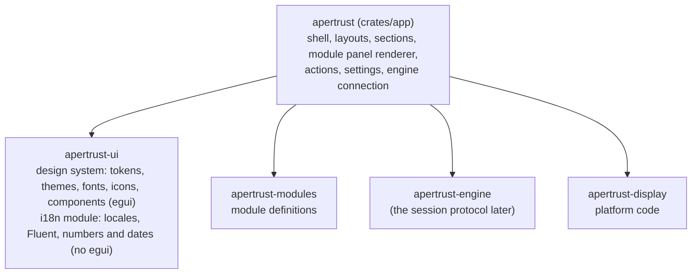
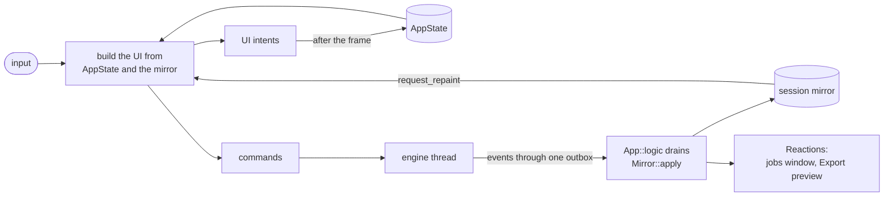
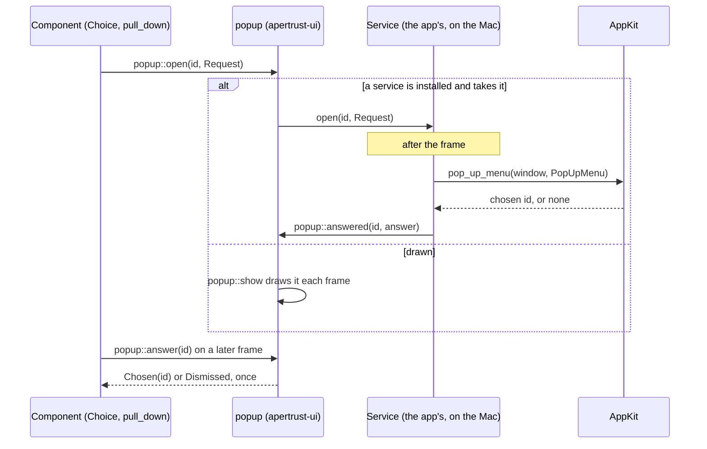
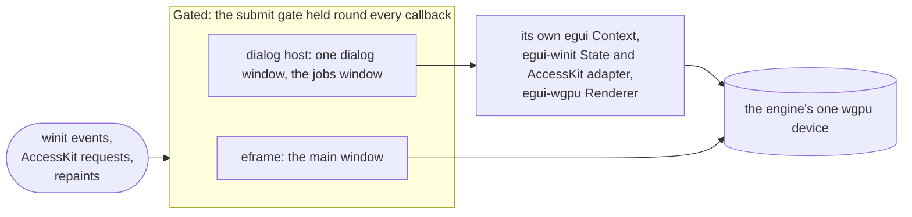
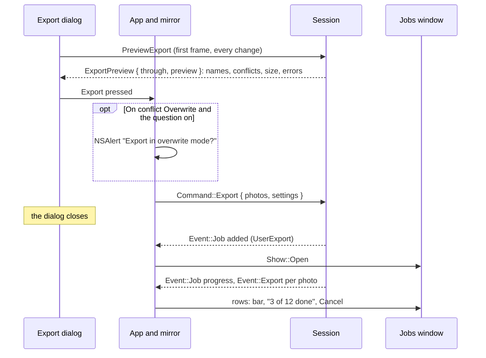
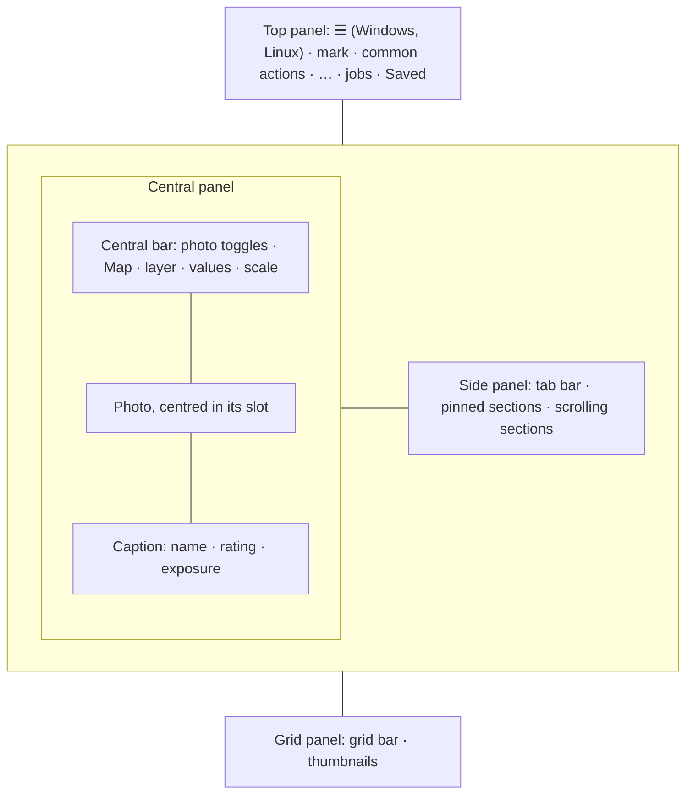
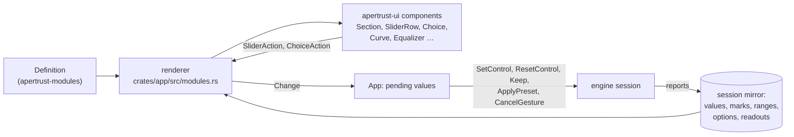

# GUI

How the desktop app's interface is built: from reusable parts, themed, translated, accessible and tested.

[decisions/](decisions/README.md) holds the decisions it rests on: egui for the desktop and the browser (decision 35), the threads (decisions 17 and 18), the fonts (decision 36), modules over operations (decision 4) and one view (decision 37). This document holds the design built on them, decided in decision 36. The `desktop-architecture` and `ui-conventions` skills turn it into working rules.

What the interface looks like and how it behaves is designed on the [UI wireframe](https://claude.ai/artifact/V4r2xReSqn344AQstUgeiK); this document is how that design becomes code. Where the two differ, the wireframe is newer, until its decisions are folded in here.

## Contents

| Part | Sections |
| --- | --- |
| How it fits together | [What is built](#what-is-built), [Goals](#goals), [Why egui](#why-egui), [Display colour](#display-colour), [Layers](#layers), [A frame](#a-frame) |
| Foundations | [Design system](#design-system) (tokens, themes, components), [Translation](#translation) |
| The window and the platform | [The window frame and menus](#the-window-frame-and-menus), [The menu bar](#the-menu-bar), [Popups](#popups), [Dialogs and alerts](#dialogs-and-alerts), [The Export dialog](#the-export-dialog) |
| The panels | [The shell](#the-shell) (the layouts, selection, workspaces, the top panel, the side panel, the photo frame, the central bar, the caption, the grid panel), [Module panels from definitions](#module-panels-from-definitions) |
| Controls | [Slider values and choices](#slider-values-and-choices), [Painted widgets](#painted-widgets): [the curve](#the-curve), [the equalizer](#the-equalizer), [the scopes](#the-scopes) |
| Keys and settings | [Keyboard and actions](#keyboard-and-actions), [Settings and workspace](#settings-and-workspace) |
| Quality | [Accessibility](#accessibility), [Testing](#testing), [Performance](#performance) |
| The plan | [Build order](#build-order), [Product choices](#product-choices), [Choices](#choices), [Open questions](#open-questions) |

## What is built

Steps 1 to 5 of the [build order](#build-order) are built, step 6 has its renderer and its modules, and steps 7 to 9 their first parts:

- `apertrust-ui` with the tokens, the three themes, the fonts, the icons and the gallery, photographed in every theme and in the pseudo-locale ([Design system](#design-system)).
- Translation, with British and American English, Ukrainian, Polish and the pseudo-locale, and the check for literal strings ([Translation](#translation)).
- The controls in `crates/ui/src/components`: the slider row, icon button, segmented control, choice list, colour swatches and value field, with AccessKit on in the app and interaction tests for each ([Components](#components)).
- The painted widgets: [the curve](#the-curve), [the equalizer](#the-equalizer) and [the scopes](#the-scopes) (the histogram, the waveform, the RGB parade and the vectorscope). The app's Scopes section is pinned in the editing tabs and fed by the engine's counts for all four.
- The section frame (header, buttons, tabs, group labels, collapsible groups, peeking with H) and the side panel's tab bar, body and edge ([Module panels from definitions](#module-panels-from-definitions), [The side panel](#the-side-panel)).
- The shell's parts: `TopPanel`, `CentralBar` and `GridPanel`, with interaction tests and a snapshot at a full window's width ([The shell](#the-shell)).
- The app as that shell, with one raw open: the engine renders it on its own thread through the viewport pipe, every ported operation from the saved edit, and a paint callback draws each frame pixel for pixel (decision 17), scaled only while the window resizes (decision 18).
- The module panel renderer (`crates/app/src/modules.rs`), which draws any module's section from its definition, with every module of the first pass built so far.
- The actions registry and the [default keyboard map](#the-default-keyboard-map) in `crates/app/src/actions.rs`.
- [The settings file](#settings-and-workspace), `settings.toml`, in the user data folder (decision 43).
- The Mac's [window frame](#the-frame) and native [menu bar](#the-menus), and the frames of Windows and Linux with the ☰ and its drawn menu (decision 39), on the first piece of [the popup service](#popups) (decision 40).
- The dialog host, with Settings, the Export dialog, the jobs window and the system's alerts ([Dialogs and alerts](#dialogs-and-alerts), [The Export dialog](#the-export-dialog)).
- Folder mode's first parts: File › Open Folder…, the Library tab's Folders section, the grid panel's cells and the central panel's empty states ([The grid panel](#the-grid-panel), [The central panel's layouts](#the-central-panels-layouts)).

Still to come:

- Rebinding keys in Settings, the actions the menus add ([what arrives when](#what-arrives-when)), and on Windows Alt pressed and released alone and native hit testing (decision 39).
- With the viewport: the scale's zoom, which needs the 100% view's regions, before and after, and the values under the cursor; the clipping overlays on the photo (the rest of step 8).
- Decision 42's slider popup and the rest of [their cards](#slider-values-the-build-in-cards).
- The rest follows the build order.

winit's default app menu on macOS is off (`with_default_menu(false)` on the app's own `EventLoop` builder, since eframe runs on the app's loop and ignores `NativeOptions::event_loop_builder`): the menu bar built from the registry takes its place.

## Goals

- **One component per idea.** A slider, a section or a tab strip is written once and used everywhere: in every module, every layout of the central panel and, later, the browser. Changing it changes every screen, as on the wireframe.
- **Nothing a user might want different is hard-coded:** colours, sizes, words and keys come from themes, translations and the keyboard map.
- **The engine boundary holds** (decision 17, `desktop-architecture`): widgets emit commands, and the UI draws from the engine's latest events.
- **The principles' quality bar:**
  - every action can be reached by keyboard;
  - screen readers work as far as egui allows;
  - the interface scales;
  - no frame waits for the engine to render: at most for a submission under way, and a resize for the GPU (decision 18).
- **The same code in the browser** (decision 35): nothing in the UI assumes a local file system, threads or a local GPU.

## Why egui

One egui codebase serves the desktop app and the desktop browser (decision 35); a native mobile app is planned after Phase 3 (decision 1). [session-protocol.md](session-protocol.md#web-tablets-and-remote-access) holds how the browser and tablets reach the engine.

**Why egui.** The image is drawn by a wgpu paint callback in the same frame as the UI: no compositing of two technologies, no IPC for pixels, and on-image overlays are more painting. Custom widgets (curves, the tone equalizer, colour wheels, scopes) suit its painter API. It compiles to wasm with production-ready web support, which settled the choice over Iced once desktop and web share one UI.

Rejected:

- **Tauri with web panels:** a webview viewport is weak on Linux, where WebKitGTK lacks WebGPU, and a native viewport beside a webview in one window is the riskiest piece on Wayland.
- **Iced:** richer theming and an enforced message architecture, but web support is not first-class.
- **Slint:** designer-friendly and touch-ready, but weaker for custom-drawn widgets and viewport integration.
- **GPUI:** polished, but its own renderer means no shared wgpu buffers, and no web target.

**What egui requires of us:**

- A design system before agents write panels: colour and spacing tokens, typography, standard panel, slider and section components. This document designs it, with themes, translation, actions, accessibility and tests (decision 36).
- Architectural discipline: widgets only emit session-protocol commands.

**Why one UI for desktop and browser.** Apps that look the same everywhere either run one web codebase, as Figma's desktop app wraps its web app (the route rejected here for viewport and Linux reasons), or build separate UIs on a shared design system, which a large company can afford and a single developer cannot. One major editor's desktop and web versions are close while its phone and tablet versions differ: the dividing line is the input model, not the platform.

**Web support compared:** egui runs in production on the web (Rerun's viewer); Iced's web target is not first-class; Slint's wasm build is aimed at demos; GPUI has none. Accepted costs of a canvas-drawn web UI: weaker accessibility, no native text selection, a multi-megabyte wasm download, less browser integration.

## Display colour

The viewport has two output modes behind one abstraction: app-managed as the baseline everywhere, system-managed where the OS supports it.

1. **App-managed:** the engine converts to the display's ICC profile, using moxcms, and outputs 8- or 10-bit, as darktable does. It works everywhere, X11 included.
2. **System-managed:** the engine hands the OS linear float16 tagged with its colour space, and the compositor maps it to the display. The only route to real HDR and EDR headroom.

| Platform | wgpu backend | System-managed path |
| --- | --- | --- |
| Windows | DX12 (Vulkan alternative) | FP16 scRGB swapchain; Windows converts to the display |
| macOS | Metal | `CAMetalLayer`, rgba16Float, extended linear Display P3, EDR |
| Linux | Vulkan | Wayland colour-management protocol where the compositor supports it; none on X11 |

wgpu does not expose surface colour-space control on every backend, so `apertrust-display` reaches through to the native layer: per-platform code behind one function per need, outside the engine because it needs the window, in an FFI crate allowed `unsafe`.

- For colour it has one function, `tag_window`, which tags the macOS window's Metal layer sRGB or Display P3 every frame. wgpu leaves the layer untagged, and macOS then shows it unmanaged, so a P3 display oversaturates the UI and the image. Elsewhere it does nothing yet.
- The system-managed paths land there in Phase 7.
- With egui, UI colours are authored in sRGB and need converting when the surface is extended-linear, or panels look oversaturated on P3 displays.

**The output profile operations see** (decision 26). In every pipe but an export with a profile of its own, operations that gamut-map against the output profile (filmic rgb's v6 and v7, AgX's "export profile") see the edit's output profile, Output colour profile's, which colorout writes, never the display's, as darktable's darkroom would. The viewport then computes what the export does (principle 2), and the display path converts colorout's output to the display, soft-proofing the export. Today the viewport draws its display buffer as sRGB, right for the default sRGB output; the conversion from any other profile is needed before the Output colour profile module lets an edit choose one.

## Layers



| Crate | Owns | Depends on |
| --- | --- | --- |
| `apertrust-ui` | The design system: tokens and themes, fonts, icons, components and the gallery. In its `i18n` module: the locale, Fluent message bundles and plural rules, and the formatting and parsing of numbers, units and dates | egui; Fluent and ICU4X for `i18n` |
| `apertrust` (app) | The shell, the central panel's layouts and the sections; the module panel renderer; the actions registry and keyboard map; settings; the connection to the engine | ui, modules (the definitions it draws, and the list it hands the session, decision 28) and protocol (the engine until the protocol exists), display |

- **`apertrust-ui` knows nothing of photos, modules or the engine.** Its slider doesn't know it sets Exposure; it reports that it moved, and the app turns that into a session command. That is what lets the gallery, the tests and the browser use components on their own.
- **Translation is a module of `apertrust-ui`**, `apertrust_ui::i18n`, which doesn't use egui.
  - Nothing outside the GUI translates yet, and a crate with a single user would protect no boundary.
  - When the CLI or the server first needs translated text, the module moves out unchanged into its own crate, `apertrust-i18n`, so they can use it without egui.
- A crate is added when its first real code lands (AGENTS.md).

## A frame



- **AppState** is the UI's own state: the central panel's layout, the workspace and its tab shown, which sections are open, scroll positions, a module being peeked at with H, open dialogs. Part of it persists in [settings](#settings-and-workspace).
- **The session mirror** is the engine's state as its latest events reported it: the active photo and the selection (decision 37), module values and their marks (kept, set by Auto), layers, history and scope data. Widgets read it.
  - Events write it, with one exception: a value a widget has just sent shows in its place until a report includes that command (each report says how many commands it includes). So a slider never jumps back to a value reported late (decision 17).
- **Outputs are plain values.** A UI intent changes AppState once the frame is drawn, so a frame never reads half-updated state. A command goes to the engine and comes back as an event.
- **Transient interaction state** (a drag in progress, a value field's draft) may live in egui's memory under the component's id. It never holds a value the engine owns.

### Events enter in one place

Events enter the app through the mirror (decision 59; [engine.md](engine.md), Events): `apply(event) -> Vec<Reaction>` in `crates/app/src/mirror.rs`, free of egui and tested by feeding it event sequences.

- **Drained in `App::logic`,** which eframe runs while the window is minimised too, so a save or a job's end is taken in while nothing is drawn.
- **No event bus, no subscriptions.** darktable's signals that ask a widget to redraw or re-read (`CONTROL_REDRAW_*`, `COLLECTION_CHANGED`'s 22 handlers, a thumbnail's six) need nothing here, since every panel draws from the mirror each frame.
- **Derived caches** compare a generation number the mirror raises: the grid panel's thumbnails' textures compare the folder's, raised whenever the folder or its thumbnails change, and each texture the generation its thumbnail came at. The grid's layout is to do the same.
- **Reactions.** What must happen once in reply to an event, the reducer returns as a `Reaction`, which the app does as it drains (`App::drain`): the jobs window opening as the person's own job starts (decision 57, `Reaction::Jobs`), a preview handed to the Export dialog (`Reaction::Preview`), and later a live region's announcement or a notice's toast (planned with `Event::Notice`).
- **Refusals.** A command the session refused names its number (`SessionError::Refused`), so the mirror stops showing the change it was sent for and stops waiting for a save it would have caused.
- **What the mirror holds:** the photo, the values with the pending changes over them, the frame, the scopes' reading, whether the edit is saved, the jobs, the failure the central panel shows, the open folder with its photos' thumbnails, and the Export dialog's floor for previews.
- **The app's own changes** (the theme, a setting, a tab, the hovered photo) are AppState, changed by intents after the frame, with no event. A setting the engine reads goes to it as a command.

### The edit, saved

The app hands the session `apertrust_modules::MODULES` with the operations (decision 28). It mirrors each module's controls with their values, defaults and marks beside the parameters no module owns yet.

- **Saved or Not saved yet** shows in the top panel as the session saves the edit by itself. Saved shows only once a write of the open photo's edit includes every change sent; a failed write's message stays over the photo until one succeeds.
- **Pending values.** `App::set_control` sends a control's value and shows it, kept, until a report includes it; a reset, a keep or a module's reset shows at once in the same way. The module renderer calls them.
- A parameter a module owns is the module's alone: `Set` on it is refused.

## Design system

`apertrust-ui` (decision 36): tokens and themes, fonts, icons and components, knowing nothing of photos, modules or the engine.

### Tokens

Every colour, size and duration a component uses is a token: a named value in the theme, named by its role, never by its look. Components read tokens and hold no literals.

| Group | Tokens | Notes |
| --- | --- | --- |
| Colour | Surfaces (surface for the top panel and the bars, panel, raised, sunken); the scrim under About and, once designed, the splash screen, the two modals drawn over the window (decision 41); text (primary, strong, secondary, disabled); border, divider, separator; the outline of a control that is only an outline at rest, `ToggleRow`'s checkbox (`control_outline`, 3:1 on `panel` and `sunken`; `text_secondary` under the pointer); accent, accent text, focus ring, selection, and the value field's neutral selection; slider track, fill, handle (with its hover and drag looks); kept marker; scroll bar thumb (with its hover and drag looks); a histogram behind a graph (`graph_histogram`); warning, error, success; shadow and highlight clipping; mask overlay; the close button's hover; the colour labels, darktable's five; a scrim over thumbnails | Authored in sRGB (`ui-conventions`) |
| Photo surround | The background around the photos in the central panel, in Photo and in the slideshow | Neutral grey only (a* = b* = 0), so it never tints how colour is judged |
| Surround text | Text on the photo surround: the caption under the photo, its file name, exposure and the marks of its rating and labels | Checked at 4.5:1 against the surround, which the light theme's mid grey fails with the panels' secondary text |
| Typography | Body 13, small 12, caption 11, title 14, section title 15 (a module's header), heading; Regular, Medium and SemiBold (decision 36), headings and group labels Medium, SemiBold only where it marks a choice ([below](#quieter-icons-lighter-headings-2-point-borders)) | Points, before scaling |
| Spacing | A scale: 2, 4, 6, 8, 12, 16, 24 | Density picks the scale |
| Sizes | Row 26, control 22, a module row's field 18, icons 14 and 16, section header 30 and panel line 24, top panel 44, slider row 37, its track strip 16, marker 16, value 54 | [How the rows are laid out](#how-the-rows-are-laid-out); `control` stays for the bars, the headers, segmented controls and egui's own widgets, `field` is the rows' |
| Shape | Radii 3, 4 and 5; hairlines 1; panel separators 2 (`separator_width`); slider track 4 | |
| Elevation | A shadow and border for menus, drawn popups and About | A dialog's window has the system's shadow (decision 41) |
| Motion | Durations for hover, opening and closing | Zero when the user or the system asks for reduced motion |

Colours that are data are not tokens: a hue track shows real hues, and a scope shows the photo's channels.

### Themes

A theme is a full set of token values, stored as TOML in `crates/ui/themes`.

- **Three built-in themes are compiled in:** dark (the default), light and high contrast. A user's theme file extends one of them and overrides any of its tokens (`extends = "dark"`).
- **The default theme is a neutral dark grey.** The wireframe is drawn light so that it is easy to read; its colours show roles, not the theme.
- **One grey, parted by separators:** the top panel, the bars, the side panel and, in the dark theme, the photo's surround share one tone (#2D2D2D), and regions and sections part by `separator`, a line or band darker than the surfaces (#191919), not by lighter rules or steps of tone. Wells and the side panel's tab strip are a step darker (`sunken`), menus and dialogs a step lighter (`raised`). The light theme follows the same structure with its own greys; high contrast keeps black with grey separators.
- **The accent is amber** in every theme, and rare ([Product choices](#product-choices)).
- **Every theme is checked when it loads:**
  - text against its background, for WCAG AA contrast (4.5:1, and 3:1 for large text and controls);
  - the photo surround, for neutrality;
  - the slider row's height, at least its top line, its track's strip and the padding under them (`sizes.field + sizes.track_strip + spacing.xxs`); what is left is its padding above, a point in the built-in themes.

  A failing theme still loads, with a warning that names the token. The built-in themes run the same check in CI.
- **Switching is live.** The app replaces the theme stored in egui's context and maps it onto egui's `Style` for the few egui widgets used directly (text fields, scroll bars, menus). No restart.
- **What a theme changes:** the colours; type sizes; density (compact or comfortable spacing); radii and strokes; the photo surround's lightness; overlay colours, which users with colour vision deficiency can choose; motion.
- **What it doesn't:**
  - the side panel's tabs and sections, which are the user's workspaces, kept in settings;
  - the components' shapes: the slider handle stays a triangle;
  - the typeface (decision 36);
  - colours that are data.
- **The interface's scale** is a setting rather than a theme value: egui's zoom factor on top of the system's scale.

#### Quieter icons, lighter headings, 2-point borders

An interface for photo editing must not be too contrasty, so:

- **Icons sit a step darker than text.** An icon in a button is drawn in `text_secondary` at rest, and in `text` while the pointer is over it, it is pressed, a key has focused it or its menu is open (`icon_colour` and `icon_lit` in `components/mod.rs`, which every icon button reuses).
  - In a button with a word, the top panel's Import…, Export… and Reset, only the icon is `text_secondary`; the word keeps `text`.
  - A toggle that is on keeps its filled icon in `text`, a disabled icon `text_disabled`, and the warning sign and the accent stay as they are.
  - Data marks (stars, Reject, colour labels, a cell's marks), the side panel's tab icons (already secondary at rest), the window's caption buttons and the kept marker are not part of this.
- **Headings are Medium, not SemiBold:** dialog titles (About and its pages, Settings, the Export sheet), `group_label`'s 11-point capitals, the jobs window's row titles and module and section titles. SemiBold is kept where it marks a choice: the chosen tab, a dropdown filter's matches, the active photo's name.
- **The borders between the window's panels are 2 points** (`shape.separator_width`, beside `hairline`, in `separator`'s colour): the top panel's bottom edge, the central bar's, the grid panel's edge towards the photo (`GridEdge`) and the side panel's (`PanelEdge`, its grab zone unchanged). Lines inside a panel, between modules, groups and bands, stay one hairline.

### Fonts and icons

- **IBM Plex Sans** is compiled in (decision 36), in Regular, Medium and SemiBold. It has every letter of the Ukrainian and Polish alphabets. Fonts for other scripts are in [Translation](#translation).
- **Icons are SVG files**, one colour (`currentColor`), in `crates/ui/assets/icons`, whose README gives the rules. They are rendered with resvg, pure Rust, at the exact pixel size they are drawn at, cached, and tinted with a token colour, so they follow the theme and stay sharp at any scale. A designer can edit or replace them in any vector tool.
  - **Lucide is their foundation** ([lucide.dev](https://lucide.dev), release 1.70.0): most are Apertrust's own files derived from Lucide's icons, each naming its source and licence in its first line, ISC or, for those Lucide derived from Feather, MIT, with Lucide's notices in `LICENSE-Lucide` beside them (decision 64). They are adapted where needed: the zoom magnifiers are mirrored, the lens at the top right and the handle at the bottom left. Where Lucide has no icon that reads as the thing, one is drawn for Apertrust in Lucide's style on its 24-unit grid: the four darktable group tabs, the quads' line tool, Copy edit's and Apply edit's arrows out and in, the scopes' graphs, log scale and clipping overlays, and the filled forms of the group tabs. `Icon::file` maps each of Apertrust's icon names to its file in one place. The window's caption buttons and the mark keep their own drawing.
  - **Their weight:** every line is 1.25 points wide at every size (`icons::STROKE`, Lucide's `absoluteStrokeWidth`), the files' 2-unit stroke set as each icon is rendered, so a 10-point chevron is as heavy as a 22-point tab, since Lucide's own 2 units, scaled with the icon, leave the 10- and 12-point icons faint. Round caps and joins, outlines at rest, and a filled form (`*-filled.svg`) only where an icon shows a state: the chosen side panel tab and a central bar toggle that is on, its outline's shapes filled with the lines that cross them cut out.
  - **Binary only:** every part of an icon is solid or an outline at full opacity, never a half-tone.
  - **One colour:** every icon is drawn in one colour, the tab icons darktable's shapes among them ([The tabs](#the-tabs-darktables-groups)).
- **`Picture`** draws an SVG in its own colours, as About's full logo.

### Components

`apertrust-ui` holds every component the wireframe uses:

- **Controls:**
  - icon button, text button, segmented control, checkbox, combo, menu; a combo, a menu or a context menu opens through the popup service, native on the Mac for plain lists ([Popups](#popups), decision 40);
  - tooltip, carrying the control's promise and its shortcut;
  - value field: typed values in the locale's number format, units accepted; a slider's, in its edit state, a number only, for now ([The value field](#the-value-field));
  - text field and path field (`TextField`, `PathField`): a one-line text well, every edit reported whole, a hint and an error outline; the path field with its list of variables ([The Export dialog](#as-built));
  - the slider popup, darktable's fine control, a kind of the popup service drawn on every platform (decision 42, [The slider popup](#the-slider-popup), planned);
  - colour swatches, channel toggles.
- **Rows and frames:**
  - the slider row, in two lines ([how the rows are laid out](#how-the-rows-are-laid-out)): the label and marker, the row's buttons and the value, read-only with its unit at rest and a field while edited (decision 42), over a track the content's full width. Its triangle handle is cut off at the track's ends; under the pointer it brightens, and while dragged it keeps its fill and size with an accent border just inside its edge (`slider_handle_hover`, `slider_handle_active`), while the value stays in the text colour; the cursor stays the arrow; the central bar's scale and the curve's handles look the same. It shows the kept and Auto markers, the fill from the default, colour tracks and the Match tick, and spans darktable's soft range where it has one, widening to show a value beyond it;
  - the checkbox row (`ToggleRow`), one line: the checkbox, then its label, which toggles it too; the action row (`ActionRow`), one button;
  - the dropdown row, always one line, Blended in module panels and Boxed elsewhere (decision 42, [Choice rows: two styles](#choice-rows-two-styles));
  - the section frame (`Section`): a header 30 points high with chevron, title and action icons, centred vertically, and no summary when closed; underlined `Tabs`, each as wide as its name, their padding and then their names shrinking when they do not fit; group labels; collapsible groups (`CollapsibleGroup`), darktable's collapsible sections (decision 29); the body; peeking while H is held (`Section::peek`);
  - the side panel's `TabBar` (icon tabs, a tab with nothing behind it yet drawn disabled, never chosen, saying it is to come, » and ⋮ menus), `PanelBody` (pinned sections, a band, scrolling sections, a quiet scroll bar, `quiet_scroll`) and `PanelEdge`.
- **Painted widgets:** colour wheels (ring, puck, saturation and luminance arcs), [the curve](#the-curve), [the equalizer](#the-equalizer)'s bands, hue curve, [the scopes](#the-scopes) (histogram, waveform, parade, vectorscope, with their controls on hover), the grid panel's thumbnails (`GridCell`), layer rows.
- **Shell parts:** `TopPanel`, `CentralBar`, `GridPanel` with its grid bar, the panels' edges (`PanelEdge`, `GridEdge`), `PhotoFrame` and `PhotoCaption`, a dialog window's content frame (its header where the platform draws none, its body and its row of buttons, decision 41), the alert's drawn body (`AlertBody`), the jobs spinner and window's content (`Jobs`), notifications.

**How a component works:**

- Each is a builder with a `show(ui) -> Output` method: given its value, it draws itself and reports what the user did.
- It reads the theme and the locale from egui's context.
- It reports its role, label and value to AccessKit.

**The gallery** (`cargo run -p apertrust-ui --example gallery`) shows every component in every state: rest, hover, focus, pressed, disabled, kept, Auto and Match. It has a switcher for the theme, the locale and the scale.

- It is the code's counterpart of the wireframe's Controls and Sections boards.
- A component is built there before any panel uses it.
- The snapshot tests photograph it, in every theme and in the pseudo-locale.

## Translation

The interface is in British English, as the docs are (colour, grey, centre, customise), with Ukrainian and Polish translated from the start and American English in its own spelling ([Product choices](#product-choices)).

- **Fluent** (Project Fluent, the `fluent-bundle` crate):
  - Messages carry variables, plurals and selectors, which translators control for their own language: `{ $count -> [one] one photo *[other] { $count } photos }`.
  - Each locale has its `.ftl` files in `crates/ui/locales/<locale>/`. British English (`en-GB`) is the source; Ukrainian (`uk`) and Polish (`pl`) are translated from the start.
  - American English (`en-US`) is an overlay of British English: its files hold only the messages whose words it spells differently (color, gray, center, normalize, canceled, license), with the same variables, and every other message is British English's. darktable's module names, American upstream, are darktable's there: Color balance RGB. A system language of `en-US` chooses it; every other English chooses British English. Numbers are written as in British English.
- **Every user-visible string is a message id.** Components and the app look text up by id (`tr(ctx, "module-exposure-control-contrast-label")`), so no English literal reaches the screen. `tools/check-ui-strings.sh`, run in CI, fails on a literal passed to a label, button, heading or tooltip in the interface's code.
- **Message ids say where a string lives:** `module-exposure-title`, `module-exposure-control-contrast-label`, `module-exposure-control-contrast-promise`, `action-copy-edit`, `error-raw-unsupported`. A module's ids follow its definition ([Module panels from definitions](#the-section-and-its-words), decision 28).
- **The engine never translates.** Its errors are codes with arguments, and the UI owns the words. Log lines and the startup banner (decision 44) stay in English, because they are for diagnosis.
- **The locale** is the system's at first start, can be changed in settings, and switches live. The settings file keeps it once the user chooses one; until then the interface follows the system's language.
- **Numbers and units follow the locale.**
  - The decimal separator and grouping come from CLDR data through ICU4X (`icu_decimal`; its Unicode-3.0 licence is allowed by `deny.toml`).
  - Value fields accept both the locale's separator and the point. A slider's field takes one of them, a comma in English being no separator and ignored, while it takes a number only (decision 42). Once darktable's expressions come, its field and popup read a comma as the point in every language, as darktable's calculator does.
  - Negative values keep `−` (U+2212), and a slider whose range spans zero signs its values, zero "+0.00" (decision 42).
  - A slider's value shows its unit through `unit-<unit>-value`, each language placing it; Ukrainian and Polish write darktable's "50%" and "px" ([Units and signs](#units-and-signs)).
  - Dates and times (history, metadata) use `icu_datetime`.
- **Room for longer languages.**
  - Labels sit in fixed columns and are shortened with an ellipsis, with the full text in the tooltip. The short-labels rule keeps English labels to a word or two, which leaves room.
  - **The side panel's tab names,** under their icons, are set as the other labels are: as written, in sentence case, Regular, at the caption size. They fit their tiles: when one is too wide, all of them shrink together, half a point at a time and by two points at most, and a name still too wide ends in an ellipsis. Wrapping has no room in the tile's 52 points under the icon, and an ellipsis alone would cut real names such as Корекція.
  - English and Ukrainian fit at the caption size; Polish's, whose Podstawowe is darktable's word for Base (decision 38), and the pseudo-locale's at 9 points, the most they may shrink, each whole in its tile, as tests check. Every tab's name counts, those under » too, so the size stays put as the panel narrows and tabs move into it. The full name stays in the tooltip and for screen readers.
  - A pseudo-locale (accented, 40% longer, bracketed: `[Ëẋƥöšüŕé ~~~]`) runs in the gallery and the snapshot tests, to catch clipped text and strings that escaped translation.
- **Ukrainian and Polish test the hard cases from the first day.** Both write a decimal comma, and both change a noun's form after 1, after 2 to 4 and after 5 or more ("1 photo", "2 photos" and "5 photos" each differ), so they test the number format and Fluent's plurals. IBM Plex Sans has every letter of both alphabets.
- **Scripts.**
  - egui 0.37 shapes text (harfrust) but has no bidirectional layout.
  - The bundled IBM Plex Sans covers Latin (Vietnamese included), Cyrillic and Greek, so those languages work now. CJK works with a fallback font.
  - Right-to-left languages wait for bidirectional layout in egui. Until then, layout code speaks of start and end rather than left and right, as the side panel's placement already does, so mirroring stays a contained change.
- **Fonts for other scripts:** the matching IBM Plex family (Plex Sans JP, KR, SC, TC, Arabic, Hebrew, Devanagari and Thai, all OFL), loaded from the app's resources only for a locale that needs it, to keep the binary small. IBM Plex Sans itself stays compiled in (decision 36).
- **Workflow.**
  - English messages change with the code, and Ukrainian and Polish change with them: the tests fail on a message missing from a language, on a translation English no longer has, and on a translation whose variables differ from English's. At run time, a message a translation lacks still falls back to English.
  - Before a release, a native speaker reviews each language's new messages; `crates/ui/locales/README.md` says which are still drafts.
  - Other languages come from contributors, on a platform that reads Fluent (Weblate does), once the repository is public.

## The window frame and menus

The top panel runs to the window's top edge on every platform and is the window's title bar. How it works, and how the menus work, is decision 39's:

- one menu model built from the actions registry;
- native in the Mac's menu bar;
- drawn by egui on Windows and Linux, opened from one menu button, ☰, at the top panel's very start, before the mark, with no row of titles.

What the menus hold is [the menu bar](#the-menu-bar)'s. Built: the frames of the Mac, Windows and Linux, the Mac's menu bar, and the ☰ of Windows and Linux with its drawn menu. Windows' Alt pressed and released alone and its native hit testing are still to come.

### The frame

| Platform | Frame | The top panel's caption parts | Empty areas of the top panel |
| --- | --- | --- | --- |
| macOS | A full-size content view, a transparent title bar, the title hidden | The traffic lights, AppKit's own buttons, centred vertically in the 44-point top panel; the top panel starts after them | A drag moves the window; a double-click does what the system's setting says (`AppleActionOnDoubleClick`: zoom, minimise or nothing) |
| Windows | Decorations off, winit's undecorated shadow and Windows 11's rounded corners | Minimise, maximise or restore, and close at the end, drawn by the app | A drag starts the system's move, with Aero Snap at the screen's edges; a double-click maximises or restores; a right-click opens the system menu |
| Linux, X11 and Wayland, every desktop | Decorations off: neither GNOME, KDE nor an X11 window manager draws a title bar | As on Windows: minimise, maximise and close at the end, until the desktop's own layout is read from the settings portal | A drag hands the move to the window manager or compositor, its edge tiling included; a double-click maximises or restores; a right-click opens the compositor's window menu on Wayland, nothing yet on X11 |

#### Every platform

- **`TopPanel` stays platform-free.** It is told its leading inset, whether to draw caption buttons and whether the window is maximised. It reports a drag starting, a double-click or a right-click on its empty areas, and the caption buttons' clicks, which the app turns into viewport commands (`StartDrag`, `Maximized`, `Minimized`, `Close`, and winit's `show_window_menu` through the window eframe hands over). On Windows it will also report the rectangles the hit map needs.
- **The window never moves by its background** (`with_movable_by_background(false)`), so dragging a slider never moves it.
- **A move starts when a drag does,** not on the press, so a double-click on the top panel stays a double-click. The drag must go egui's click distance, 6 points, or the press be held 0.8 s; the window then trails the pointer by that much (a 40-point drag moved it 31 to 32 points on the M4).
- **What counts as empty** is read from the pointer, not from a widget under the bar, which would take from each control egui's 5-point margin, within which a near press goes to the closest control. The top panel's controls with that margin, disabled ones included, are not empty areas: a drag or a double-click on a greyed-out Undo does nothing. Its title and Saved are empty areas; nothing under a popup over the bar is. Each new press may move the window again, since the system's window drag can swallow the last release.
- **The window keeps its title,** hidden in the Mac's frame, for Mission Control, the Window menu, the taskbar and screen readers.
- **Scale.** Everything the frame draws is in points, so it follows a monitor's scale; on Windows winit applies the system's suggested rectangle on `WM_DPICHANGED`.
- **The minimum window size** is 500 by 600 points on every platform, so Windows 11's half and third snap zones take the window (Microsoft asks for 500 effective pixels or less), and macOS's and the Linux desktops' tiling gain too. The quarter zones need a height of about 520 on a 1080-pixel screen, which 600 keeps out.
  - Below 960 points the shell gives way: the top panel drops its words, the ☰ of Windows and Linux never folding (decision 39), in the order [the top panel](#the-top-panel) gives, down to Undo, Redo and ⋯.
  - How the side panel narrows, hides or lies over the photo in a narrow window is an open design item.
  - The minimum is lowered in code (`WINDOW_MIN`) only once the shell gives way, so no window ever shows a broken layout.

#### The Mac's frame

- **The traffic lights** are moved by `apertrust-display`, since winit cannot place them, and moved again after every layout AppKit makes: a resize, leaving full screen, a change of scale. It reports where they end, so the top panel's inset is measured, never a constant. In full screen they leave with the title bar, and the top panel starts at its edge.
  - **Where:** the close button's centre as far from the window's left edge as from its top, 22 points in the 44-point bar, as AppKit places them in its taller toolbars; the others at AppKit's spacing; the top panel's content after a margin as wide as the one before them.
  - **How:** `apertrust_display::place_window_buttons`, called each frame before the top panel is drawn, since every such layout brings egui a frame. It makes the title bar's container as tall as the top panel in the window system's points (44 times the interface's scale), so the buttons sit at its centre and still take clicks, and returns the room they take, which the top panel's start inset takes in place of its margin.
  - **After AppKit's own layouts.** AppKit puts the buttons back in its own 32-point title bar's place whenever it tiles the title bar: on every step of a zoom's or a resize's animation, while egui draws no frame, and after leaving full screen. So two methods are replaced at run time that always run: the `layout` of the title bar's container, a private AppKit class (`NSTitlebarContainerView`), which comes before anything is drawn; and winit's window's `setFrame:display:`, a partial fallback should that class be renamed, since with `display:YES` the step may already be drawn with the buttons in AppKit's place.
  - **Only on the views it knows.** It touches nothing unless the views are as AppKit has built them since OS X 10.10: the container straight in the frame view that holds the window's content view. Otherwise the buttons stay where AppKit put them, and the top panel is still the title bar, its inset measured from where they are, or 78 points when the window cannot be reached; the window can always be moved. No oldest macOS is set yet, so the views need checking on the oldest one the app will support.
- **Only the empty areas move the window.** Under a transparent title bar AppKit moves the window from any view that lets it, and winit's view does.
  - `apertrust_display::content_never_moves_window` gives winit's view class (`WinitView`, by name) a `mouseDownCanMoveWindow` at run time that says yes only while `apertrust_display::start_window_drag` runs, and replaces winit's `mouseDown:` to keep each press's mouse-down for that drag, winit's own then called.
  - For a drag that began on an empty area, the app calls `start_window_drag` at the end of its frame, before eframe paints, in place of egui's `StartDrag`. It calls AppKit's `performWindowDragWithEvent:` with the press's own mouse-down, as AppKit asks; else the left-button event it is handling; else a mouse-down built at the pointer, since winit's `drag_window` passes whatever event is current.
  - The system may then keep the press's release from the app, so the app hands egui one on the next frame; egui would otherwise think the button down and show no tooltip until the next click.
  - An upward drag that crosses its 6-point threshold inside AppKit's own title strip (32 points on macOS 27) may not move the window, since AppKit may ask the view under the pointer there whether it may. Whether `start_window_drag` settles that is for the hand checks below, with `-d gpu`, which logs the event each move was handed off with.
- **The double-click setting** is read at each double-click. macOS 15's Fill is taken as zoom, which fills the screen for a window with no size of its own; `AppleMiniaturizeOnDoubleClick`, the setting before OS X 10.11, is read where `AppleActionOnDoubleClick` is unset. The zoom is started from the run loop, after the frame (below).
- **The window's animations draw each step,** as native apps do: a zoom, its way back and a live resize, the content laid out and drawn at every size, not the last frame stretched.
  - AppKit animates a zoom within the call that starts it, and called from inside winit's event handling, as egui's `Maximized` is, it lets winit deliver no resize nor redraw until it ends. So a double-click's zoom is started from the run loop (`apertrust_display::zoom_window`), and eframe then draws each step, presenting with the window's own transaction while it resizes (egui-wgpu's `macos-window-resize-jitter-fix`).
  - On the M4 at 2× a step takes under the animation's 16.7 ms, the surface's reconfigure included.
- **Checked by hand on the M4,** macOS 27.2: centred at 100% and 110%, through a zoom and back, gone in full screen with the top panel starting at its edge, back in place after it. A move to a display of another scale is not checked yet.

#### The photo while the window resizes

The engine's photo is not rendered for each step of a resize: the app holds the size it sends until the window has kept its size for 150 ms (`Bounds`, decision 18), since a render each step could not keep up. It holds it the same way while the side panel's edge moves, dragged or held under a key ([The side panel](#the-side-panel)).

- **Meanwhile the last frame is shown scaled,** bilinearly, to the size the next will have (`Values::viewport_size`, the photo as its edit shows it, turned where its orientation turns it), so the photo follows the window and the sharp frame then takes its place with nothing moving. The central bar's scale follows the size shown.
- **The submit gate.** Each step reconfigures the window's surface, which wgpu-core 30 fails, with a panic, should another thread submit meanwhile. What is guaranteed (decision 18): no submission of the engine's overlaps a reconfigure of the window's surface, on any platform, the one eframe makes at the first event after a resize included. Every reconfigure is inside an eframe callback, and the app holds the engine's submit gate round each (`Gated`).
- **What is not guaranteed:** the holds take turns in the order asked (`SubmitGate`), so each thread waits for the other.
  - A submission of the engine's waits for the eframe callback under way, however long it runs. A loop of its own inside a callback, a modal one included, would stop the engine's frames until it returned, so such loops run from the run loop, outside eframe's callbacks, as the Mac's popups do (decision 40).
  - A frame takes one turn, its render and its copy for the window in one submission, and the scopes' count a second while they are shown.
  - On the UI thread, as decision 18 narrows decision 17's rule that it waits for nothing, a callback waits for a submission asked for before it, a moment, and a reconfigure inside it for the work the engine had already submitted, up to one render's GPU time. Holding the size during a resize keeps that work small.
- **Measured on the M4:** with another thread holding the gate in 15 ms slices and no pause between them, a frame of the session test's synthetic photo came 12 to 23 ms after its change, against 0.8 to 1.6 ms with the gate free, and 70 to 110 ms when a frame took four turns.

#### Windows' and Linux's frames

- **Windows keeps its own window management.** With decorations off, winit keeps the window captioned, sizeable and with its system menu as far as Windows knows, and only answers `WM_NCCALCSIZE` so that the whole window is client area. So Win+arrows, Win+Z, Alt+Space and Alt+F4 stay the system's, and a move started from the top panel (`StartDrag`, which posts `HTCAPTION`) is the system's move, with Aero Snap and Snap Assist.
- **The caption buttons** on Windows and Linux are 46 points wide, as Windows 11's are, and as tall as the top panel, so the three take 138 points. Each is an AccessKit button with its translated name (Minimise, Maximise or Restore, Close), in the top panel's place in the focus order.
  - Built in `apertrust-ui`, used by the app on Linux: `TopPanel::caption_buttons` draws them after everything else, also last in the focus order, and `TopPanel::maximised` turns Maximise into Restore. They report `Minimise`, `MaximiseOrRestore` and `Close`, and a right-click on the empty areas `WindowMenu`.
  - The close button's hover is `close_hover`, with its icon in `text_on_close_hover`: Windows' red and white in every built-in theme, the high-contrast and light ones included. The other two take `hover`.
  - The fills stop above the bar's bottom line, and the focus ring is drawn inside the button, which meets the window's edges.
  - The caption icons are drawn with 1-unit strokes in a 10-unit box, thinner than the other icons, like Windows' caption glyphs, and are not Lucide's (`crates/ui/assets/icons/README.md`).
  - The right-click is reported on its release, as egui's context menus open, though GNOME's and KDE's title bars open their menus on the press.
- **Resizing** on Windows and Linux starts from 6-point bands along the window's edges, inside it (`ViewportCommand::BeginResize`), with the resize cursors. With decorations off, winit's window has no border outside it, and Wayland draws no shadow round a window that decorates itself, which winit gives no way to add.
- **Maximised on Windows,** the window fills the monitor's work area, so the taskbar stays in sight. Whether an auto-hidden taskbar still appears when the pointer reaches its edge is one of the checks below.
- **Windows is built in two steps.** First through egui alone, as above. Then native hit testing from `apertrust-display`, so that hovering the maximise button shows Windows 11's snap layouts flyout and the system draws its own resize border.
  - Either a subclass answering `WM_NCHITTEST` from a hit map the app publishes each frame (`HTCAPTION` over the empty areas, `HTMAXBUTTON` over the maximise button, the edges), in physical pixels from the frame drawn at the current scale, or a transparent child window over the button. A check on Windows 11 chooses between them.
  - The subclass also hands the maximise button's non-client hover, press and release to egui, so it is drawn like the other two.
  - winit answers no `WM_NCHITTEST`, and without `HTMAXBUTTON` there Windows shows no flyout (Microsoft's guidance); Win+Z and dragging to the edges snap all the same. Windows is first-class once the second step is in.
- **Linux's frame** is built in the app (`CAPTION_BUTTONS`), on X11 and Wayland alike: decorations off, the top panel the title bar with the caption buttons at its end, Restore while egui's viewport info says the window is maximised, and no top panel in full screen.
  - Minimise and Maximise or Restore send `Minimized` and `Maximized`. Close runs the Quit action, so the app leaves as on any close, its settings written.
  - A drag from the empty areas sends `StartDrag`, so the compositor or window manager moves the window, its edge tiling included, and the next frame gets the release it may keep (`release_after_drag`). A double-click maximises or restores.
  - A right-click calls winit's `show_window_menu` at the pointer, in physical pixels, which opens the compositor's menu on Wayland and does nothing on X11. winit hands the compositor the latest button serial, the release's, where GNOME's own title bars open the menu on the press; whether Mutter accepts it is for the hand check.
  - The resize bands, `RESIZE_BAND` (6 points) inside each edge and a corner where two meet, are off while the window is maximised or in full screen. A press in one is taken from egui's input before the frame (`resize_press`), so no control under the band sees it, and sends `BeginResize`. Over them, with no button down, the resize cursor replaces any a widget asked for.
  - Checked by hand on GNOME on Wayland; not yet on KDE or an X11 window manager.
- **Linux's later steps:** the desktop's button layout and title-bar actions read from the settings portal (GNOME shows close alone by default, elementary puts it at the start); X11's window menu through `_GTK_SHOW_WINDOW_MENU`, which Mutter and KWin answer.
- **The system's title bar as a setting,** Use the system's title bar, on Windows and Linux, off by default: decorations back on, live (`ViewportCommand::Decorations`), the caption buttons gone, the ☰ still at the top panel's start. It serves tiling window managers, where caption buttons mean nothing, and anyone the drawn frame fails. It is kept in settings.
  - GNOME on Wayland draws no decorations, so with the setting on it gets winit's Adwaita frame instead of the bare fallback frame from smithay-client-toolkit. That is the frame's variant without a title, `wayland-csd-adwaita-notitle`, a Linux-only feature of winit that unifies into eframe's: five crates (sctk-adwaita, tiny-skia, tiny-skia-path, arrayref, strict-num), MIT and BSD, which `cargo deny` accepts.
  - The full frame, `wayland-csd-adwaita`, draws the title with ab_glyph, whose font parser ttf-parser `cargo deny` refuses as unmaintained (RUSTSEC-2026-0192, no fixed release); the top panel shows the title anyway.

### The menus

- **One model,** `MENUS` in `crates/app/src/menus.rs`: a static tree of menus, each a list of groups that lines separate, each group a list of action ids, submenus or lists the app's state fills, and on the Mac the system's items. It names actions as `TOP_PANEL` does for the top panel, so the registry still declares each action once. Every menu and submenu has a message id.
- **What an item shows** comes from the registry and the frame's `State`:
  - its text, the action's message;
  - its key, the first one the keymap gives it, as `Shortcut::spell` writes it;
  - enabled when the action can run and its scope is active, so the view's items rest while a dialog or a sheet is open, and while a dialog is open so does every item that opens a dialog, a file dialog or About, Quit staying (decision 41, [Dialogs and alerts](#dialogs-and-alerts));
  - a check mark for a toggle and for the chosen one of a set, from state the registry gains for them.
- **The registry also gains Cut, Copy, Paste and Select All** (`cut`, `copy`, `paste`, `select-all`) for the Edit menu: the first three available only while a text field has focus, Select All also once photos can be selected. Their keys are the clipboard's, which egui takes on Windows and Linux before any action sees them. They are actions rather than the Mac's predefined editing items, which send `cut:`, `copy:` and the rest to the first responder: winit's view answers none of them.
- **Kept up to date** each frame: the app works out what every item should show from the keymap, the `State`, the focus and the locale, and on the Mac calls muda only for what changed (`set_text`, `set_enabled`, `set_checked`, `set_accelerator`). Choosing a language in Settings renames every menu at once.
- **A choice comes back** through muda's event handler on the Mac, a closure that sends the item's id down a channel and calls `request_repaint`, so it wakes egui as an engine event does; elsewhere as the popup service's answer to the ☰'s menu. The app runs them through `Shell::run`, as it runs clicks and keys, checking that each can still run: on the Mac in `App::logic`, which eframe calls before each frame and alone while the window is minimised or hidden, so a choice runs then too.

#### The Mac's native menu bar

Through muda: built once the window exists, on the main thread, and handed to AppKit (`init_for_nsapp`). winit's default menu is turned off.

- **The system's items.** Services, Hide, Hide Others, Show All, and the Window menu's Minimise, Zoom and Bring All to Front are muda's predefined items: the system's own, not registry actions. The Window and Help menus are handed to AppKit (`set_as_windows_menu_for_nsapp`, `set_as_help_menu_for_nsapp`), which lists the windows and adds Help's search field.
- **Every other item is a registry action,** About, Settings and Quit among them. About is Apertrust's own dialog on every platform, with its full logo, its version as the startup banner gives it, and its credits and licence ([Help](#help)), where muda's predefined About would show macOS's panel. Cmd+Q leaves through the app's own exit path, which writes the settings and the edit; muda's predefined Quit sends `terminate:` and would skip it.
- **`NativeMenus`** in `crates/app/src/menus.rs`, made in `App::new` once the window exists, builds a muda `Submenu` per menu `MENUS` has on the Mac, each action's item with the action's id as its muda id. It hands the bar to AppKit and the Window and Help menus as such, and sets muda's event handler.
- **Each frame,** after the actions have run, `update` sets what changed:
  - the words when the language changes;
  - the enabled state (`Action::enabled`: the action can run and its scope is active);
  - the key, the keymap's first unless `Focus::keeps` gives it to the focused widget, as muda's `KeyAccelerator` of the logical key (Cmd for the command key, Control for a Mac's Control key).

  muda 0.21 leaves a key equivalent in place when given none, so an item losing its key is taken out and put back at its place, which builds it afresh. That relies on AppKit only appending its own items to a menu, so muda's index of the item among its children stays its index in the `NSMenu`.
- **A held key.** A choice's id comes down a channel with whether a key's repeat chose it, read from AppKit's current event in the handler (`apertrust_display::handling_key_repeat`). AppKit performs a key equivalent on every repeat of a held key, so a press action's choice by a repeat is dropped and only a repeat action (`Trigger::Repeat`) runs again (`menus::runs`).
- **The choices run in `App::logic`,** through `Shell::run`, which runs an action only while it is enabled. eframe calls `logic` before each frame, and alone while the window is minimised or hidden, so a choice such as Quit never waits for the window to show.
- **While a text field has focus,** until the editing actions route to it ([who owns the keys](#who-owns-the-keys)), Undo and Redo lose their keys, as every key `Focus::keeps` gives the field, rather than acting on the field.
- **Still to do:** `Keymap::load` and Settings refusing the Mac's own keys, Cmd+H, Option+Cmd+H and Cmd+M, which no default takes.
- **What it holds now,** the actions the registry declares ([what arrives when](#what-arrives-when) lists what is still to come):
  - the app menu, titled Apertrust, with About, Settings, Services, Hide, Hide Others, Show All and Quit;
  - File with Open Image…, Open Folder…, Import, Export…, Export Again and Close Window;
  - Edit with Undo and Redo, Copy Edit, Apply Edit and Copy or Apply Parts, then Reset Edit;
  - Photo with Next Photo and Previous Photo;
  - View with Library, Side Panel Tab (tabs 1 to 5), Interface Size (Larger, Smaller, Normal Size) and Full Screen;
  - Window; Help, with AppKit's search.

  Disabled until built: Import, Undo, Redo, Copy Edit, Apply Edit, Copy or Apply Parts, Next Photo, Previous Photo and Library. Not placed, on purpose: the Edit view's action, which joins the menus as Photo's once there is a second layout, F6's two actions and H's peek. An item's words are its action's message for now, so "Settings", "Quit", "Reset", "Copy edit" and "Side-panel tab 1"; the `.menu` and `.mac` attributes, title case and the tabs' own names, check marks and Undo naming its step come later.
- **The app menu's title.** Run without a bundle, macOS titles it with the binary's name, "apertrust". The build embeds `crates/app/assets/macos/Info.plist`, whose `CFBundleName` is Apertrust, in the binary's `__TEXT,__info_plist` section (`crates/app/build.rs`), so the menu bar reads Apertrust.
  - The Dock and the app switcher keep "apertrust" until the app runs from a bundle, and no public API renames it: LaunchServices names an unbundled app after its executable's file and reads nothing of the embedded plist. `CFBundleDisplayName` or `CFBundleIdentifier` there, `NSProcessInfo.setProcessName`, `setprogname` and argv[0] change nothing, before the app starts or once its window is open; a symlink named Apertrust renames LaunchServices' entry but not the Dock's, which follows the link to the file.
  - Run from inside a minimal `Apertrust.app`, its Info.plist naming Apertrust and its `Contents/MacOS/apertrust` a symlink to the built binary, the same binary reads Apertrust in LaunchServices, the Dock and the menu bar, its stderr still the terminal's. The packaged Apertrust.app names it for users; in development only such a bundle would.
- **macOS adds its own items,** as [what the platforms provide](#windows-and-linux) expects: AutoFill, Start Dictation… and Emoji & Symbols in Edit, and the tiling items in Window. It would add Enter Full Screen (Globe+F) to View too, beside the app's Full Screen: `apertrust_display::no_system_full_screen_item`, called in `main` before the event loop exists, registers its `NSFullScreenMenuItemEverywhere` default as false for the run, never written to the app's defaults, and it stays out.
- **Checked on the M4** (macOS 27.2) through System Events: every menu and item in place, keys and enabled states as the registry has them, Next Photo and Previous Photo losing Space and Delete once F6 gave a tab the focus, View holding no second full-screen item, and Quit, pressed through accessibility with the window minimised, quitting at once. A held key is not checked yet.

#### The ☰ on Windows and Linux

One menu button, ☰, at the very start of the top panel, before the mark (decision 39), with the look and keys [the menu bar](#the-menu-bar) gives it. The Mac has no ☰: its menus are the native menu bar's.

- **The button:** an icon button like the top panel's others, 30 points square, which never folds, so the menus cost neither height nor a line of their own. `TopPanel` draws it and reports `Menu`, as it reports its caption buttons.
- **The menu:** one, drawn in the theme, listing the top-level menus of `MENUS` (File, Edit, Photo, Layer from Phase 4, View, Help) as submenus, with items, a shortcut column, check marks, separators, submenus and disabled items. AccessKit's menu roles, so Narrator and Orca read them as menus.
  - It is a pull-down from a button through [the popup service](#popups) (decision 40), drawn on Windows and Linux as every popup is there, so one drawn menu serves it and every other pull-down; there is no `MenuBar` component.
  - The popup service knows nothing of actions: the app turns `MENUS` into a request of entries with string ids and gets back the id chosen.
  - The browser draws the same.
- **Keys:** F10 opens it at its top, as GNOME's apps open theirs, and on Windows Alt pressed and released with nothing else too. Alt with a top-level menu's access key opens the ☰'s menu with that menu expanded (Alt+F at File, Alt+E at Edit), as apps with a hidden menu bar do. The items inside have no access keys, and a letter moves to the next item starting with it.
- **Built on Windows and Linux,** but for Windows' Alt pressed and released alone:
  - `TopPanel::menu_button` draws the ☰ first, an icon button (`Icon::Menu`, `menu.svg`) drawn pressed while its menu hangs from it, reported to AccessKit as a button with a menu popup, expanded or not, its tooltip and shortcut F10. It reports `TopPanelAction::Menu` on a press, or on ↓ while focused, and a press while the menu is open closes it. `TopPanel::menu_popup` is the popup's id and `menu_anchor` the ☰'s rectangle as last drawn.
  - The app turns `MENUS` into the request each time the menu opens (`menus::request`): the menus Windows and Linux have, each a submenu titled by its message with its `&`. Its items are as the Mac's: the action's words, enabled exactly when it can run where it is, the keymap's first key as the platform spells it whatever has the focus, since the registry reads every key there. Full Screen and the side panel's tabs carry check marks (`Action::checked`, from `State`'s `full_screen` and `panel_tab`). The Mac's own items are left out, and with them the Window menu.
  - The id chosen names its action (`menus::chosen`) and runs after the frame through `Shell::run`, as clicks do.
  - The `menu` action, F10 on Windows and Linux (`Platforms::NotMac`), opens the menu at its top, or closes it where it is open, and is in no menu itself.
  - Alt with a letter opens it at the top-level menu with that access key (`actions::access_key`), before any widget sees the press, from anywhere but a dialog. The letter the press typed on the current layout is tried first, ф on a Ukrainian keyboard, then the key's own Latin letter. The press and its text are taken out of the frame; AltGr, which egui never sees as Alt, and a key's repeat open nothing.
  - The menu closes when a key runs an action while it is open, or a dialog opens. Every item's words are the action's message for now, as on the Mac.
  - Checked by hand on GNOME on Wayland.
- **muda is not used on Windows.** Its Win32 menu bar lives in the window's non-client area, which the integrated frame removes, and cannot be placed inside the top panel. That also drops its `unsafe` setup, the `TranslateAcceleratorW` hook its accelerators need in winit's message loop, and its dark painting through undocumented messages; the drawn menus follow the theme and the interface's scale, which a Win32 menu bar does not. muda is a dependency of the app on macOS only.

### Who owns the keys

- **The registry owns every key.**
  - On the Mac the native menu carries each placed action's keys, from the keymap, as its key equivalents, and its events run the registry's actions. AppKit matches those keys by its own rules before the window sees them, so for them its matching takes the place of the registry's.
  - Windows and Linux have no native accelerators: the registry reads every key, and the drawn menus only show them.
  - While a drawn popup is open it takes the plain keys and typed text first, before the registry reads them (decision 40): every press without Ctrl, Cmd or Alt but the F-keys, so a letter typed to find an item never runs an action. F-keys and keys with a modifier stay the registry's.
  - The slider popup takes Alt with the arrows, Page Up, Page Down, Home and End, and the clipboard's Paste, too. Any other key with Ctrl, Cmd or Alt, or an F-key, closes it, putting the value back, and then runs (decision 42).
- **The focused widget keeps its keys, menus or not.** While a widget has focus, the native menu holds no key equivalent that `Focus::keeps` gives that widget: a text field every plain key, and Cmd with A, C, V, X, Z, Y, the arrows, Home, End, Backspace and Delete; a slider or a button its arrows, Space, Enter and the rest. This holds whichever comes first in AppKit, the menu or the view.
- **The editing actions act on what has focus,** as the Mac's Edit menu does.
  - Undo, Redo, Cut, Copy, Paste and Select All keep their keys while a text field has focus and act on the field: egui's `RequestCut`, `RequestCopy` and `RequestPaste`, and Cmd+Z, Shift+Cmd+Z and Cmd+A added to the next frame's input through `raw_input_hook`.
  - Without a focused field, Undo and Redo act on the photo's history and Select All on the photos once they can be selected, while Cut, Copy and Paste are disabled. Copying an edit is Copy Edit's, with its own keys, so Ctrl+C never has two meanings.
  - The drawn menus do the same when an editing item is chosen with a field focused. The app remembers the field when a menu opens, since opening it moves egui's focus, and gives focus back when it closes.
- **Rebinding** changes the keymap, and the native menu follows on the next frame. A key muda cannot express stays with the registry, and its item shows none.
- **Keys kept from actions,** as [the menu bar's rules](#rules) list them. `Keymap::load` and the Settings dialog refuse them, as they refuse the clipboard's keys.
  - On the Mac: Cmd+H, Option+Cmd+H and Cmd+M, which the system's menu items hold, and Shift+Cmd+/, Ctrl+Cmd+Space and Cmd+\`, which macOS acts on.
  - On Windows and Linux: F10, which opens the ☰'s menu; Alt with a letter, which opens it at the top-level menu whose access key that is (decision 39); and Alt+F4 and Alt+Space.
  - Built on Windows and Linux: `Keymap::load` refuses Alt with a letter for every action (`opens_menu`, "opens the menus") and keeps F10 from every action but the menu's.
- **AltGr and the exact-modifier rules** hold on Windows and Linux. AltGr arrives without Alt, so it never opens a menu by an access key, nor counts on Windows as Alt pressed and released alone. The Mac has no AltGr, and its native menu's keys follow AppKit's matching.
- **Hold actions are never menu items:** H peeks while held, and a menu item is a press. Repeat actions repeat from a key equivalent as from the registry.

### Checks

- **Unit tests:** the tree against the registry (every id in it, none twice, no Hold action, every press action placed or listed as left out); every default key as muda's accelerator; the keys suspended for each kind of focus equal to `Focus::keeps`; the editing actions' routing with and without a focused field; the refused keys on each platform.
- **Interaction tests** with `egui_kittest`: the ☰ and its menu through AccessKit (F10, and on Windows Alt alone; Alt with an access key opening the menu at its top-level menu, in each language; the arrows into and out of a submenu, Enter running the action, a disabled item doing nothing, a check mark, focus back on close), built for Linux in `crates/ui/tests/menu.rs` and the app's tests, Alt alone waiting for Windows; `TopPanel`'s caption buttons and the reports from its empty areas; snapshots in every theme and the pseudo-locale.
- **On the M4 by hand,** since native menus do not run headless: L, Space and the arrows typed into a value field with every menu in place; Cmd+Z in a field undoes its text, and outside one does what the registry says; Cmd+Q and the Dock's Quit write the settings and the edit; Cmd+H hides; AppKit adds no second full-screen item; Cmd+Z and Cmd+1 on Ukrainian and French layouts; a language switch renames the menus; the photo while a menu is open.
- **On a Mac by hand, for its frame,** since AppKit's drags and layouts do not run headless:
  - dragging from empty areas at every height of the bar, upwards and downwards, with a mouse and with a Force Touch trackpad, with `-d gpu` on, and never from a button, the margin round one, or a disabled one;
  - after a window move, drags from a top-panel button, a slider and the photo, the window staying where it is: `performWindowDragWithEvent:` hands the move to the Window Server and returns, so a drag region it kept while winit's view said yes would move the window later. Should moves from empty areas still fail, keeping that yes until the release is the next idea;
  - tooltips showing again at once after a window move;
  - a double-click on an empty area under each setting of Desktop & Dock: Zoom, Minimise, Do Nothing and Fill, the zoom and its way back smooth, the controls laid out at every step and the photo following, then sharpening, with nothing jumping;
  - Fill from the green button's menu, and a live resize from each edge and corner with a mouse and with a trackpad, as smooth, the buttons staying centred, the photo still opening, a slider being dragged, and just after;
  - the window's title still in Mission Control, the Window menu and VoiceOver;
  - full screen and back, and a move to a second display of another scale;
  - the oldest macOS the app will support, once one is set.
- **On Windows 10 and 11 by hand:** dragging, Aero Snap at the edges, Win+arrows, Win+Z, the double-click, the right-click menu, Alt+Space, Alt+F4, resizing at every edge and corner, a move between monitors at 100% and 150%, a maximised window on a second monitor, an auto-hidden taskbar; with the second step, the flyout.
- **On GNOME on Wayland, KDE on Wayland and an X11 desktop by hand:** no title bar drawn by the desktop; dragging, with the desktop's edge tiling; Super-key snapping; the double-click; the window menu; resizing; the ☰ and its menu by the pointer, F10 and Alt with the access keys. GNOME on Wayland passes the frame and the ☰'s menu; KDE and X11 are not checked yet.

## The menu bar

Apertrust has full application menus on every platform. How they work, one model from the actions registry, in the Mac's native menu bar and drawn by egui on Windows and Linux, opened there from one menu button at the top panel's start, the registry owning every key, is decision 39's, in [the window frame and menus](#the-window-frame-and-menus). This section is what they hold and how they behave to the person using them. They take the place of winit's default macOS menu.

**From the jobs** ([principles.md](principles.md)). The menus add no capability: every item runs an action the registry declares, with the key and availability its button has. What they add is one place where every action can be found by name, reached by keyboard from anywhere and read by screen readers (principle 6; the quality bar's Accessible). On macOS, the Help menu's search finds any item by its name, in the interface's language.

| Job | Where the menus serve it |
| --- | --- |
| 1. Develop a photo | File › Open; Photo › Next Photo and Previous Photo; View's zoom; Edit › Undo and Redo |
| 2. Fix one part | Layer › New Layer, the same list as the central bar's and the Layers panel's (Phase 4) |
| 3. Make a series consistent | Edit › Copy Edit, Apply Edit on every selected photo, Copy or Apply Parts, Select All |
| 4. Reproduce a look | Edit › Save Edit as Style; Photo › Match a Photo |
| 5. Trust the result | View › Zoom to 100% (the exact view, principle 2), Clipping Warnings, Before and After; File › Export |
| 6. Hand off the routine | Photo › Auto |

The top panel's groups map onto the menus: Import and Export to File; Reset, Undo, Redo, Copy and Apply to Edit; and the central bar's toggles, the Map toggle among them, to View. Settings has no button in the top panel: it is in the app menu on macOS and last in Edit elsewhere, with Ctrl+,.

### The tree

The menus: Apertrust (macOS), File, Edit, Photo, Layer (Phase 4), View, Window (macOS), Help. They are the same whatever the central panel shows. macOS first; [Windows and Linux](#windows-and-linux) differ only where their table says. In the tables:

- **Item:** the English words, in title case, as English menus are on every platform (sentence case everywhere else in the interface); → opens a submenu; a row of — is a separator. Only the top-level menus carry access keys (decision 39): on Windows and Linux Alt with one opens the ☰'s menu with that menu expanded.
- **Action:** the registry id the item runs, or "macOS's" for an item macOS performs itself.
- **Keys:** the defaults, as in [the keyboard map](#the-default-keyboard-map), where Ctrl means Cmd on macOS. A menu shows the first one for its platform.
- **Now:** *built* runs today; *declared* is in the registry and drawn disabled until it is built; *new* is an action the registry gains, with when it arrives.

#### Apertrust

macOS only: the app menu, which macOS titles with the app's name.

| Item | Action | Keys | Now |
| --- | --- | --- | --- |
| About Apertrust | `about` | — | Built |
| — | | | |
| Settings… | `settings` | Ctrl+, | Built |
| — | | | |
| Services → | macOS's | — | macOS |
| — | | | |
| Hide Apertrust | macOS's | Cmd+H | macOS |
| Hide Others | macOS's | Option+Cmd+H | macOS |
| Show All | macOS's | — | macOS |
| — | | | |
| Quit Apertrust | `quit` | Ctrl+Q | Built |

#### File

| Item | Action | Keys | Now |
| --- | --- | --- | --- |
| Open Image…; Open… with folder mode | `open` | Ctrl+O | Built as Open Image…, one raw; Open… with folder mode in Phase 2 |
| Open Folder… | `open-folder` | Ctrl+Shift+O | Built, the group after Open Image…: the platform's folder dialog, asynchronous as the open dialog is, starting in the open folder, else the open photo's, else Pictures; the folder chosen goes to the session as `Command::Library(Open(Folder))` |
| Open Library… | `open-library` | — | Phase 5, with the library (decision 46) |
| Open Recent → the last ten folders, and from Phase 5 libraries and projects, opened, newest first; —; Clear Menu | `open-recent`, `clear-recent` | — | New, Phase 2 |
| — | | | |
| New Library… | `new-library` | — | Phase 5, with the library (decision 46) |
| New Project… | `new-project` | — | Phase 5, after the library (decision 46) |
| — | | | |
| Import… | `import` | Ctrl+I | Declared; a sheet (decision 37): by copy in folder mode in Phase 3, into a library or project in Phase 5 (decision 46) |
| Import library… | `import-library` | — | Phase 5, in a library (decision 46) |
| Export as Project… | `export-as-project` | — | Phase 5, after the library, on an album (decision 46) |
| Add Folder… | `add-folder` | — | Phase 5, in a library or project (decision 46) |
| Export…; Export 12 Photos… with several selected | `export` | Ctrl+E | Built on the Mac, for the active photo ([The Export dialog](#the-export-dialog)) |
| Export Again; Export 12 Photos Again with several selected: the last export's settings, with no dialog, as darktable's Ctrl+E does | `export-again` | None by default, so anyone used to darktable can bind Ctrl+E to it | Built on the Mac, for the active photo ([Export Again](#export-again)) |
| Print… | `print` | Ctrl+P | New, with the Print sheet, after Phase 5 (decision 37) |
| — | | | |
| Show in Folder; on macOS Show in Finder | `show-in-folder` | — | New, Phase 2, with folder mode |
| — | | | |
| Close Window, macOS only | `close-window` | Cmd+W | Built: the key window, a dialog's own or the main window |
| Exit on Windows, Quit on Linux | `quit` | Ctrl+Q | Built |

- **Open…** takes one or more raws; the grid panel then shows their folder, the first chosen photo active and the chosen ones selected. **Open Folder…** shows a folder with its first photo active. Import… is not how a photo opens in folder mode: Open… and Open Folder… open in place, and Import… copies.
- **Open Image…** is what Open… is until folder mode: the platform's open dialog for one raw, showing the formats the decoder reads (`session::raw_extensions`) and starting in the open photo's folder, or the Pictures folder when none is open.
  - The raw chosen opens in place of the photo open, as one named on the command line does: the session saves the edit of the photo left, if anything in it is not on disk yet, and reads the new photo's from beside it. Should that last write fail, the central panel says so, naming the photo left, over the photos opened after it until another is asked for.
  - It also opens the raw's folder in the grid panel, unless that is the one shown.
  - Cancelling does nothing; a raw that cannot be opened says why over the central panel, as one from the command line does, and the next Open Image… starts in its folder.
  - While one photo opens, what the session still sends of an earlier open is dropped, so a raw chosen before the one chosen first has arrived is the only one shown and edited.
  - The dialog never stops the window or the engine (decision 18): on the Mac it is AppKit's open panel as a sheet on the window, on Windows the system's dialog, on Linux the desktop's file chooser through the XDG desktop portal, never GTK (`crates/app/src/dialogs.rs`, rfd's asynchronous dialog).
- **Close Window** closes the key window: a dialog's own window when it has the focus, and otherwise the main window, which ends Apertrust as Quit does, through the same exit, while the app has one window, closing any dialog first. Neither loses a change: they wait for the edit's last write (principle 3). It rests under a modal dialog over the main window, as AppKit's does under a sheet, unless a dialog's own window has the focus, which it then closes. The app does not stay open with no window, which eframe does not support.
- **Open Recent** lists the last ten folders opened, newest first, never holding an edit. They are planned for a small state file of their own beside `settings.toml`, since the settings hold no photo; until it exists they are kept in `settings.toml` as `library.recent_folders`, which the Library tab's recent folders read, and move to the state file when it is built. Clear Menu empties it. An entry whose folder has gone says so when it is chosen and offers to remove it; entries are not checked as the menu opens, since a NAS can be slow. With none, it holds only Clear Menu, disabled.
- **Open…** and **Open Folder…** work in folder mode. A library or project opens by **Open Library…**, Open Recent or a double-click on its `Name.aplibrary` or `Name.approject` file; a window holds one folder, library or project at a time (decision 46).
- **New Library…** asks for a name, a place and where its edits live, beside the photos or in the library's folder (decision 47); with a folder open, it offers to make that folder a library, in place, by writing the library's file at its top.
- **New Project…** makes a small library for one job, `Name.approject`, with its Capture, Selects, Output and Trash folders, from a project template or not.
- **Import…** opens a sheet (decision 37). In folder mode, in Phase 3, it is darktable's copy & import: photos copied from a card or a folder into a destination named by darktable's patterns and variables, under `$(PICTURES_FOLDER)/Apertrust`, then opened. In a library or project, in Phase 5, it adds a folder in place as a root or copies into the library's `Photos/` or the project's Capture. Until Phase 3 photos open through Open…, Open Folder… and the Library tab's Folders.
- **Import library…**, a library's command and never a project's, brings another library or a project in as one album named after it, by copy (the default) or reference. The sheet says first what a copy costs ("Copies 2,140 photos, 61 GB") and, for a project, what stays behind ("Leaves 212 photos in Trash and 40 in Output"), and asks once about photos already here, Keep both or Link.
- **Export as Project…** makes an album, with the albums inside it, a standalone project, by copy (the default) or reference.
- **Add Folder…** adds a folder to the library in place, as a root, writing its id file once (decision 53).
- **Export…** is a dialog on every selected photo; **Print…** a full-window sheet on them ([Dialogs, sheets and the slideshow](#dialogs-sheets-and-the-slideshow)). With more than one selected, Export's words say how many. Ctrl+E opens the dialog and Return exports, where darktable's Ctrl+E exports at once with the last settings; **Export Again** does that, with no key by default.

#### Edit

| Item | Action | Keys | Now |
| --- | --- | --- | --- |
| Undo, naming the step: Undo Exposure | `undo` | Ctrl+Z | Declared; Phase 2, with history |
| Redo, naming the step | `redo` | Ctrl+Shift+Z; Ctrl+Y on Windows and Linux | Declared; Phase 2 |
| — | | | |
| Cut | `cut` | Ctrl+X | New, with the menu bar (decision 39) |
| Copy | `copy` | Ctrl+C | New, with the menu bar |
| Paste | `paste` | Ctrl+V | New, with the menu bar |
| Select All | `select-all` | Ctrl+A | New, with the menu bar: the field's; from Phase 3, every photo the folder or album shows |
| Select None | `select-none` | Ctrl+Shift+A | New, Phase 3 |
| — | | | |
| Copy Edit | `copy-edit` | Ctrl+Shift+C | Declared; Phase 3 |
| Apply Edit; Apply Edit to 12 Photos with several selected | `apply-edit` | Ctrl+Shift+V | Declared; Phase 3 |
| Copy or Apply Parts… | `copy-apply-parts` | — | Declared; Phase 3 |
| Save Edit as Style… | `save-style` | — | New, Phase 3, with Styles |
| — | | | |
| Reset Edit | `reset` | — until undo exists | Built |
| —, Windows and Linux | | | |
| Settings…, Windows and Linux | `settings` | Ctrl+, | Built |

- **The editing items follow focus** (decision 39): while a value field has focus, Undo, Redo, Cut, Copy, Paste and Select All act on it, and Undo and Redo read Undo and Redo alone. Otherwise Undo and Redo name the step as History names it ("Undo Exposure · Sky") and read Undo, disabled, when there is none; Select All selects the photos once photos can be selected; and Cut, Copy and Paste are disabled, since copying an edit is Copy Edit's, with its own keys, so Ctrl+C never has two meanings.
- **What the edit's items act on** (decision 37): Copy Edit copies the active photo's edit; Apply Edit and Copy or Apply Parts… apply to every selected photo, one step that one Undo takes back; Reset Edit resets the active photo alone.
- **What counts as edited,** for Reset Edit, the top panel's Reset and the grid cell's pencil: values off their defaults, and kept or Auto marks. Reset clears the marks too, and a photo with only marks shows the pencil. Planned: today only values count, so a kept mark alone leaves Reset unavailable.
- macOS adds AutoFill, Start Dictation… and Emoji & Symbols at the end; they stay, since Dictation is an input method some people need.

#### Photo

| Item | Action | Keys | Now |
| --- | --- | --- | --- |
| Next Photo | `next-photo` | Space, → | Declared; Phase 2, with the grid panel |
| Previous Photo | `previous-photo` | Backspace, ← | Declared; Phase 2 |
| — | | | |
| Auto → each module that has Auto, by its title | `auto-<module>` | — | New; each item drawn disabled until its module's Auto runs |
| Take Snapshot | `snapshot` | — | New, with snapshots (principle 3; no phase yet) |
| — | | | |
| Rotate Left, Rotate Right | `rotate-left`, `rotate-right` | — | New, Phase 3, through Crop's orientation |
| Flip Horizontal, Flip Vertical | `flip-horizontal`, `flip-vertical` | — | New, Phase 3, through Crop's flip |
| — | | | |
| Rating → None, 1 to 5 stars, the rating checked; —; Reject, checked while set | `rating-0` to `rating-5`, `reject` | 0 to 5; X ([the caption](#the-caption-under-the-photo)) | New, Phase 3 |
| Colour Label → Red, Yellow, Green, Blue, Purple, each checked while on | `label-red` to `label-purple` | F1 to F5 | New, Phase 3 |
| — | | | |
| Match a Photo… | `match-photo` | — | New, with Match's interface (Phase 6) |
| New Variant | `new-variant` | — | New, with variants (no phase yet) |

- **Auto is generated** from the module definitions that have it (decision 28): Exposure, then Rotate and perspective; darktable's white balance and color calibration have none, their pickers being their tools (decision 27). It acts on the layer being edited. The module header has no Auto button, so this menu is where a module's Auto will be.
- **Rating and Colour Label** act on every selected photo, as their keys do (decision 37); their check marks show the active photo's, which also decides which way Reject and a label turn ([Selection and the active photo](#selection-and-the-active-photo)). **Next Photo** and **Previous Photo** move through the selection when several are selected.
- **Rotate and Flip** send Orientation's module commands (decision 2), so a script sends the same. They have no default keys: the usual Ctrl+[ and Ctrl+] need AltGr or Option on German and French keyboards.

#### Layer

Phase 4: the menu appears with Layers, and its keys are set with their design. Its shape:

- New Layer → the one list of new layers that the central bar's Layer menu and the Layers panel's + also show: Subject, Sky, the AI background target, People, an object picked on the photo; Brush, Linear Gradient, Radial Gradient, Range; Full Image.
- Duplicate Layer, Delete Layer, Rename Layer…; Move Layer Up, Move Layer Down.
- The layers, the Image layer first, the one being edited checked.
- Show Mask Overlay, checked while it shows (O is kept free for it).

#### View

| Item | Action | Keys | Now |
| --- | --- | --- | --- |
| Photo, checked when shown | `layout-photo` | — (E is left free) | Declared as the Edit view's action, `view-edit`, with E, to be renamed and lose its key; in the menu with the Map, once there are two layouts |
| Map, checked when shown; chosen again, back to Photo | `layout-map` | Shift+M | New, with the Map and its central-bar toggle, after Phase 5 |
| — | | | |
| Zoom In | `zoom-in` | Ctrl+= (or Ctrl++) | New, Phase 2, with the scale's zoom |
| Zoom Out | `zoom-out` | Ctrl+− | New, Phase 2 |
| Zoom to Fit, checked while fitted | `zoom-fit` | Ctrl+0 | New, Phase 2 |
| Zoom to 100%, checked at 100%; chosen again, back to Fit | `zoom-100` | Z | New, Phase 2 |
| — | | | |
| Before and After | `before-after` | Chosen with Compare; `\` is kept free for it but needs AltGr on German and French keyboards | New, Phase 3 |
| Clipping Warnings | `clipping` | J | New, Phase 2, with the clipping overlays (step 8) |
| Guides | `guides` | — | Built on the central bar; the action is new |
| Proof Margin | `proof-margin` | — | Built on the central bar; the action is new |
| Background → Black, Very dark, Dark, Medium, Light, White, the one in use checked | `background-black`, `background-very-dark`, `background-dark`, `background-medium`, `background-light`, `background-white` | — | Built, with the central panel's right-click menu ([The background](#the-background)) |
| Show All Selected | `show-selected` | — | New, Phase 3, with selecting several photos |
| — | | | |
| Slideshow | `slideshow` | — | New, with the slideshow; no phase yet (decision 37) |
| — | | | |
| Search Photos… | `grid-search` | Ctrl+F | Planned: in the menu bar alone, with no button on the grid bar |
| Sort By → Capture Time, File Name, Edited, Rating, the one in use checked; —; Ascending, Descending, one checked | `sort-capture-time`, `sort-file-name`, `sort-edited`, `sort-rating`, `sort-ascending`, `sort-descending` | — | New, Phase 2, with the grid bar; Rating in Phase 3 |
| Thumbnail Size → Small, Medium, Large, Extra Large, the one in use checked | `thumbnails-small`, `thumbnails-medium`, `thumbnails-large`, `thumbnails-extra-large` | — | New, Phase 2, with the grid bar |
| Show Labels, checked while the thumbnails show their captions | `show-labels` | — | Built, with the grid bar's Labels |
| Grid Panel Position → Left, Right, Bottom, the one in use checked | `grid-position-left`, `grid-position-right`, `grid-position-bottom` | — | New, Phase 2, with the grid bar's options menu |
| — | | | |
| Library | `show-library` | L | Declared as `view-library`, to be renamed; Phase 2, with the Library tab (decision 37) |
| Side Panel Tab → each tab by its name, the one shown checked | `panel-tab-1` to `panel-tab-5` | Ctrl+1 to Ctrl+5 | Built |
| Workspace → each workspace by its name, the current one checked; —; Save as Workspace…, Rename Workspace…, Delete Workspace…, Reset Workspace | `workspace-1` to `workspace-9`, `save-workspace`, `rename-workspace`, `delete-workspace`, `reset-workspace` | — | New, Phase 3 ([Workspaces](#workspaces)) |
| Panels → | | | |
| Side Panel | `side-panel` | — | New, Phase 3, proposed. No item hides the grid panel |
| Tab Names | `panel-tab-names` | — | Built in the tab bar's ⋮; the action is new |
| Customise Tabs… | `customise-tabs` | — | New, drawn disabled until step 7 builds it |
| Side Panel on the Right, Side Panel on the Left | `panel-right`, `panel-left` | — | New, Phase 3 |
| Interface Size → Larger, Smaller, Normal Size | `scale-up`, `scale-down`, `scale-reset` | None by default; Settings sets the size too | Built; its keys go |
| — | | | |
| Enter Full Screen and Exit Full Screen on macOS; Full Screen, checked, on Windows and Linux | `full-screen` | Ctrl+Cmd+F on macOS; F11 | Built |

- **The photo's zoom** has the keys macOS and commercial raw editors give a document's zoom, and Zoom to 100%, the view where the screen is the export (principle 2), has the single key Z. Both act at the point under the pointer when the pointer is over the photo. In Photo they zoom the photo, every cell together when several are shown.
- **The layouts** join the menu with the Map and its central-bar toggle, once there are two: a choice of one is no choice. Map, chosen again, goes back to Photo, as its toggle and Shift+M do and as Zoom to 100% goes back to Fit. Choosing one changes only the central panel (decision 37).
- **Library** chooses the first tab holding Folders, as L does, wherever the workspace puts it.
- **Workspace** switches the side panel's tabs and nothing else; the same list is in the side panel's ⋮.
- **Slideshow** plays the selected photos when several are selected, else the folder or album from the active photo.
- **Clipping Warnings** is one item and one key, J, for both of the photo's clipping overlays: checked while both are on; choosing it turns both on, or both off when both are on. The scopes' corner toggles set each alone. One state, three places.
- **Side Panel Tab** lists every tab, those under » too; only the first five have keys.
- **Sort By, Thumbnail Size, Show Labels and Grid Panel Position** run the grid bar's actions ([The grid bar](#the-grid-bar)), and their checks show what the grid bar's menus and its Labels show. **Search Photos** is planned in the menu alone.
- **The theme and the language** are not in the menus: they are settings, one Ctrl+, away.

#### Window

macOS only: the menu AppKit fills once it is the app's Windows menu.

| Item | Action | Keys | Now |
| --- | --- | --- | --- |
| Minimise | macOS's | Cmd+M | macOS |
| Zoom | macOS's | — | macOS |
| From macOS 15: Fill, Centre, Move & Resize →, Full Screen Tile → | macOS's | macOS's | macOS |
| — | | | |
| Bring All to Front | macOS's | — | macOS |
| — | | | |
| The window, by its title: the active photo's file name, or Apertrust with none, so the list says which photo | macOS's | — | macOS; the title is new |

#### Help

| Item | Action | Keys | Now |
| --- | --- | --- | --- |
| Search, macOS only, at the top | macOS's | Shift+Cmd+/ | macOS |
| Keyboard Shortcuts | `keyboard-shortcuts`: Settings, at its keys | Ctrl+? on Windows and Linux; none on macOS, where Cmd+? is the search | New, Phase 2, with rebinding (step 7) |
| —, Windows and Linux | | | |
| About Apertrust, Windows and Linux; in the app menu on macOS | `about` | — | Built; drawn on Windows and Linux with their menus |

An Apertrust Help item joins once a user guide exists.

#### About Apertrust

A dialog of Apertrust's own on every platform (decision 39): a modal over a scrim (`scrim`), about 440 points wide, built in `crates/app/src/about.rs`. With a future splash screen, it is the one exception to decision 41's native modal windows, and the same on every platform, where macOS's About panel would show the bundle's own fields.

- **Its page:**
  - the full logo, 260 points wide and centred, in its own colours, never tinted (`apertrust-logo.svg`, ink letters, in the light theme; `apertrust-logo-dark.svg`, paper letters, in the dark and high-contrast themes), rendered with resvg at the pixel size it is drawn at, as the icons are (`Picture`);
  - "Version" and the version as the startup banner gives it, from the app's `apertrust_base::program!()` (decision 44), 14 points in Medium;
  - in secondary text, "Copyright © 2026 Apertrust developers." and "Free software under the GNU General Public License, version 3 or later.";
  - two buttons centred under them, Credits and Licence.

  No Close button, no Copy Details, no GPU and no component on this page.
- **Closing it.** A click anywhere but on the two buttons closes it, on the dialog or outside it, and so does Esc, but never the second click of a double-click, whose first opened it or went back to it.
- **Focus.** Nothing has the focus as it opens, so no button is drawn highlighted; Tab reaches Credits first, and the control that opened it, the mark, has it back when it closes. Screen readers hear a dialog named About Apertrust.
- **Credits and Licence** are one step in, about 560 points wide: a back button (a left chevron) and the title, over text scrolling in about 440 points.
  - `CREDITS.md` is drawn as Markdown by `egui_commonmark`, its title left out, since the header gives it, its links opening in the system's browser. The repository's `LICENSE` is drawn in the body font with its line breaks kept, since the interface has no monospace font.
  - Both texts are compiled in; `tools/credits.sh` writes `CREDITS.md`'s list of components from `Cargo.lock`, and CI checks it is current.
  - There a click outside closes the dialog and a click inside does not; Esc or the back button goes back to About.
  - The focus follows a step taken by keyboard, to the page's back button and back to the button that opened the page, and never a click.
- **In a smaller window** every page shrinks to fit it, with a margin round it.
- **The `about` action** opens it, from the top panel's mark ([The top panel](#the-top-panel)), from the app menu on macOS and from Help on Windows and Linux.

### Windows and Linux

The menus open from one menu button, ☰, at the very start of the top panel, before the mark (decision 39; the top panel is the window's title bar). It opens one menu whose items are the menus, **File, Edit, Photo, Layer (from Phase 4), View, Help**, each a submenu, with the access keys &File, &Edit, &Photo, &Layer, &View and &Help in English: Alt with one opens the menu with that submenu expanded. There are no titles. Built on Linux; Windows' comes next. Each menu holds what macOS's does, except:

| | macOS | Windows | Linux |
| --- | --- | --- | --- |
| The menus | The system's menu bar, at the top of the screen | Drawn by Apertrust, opened from ☰ at the start of the top panel, before the mark | The same as Windows |
| About | The app menu | Help, last | Help, last |
| Settings… | The app menu | Edit, last | Edit, last |
| Quit | The app menu: Quit Apertrust | File, last: Exit | File, last: Quit |
| Close Window | File, Cmd+W | — (the caption's close button) | — |
| Services, Hide, Hide Others, Show All | The app menu | — | — |
| A Window menu | Yes | — | — |
| Full screen | Enter Full Screen and Exit Full Screen | Full Screen, checked | Full Screen, checked |
| Showing the photo's file | Show in Finder | Show in Folder | Show in Folder |
| Redo's key shown | Shift+Cmd+Z | Ctrl+Y, listed first on Windows | Ctrl+Shift+Z |
| Keyboard Shortcuts | No key | Ctrl+? | Ctrl+? |
| Reaching the menus by keyboard | Ctrl+F2 (the system's), or VoiceOver | F10; Alt pressed and released alone, as Windows does; Alt and a top-level menu's letter, the menu opening at it; the ☰ by F6 and Tab | F10, as GNOME's apps have it; Alt and a top-level menu's letter; the ☰ by F6 and Tab |
| Access keys | None | On the top-level menus in the ☰'s menu, underlined while Alt is held | The same as Windows |
| Keys spelt | By macOS, with its glyphs: ⌘⇧Z | As the tooltips spell them | As the tooltips spell them |

- **A narrow top panel:** the ☰ never folds, and the menus need no room of their own, so the top panel gives way only by its actions and words ([the top panel](#the-top-panel)); every action hidden under ⋯ is also in the menus. This matters since the window's minimum width is 500 points, for Windows' snap zones (decision 39; how the side panel gives way in a narrow window is an open design item, [Open questions](#open-questions)).
- **Inside an open menu,** typing a letter moves to the next item whose name starts with it, and Enter runs it, as menus without item access keys do on Windows; screen readers announce the item.

**What the platforms provide.** macOS performs Services, Hide, Hide Others, Show All, Minimise, Zoom, its tiling items, Bring All to Front, the window list and the Help search, and adds AutoFill, Start Dictation… and Emoji & Symbols to Edit; these stay, Dictation included. It can also add full-screen and tab-bar items of its own to View: the menu has its own full-screen item, and Apertrust's one window has no tabs, so neither may appear (decision 39's checks). Windows keeps the window menu, Alt+Space, outside the menus. On Linux Apertrust draws everything.

### Rules

**Built from the registry** (decision 39, The menus).

- Every item but the platform's own runs an action by id. Its words come from the action's message, its keys from the keymap (the user's own included), its availability from the action, so an item, its button, its tooltip and its key never disagree. A menu holds no key, word or condition of its own.
- An action only a menu offers (About, Close Window, Open Recent and Clear Menu, Show in Folder, Select None, the Panels items, Keyboard Shortcuts) is still in the registry, so it can take a key and the keyboard map lists it.
- Never in a menu: what is held (H, peeking), what moves focus (F6 and Shift+F6, like Tab) and a focused widget's own keys. Keyboard Shortcuts lists them.
- Lists come from the app's state: the side panel's tabs by their names, the modules with Auto from their definitions, the recent folders, later the layers.

**Enabled, disabled, absent.**

- An item is enabled exactly when its action can run where it is. An action of the view is disabled while a modal dialog or a sheet is open, as its keys rest then, and so, while a dialog is open, is every action that opens a dialog, a file dialog or About, one dialog at a time; the editing items act on a field focused in the dialog, and Quit closes it as its Cancel first (decision 41). One that means nothing in the current layout is disabled in it (Guides in Map). It is drawn disabled, never hidden, as buttons are (`ui-conventions`).
- An item is absent only when its action is not declared yet, when it belongs to another platform, or when its top-level menu has nothing declared (Layer until Phase 4). So the Phase 2 build shows few disabled items: a later item appears when its action is declared. One exception: the layouts' items appear only once there are two layouts, as the central bar's Map toggle does, though Photo's action is declared before (decision 37). A layout not built is in neither.
- The chosen item of a set (the layout, the tab, the workspace, the panel's side) is checked and stays enabled; choosing it again does nothing, but for Map, which goes back to Photo as its central-bar toggle does.
- Items act on what their buttons and keys act on (decision 37): the edit's items on the active photo; the rating, the reject, the labels, Apply Edit and Export on every selected photo, saying how many ([Selection and the active photo](#selection-and-the-active-photo)).
- The menus are the same whatever the central panel shows, as a key means the same in every layout.

**With no photo open,** every menu is there.

- Enabled: Open, Open Folder, Open Recent, Settings, About, Quit, Close Window, Library, Side Panel Tab, Workspace, Panels, Interface Size, Full Screen, Keyboard Shortcuts and the platform's items.
- Disabled: what acts on a photo, which is Export, Export Again, Show in Folder, Undo and Redo, the edit's items, the whole Photo menu, the zoom, the overlays and the grid bar's items.
- The empty central panel offers Open… and Open Folder… with their keys, as the platform writes them (Cmd+O on the Mac) and as the person has set them; without a key, the sentence stops after the item ([The central panel's states](#the-central-panels-states)).

**Marks and words.**

- A check mark on an item that turns something on: Guides, Proof Margin, Clipping Warnings, Before and After, Show All Selected, Zoom to Fit and Zoom to 100%, the Panels toggles, Full Screen on Windows and Linux, later Reject and each colour label that is on. And on the chosen one of a set, as macOS marks both: the central panel's layout, the tab, the workspace, the panel's side, the grid panel's sort, its direction and the thumbnails' size, later the rating and the layer. Commands have none: Zoom In and Out, the interface's size, Undo.
- An item's words never change with the state, so it stays where the hand and the Help search expect it, with three exceptions: Undo and Redo name the step; macOS's Enter Full Screen becomes Exit Full Screen; and with more than one photo selected, Apply Edit and Export name how many they act on ("Apply Edit to 12 Photos", "Export 12 Photos…"), so the count shows before the click (decision 37). Their first words stay, so the Help search still finds them.
- An item ends in "…" when it opens something that asks for more before it acts: Open…, Open Folder…, Import…, Export…, Print…, Settings…, Copy or Apply Parts…, Save Edit as Style…, Customise Tabs…, Search Photos…, Save as Workspace…, Rename Workspace…, Delete Workspace…, Match a Photo…, Rename Layer…. About and Keyboard Shortcuts ask nothing, so have none.

**Keys** (decision 39, [Who owns the keys](#who-owns-the-keys)).

- A menu shows an action's first key for the platform, as its tooltip does, and follows a change in Settings at once.
- Showing a key never takes it from a narrower scope: with a button focused, Space presses the button and not Next Photo; in a value field, Ctrl+Z undoes typing. On the Mac the native menu holds no key the focused widget keeps; on Windows and Linux the registry reads every key and the menus only show them.
- Keys kept from actions (decision 39): on the Mac Cmd+H, Option+Cmd+H and Cmd+M, which the system's items hold, and Shift+Cmd+/ (the Help search), Ctrl+Cmd+Space (Emoji & Symbols) and Cmd+\`, which macOS acts on; on Windows and Linux F10, which opens the ☰'s menu, Alt with a letter, which opens it with the top-level menu of that access key expanded (decision 39), and Alt+F4 and Alt+Space, which the system acts on.
- On Windows, Alt pressed and released with nothing else opens the ☰'s menu, as F10 does, where Windows would focus a menu bar's first title; Alt with an arrow, a slider's tenth of a step, never does.
- macOS's menus draw keys with its glyphs in the system font, so they differ from the tooltips' words, which IBM Plex Sans needs. The menus look as every Mac menu does; the tooltips stay readable.

**Feedback, undo and focus.** An item gives the feedback its button or key gives, and is undone as they are: Reset Edit is a history step once history exists, and a batch (a rating or Apply Edit on several photos) is one step, which one Undo takes back. The central bar's toggles, the layouts and the workspaces change only what is shown and are not steps. A menu never waits for the engine: Undo's step and every enabled state come from the session mirror. When a menu closes, focus returns to the control that had it.

**Theme.** No light menus over a dark interface: on the Mac the app's appearance follows its theme (dark for the dark and high-contrast themes, light for the light one), so the menus, the title bar's traffic lights and the file dialogs match; on Windows and Linux the drawn menus use the theme's tokens.

**What a script sees.** Nothing new. A menu is one more way to run an action: the items that send session commands (Reset Edit, Undo and Redo, Auto, Copy and Apply, Rotate and Flip) send what their buttons send, and History records them the same way. The selection is the session's (decision 37), so Select All and Select None are commands too; the layouts, the central bar's toggles and the workspaces are interface state, which the session never sees.

#### The drawn menus

The ☰'s menu on Windows and Linux, drawn by the popup service as its pull-downs are (decisions 39 and 40), and later the browser's. The ☰ is an icon button like the top panel's others; its menu opens under it on `raised` with the menus' elevation, and scales with the interface, which native menus do not. A submenu opens beside its line, towards the end where it fits, else towards the start. Built on Windows and Linux.

| State | Looks | Does |
| --- | --- | --- |
| The ☰ at rest, under the pointer, focused | As the top panel's other icon buttons | Opens the menu on a click, Enter, Space, ↓ or F10; while it is open, a click or F10 closes it |
| Open | The ☰ marked as pressed; the menu under it, listing the menus as submenus | ↓ and ↑ move through its items, wrapping round, separators skipped; → opens a submenu and ← closes it; Esc closes a level, and the last returns focus to what had it; plain keys and typed text are the menu's alone (decision 40); a key with a modifier or an F-key that runs an action closes it, and so does a dialog opening |
| Item under the pointer or keys | `selection` behind it | A click, Enter or Space runs it; a letter moves to the next item starting with it |
| Disabled | Disabled text | Still reached by the keys and read as unavailable, so screen-reader users learn it exists; does nothing |
| Checked | The `check` icon at its start, since IBM Plex Sans may lack ✓ | Read as checked |
| Submenu | A chevron at its end | Opens on →, Enter or Space, or once the pointer has rested 0.2 s on its line, which also closes another level's submenu, so the pointer can cross other lines on its way; ← closes it. The pause is a constant (`PAUSE`), not a motion token: it reads intent, and nothing moves |
| Key | At its end, in secondary text | — |
| A top-level menu's access key | Underlined while Alt is held | Alt with the letter, from anywhere, opens the ☰'s menu with that menu expanded |
| A press outside | — | Closes every level, gives no focus back, since the press goes on to what it landed on, which takes the focus itself; the press is not swallowed |

Tab closes an open menu, giving the focus back. The focus is on the chosen item, so Orca and Narrator read it, in a menu with its name: the items are menu items, a check box where one can be checked, and a submenu's says it opens a menu and whether it is open. Native menus are read by VoiceOver itself.

#### Translation

- **The top-level menus' names** are messages of their own, each with its `&`, never shown, and `&&` an ampersand that is: `menu-file`, `menu-edit`, `menu-photo`, `menu-layer`, `menu-view`, `menu-window`, `menu-help`. Submenus need none: `menu-open-recent`, `menu-auto`, `menu-rating`, `menu-colour-label`, `menu-new-layer`, `menu-panel-tab`, `menu-workspace`, `menu-panels`, `menu-interface-size`, `menu-sort-by`, `menu-thumbnail-size` and `menu-background`. The items macOS performs but Apertrust names are messages too: `menu-services`, `menu-hide-app`, `menu-hide-others`, `menu-show-all`, `menu-minimise`, `menu-zoom-window` and `menu-bring-all-to-front`.
- **An item that runs an action** reads the action's message (`action-<id>`), with attributes where a menu says it differently: `.menu`, the menu's words; `.mac` where macOS's differ; `.windows` where Windows' differ from Linux's. A missing attribute falls back to the next, then to the message, so translators keep one message per action in step. Undo and Redo use `menu-undo-step` and `menu-redo-step`, with `$step`. Auto's items are the modules' titles, and its action's name for the keyboard map is `action-auto`, "Auto: { $module }", which no language has to decline.

  ```ftl
  action-reset = Reset
      .menu = Reset Edit
  action-quit = Quit
      .mac = Quit { app-name }
      .windows = Exit
  ```

- **The app's name is never translated:** About, Hide and Quit take `{ app-name }`.
- **File's word is also a Fluent term,** `-file-menu`, and `menu-file` is `&{ -file-menu }`, so a sentence that names the menu uses the term and shows no `&`. Fluent keeps terms and messages under one name, so the term's is another.
- **The top-level menus' access keys** are each language's own letters, as Windows and KDE use them.
  - Ukrainian's are Cyrillic, and Alt with the key that types the letter on the current layout opens the ☰'s menu at that menu (egui reports a Cyrillic key as its physical key, so the app recovers the letter).
  - A Polish access key is a letter typed without AltGr, never ą, ć, ę, ł, ń, ó, ś, ź or ż.
  - Items inside have none; the type-ahead works on their words.
  - Built: &File, &Edit, &Photo, &View, &Window and &Help; &Файл, &Редагування, &Знімок, &Перегляд, &Вікно and &Довідка; &Plik, &Edycja, &Zdjęcie, &Widok, &Okno and Po&moc, since Plik has P.
  - Tests fail when a top-level menu has no access key, when two share one in any language, Window's included, when one needs AltGr in Polish, or when a translation lacks an attribute English has; `crates/ui/locales/README.md` tells translators.
- **The ☰'s name** for screen readers and its tooltip, with F10 beside it: Menu, the message `top-panel-menu`, beside ⋯'s `top-panel-more`; Меню in Ukrainian and Menu in Polish.
- **Switching the language** renames the menus at once (decision 39). macOS writes its own items (Services' contents, Dictation, Emoji & Symbols, the tiling items, the Help search) in the language it picks for the app from those the bundle declares, en-GB, uk and pl (`CFBundleLocalizations` in `packaging/macos/Info.plist`). When the user chooses a language in Settings, Apertrust also sets its own `AppleLanguages`, so macOS's items match from the next start; until then they may differ.
- **The menus' names,** as drafts for the native review (`crates/ui/locales/README.md`), with the platforms' own words; the access keys are the translators':

  | Menu | en-GB | uk | pl |
  | --- | --- | --- | --- |
  | File | File | Файл | Plik |
  | Edit | Edit | Редагування | Edycja |
  | Photo | Photo | Знімок, as the interface says photo | Zdjęcie |
  | Layer | Layer | Шар | Warstwa |
  | View | View | Перегляд, macOS's word; Windows says Вигляд | Widok |
  | Window | Window | Вікно | Okno |
  | Help | Help | Довідка | Pomoc |

  In Polish the Edit menu and the Edit workspace are both Edycja, as Edit is both in English; the reviewer may want the workspace to read otherwise.

### What arrives when

Keep each slice to what exists.

| When | Items |
| --- | --- |
| Built on the Mac, with its native bar | The app menu; About; Settings; Quit; Close Window; Open Image… (`open`, Ctrl+O, first in File: one raw, in place of the photo open); Open Folder…; Export… and Export Again; Reset Edit; Side Panel Tab; Interface Size; Full Screen; the Window menu; Help's search. Drawn disabled: Import, Undo, Redo, Copy Edit, Apply Edit, Copy or Apply Parts, Library, Next Photo and Previous Photo |
| Built on Windows and Linux | The ☰ and its drawn menu, holding what the Mac's menus hold but the Mac's own items and its Window menu, with check marks on Full Screen and the side panel's tabs; the `menu` action, F10 |
| Still in step 7 | Cut, Copy, Paste and Select All for value fields; Guides; Proof Margin; Panels › Tab Names; Customise Tabs; Auto › Exposure, drawn disabled; new actions `cut`, `copy`, `paste`, `select-all`, `guides`, `proof-margin`, `panel-tab-names` and `customise-tabs`, with the platforms' keys kept from actions; Keyboard Shortcuts; Windows' Alt pressed and released alone |
| Later in Phase 2 | Open… (Open Image… becoming it), Open Recent and Show in Folder, with folder mode; Library, with its tab (decision 37); Search Photos, Sort By and Thumbnail Size, with the grid bar (step 9); Undo and Redo naming the step, with history; Next and Previous Photo, with the grid panel; the zoom items, with the scale's zoom; Clipping Warnings, with the overlays (step 8); Auto as each module's runs |
| Phase 3 | Workspace; Sort By › Rating; Export on Windows and Linux; Copy Edit, Apply Edit, Copy or Apply Parts; Save Edit as Style; Select All for photos and Select None; Before and After; Show All Selected; Rotate and Flip; Panels › Side Panel and the side; Rotate and perspective's Auto; Rating and Colour Label, with the caption's controls; Import, a sheet, by copy in folder mode (decision 46) |
| Phase 4 | The Layer menu |
| Phase 5 | Open Library, New Library, Add Folder, Import library, then New Project and Export as Project, with the library and the project (decision 46) |
| Phase 6 | Match a Photo; an assistant's connection, placed with its design |
| Phase 7 | The browser's menus: the ☰ and its drawn menu, without Quit, Close Window, Show in Folder or Open Recent, and with no default key the browser keeps (Ctrl+W, Ctrl+N, Ctrl+T, Ctrl+Q) |
| No phase yet | Photo and Map, with the central bar's Map toggle; Slideshow; Print… (decision 37) |

## Popups

Native popup menus on the Mac for plain lists and context menus; drawn everywhere else, and every popup on Windows, Linux and in the browser (decision 40). That matches [the window frame and menus](#the-window-frame-and-menus).

**Built:**

- The drawn service's pull-down, for the ☰'s menu on Linux, the top panel's ⋯ and the side panel's » and ⋮; and the dropdown, `Choice`'s list, drawn with darktable's type-to-filter (decision 42).
- Every popup in the app goes through the service, as a plain list with no checkbox or other control inside, so that each can be drawn natively on the Mac:
  - ⋯ lists the folded actions with their keys, disabled where they cannot run;
  - » lists the tabs that do not fit, one that cannot be chosen disabled with its "to come" tip;
  - ⋮ holds Show tab names, an item with a check mark, and Customise tabs….

  Each is opened by its button, or ↓ on it, and closed by a second press or Esc, with the focus back on the button, which stays lit while its menu is open (`components::pull_down`, `popup::button_menu`).
- On the Mac, the native service, which shows every one of them, ⋯, », ⋮ and `Choice`'s list, as AppKit's menu, in the main window and in a dialog's (below). Windows and Linux keep the drawn ones.

Not built: the context-menu kind, and the slider popup, darktable's fine control, drawn on every platform (decision 42; [The slider popup](#the-slider-popup), planned in [its cards](#slider-values-the-build-in-cards)).

| Popup | macOS | Windows, Linux, browser |
| --- | --- | --- |
| A dropdown for a value (`Choice`: colour calibration's Adaptation, say) | Native: the chosen item over the box's text, as the Mac's pop-up buttons place it, at least as wide as the box, with AppKit's type-select in place of darktable's filter | Drawn under the box or a Blended row's option, its end edge on theirs, filtered as darktable's is while you type (decision 42) |
| A slider's fine control, darktable's popup (decision 42) | Drawn | Drawn |
| A pull-down from a button: the top panel's ⋯, the side panel's » and ⋮, the central bar's layer menu, a section's options | Native, under the button | Drawn |
| A context menu: on the photo, a thumbnail, a layer | Native, at the pointer for a right-click or Control-click, at the control from the keyboard | Drawn; also Shift+F10 and the Menu key |
| What previews on hover: presets, styles | Drawn | Drawn |
| Anything with controls, colour, thumbnails or a search field: colour pickers, swatches, a filtered list | Drawn | Drawn |
| Tooltips | Drawn | Drawn |

- **The ☰'s menu** on Windows and Linux is a pull-down from a button too, its items the menus as submenus, drawn as every popup is there (decision 39). The Mac has no ☰, its menus being the native menu bar's.
- **Customise tabs is a dialog,** not a popup: its menu item ends in "…", since it asks for more before it acts, so it is a native modal window (decision 41).
- **Inside a dialog's window** popups work as in the main window: a drawn one stays inside the dialog's window, so a long list there scrolls; on the Mac a native one opens over it.
- **A native popup is a plain list:** items of text, enabled or not, a check mark when one is on or chosen, an action's shortcut from the keymap, separators and submenus. Anything else is drawn.
- **Hover previews stay drawn,** on the Mac too: the quality bar's "preview on hover" needs the photo to repaint while the pointer moves over the items, and the item under the pointer reported, which a native menu does not give winit.
- **Words** are the component's translated messages, so a popup opened after a language switch speaks the new language.



### One service

`apertrust-ui::popup` holds plain data: a request (an anchor rectangle in points, the kind, the items, a name for screen readers) and an answer (the id chosen, or none when the popup is dismissed). A component opens a request through the service it finds in egui's context, keeps the request's id in egui's memory, and reports the answer on the frame it arrives, as a click. It never opens a list itself.

- **The drawn service,** in `apertrust-ui`, is the default, from the theme's tokens, at the interface's scale. The gallery, the tests and the browser use it.
  - It does not draw with egui's `Popup` (decision 40): egui 0.37's menus have no type-ahead, open a submenu with no pause and take no keys from the rest of the frame.
  - Each open level is an egui `Area`. An egui plugin takes the last popup opened's keys out of each frame's input before egui reads it, every press without Ctrl, Cmd or Alt but the F-keys and every typed text, so nothing under it sees them; F-keys and keys with a modifier stay the app's.
- **The functions,** free functions over state in egui's memory:
  - `popup::open(ctx, id, Request)` opens a request under an id the caller chooses, in place of any open under it, and takes the focus;
  - `popup::show` draws every open popup and takes the pointer. The app calls it once a frame, on every platform (the plugin cannot draw: egui deadlocks in a debug build on a widget under the pointer drawn while a plugin runs). A second call in a pass does nothing, so a component that opens a popup may call it to have it drawn and answered in the pass it opens in: `Choice` does, so a window that draws one, as a dialog's own context does, needs no call of its own;
  - `popup::answer` gives `Chosen(id)` or `Dismissed` on the frame it arrives, once, gone once read;
  - `close`, `is_open` and `anchor` serve the control the popup hangs from.

  A popup the last pass neither opened nor drew closes, answering `Dismissed`, and takes no keys.
- **A `Request`** holds:
  - the kind (`Kind::PullDown` and `Kind::Dropdown` so far);
  - the anchor and a name for screen readers;
  - the entries: `Item` (an id, its words, its keys, a check mark, whether it is enabled and a tip for the pointer), `Separator`, and `Submenu`, a top-level one's `&` its access key, which `Request::access_key` finds;
  - `expanded`, a top-level submenu open as it opens;
  - `opener`, the control the focus goes back to as it closes (`Request::opened_by`), which `Choice` and `components::pull_down` set to their row and button. A press leaves egui's focus on nothing, so what had it as the popup opened is no target.
- **`popup::Service`,** a trait the app installs in an egui context with `popup::install`: `takes(&Request)`, whether it shows a request itself, `open(id, Request)` and `close(id)`.
  - `popup::open` hands it a request it takes, keeping only the anchor and where the focus goes back, so `is_open` and `anchor` answer as for a drawn one, and draws any other.
  - The service answers with `popup::answered(ctx, id, answer)` between frames, which asks for a repaint. The next frame's `popup::answer` gives it, once, as a drawn popup's, and the focus goes back to the opener, chosen or not.
  - `close` and `dismiss` answer `Dismissed` at once and tell the service, whose late answer is then dropped.
  - `apertrust-ui` knows nothing of AppKit. With no service installed, in the gallery, the tests and on Windows and Linux, everything is drawn.
- **Answers come later in both:** a drawn popup stays open across frames, and a native one answers through `popup::answered` and a repaint, on the next frame. `Choice::show` keeps its signature.

### The native popups

- **The app's service** on macOS (`crates/app/src/popups.rs`) is installed on the main window's context in `App::new` and on each dialog window's by the dialog host. It takes both kinds, every one a plain list, and only holds a request. Once the frame ends, `popups::show` turns each into `apertrust_display::PopUpMenu` and hands it to `apertrust_display::pop_up_menu` with the window the context draws.
  - `PopUpMenu` is plain data of the display crate's own, which depends on nothing of ours: the titles, the enabled and on states, the tips, separators and submenus, a top-level submenu's `&` taken out, the anchor in the window's points (the egui points times the interface's scale), the dropdown's checked option as the item over the control, the keys the keymap spells parsed back into a key equivalent, and the appearance.
  - The answer comes back through a callback on the main thread once the menu has closed, which calls `popup::answered`. A menu that cannot be shown is dismissed and logged under `gpu`.
- **The menu,** from `apertrust-display` with AppKit directly (`crates/display/src/popup_menu.rs`):
  - an `NSMenu` built from the request: the translated titles, `autoenablesItems` off so the request's enabled states stand, the on states, separators and submenus, an action's shortcut as the item's key equivalent (spelt by AppKit with its glyphs), at least the control's width, access keys stripped;
  - shown with `popUpMenuPositioningItem:atLocation:inView:`, with the chosen item as the positioning item for a dropdown and none for the others. The location is the control's top-left with an item over it, its bottom-left without, in winit's flipped view;
  - the font `menuFontOfSize:` at the system font's size times the interface's scale, so a dropdown reads at the size of its control.
- **Opened after the frame, from the run loop.** `pop_up_menu(window, PopUpMenu, chosen)` builds the `NSMenu` in the frame and schedules the call on the main run loop in its default mode, as the sheets are ([Dialogs and alerts](#dialogs-and-alerts)). So it runs once the event under way is handled, outside winit's handler and so outside the gated callbacks: the engine keeps submitting while the menu is open, and winit's callbacks during it hold the gate as always (decision 18).
  - winit registers its observers and wake-up source in the run-loop modes a menu tracks in, but queues the events that arrive while its handler runs, so a menu opened inside a frame would freeze the window until it closed.
  - Whether the window keeps repainting while a menu is open is for a hand check on the M4. If not, it holds still while a plain list is open, which costs nothing, since nothing in the list depends on the photo.
- **The menu runs nothing.** Every item's target is one object of a class of the crate's own, whose `chosen:` notes the item's tag, its id's index. So a key equivalent AppKit takes while the menu is open only chooses its item, whose action the app then runs. Once AppKit's call returns, `chosen` is called with the id, or none; were the action ever sent after the call returned, it would be read on the run loop's next turn.
- **Not muda's context menus,** which are `unsafe`, cannot place the chosen item over the control, report no highlighted item and answer through the menu bar's one channel. muda stays for the menu bar.
- **Appearance.** The app's appearance follows the theme: light for the light theme, dark for the dark and high-contrast ones, so native popups, the menu bar's menus and the file dialogs match. AppKit gives its high-contrast menus when the user has Increase Contrast on; Apple asks apps not to set those appearances themselves, so the high-contrast theme's native popups are only as contrasty as macOS's. Built for the popups alone: each menu and submenu is given Aqua or Dark Aqua from the theme as it opens. The app's own appearance, for the menu bar and the file dialogs, is not set yet.

### Focus and keys

- **Native popups.** The window stays key while a native popup is open, so egui's focus stays where it was. It goes back to the popup's opener as the answer arrives, chosen or not, since a press that opened it left the focus on nothing. VoiceOver moves into the menu and back. Inside a native popup AppKit gives the arrows, type-select, Return and Escape.
- **Drawn popups** keep the drawn menus' keys ([the menu bar](#the-menu-bar)) and give focus back to the opener on close by the keys or a choice, a press outside leaving it where the press puts it. The drawn dropdown adds darktable's filter, and the slider popup its own keys ([The slider popup](#the-slider-popup)).
- Space, Enter or ↓ opens a focused `Choice`.
- A context menu also opens through AccessKit's show-context-menu action, where egui passes it on.
- In a dialog's window, Escape is the dialog's unless a text field has the focus (`dialog_host::typing`), so a choice its list gave the focus back to does not keep it.

### Checks

- `egui_kittest` with the drawn service.
- A recording service for the requests components make and their answers (`crates/ui/tests/service.rs`), and the request's conversion to AppKit's menu as unit tests (`crates/app/src/popups.rs`).
- On the M4 by hand, since the menu cannot be shown headless: a dropdown's placement, Boxed and Blended, a pull-down (⋯, », ⋮), a context menu at the pointer, Escape, type-select, a disabled item's tip, check marks and key equivalents, a choice in the Export sheet and in Settings, VoiceOver in and out, each theme and Increase Contrast, a language switch, the interface's scale, and an engine frame arriving while a popup is open.
- On Linux, the ☰ and every popup still drawn.

## Dialogs and alerts

Every dialog is a proper system modal window, and every confirmation the system's own dialog, on macOS above all (decision 41). About and a future splash screen while the app loads are the only exceptions ([below](#the-exceptions-about-and-the-splash-screen)). The look of each dialog is drawn on the wireframe first.

**Built:**

- The dialog host, `crates/app/src/dialog_host.rs`, on every platform: every dialog is built one way ([How a dialog is built now](#how-a-dialog-is-built-now)).
- Settings: a modeless window of its own on the Mac, a modal window of the host on Windows and Linux.
- The sheet on the Mac, started from the run loop, which the Export dialog uses ([The Export dialog](#the-export-dialog)).
- The jobs window, modeless ([The jobs window](#the-jobs-window)).
- The alerts on the Mac, `NSAlert` as a sheet, with Export's overwrite question and the quit alert as their first two confirmations ([The alerts](#the-alerts)).

Windows' and Linux's native modality is [still to build](#still-to-build).

### The dialog windows

| | macOS | Windows | Linux, X11 | Linux, Wayland |
| --- | --- | --- | --- | --- |
| Export, Customise tabs, the prompts for a name | A sheet on the window, the Mac's own form for a task on it | An owned window, its owner disabled while it is open | A dialog window transient for the main window, its modal state set | A toplevel whose parent is the main window, with xdg-dialog's modal hint |
| Settings | A window of its own, modeless, leaving the main window taking input, as Apple's Settings windows are | As above | As above | As above |
| The frame | A sheet has none; a window AppKit's title bar, minimise and zoom dimmed, as Apple asks of Settings | The system's title bar with close only, dark in the dark themes | Decorations off and the dialog's own header, as the main window's top panel is on Linux (decision 39) | As X11 |
| Who keeps the main window's input from it | AppKit | Windows, the owner being disabled | The app, as X11 leaves it to the client | The app, as the protocol leaves it to the client |
| Where it opens | A sheet where AppKit puts it, centred over the window with the whole window dimmed behind it, AppKit's own look (macOS 27 hangs no sheet under the top panel); Settings' window where the user last left it, kept in settings, and centred on the main window the first time or where that place is on no screen now | Centred on the main window, inside its monitor's work area | The same, unless the window manager places it | Where the compositor places it: Mutter and KWin centre a modal dialog on its parent |

- **Settings is modeless on the Mac:** a native window of its own that leaves the main window taking input, as Apple's own Settings windows are, since every change applies at once. Its key, Ctrl+, (Cmd+, on the Mac), brings the open window to the front rather than opening a second. Every other dialog is modal.
- **Sheets** follow Apple's guidance: "a sheet helps people perform a scoped task that's closely related to their current context", and the Settings item "opens your custom settings window".

#### The host

The app hosts its dialog windows beside eframe's main window, in a dialog host of its own in `crates/app`. eframe 0.37 neither hands the app an egui viewport's window, which a parent or a sheet needs, nor gives one an AccessKit adapter (egui pull request #8810 would add the adapter).



- `Gated`, which holds the engine's submit gate round every eframe callback (decision 18), creates a dialog's winit window when the app asks, hidden, with what winit takes at creation: the owner on Windows (`with_owner_window`), the dialog type on X11.
- Each window gets an egui-winit `State` with an AccessKit adapter of its own, made before the window first shows, and an egui `Context` of its own with the app's fonts, theme, language and interface scale. It also gets a surface and an egui-wgpu `Renderer` on the engine's one device, from eframe's `RenderState`.
- `Gated` routes the window's events, its AccessKit requests and its repaints, sent as eframe's `UserEvent::RequestRepaint` under a viewport id of the host's, to the host and never to eframe. After eframe's `about_to_wait` it keeps the earlier of the two repaint times.
- The window takes its content's size at the interface's scale, measured as it is drawn: its first frame is drawn hidden, at that size, before it shows.
- So every reconfigure of a dialog's surface runs while the engine cannot submit. Like every reconfigure on the shared device, it waits for the GPU to finish what the engine has submitted, so a dialog opened during a photo's first render appears once that render's work is done: up to about 0.4 s at 61 MP on the M4, and 1 s in the first run after a build, minutes on WARP (decision 18's open question).
- A dialog repaints on its own, not with the main window's frames, and the main window keeps showing the engine's frames behind it.
- **Revisit** once eframe gives every viewport an AccessKit adapter (egui pull request #8810) and the app a viewport's window: the content functions then move onto immediate viewports unchanged, and the host goes.

#### What `apertrust-display` adds

Where winit cannot:

- **On the Mac, sheets:** presenting a window as a sheet (`beginSheet:completionHandler:`) and ending it (`endSheet:`), the sheet where AppKit puts it, centred.
  - Neither returns at once: AppKit animates the sheet in and out in a run loop of its own, 177 to 206 ms on the M4. So `begin_sheet` and `end_sheet` schedule them on the main run loop in its default mode (`performInModes:block:`, as the zoom is scheduled), outside winit's handler, where they hold no gate and winit goes on delivering the windows' events. Each calls back once AppKit's call has returned.
  - That relies on `performInModes:block:` waking the run loop as it schedules the block, which it does: the block runs at once while the loop sleeps, where `CFRunLoopPerformBlock` alone would wait for the next event.
  - The host keeps the sheet's window until `endSheet:` has returned and reports the dialog gone only then, so Quit, which waits for it, never closes the main window with the sheet still on it. A close asked while the sheet slides in waits for it to arrive.
  - The phases are one pure function, `dialog_host::step`, held by tests, the close during the slide-in among them.
- **On the Mac too, `keep_out_of_tabs`:** a dialog's own window is never tabbed (`NSWindowTabbingModeDisallowed`), so with System Settings' "Prefer tabs when opening documents" set to Always, Settings never opens as a tab of the main window. No app-modal window is needed.
- **On the Mac, `show_without_focus`,** which shows the jobs window in front without making it the key window.
- **On X11** (planned), `WM_TRANSIENT_FOR` and `_NET_WM_STATE_MODAL` before the window maps, through x11rb.
- **On Wayland** (planned), `xdg_toplevel.set_parent` and xdg-dialog-v1's `set_modal`, through wayland-client over winit's display. Mutter 51 and KWin 6.7 take the modal hint; Sway, COSMIC and Weston keep only the parent.
- **Windows** needs nothing more than winit's own `with_owner_window` and `set_enable`. The owner is enabled again before the dialog is destroyed, so activation goes back to it.

#### Content, buttons, focus and keys

- **Content.** A dialog's content is a function of `&mut Ui` drawn with the design system's components, so the host draws it in its window, the browser over the page and the tests in a harness of their own. A trait stands for the host, as `OpenDialog` stands for the open panel, so the app's tests record which dialog opens without a window.
- **Buttons** sit at the end of the dialog's last row in the platform's order: on the Mac the default button last, as Cancel, then Export. Screen readers and Tab meet them in the order they are seen, since they are laid out from the row's start (`dialog_host::buttons`); egui's right-to-left layout would meet them backwards.
- **Focus.** A dialog opens with the focus in it, on its first control or on none, as its design says, and gives the focus back to the control that opened it when it closes. A modeless one gives it back only where the main window's focus has not moved since it opened, since the main window takes input beside it.
- **Keys.**
  - Escape cancels it, closing an open popup in it first, and so does Cmd+. on the Mac. Enter presses its default button, unless the focused control takes Enter: a button presses itself.
  - Settings on the Mac follows Apple's Settings windows instead: it has no Close button, Escape does nothing, and Cmd+W, File › Close Window, closes it, as its own close button does. Windows and Linux keep their Close button. It is a standard window, so a click on the main window brings that in front of it; Cmd+, or the Window menu brings it back. Minimise and zoom are dimmed.
  - Tab and F6 stay inside it. The view's keys rest (`State::dialog`).
- **Scale.** Each window takes its own monitor's scale, times the interface's, the main window's zoom factor, which is set on every dialog's context. A dialog moved to another monitor follows that monitor's scale, through `WM_DPICHANGED` on Windows.
- **Accessibility.** Each dialog window has its own AccessKit adapter and tree, its content under a node of role Dialog named by its title, since egui's root node has no name (egui issue #8785). The window's title is the dialog's, translated.
- **Size and place** come from the dialog's design and are never kept between runs, but for Settings' window on the Mac and the jobs window. Those open where the user last left them, kept in settings (`settings_window.position` and `jobs_window.position`, each with its scale factor) and restored on its monitor as the main window's place is; centred over the main window the first time or where that place is on no screen now.

#### The menus while a dialog is open

- **One dialog at a time.** The view's items rest. So does every action that opens a dialog, a file dialog or About, so one dialog is open at a time, as Apple asks of sheets, while a modal one is up: a sheet, a modal window of the host's (Settings' on Windows and Linux), About over the window, or the open dialog asking (`State::modal`).
- **Close Window** rests then too, as AppKit's does under a sheet, unless a dialog's own window has the focus: it acts on the key window.
- **A modeless Settings window** leaves them all to run, as Apple's apps do: Open Image… and About open over the main window beside it.
- **Quit while the open dialog asks** waits for its answer: AppKit's panel hangs on the main window as a sheet, and a Quit under it would take the panel away and leave the window open, the app running on.
- **While a modeless dialog's own window is the key window,** Settings' on the Mac (`State::dialog_window`), the items that act on the main window or its photo rest as well, since AppKit rests an item whose target is not in the key window's responder chain: the side panel's tabs, Full Screen, which the Settings window cannot take, and Reset Edit; later Undo, Redo, Export and the edit's items with them.
  - The Interface Size items stay, since they scale every window, and so do the app's own: About, Settings, Open Image…, Close Window, which then closes the Settings window, and Quit.
  - The menus only: the main window's own controls, its top panel's Reset among them, are drawn as they are with the main window focused, since a window's controls act on that window whichever has the focus, as AppKit checks a toolbar's items against their own window.
- **The editing items,** Undo, Redo, Cut, Copy, Paste and Select All, act on a text field focused in the dialog.
- **Quit** closes the dialog as its Cancel and leaves through the exit path, and a close of the main window does the same: Close Window with the main window the key window, or its close button, whose close is held until the dialog has gone (`ViewportCommand::CancelClose`, then Quit).
- AppKit disables menu items while an app-modal window is up unless their target works when modal; no app-modal window is used, so muda's are not measured under one.

### How a dialog is built now

One helper builds every dialog and modal window, on every platform, without duplicated code: the dialog host's `Dialog` trait (`crates/app/src/dialog_host.rs`). A dialog is a type that implements it once, and the host knows nothing else of it:

- `id`, its stable name, which tells one dialog from another and names it in the log; `title`, translated, which its window takes and screen readers read;
- `form(os)`, the form it asks for: `Sheet` (attached to the main window, which takes no input until it goes), `Modal` (a window of its own, centred on the main window, which takes no input until it goes) or `Modeless` (a window of its own beside the main window, both taking input, opening where it was last left);
- `look`, the colour its window is cleared to and the margin round its content; every dialog's window takes its content's size, measured as it is drawn;
- `keys(os)`, what Escape, Cmd+W and Cmd+. do in its window (each closes it as its Cancel), the host applying them after the content, so a field typed in or a list of its own keeps Escape;
- `show(&mut Ui)`, its content, returning what it asks of the app (`Output`), whether it closes, and whether a list of its own holds Escape;
- `placed`, what the app keeps of where its modeless window was left, for the dialogs whose place is kept.

The host draws any dialog the same way (`dialog_host::draw`, which the tests run in a harness of their own). Each platform's part of each form is in one place, `dialog_host::platform`: `platform::form` decides the form a dialog gets on each platform, a pure function tested for macOS, Windows and Linux on any host, and `platform::attributes` what its window is made with.

| Dialog | Asks for | macOS | Windows | Linux | Escape, Cmd+W, Cmd+. |
| --- | --- | --- | --- | --- | --- |
| Export | Sheet | AppKit's sheet | Modal | Modal | All three close it |
| Settings | Modeless on the Mac, Modal elsewhere | Modeless, where it was last left | Modal, with Close | Modal, with Close | Escape alone, but on the Mac, where none (Cmd+W is Close Window's) |
| The jobs window | Modeless | Modeless, where it was last left | The same | The same | None (Cmd+W is Close Window's on the Mac) |

| Form | macOS | Windows | Linux, X11 | Linux, Wayland |
| --- | --- | --- | --- | --- |
| Sheet | AppKit's sheet, from the run loop | As Modal | As Modal | As Modal |
| Modal | A window centred on the main window (a sheet AppKit refuses becomes one) | The same, owned by the main window (winit's `with_owner_window`): above it, minimised with it, no taskbar button of its own | The same, of the dialog window type (winit's `with_x11_window_type`) | The same, placed by the compositor |
| Modeless | A window where it was last left, or centred | The same | The same | Placed by the compositor |
| Frame | The system's | The system's | The host's: no decorations, a 32-point strip with the close button, in the main window's caption style | The same as X11 |

- **The frame on Linux** ([0069](decisions/0069-dialogs-on-linux-framed-by-the-host.md); `platform::draws_frame`, `dialog_host::draw`): the strip is drawn after the content, as wide as it, in the dialog's colour. Its close (`components::caption_button`, named Close) closes the dialog as its Cancel and comes last in the focus order. A drag on its empty part moves the window (`drag_window`), the next frame getting the release the system may keep (`release_after_drag`), and a right-click opens the window menu (`show_window_menu`). A dialog's window takes its content's size, the strip's height included; the host moves the window's minimum and maximum with it, since Wayland's winit holds a fixed-size window at its first guess.

- **Under a sheet or a modal window** the app keeps the main window's input from it on every platform (`raw_input_hook`, `under_modal`), and `State::modal` rests every action that opens a dialog. A press on the main window, or its taking the focus, brings a modal window forward (`Dialogs::raise`, not while an alert asks), as a system's modal window does, since neither Windows' owner nor Linux's window manager keeps the dialog's input yet. The focus goes back to the control that opened it.
- **Not built yet** ([below](#still-to-build)): Windows' owner disabled while a dialog is open (`set_enable`); X11's `WM_TRANSIENT_FOR` and `_NET_WM_STATE_MODAL` (winit 0.30's parent window is a child confined to the parent, not a transient) and Wayland's `xdg_toplevel.set_parent` and xdg-dialog's modal hint, which winit 0.30 does not offer, both for `apertrust-display`. Export shows there as that modal window, as Settings does.
- **The app's keys in a dialog's own window.** A dialog's window has no keymap, so `dialog_host::draw` hands up the presses it left alone (`Output::Keys`, never Escape, Cmd+W or Cmd+. where its keys take them). `take_dialogs` reads them with the app's keymap (`actions::read_from_dialog`), the dialog's focused widget keeping its own keys and `State` with the dialog open deciding what rests; what is left runs as from the main window. Ctrl+Q in Settings' window on Windows and Linux closes it, then quits.
- **Focus after a modal window.** A modal window that goes gives the main window the focus back (`focus_window`) where the system may not, but on Windows, which gives it to the owner.
- **Adding a dialog:** a type implementing `Dialog` beside its content's module, its outputs a variant of `dialog_host::Output`, handled in `take_dialogs`; opened with `AppDialogs::open` from an action in `run_action`; tested through `dialog_host::draw` and, for the app, the `FakeHost` of `main.rs`'s tests. Never an `egui::Modal`.

### The alerts

- **One alert service** of plain requests, answered on a later frame as the popup service answers. A request holds a title, a message and buttons, each with its words and its role: the default, which Return presses (the first unless the request names another, and it may be the cancel); the cancel, which Escape presses, and Cmd+. on the Mac; and a destructive one, marked as such. An alert is modal to the window it rises from, the main window or a dialog.
- **The words** are Fluent messages handed over as text: a button never takes the system's own OK or Cancel, which follow the system's language rather than Apertrust's.

| | macOS | Windows | Linux |
| --- | --- | --- | --- |
| The alert | `NSAlert`, as a sheet on the window it rises from (`beginSheetModalForWindow:completionHandler:`), from `apertrust-display` | The task dialog (`TaskDialogIndirect`), owned by that window, on a thread of its own as rfd runs it, so neither the window nor the gate waits | Apertrust's own alert in a dialog window, in the theme, on every desktop |
| The title and message | Its message text and informative text | Its main instruction and content, the app's name as its caption | Drawn by `apertrust-ui`'s alert body |
| The destructive button | `hasDestructiveAction` | Its words say it | Drawn in the theme's warning look |
| The keys | Set on each button, not left to AppKit, which gives Escape to a button titled Cancel in its own language | The cancel's id `IDCANCEL`, so Escape and the close box cancel | As every dialog's |
| Needs | objc2-app-kit's `NSAlert` and block2, in the lock already | Common Controls 6, named in a manifest the app's build embeds through the linker (`/MANIFESTDEPENDENCY`); windows-sys's controls | Nothing more than the dialog windows |

- **Not rfd's message dialogs:** on the Mac they set no destructive button nor a translated Cancel's Escape; on Windows they give no main instruction and make the first button the default; on Linux they run zenity, a GTK program of its own, with no parent, missing from many KDE and minimal installs and from a Flatpak's sandbox, and a zenity that cannot run answers Cancel, so a confirmation could never be confirmed. rfd stays for the file dialogs.
- **Windows' task dialog stays light** in the dark themes, as it does in every app.

#### Built on the Mac

The first two confirmations: Export's overwrite question and the quit alert.

- **The request** is plain data in `apertrust-ui` (`alert::Request`: a title, a message and buttons, each with its words and a `Role`, Default, Cancel or Destructive), egui-free.
  - The buttons are listed in the order of their answers, the one that goes ahead first. The default, which Return presses, is the first unless the request names another (`Request::default_button`), and it may be the cancel, which Escape presses too. Destructive only marks a button; at most one button is the cancel.
  - A platform puts the default where it puts it, whatever the order listed (the Mac at the row's end).
  - `Request::check` refuses a request with no button, with a default that is no button or with two cancels. The answer is the index of the button pressed, in the list.
- **The drawn body,** `components::AlertBody`, is a function of a `Ui` for the platforms that have no alert of their own: a title, the message and the buttons at the row's end in the platform's order (`ButtonOrder`: the default last on the Mac and Linux, first on Windows, the others in the order listed), Return for the default button and Escape for the cancel unless a control has the focus, an AlertDialog node named by the title. It is built and tested; no platform draws it yet.
- **`NSAlert`,** `apertrust_display::begin_alert`:
  - the title as its message text, the message as its informative text;
  - the default button added first (`NSAlertFirstButtonReturn`, which AppKit shows at the row's end) and the others as listed, the answer mapped back to the request's index;
  - each button's key equivalent set here: Return on the default, Escape on the cancel, none on the others, so AppKit's own rule for a button titled "Cancel" in English never applies; `hasDestructiveAction` on a destructive one;
  - a button that is both the default and the cancel, as the overwrite question's Cancel, takes Return as its key equivalent and Escape from a helper: a button of no size in the alert's window, whose key equivalent is Escape and whose action clicks the cancel (`escape_too`), since a button has one key equivalent. The helper is a hand check;
  - shown as a sheet from the run loop, as `begin_sheet` is, on the dialog's own sheet while one is up (a window with a sheet already would queue the alert behind it) and else on the main window. It calls back on the main thread with the index pressed, or none if the response is none of the buttons'. Elsewhere it returns false and asks nothing.
  - The host (`Dialogs::ask`, `Dialogs::answer`) keeps the answer for the app, which takes it before the next frame, `App::logic`.
- **The words** are Fluent messages in three languages (`alert-*`): the overwrite question ("Export in overwrite mode?", Overwrite, destructive and with no key, and Cancel, the default, which Return and Escape both press) and the quit alert ("Quit while a job is running?", Quit and Cancel), whose message says what a yes does: only stoppable jobs stop, or some stop and the app waits for the rest, or it only waits.
- **The overwrite question.** With On conflict Overwrite, Export pressed (the button, Return or Cmd+Return) does not start: `Asked::confirm`, the dialog stays open, and the app asks from the Export sheet. A yes sends the export and closes the dialog; a no or an alert taken away leaves the dialog as it was.
  - **When it asks is darktable's rule** (`disk.c`, `ask_user_confirmation`): On conflict Overwrite and the setting on, whether or not a file is there, and never for Overwrite if changed (`export::asks_before` is the whole rule).
  - The preview's count of files that would be replaced (`Counts::overwritten`) does not decide; it draws the line under On conflict.
  - Overwrite is enabled in On conflict, and an On conflict of Overwrite from the file or `--conf` does not stop Export.
- **Don't ask again,** darktable's `ask_before_export_overwrite`, kept as `export.ask_before_overwrite`, true at first.
  - The request may carry a suppression box (`Request::suppression`, its words a Fluent message in three languages, `alert-overwrite-suppress`: "Don’t ask again", "Більше не питати", "Nie pytaj ponownie"); the quit alert has none.
  - `begin_alert` shows it as `NSAlert`'s suppression button, unticked, with the request's words, and calls back with the answer and whether it was ticked. The host turns the two into `Answer::Pressed(i)` or `Answer::Ticked(i)`; an alert taken away is `Dismissed` whatever the box held.
  - `alerts::Overwrite` decides: a yes with the box ticked turns the setting off; a no with it ticked does nothing, since the person did not go ahead. While it is off, the dialog's Export (`App::ask_overwrite`) and Export Again send the export as a yes would, the dialog closing with it, and ask nothing.
  - The setting is kept apart from the dialog's `export::Values` (`Settings::ask_before_overwrite`), since the dialog does not edit it and its Default settings preset must not turn the question back on.
  - With `--conf` giving the setting, the alert shows no box (`overwrite_request(ctx, held)`), since ticking it would do nothing: the run keeps asking, and the file is not written (`Overwrite::new(.., held)`, from `Keeper::overridden`; the store refuses the write anyway).
  - **Turning it back on:** Settings has no page or group for it yet (it holds the theme and the language), so for now it is `--conf export.ask_before_overwrite=true` for a run or the file's `[export] ask_before_overwrite = true`. Which page shows it, as darktable's preferences do under security, is still to be designed.
  - The drawn body (`AlertBody`) does not draw the box yet: it comes with Windows' and Linux's alerts.
- **The quit alert.** `alerts::Guard` decides for Quit, Close Window on the main window and the window's close button, held while a job the user started runs.
  - With no such job, the app leaves at once. Such a job is one of the mirror's `Running`: queued or running jobs of darktable's user queues, or a background job a command of the user's started; a system job never counts.
  - With one, it closes any dialog first, then asks once, and holds while the alert is up. A yes cancels the jobs that can be stopped (`CancelJob`, as Cancel does) and the app leaves once none of the user's jobs runs, waiting for those that cannot be stopped and those asked to stop. A no or a dismissal stays, and the next Quit asks again.
  - Where the platform shows no alert, quitting asks nothing.
- **Checks:** unit and kittest tests for the request, the body, the strings in every language, the guard's phases, `Mirror::running`, the Export dialog's decisions and the app's, with a host that records the alerts and is answered as a person would. The native alert cannot be shown in a unit test: it needs a window, the main thread and a run loop, so its look, keys and placement are hand checks on the Mac.
- **Not built:** the other confirmations (Delete Workspace… in Phase 3 among them), Windows' task dialog and Linux's use of the drawn body, with the suppression box.

### The exceptions: About and the splash screen

- **About** stays Apertrust's own modal over the window on the `scrim` token, closed by a click anywhere ([Help](#help)).
- **A splash screen** while the app loads is Apertrust's own too, drawn as About is; its design waits until one is wanted.
- The `scrim` token stays for these two alone.

### Still to build

Spike D1 tried one native modal test dialog through the host, on every platform; the host and Settings on the Mac, the sheet and the Mac's alerts are built on its result. What is left, in order:

1. **Linux's modality** (X11 and Wayland). Settings is in the host, a modal window of the X11 dialog type, the app taking the main window's input; left: `WM_TRANSIENT_FOR` and `_NET_WM_STATE_MODAL` on X11, `xdg_toplevel.set_parent` and xdg-dialog's hint on Wayland, none of which winit 0.30 offers, so `apertrust-display`'s.
2. **Windows' modality.** Settings is in the host, a modal window owned by the main window (`with_owner_window`), the app taking the main window's input; left: the owner disabled while it is open (winit's `set_enable`), enabled again before it goes.
3. **Customise tabs** in the host, with step 7, as the wireframe draws it.
4. **The alerts on Windows and Linux:** the task dialog with its manifest, and Linux's drawn alert in a dialog window, with the suppression box. Until then the host shows no alert there (`platform::shows_alerts`): Export lists On conflict's Overwrite disabled, saying why, and rests while it is chosen.

Print and Import are full-window sheets inside the main window (decisions 37 and 41): they take the window's size for the page preview or the card's thumbnails, and are places to work rather than dialogs.

## The Export dialog

A modal window, as in commercial raw editors, not a side panel module, doing what darktable's export module does, row for row (`src/libs/export.c`, `export_metadata.c`, `src/imageio/storage/*.c` and `format/*.c` at the reference release). It is drawn on the wireframe's Export board.

- Ctrl+E (Cmd+E) opens the dialog and Return exports. File › Export Again does darktable's export at once with the last settings, with no key by default ([Export Again](#export-again)).
- How it is built, the export job in the engine's session, darktable's size and resampling, the writers and the file on disk, is decision 56's ([engine.md](engine.md), Export jobs).
- darktable's labels are lower case; the dialog writes them in sentence case and British English ("B&W as greyscale").
- The **first build** is Phase 3's first slice, built on the Mac; anything outside it is drawn disabled, saying why. Its later parts, presets and metadata among them, are in [the phases](#the-phases).



### Its form

- **On the Mac, a sheet** (decision 41). It opens where AppKit puts it, centred over the main window, and cannot be moved; macOS 27 dims the whole main window behind it, the photo included (no sheet can hang under the top panel there). A sheet shows no title, so "Export 12 photos" is its own heading, 16-point Medium, in a 44-point header with a hairline under it. The main window takes no input while the sheet is open.
- **On Windows an owned modal window, on Linux a transient modal one** (decision 41). Its title bar carries "Export 12 photos", so the content drops the heading. Windows puts Export before Close; Linux follows GNOME (Close, then Export) or KDE (Export, then Close). Dropdowns are drawn popups there (decision 40); on the Mac a plain list is the native pop-up menu.
- **Size and content:** 640 points wide, drawn in Apertrust's tokens on `panel`, with the side panel's components: dropdown, slider, check and collapsible group rows. A Presets column of 200 points, then the settings column, which scrolls. The footer holds "Exports run in the background; you can keep working.", Close, and the accent button **Export N photos**.
- **Close keeps the settings as left,** as darktable keeps its conf: the dialog's settings are the `export.*` settings, written as they change (decision 56; [engine.md](engine.md), Export jobs).
- **Alerts on the Mac** are `NSAlert` sheets on the Export sheet itself, attached at its top edge, centred and in front of it; the Export sheet takes no input while one asks.
  - An alert asked of the main window would wait until the Export sheet closes (`beginSheet`), and a critical alert is meant for time-critical content.
  - Another sheet asked for meanwhile, such as an AI model download question, queues until the Export sheet closes.
- **Alerts on Windows and Linux** are owned by the dialog's window: a task dialog on Windows, and on Linux Apertrust's own alert ([The alerts](#the-alerts)).

### darktable's controls and where they live

#### Header, storage, global options and buttons

| darktable | In the dialog | Options | Default | When |
| --- | --- | --- | --- | --- |
| Header: reset button | Presets list: **Default settings**, built in, at the top (D2) | — | — | Built |
| Header ☰: presets, store new preset.., update preset X, edit this preset.., delete this preset | Presets column: the list, ✓ on the matching preset ("The settings match no preset" when none does), + store, − delete, ⋯ Update / Rename | The person's own; darktable ships no built-in export presets (`init_presets` only migrates) | — | With presets |
| Header: the preset's name after the title (`has_preset_label`) | The ✓ in the list | — | — | With presets |
| Header ☰ › preferences... ("edit metadata exportation" dialog) | **Metadata** collapsible group (D4), rows below | — | Closed | With metadata |
| storage options › target storage | Storage options › Target storage | LaTeX book template, File on disk, Send as email, Website gallery, in darktable's order; Piwigo left out (D5) | File on disk | File on disk only |
| file on disk › path and select directory | Path field with a folder button (the system's folder chooser); the file-name preview under it | darktable's variables (D7) | `$(FILE_FOLDER)/apertrust_exported/$(FILE_NAME)` (D6) | Built, but the folder chooser |
| file on disk › on conflict | On conflict, with a line saying what happens to the files already there | Create unique filename, Overwrite, Overwrite if changed, Skip | Create unique filename | Built; Overwrite with its alert |
| website gallery › path, title | The same two rows when chosen | — | `$(HOME)/apertrust_gallery/img_$(SEQUENCE)`, "Apertrust gallery" (darktable's renamed, D6) | Later |
| LaTeX book template › path, title | The same two rows | — | Empty | Later |
| send as email | No rows; darktable recommends 1536 × 1536; every format but Copy | — | — | Later |
| Piwigo (accounts, server, user, password, login, status, visible to, album, new album title, parent album, filename pattern, on conflict) | Left out (D5) | — | — | — |
| format options › file format | Format options › File format; each format's rows below | AVIF, HEIF, JPEG (8-bit), JPEG 2000 (12-bit), JPEG XL, OpenEXR, PDF, PFM, PNG, PPM (16-bit), TIFF, WebP, XCF, Copy (darktable's order, Copy last) | JPEG (8-bit) | JPEG and PNG |
| global options › set size | Global options › Set size | In pixels (for file), In cm (for print), In inch (for print), By scale (for file) | In pixels | Built |
| width × height px | Two fields, ×, px | 0 = no limit | 0 × 0 | Built |
| print width × height cm/in @ dpi | Fields, unit, @, dpi | dpi 72–9600 | 0.00 × 0.00 @ 300 | Built |
| "which is equal to W × H px" | The same note, in the cm and inch modes | — | — | Built |
| scale | Scale field | Integer, decimal or fraction ("1/2"); 0 or empty = 1 | 1 | Built |
| (none) | The active photo's output size, in every mode (D9) | — | — | Built |
| allow upscaling | Allow upscaling | No, Yes | No | Built |
| high quality resampling | High quality resampling | No, Yes | No | Built |
| store masks | Store masks | No, Yes; only TIFF, OpenEXR and XCF can | No | Disabled until layers (Phase 4) |
| profile | Profile | Image settings, then darktable's 12 export profiles; ICC files later | Image settings | Image settings and sRGB only |
| intent | Intent | Image settings, Perceptual, Relative colorimetric, Saturation, Absolute colorimetric | Image settings | Disabled (D10) |
| style and its styles button | Style, a dropdown | None, then the person's styles | None | When styles exist (Phase 3) |
| mode (shown only with a style) | Mode, shown only with a style | Replace history, Append history | Replace history | With styles |
| start export (Ctrl+E) | Footer: **Export 1 photo** or **Export 12 photos** (Return), Close beside it | — | — | Built |
| multi-preset export (collapsible) and start batch export | **Multi-preset export** group: a box per preset of the person's own, then Start batch export, disabled until a box is ticked | — | Closed, none ticked | With presets |
| metadata › general settings | Metadata group: EXIF data, Metadata, Geo tags, Tags, then indented Private tags, Synonyms and Omit hierarchy (disabled while Tags is off), Hierarchical tags, Develop history | "Only embedded" only for storages other than disk, as in darktable | Ticked: EXIF data, Metadata, Geo tags, Tags, Develop history | With metadata |
| metadata › per metadata settings | The same group: a "Redefined tag / Formula" table with + and − | An empty formula drops the tag; `=` forces the EXIF value | Empty | With metadata |

Develop history embeds Apertrust's own edit, the `.apxmp`'s contents, not darktable's history. Until metadata is built an exported file carries its ICC profile and, for JPEG, its density, but no EXIF or XMP, which darktable's export writes by default (decision 56).

#### Each format's rows

darktable's `gui_init` and defaults.

| Format | Rows: options (default) |
| --- | --- |
| JPEG (8-bit) | Quality 5–100 (95); Chroma subsampling: Auto, 4:4:4, 4:4:0, 4:2:2, 4:2:0 (Auto) |
| PNG | Bit depth: 8 bit, 16 bit (8); Compression 0–9 (5) |
| TIFF | Bit depth: 8, 16, 32 bit (float) (8); Pixel type: Unsigned integer, Floating point (Unsigned; shown only at 16 bit); Compression: Uncompressed, Deflate, Deflate with predictor (with predictor); Compression level 1–9 (6; hidden when uncompressed); B&W as greyscale: No, Yes (No). Stores masks |
| WebP | Compression: Lossy, Lossless (Lossy); Quality 0–100 (95; lossy only); Image hint: Default, Picture, Photo, Graphic (Default). At most 16383 px a side |
| JPEG XL | Bit depth: 8, 10, 12, 16, 32 bit (float) (8); Pixel type (16 bit only); Quality 4–100 (95); Encoding effort 1–9 (7); Decoding speed 0–4 (0). darktable's commented-out encoding colour profile is not drawn |
| AVIF | Bit depth: 8, 10, 12 (8); B&W as greyscale (No); Tiling: On, Off (On); Compression: Lossless, Lossy (Lossy); Quality 0–100 (90; lossy only); Chroma subsampling: Auto, 4:4:4, 4:2:2, 4:2:0 (Auto; lossy only) |
| HEIF | Bit depth: 8, 10, 12 (8); Compression: Lossless, Lossy (Lossy); Quality 0–100 (50; lossy only); Chroma subsampling: Auto, 4:4:4, 4:2:2, 4:2:0 (Auto; lossy only) |
| OpenEXR | Bit depth: 16 bit (float), 32 bit (float) (32); Compression: Uncompressed, RLE, ZIPS, ZIP, PIZ, PXR24, B44, B44A, DWAA, DWAB, and HTJ2K256 and HTJ2K32 with a newer OpenEXR (PIZ). Stores masks |
| PDF | Title (empty, placeholder "untitled"); Paper size: A4, A3, Letter, Legal or typed (A4); Page orientation: Portrait, Landscape (Portrait); Border (0 mm); dpi 1–5000 (300); Rotate images (No); Embed ICC profiles (No); Bit depth: 8, 16 (8); Compression: Uncompressed, Deflate (Deflate); Image mode: Normal, Draft, Debug (Normal). All photos in one PDF; darktable hides "pages" (a TODO), so it is not drawn |
| JPEG 2000 (12-bit) | Quality 5–100 (95); DCP mode: Off, Cinema2K 24FPS, Cinema2K 48FPS, Cinema4K 24FPS (Off) |
| PFM, PPM (16-bit) | No options |
| XCF | Bit depth: 8, 16, 32 bit (float) (32). Stores masks |
| Copy | darktable's label: "Do a 1:1 copy of the selected files … The global options below do not apply!" The raw is copied with its `.apxmp` (D11) |

Kept from darktable:

- **The format list follows the storage.** Website gallery takes JPEG, PNG, WebP, AVIF and JPEG XL; Send as email takes every format but Copy.
- **Changing storage applies its recommended size,** such as email's 1536 × 1536.

### As built

`crates/app/src/export.rs` (its tests in `export/tests.rs`), `impl Dialog for Export` in the dialog host, a sheet where the Mac has one.

- **Opening it.** File › Export… (`export`, Cmd+E) opens it, enabled with a photo open and no modal dialog, on every platform: a sheet on the Mac and a modal window on Windows and Linux, the host's forms. Where the host shows no alert yet, Windows and Linux ([Dialogs and alerts](#still-to-build)), On conflict's Overwrite, which asks first, is listed disabled with its reason in the tooltip, and Export rests while a kept Overwrite is chosen.
- **Its content** is `export::Export`'s `Dialog::show(&mut Ui)`: a 44-point header with the title, a Presets column of 200 points (Default settings alone), the settings column (scrolling, 440 points high) and the footer, 640 points wide, drawn in the theme's tokens on `panel` (the host clears its window to its `Look`'s background). Every choice is a `Choice` in its Boxed style ([Choice rows: two styles](#choice-rows-two-styles)).
- **Its rows:** Target storage (File on disk the one that can be chosen), Path (`PathField`, below), On conflict, File format (JPEG and PNG; darktable's other twelve listed and disabled), JPEG's Quality and Chroma subsampling or PNG's Bit depth and Compression, Set size's four modes (width × height in pixels, in cm or in inch with the resolution kept as the physical size and "Which is equal to", or the scale text), Allow upscaling, High quality resampling, Profile (Image settings, sRGB, the other eleven of darktable's twelve disabled). Drawn disabled, each saying "Coming in a later version" (or why) in its tooltip: Store masks, Intent, Style, Metadata and Multi-preset export.
- **The settings** are `export::Values`, the fifteen `export.*` settings, read from the app's store, whose registries hold the export settings beside the app's and the engine's, so `apertrust --conf export.…` is read too. They are kept in `Settings::export` and offered back as they change (`Output::Export(Asked)`, `Asked::values`), so Close keeps them as left; `Values::settings` turns them into the session's `ExportSettings`.
- **The feedback** is the session's. The first frame and every change send `PreviewExport` (`export::commands`); the answer comes back through `Dialogs::preview` and `Export::receive`, which keeps the highest `through`. The app drops an answer older than the first preview of the dialog open (`App::export_floor`).
- **Export** is disabled, with the reason in its tooltip, while the session reports a problem with the path, its folder or the size. It sends `Command::Export` for the active photo (`PHOTOS` is 1 until a selection comes) and closes the sheet; the jobs spinner and window show the job.
- **`TextField` and `PathField`** in `apertrust-ui` (`components/text_field.rs`): the path field's list of darktable's variables with their descriptions is part of the row, shown while the caret stands after `$(` and the letters of a name. A click inserts one closed, ↓ ↑ and Enter choose, Escape closes the list alone and tells the caller (`PathOutput::list_open`), so the dialog stays.
- **Not built, and drawn so:** the folder chooser (the Path row's Choose… is disabled); the profile carried to the session (`ExportSettings` has none: both choices export Output colour profile's sRGB, the only one an edit can have); the hover preview and the difference line (with presets and decision 26); every row the table above puts later.
- **Tests:** interaction tests and snapshots (dark, light, Ukrainian, Polish, the pseudo-locale and an error) in the dialog's harness (`dialog_host::draw`). What the sheet looks like on the Mac, and its slide, are hand checks.

### Feedback

The lines under the rows come from the session (`PreviewExport`, [engine.md](engine.md), Export jobs), so a remote client sees the server's files.

- **File names,** under the path:
  - the active photo's name and where its file will go, for example `IMG_2041.ARW → ~/Pictures/2026-10 Wedding/apertrust_exported/IMG_2041.jpg` (`~` for home);
  - with several photos, the next names and "and 9 more";
  - with several photos and no variable in the path, darktable's rule adds `_$(SEQUENCE)`, and the preview says so;
  - the variables with no value here (D7);
  - for PDF, "all in one PDF".
- **The pattern's problem** (D8) in `error`, with the session's nearest name and **Use $(NAME)**, offered only while the place it names still holds that name; then the folder's preflight.
- **On conflict:** a line saying what happens to the files already there, for example "3 of the 12 are already there; those are saved with _01 added". A replace's line is in the warning colour.
- **Output size:** "IMG_2041.ARW, the active photo, will be 2048 × 1365 px. Each photo keeps its own shape.", with "not upscaled" or "full size" where that applies, or the size problem.
- **Hover preview** (with presets): pointing at a preset shows its settings in the column, with a banner, until it is clicked or the pointer leaves the list.

### States

| State | What shows |
| --- | --- |
| Settings | The defaults; Default settings ticked |
| Menu open | The Mac's pop-up menu; unbuilt options greyed, "Coming in a later version" |
| Typing `$(` | The variable list with darktable's descriptions; a click inserts one |
| Folder error | The path outlined in `error`: "Can't write to "/Volumes/Photos NAS/Exports": the disk isn't connected…"; Export greyed (`aria-disabled`, the reason in its tooltip) |
| Pattern error | "Unknown variable $(FILE_NAM). Did you mean $(FILE_NAME)?" with **Use $(FILE_NAME)**. A missing ")" or an empty path is caught the same way; Export disabled |
| darktable-only variable | A line saying it expands to nothing; Export still allowed |
| Size over the format's limit | The field outlined: "WebP is at most 16383 px a side."; Export disabled |
| Unbuilt format | Its rows shown; Export disabled: "TIFF comes in a later version." |
| Copy | darktable's label; Global options drawn disabled, saying why |
| W10 alert | `NSAlert`: "Update the out-of-date AI erase before exporting?": **Update and Export** (default), Cancel, Export as Shown; "filling" and "not filled" alike |
| Overwrite alert | "Export in overwrite mode?", "Don't ask again" (darktable's "ask before exporting in overwrite mode"), [Overwrite] (destructive) [Cancel] (default) |
| Delete or update a preset | darktable's "delete preset?" and "update preset?" as alerts |
| Running | The dialog closed; the jobs spinner at the top panel's end, and the jobs window, opened by the job's start ([The jobs window](#the-jobs-window)): the export's row with its bar, "3 of 12 done · now IMG_2044.ARW", the folder, Show in Finder, Cancel export |
| Finished | The export's row, "12 exported" ✓, with the folder, Show in Finder, Dismiss |
| Failed | "11 of 12 exported" ⚠ in the warning colour; the reason in `error` ("could not write … the disk is full"); Try again, Show in Finder, Dismiss |
| Cancelled | "3 of 12 photos were exported before it stopped; they stay." |

- **A failure** (decision 56): a photo's own failure, such as a raw that cannot be read, is that photo's, and the export goes on, as darktable-cli's loop does. A failure of the destination, a folder that cannot be created or written or a disk that is full or gone, stops it, as darktable's export job stops, since every later photo would fail the same way. Try again exports the photos that failed and those it did not reach, with the same settings, each photo's edit as it is when Try again is pressed.
- **On pressing Export,** in order: the overwrite alert, when On conflict is Overwrite and "ask before exporting in overwrite mode" is on ([The alerts](#the-alerts)); then W10; then the dialog closes and the export starts, each photo's edit taken as it is at that moment (D12).

### Keyboard

- **Closing:** Esc closes the innermost thing first: a dropdown's list, the variable list, a field being typed in, an inline rename, then the dialog. On the Mac, Cmd+. and Cmd+W close it too.
- **Exporting:** Return exports when nothing has the focus and no field is typed in, unless the focused control takes Return itself. Cmd+Return (Ctrl+Enter) exports from anywhere. Neither does anything while Export is disabled.
- **Focus order:** presets list → + − ⋯ → storage → format → global → Metadata → Multi-preset export → Close → Export. Tab goes through the presets, then the rows in reading order.
  - F6 and Shift+F6 move between three regions (presets, settings, footer, `actions::next_region`) and stay inside the dialog.
  - Disabled rows stay readable to screen readers.
  - No focus ring shows as the dialog opens.
- **Presets list:** ↑ and ↓ show a preset's settings, Space or Return chooses it, and F2 renames it.
- **Access keys,** on Windows and Linux only: &Export, &Close and &Presets.
- **Ctrl+E** opens the dialog; **Export Again** has no key by default.

### Export Again

File › Export Again (`export-again`, no key) is darktable's export with the last settings, with no dialog, for the active photo until selection comes: the one open when Export Again was pressed, whatever is open when a question is answered.

- **darktable's own.** darktable's Ctrl+E is its export button's `_export_with_current_settings` (`src/libs/export.c`): it asks the storage for its confirmation (File on disk's "export in overwrite mode?") and then exports with the conf as it stands. There is no separate "export again" command; this does the same from the `export.*` settings the dialog left.
- **Declared** in `actions.rs` with no key, after `export` in File (`menus.rs`), with the message `action-export-again` ("Export Again", "Експортувати ще раз", "Eksportuj ponownie"). Available exactly as Export… is: a photo open, the Mac, no modal dialog or alert up.
- **It follows darktable's rule,** as the dialog's Export does: with On conflict Overwrite and `export.ask_before_overwrite` on, it asks with the dialog's own alert (`Purpose::Overwrite`), whether or not a file is there, holding the export in `export_again::Again` until the answer. A yes sends the export; a no or a taken-away alert sends nothing. With Overwrite if changed, Create unique filename or Skip, or the setting off, it sends the export at once (`export::asks_before`).
- **Nothing waits for the session,** so there is no preview to number and no stale answer to drop. A path or size problem is not read from a preview: the export job fails with its cause, which the jobs window shows.
- **Under the quit alert,** confirmed or held, it does nothing (logged under `-d gpu`), so no job starts uncounted by the quit alert's yes.
- **Files:** `crates/app/src/export_again.rs`, `actions.rs`, `menus.rs`, `main.rs`, `export.rs` (`asks_before`), `crates/ui/locales`.
- **Not built:** selection (several photos, "Export 12 Photos Again"), presets, Windows and Linux.

### The jobs window

How background jobs are shown (decision 57; [engine.md](engine.md), Jobs): after darktable's background jobs panel (`libs/backgroundjobs.c`), whose rows it keeps, each job's message, its bar and a cancel button where it is cancellable, but as one spinner in the top panel and a modeless window of progress bars. It shows every job, an export's and the library's alike.

- **One spinner** at the top panel's end, beside Saved, while any job with a progress is queued or running; never one per job. It is a button in the top panel's Tab order, named "Jobs" with the count in its value ("2 running"), so its name stays as jobs come and go, with a polite live region at a job's start and end. It sits where Saved's widest leaves it, so a save never moves it, and, having no words, it never folds.
- **A click on it** opens the jobs window; a click while the window is open brings it to the front.
- **The jobs window** is a modeless window of the dialog host (decision 41), beside the main window as Settings is on the Mac, never blocking it, restored where the user last left it. One row per job, newest first, as darktable's: its message (darktable's, translated, "exporting 3 / 12 to file on disk"), a bar, its details and its buttons. An export's row says "3 of 12 done · now IMG_2044.ARW", with the folder, a failure's photo, file and cause, Show in Finder (Explorer, Files), Cancel export, Try again and Dismiss; a queued job says so.
- **It opens itself when a job the user started starts,** one of darktable's user queues: an export, an import, a copy, a move, a rename or a delete. Closing it never stops a job. System jobs, thumbnails and a folder's listing and rescans, turn the spinner and show in the window, newest on top with the others, but never open it.
- **When a job ends,** its row stays, finished, failed or cancelled: a failure stays until dismissed. While one is left and nothing runs, the spinner's place shows the tick or the warning sign, which opens the window.
- **Cancel** sends `CancelJob { job }`; a job that cannot be cancelled has no button, as darktable's delete has none.
- **Quitting:** Quit or Close Window while a user job runs asks first, with an alert of its own; confirmed, cancellable jobs stop as Cancel stops them, and the rest finish ([The alerts](#the-alerts)).
- **No progress bar while editing:** no edit ever waits on a job.
- **Windows and Linux:** the window is the same there; showing it without taking the focus waits for their modality.
- **Notices that are not jobs,** which the library sends (a diverged photo's second virtual copy, a rename re-paired, an album's move resolved), are shown as darktable shows `dt_control_log`'s messages: a short message over the photo, for 5 s and 1 s more for every 40 characters, and a history of them behind a button with an unread dot, as darktable's log history button (`libs/tools/log_history.c`). The event, `Event::Notice` with a message id and arguments, is planned with the library's diverged copies (decision 59).

#### In the design system

`crates/ui/src/components/jobs.rs`, `Jobs`, tested in `tests/jobs.rs`. Its job data is a row of any job, `Job`, with an export's `ExportDetails` and `ExportFailure`; its strings `activity-*` for the export row's details; its actions `ActivityAction` and `FileManager`.

- **The spinner,** `Jobs::spinner` through `TopPanel::jobs`: a 30-point icon button, the same at every fold, drawn while the list holds any job.
  - It turns while one is queued or running, a ring with an arc of 1.6 radians at 0.9 turns a second, repainting every 16 ms. egui has no reduced-motion setting, so it holds still where the theme's motion tokens have zeroed `animation_time`.
  - With only ended jobs left it shows the tick, or the warning sign in `warning` where one failed; a cancelled job counts as ended without failure.
  - It is named "Jobs" and its value says "2 running", "1 running, 1 waiting", "1 waiting", "Finished" or "1 failed" (Ukrainian and Polish say "Виконується: 2", "Uruchomione: 2", avoiding plural forms), so the name is stable and the count is in the value. The tooltip is "Jobs: 2 running".
  - A press is `TopPanelAction::Jobs`, also while the window is open, for the app to bring it forward.
- **The live region** is in the tree whenever the top panel has the spinner, empty while there is no job. It remembers each job's phase in egui's memory and, as a job is first seen or leaves queued or running, says its start (an export "Exporting 12 photos", another job "Started: Creating thumbnails") or its end ("Export finished: 12 photos exported", "Failed: Creating thumbnails"). Never as progress moves; cleared when the last job is dismissed. It says the start of a job that comes back under an id it ended with.
- **The window's content,** `Jobs::window(&mut Ui) -> Option<ActivityAction>`: a group named "Jobs", a row per job, newest first by id whatever order they come in.
  - Each row is a group named by its translated message, with a bar (a progress indicator named by the message, its percentage as the value) while it runs, its lines, and its buttons at the row's end, wrapping from its start when they do not fit.
  - A job that is not an export says Waiting for other jobs, Finished, Failed or Cancelled and, if it failed, its `error` in `error`.
  - An export has its own lines: "Next in line: 5 photos, to …" while queued, "3 of 12 done · now …", the outcome, a failure's photo, file and cause, what a cancel kept, "To folder".
  - Buttons: Cancel ("Cancel export" for an export) only where `Job::cancellable` and the job is queued or running; Show in Finder, Explorer or Files and Try again only for an export, Show not while queued; Dismiss on a finished, failed or cancelled row. They are ordinary buttons in the Tab order, in reading order, newest row first.
- **Messages** are `JobMessage { id, args }`, translated with Fluent from `crates/ui/locales`: `job-export` ("Exporting { $done } / { $total } to { $target }"), `job-import`, `job-delete` and `job-thumbnails`; the library's and the app's jobs add theirs. The window knows no engine type and no platform: the app names the file manager.

#### In the app

`crates/app/src/jobs.rs`, `crates/app/src/dialog_host.rs`, `crates/app/src/main.rs`.

- **The mirror,** `jobs::Mirror`, is a part of the app's mirror (`mirror.rs`, decision 59's reducer), which folds `Event::Job` and `Event::Export` into the design system's `Job` rows, built each frame (`Mirror::view`) in the language then.
  - It starts empty and holds only what this run's events named, so the window is seeded with no old jobs; an event of a job it never saw changes nothing.
  - An export keeps the request that started it (`Mirror::sent`, noted as the app sends `Command::Export`, matched to its job by the number `Event::Job { command }` carries), the result of each photo, the folder of the first file written and the first photo's failure. Its message is rebuilt from the counts ("Exporting 2 / 3 to file on disk", `job-target-disk`), done counting the photos written and those left out by On conflict.
  - Its phase: queued, running, finished, cancelled, or failed where the job ended with a failure or a photo failed (Try again offers only then). A running job asked to stop loses its Cancel until it ends; a job discarded unrun leaves no row.
  - The cause of a failure is the engine's code (`Cause::id`), worded by Fluent as `job-cause-<code>` in the three languages, the engine's own `reason` where a build has no words for a code. A failure with no photo or no file (a path that is not valid) is told without them (`activity-failure-photo`, `activity-failure-cause`).
- **When the window opens itself** is `Mirror::apply`'s answer, `Show::Open`: for a job added to `UserForeground` or `UserExport`, or to `UserBackground` when a command the app sent started it. A system job answers `Show::Update` and only shows in the window if it is open. The spinner's click is `Show::Front`: it opens the window or brings it to the front, with the focus.
  - An automatic open does not take the focus from the window the user is working in: on the Mac the host shows it with `apertrust_display::show_without_focus` (`orderFront:`), since winit's `set_visible(true)` is `makeKeyAndOrderFront:`. Windows and Linux show it as winit does until their modality is in.
  - An open asked twice before the window is made keeps the stronger focus.
- **The window** is `jobs::Window`, a `Dialog` of the dialog host, a modeless window in a slot of its own beside the dialog's (`Slot::Jobs`). So it stays open while Settings or the Export sheet open, closes alone and has its own repaints, AccessKit tree and place; at most one dialog and one jobs window at a time.
  - It is 440 points wide and as tall as its rows up to 480, then the rows scroll (`quiet_scroll`). It follows the main window's theme, language and interface scale while it stays open.
  - Its place is kept as its own, `jobs_window.position` and `jobs_window.scale_factor` in settings, the host reporting `Output::JobsPlaced` as it closes; centred over the main window the first time. Where Quit closes the window, its place reaches the keeper before the app leaves (`settle`).
  - Closing it, with its close button, Cmd+W while it has the focus or Quit, stops no job. Close Window closes the window with the focus; Quit and the main window's close close both, and the app leaves once they have gone.
  - `AppDialogs::shown` reports the dialog's form with the focus of either window, so the view's keys rest while the jobs window has it.
- **The buttons** come back as `Output::Jobs(ActivityAction)`, and `Mirror::act` says what to do:
  - Cancel sends `CancelJob`;
  - Show in Finder reveals the first file the export wrote (`open -R` on the Mac, `explorer /select,` on Windows, the folder through `xdg-open` elsewhere), or, before one is written, the folder its path names where that holds no variable;
  - Try again sends the photos that failed and those not reached with the same settings and, once the new job is added, takes the failed row's place;
  - Dismiss takes an ended row away.
- **Not built:** a finished row clearing by itself after a while (an ended row stays until dismissed, and the spinner shows the tick or the warning sign meanwhile); a Window menu item or a key for the jobs window; the folder of an export before its first file, which the session could carry in the job's message; Windows' and Linux's focus handling.

### What a script sees

- **Commands:** `Export { photos, settings }`, with the settings the dialog edits, and `CancelJob { job }` (decision 57). The job's progress comes as `Job` events and each photo's result as `Export` events ([engine.md](engine.md), Export jobs).
- **A preset** is named by the client, which reads it and sends its settings, since the engine reads no file (decision 43): `apertrust-cli export --preset NAME` will, and the server and MCP too.
- **Presets** live in the user data folder, `presets/export.toml`, so the CLI reads the ones the dialog stores (decision 56).
- **The dialog's last settings** are the `export.*` settings in `settings.toml`, kept as darktable keeps its conf. `apertrust-cli export` takes its format's options and On conflict from them, as darktable-cli takes them from darktablerc, `--conf export.…` over them for one run.

### The profile under the mirror rule

- The dialog has darktable's own Profile and Intent rows.
- **Image settings,** the default, is colorout's Export profile, Output colour profile's, so the export matches the view and its gamut warning.
- **Another profile** overrides it for that export only: it reaches colorout's `type` in that export's instances and never the edit (decision 26).
- **The difference line:** once more profiles can be chosen, a line says "Differs from Colour › Output colour profile, sRGB (web-safe): the view and its gamut warning show that one."

### Deviations from darktable

Beyond the modal itself:

| # | Deviation | Why |
| --- | --- | --- |
| D1 | Presets as a list at the dialog's start, not in the header's ☰ menu | One place to see and choose them |
| D2 | **Default settings**, built in, at the top of the list, in place of darktable's reset button | One place for presets; no header in a window |
| D3 | Pointing at a preset shows its settings before it is chosen | The quality bar: presets preview on hover |
| D4 | Metadata preferences inline as a collapsible group, not a second dialog | A modal over a modal is clumsy |
| D5 | Piwigo left out | It uploads photos, which principle 3 rules out |
| D6 | Default folder `apertrust_exported` (the gallery's title and folder likewise) | darktable's name would be wrong |
| D7 | Variables keep darktable's names. `$(DARKTABLE.NAME)` and `VERSION` read as Apertrust's, and `$(APERTRUST.NAME)` and `VERSION` are added. Those with no value here (OPENCL.ACTIVATED, WORKSPACE.LABEL, IMAGE.ID, the VERSION family) expand to nothing, with a line saying so | Patterns copied from darktable keep working |
| D8 | An unknown variable, a missing ")", an unwritable folder or a size over the format's limit stops Export with a message at the field; darktable expands to nothing, fails at export time or reverts the field | Principle 2 |
| D9 | New feedback lines: file names, what on conflict does with existing files, the active photo's size in every mode | Seeing the result before exporting |
| D10 | Intent drawn disabled at Image settings: with matrix profiles and no ICC files it changes nothing | Decision 30's practice |
| D11 | Global options drawn disabled while Copy is the format | Decision 30's practice |
| D12 | Each photo's edit taken as it is when Export is pressed; darktable reads each photo's history when its turn comes | Predictable over clever |
| D13 | The overwrite confirmation a system alert, Cancel the default, "Don't ask again" darktable's preference | The platform's replace convention |
| D14 | Progress, Cancel and result in the jobs window, opened by the top panel's spinner and by the job's start, not darktable's background jobs panel at the left panel's bottom (decision 57) | Jobs seen wherever the person is working |

Decision 56 adds three of the engine's, none of them seen in the dialog but as a result:

- **0 is no limit,** as darktable-cli and darktable's own description of the setting have it ("or 0 if no scaling should be done"). darktable's export module takes the format's largest side as the limit for a size left at 0. As it turns upscaling off at 0 × 0, the one effect is on a photo larger than the format's largest side, a JPEG past 65535 pixels, which it fits and Apertrust refuses (D8), so it is not mirrored (`docs/ports/finalscale.md`). Its largest scale, which shrinks with the computer's memory, is not mirrored either, as it would make one edit export at different sizes on two computers (principle 2).
- **Each file is written beside its name and renamed into place,** where darktable writes it in place, so a NAS or a cloud folder never holds a part file under a photo's name.
- **The profile's maker is Apertrust's:** the sRGB profile embedded in each file is darktable's, every colour tag as darktable writes it, its device maker "Apertrust" where darktable's says "darktable", as D6 and D7 rename darktable's name where it would be wrong. By the same rule its header names no preferred CMM, platform or creator, where darktable's names lcms2 as both and the platform of the machine that built darktable (`APPL` on macOS and Linux, `MSFT` on Windows): Apertrust uses no lcms, and the platform says nothing about the reader's.

The JPEG writer is jpeg-encoder, the pure Rust encoder that sets every option darktable's JPEG writer sets, licensed "(MIT OR Apache-2.0) AND IJG", its forward DCT the Independent JPEG Group's. The FSF lists the IJG licence as compatible with the GPL; it asks that the documentation of a binary say the software is based in part on the IJG's work, which `CREDITS.md` and About do. IJG is allowed in `deny.toml`.

### The phases

The Export dialog is Phase 3's.

1. **The first build** (built on the Mac): the sheet; File on disk with the path, on conflict and the name preview; JPEG and PNG; all four Set size modes, Allow upscaling and High quality resampling; Profile with Image settings and sRGB; the jobs window with progress, cancel and result; the overwrite and quit alerts; Export Again. The engine's part: an export at a size, with darktable's resample; the JPEG and PNG writers; darktable's variables and File on disk; the job API and the export job, sharing the GPU with the viewport ([engine.md](engine.md), Export jobs).
2. **Presets:** with the hover preview, and Multi-preset export.
3. **Metadata,** and Style once styles exist.
4. **Later:**
   - other formats as encoders allow: lossy WebP, JPEG XL, HEIF and JPEG 2000 need C or C++ libraries, each an exception under decision 5 that is not made, while pure Rust encoders exist for the rest ([engine.md](engine.md), Export jobs);
   - more profiles, after decision 26's display conversion and file tagging;
   - Intent with ICC files;
   - Store masks (Phase 4);
   - the other storages;
   - W10 (Phase 6).

### The build, in cards

Each card one deliverable, reviewed before the next. Cards 1 to 14 are built and described above and in [engine.md](engine.md), Export jobs: the writers (1), the export size and resample (2), the settings (3), the variables (4), File on disk (5), the job API and the export job (6), the submissions' first bound (8a, 8b), the preview (9), the sheet (10), the dialog (11), the jobs window (12), the alerts (13) and Export Again (14). What is left:

- **7. Spike X1, an export beside the viewport** ([engine.md](engine.md), Export jobs), through `apertrust-cli preview --beside-export`: measured on the M4; the RTX 5060, the Radeon 780M, WARP and exports at 2048 pixels still to run. Out of scope: changing the scheduler beyond a switch for the measured slices.
- **8c. A tile's passes split** into steps where one tile's render runs longer; quantising moves onto the GPU only if X1's readback on the discrete GPUs calls for it. Out of scope: stills.
- **15. Windows and Linux:** the dialog in the host there, a modal window, is built; their alerts are not ([Dialogs and alerts](#still-to-build)), so Overwrite waits for them.
- **16. Presets:** `presets/export.toml` through `apertrust-export`'s `presets`; the Presets column with ✓, + − ⋯, the hover preview (D3), F2's rename, darktable's "delete preset?" and "update preset?" as alerts; `apertrust-cli export --preset NAME`.
- **17. Multi-preset export:** its group and Start batch export, one job per ticked preset, queued in their order.
- **18. Metadata:** the group (D4); darktable's EXIF and XMP writing (`dt_exif_read_blob`, `dt_exif_xmp_attach_export`), EXIF through a pure-Rust writer chosen then, XMP through `apertrust-library`'s XMP layer (decision 50); Develop history the `.apxmp`.
- **19. Style,** once styles exist.
- **The old wireframe code:** `UtilityModule.dc.html`'s `export` section, the old simplified dialog, is unused and is to be removed from the wireframe.

#### Hand checks on the Mac

No test can make these:

- **The alerts.**
  - The overwrite alert rises as a sheet on the Export sheet and the quit alert on the main window, centred, the window dimmed.
  - The overwrite alert shows "Don’t ask again" ("Більше не питати", "Nie pytaj ponownie") unticked; the quit alert shows no box. The box shows under the message, not over the buttons or clipped.
  - A yes with the box ticked exports, and Export asks nothing the next time, also after a restart, `[export] ask_before_overwrite = false` in the file; so does File › Export Again. A no with it ticked asks again next time. With `--conf export.ask_before_overwrite=true` the overwrite alert shows no box, and the file is not written.
  - Return presses Cancel in the overwrite alert and Quit in the quit alert. Escape and Cmd+. press Cancel in every language, the overwrite alert's too, whose Cancel is both the default and Escape's (the helper button, `escape_too`; if Escape fails in Ukrainian or Polish the helper is the first suspect). Cancel stands at the row's end and Overwrite before it, in the destructive style, without a Return ring.
  - With On conflict Overwrite and no file there Export still asks, and with Overwrite if changed it never does.
  - VoiceOver reads the title, the message and the buttons; the main window takes no click or hover under the quit alert.
  - A yes to the overwrite alert closes the Export sheet and starts the job; a no leaves the sheet as it was. A yes to the quit alert stops an export after the photo being written and the app leaves, and the files written stay. Cmd+Q, Cmd+W and the red close button all ask; Quit while the overwrite alert is up waits for it.
- **Export Again.** Enabled with a photo open and dimmed with none, while the Export sheet or an alert is up, and in the Settings window. With On conflict Overwrite the alert rises as a sheet on the main window whether or not a file is there; a yes starts the job, the spinner and the jobs window showing it; Escape, Return or Cancel starts nothing and the files stay. With Overwrite if changed, Create unique filename or Skip it never asks and starts the job at once. It uses the settings Export… last showed, also after a restart. With an unknown variable in the path the job fails and the jobs window says why. Binding a key to it in settings works.

## The shell

Apertrust is **one view** (decision 37): one window whose regions stay what they are whatever the person is doing.

- The Library is a tab of the side panel.
- The central panel shows one of its layouts and changes only when the person asks.
- Export, Import, Print and the slideshow open over the view and give it back as it was.

So neither the side panel's tabs nor what a key or a button acts on changes with what the person is doing.



### The names of the parts

**Panels** are the window's main regions, and **bars** are strips inside a panel.

- **Top panel:** along the window's top edge, and its title bar.
- **Side panel:** the current workspace's tabs and their sections, on the right or the left.
- **Central panel:** the active photo, the selected photos side by side, or the map.
- **Grid panel:** the current folder's or album's thumbnails, along the bottom or in a column at the left or right.
- **Central bar:** the thin bar along the central panel's top.
- **Grid bar:** three icon buttons, Sort and Labels at its start and Zoom at its end, and nothing else: at the bottom a narrow column at the grid panel's left end, the buttons stacked; at the left or right a row across the panel's top ([The grid bar](#the-grid-bar)). No name or count of the folder shows in it.
- The **caption** under the photo in the central panel, and the side panel's **tab bar** and **sections**.

These are also the names screen readers hear for the regions F6 moves between ([Keyboard and actions](#keyboard-and-actions)) and the words of View › Panels. The code takes them: `TopPanel`, `CentralBar` and `GridPanel`, and the messages `top-panel`, `central-bar` and `grid-panel`. The themes' size `top_bar` keeps its name, so theme files stay valid.

The model's words:

- **one view** for the model;
- **layout** for what the central panel shows: Photo and later Map;
- **workspace** for a named, saved set of the side panel's tabs, built in or the user's own, switched only when the person asks ([Workspaces](#workspaces));
- **Folder**, **Album**, **Smart album** and **Group** for what the Library shows.

### The regions

| Region | Holds |
| --- | --- |
| Top panel | The window's title bar, from its top edge ([The window frame and menus](#the-window-frame-and-menus)). At its start: the traffic lights' place on the Mac; the menu button, ☰, on Windows and Linux; Apertrust's mark; the common actions (Import, Export, Cull, Reset, Undo, Redo, Copy, Apply). At its end: the jobs spinner, an assistant's connection and Saved; the caption buttons on Windows and Linux. No layout switcher and no Settings button ([below](#the-top-panel)) |
| Central panel | The current layout ([below](#the-central-panels-layouts)): in Photo, the active photo or the selected photos side by side; later in Map, the photos on a map. "No photo selected" when no photo is active |
| Central bar | The thin bar along the central panel's top ([below](#the-central-bar)). In Photo: the photo's toggles, ending with Guides; immediately after Guides the Map toggle (later); the layer menu, the values under the cursor, the scale. In Map: the photo's toggles where they are, drawn disabled, the Map toggle where it is, then Map's own controls |
| Caption | One line under the photo, on the surround, as wide as the photo and part of its block in the central panel's slot ([below](#the-photo-frame)): the file name with its marks at its start; the photo's reject, rating and colour labels in its middle; the exposure at its end ([below](#the-caption-under-the-photo)) |
| Side panel | The current workspace's icon tabs, the Library's first, the same whatever the central panel shows; then pinned sections, then sections that scroll; on the right or the left; as wide as the user drags its edge ([below](#the-side-panel)) |
| Grid panel | The current folder's or album's thumbnails along the bottom, except under the side panel, or in a column at the window's left or right, with the grid bar at its left end at the bottom and along its top at a side ([below](#the-grid-bar)). Shown in every layout, Map too, and never hidden; one line of thumbnails or several ([below](#the-grid-panel)) |

- **A layout** (Photo; Map later) implements one trait: what the central panel shows and the central bar's contents after the Map toggle. Everything else is the shell's and stays as it is when the layout changes: the photo's toggles and the Map toggle, the grid panel, the side panel and its tabs, the keys and what they act on, the caption, the top panel and the menus. A new layout adds what the central panel shows and the end of the central bar, and nothing more.
- **Over the view** ([below](#dialogs-sheets-and-the-slideshow)): Settings, Export and Customise tabs are dialogs, each a native window of its own (decision 41, [Dialogs and alerts](#dialogs-and-alerts)). About is Apertrust's own modal over the window. Import (Phase 5) and Print are full-window sheets, and the slideshow plays full screen. Each is modal, and the view's keys rest under it ([Keyboard and actions](#keyboard-and-actions)).
- **A section** is anything in the side panel: a module, or a utility such as Scopes, Layers, History, Match, or the Library's Folders, Albums and Smart albums.
  - Every section has an id, a title message, header actions and a body.
  - The side panel lays out a list of section ids per tab, and a workspace is a named set of those lists. Customise tabs edits the current workspace's, so any section can sit in any tab, pinned or not.
- **Module sections are generated** from module definitions (decision 4, `ui-conventions`). Utility sections are written by hand, from the same components.
- **Keys** have one scope for the view, so a key means the same in every layout; a key that means nothing in a layout is unavailable there (H outside Photo).

### The central panel's layouts

The central panel shows one of its layouts and changes only when the person asks for it (decision 37): the central bar's Map toggle, Map's key, the View menu, or a command that says so, such as "Show on map". Choosing a tab, opening a section or moving a slider never changes it.

The top panel has no layout switcher. A small Map toggle on the central bar, immediately right of Guides, shows the map; Photo is what shows while it is off ([The central bar](#the-central-bar)). There is no Grid layout either: the central panel shows Photo, or the map while Map is on, and the grid panel shows under both.

| Layout | Shows | When |
| --- | --- | --- |
| Photo | The active photo; or, with several selected, the selected photos side by side in a grid of 3 by 4 or 4 by 3 cells, its orientation following the central panel's shape: up to 11 photos, the 12th cell saying "N more photos" when more are selected | One photo in Phase 2; the selected photos in Phase 3, when culling is Photo with the grid panel and the caption's ratings |
| Map | The photos that have a location, on a map | After Phase 5, no phase yet; only on an explicit request |

#### Photo's cells

- **The grid:** 4 columns by 3 rows while the central panel is wider than tall, 3 by 4 otherwise, chosen again as the window or the side panel changes the central panel's shape.
- **Fewer photos take fewer, larger cells,** laid out to show the photos largest for their shapes and the central panel's: two side by side, or one over the other in a tall central panel; up to four in 2 by 2; up to six in 3 by 2; up to nine in 3 by 3; then the whole grid.
- **Order and marks.** The cells follow the folder's or album's order. Each photo is fitted on the surround, its file name and stars under it, read only. The active photo's cell is outlined in the accent; the others are all selected, so they need no mark.
- **More than 11 selected.** The cells show a page of 11, the one holding the active photo. They stay put while the active photo moves among them, and the page turns when → or ← takes the active photo past its end. The 12th cell says "N more photos", N those not shown. It is a label only and does nothing when clicked: → and ← reach the photos beyond it.
- **Zoom.** The scale and the zoom keys act on every cell together, at the same point of each photo, so a burst's sharpness compares at 100%.
- **Live and still.** The active photo's cell is live; the others are stills rendered from their saved edits after it, so the active photo never waits for them (decision 37). Until its still arrives, a cell shows the photo's cached thumbnail, else a placeholder with its file name, as principle 2 asks. What a thumbnail shows before Apertrust's render is decision 37's open question.
- **Show all selected photos,** the central bar's toggle and View › Show All Selected: on, Photo shows the selected photos; off, the active photo alone however many are selected. On by default.

#### Culling and the map

- **Culling** (Phase 3) is Photo with the grid panel and the caption's ratings, with no Grid. The grid panel chooses and selects, Photo shows the active photo or the selected ones side by side, and the caption, the keys and the Photo menu rate, reject and label.
  - The grid bar's sort comes with the grid panel ([The grid bar](#the-grid-bar)); Search Photos, by file name, is planned in the View menu.
  - Filters, by rating and the rest, and searching the photos' metadata arrive with the Library's index in Phase 5, as decision 1's plan has them. The grid panel has no filter by rating or reject before then, not even for culling in Phase 3.
- **Map** (later) shows only on an explicit request: its toggle on the central bar, immediately right of Guides; View › Map; its key, Shift+M, since M is the gradient tool's; or "Show on map" in a section that needs the map. A tab or a section never shows it. The toggle or Shift+M, pressed again, goes back to Photo.
  - Its sections (a photo's location, assigning one to the selected photos) work without the map shown, so the keyboard reaches all of them.
  - In Map, photos are placed by dragging them from the grid panel onto the map, the grid panel showing in Map as in Photo, or by finding a place and choosing "Assign to 5 photos".
  - The first time it is shown, it asks before any map tile is fetched, since tiles tell their server where the photos were taken (principle 3). Offline tiles come first: a Natural Earth basemap shipped with the app and regional PMTiles files the person adds. Online tiles, as darktable has them (OpenStreetMap and other sources, cached on disk), stay off until the person turns them on (decision 37).

#### The central panel's states

The same in every layout:

| State | Central panel | Central bar | Caption | Side panel | Grid panel |
| --- | --- | --- | --- | --- | --- |
| Nothing open | "Open a folder to start", with Open Folder… and Open… and their keys, and the recent folders | Hidden | Empty | Sections drawn disabled; the Library tab's Folders offers the same | Shown and empty, at its height, its edge still working |
| A folder with no raws | "No raw photos in Wedding 2026-10", with Open Folder… | Hidden | Empty | As above | Says the same |
| Photos, none active | "No photo selected", with "Choose one in the grid panel, or press → for the first" | Drawn disabled, but for the Map toggle (later), since the map needs no active photo | Empty | Modules at their defaults, drawn disabled, under one line, "Select a photo to edit" (the line to come); Scopes as it was, open or closed, its graph empty and drawn disabled | Shown |
| The active photo opening | "Opening IMG_2041.ARW"; once thumbnails exist, its thumbnail scaled to fit, the central bar saying it is still rendering, so an unfinished render never passes for the photo; never a progress bar | Shown | Its name | As with none active from the click on, then its values in one frame as the session reports them, from its sidecar; never blank | Shown |
| It fails to open | Its message over the central panel | Shown | Its name | As with none active | Its thumbnail marked |
| It fails to render | Its message over the last frame | Shown | Its name | Its values, live | Shown |

**Built** in `crates/app/src/library.rs` (`empty_state`): the states as a card in the middle of the slot.

- The start's card has its two buttons, their keys and the recent folders.
- A folder being read says "Reading …"; a failed one "Could not open …: why", with the library's reason, or "Reading … was cancelled" when the jobs window's Cancel stopped it.
- An open folder with photos and none open says "No photo selected, Choose one in the grid panel": Open Folder… reaches that state already in Phase 2.
- The first photo is not opened for the person yet, as File › Open Folder… ("shows a folder with its first photo active") will.
- The folder's reading turns the jobs spinner but never opens the jobs window.

**What a script sees:** the layout, the cells' arrangement and Show all selected photos are interface state, which the session never sees.

### Selection and the active photo

With several photos selected, the rating, reject and label keys, Apply Edit and Export act on every selected photo, saying how many, and one Undo takes the change back (decision 37). The sliders and Reset act on the active photo alone. No toggle makes the sliders edit every selected photo.

- **The active photo,** none or one, is what the side panel edits and shows (its modules, scopes, layers and history), what the caption and the window's title name, and what the accent marks.
- **The selection** is a set of the current folder's or album's photos, which holds the active photo whenever there is one. Selected photos are marked neutral, by a ring in the text colour.
- **Both are the session's** (decision 37), not the interface's, so a script or an assistant reads and sets them with the same commands, and an assistant's note says how many photos it changed (principle 8).

| Action | Acts on | What it says |
| --- | --- | --- |
| Sliders, Auto, presets, styles, layers, H, Reset Edit | The active photo | History names the step |
| Copy Edit, and the copying half of Copy or Apply Parts | The active photo's edit | — |
| Apply Edit, Apply Parts | Every selected photo | "Apply Edit to 12 Photos" in the menu and the button's tooltip; then "Edit applied to 12 photos · Undo" |
| Rating, reject and labels, from the keys, the caption or the Photo menu | Every selected photo | "3 stars on 12 photos · Undo" |
| Export… | Every selected photo | "Export 12 Photos…"; the dialog's title and button say it too |
| The slideshow | The selected photos when several are; else the folder or album, from the active photo | — |
| Print… | Every selected photo | The sheet's title |
| Show in Folder | The active photo | — |

- **The count shows before anything acts:** the central bar says "12 selected" whenever more than one is, and the batch items name the count in their words and tooltips, so nothing acts on more photos than the person can see they chose.
- **One Undo** takes a batch back: applying an edit to 12 photos, or rating them, is one step, listed in each photo's History ("Applied from IMG_2041", "Rating: 3 stars, 12 photos"). Once another photo is active:
  - Undo acts on the active photo's history, as History shows it. When the step it reaches is a batch's, it takes the batch back on every photo of it where that step is still the last, whichever of them is active, so right after a batch one Undo takes it all back.
  - A photo edited since keeps the batch under its own steps, and the notice says so: "Rating taken back on 11 of 12 photos; IMG_2045 has changed since". Undo on that photo takes back its own steps first, then the batch on it alone.
  - With a photo outside the batch active, Undo acts on that photo's own steps. The batch is taken back from any of its photos, or from the notice's Undo while it shows, which does what Ctrl+Z would on the batch's photos.
- **A toggle across several photos follows the active one:** X rejects every selected photo unless the active photo is rejected, when it clears the reject on all; a label's key does the same; a click on the active photo's current star clears the rating on all.

**The pointer:**

| Input | In the grid panel | On a cell in Photo |
| --- | --- | --- |
| Click | Selects the photo alone and makes it active | Makes it active; the selection stays |
| Ctrl-click (Cmd on a Mac) | Adds the photo, active, or removes it; removing the active photo makes the nearest selected one active, or none | Removes it from the selection, and so from the cells |
| Shift-click | Selects the range from the active photo to it; the active photo stays, so the central panel does not jump while a range grows | — |
| Double-click, or Enter | As a click: that photo alone, active | That photo alone |
| A click on empty space | Nothing: clearing the selection by accident would disable the side panel; Select None has its key and its item | Nothing |
| Right-click | The context menu acts on the selection when the photo is in it, else on the photo alone, selected first | The same |

- **The keys,** the same in every layout:
  - → and Space, ← and Backspace: with several selected, the active photo moves through the selection, which stays; with one, to the next or previous photo of the folder or album, selected alone;
  - Shift with the arrows extends the selection in the grid panel;
  - Ctrl+A selects every photo the folder or album shows, Ctrl+Shift+A none, which leaves no active photo ([The menu bar](#edit));
  - with the grid panel focused, it keeps its arrows, Home, End, Space and Enter, as a focused control does.
- **Screen readers:** the grid panel's thumbnails are a list that allows several to be selected. Each item is named by its file name, rating, labels and whether it is edited ("IMG_2041.ARW, 3 stars, red label, edited"), reports whether it is selected, and the active photo is the current one. A cell in Photo is named the same way.
- **When:** Phase 2 has one photo active, chosen in the grid panel. Selecting several, the cells and the batch actions arrive in Phase 3, with the ratings.

### Workspaces

A workspace is a named, saved set of the side panel's tabs, built in or the user's own. It is switched only when the person asks, and never with the central panel's layout.

- **What one holds:** its tabs in order, each with its id, name and icon, its sections and which of them are pinned; and the side the panel sits on. Not the panel's width, which suits a screen rather than a task; not the central panel's layout, the theme or the keys; never a photo or an edit.
- **Built in.** Each may leave modules out: Customise tabs lists what a workspace leaves out, and every module stays in at least one workspace, Edit holding them all.
  - **Edit,** the default: Library, Base, Colour, Correct, Effect and History, darktable's scene-referred groups between Apertrust's own two (decision 38; [The tabs](#the-tabs-darktables-groups)), with Scopes and Layers pinned in the editing tabs. It opens on Base.
  - **Cull,** from Phase 3: Library first, holding Folders and the photo's camera data with Scopes pinned, and opening there; Base next, for White balance and Exposure; then the rest.
  - **Map,** with the map: Library first, holding the Location section; then the rest.
- **Changing and saving.** Customise tabs, renaming a tab, moving or pinning a section change the current workspace, kept at once, as every setting is. View › Workspace › Save as Workspace… keeps a copy of the current one under a new name, as the user's own. Rename Workspace… and Delete Workspace… act on the user's own; Reset Workspace takes a built-in one back to how it shipped.
- **Switching:** View › Workspace →, listing them with the current one checked; the side panel's ⋮ holds the same list. No default keys: the first nine by position are actions a user may give keys, as the side panel's tabs are by position.
  - A switch changes only the side panel: the central panel, the selection and what every key acts on stay. The tab shown is the one last shown in that workspace; a section's open or closed state is the same in every workspace.
  - Nothing switches it but the person: no layout, photo or tab changes the workspace.
- **Kept** in settings ([Settings and workspace](#settings-and-workspace)): the current workspace by id; what the user changed in a built-in one; the user's own whole; in each, the tab last shown.
- **What a script sees:** nothing; workspaces are interface state.
- **When:** Phase 2 has a single workspace, Edit, the Library's tab first in it (decision 37), with no list, which Customise tabs edits (step 7). Named workspaces, their list and saving arrive in Phase 3, with Cull; Map's with the map.

### Dialogs, sheets and the slideshow

Export is a dialog, Print a full-window sheet, the slideshow an action, and Import a sheet in Phase 5 (decision 37). None is a layout: each opens over the view and gives it back as it was. Every dialog is a proper system modal window, and every confirmation the system's own dialog (decision 41). About, and a future splash screen while the app loads, are the only exceptions.

- **A dialog** (Settings, Export, Customise tabs, and the prompts that ask for a name: Save as Workspace…, Rename Workspace…) is a native window of its own, modal to the window it rises from and of ordinary size, its content drawn by Apertrust's components in the theme. How each platform makes it modal is in [Dialogs and alerts](#dialogs-and-alerts). Export needs no large preview; it runs in the background, shown in the top panel's jobs spinner.
- **A confirmation** (Export's overwrite question, the quit alert, Delete Workspace… in Phase 3) is the system's alert: on the Mac an `NSAlert`, on Windows the task dialog. Linux has none for an app outside GTK and Qt, so there it is Apertrust's own alert in a dialog window ([Dialogs and alerts](#dialogs-and-alerts)).
- **About** stays Apertrust's own modal over the window ([Help](#help)), and so will a splash screen while the app loads, once one is designed.
- **A sheet** covers the window below the top panel, whose actions rest while it is open. Esc or Cancel closes it and keeps its settings for next time; F6 moves between its regions. It is drawn inside the main window, not one of AppKit's sheets, which [Dialogs and alerts](#dialogs-and-alerts) calls the Mac's sheets. Print and Import are such sheets (decision 41), since each takes the window's whole size for its preview or its thumbnails and is a place to work rather than a dialog.
  - **Import** (by copy in folder mode in Phase 3, into a library or project in Phase 5; decision 46): the card's or folder's thumbnails, selectable as in the grid panel, beside a column of its settings (the destination, copying or adding in place, renaming, a backup). It runs in the background, in the top panel's jobs.
  - **Print** (File › Print…, Ctrl+P; after Phase 5, no phase yet): the page preview at its start, with page navigation; at its end a settings column as wide as the side panel (printer, paper, layout, margins, size, sharpening, colour, copies, presets); Cancel and Print… at the bottom. Below about 800 points wide, the settings move under the preview.
    - As decision 37 plans it, Print… first writes a print-ready file on every platform (a PDF or TIFF at size, through the printer's profile), and the system's print path follows platform by platform.
    - The preview is the engine's render through the printer profile, its out-of-gamut warning in patterns as well as colour.
    - Editing for the paper stays in the view, through a soft proof, so the sheet holds no editing controls.
- **The slideshow** (View › Slideshow, no default key, since S is kept free for a tool; no phase yet): the selected photos when several are, else the folder or album from the active photo. The window goes full screen and comes back after.
  - Each photo is rendered by the engine at the screen's size, the next while one shows (principle 2); a photo not ready yet leaves the one shown longer.
  - Its keys: → and Space, ← and Backspace; P pauses and resumes; Home and End; Esc ends; the rating, reject and label keys act on the photo shown, one step each, so a cull can happen full screen.
  - A move of the pointer or a key shows a strip for two seconds: "12 of 212", the file name, the stars, the timer (5 seconds by default, kept in settings), Loop and Close. A 300 ms fade between photos, none with reduced motion. Screen readers hear each photo's name and rating.
- **Keys under them:** while a dialog or a sheet is open, the view's keys rest and F6 stays inside it. A dialog's window has the keyboard focus, so its keys are its own; while the slideshow plays, its keys are its own.

### The top panel

`TopPanel` in `apertrust-ui`, drawn on the [UI wireframe](https://claude.ai/artifact/V4r2xReSqn344AQstUgeiK)'s board for the top panel, whose tweaks show both platforms, both themes and the narrow widths. Built: the order, the groups and the narrowing's steps; the mark at its start, which never folds, and before it the ☰ where the app asks for it (`menu_button`, drawn on Linux), which never folds either.

- **Order.**
  - macOS: the traffic lights and the mark; Import…, Export…, Cull, Reset, Undo, Redo; Copy edit and Apply edit, as icons; the empty strip that moves the window; the jobs spinner ([The jobs window](#the-jobs-window), decision 57), an assistant's connection and Saved.
  - Windows and Linux: the menu button, ☰, and the mark, with no menu titles (decision 39); the same actions; the empty strip and the same end; minimise, maximise or restore, close.
  - The common actions sit at the start, right after the mark; at the end stand only Saved, the jobs and an assistant's connection, which report rather than act. The actions keep their words, titles and availability. Export and Apply edit act on every selected photo and say how many in their tooltips ([Selection and the active photo](#selection-and-the-active-photo)).
  - Slideshow and Copy or Apply Parts are not in the top panel: they are in View › Slideshow and Edit › Copy or Apply Parts…. Cull arrives with culling in Phase 3, where what it opens is still to be designed; until then it is drawn on the wireframe only.
- **No layout switcher:** the central bar's Map toggle switches the central panel between Photo and the map ([The central bar](#the-central-bar)).
- **No Settings button:** Settings is in the app menu on the Mac and on Ctrl+, (⌘,); on Windows and Linux also last in Edit in the ☰'s menu ([the menu bar](#the-menu-bar)).
- **Groups** are told apart by space, never a separator line: `spacing.xl`, 16 points, between Redo and Copy edit and, on Windows and Linux, before the caption buttons, against the usual gap between buttons. The ☰ and the mark stand at the usual gap between buttons, as the mark and Import do.
- **The mark**, 20 points high: the app icon's own mark, the Folded A with its cut, alone and in one colour (`crates/app/assets/icons/svg/apertrust-mark-mono.svg`, drawn by resvg like the icons and tinted `text_secondary`).
  - Amber marks what is chosen (the tab underline, the active photo's outline, the active curve point), and the top panel is part of the photo's surround, so the mark stays neutral; the cut tells the folded faces apart without colour. It takes `text_secondary` rather than `text`, so it is not read as the first of the actions.
  - A click on it opens About ([Help](#help)). It is not drawn as a button: no hover and no tooltip, the mark alone at 20 points in a 30-point square, the other icon buttons' size. Screen readers hear a button named About Apertrust, and a key can focus and press it, with the focus ring. Being a control, it is not part of the area that moves the window.
  - No name beside it: the Mac's app menu, the window's title and About carry the name. The colour mark, the app icon and the full logo are for where the logo stands alone, away from the photo.
- **Keys and screen readers.** F6 into the top panel lands on its first control: the mark on the Mac, the ☰ on Windows and Linux. The ☰ is in the Tab order like the other buttons, also opens on F10, and with a top-level menu expanded on Alt and that menu's access key (decision 39). The caption buttons are last. Map's key, Shift+M, goes with the central bar's Map toggle ([The central bar](#the-central-bar)); Photo has none.
- **What a script sees:** nothing new: the actions send the commands their buttons send.
- **When.** Built: the mark as About's button, the order and the narrowing's steps; the traffic lights' inset on the Mac ([The frame](#the-frame)); the ☰ and its menu and the caption buttons on Windows and Linux.

#### Narrowing

The top panel measures its parts at the current scale and language each frame and gives way one step at a time, undoing a step only with 16 points to spare so a resize never flickers:

1. the actions' words go: Import, Export, Cull and Reset become icons, like the rest;
2. every action but Undo and Redo moves into ⋯ More actions, which lists them with their keys;
3. Saved and the assistant's connection lose their words (the jobs spinner has none);
4. Undo and Redo join ⋯, and the assistant's connection becomes one button whose menu holds Disconnect.

On Windows and Linux the ☰ holds the menus at every width.

Where each step starts is measured by a test in every language. While a photo is open, its status measured at its widest so a save never moves the fold:

| Step starts below | Mac, English | Linux, English | Mac, Ukrainian | Mac, Polish |
| --- | --- | --- | --- | --- |
| The words fold | 613 points | 727 | 668 | 687 |
| The actions go under ⋯ | 458 | 572 | 484 | 493 |
| Undo and Redo go under ⋯ | 254 | 368 | 254 | 254 |

Linux needs 38 points more for the ☰, its 30 points and the 8-point gap after it. The narrowing test checks at every width, in every language, that 24 points of empty panel are left, the ☰ included.

Never folded: the ☰ on Windows and Linux, the mark, Saved's tick, an assistant's connection, the caption buttons, and 24 points of empty panel to move the window by.

### The side panel

The side panel is resizable in width, and its scroll bar is quiet. Both are built.

- **The tabs** are the current workspace's ([Workspaces](#workspaces)) and stay the same whatever the central panel shows, so no tab appears or goes with the layout. The Library's tab is first (decision 37), then darktable's four groups, Base, Colour, Correct and Effect, and History last (decision 38; [below](#the-tabs-darktables-groups)).
  - Ctrl+1 to Ctrl+5 choose the first five by position, and L the first tab holding Folders (pressed again, nothing).
  - The sixth, History in Edit, has no default key, since Ctrl+6 is Ctrl+− on French AZERTY keyboards, which would zoom out.
  - With six tabs, more of them fold into » at 320 points than with five.
- **The Library tab** chooses what the grid panel shows: a folder, an album or a smart album. Its sections are Folders, Albums and Smart albums (decision 46); folder mode shows Folders alone, a library or a project all three:
  - **Folders** (Phase 2, with folder mode, decision 37): the open folder, its subfolders, a click opening one; the recent folders, Open Recent's list ([File](#file)); Open Folder…; Show in Folder. In a library or project (Phase 5), every root's tree, darktable's film roll being a folder, with Add Folder… and Locate…; a project's folder roles marked each with its icon ([below](#the-library-tabs-marks)).
  - **Albums** (Phase 5, with the library): photos chosen by hand, nested to any depth, the one container. An album shows only its own photos, with the albums and smart albums inside it listed beside them. A photo may be in any number of albums, and removing it from one removes nothing else.
  - **Smart albums** (Phase 5): darktable's collect rules, filters and sort, saved. At the library's top they search the whole library, inside an album that album's photos, and their rules gain **in album**, an album's photos with or without the albums inside it.
  - **Styles** (Phase 3), as darktable's styles module is the lighttable's, which this tab replaces (decision 38).
  - Later, search and keywords.
- **Folders, as built** (`crates/app/src/library.rs`):
  - The tab is chosen by Ctrl+1 or a click like the others. Folders shows alone, open by default (kept in settings with the other sections).
  - It holds Open Folder…; the open folder's name with its photo count ("Wedding · 120 photos", "Reading Wedding…" until its last chunk); its subfolders in the listing's order (the file browser's); and the last ten recent folders (`library.recent_folders`, newest first, a folder opened moving to the top).
  - A recent folder whose opening failed this run is drawn disabled with the reason in its tooltip, since a folder's existence is never asked as the list is drawn (a share can be slow).
  - Albums and Smart albums are drawn disabled, "Coming in a later version", until the library.
  - There is no way up to the parent folder yet, nor Show in Folder.
- **Names.** The interface has no word for a folder and an album together. The grid bar does not name the one shown: screen readers hear the folder's name and count as the thumbnails' list's name, and on screen Folders marks the open folder with its count. Names shorten in their middle at 320 points, the tree indents 12 points a level, and the panel's width serves a deep tree.
- **The editing tabs' states,** as built (`Shown` in `crates/app/src/mirror.rs`, drawn by `edit_tab` in `main.rs`), never a blank tab:
  - **With a photo open,** its modules with its values as the session reports them and the Scopes section with its latest reading, every control sending its command (none on a photo open for viewing only).
  - **With no photo** (none opened yet, a folder open with none chosen, after an open fails), and **from the moment another photo is asked for** (a click or Enter on a grid cell, File › Open…) until the session reports its values: every module's section as usual, each control at its definition's default, drawn disabled, with no kept marks; the resets, preset rows and buttons disabled; Scopes open or closed as it was, with no graph, since nothing is measured, and drawn disabled. The sections still open, close and change tab, which is the app's own state; nothing is sent to the session. The photo left's values and scopes reading go as the open is sent, so the click is answered at once.
  - **The switch** to the photo's values happens in one frame, as the mirror takes its values in (`Event::Values`, which the session sends with its `Opened`); its Scopes section comes with them and shows its first reading as it arrives.
  - The defaults are the definition's own, not the photo's (`Module::defaults` needs one): a preset row reads what they match, and a lossless view's coordinates are the module's view of them, both on the no-photo image (`ImageContext::full(0, 0)`); a row whose module cannot say reads Custom, and a view whose module cannot is left out, as the session leaves it out.
- **The History tab** shows the active photo's history as its sidecar keeps it, a log of steps saved from the history's first build (decision 47), so it is there again when the photo reopens. Compress History and Discard History act on it, and its Snapshots section lists the snapshots saved in the sidecar, each holding its edit whole (planned with the library's virtual copies and snapshots). It is to be drawn on the wireframe first.
- **The edge.** The side panel's edge towards the photo, `PanelEdge` in `apertrust-ui`, is the separator between them, `shape.separator_width` (2 points) wide, and resizes the panel.
  - Dragged, the panel follows the pointer in the same frame, the point taken hold of staying under it.
  - The column-resize cursor shows over it and while it is dragged, and the line brightens from `separator` to `border`, as it does while the edge has focus.
  - It takes the pointer egui's `resize_grab_radius_side`, 3 points, either side of the line, over the photo and the panel.
  - The app keeps the width ([Settings and workspace](#settings-and-workspace)). The edge also serves a panel at the window's start, its line then at the panel's end, as the gallery shows it.
- **The edge's keys,** as the wireframe has them: Tab reaches the edge, with a focus ring; ← and → move it 10 points, 50 with Shift, so ← widens a panel at the window's end; Home and End take the panel to its narrowest and widest; Delete, or Backspace, the Mac's Delete, goes back to the theme's width, as on a slider row. A focused control keeps these keys, so the actions registry leaves them to the edge (`Focus::keeps`). A drag leaves the focus where it was, so ← and → still go from photo to photo after one.
- **A double-click on the edge** goes back to the theme's width, which settings then leave out.
- **For screen readers** the edge is a splitter, "Side panel width", whose value is the width in points as dragged that frame; they step it by 10 points, as the arrows do.
- **Its widths:** 240 to 600 points, 320 by default. At 320 the tab bar folds two of the six tabs into », and more at 240. A slider row's track runs the content's full width under its label and value, about 296 points at 320 ([Module panels from definitions](#module-panels-from-definitions)).
- **Never more than half the window,** so the photo keeps the other half. A narrower window shows the panel narrower without changing the width kept, so it comes back when the window widens; a drag that changes nothing, as one against that limit, keeps it too. Never less than 240 either: in a window under 480 points the panel keeps 240, more than half, until the design of how the shell gives way in a narrow window settles it (decision 39's open item).
- **The scroll bar** of the scrolling sections, and of the pinned ones when they scroll, is quiet: 8 points wide and always there, its thumb on a `sunken` track in tokens of its own, `scroll_thumb`, brighter under the pointer (`scroll_thumb_hover`) and again while dragged (`scroll_thumb_active`). The reference's thumb is #5A5A5A on #191919, about 2.5:1.
- **The scroll bar's colours,** each a clear step up from the last and checked by a test:

  | Theme | Rest | Under the pointer | Dragged | On |
  | --- | --- | --- | --- | --- |
  | Dark | #606060 (2.5:1) | #767676 (3.5:1) | #8C8C8C (4.7:1) | #232323 |
  | Light | #A3A39C (2.5:1) | #87877F (3.6:1) | #72726B (4.8:1) | white |
  | High contrast | #A0A0A0 (8:1) | #D0D0D0 (13.6:1) | #FFFFFF (21:1) | black |

  The thumb at rest is below WCAG's 3:1 for controls, as quiet as the reference, except in high contrast. Under the pointer and dragged it meets 3:1, which the themes' check holds them to.

#### The Library tab's marks

Decided with the library (decisions 46, 52 and 53; [library.md](library.md#in-the-window)). Their icons, words and places are to be drawn on the wireframe, and each arrives with the library's work for it:

- **Offline:** a photo on a drive that is not connected, and its root in Folders. The thumbnail stays, with an offline mark, never darktable's skulls. Its rating, reject, labels, keywords and metadata can still change, and are written once the drive returns. Editing it needs Keep a Local Copy; Locate… points a root, a folder or a photo to its new place. Folder mode shows nothing of a drive that is not there.
- **In the cloud:** a photo in a cloud folder that is not on the disk. It shows its name, its size and a cloud mark, and no thumbnail until it is local: opening it, or Make Available Offline, downloads it; nothing downloads one in the background. A folder not yet on the disk shows as In the cloud (after spike L3).
- **Missing:** a photo an album names that is not found, not synced yet or deleted elsewhere; it stays in the album with a missing mark until it arrives or is removed. A sidecar whose photo is gone, and which no renamed photo matches, shows under **Edits without a photo**.
- **View only:** a photo whose edit a newer Apertrust wrote (decision 43, built), or whose edits a library keeps that cannot be found, saying so with Locate…; a library or project file of a newer format opens view-only, saying which version wrote it.
- **A diverged photo:** where two computers changed one edit, the second virtual copy's name says where it came from, "From MacBook, 5 Nov 14:02", or in folder mode "From another computer", and a notice says so (where notices show is still open, [The jobs window](#the-jobs-window)).
- **A slow share:** the folder says "Waiting for Main-Storage…" after 2 s and "Not responding" after 30 s, and the interface never waits (decision 53).
- **The folder roles:** a project's Capture, Selects, Output and Trash, each with its icon in the Folders tree.
- **For screen readers** each mark is in the thumbnail's or the folder's description: "offline", "in the cloud", "missing", "view only".

#### The tabs: darktable's groups

The default tabs are darktable's default "workflow: scene-referred" groups, with the same labels and similar icons, each module in darktable's tab and in darktable's order (decision 38). The only differences are Apertrust's own tabs, Library and History; darktable's quick access panel and active modules tabs are left out.

Built: the bar, the labels and icons, each built module's tab and place, History drawn disabled, Base first shown and the old ids read as unknown.

- **The bar,** in the Edit workspace: Library, Base, Colour, Correct, Effect, History.
  - darktable's bar (`src/libs/modulegroups.c`) is the quick access panel, the active modules, then the preset's groups, base, color, correct and effect, icon-only buttons whose tooltips name them.
  - Apertrust puts its Library first (decision 37) and its History last, since darktable keeps the history stack in the darkroom's left panel, and last keeps Ctrl+1 to Ctrl+5 on the Library and the four groups.
- **The labels** are darktable's words in British English and sentence case, as every tab name is: Base, Colour, Correct, Effect (darktable's base, color, correct, effect).
  - Their ids, as settings keep the tab, are darktable's names, `base`, `color`, `correct` and `effect`, as a module's id is its operation's, beside `library` and `history`. Their messages are `tab-base`, `tab-color`, `tab-correct` and `tab-effect`.
  - Ukrainian and Polish start from darktable's own translations, Базові, Колір, Корекція, Ефект and Podstawowe, Kolor, Korekcja, Efekt, awaiting native review as every translation does. Podstawowe fits its tile only at 9 points, the most the names may shrink, so every Polish name is set at 9 ([Translation](#translation)).
- **The icons** are darktable's shapes (`src/dtgtk/paint.c`, `dtgtk_cairo_paint_modulegroup_*`), which Lucide lacks, drawn for Apertrust in Lucide's style as its tab icons, drawn at 22 points, each with its filled form for the chosen tab, in one colour as every icon is (`crates/ui/assets/icons/README.md`); Library and History are derived from Lucide's `folder` and `rotate-ccw-clock`, and Metadata from its `tag`:
  - Base a circle;
  - Colour darktable's circle, its red, green and blue gradient suggested by line work in one colour;
  - Correct two half circles offset sideways, an S-shaped broken circle;
  - Effect a circle with three sparkles in it.

  They are drawn on the wireframe first. darktable's coloured Colour icon, the gradient at 60 %, would be an exception to the one-colour rule, which is not made.
- **Each module sits in darktable's group** in the scene-referred preset, and a tab lists its modules as darktable's right panel does, in pipeline order with the last module at the top:
  - Base: Local contrast, the edit's tone mapper, Crop, Tone equalizer, Exposure, Orientation, Rotate and perspective, Highlight reconstruction, White balance;
  - Colour: Colour balance RGB, Colour equalizer, RGB primaries, Colour calibration;
  - Correct: Sharpen, Retouch, Haze removal, Chromatic aberrations, Lens correction, Denoise (profiled);
  - Effect: Vignetting, Grain, Diffuse or sharpen.

  [modules/README.md](modules/README.md) keeps the lists, and its sections follow them. The modules the preset puts in no group (Raw black/white point, Demosaic, Input and Output colour profile, RGB curve, RGB levels, Soften, Bloom) each take the tab darktable's other layouts give it (modules/README.md, In no group). darktable's module search can come as work of its own.
- **History is drawn disabled** in its place until something is behind it, as a titled content tab without rows is (decision 29) and as an action that cannot run is. Its tooltip says it is to come ("History: coming in a later version", `panel-tab-later`), it has no key, and screen readers hear it disabled.
- **The Library tab** is built (Folders alone, [The side panel](#the-side-panel)): Ctrl+1 and a click choose it, and a tab kept as `library` opens it. L, declared with no command yet, stays unavailable. A tab kept in settings that is drawn disabled opens Base, its id kept.
- **The tab first shown** in the Edit workspace is Base. darktable opens its darkroom on `plugins/darkroom/groups`, 2 by default, which named its basic group while the groups were fixed (darktable 3.2) and lands on its second group, color, since presets define them.
- **Scopes** stay pinned in every tab but the Library's, as darktable's histogram sits over its groups; Layers in the four groups once they come (Phase 4).
- **Unknown tab ids** in settings, such as `profile`, `adjust`, `optics` and `detail`, which development builds wrote, are values this build cannot read: Base is shown, with a warning, and the id stays in the file until the user chooses a tab ([Settings and workspace](#settings-and-workspace)). No migration; the version stays 1; the ids are not reused for another tab.

### The photo frame

The central panel's photo is for looking: nothing is drawn on it, and its marks and controls sit in a caption under it. Built for the one photo the app shows; several photos are Phase 3's.

`PhotoFrame` and `PhotoCaption` in `apertrust-ui` (`components/photo_frame.rs`) lay it out and draw the caption; the app (`central_panel`) places the engine's frame in it.

- **The slot and the block.** The slot is the central panel's area under the central bar. The photo and its caption are one block in it:
  1. the slot loses the margin on every side;
  2. the caption's 20 points and the 4-point gap above it count inside what is left;
  3. the photo is fitted at its own aspect in the rest: that room, in physical pixels, is what the engine is asked to render (`Command::Resize`, held while the window or the side panel's edge resizes), and the engine never renders larger than the photo;
  4. the caption is exactly as wide as the photo, never as the slot;
  5. the block, photo and caption together, is centred in the slot, the photo's corner on the physical pixel grid.

  A narrow panel leaves the photo what remains of the width, and a margin larger than the slot leaves it nothing. The messages over the photo (no photo, opening, a failed render) are centred in the slot. Zoomed past fit (not built: the viewport only fits), the photo will fill the slot less the margin and the caption, which stays under it at the photo area's width.
- **The margin** round the block is a setting kept only in `settings.toml`, with no page in the Settings dialog (decision 45's `page`-less settings, as the window's place is). It is live on the next frame, and settable for one run by `--conf central_panel.margin=16`:

  | Key, in `[central_panel]` | Default | Range | darktable's |
  | --- | --- | --- | --- |
  | `margin` | 10 points | 0 to 100 | `plugins/darkroom/ui/border_size`, 10, the darkroom's border |
  | `proof_margin` | 0.12 of the slot's smaller side (darktable's 0.2 less 40%) | 0.05 to 0.4 | `darkroom/ui/color_assessment_total_border_width`, 0.2, ISO 12646's colour assessment border |
  | `background` | The theme's: `dark` in the dark theme, `medium` in the light, `black` in high contrast | `black`, `very-dark`, `dark`, `medium`, `light`, `white` | None: darktable's colour assessment has a mid grey alone ([below](#the-background)) |

- **Proof margin** (the central bar's second button, action `proof-margin`) takes `proof_margin` in place of `margin`, sized as darktable sizes its colour assessment border (`dt_dev_configure`): the photo kept that far from the slot's edge on every side (and the caption's height besides), all of it the surround.
  - darktable paints the border's inner 0.4 white (ISO 12646); Apertrust paints no white, so Proof margin only gives the photo more room.
  - Its surround is the chosen background, as everywhere else: Medium gives darktable's mid-grey colour assessment ([The background](#the-background)).
- **No active ring** with a single photo, as a commercial raw editor's single view has none. The ring marks the active photo only while several are shown (Phase 3), with room for it kept on every photo so none changes size as it becomes active.

#### The background

Built. The surround behind the photo is one of six neutral greys (`Background`), chosen from a right-click on the surround, anywhere in the central panel's slot but the photo, or from View › Background. The photo keeps its own right-click for a menu of its own, planned. The choice is kept in `central_panel.background`, for the app, never for one photo; its default is computed, so until one is chosen it follows the theme.

| Choice | sRGB | Luminance, of white's | ISO 12646 | Its caption |
| --- | --- | --- | --- | --- |
| Black | #000000 | 0% | Within | `surround_text` |
| Very dark | #191919 | 1% | Within | `surround_text` |
| Dark | #2D2D2D | 2.6% | Within: about the 3% it prefers | `surround_text` |
| Medium | #777777 | 18% | Within: the mid grey of ISO 3664 and of darktable's colour assessment | `surround_text_on_light` |
| Light | #BCBCBC | 50% | Outside | `surround_text_on_light` |
| White | #FFFFFF | 100% | Outside | `surround_text_on_light` |

- **Neutral.** Each grey has R = G = B, so its chromaticity is the display's white, as ISO 12646 asks of the surround (within 0.005 of white in u′v′). ISO 12646 keeps the surround at most 20% of white's luminance and prefers 3%.
- **Light and White** are viewing choices, outside that limit; they carry no mark in the menu.
- **The default follows the theme:** a theme's own `photo_surround` is its default, Dark in the dark theme, Medium in the light (#777777: #808080, 22%, was just outside the limit), Black in high contrast. The six greys are the same in every theme; `Theme::with_background` puts the one chosen in place of the theme's.
- **What it covers:** what `photo_surround` covers in the central panel, the slot, the Proof margin and the slideshow. The top panel, the bars and the grid panel keep the theme's colours, so the top panel stops matching the surround when the choice is not the theme's.
- **The caption** passes 4.5:1 on each: `Colors::text_on_surround` takes whichever of `surround_text` (light text) and `surround_text_on_light` (dark text, 4.7:1 on Medium) reads better, so the first on Black, Very dark and Dark, the second from Medium up. Each theme sets both; high contrast's are white and black.
- **The menu,** through the popup service (AppKit's on the Mac), lists the six with the one in use checked. Its items are actions, `background-black` to `background-white`, with no default keys.
- **Checked:** the theme check holds the caption to 4.5:1 on all six in every theme, and the shell's test that a choice is checked in the menus, outlasts a change of theme and is kept.

### The central bar

The thin bar along the central panel's top, `CentralBar` in the code. Up to the Map toggle it is the same in every layout, the photo's toggles and the Map toggle staying where they are; after it, it is the layout's. Its parts in Photo are built; the Map toggle and Guides' own icon are not.

- **In Photo,** at its start the photo's toggles: Show all selected photos, Proof margin, Before and after and Guides, then the Map toggle (later); then the layer being edited and + for a new one; in its middle the values under the cursor; at its end the scale. With more than one photo selected, the count, "12 selected", stands before the scale.
  - **Show all selected photos:** on, Photo shows the selected photos side by side; off, the active photo alone ([The central panel's layouts](#the-central-panels-layouts)). On by default. It is enabled whenever a photo is active, since it sets what Photo does once several are selected; View › Show All Selected is the same toggle.
  - **Guides,** the composition guides drawn over the photo in the `guides` token. Its message is `photo-guides`, and its action `guides` (View › Guides) comes with the menus. It is to take an icon of its own, thirds over a frame; until then it shows the icon `grid`. Which guides it draws is chosen with Crop's composition guides once Crop exists.
  - **The values under the cursor:** four numbers 0–255, with no swatch. Red, green and blue each in its channel's colour token and grey in the text colour, with no letters; their full names for screen readers.
- **In Map** (later): the photo's toggles where they are, drawn disabled, since they act on a photo the central panel does not show; the Map toggle where it is, on, under the pointer to be pressed again; after it, Map's own controls in place of the layer menu, the values and the scale. Show all selected photos stays enabled there, since it sets what Photo does.

#### The Map toggle

A small icon toggle immediately right of Guides that shows the map in the central panel while it is on; Photo is what the central panel shows while it is off, so Photo has no button of its own. There is no Grid toggle.

- **Place:** after Guides in reading order in every language, so to its right in a left-to-right one, and before the layer menu; an `IconButton` of the size of the bar's other toggles. In Map it stays where it is, under the pointer to be pressed again.
- **Icon:** a pin.
- **A click:** off, it turns on and the central panel shows the map; on, it turns off and the central panel shows Photo as it was. The central panel changes on that frame, with no animation, and the bar after the toggle becomes the new layout's.
- **States:**
  - off, the icon in secondary text;
  - on, the neutral toggled look, its filled icon in the text colour with no box, no amber, since a layout changes what is shown, not what the controls act on (the accent rule, [Product choices](#product-choices));
  - under the pointer, `hover` behind it and the tooltip "Map (Shift+M)", the same words on or off, as a menu item keeps its words;
  - with keyboard focus, the focus ring.

  Never disabled while the bar shows, even with no photo active, since the map needs none. The first time Map is turned on it asks before any map tile is fetched; declining leaves Photo shown and the toggle off.
- **Keys:** Shift+M toggles Map as the button does, and no key goes to Photo alone: E is left free. View › Photo and Map run the same actions ([the default keyboard map](#the-default-keyboard-map), [View](#view)).
- **Focus and screen readers:** a stop of the central bar's F6 region, after Guides; Space or Enter toggles it. It is a toggle button named "Map", pressed while on, with its key. A change of layout is announced, politely, with what the central panel shows ("Map", "Photo, IMG_2041.ARW"), since with Map off nothing else says Photo.
- **Narrowing:** it never folds, being the only way to the map on screen.
- **Undo:** none; a layout is interface state, not a history step, as the menus' rules have it ([Rules](#rules)).
- **What a script sees:** nothing; the layout is interface state.
- **When:** with the Map, after Phase 5. Until then Photo is the only layout and the bar has no Map toggle, since a choice of one is no choice.

### The caption under the photo

The row under the photo has three zones: the file name at its start, the photo's rating controls in its middle, which the person sets there, and the exposure at its end. With a single photo shown it is that photo's and part of its block, one line under the photo as wide as it, never wrapped ([The photo frame](#the-photo-frame)). Only with several frames (Phase 3) does a line at the central panel's foot hold the active photo's name and the count.

**Built:** the line with the file name in SemiBold (it is the active photo's), its copy number when the photo has one (none yet, until virtual copies) and the view-only mark, the centre empty, and the exposure values at its end. The controls and their keys wait for Phase 3 and the ratings' storage, and the centre stays empty until then.

- **The controls** are a reject toggle; five stars, where a click on the nth sets n and a click on the current one clears the rating to 0; and five colour labels, red, yellow, green, blue and purple, each turned on and off on its own, as darktable's are.
- **Layout.**
  - The file name with its marks at the start: the view-only mark, a lock and its word, after it; the edited mark, the status marks and the copy's number later.
  - In the centre, in order: Reject, the five stars, then the five labels after a gap.
  - At the end the exposure values: shutter, aperture, focal length, ISO, in the language's numbers, from the shooting data the session reports in its `Photo`, which it reads from the raw's EXIF as it decodes the photo. The app reads no raw; `exposure.rs` writes them in the language; the ISO is in the photo's image context. Values the photo does not record are left out.
  - The centre stays centred, so each side gets half of what it leaves and the wider side counts twice; with the centre empty the start and the end share the line. Start and end swap in a right-to-left language.
  - Hit targets are 20 points for the stars and Reject and 18 for the labels, with no gaps between them that a click falls through.
  - The tooltip and screen readers hold everything the width drops, with the camera, the photo's size and, where the edit is a newer Apertrust's, why the photo is view only.
- **Looks,** on the photo surround, so from the surround's tokens ([Tokens](#tokens)):

  | Control | Off | On | Under the pointer |
  | --- | --- | --- | --- |
  | Reject | ⊗ outlined in `text_secondary` | A disc filled in `error`, its × cut out: set by its fill, not by colour alone | The tooltip "Reject (X)", or "Clear reject (X)"; the outline in `error` while it is off |
  | Stars | Outlined in `text_secondary` | Filled in `text`, from the first to the rating | Over the nth star, the first n show filled in `text_secondary` as a preview and the tooltip says "Rate 3 stars (3)"; over the current rating's star, the stars preview empty and the tooltip says "Clear the rating (0)". Nothing changes until the click |
  | Colour labels | A ring in the label's colour, so each always shows its colour | Filled with its colour | Off, the fill at half strength as a preview of on; on, the fill at half strength as a preview of off; the tooltip "Red label (F1)" |

  - The label circles always show their colour: off a ring in it, on filled with it, so on and off differ by fill, not by colour. On the light theme's mid-grey surround each circle keeps a thin neutral outer ring as well, so it stays visible whatever its colour.
  - The five colours are tokens of each theme (`label_red` to `label_purple`), checked at 3:1 against the photo surround, the outer ring counting where there is one. They are told apart by their fixed order and their names as well as their colours, for colour-blind users.
  - The light theme's surround is mid grey (#777777), where `text_secondary` (1.85:1) and `error` (1.43:1) fail 3:1. So the stars' and Reject's outlines and the set Reject take surround tokens of their own there (a `surround_text_secondary` beside `surround_text`), which the theme check holds to 3:1. The dark and high-contrast themes pass with the tokens above.
  - While the photo is rejected its stars stay set and are drawn dimmed: a reject keeps the rating under it, as darktable's does, and clearing the reject brings it back.
- **What a click does:** the nth star sets the rating to n and clears a reject; the current rating's star sets 0; Reject toggles; a label toggles itself only. Each takes effect at once, is saved with the photo and is one step of its history, listed in History ("Rating: 3 stars", "Red label on") and taken back by one undo in order with the edit's steps.
- **With several photos selected,** the keys act on every one of them (decision 37), and so do the caption's controls, since a key and its control never disagree. The controls show the active photo's values; their tooltips then say how many they act on ("Rate 12 photos 3 stars (3)", "Reject 12 photos (X)"). The active photo's state decides which way a toggle goes. The change is one step, which one Undo takes back on all of them, and a notice says so: "3 stars on 12 photos · Undo" ([Selection and the active photo](#selection-and-the-active-photo)).
- **Keys,** darktable's, wherever a photo is active, in every layout ([the default keyboard map](#the-default-keyboard-map)): 0 to 5 set the rating, 0 clearing it, each clearing a reject as a star's click does; X toggles Reject; F1 to F5 toggle red, yellow, green, blue and purple. They act on every selected photo, as Export and Apply edit do.
  - Plain digits are free for this, since only Ctrl takes them (the side panel's tabs, the zoom's Ctrl+0) and modifiers must match exactly.
  - A focused slider takes a digit, a minus sign or the decimal separator as the start of a typed value, as if a click on the value had opened its field with it typed (decision 42). So the digits rate the photo only when no slider or text field has focus, and typing "50" on a slider never rates the photo 5 and then clears it.
- **Focus and screen readers.** The controls follow the central bar's in the focus order, in the same F6 region.
  - Reject is a toggle button named "Reject", pressed while set.
  - The stars are one Tab stop, a radio group named "Rating" whose buttons are "1 star" to "5 stars" (Fluent's plurals), the rating's one checked and none at 0. ← and → move and set; Space or Enter on the checked one clears it, as a click does.
  - Each label is a toggle button named by its colour ("Red label"), on or off.
  - Every control reports its key. The file name and the exposure are text, named "File name" and "Exposure". The focus ring shows only after a key, as elsewhere.
- **States.** With no active photo the caption is empty. With several selected it is the active photo's, and the cells in Photo show each photo's stars, read only. A write that fails shows the same message over the photo as a failed edit, until one succeeds; the control keeps showing what was set. Ratings come with the photo's sidecar, so there is no loading state.
- **Narrowing,** as the photo narrows (the caption is as wide as it), by measuring each frame at the language and scale in use, one step at a time (`photo_frame::fit`, `CaptionFit`):
  1. the exposure values go from the last: ISO, then focal length, aperture and shutter;
  2. the status mark's word becomes its icon ("View only" a lock);
  3. the edited mark goes (not built);
  4. the labels fold into the dots of those on, which is read only (not built);
  5. the stars fold into one star and the number, with ⊗ before it while rejected, read only (not built);
  6. the file name is cut in its middle, keeping its extension and copy number ("R00…76.DNG [2]"), down to nine characters;
  7. the file name goes.

  The compact rating and the labels' dots never go: they are what culling looks at. Reject and the five stars are never folded before the exposure has gone.
- **Where they are kept:** a rating, a reject and the colour labels are the photo's metadata, written to its `.apxmp` with the edit (decision 48's file; [library.md](library.md#where-edits-live), which places rating, label and keywords there), never in settings. They are written as darktable writes them, its labels and reject beside the standard XMP rating, so darktable and Apertrust read each other's; the details are settled as they are built (the library's ratings and labels step).
- **What a script sees:** session commands of their own, which the caption, the keys and the menus send alike, on a photo by its id: a rating from 0 to 5, a reject on or off, a label on or off. History and undo record them as they record a module's change.
- **When:** Phase 3, so photos can be culled in folder mode before the Library: the caption's controls, their keys and the Photo menu's Rating and Colour Label items arrive together, written to the `.apxmp` as darktable writes them, with the selection of several photos (decision 37). The Library's filters use them from Phase 5. Until Phase 3 the caption keeps its two ends, the name and the exposure, with the centre empty.

### The grid panel

The current folder's or album's thumbnails, along the window's bottom by default, except under the side panel, or in a column at the window's left or right ([Position](#its-position)). The grid bar, holding Sort, Labels and Zoom, is a column at its left end at the bottom and a row across its top at a side ([The grid bar](#the-grid-bar)).

**Built** as `GridPanel`: `GridCell`s, each a square of the grid bar's size with its caption under it ([The cell](#the-cell)), with the grid bar, Sort, Labels and Zoom and its options menu's Position: along the window's bottom in rows, the bar a column at its left end, scrolling sideways, or at the left or right in columns, scrolling up and down, the bar a row across its top, as many as `GridEdge`, its edge, was dragged to.

- It shows the open folder's photos in the grid bar's sort, the photo open being the active cell, outlined thicker than a selected one, both in the icons' grey.
- It is never hidden and is empty with no folder; a folder with no raws says "No raw photos in …" in it too.
- A click or Enter opens a photo. With a cell focused, the arrows move to the cell beside it in the layout, Home and End to the first and last, scrolling to keep it in sight, and the active photo is scrolled into view when it changes ([Its keys](#its-keys)).
- A cell shows its photo's thumbnail ([The cell](#the-cell)). Until Apertrust renders its own, a thumbnail is the camera's embedded JPEG, turned upright by the photo's orientation and shown unmarked, as darktable shows it. Until it comes, and for a photo whose raw holds none, the file name stands in a box of the square's size.
- **Asking for them:** the panel reports the cells it drew (`GridPanelOutput::shown`), and the app asks the session for those with no thumbnail at the cell's size, each once while it stays in sight, in the panel's order, as one `LibraryCommand::Thumbnails` (`crates/app/src/thumbnails.rs`). The size is the cell's side in physical pixels rounded up to 128, 256, 512 or 1024, so a change of the interface's scale or of the thumbnails' size asks again only past a step, a thumbnail at another size standing in meanwhile. A photo that leaves the panel's sight and comes back without its thumbnail is asked for again, so one the session's stack of 30 dropped comes in the end.
- **Their textures** are a cache derived from the mirror, which keeps the thumbnails by photo and size with the folder: made as they come, by comparing the folder's generation, and dropped with the folder.
- To screen readers a cell is a list item named by its file, its marks, rating, reject and labels in its description.
- File › Open… of a photo also opens its folder, unless that is the one shown.

How it selects and what screen readers hear of its thumbnails are in [Selection and the active photo](#selection-and-the-active-photo).

#### The cell

`GridCell`: a photo's square of the thumbnails' size and, while the grid shows labels, its caption under it, never over the picture.

- **The picture alone.** No box, border, background or margin round it: fitted in its square, its shape kept, a portrait one as tall as the square and a landscape one as wide, at the square's bottom centre, so it sits right above its caption.
- **Square thumbnails,** a setting (`grid_panel.square_thumbnails`, off by default, applied at once): the picture fills its whole square, cut evenly at its longer sides, instead of fitting in it. A cell then asks for a thumbnail half as large again, so a 3:2 photo's shorter side still covers the square. Settings' Library page holds its row, under Thumbnails; `--conf grid_panel.square_thumbnails=true` sets it for one run.
- **The rings** hug the picture, 2 points out: 1 point for selected and 3 for the active photo, in `frame_ring`, the icons' grey, never the accent; with square thumbnails they hug the square. An unselected cell has none. The focus ring is the usual one, outside them.
- **The corner marks,** always, labels on or off, each on a small scrim (`thumb_scrim`) at the picture's bottom right, from the corner inwards: a lock for an edit a newer Apertrust wrote or a warning sign for a sidecar that could not be read, then a pencil for a photo with an edit, a photo with only kept or Auto marks among them ([Edit](#edit), What counts as edited). The pencil and the lock are in `text_on_thumb_scrim`, the warning in `warning_on_thumb_scrim`. Nothing more shows on hover.
- **The caption,** under the picture while labels show: 40 points at Medium and larger, 10 of them above its first line so the active ring keeps clear of it; at Small 20 points, the name alone.
  - **The first line,** from its start to its end: the **reject** mark (Lucide's `circle-x`), outlined in `text_disabled` at rest and in `error` while the photo is rejected, the stars then dimmed; the **rating**, five stars, filled for each point and outlined for the rest, those up to the one under the pointer lit; and the **colour labels** as one circle at its end: filled by one label, split into equal segments for several, in darktable's order (red, yellow, green, blue, purple) clockwise from the top, an empty ring for none, in the theme's `label_red` to `label_purple`. All three are 12 points.
  - **The second line:** the file name on one line, centred, cut in its middle when too long as the caption under the photo cuts it, keeping its extension; the active photo's in `text_strong`, the others' in `text`.
  - **Its clicks,** each reported with the photo as a cell action: a star rates the photo so many stars; the reject mark turns its reject on or off; the circle opens the list of the five labels through the popup service (AppKit's menu on the Mac), each checked while on, with darktable's keys F1 to F5 shown, and Clear labels after a separator. The circle is outlined under the pointer, never while its list is open. A click there never opens the photo.
  - **Until the library keeps ratings** (Phase 3), the app draws every photo's first line unrated, not rejected and unlabelled; the gallery draws it with sample values. What its clicks report changes nothing until the ratings come.
- **Screen readers** hear the name as the list item's name and the marks, the rating (or that it is rejected) and the labels in its description, whatever the toggle shows; the first line's stars, reject and circle are buttons inside it, the stars on while within the rating, the reject on while rejected, the circle with a menu and the labels set as its value. They take no Tab stops: the keys rate from Phase 3.
- **Kept:** whether labels show is `grid_panel.labels` ([The grid bar](#the-grid-bar)), and square thumbnails `grid_panel.square_thumbnails`.

#### Its layout

- **A strip along the panel.** At the bottom the thumbnails run left to right and the strip scrolls sideways; at the left or right they run top to bottom and it scrolls up and down. The panel's thickness across the strip is a whole number of **lines** of cells: rows at the bottom, columns at the sides.
- **The order** is the grid bar's sort, kept whatever the layout: at the bottom each column is filled from the top before the next, at the sides each row from the left before the next, so the photos read along the strip.
- **The scroll bar** is the side panel's quiet one ([The side panel](#the-side-panel), The scroll bar), along the strip's far edge: under the cells at the bottom, at the column's end at the sides. It shows only while the cells overflow the panel, and its thumb is dragged as any. The wheel and a trackpad scroll the strip; a vertical wheel scrolls a horizontal strip.
- **Only the visible cells are drawn**, so a folder of thousands costs what a screenful does.

#### Its keys

With a cell focused the arrows move as the cells lie:

- **Along the strip** (← and → at the bottom, ↑ and ↓ at the sides): to the same place in the next or previous line of cells across, the last photo where the last line is short.
- **Across it** (↑ and ↓ at the bottom, ← and → at the sides): to the cell beside it in its own line, and nothing at the line's end. With one line, these do nothing.
- **Home and End**: the first and the last photo. Enter or Space opens the photo focused.
- The panel keeps these keys while a cell has the focus, as a focused control does; Shift with them extends the selection from Phase 3.

#### Its size

- **Never hidden.** It shows in every layout and every state: with nothing open it is there, empty, and no View › Panels item hides it.
- **One line or several,** resized as the side panel is, by dragging the edge between it and the central panel, `GridEdge`: at the bottom the panel's top edge, in rows; at the left its right edge and at the right its left edge, in columns.
  - The row-resize cursor shows over a bottom panel's edge and the column-resize cursor over a column's, and while it is dragged; the line brightens from `separator` to `border`, as it does while the edge has focus.
  - Tab reaches the edge, with a focus ring. ↑ adds a row and ↓ takes one away at the bottom; at the sides the arrow towards the central panel adds a column and the other takes one away. Shift does no more, a line being step enough. Home and End take the panel to its fewest and most lines; Delete, or Backspace, the Mac's Delete, and a double-click go back to one.
  - A drag leaves the focus where it was, so the arrows still go from photo to photo after one.
- **Live whole lines.** Its thickness is always a whole number of lines, so no thumbnail is ever cut: while the edge is dragged the panel gains or loses a line as the pointer passes the middle of the next one, so what the drag shows is what it leaves.
- **At most half the window,** its height at the bottom and its width at the sides, as the side panel takes at most half the width, so the central panel keeps about half for the photo; at least one line in any window. A smaller window shows fewer lines without changing the number kept, which comes back when the window grows.
- **While the edge moves** the photo in the central panel is held at its size and rendered anew once the edge rests, as with the side panel's edge (decision 18).
- **A change in the number of lines** keeps the active photo in sight, laid out again on the frame it changes.
- **Screen readers:** the edge is a splitter named "Grid panel height" at the bottom and "Grid panel width" at the sides, whose value is the number of lines ("2 rows", "3 columns"), stepped by one. The thumbnails stay one list in the sort's order however many lines show. The edge is the region's last Tab stop, after the thumbnails and the grid bar's buttons ([The grid bar](#the-grid-bar)), so F6 into the grid panel lands on the thumbnails.
- **Kept** as numbers of lines, not points, so a change of the interface's scale or of the thumbnails' size still gives whole lines: `rows` for the bottom and `columns` for the sides under `[grid_panel]`, each the same in every layout and workspace, written only once changed, a value out of range read as the nearer end ([Settings and workspace](#settings-and-workspace)).
- **No filter by rating or reject** before the Library's index in Phase 5: until then it shows every photo of the folder or album, culling in Phase 3 included.
- **States:** the edge works in every state, with nothing open too; the thumbnails are laid out again on the frame the lines change, with no progress bar.
- **What a script sees:** nothing; its size is interface state.

#### Its position

- **Bottom, Left or Right,** from the grid bar's options menu (a right-click on the grid bar, in either of its forms: **Position › Left, Right, Bottom**, the one in use checked) and from View › Grid Panel Position. Bottom is the default.
- **At the bottom** it runs along the window's bottom under the central panel, the side panel beside it running the window's height, and the grid bar is a column at its left end.
- **At the left or right** it is a column the window's height under the top panel, the grid bar a row across its top, its edge on the side towards the central panel.
- **The rule:** when the grid panel and the side panel are on the same side, the side panel takes the outer place, at the window's edge, and the grid panel sits between it and the central panel. The side panel is always on the right for now; moving it (Position › Left, Right in its own options menu) is planned, apart from the grid panel's position.

  | Side panel | Grid panel at the left | Grid panel at the right | Grid panel at the bottom |
  | --- | --- | --- | --- |
  | Right (today) | Grid panel, central panel, side panel | Central panel, grid panel, side panel | Central panel over the grid panel, side panel beside both |
  | Left (planned) | Side panel, grid panel, central panel | Side panel, central panel, grid panel | Side panel beside both, central panel over the grid panel |

- **A change** lays the panel out again on that frame, the active photo kept in view, the number of rows and columns each kept for its own place.
- **Kept** in settings as `position` under `[grid_panel]` (`bottom`, `left`, `right`), written only once changed.
- **What a script sees:** nothing; it is interface state.

#### The grid bar

Three icon buttons, **Sort** and **Labels** at its start and **Zoom** at its end, and nothing else: no name or count of the folder or album, and no search. Its place follows the panel's: **at the bottom**, a narrow column at the grid panel's left end, as tall as the panel, the buttons stacked; **at the left or right**, a row across the panel's top, the buttons side by side.

- **Layout.** Drawn by `GridPanel`, told the sort, the size, whether labels show and the position, reporting what was chosen and knowing no photos.
  - At the bottom, a column 36 points wide on the grid panel's background, with the 2-point separator between it and the thumbnails, as the central bar has under it, Sort and Labels at its top and Zoom at its bottom. Together they take 92 points, so they fit beside one row of the smallest thumbnails without captions, 100 points with their room; with more rows the space before Zoom grows.
  - At a side, a row as tall as the central bar, with the central bar's 2-point separator under it, so the two lines meet, Sort and Labels at its left end and Zoom at its right. It never folds: the narrowest column, one Small cell, still holds all three.
  - The three buttons are the central bar's 28-point `IconButton`s, in the order Sort, Labels, Zoom: the bar is at the panel's start, the left in a left-to-right language, mirrored in a right-to-left one.
- **Sort** opens a menu through the popup service (decision 40; native on the Mac), with the same items as View › Sort By:
  - the key, one checked: Capture Time, File Name, Edited, and Rating, drawn disabled until the ratings come in Phase 3; a separator; Ascending and Descending, one checked. Capture time ascending, oldest first, is the default;
  - Capture time is the camera's time of the shot, read from each raw's EXIF; until it is known, a photo sorts by its file's modified time. File name follows the file browser's order, digits compared as numbers, so IMG_2 comes before IMG_10. Edited puts the photos without an edit first and the edited ones after, one open for viewing only among them; the open photo moves, and its cell's pencil shows, as soon as the session reports its values with an edit or without one. Rating puts rejected photos first, then no stars, then 1 to 5;
  - Descending reverses the key, not the ties: photos equal by it stay in shooting order, then file name, whichever way, so the edited photos keep the order they were taken in. Photos with no capture time come last, by file name, either way;
  - the button's icon shows the direction (`sort-ascending`, `sort-descending`); its tooltip and its value for screen readers name the order: "Sort: capture time, ascending";
  - a choice re-sorts the panel on that frame, with no animation. The active photo and the selection stay as they are, and the active photo stays in view;
  - **the capture times** are read by the folder's reading job once the photos are listed, from each raw's header and not its pixels, so the photos show at once by their files' modified times and are sorted once when the times are in, the active photo kept in view, never re-sorted piece by piece. The sort is the app's mirror's: the order the grid draws, never a new reading of the folder.
- **Zoom** opens a menu of the thumbnails' sizes through the popup service, as Sort does, the one in use checked, with the same items as View › Thumbnail Size: Small, Medium, Large and Extra Large, squares of 84, 120, 176 and 256 points, each with its caption under it while labels show, 20 points at Small and 40 at the others ([The cell](#the-cell)). Medium is the default.
  - The panel keeps its number of lines, so it grows and shrinks with the size, up to half the window; beyond that it shows fewer lines without changing the number kept, as a smaller window does.
  - A choice lays the panel out again on that frame, the active photo kept in view. A cell shows the thumbnail cache's nearest size at least as large as itself and, until that one is rendered, a smaller one scaled up, never an empty cell.
  - Its icon is `zoom-in`; its tooltip and its value for screen readers name the size: "Thumbnail size: Medium".
- **Labels** shows the thumbnails' captions or hides them ([The cell](#the-cell)), the same as View › Show Labels: a toggle, its icon Lucide's `eye`, filled on the raised colour while the captions show and outlined, as the other buttons at rest, while they do not. On by default.
  - A change lays the panel out again on that frame: each cell gains or loses its caption, and the panel's rows, its height and its edge's step count it, so the panel keeps its number of rows, as tall as they now are, up to half the window.
  - Screen readers hear a toggle button named "Labels", pressed while the captions show.
- **The options menu,** a right-click anywhere on the grid bar, a column or a row: Position › Left, Right, Bottom, the one in use checked ([Its position](#its-position)).
- **States:**

  | State | Sort | Labels | Zoom |
  | --- | --- | --- | --- |
  | Nothing open, or a folder with no raws | Drawn disabled | Drawn disabled | Drawn disabled |
  | Photos shown | Enabled | Enabled | Enabled |

  Under the pointer, `hover` behind a button, and its tooltip; with keyboard focus, the focus ring; while its menu is open, the button is drawn lit. The options menu opens in every state.
- **Keys and focus.**
  - Sort, Labels and Zoom have no default keys. Ctrl+= and Ctrl+− zoom the photo, even after a click on a thumbnail; + and − with the thumbnails focused would take Czech and Slovak keyboards' 1 key, which rates. Their items are actions a user may give keys (`sort-…`, `thumbnails-…`, `show-labels`, `grid-position-…`), and they are in the View menu.
  - In the grid panel's F6 region the thumbnails come first, so F6 lands on them; Tab then reaches Sort, Labels and Zoom, then the edge. A menu closing gives the focus back to its button.
- **Screen readers.** The grid bar is a toolbar named "Grid bar", in either form.
  - Sort is a button with a menu, named "Sort", its value the order ("Capture time, ascending").
  - Labels is a toggle button named "Labels", pressed while the captions show.
  - Zoom is a button with a menu, named "Thumbnail size", its value the size.
  - The thumbnails' list is named by the folder or album and its count ("Wedding 2026-10, 212 photos"), so landing in the grid panel says what it shows.
- **Undo:** none. The sort, the size, the labels and the position change what is shown, not a photo, as the central bar's toggles do.
- **Kept** in settings, under `[grid_panel]`: the sort as `sort` (`capture-time`, `file-name`, `edited`, `rating`) and `descending`, the size by name as `thumbnails` (`small` to `extra-large`), so its points can be retuned, and Labels as `labels`. They are one for every folder and album, the same in every layout and workspace, and written only once changed; not per folder, since settings hold no folder ([Settings and workspace](#settings-and-workspace)).
- **What a script sees:** the sort is to be the session's, as the selection is (decision 37), since → and ←, Shift's ranges and Select All follow it; a script would read the order the person sees and set a sort with the same commands. How the protocol carries it is still to be designed; until then the app's mirror sorts. The size is interface state, which the session never sees.
- **Search Photos** (Ctrl+F) is planned, in the menu bar alone ([View](#view)): searching the folder or album by file name, then from Phase 5 by metadata. The grid bar has no button for it.
- **When:**
  - Phase 2, step 9, with the grid panel: the grid bar; Sort by capture time, file name and Edited; Labels; Zoom; the options menu's Position; their View items.
  - Phase 3: Sort by Rating, with the ratings.
  - Phase 5, with the Library's index: any further sort key the index makes cheap, if one is asked for.

## Module panels from definitions

`apertrust-modules` describes each module as data, and the app renders it (decision 28).

- **A definition** holds the module's id, version, whether it works on layers, whether it has Auto, its controls and its tabs.
- **A control** is what the edit stores: an id, a kind (a number with range, step and default; a choice with its options; a boolean; curve points) and a unit.
- **A row** is how a tab shows one control. Each control appears in one row, or only in the rows of its lossless views, a second view of the same stored values (decision 2). A number control may also appear in one equalizer's row, the tone equalizer's graph of its bands (`Row::Custom` with `Widget::Equalizer`), the one widget allowed as a second row beside the controls' own until another needs it.



### Content tabs and collapsible groups

Each module is darktable's page as darktable has it, with no Advanced controls toggle and no Basic/Advanced split (decisions 2 and 29).

- **Content tabs.** Every darktable tab is an ordinary content tab in darktable's order, masking, masks, options and advanced included: the tone equalizer's Simple, Advanced and Masking, colour balance rgb's Master, 4 ways and Masks, filmic rgb's Scene, Reconstruct, Look, Display and Options. Each tab has its rows, its collapsible groups among them. A module without content tabs has one untitled tab.
- **Rows under every tab.** Rows darktable shows under every tab, outside its notebook, sit before or after the tab's rows, the definition's `before` and `after`, drawn whichever tab is open: `before` under the tab strip, above the tab's rows, as the colour equalizer's graph and node placement sit under darktable's notebook tabs; `after` below them.
- White balance is darktable's white balance page, and Colour calibration's CAT tab darktable's, adaptation first, the closed Area colour mapping group last (decision 27; [modules/README.md](modules/README.md)).
- **Collapsible groups,** a UI element of their own (decision 29): each of darktable's collapsible sections is a group inside its module, at darktable's place and under its label, holding controls and never another group (`Row::Group { id, rows }`).
  - It is closed at first. Its open state is kept app-wide per group in settings, keyed by module and group beside `Shell::section_open` (`Shell::group_open`, `[edit.groups.<module>]` in `settings.toml`, `<group> = true`, beside `[edit.sections]`; planned to move with them to `[side_panel.groups.<module>]`), never in the edit. Reset module leaves it alone.
  - A label may have a group's id: their messages differ (`-group-` and `-collapsible-`), and only groups are kept in settings.
  - Its row is in the table below.
- **Rows follow darktable's conditions** (decision 29): a row darktable shows only for one mode, or while another control holds a value, names that control and its values in the definition and is drawn only then. `Row::When { control, is, rows }`: the control a choice or a toggle of the module, and `is` its values as the control writes them (option ids, `true` or `false`), which `Definition::check` and so `check::accept` hold to.
  - The check refuses a `When` where no row of the control it follows is sure to show whenever its own rows do (on its tab or under every tab, in its group or in none, and inside the modes that row is in, for those values or fewer). So a row never shows while the choice or toggle it follows is out of sight on its tab. It also refuses a group or a `When` with no rows.
  - A row may follow a control on another tab of the module, as darktable's tone equalizer shows its Mask contrast compensation, on the Advanced tab, only for the filters chosen on the Masking tab, where that tab shows the control outside any group or mode, so opening its tab always shows it.
  - A `When` inside a `When` is allowed: the rows show while both hold, as darktable nests a toggle's rows inside a mode's.
  - Where darktable shows one parameter under two labels by mode, the control has a row in each mode's `When`, no two shown at once, each with its own words (`Slider::label`).
- **A control that cannot act in the current state** is drawn disabled, never hidden (decision 30).
- **Choices list what darktable lists for the photo** (decision 30): the definition holds every option darktable lists on some photo, and `Module::options` says which this photo lists, the session reporting them.
  - Options its operation does not port are marked (`ControlKind::Choice`'s `unported`), drawn disabled with a tooltip (`Choice::disabled_options`) and refused as values. So the session refuses a command naming one, and an edit holding one is read with that control at its default, with a warning.
  - Only a list draws an option disabled, so such a choice is never segmented: `Definition::check` refuses an unported option in segments, since darktable's choices are lists and only `Choice` draws an option disabled.
- **A whole control can be unported,** as Exposure's Highlight preservation mode, Percentile and Target level are (`Control::unported`). It takes only its default, any other value refused as an unported option is: a command setting one is refused, an edit holding one is read with it at its default, with a warning, and nothing needs migrating once it is ported. The session reports it unavailable, so it is drawn disabled, in whatever row its kind takes.
- **Rows with no control** are allowed for two things only, darktable's own settings for a tool and its actions (`Row::ToolSetting`, `Row::Action`, below). A placeholder row for a parameter is refused: a row shows a control, which an edit stores, and a control that sets nothing would break its promise. So Brightness is not in Exposure's definition, not even as a disabled row; in the first pass it is Colour balance RGB's own, its 4 ways power luminance (decision 2).
- Tabs, groups and modes are view state only, so the edit and the render never depend on them.

### The rows

| Row | Component | What the definition gives |
| --- | --- | --- |
| Slider | `SliderRow`, two lines: label, marker, buttons and the value, read-only at rest and a field while edited (decision 42), over the track | The control (range, step, default, unit, whether it is ported); decimals; darktable's soft range, the track's span at rest (`Slider::soft`); the track (plain, hue, temperature, tint, saturation, luminance); fill or not; the quad: a picker, a showmask (a view mode showing the mask on the photo), an Auto for this control, or a line (decision 29) |
| Choice | `Choice` in its Blended style (decision 42), a dropdown row: label, kept marker, buttons and the option at the end; or `Segmented` for a few short options | The control's options, each marked ported or not, the unported drawn disabled (decision 29); list or segmented. The session reports which of them this photo lists (`ControlState::options`, from `Module::options`, decision 30): the list holds those alone, in the definition's order, then, while the edit holds an option the photo does not list, that option, chosen and disabled ("Not available for this photo", `choice-option-unavailable`). A choice whose options vary between photos is a list |
| Toggle | `ToggleRow`: egui's checkbox, themed, its label after it | The control, and whether it is ported |
| Preset | `Choice` in its Blended style (decision 42), a dropdown row whose options each write several of the module's controls (decision 2): White balance's Settings (decision 27). It stores nothing, so it has no marker and no reset of its own: choosing an option sends one command, `ApplyPreset`, which the session applies as one change and one history step. The box shows the option the session reports the values match, or Custom, which is no option and never in the list (`Choice::none_chosen`). Sample's `look` drives its tests | `Row::Preset` naming a preset row of the definition (`PresetRow`: its id, option ids and the controls they write); the values come from `Module::preset`, and the session reports the matching option, `None` drawn as Custom (`preset-custom`), and the options the photo can have, the others drawn disabled with a tooltip (`preset-option-unavailable`) ([engine.md](engine.md), Preset rows and lossless views). A list only: `Definition::check` refuses a segmented one. Planned (decision 27): after the row's own options, a heading with the camera's maker and model, darktable's combobox section (`Choice`'s heading entry: not selectable, skipped by the keys and the pointer, to AccessKit the label of the options under it), then the options the session reports the photo lists (`PresetState::listed`), in that order; and the row's tuning (`PresetRow::tuning`), a `SliderRow` in its `Row::Slider` drawn only while the session reports it (`PresetState::tuning`), its range, track and step from the report, its value a whole number, its words a control's, sending `SetControl`, `ResetControl` and `Keep` with the tuning's id, and followed by the pending display through `Module::preset`, `matching` and `tuning`: White balance's camera presets and Finetune, in mired |
| View | `SliderRow`, one coordinate of a lossless view of stored controls (decision 2): Colour calibration's Hue and Chroma, a view of the illuminant's x and y, and White balance's Temperature and Tint, a view of its coefficients (decision 27). Details [below](#view-rows) | A `Row::Slider` naming a coordinate of one of the definition's views (`View`: its id, the controls it covers, its coordinates with their range, step and unit), and as for a slider |
| Group label | `group_label` (`Row::Label`) | Its id |
| Group | `CollapsibleGroup`, darktable's collapsible section (decision 29). Details [below](#how-the-rows-are-laid-out) | Its id and its rows, never another group |
| Mode | No component: the rows it holds, drawn only while another control holds one of its values (`Row::When`, decision 29) | The control it follows, a choice or a toggle; the values; its rows |
| Custom | A registered widget: curve, colour wheels, equalizer, hue curve, colour swatches | The widget, the controls it edits, and the readout it draws behind them, if any, one of `Definition::readouts` (decision 19): the tone equalizer's band graph draws its mask histogram, as darktable's does, and RGB levels' and RGB curve's graphs will draw their input histograms |
| Tool setting | `SliderRow`, `Choice` or `ToggleRow`, drawn disabled at darktable's default and reporting nothing: one of darktable's own settings for a tool, kept in its darktablerc and never in an edit (decision 29; [modules/README.md](modules/README.md), rule 12), as the colour checker's chart or an area mode. It is no control, so no edit stores it. When the tool comes it becomes a setting kept in `settings.toml` under `[tools.<module>]`, declared in the settings schema with `owner = "module:<id>"`, this row then naming the static generated for it in place of its kind, and the tool's command carries its value (decision 43). The CAT tab's Area colour mapping and Exposure's Area exposure mapping use it | `Row::ToolSetting`: its id, its kind (a number with range, step and default, a choice with its options, or a boolean) and a number's decimals, until its tool comes; then its setting's static |
| Action | `ActionRow`, one line: egui's button, themed, at the start, drawn disabled and reporting nothing until its tool comes, its promise the tooltip and its full name to AccessKit. One of darktable's buttons, an action that writes the module's controls and is never stored ([modules/README.md](modules/README.md), rule 10), as AgX's Auto tune levels, Read exposure, Reset primaries and Set from above. It is no control; when its tool comes it becomes a command that writes its controls as one change | `Row::Action`: its id |
| Buttons | `ButtonsRow`, one line: a control's label, darktable's reset label, a double-click resetting the control, and darktable's icon buttons inline at the row's end (`IconButton`s in the theme's tokens, left to right in reading and Tab order), each named by its action's full name for AccessKit and in its tooltip. A button runs its action on the values the panel shows (`Module::action`), and the app sends each control it writes as `SetControl`, one gesture, every write but the last `done: false` (`modules::action_writes`), so one change and one history step, as orientation's rotate and flip buttons compose the orientation with a quarter turn or a mirror as darktable's do | `Row::Buttons`: its control and its buttons, each an action id and a `ButtonIcon` |
| Guides | darktable's guides widget, for a module with `IOP_FLAGS_GUIDES_WIDGET`: a `ToggleRow`, Show guides, with the global guide settings button (`IconButton`, the grid) at its end, drawn disabled, off, until the module's guides come; its words shared by every module (`messages::GUIDES`) | `Row::Guides` |

- **A collapsible group whose rows are to come** (AgX's Show curve, before a read-only graph row) is a `Row::Group` with no rows, which `Definition::check` takes, drawn disabled and closed with the tooltip a titled tab with no rows has, "Coming in a later version" (`CollapsibleGroup::disabled`, `section-tab-later`).
- **A quad with nothing behind it** is not drawn until its tool runs, so Exposure has no picker yet. Drawing it disabled needs a disabled state on `SliderRow`'s quad first.

#### View rows

- **Editing it** sends `SetControl` with the coordinate's id. The session holds the view's other coordinates through the gesture and reports every view's coordinates, and the renderer follows a drag from `Module::view` and `Module::unview` on its pending values. It shows its view's controls' mark, and resets as engine.md describes.
- **Its value, default and mark** are the session's `CoordinateState`; its range, step and unit the coordinate's; its words a control's. It is laid out as any slider row, its row's soft range (`Slider::soft`, held to the coordinate's range) the track's span and the coordinate's step what a key moves.
- **Disabled** only while none of the controls it moves can change the photo (`Module::available`), since moving it moves them all: so on a photo open for viewing only, whose controls the session reports unavailable, as every row is.
- **Commands:** moving it sends `SetControl`, merged by `done`; Delete or a double-click `ResetControl`; the marker `Keep`; each naming the coordinate.
- **While a change is pending,** `modules::Pending::show` moves the view's controls and coordinates as the session's edit will, so the coordinate's row, the view's other coordinates and the rows of the controls it covers follow at once, and a change through one of those controls' own rows moves the coordinates. Every other view of the same controls follows too, as White balance's hue and chroma follow its temperature and tint.
- **The held coordinates** have no state of their own on the app's side: the coordinates shown stand in for them.
  - A report carries the coordinates the session holds through a gesture, else its view of the stored values.
  - A pending coordinate replaces one of those shown and keeps the others exactly.
  - A pending change that moves one of the view's controls to another value, through its own row or another view of it, shows the module's view of the values, as the session's next report will, since that change ends its hold; so does a reset of one, which takes its value out of the edit and always ends it.
  - So the display is the session's `edit::Held` rule without a copy of it. Each change sent is shown once over the values as they are, never the pending list again, since a coordinate's change starts from where later changes put the coordinates.
- **The image context** the app's `view` and `unview` read is the photo's full-resolution image context, which the session's `Photo` carries (decision 27), the one every binding sees, so a pending change shows what the session will report. White balance's temperature and tint read the camera's colour matrix.
- **In a collapsible group,** a coordinate's row is not counted in the group's "N set", which counts controls; no built-in module has a view in a group yet.
- **Tests:** Sample's `pair` and `testing::Twin`, two views of two controls, drive its tests, and one in `crates/app/src/main.rs` holds the pending display, a change at a time, to the engine's `Edit` and `Held`.

#### Preset rows

- **Custom** is a text of its own, `Choice::none_chosen`, shown while no option is chosen and never in the list. The box is as wide as it too, so the row keeps its size.
- **A segmented preset row** is refused by `Definition::check`, as an unported option in segments is: White balance's Settings is a list in darktable, its button bar a row of its own, and segments would need both a disabled segment and Custom.
- **Showing a chosen option before the session reports it:** not done. The box and the controls follow the session's report, which comes with the frame the option renders, since the option's values are the photo's and only the session has its image context. After any other change to a control the row writes, the box follows one report behind the pending sliders.
- **An option the photo cannot have** has the tooltip "Not available for this photo" (`preset-option-unavailable`), one for every preset row.

#### Options per photo

- **The options a photo does not list are not drawn,** as darktable lists them per photo (demosaic's sensor's methods, highlight reconstruction's, the photo's own input profiles). Hiding them hides no value, since one the edit holds is always shown.
- **An option the edit holds that the photo does not list** is last in the list, chosen and drawn disabled, "Not available for this photo" (`choice-option-unavailable` in `ui.ftl`), and in the box's tooltip. It leaves the list once another option is chosen. This is darktable's generic combobox rule (`dt_bauhaus_combobox_set_from_value` re-adds a stored value at the end). Its rows follow it as stored.
- **Screen readers:** the ComboBox's value is the chosen option's name; while that option is one the photo does not list, its description is "Not available for this photo". The list's entries are those drawn, the disabled ones with their tooltips; options the photo does not list are not announced.
- **A choice listed per photo as segments** is refused by `crates/modules/tests/builtin.rs`, which sees each module's lists on its image contexts: segments cannot draw a stored option disabled.

### How the rows are laid out

Compact rows, from the wireframe's ModulePanel board, with darktable's sliders the example of density; the wireframe's "Experiment: slider rows" board holds the comparison with one-line rows. The slider, checkbox, dropdown and segmented rows and the section's header are built. Rows carry their own padding: a section's rows are stacked with no spacing between them.

- **A slider row** is two lines, 37 points high: a point over the top line, the top line a field high (18), the track's 16-point strip and 2 points under it.
  - The top line holds the label at the start with its marker (the kept dot, 16 by 18) beside it, the row's buttons (an Auto of its own, the picker, 18 by 18) just before the value, and the value at the end. The module's header has no Auto.
  - The track runs the content's full width under them: about 296 points at the side panel's 320. Every value's end edge is on the content's end edge, so the values form one column.
  - The track is 4 points thick, its top 6 points into the strip, and the whole strip takes the pointer. The handle keeps its size, its tip and base 5.5 points each way of the track's middle as the wireframe draws them, so with its outline it stays inside the strip, which cuts it off at the track's ends. The handle and the kept marker never shrink.
  - **The value** (decision 42, [Slider values and choices](#slider-values-and-choices)): at rest, read-only text with its unit and sign as darktable writes them ("+0.42 EV", "25.00%", "1600 ISO"), in the small text, 12 points, right-aligned 5 points from the row's end, with no box and never cut, the label cut instead; under the pointer the `hover` band and an I-beam.
  - **The value field:** a click on the value, or a digit, a minus sign or the decimal separator typed on the focused slider, makes it the value field: 54 by 18 points, so "−180.00" fits whole, `sunken`, with the small radius, in the small text, right-aligned 5 points from its end, typing included, holding the number alone, selected, wider only when the number needs it. It takes a number only, for now: digits, a leading minus and one decimal separator. Enter, Tab or a click elsewhere sets it; Esc puts it back.
  - **No accent while a value is edited:** the text stays in the text colour while its slider is dragged and while a value is typed, a selection is `field_selection`, a neutral grey, and the cursor is in the text colour.
  - **The track's span.** The track spans darktable's soft range where the definition gives one (`SliderRow::soft_range`), and the control's range otherwise; the range stays what a value may hold. The soft range lives on the slider row (`Slider::soft`), in the control's units, as darktable sets it on the widget, so the control's range stays what an edit, a script and the session hold, and a coordinate's row can have one too.
  - **A range that follows other controls,** as AgX's pivot spans black to white relative exposure: the range, the soft range and the step are those the session reports for the module's values (`ControlState::range`, decision 30). When the reported soft range moves, the span starts again from it, widened just enough to show the value, as darktable's `dt_bauhaus_slider_set_soft_min` resets its visible range, and a value the moved range leaves outside comes back clamped, as the session stores it.
  - **A value beyond the soft range,** typed, pasted, set by a script, a preset or an edit, reaches the range, and the track widens just enough to show it, its handle at the end, as darktable's `dt_bauhaus_slider_set` does. It keeps that span, as darktable's visible range, until the row is reset (a double-click, Delete), when it goes back to the soft range, as `dt_bauhaus_widget_reset` does. The span is the row's state in egui's memory, never in the edit.
  - **Within the span:** a drag, a click and the keys stay inside the span the track shows, Home and End at its ends, as darktable's popup and shortcuts take them to its visible range.
  - **Rounding and steps.** A dragged or typed value is rounded to the decimals shown, as darktable's `_slider_set_normalized` rounds to its digits; the step is a key's alone. The step is darktable's at rest and, once the track widens, darktable's for the span shown, as its zoom step (on by default) makes it, never less than the step at rest. A key's move, Alt's tenth included, is never less than the last decimal shown, darktable's `min_visible`. In the units shown the step is darktable's exactly but for a slider with an offset, RGB primaries' purities, whose top darktable measures in its parameter's units.
  - **Screen readers** are told the control's range as the value's limits, since a value they set may reach it as a typed one may, and Increment and Decrement step inside the track's span as the keys do.
  - **Focused by the keyboard,** the row shows the focus ring round all of it, centred on its edge and 4 points beyond the content at its start and end, as far as a dropdown row's hover band, so it runs into neither the top line nor the next row.
- **Every one-line row in a module panel is 24 points** (`sizes.panel_line`): the Blended dropdown row and the preset row, the checkbox row, the action row, the button row, a tool setting, and a collapsible group's row, with their text centred, so stacked choices read as separate rows, as darktable's do beside its sliders. `sizes.row` (26) stays for popups, text fields, segments and the dialogs, and a Boxed dropdown row stays 20. The slider row is 37.
- **A checkbox row** is one line, 24 points: the checkbox at the start and its label after it. Clicking the label toggles it too.
- **A dropdown row** (`Choice`) is always one line, in one of two styles (decision 42, [Choice rows: two styles](#choice-rows-two-styles)): **Blended**, darktable's combobox, in module panels, its option right-aligned in the small text with a small chevron ending where slider values end and no box; **Boxed** everywhere else. Both put the label at the start and the row's buttons, such as the picker, before the option or the box.
  - Boxed, the box is styled as the value fields, 18 points high, its text 5 points from its start and followed by ⌄, 4 points from its end, as the browser draws the wireframe. It is as wide as its widest option, a preset row's Custom counted as one, and at least a value field's width, so a choice never changes its size and it lines up with the fields around it.
  - The whole row opens it, the label, the gap and the box but not the buttons, and under the pointer a neutral band in `hover`, never the accent, runs across it, so a short label and its value read as one at 600 points. It is one focus stop, the box, reported to AccessKit as a combo box named by the control's full name, the chosen option its value.
  - When the label, a 12-point gap, the buttons and the box at its widest option do not fit, the row stays one line, as darktable's do: the label and the box share what the gap and the buttons leave in proportion to their widths, darktable's `label / (label + value)`, and each is cut at its end with …, never in its middle, since an option's start tells it from the others ("Fluorescent F11 (narrow tri-band)" cut in the middle loses F11). The widest option decides the share, not the chosen one, so a choice never changes the layout. The tooltip shows whatever is cut whole, before the promise, and screen readers hear the whole label and option.
  - Its popup is [the popup service's](#popups): on the Mac the chosen item over the box's text, elsewhere a drawn list under the box, its end edge on the box's.
- **A segmented row** (`Segmented`, a few short options as joined buttons, such as Retouch's Heal, Clone and AI erase) is two lines: the label on a line of its own and the buttons across the content's full width below, as the wireframe draws it. Segmented controls in the bars, such as the map's Show and style in the central bar, stay one line.
- **A collapsible group's row** (`CollapsibleGroup`) is 24 points (`sizes.panel_line`) with 4 above it and, while it is open, 4 after its last row. It looks like darktable's, not like a module's header.
  - The label in `group_label`'s type, 11-point Medium capitals in `text_secondary`; a `divider` hairline from the label to a 10-point chevron at the row's end, pointing to the end when closed and down when open.
  - While closed, a dot in `text` after the label when a control in it is off its default for the photo, read from the mirror; `text`, not `kept_marker`, since set is not kept.
  - The whole row is the target, with the hover band under the pointer and the focus ring after a key; Enter or Space toggles it; Tab skips a closed group's rows.
  - To AccessKit a Button with `expanded`, named by its title and described as "N set" while N controls in it are set, open or closed. While closed with controls set, its tooltip names the count, as the wireframe's "Margins: 1 set" (`collapsible-group-tip`), from a scope round the group. N counts the controls of the rows it shows, those a mode hides left out, so opening it shows what the count says.
  - While open, its rows are the children of a Group named by its title. Search will open the group holding a match.
- **The gaps in a module panel** come from the 2, 4 and 8 steps of the spacing scale, each carried by the row it belongs to, so rows stack with no spacing between them:
  - 4 points (`spacing.xs`) after the header in a section without tabs, outside the header's band;
  - the tab strip 26 points (`sizes.row`), then 8;
  - 8 before a group label and 2 after it;
  - 4 before a collapsible group, its row 24, and 4 after its last row while it is open;
  - 1 above and 2 below inside a slider row;
  - 8 at a module's end, then the separator; none between modules;
  - 12 at the sides, the header's chevron at 8.
- **A section's header** is 30 points (`sizes.section_header`) with its title and buttons centred vertically and the whole 30 its click target.
  - Its title is 15-point Medium (`text.section_title`; `text.title` stays for About's version line), and its chevron `text_secondary` while closed and `text` while open or under the pointer.
  - A module's buttons are reset and presets, presets at the header's end, and Auto where its definition has one. It has no options button (⋯), so its title has that room. A utility, such as Scopes, has options only.
  - A title that would run under the header's buttons is cut at its end with …, as labels are, its tooltip giving it whole on a line of its own and screen readers hearing it whole. At the side panel's narrowest, 240 points, several Ukrainian and Polish module titles are cut, Калібрування кольору the longest.
- **A section's tabs** (`Tabs`, drawn by `Section::tabs`) sit right under the header, the strip 26 points high, and the first tab's name is on the content's 12-point edge (the strip starts 8 points, the tabs' padding, before it and its line from the edge), as the wireframe's board has them.
  - Each tab is as wide as its name with 8 points (`spacing.m`) at each end, one after another from the row's start, the rest of the row empty after the last, never equal shares.
  - When they do not fit, the row stays one line and never scrolls: first the padding gives way, all tabs alike, down to 4 points (`spacing.xs`) at each end; only then do the names shrink, in proportion to their widths, darktable's `label / (label + value)` as the dropdown row's label and box share theirs, each cut at its end with …, whole in its tooltip and for screen readers. A single letter, as Colour calibration's R, G and B, cannot be cut and stays whole in its tab.
  - Every name is measured SemiBold, as the chosen tab draws it, so choosing a tab moves none of them.
  - The chosen tab's accent line spans its name, and each tab's hover, focus ring and keys are its own width's.
  - At the side panel's 320 points the row is 284: Colour calibration's English names need 203 and the Tone curve's 207, so their padding is 6.8 and 6.5 points and every name is whole, as are Colour calibration's Polish ones, at 4.8. At 240 the row is 204, and Colour calibration's names, at 4 points of padding, keep 75% of their width in Ukrainian and 42% in the pseudo-locale, all cut but the single letters.

### The section and its words

- **The module is a `Section`:** `Section::module()`, its title, its tabs (`Section::tabs`, the selected tab being the app's state).
- **No summary while closed:** a closed section is its title and its header buttons, with no summary of what is set. What a module has set shows in its open section and in History.
- **Words are message ids that follow from the ids**, so a definition holds no text. Ids are snake\_case and hyphens separate the parts, and each id follows a fixed word, so an option or a tab named `label` or `title` can never collide with another message:

  | Message | Id |
  | --- | --- |
  | The module's title | `module-<module>-title` |
  | Auto's tooltip, naming its target | `module-<module>-auto` |
  | A tab | `module-<module>-tab-<tab>` |
  | A group label | `module-<module>-group-<group>` |
  | A collapsible group's title | `module-<module>-collapsible-<group>` |
  | A view's coordinate: as a control's, under its id | `module-<module>-control-<coordinate>-label`, `-full`, `-promise` |
  | A preset row's label, full name and promise, and each option | `module-<module>-preset-<preset>-label`, `-full`, `-promise`; `module-<module>-preset-<preset>-option-<option>`; Custom is the shared `preset-custom` |
  | A control's short label, full name (what screen readers say) and promise (the tooltip) | `module-<module>-control-<control>-label`, `-full`, `-promise` |
  | A choice's option | `module-<module>-control-<control>-option-<option>` |
  | A row's own words, where darktable labels its control otherwise in the row's mode (`Slider::label`) | `module-<module>-control-<control>-as-<words>-label`, `-full`, `-promise` |
  | One of darktable's own settings for a tool (`Row::ToolSetting`), and each of its options | `module-<module>-setting-<setting>-label`, `-full`, `-promise`; `module-<module>-setting-<setting>-option-<option>` |
  | One of darktable's buttons, an action (`Row::Action`) | `module-<module>-action-<action>-label`, `-full`, `-promise` |
  | A unit, from the closed list a control's unit takes | `unit-<unit>`: `unit-ev`, `unit-percent`, `unit-degrees`, `unit-kelvin`, `unit-pixels`, `unit-iso` |
  | A value with its unit, `$value` already in the language's number format, so each language places the unit | `unit-<unit>-value`: `{ $value } EV`, `{ $value }%` |

  They live in `crates/ui/locales/<locale>/modules.ftl`, and a test in `crates/modules/tests` checks every id a definition implies against `apertrust_ui::i18n::message_ids()`; the translation tests keep Ukrainian and Polish complete. A third-party module (later, decision 20) ships its own `.ftl` files in its package, loaded into the translator when the package loads; its module id carries the package's prefix, so its messages cannot collide with the built-in ones.
- **Values come from the session mirror:** each control's value, its default for the photo (White balance's as shot comes from the photo, so the UI never computes a default) and its mark, `Mark::Kept` or `Mark::Auto`.
- **Readouts come from the mirror too** (decision 19; [engine.md](engine.md), Readouts): what an operation measured of the photo for its module's panel, the latest `Event::Readout` per module and readout, plain data the renderer hands to the widget as `apertrust-ui`'s own arrays, as the Scopes section turns its readings into `HistogramBins`. `None` while the module's operation is not planned, when the widget draws no histogram, as darktable draws none while the module is off.
- **Custom widgets come from a closed registry** in the design system. A third-party plugin (decision 20, later) can choose among them but cannot ship UI code.
- **What a row emits**, as session commands carrying the module's and the control's ids (decision 28):

  | The user | Component output | Command |
  | --- | --- | --- |
  | drags, clicks, types or steps | `SliderAction::Set { value, done }`, a choice's index | `SetControl { module, control, value, done }`; `done` on release, so the history merges a drag into one step |
  | double-clicks or presses Delete | `SliderAction::Reset` | `ResetControl { module, control }` |
  | clicks the marker | `SliderAction::ToggleKeep` | `Keep { module, control, kept }` |
  | fine-tunes in the slider popup (decision 42) | `SliderAction::Set { value, done: false }` while the photo follows, `done: true` on the release or Enter | `SetControl { module, control, value, done }` |
  | cancels the popup: Esc, leaving it, a press outside, an app key | `SliderAction::Cancel` | `CancelGesture { module }`, which puts the module back as it was before the gesture ([engine.md](engine.md), Session and threads) |
  | clicks a choice's marker (●, or ○ under the pointer or focus; decision 42) | `ChoiceAction::ToggleKeep` | `Keep { module, control, kept }`, releasing a kept choice or keeping one |
  | presses the header's reset | `SectionAction::Reset` | `ResetModule { module }` |
  | presses the quad | `SliderAction::Quad` | a pick from the photo, once pickers exist |
  | chooses a preset row's option | `ChoiceAction::Set`, the option's index | `ApplyPreset { module, preset, option }` |

### The renderer

`crates/app/src/modules.rs` draws any module's section from its definition and the mirror's values, with no code of the module's own.

- **The section** is `Section::module()` with the module's title, its tabs when it has more than one (the tab shown is the app's state for the run), and presets drawn disabled until something is behind it; no options button and no Advanced controls toggle (decision 29). Whether it is open is the shell's, kept in settings by the module's id (`Shell::section_open`), open by default, on its first tab.
- **A switched module that is off** (decision 32, planned) is drawn as any other, its controls at darktable's defaults as the session reports them, with no dimming and no switch: it is transparent to the person.
  - The section's reset is available only while the session reports the module edited (`ModuleState::edited`: a switched module while it is on, any other while a control is off its default), and at once while a change is pending, on a photo that can be edited. The kept marker beside each control set is the other cue.
  - To AccessKit the section is described as "Not applied" (`section-not-applied`) while the session reports it off (`ModuleState::enabled` false), and not while a pending change turns it on.
  - Its first change turns it on with darktable's defaults, the values it was already showing, as darktable's off module shows them.
- **The rows:** those before every tab's, the open tab's, then those after. Each is laid out as above.
  - A slider is a `SliderRow` with the control's range, step, default, unit, decimals, track and fill, its track over the row's soft range where the definition gives one, the range, soft range and step those the session reports for the module's values (`ControlState::range`, decision 30), its mark from the mirror.
  - A choice is a `Choice` in its Blended style (decision 42), its kept marker the mirror's, listing the options the session reports this photo lists, its unported options disabled, and last, while the edit holds one the photo does not list, that one chosen and disabled (decision 30); or a `Segmented` with its label (`Segmented::label`).
  - A toggle is a `ToggleRow`, egui's checkbox, themed, named by its full name for screen readers. An action is an `ActionRow`, egui's button, themed, drawn disabled until its tool comes.
  - A curve is the `Curve` widget at the content's full width, drawing the curve the module reports through `Module::curve`, so the panel shows what the operation renders, with only the points between its fixed ends (0,0) and (1,1) stored and moved (decision 31; the Tone curve's Luma tab, RGB curve's curve once reshaped, decision 2).
  - A band graph, `Widget::Equalizer`, is the [`Equalizer`](#the-equalizer) at the content's full width, a second view of the bands it names, which have slider rows of their own. It draws the curve the module reports through `Module::curve` of the first band, sampled at darktable's 256 points, in the warning colour where it reports none, settling a drag's bands on it and reaching as far as `Module::curve_width` says; its histogram is `None` until the engine measures the mask (decision 19).
  - A label is a `group_label`. A collapsible group is a `CollapsibleGroup`, open as the shell keeps it, its toggle reported as `Change::Group`.
  - A mode's rows are drawn while the mirror's value of the control they follow is one of theirs, pending values included, so they follow a choice at once.
  - A tool's setting is drawn disabled at darktable's default, reporting nothing, a choice among them Blended.
  - A preset row is a Blended `Choice` showing the option the session reports, or Custom, the options the photo cannot have disabled.
  - A slider row naming a lossless view's coordinate is a `SliderRow` showing the coordinate the session reports, set, reset and kept as a control.
- **A control that can change nothing on the photo** is drawn disabled and reports so to AccessKit: `Module::available`, reported by the session with each control.
  - So Compensate camera exposure is disabled on a photo that records no bias; a control not ported is reported unavailable on every photo, and a choice whose photo lists only the option it holds, as a monochrome sensor's demosaic method, on that photo (decision 30).
  - It takes the module's values too, recomputed after each change, so a control another control disables follows it, as vignetting's width/height ratio does automatic ratio (decision 30).
  - The renderer reads it from the report and never decides it. While a change is pending, the app's display (`modules::Pending::show`) moves it with the values at once through the module's own pure `available`, where its answer for the values shown differs from its answer for the values before, the report standing elsewhere, on the photo's image context that `Photo` carries (decision 27). A module whose `available` panics leaves it as reported.
  - A view's coordinate is drawn disabled where the session reports it unavailable (`CoordinateState::available`), as White balance's temperature and tint are without the camera's colour matrix.
  - It still takes a value and keeps it while disabled, so a pasted edit or a script never fails on it.
- **A range that follows other controls** (decision 30; `testing::Sample`'s coarseness the worked example) is drawn as the session reports it, `ControlState::range`: AgX's pivot's track spans black to white relative exposure, its step darktable's for the width. The renderer never computes it. While a change is pending, `modules::Pending::show` asks the module's pure `range` on the values shown where its answer moves, as it asks `available`, and shows a value the moved range leaves outside clamped, through the function the edit clamps with, so dragging black moves the pivot's track and pushes its handle at once. A module whose `range` panics leaves the report standing. Screen readers are told the reported range as the value's limits.
- **What it asks for:** the readouts of the custom rows it draws this frame, the tone equalizer's band graph while its section is open on the Advanced tab, where darktable draws it, in one `Command::Readouts` holding them all, sent only when that set changes, as the Scopes section asks for its graph (planned with the readouts, decision 19). A widget asks for nothing and emits nothing about a readout: it draws what the renderer hands it.
- **What it reports** is a `Change`:
  - `Set`, `Reset`, `Keep` and `ResetModule`, which the app sends as `SetControl`, `ResetControl`, `Keep` and `ResetModule` and shows at once through its pending values until a report includes them, so a slider never jumps back;
  - `Cancel`, a slider popup's cancelled gesture (decision 42), which it sends as `CancelGesture` and shows as the module was reported when the gesture began, until a report includes it (planned with the popup);
  - `ApplyPreset`, which it sends as `ApplyPreset` and shows once the session reports it, since the option's values are the photo's;
  - `Toggle`, `Tab` and `Group`, which change the app's own state after the section is drawn.
- **Values are what the row shows:** a definition's 0.01 is f32's 0.0099999998, so the renderer widens each f32 to the decimal it was written as before the slider steps and clamps in f64, and a key step lands on +2.00, not on +1.9999999. A value is then rounded to the row's decimals before it is sent, so nothing finer than the row shows is ever set: a Contrast of 0.1 would run colour balance rgb while its row read "0". A key's move is never less than that last decimal (darktable's `min_visible`), so Alt's tenth of a step still moves where the step is the last decimal, as on Global offset chroma.
- **Which modules a tab shows** is a list per tab in the app (`TAB_MODULES`), in [modules/README.md](modules/README.md)'s order, darktable's groups and its on-screen order, the last in the pipeline at the top (decision 38; [The tabs](#the-tabs-darktables-groups)), until Customise tabs edits it (step 7). A test holds each list to `apertrust_operations::OPERATIONS` reversed. Built:
  - Base: AgX, the Tone curve (RGB curve's place), the Tone equalizer, Exposure, Demosaic, Highlight reconstruction, White balance and Raw black/white point;
  - Colour: Output colour profile, Colour balance RGB, RGB primaries and Colour calibration;
  - Correct: Haze removal;
  - Effect: Vignetting, Soften and Grain;
  - nothing yet in the Library and History.
- **A module joins the plan** on its first step off its defaults, as darktable's does (decision 32): colour balance rgb, say, with `default_enabled` off, runs only while its module is used. The pipeline keeps its kernels and matching cache points across a rebuild (decision 28), so that first step does not run the raw stage again. On the M4 an operation joining after the downscale costs its compilation and a render from the downscale, 15 to 17 ms for colour balance rgb at 30 and 61 MP with macOS's shader cache warm, against 225 to 469 ms built from nothing; a kernel the cache lacks, as after an update that changes it, compiles in about 75 ms instead of 7 to 9, once (`docs/engine.md`, Caching).

### What the renderer still lacks

None of these blocks a module built so far:

- **A row's own buttons** are only its quad, with no Auto of its own yet.
- **Slider values** (decision 42, [their cards](#slider-values-the-build-in-cards)): the value with its unit at rest and the number-only field are built. Dropping one trailing unit of the closed list and darktable's expressions wait until there is a need.
- **darktable's other ways past a soft range than typing:** its fine-tuning popup, its zoom and the middle click come with decision 42's cards. A drag or a scroll with Ctrl+Shift stepping beyond it still needs a decision, since keys with Ctrl are the app's here (`ui-conventions`); a typed value, a script and a preset already reach the range. darktable wraps a hue typed past ±180° onto the turn; Apertrust clamps it (`docs/modules/rgb-primaries.md`, Gaps).
- **How a widened track looks,** which Colour calibration's temperature row needs first (its track over 3000 to 7000 K, its range 1667 to 25000). darktable draws the parts of a widened track outside the soft range in its insensitive colour (`_draw_baseline`), so the soft range stays visible within the span shown, where Apertrust draws the whole span alike. darktable also remaps a gradient track's stops onto the visible range, from positions over the hard range, where `Track::Gradient` places its stops along the track whatever it spans, so a colour band over a soft range or a widened span would show the wrong colours at each value.
- **Track shapes.** `SliderRow` maps the track linearly, as darktable's sliders do. `Track` has temperature, tint and hue, but not the saturation and luminance bands the definition offers; the renderer draws those plain.
- **Markers and resets.** `Choice`'s Blended style has the kept marker; a choice's reset (darktable's quick second click), and `Segmented`'s and the toggle's marker and reset, remain. Only `Choice` has a quad, which a choice with a picker needs.
- **The quad's tools:** a quad's disabled state, and the tools behind it: the picker and the line.
- **A disabled control's tooltip cannot say why:** Compensate camera exposure on a photo with no bias shows its promise, not that the camera recorded none.
- **Colour balance RGB** leaves these rows out until they come (`docs/modules/colour-balance-rgb.md`, Gaps): a showmask quad, which `Quad` lacks; a read-only graph among the custom widgets, its luminance ranges'; a track following another control's value, its chroma at the wheel's hue; and words for a tab's tooltip and the module's own.
- **The Tone equalizer** (`docs/modules/tone-equalizer.md`, Gaps): a `Quad` for darktable's wand, an Auto that solves one control from the photo, which its two mask compensations have; and its showmask button, drawn as a disabled checkbox meanwhile.
- **AgX** (`docs/modules/agx.md`, Gaps): a read-only graph row, its curve's, which Show curve waits for; a warning quad, its toe and shoulder powers'; and an action's command, with the first tool.
- **Painted widgets to come.** [The curve](#the-curve) and [the equalizer](#the-equalizer) exist, and the renderer draws both as custom rows; RGB levels' three handles and the colour equalizer's hue curves come later, the first pass drawing sliders meanwhile.
- **Readouts.** The histograms behind the widgets are readouts the engine measures (decision 19): the tone equalizer's mask histogram first, its 256 bins over −8 to 0 EV and its 5th and 95th percentiles, from which the band graph draws darktable's warnings (the last above −0.1 EV, the first below −7.9) and its height, which darktable lets only grow until the mask's settings change, both the widget's choices; RGB levels' and RGB curve's input histograms with their graphs. The equalizer draws none until the session sends the mask's readout.
- **darktable's page:** search opening the group that holds a match, with the side panel's search; words of its own for a choice or toggle row in a mode, which only a slider row has; a `Segmented` that draws an option disabled.
- **Rows per mode** change only their words and how their slider is drawn (decimals, track, fill, quad): their range, unit and default are the control's. darktable's local contrast changes more by mode: `sigma_r` is Contrast from 1 with a default of 20 and no decimals with the bilateral grid, and Highlights up to 2 as a percentage with the local Laplacian filter, and `sigma_s` likewise (`src/iop/bilat.c`, `gui_init`). So its port needs a row's own range, unit and default, or a control per mode, before its definition.
- **The Tone curve's Advanced tab** goes with its reshape to RGB curve (decision 2), Preserve colours becoming RGB curve's.
- **Views in groups:** a closed group's "N set" counts controls, so a coordinate's row in a group counts nothing, though the controls it moves are set.

## Slider values and choices

How a slider's value is shown, typed and fine-tuned, and the two styles of choice rows (decision 42), drawn on the wireframe's `SliderPopup`, `SliderRows`, `Controls` and `ModulePanel` boards. The reference is darktable's `src/bauhaus/bauhaus.c` and `src/common/calculator.c`, read at the tag. What the edit stores does not change: a number in the control's units.

Built: the value at rest, the number-only value field, the calculator (unused), the session's cancel, the Blended style and the drawn dropdown with darktable's filter. The slider popup is [still to build](#slider-values-the-build-in-cards).

### The value at rest

- **Read-only text with its unit, as darktable writes it** (`dt_bauhaus_slider_get_text`): the row's decimals, then the unit through `unit-<unit>-value`, so "6.50 EV", "25.00%", "1600 ISO", "45.0°", "5000 K". EV, K, ISO, px, mired and mm follow a space; % and ° none. A control with no unit shows the number alone.
- **darktable's sign rule:** a sign whenever the control's range spans zero, `min < 0 < max` in the units shown, zero included, as C's `%+` writes it: "+0.00 EV", "+12.00%". A stored value that rounds to zero shows "+0.00", where darktable prints "−0.00" (deviation 13). A range that does not span zero shows no "+".
  - `SliderRow` applies the rule from the range it is given, so every slider row follows it; there is no `signed` switch.
  - `Translator::format_number` with `signed` writes zero and a value that rounds to it with "+".
- **The factor:** darktable's `dt_bauhaus_slider_set_format` turns a "%" slider with `|max| ≤ 10` into factor 100 and two fewer digits; the definitions hold those factors and digits already (decision 30).
- **Digits** in the language's CLDR format, with U+2212.
- **Where it sits:** in the small text, 12 points, right-aligned 5 points from the row's end, where the field's text sits, so nothing moves when editing starts. No box, and the value is never cut: the label is cut instead, at its end with …, whole in its tooltip (before the promise) and for screen readers, as darktable's `_widget_draw` cuts it. The value has no fixed column at rest; the label gets what the value, the marker and the row's buttons leave. The triangle handle, the track and the 37-point row are as [the module panels](#how-the-rows-are-laid-out) lay them out.
- **Under the pointer** the value takes the neutral `hover` band and an I-beam. Only the track's strip moves the slider, so a click on the value never does; darktable sets the value from a click on the lower half of its top line, which here holds the value and the buttons.
- **Its tooltip** says how to type a value (`slider-value-tip`; deviation 16), the control's promise staying on the label and the track. Until the popup comes it says only what works: "Click, or press Enter on the slider, to type a value.", Return on the Mac; with the popup it says how to fine-tune too.
- **Disabled,** the value is dimmed with the row and still read (deviation 17).
- **Focus and screen readers.** The Tab order is the marker, the quad, the track, and the field a stop only while open. AccessKit hears the value text with its unit, the hard range, the step and Enter (Return on the Mac) as the shortcut.

### The value field

- **It opens** on a click on the value, or on a digit, a minus sign or the decimal separator (`Translator::decimal_separator`) typed on the focused slider, the field starting with that character and the caret after it. Typing on a slider never rates the photo. A click opens the field on the next frame, since egui takes the focus from a widget a click lands beside and the field is new under the pointer.
  - Enter opens the field too until the popup comes; then Enter opens the popup ([below](#the-slider-popup)). So a value can be typed by keyboard at every step of the build.
- **It looks** as the value field always has: 54 by 18 points, `sunken`, the small radius and the small text, right-aligned 5 points from its end, holding the number alone, selected; nothing in it turns the accent. It is wider only when the number with its padding needs it, growing towards the label, so typing starts with the whole number in view (`ValueField::width`).
- **It takes a number only, for now** (decision 42, `ValueField::number_only`), until there is a need for more:
  - digits, a minus at the number's start, `-` or U+2212, and one decimal separator, the point or the language's own, so "0,5" works in Ukrainian and Polish, and in English a comma is none;
  - any other character, `+` and a unit among them, ignored as it is typed or composed by an input method, a selection staying as it was. A second separator, a minus past the start and anything before a minus are refused where they land, typed over a selection too, whose text then stays, the selection collapsing to a caret at its start;
  - Undo, Cut, Copy, Paste and Select All, as on every text field (decision 39's editing actions);
  - a paste, and a value or a replaced selection a screen reader sends, is taken whole or refused whole: its text, less the spaces round it, replaces the selection as typing would only where the field takes every character of it. Anything else leaves the text as it was, so "1e-5" never becomes 15, nor "−0,25" in English −25. One that is no number on its own leaves the selection too; one refused only where it lands, as "-5" after a digit, collapses it to a caret at its start. A screen reader setting nothing clears the field;
  - the number it opens with has no `+`, which it does not take: "+0.42 EV" at rest is "0.42" in the field.

  So the field never holds text that is no number. How: the field's text is a `TextBuffer` of its own, which takes whatever egui inserts, typed, pasted, composed or a screen reader's, whole where a number takes it there (`takes`) or not at all, putting back a selection egui deleted for an insertion it refuses. A character no number has is dropped from typed and composed text before egui's field sees it. The characters that open the field from the track are the field's (`number_char`).
- **darktable's expressions** wait until there is a need: `dt_calculator_solve`, with x for the current value, + − * /, % for the remainder, ^ for the power, : for the larger over the smaller, brackets, and ++ or -- alone for one more or one less, a comma read as the point in every language and one trailing unit of the closed list dropped (deviation 4). [The calculator](#the-calculator) holds them, built and unused.
- **It ends:** Enter, Tab or a click elsewhere sets it, and an unchanged value sets nothing; Esc puts the value back. After Enter or Esc the focus goes back to the slider, so a keyboard user goes on from there; Tab and a click put it where they go.
  - What was typed belongs to the focus that typed it: a field whose row is hidden before it ends, as a tab switched by Ctrl and a digit hides it, sets nothing and shows nothing when the row comes back.
  - A field left with no digit, empty or holding a sign, a separator or both, the only texts it can hold that are no number, puts the value back on Enter, Tab or a click elsewhere, as Esc does, and shows no error. So does a number past an f64's range, hundreds of digits long, which reads as no finite value (the field keeps `parse_number` for what it holds). The `error` border and `field-no-value` of deviation 5 come with the expressions.
  - A typed "-0" sets 0, never −0.
- **Its range:** the result is rounded to the row's decimals. Past the track's span it may reach the control's range, and the track widens to show it (decision 30's rule); past the range it is clamped.
- **A double-click** on the value selects the number in the field; a double-click to reset stays on the label and the track.
- **It sends** one `SetControl { done: true }`.
- **Its name** for screen readers carries the slider's unit, `field-value-in` ("Exposure, in EV"), the slider passing the unit as `unit-<unit>` writes it.
- **Plain fields** (Export's sizes, the memory budget) keep `Translator::parse_number`, a unit typed after the number included; only a slider's field takes a number only.

### The calculator

`apertrust_ui::calculator`, an egui-free module beside `i18n`: the client evaluates what is typed, and the session gets numbers. Built and unused until the expressions are wanted.

- `solve(x, text) -> Option<f64>`, in f64, darktable's grammar exactly: `+` and `−` below `*`, `/`, `%` (C's `fmod`) and `:` (`max / min`), below `^` (`pow`), each left-associative, so `2^3^2` is 64; unary `+` and `−` binding tighter than `^`, so `−2^2` is 4; brackets; `x` or `X` the current value; `++` or `--` as the first token meaning x + 1 or x − 1 whatever follows; spaces and tabs skipped; an empty text, a token left over or an unclosed bracket no value.
- Before the grammar: U+2212 read as a minus, and a comma as the point, as darktable's `g_strdelimit` does.
- Numbers are decimal: digits with at most one point. `g_ascii_strtod`'s exponents and hexadecimal, which darktable reads only where its popup lets `0x` through, are not.
- A character darktable's popup would refuse, but a space or a tab, makes no value, where darktable's tokenizer skips it; so the field and the popup agree, and "5abc" is no value (deviation 5), nor "0x10" 16.
- `without_unit(text, units)`: the text without one trailing unit of those given, case-insensitive, spaces before it allowed (deviation 4). The caller passes the closed list's words in the language, its `unit-<unit>` messages, and in English.
- A result that is not finite is no value.
- **Tests:** darktable's grammar restated case by case (precedence, associativity, the unary signs, `++` and `--`, brackets, the ratio, the remainder's sign, an empty text, a token left over, a comma), U+2212, the units, and the characters refused; and held against darktable's compiled `calculator.c` on generated texts.

### The slider popup

darktable's fine control, nothing removed (`_popup_show`, `_popup_draw`, `_window_motion_notify`, `_popup_key_press`). It is a kind of the popup service, `popup::Kind::Slider`, drawn on every platform, since it holds a control (decision 40), its keys its own through the service's plugin (decision 40), not an `Area` of the slider row's own, which would own no keys. Its request is plain data: the row's rectangle, its label and full name, the value, the span shown, the range, the decimals, the step, the unit's message, the track's look and its fill. Its answers come a value per change, `Live`, `Set` or `Cancelled`. Planned.

- **It opens on:**
  - Enter on the focused slider, as darktable's `_widget_key_press`;
  - a right-click anywhere on the row but its own buttons, where it opens nothing (deviation 14), and a Control-click on the Mac;
  - Shift+F10 and the Menu key on the focused slider;
  - AccessKit's ShowContextMenu (VoiceOver's VO+Shift+M).

  There is no Shift+Enter. darktable's assignable "popup" effect comes with the shortcuts editor.
- **Geometry:** as wide as the row's content, and square, as darktable's; its label line and track lie exactly on the row's; `raised`, `border`, the menus' shadow and `spacing.s` padding outside the content. Near the window's bottom it moves up to stay whole (deviation 10). Opened from the keyboard it sits over its row too, and the pointer cancels it only once it has entered it (deviation 7).
- **What it draws:**
  - the label, the value with its unit, the track and the handle, as the row draws them;
  - the span's two ends under the track, in `text_secondary` (deviation 12; darktable's insensitive colour fails 4.5:1);
  - the fan: with `scale = 5·10^−decimals / span`, a line every `scale` of the span, each from its place on the track to where the popup's full width spans ±5 units of the last decimal around the value it opened with (`_slider_draw_line`, 64 segments), half a point wide in `text`, its opacity the scale over its distance from that value. Lines whose opacity rounds to nothing are left out, so at most 511 are drawn;
  - the current value's line, 2 points wide.
- **The pointer:**
  - opening it moves nothing;
  - the value follows the pointer once the pointer crosses the line through it, or once a button is pressed (darktable's `change_active`);
  - over the label line and the track the mapping is 1:1; below them the precision grows with the square of the depth (`_slider_get_line_offset`), and at the bottom the full width is 10 units of the last decimal;
  - a press sets the value, and the release closes the popup keeping it;
  - the photo follows live: `SetControl { done: false }` from the first move, `done: true` as it closes keeping the value, nothing at all when the value never moved.
- **Cancelling** puts back exactly the value it opened with, even after a zoom (deviation 6), with its mark: leaving the popup by more than 50 points, or 400 with a button held; a press outside; a right-click inside; Esc; an app key (deviation 9). The row reports `SliderAction::Cancel`, which the renderer sends as `CancelGesture { module }`, and the session puts the module back as it was before the gesture ([What the session sees](#what-the-session-sees)).
- **The scroll wheel** (`_popup_scroll`, `_slider_zoom_range`): each notch zooms the span around the value by √2, never past the control's range and never below 10 units of the last decimal. After a zoom the value waits for the pointer to cross its line again. The row keeps the zoomed span until it is reset, a span that may now be narrower than the soft range (decision 30's visible range).
- **The middle click,** in the popup and on the row as darktable's `_widget_button_press` has it: it switches the span between the whole range and the soft range, and the fan starts again at the current value.
- **Typing:**
  - a number only, for now, as [the value field](#the-value-field) takes it, sharing its `number_char` and `takes`: digits, a minus at the number's start, `-` or U+2212, and one decimal separator, the point or the language's own. Any other character is dropped as it is typed, and so is one the number refuses where it lands, a second separator or a minus past the start. darktable's characters, `0123456789.,%+-*Xx/:^~ ()`, wait with the expressions;
  - the text is drawn large, min(3 line heights, 0.2 × the popup's height), right-aligned above the middle;
  - the cursor shows for 3 s after opening, stays while typing, and hides on a pointer move with nothing typed; with reduced motion it does not blink;
  - Paste takes the clipboard's text whole or not at all, as the field does: less the spaces round it, it is added after what is typed only where every character of it is taken there, and otherwise nothing changes (deviation 11).

| Key in the popup | Does |
| --- | --- |
| Enter | Sets the typed number, rounded to the row's decimals and clamped to its range; with nothing typed, or with no digit, a sign or a separator alone, keeps the current value; closes. Once the expressions come, the result through the calculator, and one that is no value keeping it open, the text in `error` with "Not a value. Correct it, or press Esc." (deviation 5) |
| Esc | Puts back the value it opened with; closes |
| ↑, →, Page Up | One step up, live; Shift ten steps, Alt a tenth (darktable's Ctrl, which stays the app's: deviation 8) |
| ↓, ←, Page Down | One step down, live, likewise |
| Home, End | The ends of the span shown |
| Backspace, Delete | Remove the last typed character |
| Tab, Shift+Tab | Nothing; the focus stays |
| Ctrl+V, Cmd+V | Paste, filtered |
| Any other key with Ctrl, Cmd or Alt, and the F-keys | Close it, putting the value back, then run (deviation 9) |

- **The step:** the row's step at rest, or darktable's zoom step for the span shown (`dt_bauhaus_slider_get_step` with `bauhaus/zoom_step` on), never less than the last decimal.
- **Full-turn degree sliders** (`_is_full_circle`, `_draw_color_wheel`, `bauhaus/color_wheel` on): a ° slider whose span shown is 360°, colour balance RGB's hues, colour calibration's illuminant hue and RGB primaries' tint hue, and its primaries' hues once their span is the whole range, gets a colour wheel instead of the fan.
  - Angles run clockwise from the bottom: 0° at the top for ±180° ranges; for 0° to 360° hues, 0° at the bottom and 180° at the top.
  - The inner quarter means back to the start.
  - Without a gradient it has ticks, labelled 0°, −90°, 90° and 180°.
  - The wheel does nothing over it (deviation 15).
- **darktable's settings that touch it,** `bauhaus/zoom_step` and `bauhaus/color_wheel` (both on) and the step multipliers (1, 10 and 0.1): Apertrust follows the defaults and adds no setting. darktable has no setting for the popup's size.
- **Screen readers:** a SpinButton named by the control's full name with its unit, its numeric value, the value text and the range, described by its keys ("Move the pointer down for finer steps. Type a value. The arrows step, with Shift ten steps and Alt a tenth. Enter sets it, Esc puts it back.", `slider-popup-keys`, which says "Type a value or an expression; x is the value now." once the expressions come). A polite live region announces each step; the focus goes back to the slider when it closes. Everything works by key but the pointer's precision, which typing and Alt's tenth replace; the zoom has no key, as in darktable.

### Choice rows: two styles

`Choice::style(ChoiceStyle::Blended | ChoiceStyle::Boxed)`, Boxed by default. The design system's `apertrust_ui::components::ChoiceStyle` sits beside the definitions' `apertrust_modules::ChoiceStyle` (a list or segments), and the renderer names the design system's by its path (`parts::ChoiceStyle`).

- **Blended,** darktable's combobox (`_widget_draw` for `DT_BAUHAUS_COMBOBOX`), in module panels only: module choice rows, preset rows such as White balance's Settings, and the choices of darktable's tool settings. One row, 24 points high (`sizes.panel_line`, as every one-line row of a module panel):
  - the label at the start, in the body text;
  - the kept marker after the label, as a slider row's, drawn by the same function: ● while the session reports the control kept, ○ under the pointer or focus, a click on it releasing or keeping it (`Choice::mark`, `ChoiceAction::ToggleKeep`, sent as `Keep`). Its place is the row's, kept or not, so keeping moves nothing. A preset row and a tool's setting, which store nothing, have none;
  - the row's buttons, a picker, before the option;
  - the option right-aligned in the small text, 12 points, followed by a 10-point chevron in `text_secondary` whose stroke ends 5 points from the row's end, where slider values end (1.3 points inside its 10-point box as `chevron-down.svg` draws it, within 0.3 points of a slider value's end at 296 and 216 points); no box, border or fill;
  - when the label, 12 points, the buttons, the mark and the option at its widest do not fit, the label and the option share what is left in proportion to their widths, as darktable's do, each cut at its end;
  - the `hover` band across the row under the pointer, staying under its marker and quad, and the focus ring round the row after a key, as a slider row's;
  - an option the photo does not list last and disabled (decision 30), options not ported disabled (decision 29), a disabled row dimmed;
  - a click anywhere on the row but its buttons opens it, and Space, Enter or ↓ when it has the focus; the list hangs from the option's place at its widest option;
  - to AccessKit a ComboBox named by the control's full name, the option its value; the marker a button of its own, as a slider's. The combo box comes before its marker and quad in the focus order, since the row lies under them for the pointer.
- **Boxed:** the sunken box as wide as its widest option, never narrower than a value field, its end on the values' edge; in the Settings dialog, the other panels and utility sections, the Export dialog and Customise tabs; no hover band, the box alone the control, with the focus ring round the box after a key.
- **The gallery** draws both styles, Blended in a 296-point column under a slider row.

#### The list

The list is the popup service's dropdown (decision 40).

- **On the Mac** AppKit's native pop-up menu, the chosen item over the option, with AppKit's type-select, which moves to the first option starting with what is typed, in place of darktable's filter.
- **On Windows and Linux** the drawn list under the row, its end edge on the option's or the box's and at least as wide, the chosen option checked, with **darktable's type-to-filter** (`_popup_draw`, `_popup_key_press`):
  - typing filters case-insensitively anywhere in an option's text, the matched characters in SemiBold, as darktable bolds the match and not the whole option, and the options matching nothing at half strength but still listed; a disabled option is drawn as it is, dim already, with no match shown;
  - a key is kept only where some option that can be chosen holds the typed text, as darktable's `_popup_draw` counts only sensitive entries, so a key that matches nothing, or matches only a disabled option, is dropped; Backspace and Delete take a character back;
  - ↑ and ↓ move the highlight, which starts on the chosen option, wrapping among the options that match and can be chosen, the highlight moving to the first as typing leaves it on none; the pointer's highlight passes over a disabled option;
  - Space chooses before anything is typed and is a character after. Enter with nothing typed chooses the highlighted option, so a bare Enter closes the list and an Enter after an arrow chooses; with text typed it takes the only match that can be chosen (`unique_match`) and otherwise leaves the list open, as darktable's does. A click chooses too. Escape and Tab close it, changing nothing.
- **How it is built:** `Kind::Dropdown` and `Request::dropdown`, `Item::tip` for a disabled option's tooltip, and the filter's rules in `popup/filter.rs`, unit-tested.
  - A dropdown's items are `Choice`'s options by index, the chosen one checked and highlighted first. The list is at least as wide as the option's place and measured in SemiBold, so it keeps its width as options match, its end edge on the option's, above the row where the window's bottom would cut it.
  - A press anywhere in the row, not only on the option the list hangs from, is inside it (`Request::inside`), so a click on the label closes the list through the row's own click, and does not dismiss and reopen it.
  - `Choice` calls `popup::show` itself while its list is open, a second call in a pass doing nothing, so the click or key that chooses is answered, and the row reports `Set`, in the frame it happens, wherever the app draws the popups. A popup no row draws closes, as any does.
  - The drawn dropdown filters wherever it is drawn: one code path. The drawn menus' first-letter type-ahead (decision 40) stays the pull-downs'.

### Units and signs

- **The unit messages** `unit-<unit>-value` are drawn, not only spoken, each language placing the unit; `$value` arrives in the language's number format.
- **Ukrainian and Polish as darktable's uk.po and pl.po:** "50%" and "px". darktable translates only " EV" and " px", and its uk.po and pl.po keep both; "%", "°", " K", " ISO" and " mired" are never translated.
- **The closed list grows with its first control:** `unit-mired` and `unit-mired-value` with White balance's Finetune (decision 27), `unit-mm` and `unit-mm-value` with the first control in millimetres.
- **The messages,** in the three languages: the value's tooltip (`slider-value-tip`), the field's name with its unit for screen readers (`field-value-in`, `$unit` the unit as `unit-<unit>` writes it), its error ("Not a value. Correct it, or press Esc.", `field-no-value`, which waits with the expressions), and the popup's name and description of its keys (`slider-popup-keys`, with the popup).

### Where else it applies

| Place | Becomes |
| --- | --- |
| Export: the quality, compression, level, effort and tier sliders (bauhaus sliders in darktable) | Read-only at rest (no unit), click to edit, the popup |
| Export: width × height in px, print sizes, dpi, scale (GtkEntry in darktable) | Stay typed `ValueField`s |
| Layers' sliders, Match's strength, the Settings dialog's slider rows | As module rows |
| Settings' plain numbers (the memory budget) | Stay `ValueField`s |
| The curve's readout | Stays read-only with no popup, as darktable's; its handles keep the slider's keys but Enter; no "Exact values" fields in the first pass ([The curve](#the-curve)) |
| The equalizer | Its bands' slider rows get everything; the graph shows no value and has no popup, as darktable's ([The equalizer](#the-equalizer)) |

Each is drawn by `SliderRow`, so they need nothing of their own.

### The scroll wheel over a row

A plain scroll scrolls the side panel and never changes a row; this is a deviation from darktable's default (decision 2). Planned.

- **Option+scroll** on the Mac, **Ctrl+scroll** on Windows and Linux, over a slider adjusts it by its step, ten with Shift, and over a choice row steps its options, as darktable's wheel does a combobox's. Alt is unreliable on Linux desktops, and a released Alt opens Windows' menu; the Mac's Ctrl+scroll is the system's screen zoom.
- Over the photo, Ctrl+scroll stays the photo's zoom, what is under the pointer deciding.
- darktable has this as its setting "mouse wheel scrolls modules side panel by default" (`darkroom/ui/sidebar_scroll_default`), with Ctrl+Alt to change a widget; Apertrust makes it the default, with one modifier.

### What the session sees

Nothing new but the cancel. The client evaluates what is typed and sends numbers: `SetControl { done: false }` while the popup's value follows the pointer or the keys, `done: true` once it is set.

- **A cancel is `CancelGesture { module }`:** the session keeps the edit and the held view coordinates as they were before a gesture's first `done: false` change and puts them back. So every control's value and mark, a switched module's `enabled` (decision 32), follow writes (decision 27, White balance's user modified) and clamps (decision 30, AgX's pushed pivot) return too, with no history step and no write while the file already holds that edit ([engine.md](engine.md), Session and threads). The writer reports `Saved` with the cancel's number.
- **What ends a gesture:** any other command on the edit, refused or not, ends it as completed; a resize, the scopes and a cancel naming another module do not.
- **Until a report includes it,** the app shows the module as reported when the gesture began.
- A script that sends `done: false` changes cancels the same way.
- **Tests:** a cancelled drag of White balance's coefficient putting `preset` back; `testing::Sample`'s clamp undone; a view's held coordinates restored; no write and `Saved` reported; a cancel after `done: true` or another command changing nothing; a photo open for viewing only refusing it; and, once decision 32's on state is built, a switched module the gesture turned on off again.

### The sliders' deviations from darktable

| # | Deviation |
| --- | --- |
| 1 | A click on the value opens a field, removing nothing of darktable's |
| 3 | A digit typed on a focused slider opens the field |
| 4 | A trailing unit is dropped before evaluating, in the field and the popup ("25%" is 25); darktable reads % as the remainder, so "25%" is no value there. Waits with the expressions: the field and the popup take a number only, for now |
| 5 | An expression that is no value keeps the field or the popup open and marked; darktable closes and keeps the old value. Waits with the expressions: taking a number only, each puts the value back on no number, with no mark |
| 6 | Esc restores exactly the value the popup opened with, even after a zoom; darktable restores the normalised position |
| 7 | Opened from the keyboard, the popup sits over its row, and the pointer cancels it only after entering it |
| 8 | A tenth of a step is Alt, not Ctrl |
| 9 | An app key (Ctrl or Cmd, the F-keys) closes the popup, putting the value back, then runs |
| 10 | Near the window's bottom the popup moves up to stay whole |
| 11 | Paste works in the field and the popup, a number taken whole or nothing |
| 12 | The span's ends in `text_secondary`; darktable's insensitive colour fails 4.5:1 |
| 13 | A stored tiny negative shows "+0.00"; darktable prints "−0.00" |
| 14 | A right-click on the row's own buttons opens nothing |
| 15 | The wheel does nothing on the colour wheel |
| 16 | The value's tooltip always says how to type and fine-tune; darktable hints only at the track's ends |
| 17 | U+2212 and CLDR digits; hues typed past ±180° clamp, where darktable wraps them; a disabled slider shows its dimmed value |

Number 2 is not used.

### The choice rows' deviations from darktable

Against darktable's combobox and the wireframe's `Controls` and `ModulePanel` boards:

| # | Deviation |
| --- | --- |
| C1 | A chevron always ends the option, where slider values end; darktable draws its small chevron in the quad's place only when the combobox has no quad of its own (`_draw_quad`) |
| C2 | The row's buttons, a picker, sit before the option; darktable's quad takes the chevron's place at the row's end |
| C3 | The option in the small text, 12 points, the slider values' type, the label in the body's 13; darktable draws both in its one font |
| C4 | The kept marker after the label, as a slider row's: ● while the control is kept, ○ under the pointer or focus, a click releasing or keeping it; darktable has no marks |
| C5 | An option the photo does not list is last, chosen and disabled, "Not available for this photo" (decision 30); darktable re-adds the stored value at the end as an entry that can be chosen |
| C6 | Options darktable lists that Apertrust does not port are disabled, "Coming in a later version" (decision 29) |
| C7 | On the Mac the list is AppKit's native pop-up menu, the chosen item over the option, with the system's menu font and type-select (decision 40); darktable draws its own list on every platform |
| C8 | On Windows and Linux the drawn list opens under the row, its end edge on the option's, the chosen option checked; darktable's opens over the row, the chosen entry where the row is |
| C9 | In the open list the arrows move the highlight and Enter, Space or a click chooses; Esc closes with nothing changed. darktable's arrows, wheel and a held drag change the value live while it is open, and Esc keeps what they set |
| C10 | A focused row that is closed opens on Space, Enter or ↓ (decision 40); darktable's arrows step the choice in place. The wheel over the row: Option+scroll on the Mac, Ctrl+scroll elsewhere, steps it, a plain scroll scrolling the panel ([above](#the-scroll-wheel-over-a-row)) |
| C11 | A click opens the list, and a quick second click does not reset; darktable resets a combobox when the second press comes within its long-click time (`_popup_button_press`) |
| C12 | A neutral `hover` band across the whole row under the pointer; darktable only brightens the text |
| C13 | The chevron is Apertrust's 10-point `ChevronDown` icon in `text_secondary`; darktable draws a flat one-pixel "v" in the text colour |
| C14 | The Export dialog's choices stay Boxed, though darktable's export module uses this same combobox: Blended only in module panels |

### Slider values: still open

- **A choice row's reset,** darktable's quick second click, and the marker and reset of `Segmented` and the toggle ([what the renderer still lacks](#what-the-renderer-still-lacks)).
- **Ctrl+Shift's steps past the soft range,** darktable's on a drag or a scroll, since keys with Ctrl are the app's.
- **Two choices to confirm on the wireframe:** the field's width growing towards the label, and leaving the field with no value putting the value back.

### Slider values: the build, in cards

Each card one deliverable, reviewed before the next, one after another, since each touches the popup's files, `slider.rs`, the renderer and the gallery, whose snapshots photograph every component. Cards 1 to 6 are built (the value at rest, the calculator, the number field, the session's cancel, the Blended style, the drawn dropdown) and described above. What is left:

- **7. The popup's pointer and its cancel.** A new `crates/ui/src/popup/slider.rs` with `Kind::Slider` in `popup.rs`: its request and answers, the geometry, the fan, the pick-up rule, the precision curve, the press and the release, the 50 and 400 point tolerances, a press outside and a right-click inside. `slider.rs`: opening on a right-click, a Control-click on the Mac, Enter, Shift+F10, the Menu key and ShowContextMenu, Enter no longer opening the field; `SliderAction::Cancel`. `crates/app/src/actions.rs`: Shift+F10 and the Menu key kept by a focused slider. `crates/app/src/modules.rs` and `main.rs`: `Change::Cancel` sent as `CancelGesture`, the pending display showing the module as reported when the gesture began. Tests in a new `crates/ui/tests/slider_popup.rs` and the app's. Out of scope: typing and the keys inside (card 8), the zoom (card 9), the colour wheel (card 10).
- **8. The popup's keys, typing and screen readers.** `popup/slider.rs`: the key table, the typed number drawn large, taking what the value field takes (`value_field.rs`'s `number_char` and `takes`, shared), the cursor, Paste taken whole or not at all, Enter setting the number, or the current value with no digit typed; the plugin giving the popup Alt with the arrows and Paste, and an app key cancelling it before it runs; the SpinButton, its description and the live region. The locales: `slider-popup-keys`, saying "Type a value." Out of scope: the zoom; darktable's characters, Enter through the calculator and the error text, which wait with the expressions.
- **9. The zoom and the middle click.** `popup/slider.rs`: the wheel's √2 zoom and the wait for the line; `slider.rs`: the row keeping a zoomed span narrower than the soft range until reset, the middle click on the row and in the popup. Out of scope: Ctrl+Shift's steps.
- **10. The colour wheel.** `popup/slider.rs`: darktable's wheel for a ° slider whose span shown is 360°, its angles, the inner quarter, the ticks without a gradient, the wheel's notches ignored over it.

## Painted widgets

The widgets drawn with egui's painter rather than built from other components. Each reports one action a frame and knows nothing of modules.

### The curve

`Curve` (`crates/ui/src/components/curve.rs`) edits points on a square plot, its side the width it is given: the Tone curve's Luma curve now, RGB curve's curves in the first pass (decision 2), and the base for the hue curve.

- **What it is given:** its full name; the points, x and y from 0 to 1 in increasing x; the curve to draw, as samples or a function to sample, or straight lines between the points when it is given neither, so it knows no spline.
  - Optionally: black and white point handles, a histogram of the input behind the curve, an axis scale for display (linear, darktable's logarithmic graph scale, or any mapping with its inverse), the most points it takes, the key step (`Curve::step`), and whether it is enabled. A disabled curve is dimmed and ignores input.
  - A value that is not a number is read as the axis's start (a white point as its end), so it never breaks the limits.
- **The handles** come in two kinds:
  - `levels(black, white)`: input levels that move on their own, at least 0.05 apart; the curve's first and last points stay. darktable's rgblevels keeps each 0.05 from its grey point, which lies between them; with no grey point here, the two keep 0.05 apart.
  - `ends(black, white)`: the curve's own ends, (black, 0) and (white, 1). The points are those between them, any of them can go, and points and handles keep their order, 0.0025 apart as darktable's rgbcurve keeps its nodes.
- **What it reports,** one `CurveAction` a frame: `Move { index, x, y, done }`, `Add { x, y }`, `Remove(index)`, `BlackPoint { value, done }`, `WhitePoint { value, done }` and `Reset`.
  - A drag reports every change and once more, marked done, on release, so the history merges it into one step.
  - It never reports what the module would refuse: points out of order or closer than 0.0025, measured in f32 as the caller measures them (a neighbour's x plus 0.0025 can fall a hair short, so the widget steps past it), a point past a handle that is an end, more points than its most.
- **Pointer:**
  - Pressing on the curve adds a point on it, at the curve's height: with straight lines that changes nothing until it moves, but an interpolating curve may reshape the segments beside it (Tone curve's row T7). Pressing on empty space adds a point there. Either is dragged at once if the button stays down, so a press and drag places the point in one gesture.
  - Dragging a point moves it between its neighbours, and never makes it jump to the pointer.
  - A double-click on a point removes it. Dragging a point off the plot does not: the plot clamps it.
- **Keys** (the table under [Keyboard and actions](#keyboard-and-actions)):
  - Page Up and Page Down, Home and End choose points; the arrows move the chosen point, a hundredth of the plot, Shift ten, Alt a tenth (0.001), as the slider row, unless a module sets another step.
  - Insert or + adds, Delete removes, Shift+Delete resets the curve, removing every point as Delete removes one; Ctrl is left to the app.
  - Moving repeats while a key is held; adding, removing and resetting happen once a press.
  - Each handle is a slider of its own, after the plot in the focus order, with the slider's keys but Enter, as it has no value field.
- **No exact values in the first pass,** as darktable's curves have none: the readout shows them, read-only and with no popup.
- **Screen readers:** the plot is a list (`ListBox`) named by the curve's full name, whose items are the points, the chosen one selected and active. A point's name says where it is, "Point 3: input 42%, output 51%", since VoiceOver reads a list item as text whose value is its name. The plot's description says what the keys do, spelt as the platform's keyboard prints them: a Mac has no Insert and calls Backspace Delete. The handles are sliders ("Tone curve, Luma: black point") in percent to a hundredth, with the range each can really reach, its step, and AccessKit's step and set actions.
- **Drawing,** from tokens only:
  - the plot sunken with a divider frame, a grid at quarters (divider), the identity dashed (border), the curve in the text colour;
  - points as the slider's handle and the chosen one in the accent with the focus ring while the plot has focus; the focus ring around the plot when it has focus and no point is chosen (a curve whose handles are its ends starts with none);
  - handles as the slider's triangle under the plot;
  - the histogram in the secondary text colour at 12% opacity;
  - while the pointer is over the plot or it has focus, the input and output of the point at hand, or of the pointer, in the top-left corner, or the bottom-right when that is where it is, on a translucent backing so the curve and histogram show through;
  - a disabled curve at 60%, as a disabled slider row.

### The equalizer

`Equalizer` (`crates/ui/src/components/equalizer.rs`) is darktable's tone equalizer graph (`src/iop/toneequal.c`, `_init_drawing`, `area_draw`, `area_motion_notify` and `set_new_params_interactive`) in Apertrust's theme, as the wireframe's "Component · Side panel · first pass" board draws it on the Tone equalizer's Advanced tab: the registry's `Widget::Equalizer`, which the renderer draws for a `Row::Custom` naming it. The module's own choices are in [modules/tone-equalizer.md](modules/tone-equalizer.md), Design choices.

- **What it is given:**
  - its full name ("Tone equalizer, curve", `equalizer-name`);
  - the bands in EV, the darkest first, 1 EV apart up to +0 EV, each with its band's full name;
  - the curve through them as samples in EV, evenly spaced over the bands' exposures, or straight lines without them; whether no curve fits them; the curve's smoothing σ;
  - where a drag's bands settle after each step (`settle`, a function of the bands, `None` where no curve fits them), from the module's curve (`Module::curve`), so the widget knows no fit and a drag still ends with darktable's bands, the curve's corrections at the nodes;
  - the decimals the bands show; no curve at all (`no_curve`), where the module's code panicked;
  - optionally the mask's histogram as `MaskHistogram`: its bins, their range in EV and the mask's 5th and 95th percentiles, as the Scopes section hands `Histogram` its counts, which the renderer fills from the readout of decision 19 once the engine sends it;
  - the key step; whether it is enabled.
- **Drawing,** at the wireframe's proportions, 296 by 196 points at the side panel's 320:
  - −8 to +0 EV across the top and +2 to −2 EV down the end in `text_secondary` at the caption size; black-to-white bars at the start and under the graph, colours that are data;
  - the graph `sunken` with a `divider` frame and an 8 × 8 `divider` grid; the ground line at 0 EV in `text_secondary`;
  - the mask's histogram at darktable's weight, `graph_histogram`, darktable's 50 % of its grey 65, a token of its own so the curve's histogram choice stays open. Each reading's tallest bin is drawn at 0.96 of the graph; darktable's `max_histogram`, which only grows until the mask's settings change, is for the readout's work to decide;
  - the curve 3 points wide in `text`, or `warning` where no curve fits;
  - each band's 6-point `slider_fill` bar from the ground to its node;
  - the nodes as rings of radius 4, 3 wide, in `text`, filled with the ground, or with `text` while within reach of the pointer or chosen with the graph focused;
  - darktable's warning sign, a triangle in `warning` with its exclamation mark cut out in the graph's ground, over whatever the histogram draws under it (egui cannot fill darktable's even-odd cut), at the top end while the mask's 95th percentile lies above −0.1 EV and at the top start while its 5th lies below −7.9 EV;
  - under the pointer a 1.5-point ring in `text` on the curve, of radius σ/√2, how far a drag reaches;
  - a disabled graph at 60 %.
- **Pointer,** as darktable's:
  - a drag anywhere on the graph moves the bands. Each step of the pointer raises every band by its rise, the graph being 4 EV high, times a Gaussian of the band's distance from the exposure the pointer left, of standard deviation σ²/2, with no limit, as darktable fits them. Then it settles the bands as the caller says, darktable's correction of the curve they give at each node, within ±2 EV as its `pixel_correction` keeps it; without a settle each band is kept within ±2 EV itself;
  - the bands are kept unrounded in egui's memory through the gesture, the renderer rounding what it sends, so a slow drag loses nothing to the two decimals shown;
  - a step whose bands no curve fits is undone and ends the drag; so does the pointer leaving the graph, as darktable's `area_enter_leave_notify` commits a drag, and the pointer's last move before the release counts, as darktable's last motion does;
  - the node within 0.45 of the nodes' spacing of the pointer is filled;
  - a double-click resets every band; the tooltip says so, darktable's "Double-click to reset the curve."
- **Keys:** the graph is one focus stop. Page Up and Page Down choose the previous and the next band, as on the curve, Home and End the first and the last. The arrows move the chosen one by its step (Shift ten, Alt a tenth), up and right raising it, as a slider's, never by less than the last decimal the bands show (`Equalizer::decimals`). Delete resets it and Shift+Delete resets every band. Keys with Ctrl are the app's.
- **What it reports,** one `EqualizerAction` a frame: `Move { from, to, done }`, the bands from where the gesture found them to where it put them, a drag's every change and once more, done, on release, a key's or a screen reader's step done; `ResetBand(i)`; `Reset`. The renderer sends `SetControl` for each band whose value, rounded to its own slider row's decimals, changes, and on release for each band the gesture moved, so the history merges a drag into one step; `ResetControl` for a reset.
- **No value and no popup on the graph,** as darktable's: each band's own slider row has its value at rest, its field and its popup (decision 42).
- **Screen readers:** a group named by its full name, whose description says where the mask overflows the bands, as darktable's sign does without words, then what the keys do; each band a slider named by its band's full name, its value with its unit, −2 to +2 EV, its step, and the Increment, Decrement and SetValue actions; the chosen one the active descendant.

### The scopes

`Histogram` (`crates/ui/src/components/histogram.rs`) draws the Scopes section's graphs, one at a time and chosen with buttons over it, not tabs, as darktable's scopes module offers them: the histogram, the waveform, the RGB parade and the vectorscope.

- **What it is given:** the app's `ScopeView` (the graph, the scale, the channels shown and whether each clipping overlay is on), kept in settings and never by the engine; and what the engine measured, as small arrays of counts:
  - the histogram: bins evenly spaced from black to white for red, green, blue and luminance;
  - the waveform: for each column of the photo, from its left, counts by level, darkest first, for each channel; the parade draws the same counts;
  - the vectorscope: a square grid of counts over a chroma plane, neutral at its centre, row by row from the top, each sample the mean of 2 × 2 pixels as darktable's, and each cell's colour if the engine gives it;
  - how much clips: the shares of pixels at or below black and at or above white.

  Counts that are not numbers, or below zero, count as none.
- **Graphs and their data:** the engine measures only the graph shown, so a graph is chosen before it has data, like any other. A graph with none yet says "Nothing measured yet", in the graph and to screen readers; its button is disabled only when the app cannot measure it at all (`Histogram::available`). Once a graph has data, a channel it lacks has its toggle disabled.
- **What it reports,** one `HistogramAction` a frame: `Scope`, `Scale`, `Channel(channel, shown)`, `ShadowClipping(on)` and `HighlightClipping(on)`; `ScopeView::apply` applies it. The overlays on the photo are the app's, drawn from the view; until the app draws them, `overlays(false)`, the default, draws their toggles disabled.
- **Controls:**
  - the graphs' buttons at the top left, four icon buttons as the wireframe draws them, the histogram first as darktable orders them (a radio group, Graph);
  - at the top right the logarithmic scale, in the histogram only, one toggle, Logarithmic scale, pressed while it is on (the logarithm of each count, so a single pixel still shows); and the channels' toggles, red, green, blue and luminance, without luminance in the parade and with none in the vectorscope. Red, green and blue are on and luminance off by default;
  - the clipping overlays' toggles in the bottom corners, in every graph, since the overlays they turn on belong to the photo.

  They are hidden at rest and show, all of them, while the pointer is over the graph or one of them has focus. Hidden, they keep their place in the focus order and for screen readers, so Tab reaches them and shows them; Space or Enter presses the one in focus. `show_controls` keeps them shown, as the gallery draws the scopes in use.
- **Screen readers:** the graph is an image named by its graph ("Histogram") and described by what clips ("Shadows clipped: 0.12%, highlights clipped: 0.4%", or "No clipping"), and each control has its full name and pressed state. The closed section has no summary; what clips is in the graph's description. The graph's tooltip says what it shows.
- **Clipped shares in words:** two decimals below 1%, rounded up and at least 0.01%, so a few clipped pixels never read as none; one decimal from 1%, rounded down, so nearly all never reads as 100%.
- **Drawing,** from tokens, but for the channels' colours, which are data:
  - the graph sunken with a divider frame; a grid of hairlines at quarters over the data, so fills never hide it; the controls on the raised colour so they read over the data;
  - the channels overlaid: they add as light on a dark ground and multiply as ink on a light one, half strength in the histogram. Their colours are alike but for their order, each its own primary at 0.80 in linear light and the others at 0.08, so all three together read neutral both ways and at any strength. Luminance is a line in the text colour over the colours, filled when it is shown alone;
  - the histogram's height: the tallest bin but the two ends fills the graph, so pixels clipped into an end bin do not flatten the rest; the ends are cut at the top. When only the ends hold pixels (a lens cap, or everything clipped), the taller end;
  - the clipping marks: a 3-point band in the theme's clipping colour along the edge that clips, inside the plot: the histogram's ends, the waveform's foot and top. The edge, not only the colour, tells shadows from highlights;
  - the waveform, the parade and the vectorscope are textures, a texel a cell, refilled in place when their counts change and made anew only when their size does. A waveform's cell is as strong as the logarithm of its count against the largest, so sparse pixels still show.
- **The vectorscope's cells** are drawn as darktable draws them (`src/libs/scopes/vectorscope.c`, `_vec_process` and `_vec_draw`; decision 2's mirror rule):
  - a cell's strength is darktable's: its count times 1/30 of the cells over the frame's pixels, four to a sample, through darktable's HLG curve, its shortcut to display gamma, then to 8 bits, so a photo's spread shows as darktable shows it and not against its densest cell;
  - on a dark ground the cell's colour, the full-saturation hue the engine gives, is added at that strength, then lightened towards white by 55% of it (cairo's `ADD`, then `HARD_LIGHT` with white at 0.55), on encoded values as cairo composes;
  - on a light ground, where that would vanish into white, the mirror: the colour multiplied as ink, then darkened as far towards black, so the light theme reads and any pale colour a caller gives still shows.
- **What is measured:** the whole image at the size that fits the viewport, whatever the zoom and pan, as darktable measures it: the fit frame while it shows, else a small whole-image pipe. A graph chosen or the section opened is measured at once, from the frame shown.
- **Not yet:** the waveform's vertical orientation, the vectorscope's choice of colour space (the engine counts darktable's default, u\*v\*) and harmony guide, and dragging the histogram to change Exposure and Black level, all on the wireframe.

#### What the engine delivers

Decision 19; engine.md's [Scopes](engine.md#scopes). Built for the histogram, the waveform, the vectorscope and the totals.

- **What is measured:** the frame the viewport shows, the whole image at the size that fits it, after colorout, in the display's encoding, before it is rounded to 8 bits, so the histogram's ends are the display's black and white.
  - Luminance is the encoded relative luminance: Rec. 709's relative luminance of the frame's linear light, read as sRGB as the window shows it, encoded again with sRGB's curve, so a pixel falls where a grey as bright falls. A grey takes its own value, so it falls in the same bin in all four channels. (Luma, the encoded channels weighted as video's Y′, would put a saturated blue far darker than it looks, 0.07 against 0.30.)
- **Counts:** `u32`, in one storage buffer:
  - with every count, whether the Scopes section is open or not, three totals: the pixels counted, those with any of red, green and blue at or below 0, and those with any at or above 1, for the clipping marks and the graph's description. Whether they are still measured while the section is closed is decision 19's to revisit;
  - while the client asks for them, the graph shown: 256 bins for each of the four histogram channels (4 KiB); or the waveform at 256 columns by 128 levels for each of the four channels (512 KiB), for the waveform and the parade; or the vectorscope at 128 by 128 cells (64 KiB) over darktable's default plane.
  - The vectorscope is computed as darktable computes it: the mean of each 2 × 2 block of the frame, read as sRGB, darktable's default histogram profile; its CIE 1976 u\*v\* against D50 on darktable's logarithmic scale, the grid's edge at sRGB's most saturated colour. It is laid out as darktable shows it by default, its angle setting at 270°: red and magenta at the top, yellow to the left, blue to the right, cyan at the bottom, as video editors' vectorscopes have it. darktable stores its bins unturned and turns them as it draws, by a setting; `VectorscopeBins` has no turn, so the layout settles it. Each cell's colour is the one darktable paints under its counts, from a table the engine makes once (engine.md, Scopes, the vectorscope). darktable's other planes, its linear scale and its harmony guide are not yet.

  Bins and levels are evenly spaced from 0 to 1 (`⌊v × 256⌋`); a value below 0 counts in the first, one at 1 or above in the last, so a clipped pixel also counts in its end bin. The UI turns the counts into `f32` and the clipped counts into shares.
- **Asking:** `Command::Scopes(Option<Graphs>)` says what to count of each frame: with `None`, as until a client first asks, nothing, so a client without scopes pays nothing; with `Some(Graphs { histogram, waveform, vectorscope })`, the totals and the graphs named.
  - The app's Scopes section (`crates/app/src/scopes.rs`) asks for the totals while it is in the side panel, open or closed, and for the graph shown while it is open, asking again as the graph, its open state or the tab changes. It asks with no photo open too, so a photo's first frame is counted as it renders.
  - Asking for what the frame shown was not counted for counts it again at once, without rendering.
- **Rate:** once a rendered frame. The engine thread never waits on a mapping (decision 17), so the readback rotates through two staging buffers.
  - Each frame's counts are copied into whichever is free, and a buffer stays busy until its reading has been read, since taking it back sooner would abort its mapping and drop the reading, which during a drag could drop them all. While both are busy, the counts stay in the storage buffer and the latest is copied as soon as one is free.
  - So the last frame's reading always arrives, even when the edit stops on a frame whose copy had to wait, and the scopes lag the photo by about a frame without holding the UI or the engine.
  - On the M4 at 2400×1600, a reading arrives about 1 ms after its frame when nothing else runs and about one frame later during a drag. The count adds 0.65 ms of GPU time to each frame, 1.3 ms with the waveform (the pipeline timings), and about the histogram's with the vectorscope (engine.md, Scopes).
- **The event:** `Event::Scopes(Reading)`, plain data:
  - `through`, the commands the frame it counts includes, as that frame's `Frame::through` says; the frame's size;
  - `totals` (`pixels`, `shadows`, `highlights`);
  - `histogram` and `waveform` when asked, each channel's counts as `red`, `green`, `blue` and `luminance`, shaped as `HistogramBins` and `WaveformBins` take them;
  - `vectorscope` when asked, its `size`, its `counts` row by row from the top and each cell's colour in `colours`, sRGB-encoded `[u8; 3]` from one table every reading shares, shaped as `VectorscopeBins` takes them once the app turns the counts into `f32` and the colours into `Color32`;
  - the count's GPU time and latency.

  Readings arrive in the order their frames were counted, so a client keeps the latest. Readings of a photo that has closed never arrive. A failure of the scopes is reported once, `SessionError::Scopes`, and turns them off for the session; the frames go on.

## Keyboard and actions

- **Every action is declared once**, in an actions registry (`crates/app/src/actions.rs`): a stable id, a message id, its default keys, its scope, when it is available and what it emits, a session command or a UI intent.
  - Buttons, menus, tooltips (which show the first key), the keyboard handler and, later, a command palette all read the registry, so a shortcut and its button never disagree.
  - On the Mac the native menu holds the registry's keys as its key equivalents and runs its actions, holding none that the focused widget keeps; on Windows and Linux the registry reads every key and the drawn menus only show them ([Who owns the keys](#who-owns-the-keys), decision 39).
  - An action that can't run is drawn disabled, and its keys do nothing. One not built yet is listed all the same, so that its keys are kept and shown, and never runs.
  - The keys are read once a frame, before anything is drawn; what they ask for runs after the frame, with what was clicked. No widget handles a shortcut: a section is told whether the keys that peek are held.
- **Shortcuts can be rebound** in settings, with conflicts shown. darktable's shortcuts can be offered as a preset set. The settings file keeps the keys that differ from the defaults ([Settings and workspace](#settings-and-workspace)); rebinding them in the Settings dialog is still to come.
- **Scope:** a shortcut belongs to the app, the view or the focused widget, and the narrowest scope wins. Keys held down, such as H to see the photo without a module, are actions too.
  - The view's scope holds the keys that act on the photos, the central panel and the side panel. With one view (decision 37) it is one scope: a key means the same whatever the central panel shows, and a key that means nothing in the current layout is unavailable there, so it does nothing, such as H outside Photo. In code, `Scope::View(View)` is to become `Scope::View`, and the `View` type is to give way to `Layout`.
  - The widget scope is the focused widget's own keys, a fixed list rather than registry entries.
    - A focused control (a button, a slider, a tab) keeps the arrows, Home, End, Page Up, Page Down, Space, Enter, Tab, Escape, Backspace and Delete, without Ctrl.
    - A focused slider also keeps a digit, a minus sign and the decimal separator, which open its value field, and Shift+F10 and the Menu key, which open its popup (decision 42).
    - A focused control also keeps Insert and +, which add a point to a curve: Czech and Slovak keyboards type + on the 1 key, and the curve still gets it, while Ctrl with it still chooses the first tab.
    - A text field keeps every key without Ctrl but F1 to F35, and Ctrl with A, C, V, X, Z, Y, the arrows, Home, End, Backspace and Delete.
  - A key whose narrowest action can't run does nothing, even where a wider scope binds it too. While a modal dialog or a sheet is open, the view's keys rest and F6 stays in it; while the slideshow plays, its keys are its own ([Dialogs, sheets and the slideshow](#dialogs-sheets-and-the-slideshow)).
- **Which key is which.** Keys match egui's logical key, the character printed on the key, so Ctrl+Z is the key labelled Z on QWERTZ and AZERTY keyboards too.
  - A letter egui has no name for, every Cyrillic and Greek one, arrives as its physical key: egui-winit puts it in the logical key's place. So on a Ukrainian layout Ctrl+Я is Ctrl+Z with nothing remapped, and Polish layouts are Latin already.
  - On the number row the physical digit comes first, since layouts disagree about the symbols on it: AZERTY types `'` on the 4 key, and Ctrl+4 still chooses the fourth tab; Czech types `+` on the 1 key, and Ctrl+1 chooses the first. A letter under a symbol is not read, because Dvorak puts `'` where QWERTY has Q, and Ctrl+' must not quit.
  - Alt and Shift must match exactly, so Option letters on a Mac never fire a shortcut. Only keys whose symbol needs Shift on many layouts (+ : ? ! | { }) allow an extra Shift: Ctrl++ is Ctrl+Shift+= on a US keyboard.
  - AltGr is no modifier egui sees: on Windows winit drops Ctrl and Alt while it is held, and on Linux it is a modifier of its own, so AltGr+E, ę on a Polish keyboard, arrives as a plain E, since egui-winit does not report AltGr. A letter's shortcut is skipped when the same press typed something else: a Latin letter not its own (ę, ł) or no letter at all (@, €). A letter of another alphabet, у on a Ukrainian keyboard, is that key's own and still runs it.
- **Platforms.** Ctrl is Cmd on macOS (egui's `Modifiers::COMMAND`), and a few keys differ (below). Tooltips spell keys the platform's way, `Ctrl+Shift+Z`, and on macOS `Shift+Cmd+Z`, in Apple's order of Control, Option, Shift and Command. On macOS the modifiers are words, not ⌘ ⇧ ⌥ ⌃, which IBM Plex Sans lacks. Key names stay as printed on the keys (Ctrl, Shift, F6, and on a Mac Delete and Return); Space is translated. The keys also reach screen readers as the control's AccessKit shortcut.
- **Focus order follows reading order:** top panel, central bar, the central panel when it can take focus (Photo's cells with several selected), the side panel's tabs, then its sections, then the grid panel. F6 moves the focus to the first focusable control of the next region that has one, in that order; Shift+F6 goes back. Screen readers hear each region by its part's name ([The shell](#the-names-of-the-parts)): "Top panel", "Central bar", "Central panel", "Side panel" and "Grid panel".

**Slider keys:**

| Key | Does |
| --- | --- |
| Arrow keys | One step; Shift ten steps, Alt a tenth of one |
| Page Up, Page Down | Ten steps |
| Home, End | The two ends of the track's span |
| Delete or double-click on the label or the track | Reset to the default |
| Enter | Open darktable's popup, as darktable's own key does (decision 42); until the popup is built, the value field |
| Shift+F10, the Menu key | Open the popup, as a context menu opens; also AccessKit's ShowContextMenu (with the popup) |
| A digit, a minus sign or the decimal separator | Open the value field starting with it, the caret after it, so the rating's digits never reach the photo from a focused slider |
| A click on the value | Open the value field, the number selected; a double-click there selects the number and never resets |

The keys inside the field and the popup are in [Slider values and choices](#slider-values-and-choices).

**Curve keys,** with the plot focused ([the curve](#the-curve)):

| Key | Does |
| --- | --- |
| Page Up, Page Down | The previous and the next point |
| Home, End | The first and the last point |
| Arrow keys | Move the chosen point one step: a hundredth of the plot unless the module sets it; Shift ten steps, Alt a tenth of one |
| Insert or + | Add a point on the curve, midway to the next one (to the one before for the last) |
| Delete or Backspace | Remove the chosen point; the first and last stay unless the handles are the ends |
| Shift+Delete or Shift+Backspace | Remove them all: reset the curve |

The arrows repeat while held; Insert, +, Delete and their Shift forms act once a press. On a Mac, Page Up and Page Down are Fn+↑ and Fn+↓, Delete is the key egui calls Backspace, and there is no Insert.

### The default keyboard map

Ctrl means Cmd on macOS.

| Scope | Action | Keys | Now |
| --- | --- | --- | --- |
| App | About Apertrust | None | Opens the dialog; the top panel's mark runs it |
| App | Settings | Ctrl+, | Opens the dialog, or brings it to the front |
| App | Open Image… | Ctrl+O | Opens the platform's open dialog for one raw |
| App | Open Folder… | Ctrl+Shift+O | Opens the platform's folder dialog |
| App | Import, Export | Ctrl+I, Ctrl+E | Import not built: listed and disabled. Export built on the Mac; it acts on every selected photo |
| App | Export Again | None, so anyone used to darktable can bind Ctrl+E to it | Built on the Mac |
| App | Undo, Redo | Ctrl+Z; Ctrl+Shift+Z, and Ctrl+Y on Windows and Linux | Not built |
| App | Copy edit, Apply edit | Ctrl+Shift+C, Ctrl+Shift+V | Not built; Copy or apply parts has no key. Apply edit acts on every selected photo |
| App | Reset | None until undo exists, since a reset by accident could not be taken back | Its button; the active photo only |
| App | Side-panel tabs 1 to 5 | Ctrl+1 to Ctrl+5 | By position, whatever the tabs hold. With the Library's tab first, the sixth has no default key: Ctrl+6 is Ctrl+− on French AZERTY keyboards, whose 6 key types − |
| App | Interface scale | None by default: View › Interface Size and Settings set it, and a user may give it keys | egui's zoom factor, from 50% to 300% in steps of 10%. egui's own zoom keys are off, so the registry owns them. `actions.rs` still gives it Ctrl+=, Ctrl+− and Ctrl+0 until the photo's zoom is built, when they move to it |
| App | Next and previous pane | F6, Shift+F6 | Between the regions, as above |
| App | Full screen | F11; on macOS Control+Cmd+F first (spelt Ctrl+Cmd+F), since macOS keeps F11 for showing the desktop | The window's full-screen command |
| App | Close Window | Cmd+W, macOS only | Closes the key window: a dialog's own window when it has the focus, else the main window, which quits as Quit does. Rests under a modal dialog over the main window, unless a dialog's own window has the focus |
| App | Quit | Ctrl+Q | Closes the window |
| App | The menu | F10, Windows and Linux | Opens the ☰'s menu at its top |
| View | The layouts: Photo, and Map toggled on and off, as its central-bar toggle is | Shift+M toggles Map, pressed again back to Photo; Photo has no key of its own, and E is left free | The Edit view's action, built with E, is to become Photo's, with no key; Shift+M comes with the Map and its toggle |
| View | The Library's tab: the first tab holding Folders | L; pressed again, nothing | Declared, not yet available; the tab is chosen by Ctrl+1 and a click |
| View | See the photo without the section under the pointer | Hold H | In Photo. The section shows that it peeks, a module's section too; rendering the photo without that module waits for a session command that leaves one module out of the render |
| View | Next and previous photo | Space and →, Backspace and ← | With several selected, through the selection; else through the folder or album, the photo reached selected alone. Disabled with one photo |
| View | Extend the selection | Shift with the arrows, in the grid panel | Phase 3, with selecting several photos |
| View | Zoom the photo in and out, and to Fit | Ctrl+= (or Ctrl++), Ctrl+−; Ctrl+0 fits | Not built: the scale's zoom comes with the viewport's 100% view; at the point under the pointer when it is over the photo. Every cell together with several shown |
| View | Zoom the photo to 100%, and back to Fit | Z | Not built, as above; in Photo only |
| View | Search the grid panel by file name | Ctrl+F, from a value field too, which does not keep it | Planned: View › Search Photos… alone ([The grid bar](#the-grid-bar)) |
| View | The grid panel's sort and its direction; the thumbnails' size; their captions; the panel's position | None by default: the grid bar's Sort, Labels and Zoom, its options menu and View's items; Ctrl+= and Ctrl+− stay the photo's | Phase 2, with the grid bar; Sort by Rating in Phase 3 |
| View | Select every photo, or none | Ctrl+A, Ctrl+Shift+A | Phase 3; Ctrl+A is a focused field's own |
| View | Rate the selected photos: no stars, or 1 to 5 | 0 to 5, on the number row and the keypad, as darktable's | Not built: Phase 3, with ratings ([the caption](#the-caption-under-the-photo)); on every selected photo (decision 37) |
| View | Reject, or clear it | X | Not built, as above |
| View | Colour labels red, yellow, green, blue and purple, each on or off | F1 to F5 | Not built, as above |
| View | Print… | Ctrl+P | Not declared yet: with the Print sheet, after Phase 5 |
| View | Slideshow | None: S stays free for a tool | Not declared yet: no phase |

- **The photo's zoom** has the keys macOS and commercial raw editors give a document's zoom, since it is used every minute; the interface's size is set once, so it keeps View › Interface Size and Settings with no default keys.
- **Repeat:** Undo, Redo, zooming the photo in and out, F6 and the next and previous photo repeat while their keys are held, and so does the interface's scale on keys a user gives it; the rest run once a press.
- **The rating's keys clash with nothing in the map:** no default takes a plain digit, X or F1 to F5.
  - Ctrl+0 to Ctrl+5 (the zoom's Fit, the side panel's tabs) and Ctrl+X (Cut) are other presses, since modifiers must match exactly; F6, F10 and F11 are their neighbours.
  - The number row is matched by its physical key, as Ctrl's digits are, so AZERTY's unshifted & é " ' ( still rate.
  - Three things stay with the focused widget or the platform. A focused text field keeps the digits and X, so typing a value never rates the photo, but not F1 to F5, which reach the registry from a field as F6 does. A focused curve keeps +, which Czech and Slovak keyboards type on the 1 key. On a Mac, F1 to F5 are the system's brightness and other keys unless Fn is held or the standard function keys are turned on, as in darktable.
  - A focused slider takes a digit, a minus sign or the decimal separator as the start of a typed value, so 3 with a slider focused never rates the photo (`Focus::keeps`).
- **Kept free** for later features, as plain keys: `\`, J, O, W, B, S, C and M, M for the gradient tool, so the Map takes Shift+M; G and E are free too. On Polish keyboards AltGr with L types ł, which the AltGr rule above keeps from running the Library's tab.
- **A test fails** if a default takes a key kept free, if two keys in one scope can be one press, or if a key of the view would hide an app's. One press is judged by the matching rules (`actions::conflict`): on Windows and Linux Ctrl and Command of one letter, Ctrl++ and Ctrl+Shift++, and a symbol that a known layout types on a digit key with that digit. The one overlap accepted is Ctrl++ with Ctrl+1 on Czech and Slovak keyboards, where the 1 key types `+`: the digit wins there, and Ctrl+= zooms the photo in.

## Settings and workspace

### The file

**One settings file,** `settings.toml` in the user data folder, chosen by `apertrust_base::folders` (decision 43; [settings.md](settings.md)):

- the platform's, found through the `directories` crate: `~/Library/Application Support/Apertrust` on macOS, `%APPDATA%\Apertrust\config` on Windows, `$XDG_CONFIG_HOME/apertrust`, by default `~/.config/apertrust`, on Linux, one whole folder;
- unless `--user-data-dir` (or `--config-dir`, or darktable's `--configdir`) or `APERTRUST_USER_DATA_DIR` names another. One given that way never falls back to the platform's, and keeps its cache inside it;
- development builds get a folder of their own by default, Apertrust Dev's: the nightly packages always, and once a release tag exists, any build not on one ([settings.md](settings.md), Development builds).

It is versioned (`version = 1`) and migrated as `.apxmp` is. It holds:

- the theme, the locale and the scale; theme overrides and the density once they exist;
- the keys that differ from the defaults;
- whether the side panel's tabs show their names, and its width once the user drags its edge ([The side panel](#the-side-panel));
- the grid panel's position and its rows and columns, and the grid bar's sort and thumbnail size, each once the user changes it ([The grid panel](#the-grid-panel), [The grid bar](#the-grid-bar));
- the workspaces ([Workspaces](#workspaces)): in each, the tab last shown; once Customise tabs edits them (step 7), what the user changed in a built-in one; from Phase 3, the current one by id and the user's own whole;
- the sections the user opened or closed, the same in every workspace, and the collapsible groups, by module and group (decision 29);
- the Scopes section's view (the graph, the scale, the channels shown and the clipping toggles), in a top-level `[scopes]` table, one key per part, each once the user changes it, the same in every workspace;
- the central panel's margins (`[central_panel]`, [The photo frame](#the-photo-frame)), with no page in Settings;
- the recent folders, `library.recent_folders`, until Open Recent's state file exists ([File](#file));
- the export settings, `export.*` ([The Export dialog](#the-export-dialog)), and `export.ask_before_overwrite`;
- from Phase 3, whether Show all selected photos is on, and the central panel's layout once the Map exists, so Apertrust opens in the layout it closed in;
- the window's size, position and whether it is maximised, and the places of Settings' window on the Mac and of the jobs window;
- on Windows and Linux, whether the window uses the system's title bar, off unless the user turns it on ([The frame](#the-frame), decision 39);
- the engine's settings under `[engine]` (the GPU, the memory budget, later the tone mapper for new photos), which the CLI reads too;
- the tools' under `[tools.<module>]`: darktable's own settings for a tool, as the colour checker's chart (rule 12).

A setting the user never changed is not written, so a missing one is its default.

**Edits never go in settings,** nor the last photo. Edits live in sidecars beside the photos (decision 48), or in a library's own folder as each root's id file says, never decided by the user data folder (decision 47): `--user-data-dir` separates settings only. The library itself is a folder of its own wherever the person puts it, next to the images (decisions 43 and 46; [library.md](library.md#a-library)). No setting says where edits are kept: a library's file does.

**An edit a newer Apertrust wrote** is never overwritten: it opens for viewing only, its controls disabled, saying which version wrote it, and every edit records the build that wrote it (decision 43).

### Declared once, in the settings schema

The schema is one file in TOML, `data/settings.schema.toml` (decisions 43 and 45), as darktable's `data/darktableconfig.xml.in`. The machinery lives in `apertrust-base` (`crates/base`): the generator, which embeds the schema from the top-level `data/`, and `Choice`. `apertrust-ui` turns on only its settings part, for `Choice`.

- **Every setting is a table,** its header its id, the dotted key above, with:
  - its `owner` (`app`, `engine`, `export` or `module:<id>`), `kind`, range, step, decimals, and a number's `unit` and `factor` (what it is multiplied by where it is shown, as darktable's slider factor: the interface's size, kept as 1.1, shows as 110 %);
  - `default` (or `"computed"`, computed in Rust);
  - `page` and `group` in the Settings dialog, each with the other, or neither for the interface state the app keeps by itself; a page the dialog does not have fails the build;
  - `applies` (`at-once`, `next-photo`, `after-restart`) and platforms;
  - a `#` comment above it, a developer's note.
- **A choice names its Rust type** (`type = "apertrust_ui::Builtin"`) and takes its options from it through the `Choice` trait, each value's stable id, so a default no value has fails the build.
- **Each owner's crate generates its settings** from the schema in its `build.rs` as typed statics, the settings registry, in the file's order, each static's doc comment naming its line. The app's are `settings::registry` (`crates/app/build.rs`), from which `Settings::default()` and the ranges come.
- **Its words are message ids** that follow from its id: `setting-<id>-label`, `-full`, `-promise` and `-option-<option>`, the id's dots and underscores as hyphens, with `settings-page-<page>` and `settings-group-<group>`.
- **The store,** `apertrust_base::settings::Store`, reads and writes the file by the rules below; the app's `Settings` is read and set through it (`crates/app/src/settings.rs`). Code reads `settings.get(&SCALE)` and writes `settings.set(&SCALE, value)`. A set that leaves the value as it is changes nothing, so the rules below hold for every setting without code of its own. A computed default, as the language, is no value, so a set keeps what it is given even when it is the computed one, and `reset` follows the default again.
- **`--conf KEY=VALUE`,** darktable's, sets one for a run and is never written.

### The Settings dialog

**Its form,** as darktable's preferences (the UI wireframe's Settings frames):

- the pages listed at its start, their names in the group titles' size (`text.section_title`, 15 points, Regular), 30 points a line, the first name's centre level with the first group title's, 26 points from the top (11 points of padding, the page's top margin and half a title's line less half a page's), the chosen one in `text_strong` on the `list_chosen` band (a token of its own, `text_strong` on it at 4.5:1, apart from the list's `sunken` ground in every theme) with a bar at its start: General, Import, Library, Editing, Processing, Storage, Shortcuts, Presets and AI;
- the chosen page inside a margin of 12 points above and below and 24 at the sides, its groups each under its title (`settings-group-<group>`, 15-point Medium in `text_strong`, centred on a 28-point line), 12 points before each group but the first, so the first page's name and the first title share a centre 26 points from the top; their rows in the schema's order;
- each row one line, 24 points (`sizes.panel_line`), as a module's one-line rows, by darktable's grid: the label column as wide as the page's widest label at the body size in the language shown, rounded up, at least 176 points and no wider than leaves room for the rest, a longer label wrapping in it; then 16 points, the dot's 14-point column, 4, and the control, its start edge on the column's, whatever its kind; the label's double-click and right-click take its own column only;
- each control by its kind, with the design system's components: a checkbox for a boolean (`ToggleRow`), a Boxed `Choice` for a choice, a `ValueField` for a number with its unit inside it after the value, at the field's end in `text_secondary` ("100 %", "2048 MiB", `ValueField::suffix`), a `TextField` for a text, later a folder row with Choose…;
- one width for every choice box, number field and text field on a page, as darktable's preferences have it, so their starts and ends line up: 180 points, or as wide as the widest box a choice on the page needs in the language shown (its widest option, its chevron and padding), up to the control column's 220 (`Choice::min_box_width`); a checkbox stays a box at the control's start;
- a page that holds nothing yet is listed dimmed, saying it is to come, and cannot be chosen;
- the page last shown is kept, `settings_window.page`, and the dialog opens on it, or on General where that page holds nothing;
- Tab walks the pages, then the rows; ↑ and ↓ move between the pages that can be chosen.

**Two sources.** The pages of rows are drawn from the registry (decision 43): each setting the schema gives a `page` and a `group` is a row there. Shortcuts (the keymap editor, drawn from the actions registry), Storage (the user data and cache folders, each with how it was chosen, read-only, since a folder is chosen before the app starts; the thumbnail cache's size and Clear Thumbnails…), Presets (darktable's presets by module, the person's own beside them) and AI (the models) are panels built by hand in the same window and look. Import is rows, as General is. Where edits are kept is no setting: each library's file and each root's id file say (decision 47).

**Its rows:**

- a row off its default has darktable's dot before its control, and its label says so to screen readers ("Changed from its default"); a double-click on its label, or Reset in its right-click menu, puts the default back;
- a row `--conf` sets for this run is drawn disabled, its dot in `text_disabled`, saying "Set by --conf for this run" under it (`Keeper::overridden`);
- "Applies after a restart" is said under the row of a setting the schema says `applies = "after-restart"` of: the Processing page's graphics card and memory budget;
- such a note starts at the control's start, wraps at the content's end, not the control's, and has 4 points after it;
- every change applies at once and is kept, with no OK or Apply;
- a row for another platform is absent;
- tool settings are drawn in their module, never here, and what the app remembers on its own (the window's place, the sections open, the grid's sort) has no page and is never shown.

**Its pages now:**

| Page | Group | Rows |
| --- | --- | --- |
| General | Interface | Theme, Language, Interface size (`scale`, in per cent) |
| General | Confirmations | Ask before overwriting an exported file (`export.ask_before_overwrite`) |
| Library | Thumbnails | Square thumbnails (`grid_panel.square_thumbnails`) |
| Editing | Side panel | Show tab names (`side_panel.tab_names`) |
| Processing | GPU | Graphics card (`engine.adapter`), Memory budget (`engine.memory_budget`, in MiB), both after a restart |

Import, Storage, Shortcuts, Presets and AI are dimmed until they hold something. Planned rows: the system's title bar on Windows and Linux in General's Interface group (decision 39), and the tone mapper for new photos on Processing (decision 33).

**Its window** is a native window of its own (decision 41, [Dialogs and alerts](#dialogs-and-alerts)): on the Mac a modeless window rather than a sheet, minimise and zoom dimmed, no Close button, its own close button and Cmd+W closing it and Escape not, as in the Mac's own Settings windows, opening where the user last left it, centred over the main window the first time. On Windows and Linux it is a modal window of the host, with its Close button, and Escape closes it. Its content is 960 by 640 points, the page list 200 of them.

**Built** (`crates/app/src/settings_dialog.rs`, a `Dialog` of the dialog host on every platform): the page list, the pages of rows drawn from the registry by kind, the dot, the reset by a double-click or the row's menu, `--conf`'s rows disabled, the after-restart note and the page kept. A change goes to the app as `settings_dialog::Change` (a setting set to a value as `settings.toml` keeps it, or reset), which `Keeper::apply` keeps in the store, after the frame's own settings, and the shell takes in from the settings read back (`Shell::follow`): the theme and the language as before, the interface's size, square thumbnails in the grid and the tab names in the side panel at once; the engine's settings are kept for its next start. The dialog shows the theme and the language in its own window at once too. Still to build: the hand-built pages, Storage and Shortcuts first, key rebinding among them, and the help button that opens a page's documentation.

### What the file looks like

With the parts one view adds:

```toml
workspace = "cull"          # from Phase 3

[side_panel]
tab_names = false
width = 480

[side_panel.sections]
exposure = false

[side_panel.groups.exposure]
area_exposure_mapping = true

[grid_panel]
position = "right"
columns = 2
sort = "file-name"
descending = true
thumbnails = "large"

[workspaces.edit]
tab = "base"

[workspaces.cull]
tab = "library"

[central_panel]
margin = 16                 # points; no page in Settings
proof_margin = 0.25         # of the slot's smaller side; no page in Settings
background = "medium"       # black to white; the theme's own until chosen
layout = "map"              # from Phase 3, once the Map exists
show_selected = false       # from Phase 3
```

- **Workspaces** live under `[workspaces.<id>]`: a built-in one holds only what the user changed in it; a user's own adds its name and its tabs, each with its id, name, icon, sections and pinned sections.
- **The tab** is kept by id (`base`), each workspace its own, so a tab that moves keeps it. **Sections** are kept by id, the same in every workspace, only those the user opened or closed, the others as their section starts. **Tab names** are the side panel's, the same in every workspace.
- **The side panel's width** is in points, the same in every layout and workspace, under `[side_panel]` as `width`, kept only once dragged. A value outside 240 to 600 is read as the nearer end, with a warning, and left in the file until the user drags the edge; the width shown in a narrower window is never written.
- **The grid panel's size** is in whole lines under `[grid_panel]`, `rows` at the bottom and `columns` at the sides, beside `position`, `sort`, `descending` and `thumbnails`, the same in every layout and workspace, each kept only once changed; a value out of range is read as the nearer end; the lines a smaller window shows are never written.
- **`[edit]`, from development builds.** Edit's tab, sections and collapsible groups were kept under `[edit]` (`tab`, `[edit.sections]` and `[edit.groups.<module>]`, decision 29). The tab is now the Edit workspace's, `[workspaces.edit]`'s `tab`, the sections `[side_panel.sections]` and the groups, with them, `[side_panel.groups.<module>]`.
  - A file with `[edit]` is read into those where they are missing, and the first write of any of them removes `[edit]`, so none is written without the others and the move drops no group.
  - The version stays 1: nothing else changes meaning, and an older build reading the new file only starts its tab, sections and groups afresh, keeping the new tables as keys it does not know.

### Reading and writing

- **Reading** happens once, before the window opens, so the theme, the language, the scale, the keys and the window's placement are in place for the first frame (`apertrust_base::settings::Store`, opened by the app's `settings::Keeper`):
  - no file gives the defaults, in the system's language;
  - a file that is not TOML, or not text, is renamed `settings.toml.bak`, replacing an older one, and the defaults are used, with a warning in the log;
  - a value that cannot be read gets its default, with a warning, and stays in the file until the user changes that setting; keys this version does not know stay too, and `-d settings` names them;
  - a newer version's file is read for what this version knows and never overwritten, and a file that cannot be read at all, as when its permissions forbid it, is never overwritten either; nor is a read-only one, which is read, with one warning;
  - temporary files a write left as its process ended, older than a minute, are removed first.
- **The language** is kept only once the user chooses one in Settings; until then the interface follows the system's.
- **Writing** is on a thread of its own, as the session writes edits (decision 28), so a slow disk never delays a frame, once the settings have stood still for a second, and on exit for what changed since:
  - it reads the file again and changes only what the user changed since the last write, merged into the file as it is then, so another running Apertrust's changes, a person's edits made meanwhile and values this version cannot read all stay; when two change one setting, the later stays;
  - a write keeps keys it does not know and values it did not change, but not comments nor a person's order, unless nothing changed;
  - through a temporary file of the write's own, with the file's permissions, so one only its owner may read stays so, synced to the disk and renamed into place, following a `settings.toml` that is a symbolic link; a file damaged since the last write is set aside and written as that write left it;
  - a write that fails is tried again with the next change and once more on exit;
  - nothing is written per frame, nor while the settings are as the file has them, so opening and closing the app leaves the file as it was, unless the system places or sizes the window otherwise as it opens. The first start writes where the window opened, where that differs from the defaults (on Wayland, at the default size, nothing). On a Mac whose screen the default size overfills, the second writes once more, as macOS sizes a window that fills the screen with margins (in one test, 1470 by 836 points, then 1450 by 816).
- **The window** opens where it was. Its size is kept in logical pixels, its position in physical pixels with the display's scale factor, as egui-winit keeps them for eframe's own persistence.
  - On macOS and Windows the app moves the new window there before it shows (`CreationContext::winit_window`), since winit would otherwise place it with the scale factor of the monitor it is created on: on macOS a position on no monitor is dropped, on Windows it is brought onto the monitor it overlaps most, or the primary one.
  - Then it is maximised, if it was, and again after the first frame, when it shows, for X11 window managers, which ignore a hidden window's.
  - While it is maximised or full screen its last normal placement stays; full screen is not restored; the position is left out where the platform places windows (Wayland).
  - On macOS egui reads the zoom only when the window opens, so whether it was zoomed is neither followed nor restored there (asking the window would risk egui's deadlock, egui issue 3494).
- **Keys** are kept by action id (`ActionId`), only those that differ from the defaults, in Qt's portable text form, the same on every platform: `Ctrl+Shift+Z`, where Ctrl is the platform's command key (Cmd on macOS) and Meta a Mac's Control key, then Alt, Shift and the key by egui's name (`Comma`, `Plus`, `F6`), so a + is never a key. They are read leniently: any order and case, Cmd and Option, symbols (`Ctrl+,`).
  - An empty list leaves an action without a key. `Keymap::load` puts them in place of `Keymap::defaults(os)`.
  - An override is refused, with a warning, when it names no action, holds text that is no key, holds a key egui keeps for the clipboard (`actions::clipboard`: Ctrl+C, X and V, and on Windows Ctrl+Insert, Shift+Insert and Shift+Delete), or holds a key that one press can be with another action's where both work (`actions::conflict`: in one scope, or in the view's and the app's). Both of two clashing overrides are refused. A clash the defaults already have, Ctrl++ with Ctrl+1 on Czech keyboards, is not one.
  - Every override stays in the file as it was written until the user changes that action, so a Mac's `Ctrl+Meta+F` read on Linux stays one, and a file another platform or a later version wrote keeps it.
- **Platform services sit behind small traits** (settings storage, `apertrust_base::settings::Storage`; files, clipboard, the engine connection), so the browser build swaps in its own: an in-process engine on the desktop, a remote one on the web (decision 35). The browser's storage is the browser's own, written in place, since it has no threads.

## Accessibility

- **AccessKit**, through eframe's `accesskit` feature (pure Rust; on Linux through zbus 5, with three of its crates allowed in `deny.toml` until AccessKit moves to zbus 6):
  - egui's own widgets report themselves;
  - every custom component sets its role, its label (the full name, not the short label), its value and its state;
  - the same tree drives the interaction tests;
  - each dialog window has its own adapter and tree, made by the app's dialog host, since eframe 0.37 gives one only to the main window (decision 41, [Dialogs and alerts](#dialogs-and-alerts)).
- **Sliders** (decision 42, [Slider values and choices](#slider-values-and-choices)):
  - at rest a Slider with its numeric value, the value text with its unit, the hard range, its step, Enter as its shortcut, and Increment, Decrement, SetValue and ShowContextMenu;
  - while edited a text input named with its unit ("Exposure, in EV"), invalid when Enter finds no value once the field takes expressions, and never while it takes a number only;
  - the popup (planned) a SpinButton with a description of its keys and a polite live region for each step, the focus back on the slider when it closes;
  - an exact value by keyboard: Tab to the slider, type "6.5", Enter; the popup without a mouse: Enter, Shift+F10, the Menu key or ShowContextMenu.
- **Keyboard** as above, with a visible focus ring from the theme. The ring shows after a key or a screen reader's request moves focus, not after a click or a drag, as browsers' `:focus-visible` does (`apertrust-ui`'s `FocusVisible`): a slider being dragged has focus, and a ring around it only distracts.
- **Scale:** the system's scale times the user's (egui's zoom factor, set in View › Interface Size and in Settings, with no default keys, since Ctrl+= and Ctrl+− are the photo's zoom); every size is a token in points.
- **Colour:**
  - a high-contrast theme;
  - warnings and overlays that use patterns as well as colour (the principles' quality bar);
  - overlay colours the user can choose.
- **Motion** reduced on request.
- **In the browser**, accessibility is weaker, a cost decision 35 accepted; the desktop app is where it is complete.

## Testing

- **Unit tests** for:
  - formatting and parsing;
  - the models the shell draws from: the layouts' cells, the selection's rules and the workspaces;
  - the actions registry (no default shortcut used twice in one scope);
  - settings migrations;
  - the mirror, fed event sequences (`crates/app/src/mirror.rs`).
- **Interaction tests** with `egui_kittest`, which finds widgets through AccessKit by role and label: drag a slider, type a value, press a shortcut, then check the command the app emitted. A dialog's content is tested in a harness of its own, and the app's tests check which dialog the action opens through a recording host (decision 41). The windows, their modality and the system's alerts are checked by hand on each platform, since they do not run headless.
- **Snapshot tests** of the gallery in every built-in theme and in the pseudo-locale.
  - They render through wgpu on CI's software GPU (decision 7), with a small image tolerance.
  - The tolerance, in `kittest.toml` for every snapshot test, lets 2/255 a channel and 2 pixels more through, since GPUs rasterise antialiased edges and text differently: a snapshot made on one machine passes on the others. `crates/ui/tests/tolerance.rs` checks on every runner that it still fails a colour token 3/255 off, a widget moved by a point and a label that lost its last letter.
  - A changed snapshot is reviewed like a changed golden image (`UPDATE_SNAPSHOTS=1` accepts them).
- **CI checks:**
  - themes: contrast and a neutral surround;
  - translations: missing or unused messages, mismatched variables, literals in UI code.

## Performance

- The UI thread builds a frame in a few milliseconds and waits for nothing but its turn at the engine's submit gate and, inside a reconfigure of the window's surface, for the GPU (decisions 17 and 18). puffin scopes for each region show where the time goes.
- Long lists draw only their visible rows: the grid panel's thumbnails, the Library's folders, keywords.
- Scopes and thumbnails are computed by the engine, scopes as GPU reductions (decision 15). They arrive as textures or small arrays, and the UI only draws them.

## Build order

Phase 2's interface, each step usable on its own. Steps 1 to 5 are built; steps 6 to 9 have their first parts built, and what is left of each is listed with it.

1. `apertrust-ui`: the tokens, the dark, light and high-contrast themes, the fonts, the icons and the gallery; snapshot tests running in CI.
2. Translation, in `apertrust-ui`'s `i18n` module: British and American English, Ukrainian, Polish and the pseudo-locale; the check for literal strings.
3. The controls and the slider row, with AccessKit and interaction tests.
4. The section frame and the side panel: icon tabs, pinned and scrolling sections.
5. The shell: top panel, central bar, the viewport's paint callback, grid panel. No Map toggle on the central bar, since Photo is the only layout until the Map (decision 37), and no switcher in the top panel.
6. The module renderer, from `apertrust-modules` definitions (decision 28), and the first pass's modules for the ported operations, darktable's (decision 2; `docs/roadmap.md`, Phase 2), the side panel's tabs darktable's groups (decision 38). Built: the renderer and every module listed in [the renderer](#the-renderer). Left: RGB levels and RGB curve, then the rest.
7. The actions registry, the keyboard map, settings, Customise tabs on the Edit workspace, the window frame, the popup service and the menu bar ([the window frame and menus](#the-window-frame-and-menus); [what arrives when](#what-arrives-when)).
   - Built: the registry and the keyboard map; the Mac's frame and native menu bar; Linux's frame and its ☰ with the drawn menu, on the popup service's first piece (decisions 39 and 40); the popup service's native lists on the Mac; the settings file on the settings schema (decision 43), in its build plan's order: `apertrust-base` with the schema and its generator, the store, the user data folder, the engine's first settings with the CLI reading them, `--conf`, and an edit a newer Apertrust wrote opened for viewing only; the dialog host with Settings in it, on every platform (decision 41), its pages of rows drawn from the registry.
   - Left: Windows' Alt pressed and released alone, then its native hit testing; Settings' hand-built pages, Storage and Shortcuts, with rebinding keys; Linux's and Windows' native modality ([Dialogs and alerts](#still-to-build)); Customise tabs in the host.
8. Scopes, from the engine's reductions. Built: the widget ([the scopes](#the-scopes)), the engine's counts for the histogram, the waveform, the vectorscope and the totals, sent as session events (engine.md, Scopes; decision 19), and the app's Scopes section, pinned in the editing tabs and drawing all four. Left: the photo's clipping overlays.
9. Folder mode in one view (decision 37): the Library tab first, with its Folders section; the grid panel showing the folder, with the engine's thumbnails and its grid bar, never hidden, in one line or several, resized from its edge, at the bottom, left or right ([The grid panel](#the-grid-panel)); File › Open…, Open Folder… and Open Recent; the central panel's empty states ([The central panel's layouts](#the-central-panels-layouts)). The library's side is its own build plan (decision 46; architecture, Implementation plan, The library's cards).
   - Built: File › Open Folder…, the Library tab's Folders section with the recent folders, the grid panel's cells with the camera's embedded pictures, its grid bar's Sort and Zoom, its edge in whole rows or columns and its position, and the central panel's empty states.
   - Left: Open… and Open Recent, and opening a folder's first photo. The engine's side for the stills waits for spike W1.

Decision 42's slider values and choice rows are Phase 2's, built beside steps 7 to 9 in [their cards' order](#slider-values-the-build-in-cards).

Phase 3 adds, for the interface:

- selecting several photos, Photo's cells and the batch actions;
- virtual copies in the grid panel, History's Snapshots, photo groups and Import… by copy, in folder mode (decision 46);
- ratings, the reject and labels from the caption, so culling is Photo with the grid panel and the caption's ratings, with no Grid;
- named workspaces and Cull;
- the Export dialog, a native modal window (decision 41), in [its cards' order](#the-build-in-cards) on the session's export job (decision 56): built on the Mac, its presets, metadata and the other platforms left;
- the system's alerts: built on the Mac with Export's overwrite question and the quit alert; Delete Workspace… and the other platforms left.

## Product choices

- **The default theme is a neutral dark grey.** The wireframe is drawn light so that it is easy to read; its colours show roles, not the theme.
- **The accent is amber** in every theme, and rare. It marks only:
  - keyboard focus;
  - the active photo, its cell outlined in Photo;
  - what is being changed right now (a slider being dragged, a curve's chosen point, Match's proposal, a section peeked with H);
  - the side panel's chosen tab's icon, in `accent_text`, its name staying in the text colour;
  - a mode that changes what the controls act on (the Layer button while a layer other than Image is edited);
  - a dialog's one primary button.
- **Anything merely selected or on is neutral:**
  - a section's chosen tab is SemiBold in the text colour over a 1-point accent line as wide as its name;
  - the side panel's chosen tab shows by its folder-tab fill, its name in the text colour and its icon in the accent;
  - a toggled button by its filled icon in the text colour, with no box, the untoggled one's outlined icon in secondary text; a toggle whose icon has no filled form (a quad's picker, the ☰ with its menu open) is drawn pressed instead, a raised fill with a hairline;
  - a chosen swatch or chip by a ring in the text colour.

  Warnings are orange, so they never read as the accent.
- **No accent while a value is edited:** the value field's text, its selection and its cursor stay neutral, whether its slider is dragged or a value typed.
- **Three themes are built in:** dark, light and high contrast. Users may write their own theme files, as overrides of a built-in theme, checked when they load.
- **The interface is in British English**, as the docs are: colour, grey, centre, customise.
  - The module names follow: Colour balance RGB, Colour calibration.
  - darktable's module names keep darktable's spelling where they are cited.
  - American English is offered too, British English's words in American spelling, the module names darktable's: Color balance RGB, Color calibration ([Translation](#translation)).
- **Ukrainian and Polish are translated from the start**, alongside English, their units as darktable's uk.po and pl.po write them ("50%", "px"). They test the number format and Fluent's plurals from the first day ([Translation](#translation)).
- **Compact module rows,** darktable's sliders the example of density ([How the rows are laid out](#how-the-rows-are-laid-out)), built:
  - a slider row of two lines, 37 points, its label, marker, buttons and value over a full-width track, about 296 points at 320; its value 54 by 18 while edited, so "−180.00" fits whole; its buttons and kept marker 18 high; its track's strip 16 with the track 6 points into it; the handle never shrinks, its tip and base 5.5 points each way of the track's middle;
  - a checkbox row of one line, its label after the box;
  - a dropdown row of one line, Blended in module panels and Boxed elsewhere; a label and options too long share the line in darktable's proportion, each cut at its end;
  - section headers of 30 points with the title centred.
- **Slider values the darktable way** (decision 42, [Slider values and choices](#slider-values-and-choices)): read-only at rest with their unit, in 12 points; a click on the value or a digit makes it a field with the number alone; darktable's popup for fine control, Enter on a focused slider opening it as in darktable.
- **Choice rows in two styles:** Blended, darktable's combobox, in module panels; Boxed everywhere else; darktable's type-to-filter in the drawn dropdowns on Windows and Linux, the Mac's native menus with AppKit's type-select.

## Choices

The decisions this design rests on, by area; each decision record has the options considered.

| Area | The choice |
| --- | --- |
| Reuse | A design-system crate, `apertrust-ui`, that knows nothing of the engine or modules, with translation in an egui-free module until a second client needs it; module panels generated from definitions (decision 36) |
| Themes | Token sets named by role, in TOML; built-in themes compiled in; checked for contrast when they load; switched live (decision 36) |
| Translation | Fluent, with ICU4X for numbers and dates (decision 36) |
| Actions | One registry for buttons, menus, tooltips and shortcuts, all rebindable (decision 36) |
| Settings | One settings schema in TOML, each setting declared once, each owner's crate generating typed statics from it, which the file, the Settings dialog and the CLI read; the dialog's nine pages, General, Import, Library, Editing, Processing, Storage, Shortcuts, Presets and AI, its rows drawn from the schema and Shortcuts, Storage, Presets and AI built by hand; the generator, the machinery and the user data and cache folders in `apertrust-base`, with the log; a user data folder of one's own by `--user-data-dir` or `APERTRUST_USER_DATA_DIR`, separating settings only; the library in another place, next to the images; an edit a newer Apertrust wrote never overwritten (decision 43) |
| Window frame | The top panel from the window's top edge on every platform: the Mac's traffic lights in it, caption buttons drawn by the app on Windows and Linux, Windows' snap layouts flyout through native hit testing; the system's title bar as a setting there, off by default; a minimum width of 500 points (decision 39) |
| Popups | Native `NSMenu`s on the Mac for plain lists and context menus, from `apertrust-display`; drawn for what previews or holds controls, and on Windows and Linux; one popup service; the drawn ones on egui `Area`s, owning their plain keys while open through an egui plugin, drawn by `popup::show` once a frame (decision 40) |
| Dialogs and alerts | Every dialog a native window of its own, modal to the window it rises from, hosted by the app beside eframe's window with its own egui context, AccessKit adapter and surface on the engine's device; made modal as each platform does it (on the Mac a sheet, and Settings alone modeless, a native window of its own; an owned window with its owner disabled on Windows; transient-for and the modal state on X11; a parent and xdg-dialog's hint on Wayland); confirmations the system's alerts through one alert service, `NSAlert` and the task dialog, Linux's Apertrust's own in a dialog window; About and a future splash screen Apertrust's own over the window (decision 41) |
| The Export dialog | darktable's export module row for row in a native modal window, a sheet on the Mac, presets as a list at its start, its feedback lines, the jobs window (decision 57), D1 to D14; built on the session's export job, a `UserExport` job of darktable's control jobs (decision 57), darktable's size and resample, JPEG and PNG in Rust, each file written beside its name and renamed into place, the dialog's settings `export.*` settings and its presets `presets/export.toml` (decision 56; [The Export dialog](#the-export-dialog)) |
| The engine and the window | eframe on the app's own event loop, the engine's submit gate held round each of its callbacks (`Gated`), so the window's surface is never reconfigured while the engine submits; during a resize the last frame scaled, the photo's new size sent once the window has kept it for 150 ms (decision 18) |
| Menus | One model from the registry: the Mac's native menu bar through muda; on Windows and Linux one menu button, ☰, at the top panel's very start, before the mark, opening the menus drawn by egui through the popup service; the registry owns every key (decision 39) |
| Icons | SVG files rendered by resvg at their pixel size, their lines 1.25 points wide, and tinted with a theme colour (decision 36); derived from Lucide's, with its ISC and MIT notices, or drawn in its style where it has none (decision 64) |
| Accessibility | AccessKit on, every component reporting its role, label and value (decision 36) |
| UI tests | Interaction tests with `egui_kittest` through AccessKit; gallery snapshots per theme and in the pseudo-locale (decision 36) |
| Slider values and choices | darktable's: the value read-only at rest with its unit and sign, a click or a digit making it a field that takes a number, for now (darktable's expressions waiting until there is a need), darktable's popup for fine control on Enter, a right-click, Shift+F10 or the Menu key, drawn on every platform, a cancel put back by the session with no history step; choice rows Blended, darktable's combobox, in module panels and Boxed elsewhere, the drawn dropdown filtering as darktable's (decision 42; [Slider values and choices](#slider-values-and-choices)) |
| The view | One view: the Library a side-panel tab; the central panel's layouts, Photo and later Map, switched only when asked, with no Grid; one set of tabs, kept as workspaces; the rating keys, Apply Edit and Export on every selected photo, the sliders and Reset on the active one; Export a dialog, Import and Print sheets, the slideshow an action (decision 37; [The shell](#the-shell)) |

## Open questions

What is still undecided in the interface. Each says what the app does meanwhile.

- **Spike D1 on Windows and Linux** (decision 41): one native test dialog through the app's dialog host on Windows 11, GNOME and KDE on Wayland and an X11 desktop. It measures the dialog's first frame, idle and behind a 61 MP first render; the main window's engine frames while it is open; focus, Escape and Enter; clicks on the main window; Narrator and Orca; a monitor of another scale; and Wayland's parent and modal hint on Mutter and KWin. On macOS neither the sheet nor the modeless window stops the main window's engine frames, and no app-modal window is needed.
- **The shell between 960 and 500 points wide** (decision 39). The minimum width is 500 so that Windows 11's half and third snap zones take the window, and the shell must stay usable down to it, with the photo in sight and every action reached by the menus and keys. The top bar folds the actions' words first, then every action but Undo and Redo into ⋯, then the status words, and last Undo and Redo ([The top panel](#the-top-panel)). How the side panel narrows, hides or lies over the photo is still to design; until then it keeps at least 320 points, and at most half a wider window ([The side panel](#the-side-panel)). The minimum is lowered in code once the shell gives way. The quarter zones stay out, kept out by the minimum height of 600 points on a 1080-pixel screen.
- **The panels' edges in the Tab order.** The side panel's and the grid panel's edges are drawn after the central panel, so their grab zones lie over it, and so Tab reaches each edge after the central panel's controls, not right after its own panel's last control as [Its size](#its-size) has it. Meanwhile the order is egui's, the order they are drawn in; F6 still lands on the grid panel's thumbnails first.
- **Native popups' repaint** (decision 40): whether the window repaints while a native popup is open waits for a spike on the M4.
