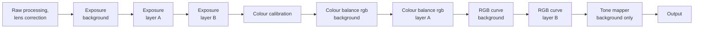

# Layers

How local edits work: layers, each a mask over module adjustments, and where in the pipeline each kind of operation sits. The pipeline that expands layers into instances is [engine.md](engine.md); the modules a layer holds are [modules/README.md](modules/README.md)'s.

**Status.** Planned, Phase 4 (decisions 34 and 74). Until then every module acts on the background, and the plan is a linear chain ([engine.md](engine.md#the-default-pipeline)).

## What a layer is

Masking uses layers, and a layer is masked operation instances at their normal pipeline positions, not compositing on top of the finished image (decision 34, Phase 4). That keeps darktable's processing quality; end-of-pipe compositing would be display-referred.

- **A first-class object** in the edit format and the session protocol: name, mask, opacity, blend mode, enabled flag, module adjustments. The engine expands it into instances; users, the UI and MCP see layers.
- **Order** matters only where two layers adjust the same operation. The layers panel shows this, rather than implying a stack.
- **Image** is the whole photo's edit, the layer under all others: no mask, no opacity, always on.
- **How much applies:** each instance applies by the mask times the opacity, in each slider's own unit. At 50%, Exposure and the tone equalizer give half the stops (−2 EV gives −1 EV, where darktable's linear mix would give −0.68 EV), a curve goes halfway to straight, and the rest is mixed halfway in linear light, as darktable mixes. Each layer-capable operation declares which of the three it uses. A slider on a layer starts at zero.
- **Blend modes:** darktable's for scene-referred work: normal and the arithmetic ones, the red, green and blue channels, lightness and chromaticity.
- **Global modules** (profile, lens, geometry, raw, grain, black and white) stay on Image, as in commercial layer-based editors, shown unavailable on a layer with the reason.
- **Colour calibration's adaptation** works on a layer only with a mask, stacked after Image's: it corrects what remains inside the mask, starting at no change, as darktable's second, masked colour calibration does for mixed light.
- **Limits:** a notice past the count where editing slows, and a hard limit only where the engine can no longer render within its memory budget, counting brush strokes and AI parts as well as layers.
- **Performance:** a stress test of 15 layers, 100 brush strokes and 5 AI parts on a 60 MP image, on the M4, the RTX 5060 and lavapipe.

## Masks

A mask is a list of **parts**, darktable's Flexi model underneath, ported from darktable's master (decision 74).

- **Parts:** brush with optional edge-aware auto-masking, linear and radial gradients, paths, luminance and colour ranges, depth (by distance from the camera), AI selections (subject, sky, background, people, a clicked object), **Fill** (the whole photo), and another layer's mask.
- **Top to bottom:** each part changes the mask the parts above it made, from an empty mask. Add is the maximum, Intersect the minimum, Subtract the mask times one minus the part; each part can be inverted, and parts are dragged to reorder. So a brush can paint back what a range cut out.
- **An empty mask changes nothing.** New Filled Layer and Fill Mask give a layer a Fill part, from which other parts can be subtracted.
- **Feather and Edge** refine the whole mask after its parts: a blur and a guided filter. An overlay shows the mask on the photo, and the layer's row a thumbnail of it.
- **AI parts** keep their request (model, class or clicked point) and their raster in `.apdata`. Copied, synced or applied by a style, they are recomputed once per photo, all together; an edit on this computer that changes what is under one recomputes it in the same undo step; they never recompute by themselves on opening, after an update or on another computer, where a raster that no longer matches is marked, with Update. A brush that fixes an AI part is a part of its own, which a recompute keeps.
- **Range parts are read once per layer** on the photo with Image's edits and no layer's at a reference point, scene-linear after colour calibration. The tone equalizer, at darktable's camera RGB 24.0 (decision 22), comes before that point, as exposure does. The result is reused as a raster mask by every instance in the layer, so the mask looks the same whatever modules the layer holds, and no layer's mask depends on another layer's edits. Operations before the reference point run once without layers to produce it; that result rarely changes while editing layers and caches well. Per-module evaluation stays as an advanced option.
- **Geometry:** mask shapes are stored in original image coordinates and transformed through lens correction, perspective, orientation and crop by their forward point maps, a raster mask warped by the geometry's own kernel (decision 16).

## Retouch layers

Heal, clone and AI erase are layers, each holding many spots, listed between the adjustment layers and Image, past a thin divider, and applied first whatever their place: retouch runs at camera RGB 20, before exposure and every colour and tone edit. They have opacity, hide, rename and delete as any layer and move only among the retouch layers. darktable's retouch module is ported as these layers in Phase 4, from darktable's master (decision 74), not in the first pass.

## Instances and order

Users get one instance of each module, in a fixed pipeline order: no reordering, and no extra instances outside layers. The engine still creates operation instances internally, one per adjusted operation per layer.

- **Filled layers** (one Fill part) cover unmasked duplicates such as a second sharpening pass, two blended colour looks, or luminance and colour noise reduction blended by lightness and by chromaticity, with opacity as a bonus.
- **One instance of each module per layer,** keeping one owning module per parameter within each layer; the operation instances a module adds are its own.

## Sequencing

A layer is not a contiguous block: each of its module adjustments becomes instances at the fixed positions of the operations the module drives, interleaved with the background and other layers.

1. Pipeline order first. A module that drives several operations produces instances at several positions from one layer.
2. At the same position: background first, then layers bottom to top in the layers panel. This is the only place layer order matters.
3. Each instance blends with its input using the layer's mask times its opacity. One mask raster serves all of the layer's instances; geometry corrections come before any layer instance, so the raster stays aligned.
4. Only adjusted controls create instances: a layer where only Exposure's exposure slider was touched adds one instance.

Rule 4 holds for an operation the background runs too. Colour balance rgb's first step on a layer adds it there, bringing its gamut mapping inside the mask. Where the background also runs it, that mapping, which is not idempotent, moves colours the background's instance already pulled in, as a second instance does in darktable. How a layer treats that first step is settled with layers (decision 32), as a layer's white balance is (decision 27).

### Example

The background has exposure, colour balance rgb and RGB curve; layer A (a face, brushed) has exposure +0.7 and colour balance rgb; layer B (the sky, an AI mask) has exposure −0.5 and RGB curve. RGB curve sits at darktable's 42, after colour balance rgb and before the tone mapper (decision 22). The pipeline runs:

Layer A's brighter face flows into everything downstream, the tone mapper included, so it is tone-mapped as genuinely brighter light rather than lightened on top. Both layers here use the background's tone mapper; a layer may choose its own, which replaces the background's within its mask, never stacked on it (decisions 33 and 34).

## Scene and display domains

The pipeline's core stays scene-referred, but editing is not purist: an operation goes before the tone mapper if it models light or needs values above display white, and after it if its job is how the final image looks. Every operation keeps darktable's place, so this is darktable's split (decision 22); engine.md's [Order](engine.md#order) table has every operation.

- **Scene-referred, before the tone mapper:** raw processing, white balance and colour calibration, exposure, the tone equalizer, colour balance rgb (contrast, colour grading), RGB curve and RGB levels, as darktable has them, denoise, sharpening, blur, lens corrections, and the tone mapper itself, whose parameters are global: layers change the light it receives, and a layer that chooses its own tone mapper replaces the background's within its mask, never stacked on it (decision 33, planned with layers). Every module a layer can use acts at its darktable place, before the tone mapper, apart from darktable's display-referred effects.
- **Display-referred, after the tone mapper:** darktable's effects such as grain and vignette. These shape the look, on layers too, and the tone mapper still runs once.

**Caution:** everything after the tone mapper is tied to one display range, which makes rendering the same edit for SDR and HDR harder. Keeping physics before the tone mapper and only the look after it limits that risk.
