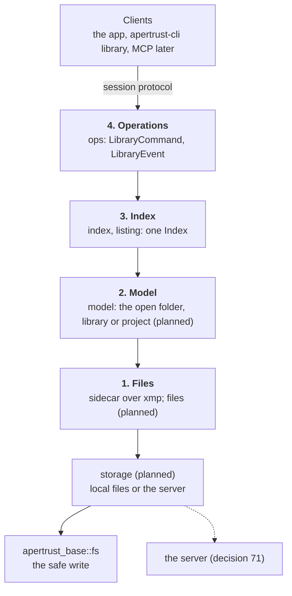
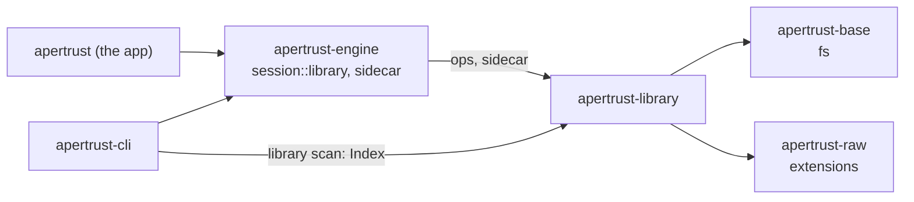
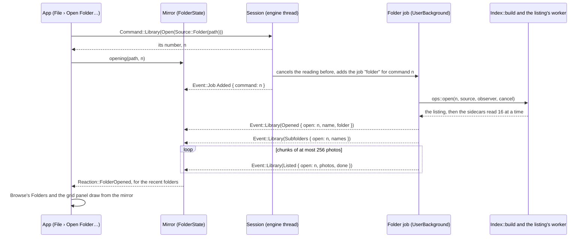
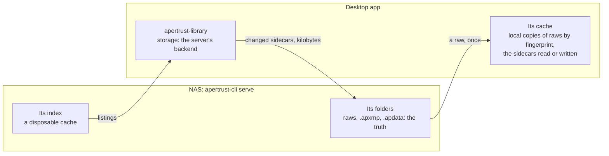

# Library

The library is how Apertrust finds photos and keeps what is known about them: one photo, folder mode, the Library and the Project. This document describes its design and its API: what each mode holds, the code's layers, the commands and events clients use, how a folder is listed and indexed, the sidecars, how photos are found again on several computers, the cache and the thumbnails.

[decisions/](decisions/README.md) holds the decisions it rests on, 46 to 55 and 71 above all, [architecture.md](architecture.md) the design around it, and [roadmap.md](roadmap.md#the-librarys-steps) the library's steps. How events in general are sent and taken in is [events.md](events.md), and how a client sends commands is the [session protocol](session-protocol.md). The crate's state is in [crates.md](crates.md#apertrust-library).

**Status.**

- **Built:** folder mode's first part. A folder is listed and its sidecars read into an index in memory, opened through the session as a job, and shown in Browse's Folders, in the side panel's Photos tab, and in the grid panel. The `.apxmp` version 1 and the XMP layer under it are built, as are the safe write and `apertrust-cli library scan`. The code is in `crates/library/src/`: `listing`, `index`, `sidecar`, `xmp` and `ops`.
- **In progress:** thumbnails ([Thumbnails](#thumbnails)): the camera's embedded pictures are built, the cache and Apertrust's own renders remain.
- **Planned:** one photo, Open With into folder mode and the start window in Phase 2; the rest of folder mode in Phases 2 and 3; the Library and the Project in Phase 5; the server in Phase 7 ([The steps](#the-steps), [A server](#a-server)).

## What the library is

Decision 46. The library meets five requirements:

1. **One concept,** the Library, of any size, and a small one for one job, the Project.
2. **Folder mode first:** sidecar files only, with no database.
3. **Libraries move** between computers and systems.
4. **Libraries live anywhere:** a NAS, external drives, cloud folders.
5. **No trouble when one library is edited on several computers,** which darktable's library has.

**Sidecars are the truth; no database ever is.** The truth is in files that travel: the sidecars and a library's small text files. A photo's edit and metadata live in its `.apxmp`, written whenever they change. Anything else, a library's cache included, is rebuilt from the files. A database is never the truth and never sits on shared storage. darktable's library is ported as far as these allow.

### The four modes

A window holds one of them at a time. The first rows are for choosing between them; the rest say how each is made.

| | One photo | Folder mode | A library | A project |
| --- | --- | --- | --- | --- |
| Best for | A quick look at one raw, or an edit, from a terminal or a script | Working through a folder as it is: a card just copied, a trip's folder | Everything you keep, of any size: a client, a trip, a whole archive, across drives and computers | One job from capture to delivery: a shoot, a client's day |
| What it gives | The photo at once, its edit beside it, nothing else touched | The folder's photos in the grid panel, to edit, rate and cull, with nothing to import | Albums and smart albums, nested; search across all its folders; photos on drives that are away, still rated and tagged; its edits beside the photos or in its own folder | What a library gives, and folders with roles (Capture, Selects, Output, Trash), a watched Capture folder and the job's settings |
| What it lacks | Every other photo: no grid of its folder, and no place in the recents | Albums, smart albums, search beyond the open folder, photos on drives that are not connected | Folder roles and the job's settings | Import library…: a project stays one job |
| What it leaves on disk | The photo's `.apxmp`, once something changes | Each photo's `.apxmp`, once something about it changes; nothing else of Apertrust's | A folder with `Name.aplibrary` and a hidden `.apertrust/`; the sidecars beside the photos or in it; an id file at the top of each folder added | A folder with `Name.approject`, `.apertrust/` and its role folders |
| How it opens | `apertrust FILE` from a terminal, and no other way | File › Open Folder… or Open…; Open With or a double-click on a raw; Browse's Folders; Open Recent or the start window; `apertrust FOLDER` | File › New Library…, or from the open folder, in place; then Open…, Open Recent, the start window or a double-click on `Name.aplibrary` | File › New Project…, from a template or not, or Export as Project… from an album; then Open…, Open Recent, the start window or a double-click on `Name.approject` |
| Its photos | The one | The folder's | Copied into its `Photos/`, or referenced where they are | Copied into its Capture, or referenced where they are |
| Its edits | Beside the photo | Beside the photos | Beside the photos, or in its own folder, mirrored by path | As a library's |
| Index | None beyond the photo | In memory while open | Built from its files as it opens; a cache on each machine (decision 55) | As a library's |
| Albums and smart albums | No | No | Yes, nested | Yes |
| Folder roles and the job's settings | No | No | No | Yes |
| Photos on a drive that is not connected | — | Not shown | Browsed, rated and tagged; edited from a local copy | As a library's |
| In the recents, and reopened at the start | No | Yes | Yes | Yes |
| State | Planned, Phase 2 | First part built | Planned, Phase 5 | Planned, Phase 5 |

```text
Folder mode                       A library                          A project
Mountains/                        Family/                            Wedding/
  DSCF0001.RAF                      Family.aplibrary                   Wedding.approject
  DSCF0001.RAF.apxmp (if changed)   .apertrust/ albums/ smart-albums/  .apertrust/
                                                roots/ keywords.toml   Capture/  Selects/
                                                edits/ (if kept here)  Output/   Trash/
                                    Photos/   (copied in at import)
                                  Photo-Archive/2024/  (a folder referenced in place)
                                    .apertrust/root.toml  (its id, and where its edits are kept)
```

### One photo

Built. `apertrust FILE` from a terminal opens that one raw alone, for a quick look or an edit from a script. It is the only way into this mode: Open With and a double-click open the photo's folder instead ([Folder mode](#folder-mode)).

- Its edit is found as folder mode finds it, beside the photo or where its root's id file says ([Where edits live](#where-edits-live)).
- Nothing is listed or indexed beyond the photo, and nothing is written but its `.apxmp`, once something about it changes, and its `.apdata` once the edit has one (decision 49).
- It is never added to the recents and is never what the next start reopens; that stays what was open before it.
- The grid panel shows the photo alone, its file name in its cell, since nothing of its folder is read for a thumbnail. Browse's top line names the photo and lists the recent folders, as in any mode; its Folders holds Open This Folder alone, which opens the photo's folder in folder mode, that photo active ([In the window](#in-the-window)).
- A folder named instead, `apertrust FOLDER`, opens folder mode. A `Name.aplibrary` or `Name.approject` stops the start with a message saying libraries and projects come in a later version, until Phase 5, as do a file that is no raw and a path that is not there.

Built: all of it but the root's id file, which the edits of every mode wait for (decision 47); the photo's edit is read and written beside it.

### Folder mode

Built first, and partly built.

- It opens by File › Open Folder… or Open…, a folder or raws dropped onto the window, from a folder in Browse's Folders, from Open Recent or the start window ([gui.md](gui.md#the-start-window)), by `apertrust FOLDER`, or by Open With and a double-click on a raw (below).
- **Open With and a double-click** open the photo's folder, that photo active. The photo opens at once and the folder lists in the background. Several files opened together from one folder open it with them selected, the first active; files from several folders open the first file's folder, with those from it selected, and a notice says how many were left.
  - macOS delivers these as an open-documents event, not as arguments, which the app's platform code receives (`apertrust-display`), a drop on the Dock icon among them. A folder dropped on the Dock icon opens in folder mode; it is the one way the system opens a folder with Apertrust ([packaging.md](packaging.md#opening-a-raw-from-the-system)).
  - On Windows and Linux, the installer's and the desktop entry's registrations pass `--in-folder` before the file ([packaging.md](packaging.md#opening-a-raw-from-the-system)), so the app tells them from a terminal's `apertrust FILE`, which opens [one photo](#one-photo).
  - Built, as a drop of the files opens them: looked at off the interface's thread, a file that opens nothing refused with an alert in the window, and waiting for a modal dialog to go. Selecting the others with the first waits for the grid panel's selection (Phase 3), and the notice for notices (step 12).
- Opening, browsing and thumbnailing write nothing beside the photos. A photo gets its `.apxmp` only once something about it changes: an edit, a rating, reject or label, a keyword or metadata field, a virtual copy, a snapshot, a group.
- The listing and the sidecars, read 16 at a time, make an index in memory, gone when the folder closes ([Listing and the index](#listing-and-the-index)).
- Browse, the Photos tab's first module, has Folders alone, the open folder's tree; Albums and Smart albums are not shown, and Make This Folder a Library… is in Browse's options ([In the window](#in-the-window)). Filters filters the open folder from its index (planned, decision 73).
- Its keyword list is the keywords its photos hold; their properties (synonyms, private, category) and Recent are in the user data folder's `keywords.toml`, of the same form as a library's (planned, decision 73).
- Import… (planned) copies photos from a card or another folder into a destination named with darktable's patterns, then opens it.
- It lacks albums, smart albums, search beyond the open folder and photos on drives that are not connected. New Library… (planned) makes the open folder a library, in place. The CLI works this way.

### A library

Planned, Phase 5. A library is a folder with `Name.aplibrary` at its top, a short TOML file that says the folder is a library and that a person double-clicks (`format`, `id`, `name`, `written_by`, `edits`, `photos`), and a hidden `.apertrust/`.

- `.apertrust/` holds one file per root (`roots/`), album (`albums/`) and smart album (`smart-albums/`), each named by its id; `keywords.toml`; `machines/`; and Import library…'s notices. It holds `edits/` only when the library keeps its edits in its folder, and the library holds `Photos/` for photos copied in. There is no database.
- Photos inside its folder make it self-contained; folders elsewhere are roots, found on each machine by their ids ([Roots](#roots)).
- It is made by File › New Library… (a name, a place, where its edits live) or from the open folder in place, and opened by Open…, Open Recent, the start window or a double-click on its file.
- Several libraries may exist, and a window opens one photo, folder, library or project at a time; they replace darktable's workspaces. A photo in two libraries has one place for its edits, so its edit and ratings agree in both, while albums belong to each.

### Albums and smart albums

Planned, Phase 5.

**Albums** hold photos chosen by hand, each named by its root, path and virtual copy, and other albums and smart albums, to any depth. darktable has no albums.

- An album shows only its own photos, with its albums and smart albums beside them.
- Removing a photo from one removes nothing else. Deleting an album deletes the albums inside it, after the sheet says how many, never a photo.
- Each album is one file naming its parent, so a move rewrites one line, and two machines changing different albums never touch one file.
- A move that would make a cycle is refused. One made offline on two machines puts the album whose move has the later clock at the library's top, and the activity says so.

**Smart albums** are darktable's collect rules, filters and sort, saved: at the library's top over the library, inside an album over that album's photos. Their rules gain one property of Apertrust's own, **in album**: the photos of an album, or of an album and every album inside it.

### A project

Planned, Phase 5. A project is a small library for one job, `Name.approject`, made by File › New Project… or Export as Project…, in the same format and code as a library with folder roles on.

- **Capture:** where Import… and a tethering tool's photos land.
- **Selects:** Move to Selects.
- **Output:** Export's default destination.
- **Trash:** Delete moves photos there with their sidecars; Empty Trash sends this project's Trash to the system's trash.

New Project… makes the four folders at its top, and any folder inside may take a role instead. A role never points outside the project, so it moves whole. A large library culls with ratings, the reject and albums instead. A project also has:

- Export as Project…: an album with its albums made a standalone project, by copy (the default) or reference;
- a watched Capture folder while the project is open, so a camera maker's tethering app works;
- the job's settings in its file: the next capture's folder, name pattern and job code, the start adjustments as `.apertrust/start.apxmp`, the Output folder and export preset;
- project templates in the user data folder, never photos or edits;
- Output's photos kept out of smart albums unless a rule names Output;
- a count of what stays behind on Import library…;
- the roles marked in the Folders tree.

A project never runs Import library…, so it stays one job. Tethering and import from a camera through libgphoto2 are decided when camera import is planned in detail, leaning to allow it loaded at run time as darktable does, an exception to decision 5; the watched Capture folder serves meanwhile.

### Photos copied or referenced

In every mode, as darktable's import module does.

- **In place,** darktable's "add to library": Open Folder… in folder mode; Add Folder… or Import… in place in a library, the folder becoming a root.
- **By copy,** darktable's "copy & import", with its base folder, subfolder and file name patterns and variables, job code, date override and original names. The base folder is `$(PICTURES_FOLDER)/Apertrust` in folder mode, the library's `Photos/`, or a project's next capture folder.
- Importing writes no sidecar unless it sets something on the photo, never rewrites one, and recognises a photo already imported by its fingerprint, not its name and date.
- Import's settings take `import.*` ids, where darktable's copy & import uses `session/…`.

### Import library…

A library's command, planned. It takes another library's file or a project's and brings it in as one album named after it, with its albums and smart albums inside. A project's Selects arrive as an album inside; its Output and Trash are left behind, and the sheet counts them.

- **By copy,** the default: its photos go into `Photos/<its name>/`, keeping their paths below each root, with their edits placed as this library keeps edits. The sheet says what it costs first ("Copies 2,140 photos, 61 GB"). The old library is left as it was, with a notice in its `.apertrust/` shown when it next opens.
- **By reference:** its roots become this library's, the edits staying where each root's id file says.
- Either way keywords merge by path (`Places|Thailand`). A photo already here, matched by fingerprint, is asked about once for all such photos: Keep both, or Link, an imported edit that differs then arriving as a virtual copy.
- Importing the same one again is refused for now; Apertrust never deletes the old one.

### Words

The library's words are decision 46's, listed with the others in [architecture.md](architecture.md#naming):

- The interface says Folder, Library, Project, Album, Smart album, Capture, Selects, Output, Trash, Virtual copy and Snapshot.
- The code and docs add **folder roles**, **root** and **collection**, for any set of photos Browse chooses.
- Never: film roll; catalogue; workspace for a library; session for a library or project ("session" is the engine's); Shoot or layout for the roles; version for a virtual copy.

### Against darktable's library

darktable's library is kept feature by feature, with 24 deviations, each for a requirement (D1 to D24, each with darktable's sources, recorded with decision 46):

- no `library.db` as the truth; roots by id and relative path; no import step in folder mode;
- libraries, projects and Import library… in place of workspaces;
- a sidecar written only once something changes, whole and byte for byte the same for the same content;
- groups made by hand stored by id in the sidecars; every virtual copy in the photo's one sidecar;
- a reject that keeps the stars; ratings and labels as history steps;
- change detection always on, an edit changed on two machines kept as a second virtual copy, metadata combining; cloud conflict copies found and handled;
- a content fingerprint; no locks or database on shared storage; offline drives marked, never skulls; no background download of a cloud file;
- Folders, Albums and Smart albums in place of the collect module;
- darktable's automatic `darktable|…` tags not written, their facts properties of the index;
- Import never rewriting a sidecar; names compared in one Unicode form;
- the selection the session's; the import time only in each machine's cache; local copies keyed by fingerprint;
- history in Apertrust's readable layout; snapshots saved; edits optionally in the library's folder.

### In the window

Decisions 37, 46 and 73. The Photos tab of the side panel chooses what the grid panel shows and describes the photos in it. Its modules are Browse, pinned, then Filters, Keywords, Metadata and Styles ([gui.md](gui.md#the-side-panel)). Browse keeps one name in every mode, its top line showing what is open: in folder mode the open folder ("Folder: Wedding 2026-10"), its count on its row in Folders' tree, in a library or a project its name. Its groups are Folders, Albums and Smart albums: Folders from Phase 2, with folder mode, and Albums and Smart albums with the library in Phase 5. The interface has no catch-all word for them; "collection" is the code's and the docs' word for any of them. darktable's film roll is a folder.

**The sections by mode:**

| Mode | Folders | Albums | Smart albums |
| --- | --- | --- | --- |
| One photo | The photo's own folder, as Open This Folder (into folder mode) | Not shown | Not shown |
| Folder mode | The open folder's tree | Not shown | Not shown |
| A library | Its roots' trees | Its albums, nested | Its smart albums, over the library or inside an album |
| A project | Its folders, with their roles marked: Capture, Selects, Output, Trash | Its albums, which group photos without moving them | Its smart albums, saved searches within the project |

- **What a mode has not is not shown.** Folder mode writes nothing of Apertrust's but sidecars, while albums and smart albums are saved files, so they need a library and one photo and folder mode show Folders alone. The way there is in Browse's options: Make This Folder a Library…, New Library… on the open folder, in place. The module's top, what is open with its recents and ＋, is the same in every mode.
- **Filters in folder mode** (decision 73, Phase 3, planned) run over the open folder's index in memory, not smart albums: nothing is written beside the photos, and Save as Smart Album leads to Make This Folder a Library…. A filter that hides selected photos leaves only the shown ones selected.
- **Keywords** are one module, darktable's tagging, and **Metadata** one, darktable's image information and metadata editor (decision 73).
- **In a project,** the role folders hold where the files are, and albums group photos across them without moving them: a client's picks, the prints, the blog's, one photo in several. Smart albums are saved searches within the project.

- **Built:** one photo from a terminal ([One photo](#one-photo)), with Browse's Open This Folder; `apertrust FOLDER`; Open With and a double-click, the files' folder opened with the first active; File › Open Folder…, File › Open… and drag and drop onto the window ([gui.md](gui.md#file)), View › Browse (L), and the Photos tab's Browse, in folder mode's form: its top line, what is open, listing the recents kept in the user data folder's `state.toml`, with ＋ and ⋯, and Folders alone, the tree of the folder opened, its root fixed at the top with its count and nothing above it, its subfolders, a click on one making it the active folder, the tree and the recents unchanged; the grid panel showing the active folder's photos in the listing's order, each cell its photo's thumbnail, the camera's embedded picture, or its file name until it comes or where there is none, its marks from its edit state ([Edit states](#edit-states)); the central panel's empty states. Open… and a drop of raws open the first raw at once and its folder behind it, unless that folder is the one shown; selecting the others with it waits for the grid panel's selection (Phase 3). A dropped folder opens as Open Folder… opens one.
- `apertrust-library` owns the folders, their listing and the sidecars' metadata, and the thumbnail cache's files ([Thumbnails](#thumbnails)).
- Offline, in the cloud, missing and view-only photos, and a project's roles, carry marks of their own ([gui.md](gui.md#the-photos-tabs-marks)).

## The code

Decision 54. The library's code is one crate, `apertrust-library`, with no GPU and no engine. It depends on quick-xml, thiserror, blake3, tracing, `apertrust-base`'s `fs` part and `apertrust-raw` (for its list of raw extensions alone), never on the engine, the modules, the plugin interface or wgpu.

### Four layers

Each layer calls only the one below, with a good but not overcomplicated abstraction; clients see only the last.



| Layer | Its one job | Module | State |
| --- | --- | --- | --- |
| 1. Files | Bytes in, values out, and back: the `.apxmp` text layer with the comparison of two copies, over the XMP layer, and the library's TOML files (`Name.aplibrary` or `Name.approject`, and `.apertrust/`'s roots, albums, smart albums and keywords); no folders listed, no threads; every call into a root's files through the storage interface | `sidecar`, `xmp`; `files`; below them `storage` and `apertrust_base::fs` | `sidecar` (version 1) and `xmp` built; `files`, the comparison and `storage` planned |
| 2. Model | The open `Library` (a folder, a library or a project), its roots, photos, virtual copies, albums, smart albums and keywords; every change applied here, written through layer 1, reported as events | `model` | Planned |
| 3. Index | Rules, sorts, pages and full text: one `Index`, in memory for folder mode, saved as a library's cache (decision 55); always rebuilt from the layers below | `index`, `listing` | The folder's listing and its sidecars read, in memory, built; rules, sorts, pages and full text planned |
| 4. Operations | `LibraryCommand` (about forty in the end) and `LibraryEvent` (about twenty) in the session protocol | `ops` | Opening and closing a folder, a folder's subfolders for Browse's tree, and its photos' thumbnails, built |

Layer 1 alone knows file layouts; layer 3 alone the cache's engine; the storage interface alone where the bytes are. Until the model exists, `ops::open` calls `Index::build` directly, and the index reads its sidecars through `sidecar`.

**The storage interface** (decision 54, planned with step 21b) is the library's lowest part, under layer 1 and the listing, so nothing above it assumes a file system. Every call into a root's files goes through it: a folder listed in chunks, a file's facts, a file read whole or a byte range of it (the fingerprint's first and last 64 KiB, an embedded picture), the safe write, rename, move, copy and delete, and a raw fetched into a local copy.

- **Local files:** `std::fs`, bulk listing (step 7), cloud placeholders' flags and `apertrust_base::fs`'s safe write; today's listing and safe write move behind it.
- **The server** ([A server](#a-server)): a server root's files through the server's protocol, its raws fetched once into local copies by fingerprint.
- The per-root queues and their deadlines (decision 53) and the comparison before every write (decision 52) sit above it, the same for both backends.

**A new library feature** is a command and its events in layer 4, a change in layer 2, and a file format in layer 1 only if it is stored.

**Left out on purpose:** SQL or any query language beyond darktable's rules; a trait for the cache's engine, which has one implementation; plug-in points until scripting has a second user; a sync engine beside decision 52's comparison, the server being one more copy; transactions across photos; a second API beside the protocol; undo in the library, which stays the session's.

### What depends on what



- **The engine** depends on the library for `sidecar` and `ops`. Its own `sidecar` module is the typed reading and writing of an edit on top of the library's text layer, with the module definitions ([engine.md](engine.md#edits)). Its session re-exports `ops` as `session::library`, with `LibraryCommand` and `LibraryEvent`, and serves them ([The API](#the-api)).
- **The app** reaches the library only through the session: `Command::Library` out, `Event::Library` in.
- **The CLI** runs the library in its own process, with no lock between it and a running app ([The CLI](#the-cli)).
- The library never depends on the engine, so a client could one day compile its types without it (decision 58).

## The API

Decision 54's layer 4, in `crates/library/src/ops.rs`. Clients see only `LibraryCommand` and `LibraryEvent`, plain data so they can move into the protocol. The engine's session serves them as `Command::Library(LibraryCommand)` and `Event::Library(LibraryEvent)` (decision 58). `LibraryCommand` and what its events carry are re-exported as `apertrust_engine::session::library`.

### Commands

| Command | Fields | What it does |
| --- | --- | --- |
| `LibraryCommand::Open(Source)` | `Source::Folder(PathBuf)`, a folder in folder mode: its photos, not its subfolders' | Opens the folder in place of the one open, whose reading stops. A cancellable job reads it; its events follow. Opening a folder opens no photo: `Command::Open` does. |
| `LibraryCommand::Close` | none | Closes the folder open, stopping its reading; answered at once by `LibraryEvent::Closed`. |
| `LibraryCommand::Thumbnails` | `photos: Vec<String>`, the open folder's photos by file name, the first the most wanted; `size: u32`, the most pixels on a thumbnail's longer side | Asks for the photos' thumbnails, each a job of its own ([Jobs and queues](#jobs-and-queues)), each answered by `LibraryEvent::Thumbnail`. A new `Open` or a `Close` cancels those not yet sent; with no folder open nothing is read. |
| `LibraryCommand::Subfolders` | `folder: PathBuf`, a folder inside the tree's root | Lists its subfolders for Browse's tree, a cancellable job on `UserBackground` as the open folder's reading ([Jobs and queues](#jobs-and-queues)), answered by `LibraryEvent::SubfoldersOf`; a folder outside the tree's root, the first folder opened, kept while each later `Open` lies inside it, is refused, so the siblings of the folder open now can be listed. A new `Open` or a `Close` cancels it; with no folder open nothing is listed. |

`Source` has one variant today; a library and a project join it in Phase 5.

### Events

Every event names the open or close it is about in its `open` field, read by `LibraryEvent::open()`: the command it answers, or, for a thumbnail, the open of its folder.

| Event | Fields | Meaning |
| --- | --- | --- |
| `Opened` | `open`, `name: String`, `folder: PathBuf` | The folder was listed and its sidecars read: its name, the last part of its path, and the path as asked for. |
| `Subfolders` | `open`, `names: Vec<String>` | The folder's subfolders, hidden ones left out, a link to a folder counted as one, as the system's file browser sorts them ([Subfolders and their order](#subfolders-and-their-order)); sent once, before the photos, empty where there is none. |
| `SubfoldersOf` | `open`, `folder: PathBuf`, `names: Vec<String>`, `unreadable: Option<String>` | The subfolders of `folder`, as `LibraryCommand::Subfolders` asked, in the open folder's number: hidden ones left out, as the system's file browser sorts them, empty where there is none. `unreadable: Option<String>` says why the folder could not be listed, its `names` empty then. |
| `Listed` | `open`, `photos: Vec<Photo>`, `done: bool` | More of the folder's photos, in name order across chunks, at most `ops::CHUNK` (256) each; the last says `done`, and an empty folder sends one, empty and done. |
| `Taken` | `open`, `times: Vec<Option<DateTime>>` | When each photo was taken, sent once after the last chunk: one for each photo listed, in the listing's order, the camera's clock from the raw's EXIF (`apertrust_raw::DateTime`), `None` where it holds none or cannot be read. Read 16 at a time once every photo is sent, so the photos show first. |
| `Failed` | `open`, `reason: String` | The folder could not be listed, in plain words: missing, no folder, unreadable, or gone while it was read. It ends the open, in place of `Opened`. |
| `Closed` | `open` | No folder is open: the answer to `Close`, whose number it names. |
| `Thumbnail` | `open`, `photo: String`, `size: u32`, `image: Option<Thumbnail>` | A photo's thumbnail at the size asked for: the camera's embedded picture, upright, or `None` where the raw holds none that can be read, said too so a client asks no more. |

**A `Thumbnail`** is 8-bit RGBA, rows top to bottom, four bytes a pixel, upright: its `width`, `height` and `pixels`, an `Arc<[u8]>`, so the event's copies cost nothing.

**A `Photo`** has the raw's file `name`, its `size` in bytes, its `modified` time (`None` where the system gives none) and its `edit`, an `EditState`:

| `EditState` | Meaning |
| --- | --- |
| `None` | No edit: no sidecar, or one with nothing in it. |
| `Edited` | An edit this build can change. |
| `ViewOnly(Newer)` | An edit a newer Apertrust wrote, which opens for viewing only, and why (decision 43; [Newer edits](#newer-edits)). |
| `Unreadable(String)` | The sidecar could not be read or is no `.apxmp`: the reason, in plain words. |

Orphan sidecars, those with no raw, are found by the listing and counted by `library scan`, but not sent to clients; they become Edits without a photo with step 18.

### Numbers

Each command gets its number from `Session::send` ([events.md](events.md#numbers)). An open's events carry that open's number, its thumbnails' too, whichever `Thumbnails` asked for them; `Closed` carries the close's. A client keeps the number of its latest `Open` or `Close` and drops every `LibraryEvent` naming another, so what an earlier open sends on its way never reaches the grid.

### Jobs and queues

Decision 57. A folder's reading runs as a job of the session's control on darktable's `UserBackground` queue, as darktable reads a film roll:

- kind `folder`, cancellable, its message `job-folder` with its `folder` argument;
- its progress as `Event::Job`, whose `Added` names the open's command number in `command`;
- its body `ops::open`, a blocking call made on a job's worker, handed an observer that wraps each `LibraryEvent` into `Event::Library` and sends it through the session's outbox, and a cancel closure, the job's `Context::cancelled` ([events.md](events.md#lower-crates-report-through-an-observer)).

A new `Open` or a `Close` cancels the reading before it, as does `Command::CancelJob` on its job. A reading that fails still ends its job finished: the failure is told by `Failed`. `Close` is answered from the engine thread with no job.

Each thumbnail asked for is a job on darktable's `SystemForeground` queue, as darktable's thumbnail loads:

- kind `thumbnail`, with no progress, so it shows in neither the spinner nor the jobs window;
- deduplicated by the open, the photo and the size: one asked for again while queued moves to the stack's top and the new one is discarded, one being read is not read twice;
- added from the last of a command's photos, so the first, on the stack's top, is read first, and a later command's above an earlier's, the newest asked first; past 30 the oldest not yet begun is dropped, which the client covers by asking again for a photo that comes back into sight;
- its body `ops::thumbnail`, handed an observer and a cancel closure as the folder's is, which reads the raw's embedded picture (`apertrust_raw::read_preview_file`, without decoding the mosaic) and sends one `Thumbnail`; it asks its cancel before it reads and before it sends, and reads nothing for a name that is no plain file name.

A new `Open` or a `Close` cancels every thumbnail asked for before it.

Each `LibraryCommand::Subfolders` is a job on `UserBackground`, beside the folder's reading:

- kind `subfolders`, cancellable, with no progress;
- its body `ops::subfolders`, handed the tree's root, the first folder opened, kept while each later `Open` lies inside it (`ops::inside`), an observer and a cancel closure as the folder's is, which refuses a folder outside that root, relative or holding a `..`, and lists through layer 3, `listing::subfolders`: a folders-only listing on the listing's own thread, waited for while the cancel is asked every 20 ms, so a share that hangs holds only that thread, never a worker or the quit;
- a new `Open` or a `Close` cancels it, and with no folder open it is not added.

The library's other long commands are to run on darktable's queues too: move, copy, rename, delete and Import… on `UserForeground`; each call into a root on that root's queue with its deadline (decisions 53 and 57, planned).

### Order, chunks and done

An open sends, in order: `Opened`, `Subfolders`, then the photos in `Listed` chunks, the last `done`, then their capture times in `Taken`; or `Failed` alone in their place. `ops::open` returns how it ended, an `Ended`: `Listed`, `Cancelled` or `Failed`.

Today the whole folder is listed and its sidecars read (`Index::build`) before anything is sent. Chunks sent as the listing goes are planned with bulk listing (step 7).

### Cancelling

The cancel closure is asked between calls into the folder, while the listing is waited for, and before each event. Once it answers true, the call returns at once and nothing more is sent: no chunk says `done`, and the job ends cancelled. A listing stuck in a call into a network share is left to end on its own thread, so it holds neither a job's worker nor the session's end.

### Kinds of event

All eight are notices ([events.md](events.md#facts-and-notices)): each is about one open and comes once. A chunk is part of a listing, never the whole of a topic, `Subfolders`, though whole, is sent once an open, as `Opened` is, and a thumbnail answers one ask. The remote protocol's `Sync` is to send the open folder's listing again to a client that joins late ([session-protocol.md](session-protocol.md#remote-clients)).

### Opening a folder, end to end



### In the app

`crates/app/src/folder.rs`, held by the mirror (`crates/app/src/mirror.rs`, [events.md](events.md#in-the-app-one-reducer)):

- `FolderState::opening` notes the latest command's number, and `FolderState::apply` drops every `LibraryEvent` naming another. `FolderState::closing` is ready, though no action closes a folder yet.
- What is open is a `folder::Folder`: `None`, `Opening`, `Open` with its `folder::Listing` (name, path, subfolders, the photos so far, `done`), or `Failed` with its reason, none for a cancel.
- The photos accumulate from `Listed` chunks until one says `done`; `Taken`'s capture times are kept with them (`Listing::taken`).
- The order the grid panel draws is the grid bar's sort of the listing (`FolderState::order`, `folder::sorted`), worked out again as a chunk, the times or a new sort comes: by capture time, the files' modified times standing in until `Taken`, by file name in `ops::browser_order`, or edited last, ties by time then name ([gui.md](gui.md#the-grid-bar)).
- `Failed`, or the folder's job ending cancelled (the jobs window's Cancel), ends the open. The job's id is noted from its `Added`, whose `command` is the open's number.
- `Opened` and `Failed` come back as `Reaction::FolderOpened` and `Reaction::FolderFailed`, for the recent folders (newest first, ten); a recent folder that failed is drawn disabled with its reason. The folder's job shows in the top panel's spinner and never opens the jobs window.
- Each `Thumbnail` is kept with the listing by photo and size (`Listing::thumbnails`), its picture or `None`, with the generation it came at; `FolderState::generation` is raised whenever the folder or its thumbnails change, so the textures made of them, a cache derived from the mirror, know when to look again.
- `crates/app/src/thumbnails.rs` asks for them and makes their textures: the cells the grid panel drew without a thumbnail at the cell's size, each asked for once while it stays in sight, in the panel's order, as one `Thumbnails`, at the cell's side in physical pixels rounded up to 128, 256, 512 or 1024; one that comes back into sight without its thumbnail asked for again. A texture is made for each thumbnail as it comes, another size's standing in while the right one comes, and dropped with the folder ([gui.md](gui.md#the-grid-panel)).

### Planned

From decision 54 and the steps; none of these names exist in the code yet.

- **What clients see:** `PhotoRef`, a root id or a folder path, a relative path and an optional virtual copy id (`5b0c7d0e/Photos/Wedding/DSCF0001.RAF#7c0e9a14`); `Target`, photos, the selection or a query; `Rules`, darktable's collect rules, filters and sort, with "in album". Undo and Redo stay the session's.
- **Commands,** about forty, in five groups: open and organise; bring in and take out (`Import`, `ImportLibrary`, `ExportAsProject`); browse (`Show` and `Page`, while today the client keeps the photos listed); describe photos, ratings to snapshots and groups, and the keyword list's rename, move, delete and edit, each a cancellable job writing every sidecar that holds the keyword, one undo step (decision 73); files (Move to `MakeAvailableOffline`).
- **Events,** about twenty, reporting every change whoever made it: `PhotosChanged`, `Diverged`, `RootOffline`, `InCloud` and `ViewOnly` among them; `CollectionChanged` first, one per change with darktable's reason and property, a fact or a notice by its kind (decision 59, step 5's later part).
- **Notices for the user,** `Event::Notice`, with step 12 ([events.md](events.md#notices-for-the-user)).
- **The whole of `LibraryCommand` and `LibraryEvent`** in the session protocol with step 35; MCP's tools generated from `LibraryCommand`'s schema, read and write apart, off until the person allows them and read-only unless writes are allowed (principle 8), in Phase 6.

## Listing and the index

### The listing

Decision 53. `crates/library/src/listing.rs`. `Listing::start(folder, options)` lists one folder, not its subfolders, on a worker thread of its own with `std::fs` alone, and sends what it finds over a bounded channel (`Listing::events`), so the caller never waits on the folder: a slow share costs the worker's time, not the interface's, and a caller that reads slowly holds the worker back instead of letting results pile up. `Listing::cancel`, or dropping the `Listing`, stops it; `Listing::collect` waits for the whole of it as a `Folder`.

**What it reads and skips:**

| Entry | What the listing does |
| --- | --- |
| A raw, by `apertrust_raw::extensions()` in any case | Listed as a `Photo` with its name and `FileStat` (size and modified time, following links), and its sidecar's, where it has one |
| `NAME.apxmp`, the raw's whole name plus `sidecar::SUFFIX` | The raw's sidecar, matched byte for byte for now; with no raw, an `Orphan` |
| A subfolder, or a link to one | Its name alone, never descended into |
| A name starting with a dot | Skipped and counted as hidden, except a stale temporary (below) |
| A name that is not text (not valid UTF-8) | Not listed, whatever it is; counted and warned of once per listing |
| Anything else | Skipped and counted |

**Its events,** a `listing::Event`, in order: `Chunk`s of photos (`Options::chunk`, 256 by default), sorted by name across chunks; `Orphans`, sorted by name; `Subfolders`; then `Done` with its `Summary`, or `Failed` with an `Error` in its place. `Orphans` and `Subfolders` are not sent when there is none.

**Its `Summary`** counts the raws, those with a sidecar, orphans, other files, names that are not text, hidden entries, stale temporaries removed, subfolders, files that vanished or could not be read between the listing and their size, whether it was cancelled and how long it took; the time is a `-d perf` line.

**Deadlines.** With `Options::deadline` set, a listing that takes longer sends `DeadlinePassed` once and goes on. A timer thread sends it, so it comes even while the worker is inside a call into the folder that does not return. Nothing sets a deadline yet: the session and the CLI list with the default options. "Waiting for Main-Storage…" after 2 s and "Not responding" after 30 s are to be built on it with the root queues ([Shares, offline drives and cloud folders](#shares-offline-drives-and-cloud-folders)).

**Stale temporaries.** The one hidden file the listing touches is a leftover temporary of Apertrust's own safe write, `.~NAME.XXXXXX.tmp`, told by its name alone (`apertrust_base::fs::is_temporary_name`). One more than a day old and a plain file is removed (`apertrust_base::fs::remove_if_stale`) and counted in `Summary::stale_removed`; younger ones, and any file that merely looks similar, stay hidden files. It is the one thing Apertrust removes from a person's folder.

**Bulk listing** is planned (step 7, [Listing in bulk](#listing-in-bulk)).

### Subfolders and their order

Subfolders are sorted as the system's file browser sorts them, `listing::browser_order`, as macOS's Finder (`localizedStandardCompare:`) and Windows' Explorer (`StrCmpLogicalW`) do: spaces, punctuation and symbols before digits and digits before letters, letters without regard to case, a run of digits by its number, so `Day 2` comes before `Day 10`, and names equal so ordered as their text, so the order is total.

It approximates the system's collation. Rust's standard library decomposes no character, so an accented letter is not compared by its base letter but sorts after every unaccented one (`École` after `Zoo`), and no language's own order of its letters is followed.

### The index

Decisions 47 and 53, layer 3 in memory, `crates/library/src/index.rs`. `Index::build(folder, options, cancel)` is a blocking call a job's body can make. It lists the folder on the listing's worker, then reads the sidecars on up to `index::READERS` (16) threads at once, so a share that answers slowly is asked many times at once: 2.2 ms a sidecar against 26.7 ms one by one over SMB. The index is plain data, always rebuilt from the files below it.

- **`Index`:** its `photos`, each an `index::Entry` in name order; its `orphans`; its `subfolders` in `browser_order`; the listing's `summary`; whether it was `cancelled`; how long it took (`elapsed`), a `-d perf` line.
- **`index::Entry`:** the raw's `name` and `FileStat`, the sidecar's `FileStat` where it has one (`file`), and its `sidecar`.
- **`index::Sidecar`:** `None`, no sidecar; `Read(Edit)`; `Unreadable(reason)`, which is that photo's alone to report, the rest indexed; or `NotRead`, the build cancelled before it.
- **`index::Edit`:** the file's `version`; `file_hash`, the BLAKE3 of the file's bytes, which changes whenever the file does and means the same on every machine and build (not the thumbnail key, which hashes the edit it holds, so another build rewriting the same edit differently does not invalidate them); `edited`, whether it holds entries or is a newer Apertrust's, whose layout this build may not read and so may not call empty; and `view_only`, the `Newer` that makes it open for viewing only.
- **`Index::counts`:** the photos with an edit, those that open view-only and the unreadable sidecars, as `Counts`.
- **Cancelling** is a closure the build asks between calls into the folder, from the calling thread and the readers', and while it waits for the listing. A cancelled build returns at once, never waiting for a listing stuck in a call, says so, and marks the sidecars it had not reached `NotRead`. A reader that panics makes that photo's sidecar unreadable, and the thread goes on with its share.

Ratings and other metadata in the index, and changes made outside, are planned. So are its **rules** (decision 73): the Filters module's groups with their counts, darktable's collect rules and filters, over the open folder in Phase 3 and reused by smart albums and the library's cache in Phase 5. Camera, lens and exposure come with the capture times, in the same read.

### Edit states

`ops` turns each entry's sidecar into the `EditState` clients see:

| `index::Sidecar` | `EditState` |
| --- | --- |
| `None` | `None` |
| `Read`, with `view_only` | `ViewOnly(Newer)` |
| `Read`, `edited`, no `view_only` | `Edited` |
| `Read`, nothing in it | `None` |
| `Unreadable(reason)` | `Unreadable(reason)` |
| `NotRead` | `None`, never sent, since a cancelled open sends nothing |

## Sidecars

### Where edits live

Decision 47.

- **Beside the photos, by default:** `DSCF0001.RAF.apxmp` (decision 48), `sidecar::path_for`. Built: the session reads and writes every sidecar there.
- **Or, per library, inside its folder** (planned): `Family/.apertrust/edits/<root id>/<path relative to the root>.apxmp`, mirrored by path, for people who want their photo folders left clean. It is the same sidecar format, byte for byte, never a database. The library's setting covers the photos copied into it and the folders added without sidecars; a folder added with sidecars beside its photos keeps them there. Move Edits…, between the two, is a later command.
- **One place per root.** The root's id file, `.apertrust/root.toml` at its top, names where its edits are kept: beside the photos, or one library, by its id, name and a path hint. Every library holding the root reads and writes the edits there. So does folder mode, which looks for an id file in the folder and its parents, one look each, says "Edits for these photos are kept in the library Family", and uses them. If that library cannot be found, the photos open view-only and say so, with Locate…, and nothing is written beside them, so no second truth begins. The session is to take the sidecar's path from the library ([engine.md](engine.md#where-edits-are-kept)).
- **A read-only root,** such as a disc, holds no id file and no sidecar, so its edits are always its library's; in folder mode such media are view-only for edits.
- **A user data folder never decides where edits go;** `--user-data-dir` separates settings only ([settings.md](settings.md#edits-in-another-user-data-folder)).
- **Own names,** so Apertrust never overwrites darktable's `IMG.ARW.xmp` or the `IMG.xmp` files other editors write. From darktable's XMP files only ratings, labels and keywords are read, while a photo has no `.apxmp`; darktable's edit history is imported once every module it uses is ported (decision 51, planned).
- **Optional sync** of ratings, labels and keywords into standard XMP files, so other apps see them, without touching their edit data (planned).

| Data | Where | Why |
| --- | --- | --- |
| Module values, layers, mask shapes, history, virtual copies, snapshots, ratings and metadata | `.apxmp` | Small, text, inspectable |
| Generative fill and AI erase results | `.apdata` | Generated pixels cannot be reproduced exactly |
| Refined AI masks, painted brush masks | `.apdata` | Raster data a person made, expensive or impossible to regenerate |
| Click-to-select embeddings, depth maps, search embeddings, thumbnails | Each machine's cache | Recomputable, so never carried in sidecars |

### The `.apxmp`, version 1

Decisions 28 and 48, built. `.apxmp` is XMP: attributes for values, one `rdf:Description` per entry, numbers in their shortest exact form.

- **Version 0** held operation parameters only, with no compatibility promise; it still opens.
- **Version 1** holds each module the edit touches with its version, its controls and its marks, and operation parameters only where no module owns them, on operations an unedited photo runs. The session writes it after each completed change. What each entry means, how it is read, migrated, clamped and saved is the engine's ([engine.md](engine.md#edits)).
- **The namespaces** are on the project's domain: `sidecar::NAMESPACE`, `https://apertrust.org/ns/xmp/`, for Apertrust's own properties; `sidecar::CONTROL_NAMESPACE`, `.../xmp/control/`, for module controls by their ids; `sidecar::PARAM_NAMESPACE`, `.../xmp/param/`, for operation parameters by their schema names.

**The text layer** is the library's `sidecar` module, layer 1, `crates/library/src/sidecar.rs`. It knows the file's structure and nothing of what the values mean, so it depends on no engine, GPU, module or operation crate:

- `sidecar::Document`, the file as text: its `version` (`sidecar::VERSION`, 1, for a document made to be written), the `build` that wrote it from `x:xmptk`, and its `entries`, each a `sidecar::Entry`: `Module` (its id, version as written, `kept` and `auto` marks and `control:` attributes) or `Operation` (its id, schema and `param:` attributes), every value as the text the file holds, in the file's order.
- `Document::parse` reads one through the XMP layer, and `sidecar::read` reads a file; `Document::to_xml` writes one, the modules' entries first and then the operations', in a layout that never varies, so a file read and written back is the same bytes. A fixture folder (`crates/library/tests/fixtures/*.apxmp`) is written back byte for byte.
- `SidecarError`: `Io`, `Xml` (not XMP), `NotAnEdit` (no `apertrust:version`) and `Version`, a version that is no whole number, which refuses to open.
- The engine turns the entries into an `Edit` and back with the module definitions; this module never sees a number, a choice or a parameter's range.

### Newer edits

Decisions 43 and 52. An edit holding anything a save would drop is never overwritten by an older build: it opens for viewing only, saying which version wrote it.

- `sidecar::Newer` says why, never by comparing builds' versions, which development builds on different branches do not order: `Version`, a file version above `VERSION`, which `Document::newer` tells from the file alone; `ModuleVersion`, a module version above its definition's; `Module`, a module this build neither has nor has retired. The last two only the module definitions can tell, so the engine finds them.
- `sidecar::ViewOnly` is the error such an edit carries, with the `build` that wrote it (`sidecar::writer`).
- The index reports `Newer` from the file alone, so a folder's grid marks such a photo before it is opened; the engine adds what the module definitions tell as the photo opens ([engine.md](engine.md#edits-a-newer-apertrust-wrote)). Anything else a save would drop, metadata included, is to make the photo view-only too ([engine.md](engine.md#what-a-save-may-drop), planned).

### Safe writes

Decision 53. Every sidecar is written whole, through `sidecar::write_xml`, which is `apertrust_base::fs::write`: a hidden temporary beside the file (`.~NAME.XXXXXX.tmp`), written, flushed, synced and renamed over the old file, a rename Windows refuses retried ten times 100 ms apart, and nothing written, the file untouched, when it already holds the bytes. A failed write leaves neither half an edit nor a stray file. The session's edit writer runs it on a thread of its own, never the interface's or the engine's ([engine.md](engine.md#saving)).

### The XMP layer

Decision 50, built, `crates/library/src/xmp.rs`. Any valid XMP packet read into a tree of properties and written back in a canonical compact form, for the `.apxmp`, darktable's `.xmp` and, later, the files an export writes. It is XMP and nothing about what any property means, on quick-xml alone.

- **The tree:** `Xmp` (its toolkit, `about`, the declared prefixes, its properties in order); `Property`, a `Name` and a `Node`; a `Node`'s `Value` simple, a resource, a struct, or an array (`ArrayKind`: Bag, Seq or Alt), with its `Qualifier`s, `xml:lang` first.
- **`Xmp::parse` and `Xmp::parse_bytes`** read what a packet can be: an `<?xpacket?>` wrapper, a byte order mark and UTF-16, `x:xmpmeta` or a bare `rdf:RDF`, several descriptions merged in order, attribute and element forms, `rdf:parseType="Resource"`, nested descriptions, `rdf:resource`, `rdf:value` qualifiers, CDATA. Every form gives the same `Node`; an error names the line, and RDF beyond XMP's subset is refused, not guessed.
- **`Xmp::to_xml`** writes exiv2's compact form, the file a sidecar is, and **`Xmp::to_packet`** wraps it for embedding; the same tree gives the same bytes.
- **Every unknown namespace, property and prefix is kept** in its place. A caller `Xmp::set`s and `Xmp::remove`s the properties it owns (`Xmp::get` reads one) and leaves the rest as read, as darktable's `dt_exif_xmp_write` does with `dt_xmp_keys`.
- Fixtures in `crates/library/tests/fixtures/xmp`: four of darktable's `.xmp` and four hand-written forms; ExifTool and exiv2 read what it writes.

### Version 2

Decision 47, planned (steps 8, 9 and 11 to 17). Version 2 holds the parts below, in decision 48's style, written through the XMP layer.

**The photo:** its name (`apertrust:photo`), its fingerprint (`apertrust:fingerprint`, [Fingerprints](#fingerprints)) and the build that wrote it (`x:xmptk`).

**Its virtual copies** (`apertrust:copies`), one at first. Each has a random id of 8 hex digits, a number for its place (darktable's version number, 0 for the first), a name (darktable's version name), its history and the log's end, its snapshots and its clock vector.

- New Virtual Copy is darktable's duplicate; New Virtual Copy from Original is its "virgin" duplicate.
- A deleted one leaves a tombstone, so a sync cannot bring it back.
- Albums, the protocol and the thumbnail cache name one as `photo#id`.

**Its history,** per virtual copy, an ordered list of steps, as darktable's XMP holds `darktable:history`.

- **A step** is what one gesture changed (decision 28's `done`): a random id; its clock; each module it touched with its stored values after it, a reset that turns a switched module off being the entry `off` (decision 32); the ratings, reject, labels, keywords and metadata it set; and a batch's id, so Undo finds the batch in every photo after a restart (decision 37).
- **The end** (`apertrust:end`) is the last step applied, darktable's `history_end`. The edit is, for each module, its values at its last step up to the end, otherwise its defaults, off if it is switched.
- **Undo and Redo** move the end; a change after Undo drops the steps after it.
- **Compress History** drops the steps after the end, keeps for each module and field its last entry with its step id and clock, and records the clocks it covered, so a copy still holding the folded steps is known to be older.
- **Discard History** is a step that resets the edit.
- **Only the log is stored,** never the edit's state beside it, which could disagree with it. A step is about 100 to 300 bytes, so 200 steps make about 40 kB.

**Its snapshots,** per virtual copy, each with an id, a name, its clock and the edit it shows, whole, as one compressed step, so Compress cannot break one. Restore Snapshot is a step. (darktable's are a point in the history, in memory, ten at most.)

**Its clocks:** hybrid logical clocks, UTC milliseconds, a counter and the machine id (`2026-03-14T14:02:11.120Z 0 a1b2c3d4`).

- A machine that reads a later clock moves its own past it.
- Each step, snapshot, tombstone and library-file entry has one, and each virtual copy keeps its clock vector, the latest clock of each machine that changed it.
- The machine id is eight hex digits, a hash of the system's machine id and the user, never stored in the user data folder. A machine's name goes only into a library's `.apertrust/machines/`.

**Its photo groups,** by id, so they survive a rebuild.

**The session's undo and history are this log from their first build** ([engine.md](engine.md#session-and-threads)), so reopening a photo brings Undo and Redo back and a crash loses at most the gesture in flight. A version 1 sidecar is read as one virtual copy whose history is one step holding its modules; version 0 still opens. The text layer is to gain the comparison of two copies ([Comparing two copies](#comparing-two-copies)); the engine keeps the typed reading with the module definitions ([engine.md](engine.md#version-2)).

**Never overwritten by an older build** (decisions 43 and 52): an edit holding anything a save would drop opens for viewing only, metadata included. That is a newer file or module version, a module this build neither knows nor has retired, or, at the edit's own versions, a control, value, operation, parameter or element it cannot keep.

### The binary sidecar, `.apdata`

Decisions 47 and 49, planned with the first raster mask, in Phase 4. `IMG_2041.ARW.apdata` holds the binary data an edit depends on and that cannot be recomputed: painted brush masks, refined AI masks, AI erase and generative fill results. Its format is darktable's `.dtdata`, which darktable's development branch added after the reference release for its AI object masks (`dev-doc/dtdata_sidecar.md`, commit `9d054e21bf`).

- **Optional:** a photo has an `.apdata` only once an edit saves binary or raster data; until then, and for most photos ever, only its `.apxmp` exists.
- **The format,** darktable's: a flat zip with no manifest, its entries stored, not deflated, since they are compressed already. An entry `version` holds `1`, then one PNG per entry, named by its kind and the SHA-1 of its bytes: `mask-<sha1>.png` (8-bit grey, an alpha mask), `depth-<sha1>.png` (16-bit grey), `brush-<sha1>.png` (8-bit grey) and `patch-<sha1>.png` (pixels). New kinds are added as darktable adds them or as Apertrust needs one, each with its PNG's layout. Nothing in the file describes an entry: that lives with the reference. Written by `zip` and `png`, both pure Rust.
- **The reference,** in the `.apxmp`, as darktable's `dt_dtdata_ref_t`: the entry's name, its kind, its origin (made by a person, or regenerable by a model), its size, its bit depth and its producer, and no path. The entry is looked up in the `.apdata` beside the `.apxmp` the reference came from, so moving a folder breaks nothing. On read the SHA-1 is checked against the name; a missing or damaged entry shows that mask or fill as missing, and the rest of the edit opens.
- **Entries never change.** A changed mask is a new entry. A virtual copy, a snapshot or a history step names the entries it uses, so going back in the history or restoring a snapshot finds its masks. Readers ignore entries they do not know, and writers keep entries they cannot attribute, so an older Apertrust never drops what a newer one wrote.
- **Writes:** the whole zip rewritten through the safe write, never while a reader holds it open on Windows. A zip that cannot be read to its end is never rewritten, swept or merged from.
- **Cleanup,** darktable's sweep: an entry is removed only when no step of the photo's saved history, no virtual copy and no snapshot names it, decided once the history is final (a photo left, Compress History), never on reset or undo. Only entries of a kind a built-in producer registers are swept, so a build without some kind's producer leaves its entries alone. The file goes once it is empty.
- **It follows the `.apxmp` everywhere:** it lives where that photo's `.apxmp` lives, beside the photo or mirrored in the library's folder, a virtual copy's beside its `.apxmp` with the same suffix where darktable gives one. Everything that carries the `.apxmp` carries it: Move, Rename and Copy (a sidecar that cannot be moved is copied, since its data exist nowhere else), Delete, copy or reference on import, Import library… and Export as Project…. Pasting an edit onto another photo copies the entries its references need, as darktable's `dt_dtdata_merge`. Until Phase 4, these operations carry any `.apdata` they meet.
- **Two copies combine** by taking every entry either holds, which loses nothing, since entries are named by their bytes (decision 52).

## Finding photos and several computers

Decision 53, from measurements on an M4 against a NAS over SMB and on Proton Drive, and decision 52. Built so far: the listing, the index, the safe write and stale temporaries' removal; the rest is planned.

### Roots

Roots are folders Apertrust tracks as a unit, each carrying its id at its top: a library or project in its file, a plain folder in `.apertrust/root.toml`, written once as it joins a library. Shared files name a photo by its root's id and a path relative to the root, in Unicode NFC with `/`. A root is found on a machine by its path relative to the library, then by the same name under each mounted volume, its id file checked, then by Locate…, once per root per machine; the answer goes into the machine's root map. Never volume UUIDs, drive letters, inodes or absolute paths.

### Fingerprints

The fingerprint is the file's size plus BLAKE3 over its first and last 64 KiB (`blake3` with pure Rust features only, no C, decision 5), in the sidecar and the cache. It re-pairs a sidecar with a raw renamed outside Apertrust, recognises a moved photo and photos already there on import, and keys the thumbnails. It is computed only when a photo is opened or thumbnailed, when its sidecar is first written, and for a lost sidecar's few candidates, never for a cloud file not on the disk: 35 ms a raw over SMB. A whole-file hash would cost 0.36 s for a 30 MB raw at the NAS's 84 MB/s. Not built yet; the index's `file_hash` is a sidecar's, not a raw's.

### Names

A sidecar matches its photo by exact bytes, as built, else (planned) in NFC with case folding when one photo matches, the fingerprint confirming. Apertrust never renames the person's files, and the names it makes pass Windows' and OneDrive's rules on every system. A rename outside Apertrust is re-paired by size and fingerprint, the activity saying so (step 18); Move, Rename and Copy inside Apertrust carry sidecars, `.apdata` and attached files (step 19).

### Listing in bulk

Planned, step 7: `getattrlistbulk`, `FindFirstFileExW` with a large fetch, `statx`, in an `apertrust-fs` crate only if it needs FFI that safe crates do not cover (decision 65). On macOS a call per file took 21.6 s for 2,825 files over SMB, against 342 ms in bulk. Sidecars are read 16 at a time, 2.2 ms each against 26.7 ms one by one, compared by name, size and time and then by content hash.

### When folders are listed

The open folder as it opens, as built; planned: when the window comes to the front, and every 30 s on network and cloud roots; watchers on local disks are hints; a library's roots are crawled in the background; Check for Changes runs by hand. Nothing reads a raw to detect a change.

### Writing

Only sidecars, a library's files and a root's id file are written into the person's folders, never lock files, caches or indexes. Every write goes through the safe write ([Safe writes](#safe-writes)), on the library's threads, never the interface's or the engine's. The export's disk writes share it.

### Shares, offline drives and cloud folders

Planned.

- **A NAS:** each root's calls run on a queue of their own, showing "Waiting for Main-Storage…" after 2 s and "Not responding" after 30 s, retried every 2 minutes, so the interface never waits for a share, as darktable does on a sleeping one.
- **Offline drives:** their photos keep their thumbnails with an offline mark. Ratings, labels, keywords and metadata still change, held in the library's `.apertrust/pending/` until the drive returns; edits need a local copy, the raw copied into the cache's kept kind `copies/` by fingerprint, never removed by size (decision 76).
- **Cloud folders:** a file not on the disk is never read in the background, macOS's materialisation turned off on the library's threads. Placeholders are told by Windows' recall attributes and macOS's `SF_DATALESS`. Such a photo shows its name, size and a cloud mark, and a thumbnail once it is local, by opening it or Make Available Offline. Spike L3 checks each provider.

### Comparing two copies

Decision 52, planned (steps 10 to 13).

- **Two copies of one sidecar** (a conflict copy, a sidecar changed outside Apertrust, the file found changed before a write) are compared virtual copy by virtual copy, by id, through their clock vectors:
  - the same vector: nothing to do;
  - one at or below the other for every machine: that copy is only older, and the newer replaces it;
  - neither, and both changed the edit: the copy whose last step is later stays, and the other becomes a new virtual copy with its own history, named after its machine and time ("From MacBook, 5 Nov 14:02"; in folder mode "From another computer"), the activity saying so.
- **Ratings, the reject, labels, keywords and metadata combine:** the two logs join step by step, in clock order, the later change winning each field, label and keyword, so culling on one computer and editing on the other never splits a photo. A module-by-module merge comes later, as a setting.
- **A virtual copy only one side has** is kept; one a side deleted stays deleted if the deletion is later than the other side's last step on it.
- **When copies are compared:**
  - before every write, the writer reading the file again if it changed since this machine last read it, and writing only if the bytes differ;
  - when a sidecar changes outside Apertrust, the active photo taking a newer edit, a module being dragged staying the person's;
  - for conflict copies: any file ending in `.apxmp` that is not a photo's name plus `.apxmp`, and whose `apertrust:photo` and fingerprint match a photo there, is compared, kept 30 days in the user data folder's `conflict-copies/` and removed, its content deciding, not its name (decision 76);
  - for a server root, whenever this machine and the server exchange a sidecar, the server being one more copy ([A server](#a-server));
  - later, silent winners: each machine keeping in its user data folder the last copy of each sidecar it wrote (decision 76), and iCloud's hidden versions.
- **Convergence:** comparing the same copies gives the same bytes on every machine, so after one round nothing is written again; spike L4's harness of simulated machines and syncs holds it.
- **A library's own files** combine entry by entry, the later clock winning each, so photos added to an album on two machines are all kept. A library or project file of a newer format opens view-only; an album or smart album file holding what this build does not know is shown and never written.
- **No lock decides anything.** Locks fail across NFS and SMB and do not exist in cloud folders. A presence note may later warn that a library is open on another computer; it blocks nothing.

## A server

Decision 71, planned, after Phase 5's library and beside Phase 7's server work. A self-hosted server that the desktop app optionally connects to, first as a Docker container on a NAS (amd64 and arm64), written in Rust. It stores, lists and syncs, and does no processing: no engine, no GPU, no renders or thumbnails. The app works fully without it, and its accounts are the person's own, on their own server.



- **The files live on the server.** The originals and their sidecars are in the server's folders. The desktop edits local copies and sends back what changed. Raws never change, so only sidecars and `.apdata` files go back, kilobytes a photo. A raw comes down once into a local copy in the cache by its fingerprint, as an offline drive's do ([Shares, offline drives and cloud folders](#shares-offline-drives-and-cloud-folders)).
- **Away from the server,** the desktop keeps the sidecars of a server root it has read or written, by root and path, with the changes the server has not taken yet, in its user data folder rather than the cache, since the changes are nowhere else (decision 76), so a photo is still rated and edited; the changes go back once the server answers.
- **A server root** is a new kind of root ([Roots](#roots)), found by the server's URL and an account instead of a path, its id kept on the server at its top. The root map holds the URL and the account. A library may mix server roots and folders.
- **Conflicts** are decision 52's: the server is one more copy, compared by clock vectors and merged as copies from several computers are ([Comparing two copies](#comparing-two-copies)). No lock.
- **The truth** is still the sidecar files, in the server's folders (decision 46). The server's index of its folders is a disposable cache, as a library's is ([A library's cache](#a-librarys-cache)); no database is the truth.
- **The code:** the desktop reaches it through the storage interface's server backend ([The code](#the-code)); the server lists and reads its own folders through the same library code with the local-files backend. Sync is the storage backend's protocol, not the session protocol.
- **One server:** `apertrust-cli serve`, the `apertrust-server` crate (decisions 6 and 58), for sync. The engine for browser and tablet clients is a separate, later option for the same program ([session-protocol.md](session-protocol.md#web-tablets-and-remote-access)). An account, and TLS by rustls with a crypto provider in Rust, or a reverse proxy in front; a VPN is still the recommended default in front of a server reached over the Internet (decision 58).
- **The container's base system** counts as the platform, as a distribution's libraries do; only what Apertrust compiles into the server follows decision 5.
- **Thumbnails** of a server root are the desktop's, made from the local copies or the raws as it reads them, as for any folder.
- **What it gives over a NAS share:** away from home, one protocol made for the network's latency where SMB needs a VPN and pays its latency on every call; listing from the server's index rather than a call per file (21.6 s for 2,825 files over SMB, [Listing in bulk](#listing-in-bulk)); one place every machine, and later a mobile app, syncs with.
- **Later, Shared Project** for a studio shoot (decision 71), by File › Share Project… and Join Shared Project…: several people in one project at once, the host the NAS or a desktop running the same server, changes pushed to every machine within about 2 s on a local network, the owner managing the structure and the collaborators editing and culling, merged module by module and never locked, with a follow mode and a sync panel.

## A library's cache

Decision 55, planned (steps 21 and 27): one per library per machine, in `<cache>/libraries/<library id>/cache-<schema>/` (the cache folder, [cache.md](cache.md#the-folder)), never in the library's folder, on a share or in a sync folder.

- **What it gives:** a large library's open under a second, browsing of roots that are away, full-text search and later similarity.
- **What it holds:** each photo and virtual copy with its file facts, EXIF, ratings, labels, keywords and metadata, as darktable's `images` table where it serves. Vectors for semantic search, similar photos and faces stay in it too, decided with the AI work.
- **Disposable:** a library opens without it, and it is rebuilt from the files when missing, so it needs no backup and never travels.
- **In the cache** it is the kept kind `libraries`: never removed by size or age, offered for removal once long unopened or its library is not found, locked while a process has it open; the library's root map, last-written sidecars and a server root's pending changes are in the user data folder instead ([cache.md](cache.md#time-and-never), decision 76).
- **Folder mode** has none: the same facts in memory, in the same `Index` type.
- **Its engine** is chosen by spike L2: plain Rust collections with a snapshot file and `tantivy` for full text, the likely choice, measured beside Turso Database at 100,000 and 500,000 photos against a query under 50 ms and an open under 1 s at 100,000. SQLite only if both fail, with an exception to decision 5.

## Thumbnails

In progress: step 6. Built: the camera's embedded pictures, read in memory, through `LibraryCommand::Thumbnails` and `LibraryEvent::Thumbnail` ([The API](#the-api)); the cache opened by the app, walked and kept within its limit by the session ([cache.md](cache.md#through-the-session)); the embedded pictures kept in the cache's thumbnails, read from it first and written on a miss ([cache.md](cache.md#thumbnails)). Remaining: Apertrust's own renders.

- **The embedded picture** (`apertrust_raw::read_preview_file`, `crates/raw/src/preview.rs`): rawler's thumbnail, which only a DNG gives, where it is at least the size asked, else its preview, else the larger of the two; at most the size asked on its longer side, each pixel the mean of those under it, never made larger; turned upright by the EXIF Orientation, since the camera stores it as the sensor sees it, as darktable turns it (`dt_iop_flip_and_zoom_8`); 8-bit RGBA. Of the corpus's 40 raws, 33 give one (`crates/raw/tests/corpus/previews.txt`); the GoPro's, the two Olympus and OM System ORFs, the Phase One IIQ and the Samsung SRW give none rawler reads, and the Hasselblad 3FR and the Sigma X3F fail to parse.

The decided design (decisions 53 and 57):

- **The camera's embedded JPEG first,** shown unmarked, as darktable does, then Apertrust's own render, a still of the engine's viewport pipe. The engine renders the thumbnails and the library keeps them. A cheaper path of Apertrust's own (the raw stage, then the mosaic averaged per thumbnail pixel) is a performance idea to measure later.
- **The cache** (decision 76), the library's files in every mode, the cache's limited kind `thumbnails/`: one file per photo, virtual copy and size (128, 256, 512 or 1024), a JPEG of quality 90 through the export's JPEG encoder, chroma halved across (4:2:2), holding the edit's hash and the render version (the operations' and the pipeline's), or the embedded picture's mark, replaced whole by a newer one; a reader finding another version renders again, showing the stale picture meanwhile. Its limit, Unlimited, eviction and clearing are [cache.md](cache.md)'s.
- **Jobs on `SystemForeground`,** each thumbnail one, deduplicated by photo, size and edit, the newest first, as darktable's thumbnail loads.
- **Nothing for cloud files not on the disk.**
- **The opening photo's picture** (decision 77): the session's open reads the largest of the photo's rendered thumbnails from this cache, stale or not, as the central panel's first picture, before its live frame; else the camera's embedded picture at the central panel's size ([engine.md](engine.md#opening-a-photo)).

## The CLI

`apertrust-cli library scan DIR` (`crates/cli/src/library.rs`, decision 54) builds the folder's `Index` in its own process, with no lock between it and a running app, and prints its counts, one to a line:

- the raws, those with sidecars, orphan sidecars and other files skipped;
- from the index, the photos with an edit, those that open view-only and the sidecars that could not be read;
- where there are any, hidden files and folders skipped, old temporary files removed, names that are not text, subfolders not listed and files that could not be read;
- the times of the listing and the reading, under `-d perf`.

Planned: `apertrust-cli library` running layers 2 to 4 in its process, `scan` today, later `list`, `query --json`, `rate`, `label`, `tag`, `album`, `import`, `import-library`, `export-project`, `relink`, `check`, `rebuild` and `conflicts` (step 35). Scripting comes later as a protocol client.

## The steps

The library is built in steps, each delivering one thing and reviewed before the next starts: folder mode first, twenty steps in Phases 2 and 3 before any library exists, then the library and then the project in Phase 5, with spikes L1 to L4 along the way. The list, built and remaining, is [roadmap.md](roadmap.md#the-librarys-steps)'s.

Built so far: the listing and `library scan` (step 1); the `.apxmp` text layer (step 2); safe writes and stale temporaries removed (step 3); the open folder's `Index` (step 4); the open folder through the session, Browse's Folders and the grid panel (step 5's first part); the XMP layer (step 7b); the camera's embedded pictures as thumbnails (step 6's first part). The cache's thumbnails of the embedded pictures are built too; the rest of step 6, Apertrust's own renders, is in progress.

## Open questions

- **The server** (decision 71, [A server](#a-server)):
  - its licence: AGPL-3.0 is common for self-hosted servers, and GPL-3.0's section 13 lets Apertrust's GPL-3.0-or-later code be combined with it;
  - accounts and sharing between people: one person's server, or a household's, with photos shared between accounts;
  - where a library whose roots are all on the server keeps its own files;
  - a hosted service later, which the principles' "no accounts, subscriptions or cloud processing" would have to allow (decision 1).

- **The CLI and the root map** (decision 76): the root map is in the user data folder, which the CLI only reads; `apertrust-cli library relink` (step 35) would be its one write there, decided with that step.

- **A library's cache's engine** (decision 55): spike L2 builds plain Rust collections with a snapshot file and `tantivy`, the likely choice, beside Turso Database, at 100,000 and 500,000 synthetic photos on the M4, against a query under 50 ms and an open under 1 s at 100,000. `rusqlite` with SQLite compiled in only if both fail, with an exception to decision 5.
