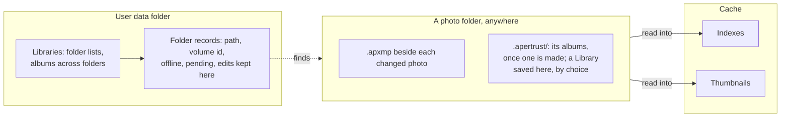
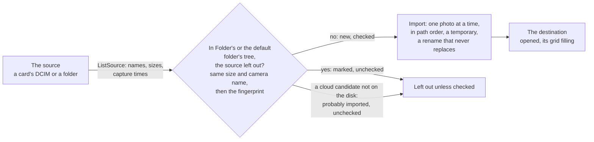
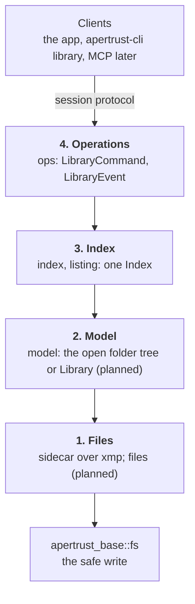
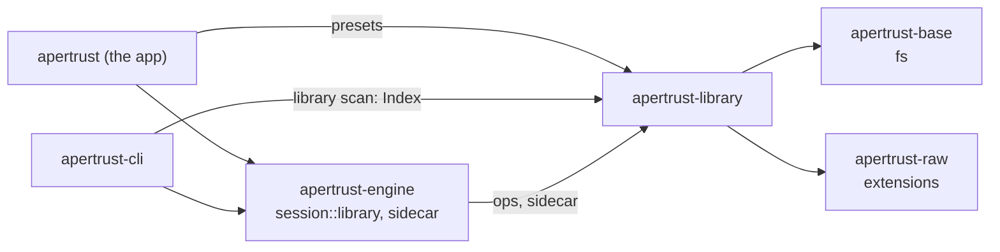
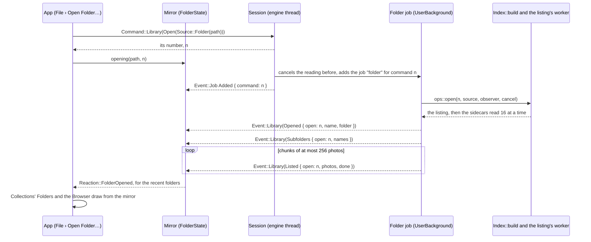
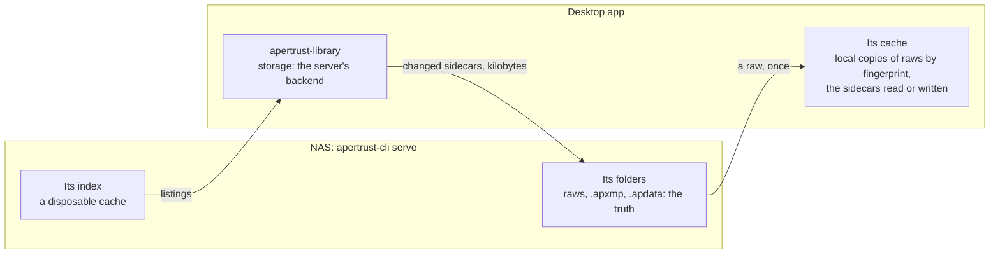

# Library

The library is how Apertrust finds photos and keeps what is known about them: one photo, folders, and optional Libraries. This document describes its design and its API: what each place holds and where each feature keeps its data, the code's layers, the commands and events clients use, how a folder is listed and indexed, the sidecars, the preset and style files, how folders and photos are found again on several computers and drives, the saved index and the thumbnails.

[decisions/](decisions/README.md) holds the decisions it rests on, 46 to 55, 71, 85 and 101 above all, [architecture.md](architecture.md) the design around it, and [roadmap.md](roadmap.md#the-librarys-steps) the library's steps. How events in general are sent and taken in is [events.md](events.md), and how a client sends commands is the [session protocol](session-protocol.md). The crate's state is in [crates.md](crates.md#apertrust-library).

**Status.**

- **Built:** folder mode's first part. A folder is listed and its sidecars read into an index in memory, opened through the session as a job, and shown in Collections' Folders, in the Tools panel's Photos tab, and in the Browser. The `.apxmp`, version 2, the one the engine writes, with its history ([Version 2](#version-2)), version 1 still read, and the XMP layer under it are built, as are the safe write, the preset and style files ([Outside the layers](#four-layers)) and `apertrust-cli library scan`. The code is in `crates/library/src/`: `listing`, `index`, `sidecar`, `presets`, `xmp` and `ops`. The ways in to it are built in the app: one photo from a terminal, Open With and a double-click, each opening the photo alone ([One photo](#one-photo)), Open Recent, what was open last reopened at the start, and the start window in place of the main window with nothing open ([gui.md](gui.md#the-start-window)).
- **In progress:** thumbnails ([Thumbnails](#thumbnails)): the camera's embedded pictures, the cache and the live photo's own renders are built; the other photos' renders remain.
- **Planned:** the rest of folder mode in Phases 2 and 3, Include subfolders, a folder's albums and Move to… and Copy to… among it; Libraries and the index across folders in Phase 5 ([The steps](#the-steps)); the server later, if asked ([A server](#a-server)).

## What the library is

Decisions 46 and 101. The library meets five requirements:

1. **Folders are the unit:** any folder opens and is worked in as it is, with nothing to import, make or find first.
2. **Sidecar files only,** with no database as the truth.
3. **Photos move** between folders, drives, computers and systems, in Apertrust or in a file manager, their edits with them.
4. **Photos live anywhere:** a NAS, external drives, cloud folders.
5. **No trouble when one folder is edited on several computers,** which darktable's library has.

**Sidecars are the truth; no database ever is.** The truth is in files that travel: the sidecars, and a folder's small text files in its `.apertrust/`. A photo's edit and metadata live in its `.apxmp`, written whenever they change. Anything else, the saved index included, is rebuilt from the files. A database is never the truth and never sits on shared storage. darktable's library is ported as far as these allow.

**Each feature's data is made where it belongs, when it is first used** ([decision 101](decisions/0101-folders-first-libraries-optional.md)):

| What | Where | Made |
| --- | --- | --- |
| Edits, ratings, labels, keywords, groups, virtual copies | The photo's `.apxmp` beside it (decisions 47 and 48) | When something about the photo changes: the edit and its history built, and the rating, reject and labels (step 14); keywords, groups and further virtual copies planned (Phase 3) |
| A folder's own albums and smart albums, of photos anywhere under it | `.apertrust/` at that folder's top, hidden; it travels with the folder, so any computer that opens it sees them ([A folder's `.apertrust/`](#a-folders-apertrust)) | When the first album or smart album is made there (Phase 3), or a Library is saved there (Phase 5) |
| The keyword tree | Built from the sidecars' hierarchical keywords; the keywords' properties and Recent in the user data folder's `keywords.toml` (decision 73) | Never a file beside the photos |
| Search across a folder and its subfolders | The index: in memory over the open tree in Phase 3, then saved in this computer's cache ([The saved index](#the-saved-index)) | As the folder opens, in the background |
| Browsing a folder whose drive is away | One thumbnail size per photo kept in the cache, and the index ([Keep Available Offline](#keep-available-offline)) | When a folder is marked Keep Available Offline or is in a Library (Phase 5) |
| A Library: its folders and its albums across them | `<user data>/libraries/<id>/`, seen only on this computer ([A Library](#a-library)) | New Library… (Phase 5) |
| A Library that travels, by choice | `.apertrust/libraries/<id>/` in its home folder, one of its own ([A Library that travels](#a-library-that-travels)) | Save Library in a Folder…, or the choice in New Library… (Phase 5) |
| A tool's presets | One `.appreset` each, `<user data>/presets/<tool>/<Name>.appreset`, XMP holding the `.apxmp`'s tool entries or, for a utility, its settings; the built-in ones in `data/presets/`, embedded (decision 106) | Save as Preset… in the tool's header's presets pull-down |
| Styles | One `.apstyle` each, `<user data>/styles/<Name>.apstyle`, XMP holding one or more tools' entries; the built-in ones in `data/styles/`, embedded, read-only; a copied edit only in the app's memory; the styles applied to a photo in its sidecar's history (decision 106) | Create a Style… or Save Edit as Style… |

```text
NAS/Photos/                          a folder, opened as it is
  .apertrust/                        hidden; only once an album is made or a Library saved here
    albums/7c0e9a14.toml             one file per album, named by id, naming its parent
    smart-albums/3f2a91d0.toml
    libraries/9e4d2b61/              only if a Library is saved here: library.toml,
                                     albums/, smart-albums/
  2026/2026-11-20 Lisbon/
    DSCF0001.RAF
    DSCF0001.RAF.apxmp

<user data>/                         this computer, what clearing the cache must not lose
  folders/5b0c7d0e.toml              a folder record: last path, volume id, path below the
                                     mount, Keep Available Offline, edits kept here
  folders/5b0c7d0e/pending/          ratings and tags waiting while its drive is away
  folders/5b0c7d0e/edits/            only with its edits kept on this computer, by path
  libraries/a1b2c3d4/library.toml    a Library: its name and its folders' ids
  libraries/a1b2c3d4/albums/  smart-albums/
  libraries/9e4d2b61/library.toml    a Library saved in a folder: its home folder's record
                                     and the last copy read, for while the home is away
  keywords.toml                      keyword properties and Recent

<cache>/                             rebuilt from the files
  indexes/                           a folder tree's index: kept while a folder it
                                     covers has a record, limited otherwise
  thumbnails/                        limited
  offline/                           kept: one thumbnail per photo of a folder kept offline
```



### One photo, a folder, a Library

The main window holds one of them at a time, its place, with one main window per user data folder ([decision 89](decisions/0089-one-instance-and-one-window-per-user-data-folder.md); [gui.md](gui.md#instances-and-windows)).

| | One photo | A folder | A Library |
| --- | --- | --- | --- |
| Best for | A look at a photo, or a few, and an edit: whatever was opened, from the system, a dialog, a drop or a terminal | Working in a folder as it is: a card just copied, a trip, a whole archive on a NAS, with its subfolders | Several folders on several drives as one: search and albums across them, drives that are away still browsed |
| What it gives | The photo at once, its edit beside it, nothing else touched | The folder's photos in the Browser, to edit, rate, cull and export, with nothing to import; its subfolders' too with Include subfolders; its own albums and smart albums; search over its tree; Keep Available Offline | What its folders give, and search, albums and smart albums spanning them; its folders found again after a mount changes |
| What it leaves on disk | The photo's `.apxmp`, once something changes | Each photo's `.apxmp`, once something about it changes; `.apertrust/` once its first album is made or a Library is saved there | Nothing in its folders by default; `.apertrust/libraries/<id>/` in its home folder where saved there by choice |
| How it opens | Opening a photo by any route: Open With or a double-click on a raw or its edit; File › Open…; raws dropped onto the window; `apertrust FILE` | File › Open Folder…; a folder dropped onto the window; Collections' Folders; Open Recent or the start window; `apertrust FOLDER`; Open This Folder from one photo | Collections, once made by New Library…; Open Recent and the start window; on another computer, the offer on opening its home folder |
| Its edits | Beside the photo | Beside the photos, or kept on this computer ([Nothing written beside the raws](#nothing-written-beside-the-raws)) | Each folder's own |
| Index | None beyond the photo | In memory while open, then saved per folder tree ([The saved index](#the-saved-index)) | Its folders' indexes, read together |
| In the recents, and reopened at the start | No | Yes | Yes |
| State | Built, by every way in, several photos together | First part built; the rest Phase 3, the saved index Phase 5 | Planned, Phase 5 |

### One photo

Decision 46. **Opening a photo, by any route, opens that photo alone:** Open With and a double-click on a raw or its `.apxmp`, File › Open…, raws dropped onto the window or the Mac's Dock icon, and `apertrust FILE` from a terminal. One rule, so the same photo never opens two ways: opening a file means "show me this photo", and a folder full of other photos, a changed recents list and a background listing are side effects nobody asked for. The folder is one visible click away, Open This Folder.

- An edit, `IMG.ARW.apxmp`, opens the photo beside it, the name without its lower-case `.apxmp` (`sidecar::photo_for`); one whose photo is not there is refused with an alert naming the photo.
- Its edit is found as folder mode finds it, beside the photo, or, where the nearest folder above it whose record keeps edits on this computer has it, in that record's `edits/` under the photo's path relative to that folder ([Where edits live](#where-edits-live)).
- Nothing is listed or indexed beyond the photo, and nothing is written but its `.apxmp`, once something about it changes, and its `.apdata` once the edit has one (decision 49).
- It adds nothing to the recents (Open Recent, the start window, `state.toml`) and is never what the next start reopens while `library.reopen_last` is on; that stays what was open before it.
- The Browser shows the photo alone, or the photos opened together, each with its thumbnail as folder mode shows it: read from the photo's own file or the cache, asked for as its cell is drawn, by path (`LibraryCommand::PhotoThumbnails`, [Thumbnails](#thumbnails)), its folder never listed. Collections' top line names the active photo and lists the recent folders, as in any mode; there is no folder tree, and its Folders holds Open This Folder alone ([In the window](#in-the-window)).
- **Only Open This Folder switches to folder mode,** on the photo's folder, that photo active; only then does that folder join the recents.
- **Several files opened together** (Open With on several raws, Open… with several, several raws dropped) open together in this mode, from one folder or several: the Browser shows just them, the first active, still with nothing in the recents and no folder tree. Open This Folder opens the active photo's folder.
- **The app tells the session the photos** (`LibraryCommand::Open(Source::Photos(paths))`), so they are the selection's collection, as a folder's photos are: Select All, Invert Selection and Select Unedited act on them, Next Photo and Previous Photo move through them in the order opened, and an export takes every one selected ([session-protocol.md](session-protocol.md#the-selection)).
- A path that opens nothing, a file that is no raw or edit or a path that is not there, is refused with the alert in the window, as a drop's is, by every route; no file is a library ([decision 101](decisions/0101-folders-first-libraries-optional.md)).
- **Where an open goes:** every open replaces the window's place, one from outside as one from inside. From outside are Open With, a double-click, a drop on the Mac's Dock icon and, on Windows and Linux, a second start's paths, which a second start hands to the instance running on its user data folder ([decision 89](decisions/0089-one-instance-and-one-window-per-user-data-folder.md)); from inside, File › Open…, a drop on the window or Open This Folder.
- **The command line** is taken as a drop is: `apertrust FILE...` opens one photo, `apertrust FOLDER` folder mode, looked at after the window opens and off the interface's thread, a refusal's reason also on stderr. The registrations on Windows and Linux pass the files alone ([packaging.md](packaging.md#opening-a-raw-from-the-system)); `--in-folder`, which told Open With from a terminal while the two differed, is accepted and ignored until the first release is tagged, and removed in it.

Built: all of the above but edits kept on this computer, planned with Phase 5 (decision 47). On Windows Open With takes one file; several come through Send To, one start with every file, or through Open where Apertrust is the type's default, one start per file, each handing off, and the instance joins those starts, each arriving within 500 ms of the one before, into one open, the gaps to be measured on Windows 11 ([decision 89](decisions/0089-one-instance-and-one-window-per-user-data-folder.md)).

### Folder mode

A folder open, the main way in; built first, and partly built.

- It opens only from a folder: File › Open Folder…, a folder dropped onto the window or the Mac's Dock icon, a folder in Collections' Folders, Open Recent or the start window ([gui.md](gui.md#the-start-window)), `apertrust FOLDER`, and Open This Folder from [one photo](#one-photo), which opens the photo's folder with that photo active. A photo opened, by any route, opens [one photo](#one-photo).
  - macOS delivers Open With, a double-click and a drop on the Dock icon as an open-documents event, not as arguments, which the app's platform code receives (`apertrust-display`). A folder dropped on the Dock icon opens in folder mode, as one sent with Windows' Send To does ([packaging.md](packaging.md#opening-a-raw-from-the-system)).
- Opening, browsing and thumbnailing write nothing beside the photos. A photo gets its `.apxmp` only once something about it changes: an edit, a rating, reject or label, a keyword or metadata field, a virtual copy, a snapshot, a group. The folder gets its `.apertrust/` only once its first album or smart album is made there, or a Library is saved there.
- The listing and the sidecars, read 16 at a time, make an index in memory, gone when the folder closes ([Listing and the index](#listing-and-the-index)); with Phase 5 it is saved per folder tree ([The saved index](#the-saved-index)).
- Collections, the Photos tab's first tool, shows the open folder's tree in Folders, and from Phase 3 the folder's own Albums and Smart albums ([In the window](#in-the-window)). Filters filters the open folder from its index (planned, decision 73).
- Its keyword list is the keywords its photos hold; their properties (synonyms, private, category) and Recent are in the user data folder's `keywords.toml`, shared by every folder and Library (planned, decision 73).
- Import… (planned, decision 85) copies photos from a card or another folder into a destination named with darktable's patterns, then opens it ([Import in folder mode](#import-in-folder-mode)).
- The CLI works on folders this way too: `library scan` built, `import` planned ([The CLI](#the-cli)).

### Images other than raws

Decision 111, planned, JPEG first, then the decision's later tiers. An image that is not a raw is a photo as a raw is, wherever a raw is one: in folder mode, one photo, the Browser and `library scan`.

- **Listed** by the extensions of the formats the app opens, in any case; opened by its magic number first, as darktable's loaders are, so a JPEG named otherwise still opens.
- **Its sidecar** is beside it by its whole name, `photo.jpg.apxmp` (`sidecar::path_for`), its edit, ratings, labels, keywords and metadata there as a raw's; its EXIF and XMP read as a raw's, a JPEG's through rawler's `formats::jfif`, which skips the APP13 segment, so a JPEG's IPTC-IIM needs a reader of its own (planned).
- **A raw and its JPEG** become one photo with step 17's groups by base name, which this does not replace. Until step 17, a JPEG with a raw of the same base name beside it is left out of the Browser and the folder's photos, as darktable's collapsed group shows one photo, and counted apart; a JPEG alone is a photo. Opened by a route that names it, File › Open… or Open With, it opens as one photo.
- **Its thumbnail** is the image itself ([Thumbnails](#thumbnails)).
- **Import** lists and copies non-raws with its slice 20b (decision 85).

### Include subfolders

Planned, Phase 3, the library's step 19b. **Include subfolders** shows the open folder's photos with its subfolders', from [the tree's walk](#the-trees-walk), the index in memory over the whole tree.

- **Off by default, remembered per folder,** as darktable's film roll shows one folder and Import's `include_subfolders` is off. The tree's walk lists the archive's folders on its first open, as built, directory entries alone ([The tree's walk](#the-trees-walk)), but no photo or sidecar below the open folder is read unless asked.
- **Search and filters follow what the Browser shows:** with it off, they run over the open folder and say how many photos its subfolders hold, from the tree's walk, "37 more photos in subfolders", with the switch beside it; no sidecar below the open folder is read for it, so the count is of photos, not of matches, but where a saved index (Phase 5) already holds them; on macOS and Linux it leaves out the photos below a mount point inside the tree, which the walk names but does not enter ([The tree's walk](#the-trees-walk)).
- **The first open of a large tree** lists and reads in the background, the open folder first. At the measured SMB rates on the M4 against a NAS (342 ms for 2,825 files listed in bulk, 2.2 ms a sidecar read 16 at a time, [Listing in bulk](#listing-in-bulk)), 100,000 photos list in about 12 s and their sidecars read in about 4 minutes; with the saved index (Phase 5) later opens start from it.

### A folder's `.apertrust/`

Planned, Phase 3, the library's steps 19c and 19d ([decision 101](decisions/0101-folders-first-libraries-optional.md)). A folder's own data lives in a hidden `.apertrust/` at its top, made only by the first album or smart album made there or by a Library saved there (Phase 5), whichever comes first, so any computer that opens the folder sees its albums.

- **It holds** `albums/` and `smart-albums/`, one TOML file each, named by the album's id and naming its parent, so a move rewrites one line and two computers changing different albums never touch one file; and `libraries/<id>/` only where a Library is saved there by choice ([A Library that travels](#a-library-that-travels)). Nothing else is written into it, and it is removed once neither is left.
- **Its album entries** name photos by their path relative to that folder, with `/` and each name's bytes kept as read ([Folder records](#folder-records)), with their fingerprint and virtual copy, so the folder moves or renames with no change to them.
- **No id of its own:** a copied folder, a backup, is two folders, each with its albums, diverging from there; nothing tells them apart or needs to.
- **Nested:** a folder with albums moved inside another with albums keeps both `.apertrust/` folders. Opening the outer folder shows its own albums and, grouped under the inner folder's name, the inner's, found by the tree's walk. Nothing is merged.
- **Hidden:** the dot hides it on macOS and Linux, and Samba hides dot files from Windows clients by default; Explorer shows it otherwise, as it shows `.git`. Setting Windows' hidden attribute on a folder takes `SetFileAttributesW`, an `unsafe` call in the `windows` crate that the standard library does not wrap, so it is set only if `apertrust-fs` comes for another reason (decision 65); until then `.apertrust/` stays visible in Explorer, as `.git` does. The listing skips it by its dot, as it skips every hidden entry ([The listing](#the-listing)); the tree's walk notes it, without walking into it.

### Albums and smart albums

Planned: a folder's own in Phase 3 (steps 19c and 19d), a Library's spanning its folders in Phase 5 (step 26).

**Albums** hold photos chosen by hand, each named by its folder, relative path, fingerprint and virtual copy, and other albums and smart albums, to any depth. darktable has no albums.

- A folder's albums hold photos anywhere under that folder; a Library's albums hold photos of any of its folders.
- An album shows only its own photos, with its albums and smart albums beside them.
- Add to Album adds the selected photos; removing a photo from one removes nothing else. Deleting an album deletes the albums inside it, after the sheet says how many, never a photo.
- A move that would make a cycle is refused. One made offline on two computers puts the album whose move has the later clock at its folder's or Library's top, and the activity says so.
- **Two computers changing one album** combine it entry by entry, the later clock winning each (decision 52), so photos added on both are all kept. An album file's conflict copy from a sync tool is combined into the album its id names, then moved as a sidecar's is.
- **Photos moved out of the folder's tree:** Move to… counts the album entries it takes out and says so before it runs; moved outside Apertrust, the entries stay, shown as missing, and are re-paired if the photo comes back under the folder.

**Smart albums** are darktable's collect rules, filters and sort, saved: a folder's over that folder's tree, a Library's over its folders, one inside an album over that album's photos. Their rules gain one property of Apertrust's own, **in album**: the photos of an album, or of an album and every album inside it. Filters' Save as Smart Album saves into the open folder's `.apertrust/` (step 19d), or into the open Library.

### Move to… and Copy to…

Planned, Phase 3, the library's step 19, with Rename and Delete ([decision 101](decisions/0101-folders-first-libraries-optional.md)); the checked copy they stand on is built ([below](#the-checked-copy)). Between any two folders, each a `UserForeground` job, cancellable, as darktable's (decision 57):

- **A photo moves whole or stays:** its main file (its raw, else its only image file) with its `.apxmp`, `.apdata` and attached files, and its edits kept on this computer, which go where the destination's edits are kept. A cancel, a crash or a write from elsewhere during the move never leaves a photo in both places, or half in each, and never loses a file: what cannot be settled is named in the activity for the person to settle. How each is met is step 19's spec.
- **On one volume, a rename; across volumes, a checked copy** ([below](#the-checked-copy)): each file is copied through a hidden temporary ([the safe write](#safe-writes)), read back past the system's cache and compared with its source's hash before any source file is removed.
- **Never replaces a file** at the destination; a cancel takes effect between photos.
- **Albums:** the sheet counts the album entries a move takes out of a folder's `.apertrust/`.
- **Delete** sends photos with their sidecars to the system's trash, with a bar and not cancellable (decision 57).
- **Import's copy is this checked copy** (decision 85): from 20a1 whole or absent and never replacing a file, its read-back Verify the copies (20b), on by default, the source hashed as it is copied and only the destination read back ([below](#why-verify-the-copies-is-on-by-default)); Backup (20d) copies to a second destination the same way.

### The checked copy

Built, ahead of the commands that use it: `copy::copy_photo` in `apertrust-library` ([crates.md](crates.md#copy)), over `apertrust_base::fs`. One photo's files, its `.apxmp`, `.apdata` and darktable's `.xmp` first and its main file last, copied into a folder under the same names, whole or not at all:

- **Each file** is streamed in 1 MiB chunks from the source, opened read-only and never written, hashed with BLAKE3 as it is read, into a hidden temporary in the destination (`.~NAME.XXXXXX.tmp`); synced and, with `Check::ReadBack`, read back past the system's cache and compared with the hash; renamed into place by a rename that refuses to replace a file; and only then given the source's modified time, a time not set logged and the copy kept. The temporary stays as young as its write, so a listing of the folder meanwhile never removes it as stale.
- **Any failure** (a cancel, a full disk, a source that cannot be read, a file that appears at the destination, a copy that differs) removes the temporary and the photo's files that had landed, and names the file; a file that was there before is never touched. A landed file whose removal fails is logged and stays.
- **A crash** leaves the temporary, hidden and told by its name, which the listing removes a day after it was last written; and, where some of the photo's files had landed, those under their names, its sidecars without its main file, so copying the photo into that folder again fails with `Exists`. They are copies whose source is still there: remove them and copy again, or copy into another folder.
- **A destination folder** is made as the first file is to land; removing one left empty is the caller's. The copy always copies, on one volume too.
- **A share without an exclusive rename:** macOS's SMB client refuses `renamex_np`'s `RENAME_EXCL`, hard links and `F_FULLFSYNC` alike (`ENOTSUP`). There the copy syncs with `fsync`, and looks for a file at the destination just before a plain rename, so another program's file made in between is replaced: the window narrowed to that, as [the safe write](#safe-writes)'s check before its rename is. Linux's SMB and NFS clients are to measure.

**Reading past the cache** (`fs::uncache_writes`, `fs::sync`, `fs::read_uncached`):

| System | Method | Checked |
| --- | --- | --- |
| macOS | `F_NOCACHE` on the handle that writes and on the one that reads; `F_FULLFSYNC`, else `fsync` | APFS and SMB: a file just written reads back at 2.0 GB/s from the SSD and at the network's 50 MB/s from the NAS, against 8 to 9 GB/s and 1.3 GB/s from the cache. `F_NOCACHE` on the read alone is answered from the pages the write left, at the cache's speed |
| Linux | `fsync`, then `posix_fadvise(POSIX_FADV_DONTNEED)`, advice the kernel may not follow, so best effort: it drops clean pages where it is followed, never proving the cache was passed; `O_DIRECT`, refused by some file systems and asking for aligned buffers, is not used | ext4: a file just written reads back at 1.5 to 1.9 GB/s from the NVMe SSD, far below the cache's speed, so the cache is passed there. btrfs and SMB and NFS mounts to measure |
| Windows | `FlushFileBuffers`, then reads with `FILE_FLAG_NO_BUFFERING` in whole 4 KiB blocks into an aligned buffer | NTFS: the NVMe SSD's own counters read 8,463 MB of 8,464 MB for the way that reads back, and none for copy and hash. An SMB share to measure |

**What it costs,** from `examples/copy_timing.rs`, the sources read once before each run so every way meets them in the cache and the times are the destination's, a card's read cold (`--cold`, the card inserted or mounted again), each a separate run:

| Destination | Files | Copy alone | Copy and hash | Copy, hash and read back | The read-back adds |
| --- | --- | --- | --- | --- | --- |
| The M4's SSD: a MacBook Air M4, 24 GB, 1 TB APPLE SSD AP1024Z, APFS, macOS 27.2 | 200 (17 raws of 25 to 60 MB from raw.pixls.us, repeated), 8,464 MB | 7.64 and 8.37 s, 38 and 42 ms a file | 9.72 and 9.86 s, 49 ms a file | 21.38 and 21.44 s, 107 ms a file | 11.6 and 11.7 s, 1.4 s a GB, 58 ms a 42 MB raw |
| A NAS over SMB 3.1.1 on Wi-Fi, from the same NAS | 39 raws of 25 to 60 MB, 1,492 MB | 42.0 and 59.1 s, 1.1 and 1.5 s a file | 45.7 and 60.6 s | 87.3 and 94.7 s | 34 and 42 s, about 1 s a 38 MB raw, the network's 36 to 44 MB/s |
| Linux's SSD: a Ryzen 7 8845HS, 59 GB, WD_BLACK SN7100 2 TB NVMe, ext4, Linux 7.0 | 200 (the same 17 raws, repeated), 8,464 MB | 6.68 to 15.40 s, 33 to 77 ms a file | 9.28 to 15.47 s, 46 to 77 ms a file | 13.89 to 23.99 s, 69 to 120 ms a file | 4.6 to 12.0 s, 0.54 to 1.41 s a GB, usually 0.55 to 0.7, the kernel's writeback varying the runs |
| Windows' SSD: the same machine, 62 GB, NTFS, Windows 11 Pro | 200 (the same 17 raws, repeated), 8,464 MB | 7.37 to 15.69 s | 10.40 to 22.03 s | 18.53 to 21.39 s | 4.5 to 8 s, 0.5 to 1 s a GB; the first two ways swing about 2×, Defender's scan of the new files the likely cause |
| An SD card in a USB reader at 165 MB/s, to the M4's SSD: a 128 GB LUMIX card, exFAT, cold | 200 RW2 raws of 25 to 60 MB, 7,005 MB | 42.44 and 42.31 s | 42.56 and 42.53 s | 51.84 and 51.69 s | 9.2 s, +22%, 1.3 s a GB |
| Another LUMIX card in the same reader, cold | 22 RW2 raws of 25 to 60 MB, about 680 MB | 4.04 to 4.10 s | 4.06 to 4.10 s | 4.97 to 5.01 s | 0.92 s, +23%, 1.35 s a GB |
| An SD card in a USB 2 reader at 41 MB/s, to Linux's SSD: a 128 GB LUMIX card, exFAT, cold | 100 RW2 raws of 25 to 60 MB, 3,450 MB | 84.31 and 85.27 s | 84.63 and 84.56 s | 86.82 and 86.64 s | 2.2 and 2.1 s, +2.6% and +2.5%, 0.6 s a GB |
| An SD card in Windows' own reader at about 39 MB/s, to its SSD: a LUMIX card, exFAT, cold | 200 RW2 raws, 7,005 MB | — | 177.91 s, 890 ms a file | 186.58 s, 933 ms a file | 8.7 s, +4.9%, 1.2 s a GB |

Hashing runs at 3 to 4 GB/s in BLAKE3's pure-Rust build. On the NAS the copy ran at 25 to 36 MB/s, below the 84 MB/s the link gave before, so a 30 MB raw's read-back takes 0.7 to 0.8 s there rather than 0.36 s.

To measure, each from the repository's root:

```sh
# An SD card just inserted, holding 200 raws of 25 to 60 MB, into a scratch folder on the SSD;
# each run on the card inserted again, so nothing of it is in the cache.
cargo run --release -p apertrust-library --example copy_timing -- --cold hash /Volumes/CARD/DCIM ~/copy-timing 200
cargo run --release -p apertrust-library --example copy_timing -- --cold read-back /Volumes/CARD/DCIM ~/copy-timing 200
# Linux and Windows: the SSD, then each file system above as INTO.
cargo run --release -p apertrust-library --example copy_timing -- test-images/raw.pixls.us /tmp/copy-timing 200
cargo run --release -p apertrust-library --example copy_timing -- test-images\raw.pixls.us %TEMP%\copy-timing 200
```

#### Why Verify the copies is on by default

The read-back's cost is the destination's, about 1.3 s a GB to a local SSD, whatever the card: so its share of a card import is the reader's speed. From a USB 2 reader, at 39 to 41 MB/s, it adds 2.5 to 5%; from one at 165 MB/s, 22 to 23%, a 64 GB card taking about 8 minutes rather than 6.5. Hashing the source as it is read adds nothing a card shows. A copy that differs from its card is found only by the read-back, before the card is formatted, so Verify the copies (`import.verify`, 20b) is on by default (decision 85), and the setting turns it off.

### Import in folder mode

Decision 85, planned: the library's step 20, in slices 20a1 to 20d ([roadmap.md](roadmap.md#the-librarys-steps)), the first, 20a1, this library side with `apertrust-cli import` and a simple sheet, after step 19's checked copy. The sheet that shows it is [gui.md](gui.md#the-import-sheet)'s, on the sheets' frame (decision 86); this is its library side, in `apertrust-library`.



**The source** is a place and a folder in it, Source's group of the Import tool: a card, any mounted volume with a `DCIM` folder at its top, whose `DCIM` is always listed whole, or a folder, with its subfolders where Include subfolders is on (20a2). `LibraryCommand::ListSource { source, include_subfolders, base_folder, default_folder, places }` lists it as a cancellable job of kind `import-source` on darktable's `UserBackground` queue, with no progress, so it shows in the sheet alone, never in the spinner or the jobs window: where `source` is a card, its root or any folder inside it, the card's `DCIM`, every folder under it; else the folder alone. `base_folder` and `default_folder` are the patterns as the settings hold them, and `places` the client's `Places` (the home, Pictures and desktop folders and the user name), for the check below, since the engine reads no platform folder (decision 43). It sends `LibraryEvent::SourceListed` chunks of at most 256 files, each file's path relative to the folder listed, which each chunk names, its size, its modified time and whether it is on the disk, the last saying `done` and counting the other files left out, non-raws and sidecars; then `LibraryEvent::SourceTaken`, once, a capture time for each file with the camera's make and model, read 16 at a time as a folder's are; or `LibraryEvent::SourceFailed` in their place, the source missing, no folder, unreadable or gone while it was read. Nothing is written on the source, a stale temporary there included. A cloud file not on the disk is listed by name and size alone, its capture time never read in the background ([Shares, offline drives and cloud folders](#shares-offline-drives-and-cloud-folders)). A new source cancels the listing before it, and so does closing the sheet, as a new `Open` or a `Close` cancels a folder's `Subfolders`: `LibraryCommand::CancelListing { listing }`, naming the `ListSource`'s number, which a client has without the job's id. Raws only until 20b, the listing counting the other files it leaves out, which the sheet shows from 20a2; non-raws, and a raw and its JPEG as one, with 20b.

**Already imported** is told by the destination alone; no record is kept and nothing is written on the source.

- **The trees:** the base folder's, Folder's, pattern expanded up to its first variable that is not a fixed folder's (`$(HOME)`, `$(PICTURES_FOLDER)` and the like, the client's places, `$(PICTURES_FOLDER)` the home's `Pictures` where the system names no Pictures folder, as darktable falls back), and everything under it: `~/Pictures/Apertrust` by default; and whenever Folder's tree does not already hold it, the default folder's tree too, Folder inside it included, Settings › Import's Base folder (`import.default_folder`), so a card imported before there is still known when this import goes into an album folder elsewhere. Each is walked for each raw's name and size, as [the tree's walk](#the-trees-walk) reads entries, with a size added; on a share, step 7's bulk listing keeps that fast. The source's own folders are left out of the walk, so a source inside a tree never matches itself. A pattern whose fixed part is the file system's root, `/` on macOS and Linux or the system drive on Windows (`%SystemDrive%`), gives no tree, so the whole system is never walked; any other drive's root or volume is a tree as any folder is.
- **The recents' trees too** (20c): those of the recent base folders and of the recent folders imported into, Folder's ⌄'s recents, each walked as the default folder's is; `SourceChecked` names every folder it walked, which the sheet's counts' tooltip shows.
- **Candidates:** a file there of the size and camera name of the source photo's main file, its raw, or from 20b its only image file, a JPEG alone among them: its own file name, or the camera name its `.apxmp` keeps in `xmpMM:PreservedFileName`, read only for a file whose size matches. Every copy Import names otherwise than its source keeps that name, one with `_01` added included, so a renamed copy is found as surely as one under its own name.
- **Confirmed by the fingerprint** of both files ([Fingerprints](#fingerprints)); a photo with no candidate is new without reading it. A card of 5,000 photos already imported reads about 640 MB from it, about 7 s on a UHS-I card by estimate; a new card reads nothing beyond its listing.
- **A probable match:** the fingerprint reads 128 KiB of each file, so two different photos of one name and size whose first and last 64 KiB agree would be taken for one. The mark only leaves the photo unchecked and shown, naming its copy, so the person can check it; the copy never skips on the fingerprint alone. A candidate that is a cloud file not on the disk, whose fingerprint is never read ([Fingerprints](#fingerprints)), leaves the photo marked as probably imported, unchecked and shown with the candidate's name, until that file is on the disk, opened or made available offline; size and name alone never skip a copy.
- **A photo of several files** (20b: a raw and its JPEG) counts as imported once each of its files is there; one whose raw is there and whose JPEG is not counts as new for its JPEG alone.
- `LibraryEvent::SourceChecked` gives each photo's state in the listing's order, new, imported before with where its copy is, or probably imported with its candidate, in chunks of at most 256, each saying how many photos are checked of how many, so the sheet's bar can say "Checking against ~/Pictures/Apertrust… 2,400 of 5,000", the last saying `done`. The check runs as the listing ends, in the same job, and again when Folder changes, `LibraryCommand::CheckSource { listing, base_folder, default_folder, places }`: the change cancels a check still running, which sends nothing more, and each check is numbered within its listing, the listing's own first, its `SourceChecked` naming that number and the folders it walked; the sheet keeps only the latest check's, so neither another folder's nor an earlier check of the same one replaces it. The check runs again when an import into those trees ends, and meanwhile the sheet marks each photo imported as `Imported` names it.
- A photo moved out of every tree the check walks, or imported under a folder outside them, counts as new; another computer importing into the same share sees what this one imported.

**The preview,** `LibraryCommand::PreviewImport { photos, settings }`, a job on `UserForeground` with no progress, as Export's preview, answers `LibraryEvent::ImportPreview`, which the Import tool shows in its rows' tooltips and warning buttons, never as text under them: each checked photo's destination path, the folders the patterns make, each new or there already with its count, the dates each pattern uses (today's or the day taken), the clashes, how many of the checked photos were imported before and will be copied again, those to be skipped as already at their destination left out (the sheet's footer warns of them), the photos already at their destination with a sidecar of their own that differs from the source's, the size, the destination disk's free space, the problems that disable Import (an unknown variable, a folder that cannot be made or written, a destination that is the source, lies inside it, or is anywhere on a card the source is on, too little space, an override date darktable cannot read, which only a script sends), and the fixes each offers, such as Use $(MONTH), or for folders dated by the day taken and names by today, the file name with the capture date's variables.

**The copy,** `LibraryCommand::Import { photos, settings }`, a cancellable job of kind `import` on `UserForeground`, as darktable's `dt_control_import` (decision 57), its row "Importing 214 photos", "120 of 214", "now DSCF1120.RAF", its destination the destination folder:

- one photo at a time, in the order of their paths, as darktable's import job sorts them (`_sort_filename`), whatever the sheet's sort, so the sequence numbers follow it; a raw and its JPEG keeping one name;
- a destination folder made as its first photo lands, never before, and one the import made that is left empty by a cancel or a failure removed as the job ends, as darktable removes an empty film roll's folder; a folder that was there before is never removed;
- each file copied as [step 19's checked copy](#move-to-and-copy-to) copies it: streamed into a hidden temporary in the destination folder (`.~NAME.XXXXXX.tmp`, as the safe write names one), then renamed into place by a rename that refuses to replace a file, so a copy is whole or absent and nothing is ever overwritten, but on a share with no such rename, where a look just before a plain rename narrows the window ([The checked copy](#the-checked-copy)); its modified time set to the source's;
- with Verify the copies (20b, `import.verify`), each copy read back past the system's cache and compared with its source's hash before its photo counts as landed; a copy that differs is removed and that photo fails alone;
- a photo landing as one: its sidecars and its JPEG first, its main file renamed into place last, its raw where it has one, else its only image file (20b), so it counts as landed once its main file is there; one whose main file did not land has the files it copied removed, as its temporary is; a name counts as taken where any of a photo's files is there, so a sidecar a crash left is never overwritten;
- a photo whose raw is there already and whose JPEG is not (20b) gets its JPEG alone, beside the raw's copy, under its name, the raw untouched; so does a photo skipped as already there (below) whose sidecars are missing beside its copy, each copied under the copy's name and never over a file there; a sidecar there that differs from the source's, a diverged edit, is never written over: from 20a2, after step 12, the source's edit comes in as a second virtual copy beside the one there, as [two copies](#comparing-two-copies) keep a diverged edit (decision 52); until then the photo is skipped, its sidecar not copied, the preview listing it among the clashes and `Imported` naming it; a JPEG there of the copy's name that differs from the source's (20b) is left as it is, listed and named the same way;
- a name taken: the sequence continues after the last file there; under original names `_01` is added, then `_02`; a photo whose file at its destination, under its name or one of its `_01` names there, is the same byte for byte, compared whole as the copy reads the source, is skipped; any other checked photo is copied, one imported before included;
- carried with each photo and renamed with it: its `.apxmp` and `.apdata`, and darktable's `.xmp` as it is (decision 51); the source's are never written, and the copy's `.apxmp` names its new photo;
- a copy named otherwise than its source, by a pattern or with `_01` added, keeps its camera name in `xmpMM:PreservedFileName` in its `.apxmp`, as darktable writes it, so the check finds it by that name; otherwise a sidecar only where Metadata sets something (20b), a rating, labels, keywords and fields as values beside the edit ([Metadata beside the edit](#metadata-beside-the-edit)); no initial rating by default;
- `LibraryEvent::Imported` chunks name each source and its copy, with their `Import`'s number, by which the sheet marks only the photos of imports it sent from the listing it shows;
- a photo's own failure is that photo's and the import goes on; the source or the destination failing stops it; the copies made stay. Try again (`RetryJob`) copies what is left, the check skipping each file that landed; Cancel leaves no temporary and no photo half landed;
- from 20c, the source checked again as the job ends, the photos it copied counting as imported without a second read, so its row and the notice say whether anything new is left on the card ("Nothing new is left on EOS_DIGITAL"), with Eject beside it; a photo whose JPEG or edit stayed on the card by a clash, or whose file failed, counts as not copied and is named.

**Backup** (20d): each photo copied a second time, under another folder with the same subfolders and names, the same way, as it lands; a backup that fails is that photo's failure. Until 20d, Copy to… (step 19) makes the second copy, as the Help topic `import` says.

**The destination opens** when the copy ends in 20a1, where at least one photo landed, whether the job finished, stopped or was cancelled, and not where nothing was copied; from 20a2 as the first photo lands, where After import says so: the app opens it as a way in, with no photo opened, the photo being edited closing with its edit saved, and from 20a2 the session adds each photo copied into the folder the Browser shows to its index and sends it to clients as the folder's photos added, the event step 10's outside changes send, so the Browser fills without reading the folder again; a photo the folder's listing has found already is not added twice. Where the patterns make several subfolders, their deepest common folder is the one opened, and the first subfolder is chosen in Collections' tree, as a click chooses it; the others list as they are chosen, each listing only its own photos as any folder does.

**Cards:** `LibraryCommand::ListVolumes`, a `UserBackground` job with no progress, is answered by `LibraryEvent::Volumes`, the cards and drives mounted, each by its name as the system's file manager shows it, its mount point, whether it is a card and whether it is removable, with its free space, from `sysinfo`'s disk part, so the CLI has the free space too: those mounted when the sheet opens in 20a1, and as they come and go in 20c, their notifications from `apertrust-display`'s platform code. The preview's free space is the volume whose mount point is the destination's longest prefix. Counting a card's new photos (20c) is a `SystemBackground` job of the same check. Eject (20c) is the app's, through `apertrust-display`'s platform code, never a library command.

**A place's subfolders,** for the Import tool's Folders tree: `LibraryCommand::SourceSubfolders { folder }`, a cancellable `UserBackground` job as `Subfolders` is, served whatever folder is open or none, since `Subfolders` refuses a folder outside the open folder's tree, answered by `SubfoldersOf` in its own command's number and dropped by `CancelListing`.

**A card opened as a folder,** planned ahead of Import, on its own: a volume with a `DCIM` folder at its top or any folder inside one, opened with Open Folder…, a drop or Collections, is view-only: the session writes no rating, label, edit or sidecar there, so a card browsed as a folder is never written to outside Import either; its banner's Import… comes with 20a1 ([gui.md](gui.md#a-card-opened-as-a-folder)).

**Their numbers:** `SourceListed`, `SourceTaken`, `SourceFailed`, `SourceChecked` and the `Thumbnail`s `SourceThumbnails` asks for carry their `ListSource`'s number in `open`, a `SourceSubfolders`' `SubfoldersOf` its own command's, `ImportPreview` its `PreviewImport`'s and `Imported` its `Import`'s; `Volumes`, which from 20c also comes unasked, carries none. The Import sheet keeps the latest `ListSource`'s and the latest `PreviewImport`'s numbers and drops an older one's events, as the grid does an older open's; the folder's filter never applies to them, and an import's `Imported` events reach the destination's grid through the folder's photos added.

**Through `apertrust_base::fs`:** the listing, the check and the copy use it and the listing, as the rest of the library does ([Four layers](#four-layers)). The copy, its Verify the copies (20b) and Backup (20d) are [Move to…'s checked copy](#move-to-and-copy-to).

### A Library

Planned, Phase 5 ([decision 101](decisions/0101-folders-first-libraries-optional.md)). A Library is optional: a named collection of folders from anywhere, such as "Archive" or "Work", made by **New Library…**. **Add Folder…** adds folders from any drive, and a folder's ⋯ in Collections has **Add to Library…**.

- **What it adds:** search and filters across its folders; albums and smart albums spanning them; browsing, rating and tagging its folders while their drives are away; its folders found again by their volume id after a mount or drive letter changes ([Folder records](#folder-records)).
- **It is light:** its name, its folders by their records' ids, and its spanning albums and smart albums, kept by default in `<user data>/libraries/<id>/`, seen only on this computer, with nothing written into its folders. Its folders' indexes are in the cache ([The saved index](#the-saved-index)).
- **A folder can be in several Libraries or in none,** and works the same either way: its sidecars and its own albums are the folder's. A folder in two Libraries has one record, one index, one set of kept thumbnails and one set of pending changes; each Library's spanning albums are its own. A Library never holds one folder twice, or a folder and one of its subfolders.
- **Import knows no Libraries:** Import… copies into a folder, never into a Library. A destination inside a folder a Library holds is in that Library as any subfolder is; one anywhere else is in none until Add Folder… adds it.
- **Removing a Library** (Remove Library…) deletes only its list and its albums, never photos, sidecars or a folder's own albums. Remove from Library takes one folder out. Removing the last Library of a folder whose edits are kept here asks first: write the edits beside the photos, or add the folder to another Library.
- **Several Libraries per user data folder** take the place of darktable's workspaces. "Workspace" names the Tools panel's layouts (decision 96), so the word is Library. Settings, presets, styles, workspaces and keywords' properties are shared by every Library of the user data folder; separate user data folders stay for wholly separate setups (decision 89).
- **Keywords:** each scope's tree, a folder's or a Library's, comes from its own photos' sidecars, so a Library never shows another's keywords; a synonym set once works everywhere. A rename rewrites the sidecars of the open scope only.
- **Its file,** `library.toml`, holds its id, name and format and its folders; one of a newer format opens view-only (decision 52).
- In the window, Collections lists each Library with its folders, Albums and Smart albums ([In the window](#in-the-window)); the recents hold it by its id.

### A Library that travels

Planned, Phase 5, the library's step 27b, the last Library step, which moves to Later alone if Phase 5 runs long. As a choice, a Library is saved in one of its own folders, its **home folder**, so any computer that opens that folder can open the Library with its albums. It is the same Library kept elsewhere: the folder does not become a library, and no Library nests in another.

- **Saving it there:** New Library… asks where to keep it, This computer (the default) or In one of its folders. A Library kept here has Save Library in a Folder… in its ⋯ in Collections, which also moves it to another of its folders; Keep Library on This Computer moves it back, and other computers then say once that it has left its folder. Each move is [Move to…'s checked copy](#move-to-and-copy-to): written, verified, and only then the other copy removed.
- **The home folder** is one of the Library's own folders and writable, told by trying the write as `Cache::create` does, never by permission bits. A folder outside the Library, or one whose edits are kept on this computer, cannot be home. While it is home it cannot be removed from the Library: Remove from Library asks first to move the Library to another of its folders or back to this computer.
- **Where:** `<home>/.apertrust/libraries/<id>/`, named by id as albums are, so renaming the Library moves nothing and two Libraries named Archive never collide.
- **What it holds, and nothing else:** `library.toml`, with its id, name and format and its folders, each by an id of the Library's own with its volume id and path below the mount as a hint, the home folder `.`; and its spanning albums and smart albums, one file each.
- **What it never holds:** one computer's paths, Keep Available Offline marks, pending changes, edits kept on a computer, indexes, thumbnails, settings or keywords. Those stay in each computer's folder records and cache. A folder record is never shared: each computer's notes which of the Library's folder entries it answers.
- **On another computer,** opening the home folder asks once: "This folder holds the Library 'Archive'. Open it?"
  - **Open** lists it in Collections with that computer's own Libraries, marked with its home folder.
  - **Not Now** is remembered in the home folder's record; the folder's ⋯ still offers Open Library "Archive".
  - **Its folders** show as found (the hint matched, the photos confirming), away (no such volume present) or with Locate… (the volume present without the path, or an id this system reads differently, as an exFAT drive's can be between macOS and Linux). Locate… asks once per folder on each computer and keeps the answer in that computer's folder record; it is accepted once the photos the Library's albums name there match by fingerprint, or, for a folder no album names, as the person points.
  - **Its albums and smart albums** show as on the first computer; entries in a folder not found yet are away, never missing.
- **Two computers changing it:** its files are small, one per album as a folder's are, and decision 52's comparison applies to each: an album entry by entry, `library.toml`'s folders entry by entry, the later clock winning each. A folder removed is kept as a removal, so another computer's copy does not bring it back. Conflict copies from sync tools are combined into the file their id names, then moved as a sidecar's are.
- **Its home folder away:** the Library shows as away, browsed from the last copy this computer read, kept in its `<user data>/libraries/<id>/`. Its other folders work as usual. Album changes meanwhile wait in the home folder's record's `pending/` and are written through decision 52's comparison when it is back.
- **Its home folder renamed or moved:** the Library goes with it, being inside, found as any folder with a record is. **Copied,** as a backup: two copies of one Library id; a computer that finds both asks once which is the home, as with a clone, and ignores the other.
- **Removed:** Remove Library… asks first, saying every computer loses it, then deletes `.apertrust/libraries/<id>/`, and `.apertrust/` if nothing else is in it, never photos, sidecars or a folder's own albums; other computers say once that it was removed. Remove from This Computer forgets it on one computer only.

### Keep Available Offline

Planned, Phase 5, the library's step 27. A folder's own mark, in Collections' ⋯, with no Library needed; a Library marks each of its folders the same way. It sits beside the cloud folders' Make Available Offline ([Shares, offline drives and cloud folders](#shares-offline-drives-and-cloud-folders)), the system's own term, which downloads a placeholder's file.

- **It keeps** the folder's [record](#folder-records), its index and one thumbnail per photo in the cache's kept kind `offline/`, 256 px: 25.3 kB each on the corpus's embedded pictures on the M4 ([cache.md](cache.md#timing-the-walk)), so 100,000 photos take about 2.5 GB.
- **Away,** the photos are browsed, rated and tagged; editing says the drive is not connected. The ratings and tags wait in the folder record's `pending/` and are written through decision 52's comparison when the drive is back, combining with any change another computer made meanwhile.
- **Away, never deleted:** a volume or share not present means away; a file gone from a present volume means missing, re-paired by fingerprint. No index row, album entry or pending change is dropped by a scan, only by the person.

### Nothing written beside the raws

Planned, Phase 5, the library's step 28. Some people need Apertrust to write nothing into their photo folders: someone trying the app, an archive that must never touch its masters, a share that cannot be written. For them:

- **Albums go in a Library** kept on this computer, never in a folder's `.apertrust/`; a Library is saved into a folder only when the person chooses one.
- **Keep Edits on This Computer,** a folder's setting in Collections' ⋯, and `library.keep_edits_here` for every folder not yet edited, off by default, with `--conf` for a test install, as darktable's manual suggests `write_sidecar_files=never` for one ([settings.md](settings.md#edits-in-another-user-data-folder)). The edits go to the folder record's `edits/`, mirrored by path, the same `.apxmp` byte for byte ([Where edits live](#where-edits-live)).
- **Turned on or off for a folder that has edits,** it asks first, naming how many, and moves them to their new place by Move to…'s checked copy, so a photo's edits are only ever in one place and none is lost. How a sidecar already at the new place, a folder that cannot be written and a subfolder's own setting are met is step 28's spec.
- **Nested:** a subfolder of a folder that keeps its edits here shows the setting on, from that folder, and changes it only there.
- **Routed to a Library,** so nothing is left unsaved: the first change in such a folder adds it to a Library, asking once which, or making one. Every Library holding the folder uses the same edits. The folder is then only read: the listing's sweep of Apertrust's own stale temporaries passes it by too.
- **A known limit,** said here and in the setting's help: another computer, or another user data folder on this one (Apertrust Nightly, a development build), sees none of these edits and would write sidecars beside the photos, a second truth.

### Outside changes and several computers

| Case | Rule |
| --- | --- |
| **Photos moved or renamed outside Apertrust** | Matched again by fingerprint ([Fingerprints](#fingerprints)) wherever the orphan sidecar and the photo are in one indexed scope, the open folder with its subfolders or a Library; across scopes, Find Photos… on the orphans. Nothing is dropped: an orphan stays as Edits without a photo until the person removes it (step 18) |
| **A whole folder copied in a file manager** | Its sidecars and any `.apertrust/` go with it; the destination's next listing finds the photos with their edits and albums. Edits kept on this computer stay in the folder's record and do not go with the copy. The copy is the file manager's, not verified by Apertrust |
| **A folder with `.apertrust/` moved or renamed** | Its albums move with it unchanged, their entries relative to it. A recent breaks, with Locate…; a folder record finds it by volume id and path, else by Locate…, accepted once enough of its photos match by fingerprint |
| **A folder with `.apertrust/` copied,** a backup | Two folders, each with its own albums and sidecars, diverging from there; a Library holding both shows the photos twice. A Library saved there is the exception ([A Library that travels](#a-library-that-travels)) |
| **Drive letters and mount points that change** | A folder with a record is found by its volume's id and the path below the mount, the photos' fingerprints confirming ([Folder records](#folder-records)); a plain recent shows Not found, with Locate… |
| **Two computers editing one sidecar** | Decision 52: a diverged edit kept as a second virtual copy, "From another computer" and the time; ratings and metadata combined field by field ([Comparing two copies](#comparing-two-copies)) |
| **Two computers changing a folder's albums** | One file per album, combined entry by entry, the later clock winning each |
| **Sidecar conflict copies from sync tools** | Found by content and handled by decision 52's rule, moved to the user data folder's `conflict-copies/` and removed after 30 days (step 13) |

### Left for later

Later, if asked: editable previews and local copies of raws kept elsewhere; cloud storage folders, behind a spike; [the server](#a-server); a presence note, written only into an existing `.apertrust/`; carrying album entries to Move to…'s destination; videos listed; the watched folder, with tethering. Import's presets take a job's names and destinations, an export preset its output, ratings and albums its selects, and the system's trash its deleted photos.

### Words

The library's words are decisions 46's and 101's, listed with the others in [architecture.md](architecture.md#naming):

- The interface says Folder, Library, Album, Smart album, Virtual copy and Snapshot, and Collections for the tool that chooses which folder, album or smart album the Browser shows (decision 95); and for its commands Include subfolders, Move to…, Copy to…, Keep Available Offline, Keep Edits on This Computer, Add Folder…, Add to Library…, Save Library in a Folder… and Keep Library on This Computer.
- The code and docs add **folder record**, **home folder**, **folder tree** and **collection**, for any set of photos Collections chooses; the tree's root is the folder opened in Collections. The interface has no word for a folder and an album together, nor for a folder record.
- Never: project; film roll; catalogue; workspace for a Library; session for a Library ("session" is the engine's); version for a virtual copy.

### Against darktable's library

darktable's library is kept feature by feature, with its deviations, each for a requirement (each with darktable's sources, recorded with decision 46):

- no `library.db` as the truth; folders by folder record, relative path and fingerprint; no import step;
- optional Libraries, collections of folders, in place of workspaces;
- a sidecar written only once something changes, whole and byte for byte the same for the same content;
- groups made by hand stored by id in the sidecars; every virtual copy in the photo's one sidecar;
- a reject that keeps the stars;
- change detection always on, an edit changed on two computers kept as a second virtual copy, metadata combining; cloud conflict copies found and handled;
- a content fingerprint; no locks or database on shared storage; drives that are away marked, never skulls; no background download of a cloud file;
- Folders, Albums and Smart albums in place of the collect tool;
- darktable's automatic `darktable|…` tags not written, their facts properties of the index;
- Import never rewriting a sidecar; names compared in one Unicode form;
- the selection the session's; the import time only in each computer's index; Move to… across volumes a checked copy;
- history in Apertrust's readable layout; snapshots saved; edits optionally kept on this computer.

### In the window

Decisions 37, 46, 73 and 101. The Photos tab of the Tools panel chooses what the Browser shows and describes the photos in it. Its tools are Collections, pinned and built, then Filters, Keywords and Metadata, planned for Phase 3, Styles, built, and Export, last, built for the selection, else the active photo (decision 90) ([gui.md](gui.md#the-tools-panel)). Collections keeps one name everywhere, its top line showing what is open: in one photo the photo, the active one where several were opened together, a folder ("Folder: Wedding 2026-10"), its count on its row in Folders' tree, or a Library's name. Its groups are Folders, Albums and Smart albums: Folders from Phase 2, a folder's own Albums and Smart albums from Phase 3, and each Library with its folders, Albums and Smart albums in Phase 5. The interface has no catch-all word for them; "collection" is the code's and the docs' word for any of them. darktable's film roll is a folder.

**The sections by place:**

| Place | Folders | Albums | Smart albums |
| --- | --- | --- | --- |
| One photo | The active photo's folder, as Open This Folder (into folder mode) | Not shown | Not shown |
| A folder | The open folder's tree | The folder's own, and grouped under each inner folder's name its own (Phase 3) | The folder's own (Phase 3) |
| A Library | Its folders' trees, those away marked | Its albums spanning its folders, nested | Its smart albums, over the Library or inside an album |

- **One photo shows Folders alone,** since nothing is open beyond the photo. A folder's Albums and Smart albums are made there, the first one making its `.apertrust/` unless a Library saved there has made it. The tool's top, what is open with its recents and ＋, is the same everywhere.
- **Filters** (decision 73, Phase 3, planned) run over the open folder's index in memory, following what the Browser shows ([Include subfolders](#include-subfolders)); Save as Smart Album saves into the folder's `.apertrust/`. A filter that hides selected photos leaves only the shown ones selected.
- **Keywords** are one tool, darktable's tagging, and **Metadata** one, darktable's image information and metadata editor, in groups after EXIF and IPTC Core (decisions 73 and 110; [gui.md](gui.md#the-metadata-tool)).
- **Collections' ⋯** gains Keep Available Offline, Keep Edits on This Computer and Add to Library… in Phase 5, each with its step.

- **Built:** [one photo](#one-photo) by every way in, several together, with Collections' Open This Folder; `apertrust FOLDER`; File › Open Folder… and a folder dropped onto the window ([gui.md](gui.md#file)), View › Collections (L), and the Photos tab's Collections, in folder mode's form: its top line, what is open, listing the recents kept in the user data folder's `state.toml`, with ＋ and ⋯, and Folders alone, the tree of the folder opened, its root fixed at the top with its count and nothing above it, its subfolders, a click on one making it the active folder, the tree and the recents unchanged; the Browser showing the active folder's photos in the listing's order, each cell its photo's thumbnail, the camera's embedded picture, its file name until it comes, or No preview yet where there is none ([gui.md](gui.md#the-cell)), its marks from its edit state ([Edit states](#edit-states)); the Viewer's empty states, one quiet line with nothing open; File › Open Recent with Clear Menu, File › Close, and what was open last reopened at the start, its photo active once listed (`library.reopen_last`). A dropped folder opens as Open Folder… opens one.
- `apertrust-library` owns the folders, their listing and the sidecars' metadata, and the thumbnail cache's files ([Thumbnails](#thumbnails)).
- Away, in the cloud, missing and view-only photos carry marks of their own ([gui.md](gui.md#the-photos-tabs-marks)).

## The code

Decision 54. The library's code is one crate, `apertrust-library`, with no GPU and no engine. It depends on quick-xml, thiserror, blake3, chrono, machine-uid, getrandom, tracing, `apertrust-base`'s `fs` part and `apertrust-raw` (for its list of raw extensions alone), never on the engine, the tools, the plugin interface or wgpu.

### Four layers

Each layer calls only the one below, with a good but not overcomplicated abstraction; clients see only the last.



| Layer | Its one job | Tool | State |
| --- | --- | --- | --- |
| 1. Files | Bytes in, values out, and back: the `.apxmp` text layer with the comparison of two copies, over the XMP layer, and the library's TOML files (a folder's `.apertrust/` albums and smart albums, the folder records, the Libraries, `keywords.toml`); no folders listed, no threads | `sidecar`, `xmp`; `files`; below them `apertrust_base::fs` | `sidecar` (version 1) and `xmp` built; `files` and the comparison planned |
| 2. Model | What is open, a folder tree or a Library (decision 101), with its folders, photos, virtual copies, albums, smart albums and keywords; every change applied here, written through layer 1, reported as events | `model` | Planned |
| 3. Index | Rules, sorts, pages and full text: one `Index`, in memory over the open tree, saved per folder tree (decision 55), a Library's search reading its folders' indexes together; always rebuilt from the layers below | `index`, `listing` | The folder's listing and its sidecars read, in memory, built; rules, sorts, pages and full text planned |
| 4. Operations | `LibraryCommand` (about forty in the end) and `LibraryEvent` (about twenty) in the session protocol | `ops` | Opening and closing a folder, a folder's subfolders for Collections' tree, and its photos' thumbnails and those of photos alone, built |

Layer 1 alone knows a photo folder's file layouts; layer 3 alone the index's engine. Until the model exists, `ops::open` calls `Index::build` directly, and the index reads its sidecars through `sidecar`.

**Outside the layers, `presets`** (decision 106; the module built, `crates/library/src/presets.rs`, with Export's built-in presets and the built-in styles, the app's side for a processing tool's presets and Export's, `crates/app/src/presets.rs`, and the CLI's `export --preset`; and styles, `crates/app/src/styles.rs`): the user data folder's `.appreset` and `.apstyle` files, which belong to no photo folder and which the engine never opens. The app and the CLI call it directly, as they read `settings.toml`, the folders from `apertrust_base::folders::Folders`; it reads and writes over `xmp` with `sidecar`'s entry reading and writing, its field check and `write_xml`, sorts with the pure `listing::browser_order`, and nothing in the four layers calls it. It reads, writes, lists, renames and deletes the files as text and knows nothing of what their values mean; the engine turns the entries into tool values, as it does an edit's (`session::tool_values`, built).

- **The folders,** in the user data folder: `presets/<tool>/<Name>.appreset`, one preset of one tool, `Folders::presets(tool)`; `styles/<Name>.apstyle`, one style of one or more tools, `Folders::styles()`. Either may not exist yet.
- **The format** is decision 106's: XMP whose root holds `apertrust:preset` or `apertrust:style`, the format version (`presets::FORMAT_VERSION`, 1), `apertrust:name` and an optional `apertrust:description`; then `apertrust:tools`, tool entries written by the `.apxmp`'s own code, so the same values give the same bytes; and, for a utility's preset, Export's, `apertrust:settings`, the utility's id, `apertrust:tool`, then its `setting:` fields in `presets::SETTING_NAMESPACE`, `https://apertrust.org/ns/xmp/setting/`. A switched tool off is an entry with no `apertrust:enabled` and no values.
- **`presets::Stored`** is one file: its `Kind` (`Preset` or `Style`), name, description, `sidecar::Entry::Tool`s, a utility preset's `settings_tool` and settings, format version, problems and path. `presets::parse` reads one and `Stored::to_xml` writes one, in a layout that never varies; fixtures in `crates/library/tests/fixtures/presets` read and write back byte for byte.
- **A folder:** `presets::list` reads every file of a kind directly in a folder, hidden ones left out, sorted by name in the file browser's order, and reports each that cannot be read without failing the rest. A name is trimmed of spaces at both ends, never empty. `presets::write` makes the folder and writes through the safe write ([Safe writes](#safe-writes)), replacing the file that holds the same name, whatever its file name; `presets::rename` rewrites `apertrust:name`, everything else kept, then renames the file, refusing a name another file holds, a failed file rename leaving the new name under the old file name; `presets::delete` removes one.
- **File names:** `presets::file_name`, the name with `/ \ : * ? " < > |` and control characters replaced by `_`, leading and trailing dots and spaces trimmed and at most 200 bytes kept, cut at a character's boundary, and a `_` after a name Windows keeps for a device (CON, PRN, AUX, NUL, COM1 to COM9, LPT1 to LPT9, in any case, alone or before a dot: `CON_`, `Aux_.txt`); `_` where nothing is left. Where another file has it, the file is numbered, `Name 2`, `Name 3` and on: names are matched ignoring case, and a name the file system finds a file by, as APFS finds `Café` under either Unicode form, is taken.
- **A newer file is parked:** `Stored::newer` is `sidecar::Newer::FormatVersion` for a format version above this build's, read as this build lays it out, else `Newer::Field` for a field a write would drop, kept in `Stored::problems`: at the root any field, of any namespace, but the kind, `name`, `description`, `tools` and `settings`; in an entry what version 2's check of a step's entries finds, and an operation's entry; in `settings` any field but `apertrust:tool`, once, and the `setting:` ones. Such a file is listed, never replaced or renamed, and its name is refused to `presets::write`, as is a parked `Stored` (`PresetError::Newer`). A newer tool version, or a tool this build lacks, only the engine can tell.
- **`PresetError`:** `Io`, `Xml` (not XMP), `NotAPreset` (no `apertrust:preset` or `apertrust:style`, whichever the kind asks), `Version` (one that is no whole number), `NameTaken`, `EmptyName` (empty, or spaces alone) and `Newer`.

**A storage interface waits for a second backend** (decision 54). The library reaches the file system through `std::fs`, bulk listing (step 7), cloud placeholders' flags and `apertrust_base::fs`'s safe write, with the per-folder queues and their deadlines (decision 53) and the comparison before every write (decision 52) above them. Should a second backend come, the server's later, if asked ([A server](#a-server)), every call into a folder's files moves behind one interface under layer 1 and the listing, so nothing above it changes.

**A new library feature** is a command and its events in layer 4, a change in layer 2, and a file format in layer 1 only if it is stored.

**Left out on purpose:** SQL or any query language beyond darktable's rules; a trait for the index's engine, which has one implementation; a storage trait before a second backend; plug-in points until scripting has a second user; a sync engine beside decision 52's comparison, the server being one more copy; transactions across photos; a second API beside the protocol; undo in the library, which stays the session's.

### What depends on what



- **The engine** depends on the library for `sidecar` and `ops`. Its own `sidecar` module is the typed reading and writing of an edit on top of the library's text layer, with the tool definitions ([engine.md](engine.md#edits)). Its session re-exports `ops` as `session::library`, with `LibraryCommand` and `LibraryEvent`, and serves them ([The API](#the-api)).
- **The app** reaches the library through the session, `Command::Library` out, `Event::Library` in, but for `presets`, which it calls directly (decision 106).
- **The CLI** runs the library in its own process, with no lock between it and a running app ([The CLI](#the-cli)).
- The library never depends on the engine, so a client could one day compile its types without it (decision 58).

## The API

Decision 54's layer 4, in `crates/library/src/ops.rs`. Clients see only `LibraryCommand` and `LibraryEvent`, plain data so they can move into the protocol. The engine's session serves them as `Command::Library(LibraryCommand)` and `Event::Library(LibraryEvent)` (decision 58). `LibraryCommand` and what its events carry are re-exported as `apertrust_engine::session::library`.

### Commands

| Command | Fields | What it does |
| --- | --- | --- |
| `LibraryCommand::Open(Source)` | `Source::Folder(PathBuf)`, a folder in folder mode: its photos, not its subfolders'; or `Source::Photos(Vec<PathBuf>)`, photos opened alone ([One photo](#one-photo)), in the order opened | Opens the folder in place of the one open, whose reading stops. A cancellable job reads it; its events follow. Photos opened alone close the folder open and are the session's collection for the selection, answered by nothing. Opening either opens no photo: `Command::Open` does. |
| `LibraryCommand::Close` | none | Closes the folder open, stopping its reading; answered at once by `LibraryEvent::Closed`. |
| `LibraryCommand::Thumbnails` | `photos: Vec<String>`, the open folder's photos by file name, the first the most wanted; `size: u32`, the most pixels on a thumbnail's longer side | Asks for the photos' thumbnails, each a job of its own ([Jobs and queues](#jobs-and-queues)), each answered by `LibraryEvent::Thumbnail`. A new `Open` or a `Close` cancels those not yet sent; with no folder open nothing is read. |
| `LibraryCommand::PhotoThumbnails` | `paths: Vec<PathBuf>`, photos opened alone ([One photo](#one-photo)) by path, the first the most wanted; `size: u32` | Asks for their thumbnails as `Thumbnails` does for a folder's, each from its own file or the cache, its folder never listed, whatever is open; each answered by `LibraryEvent::PhotoThumbnail` in the number of the latest `Open` or `Close`; the next `Open`, photos alone's `Source::Photos` among them, or `Close` cancels those not yet sent, and a client asks again for those it still needs. |
| `LibraryCommand::SourceThumbnails` | `listing`, the `ListSource`'s number; `photos: Vec<PathBuf>`, the source's files by path relative to the folder listed, the first the most wanted; `size: u32` | The thumbnails of the latest listing's photos ([Import in folder mode](#import-in-folder-mode)), the camera's embedded pictures alone, never a render the cache holds of an edited photo of the same fingerprint, read whatever folder is open or none and kept in the disk cache by fingerprint, so the copies' are there once they land; each answered by `LibraryEvent::Thumbnail` in the listing's number, its `photo` the path asked as text, lossy where it is not valid Unicode, which the listing never lists, `image: None` where the raw holds no picture that can be read. A path that is absolute or holds a `..` is refused and reads nothing; the next `ListSource` or a `CancelListing` cancels those not yet sent. |
| `LibraryCommand::Subfolders` | `folder: PathBuf`, a folder inside the tree's root | Lists its subfolders for Collections' tree, a cancellable job on `UserBackground` as the open folder's reading ([Jobs and queues](#jobs-and-queues)), answered by `LibraryEvent::SubfoldersOf`; a folder outside the tree's root, the first folder opened, kept while each later `Open` lies inside it, is refused, so the siblings of the folder open now can be listed. A new `Open` or a `Close` cancels it; with no folder open nothing is listed. |
| `LibraryCommand::RawThumbnails` | `RawThumbnails`, the setting `library.raw_thumbnails_from` | From which size a photo with no edit shows a render of its raw rather than the camera's embedded picture, for the thumbnails and opening pictures from then on ([Thumbnails](#thumbnails)); answered by nothing. |
| `LibraryCommand::ListSource` | `source: PathBuf`, a folder; `include_subfolders: bool`, off until the Import tool's toggle (20a2); `base_folder` and `default_folder`, the patterns of `import.base_folder` and `import.default_folder` as the settings hold them; `places: Places`, the client's home, Pictures and desktop folders and user name | Lists Import's source ([Import in folder mode](#import-in-folder-mode)), whatever folder is open or none: a card's `DCIM` whole where `source` is a card, its root or any folder inside it, else the folder, raws only, nothing written on it; answered by `SourceListed` chunks then `SourceTaken`, or `SourceFailed`, in its number; then checks it against the trees, its check 1, answered by `SourceChecked`. The next `ListSource` or a `CancelListing` naming it cancels it. |
| `LibraryCommand::CancelListing` | `listing`, the `ListSource`'s number | Cancels that listing and its check, as the Import sheet closes, where it is the latest; they send nothing more. |
| `LibraryCommand::CheckSource` | `listing`, the `ListSource`'s number; `base_folder`, `default_folder` and `places`, as `ListSource`'s | Checks the latest listing again against these trees, as Folder changes: its next check, numbered one past the last, answered by `SourceChecked` in the listing's number, cancelling the check still running; one asked while the listing runs is the check it ends with. A listing that is not the latest is not checked. |
| `LibraryCommand::ListVolumes` | none | Lists the cards and drives mounted for Import's Source, as its sheet opens: a job on `UserBackground` with no progress, the one before it, or a `CancelListing` as the sheet closes, cancelling it, answered by `Volumes`. |

`Source` has `Folder` and `Photos` today; `Folder` gains Include subfolders with step 19b, and `Library`, by its id, joins them in Phase 5.

### Events

Every event names the open or close it is about in its `open` field, read by `LibraryEvent::open()`: the command it answers, or, for a thumbnail, the open of its folder, for a photo alone's the latest open or close, and for the tree's walk, the open that made its root; Import's events name their own command, the source's listing ([Their numbers](#import-in-folder-mode)).

| Event | Fields | Meaning |
| --- | --- | --- |
| `Opened` | `open`, `name: String`, `folder: PathBuf` | The folder was listed and its sidecars read: its name, the last part of its path, and the path as asked for. |
| `Subfolders` | `open`, `names: Vec<String>` | The folder's subfolders, hidden ones left out (a dot, and on the Mac and Windows the system's own hidden flag), a link to a folder counted as one, a Mac package as a file ([The listing](#the-listing)), as the system's file browser sorts them ([Subfolders and their order](#subfolders-and-their-order)); sent once, before the photos, empty where there is none. |
| `SubfoldersOf` | `open`, `folder: PathBuf`, `names: Vec<String>`, `unreadable: Option<String>` | The subfolders of `folder`, as `LibraryCommand::Subfolders` asked, in the open folder's number: hidden ones left out (a dot, and on the Mac and Windows the system's own hidden flag), a link to a folder counted as one, a Mac package as a file, as the system's file browser sorts them, empty where there is none. `unreadable: Option<String>` says why the folder could not be listed, its `names` empty then. |
| `Listed` | `open`, `photos: Vec<Photo>`, `done: bool` | More of the folder's photos, in name order across chunks, at most `ops::CHUNK` (256) each; the last says `done`, and an empty folder sends one, empty and done. |
| `Taken` | `open`, `times: Vec<Option<DateTime>>` | When each photo was taken, sent once after the last chunk: one for each photo listed, in the listing's order, the camera's clock from the raw's EXIF (`apertrust_raw::DateTime`), `None` where it holds none or cannot be read. Read 16 at a time once every photo is sent, so the photos show first. |
| `Failed` | `open`, `reason: String` | The folder could not be listed, in plain words: missing, no folder, unreadable, or gone while it was read. It ends the open, in place of `Opened`. |
| `Closed` | `open` | No folder is open: the answer to `Close`, whose number it names. |
| `Thumbnail` | `open`, `photo: String`, `size: u32`, `image: Option<Thumbnail>` | A photo's thumbnail at the size asked for: the camera's embedded picture, upright, or `None` where the raw holds none that can be read, said too so a client asks no more. |
| `PhotoThumbnail` | `open`, `path: PathBuf`, `size: u32`, `image: Option<Thumbnail>` | A photo opened alone's thumbnail, as `LibraryCommand::PhotoThumbnails` asked: `Thumbnail`'s, by the path asked for. A client keeps those of the photos alone it holds, so one of an earlier set no longer among them is dropped. |
| `Walked` | `open`, `folders: Vec<WalkedFolder>`, `done: bool` | More folders of the tree under the root, walked breadth first after the root's own listing ([The tree's walk](#the-trees-walk)): each `WalkedFolder` its `folder: PathBuf`, `raws: usize`, the files the decoder reads by their extensions, `subfolders: Vec<String>` and `unreadable: Option<String>`, why it could not be read, its counts empty then. `open` is the number of the open that made the folder the tree's root, which later opens inside the tree keep; the last batch says `done`. |
| `SourceListed` | `open`, `folder: PathBuf`, `files: Vec<SourceFile>`, `done: bool`, `left_out: Option<LeftOut>` | More of Import's source, in the `ListSource`'s number: `folder`, the folder listed, the card's `DCIM` or the folder, and its raws, each a `SourceFile` (`path`, relative to `folder`, `size`, `modified` and `local`, false for a cloud file not on the disk), in the order of their paths across chunks, at most `ops::CHUNK` (256) each; the last says `done`, an empty source sending one, and carries `left_out`: the non-raws and the sidecars counted, and each folder that could not be read, skipped, with why (`Unreadable`). |
| `SourceTaken` | `open`, `shots: Vec<SourceShot>` | Sent once after the last chunk: each raw's `SourceShot`, in the listing's order, its capture time from its EXIF (`taken`, `None` where it holds none, cannot be read, or the file is a cloud file not on the disk) and the camera's `make` and `model` as it wrote them, read 16 at a time. |
| `SourceFailed` | `open`, `reason: String` | Import's source could not be listed, in plain words: not there, no folder, unreadable, or gone while it was read, a card pulled out. It ends the listing. |
| `SourceChecked` | `open`, `check: u64`, `folders: Vec<PathBuf>`, `states: Vec<SourceState>`, `checked: usize`, `of: usize`, `done: bool` | Whether each photo of the source was imported before, by the check numbered `check` within the listing, its own 1, from the trees it walked, `folders`: a `SourceState` for each photo in the listing's order, `New`, `ImportedBefore { copy }` or `ProbablyImported { candidate }`, at most `ops::CHUNK` (256) a chunk, each saying `checked` of `of`, the last `done`. A client keeps only the latest check's. |
| `Volumes` | `volumes: Vec<Volume>` | The cards and drives mounted a person would import from, in the order the system lists them: each `Volume` its `name` as the system's file manager shows it, its `mount_point`, `card` where it holds `DCIM` at its top, `removable`, and its `available` and `total` bytes. The system's own volumes are left out, and one that cannot be read is left out and logged. It carries no number, `LibraryEvent::open()` giving 0, since from 20c it also comes unasked as volumes come and go. |

**A `Thumbnail`** is 8-bit RGBA, rows top to bottom, four bytes a pixel, upright: its `width`, `height` and `pixels`, an `Arc<[u8]>`, so the event's copies cost nothing.

**A photo's facts,** what the Metadata tool summarises of several photos (decision 110), are an `ops::Shot`: its `Exif`, ISO, developed and sensor sizes, format, the camera's names and its size on disk, from one parse of its metadata (`Shot::read`, `RawFile::metadata`). They are not read with the capture times: the open reads the EXIF alone (`read_exif_file`), and a photo's facts are read when a summary first needs them, then kept by the session for the next ([events.md](events.md), `Summary`). Measured on the M4 in a release build, one file at a time (`tests/facts.rs`): over the raw corpus's 42 files on its SSD, the facts take 14 to 15 ms a file against 2 ms for the EXIF alone (6 to 7 times as long), and 30 to 36 ms against 1.2 ms read a second time (26 to 30 times); over SMB, 125 raws on a NAS, 535 to 550 ms against 521 to 526 ms (1.03 to 1.05 times), the network's time either way. So the open stays light, the facts cost only the summaries that need them, and a saved cache of them is planned with the saved index (Phase 5).

**A `Photo`** has the raw's file `name`, its `size` in bytes, its `modified` time (`None` where the system gives none) and its `edit`, an `EditState`:

| `EditState` | Meaning |
| --- | --- |
| `None` | No edit: no sidecar, or one with nothing in it. |
| `Edited` | An edit this build can change. |
| `ViewOnly(Newer)` | An edit a newer Apertrust wrote, which opens for viewing only, and why (decision 43; [Newer edits](#newer-edits)). |
| `Unreadable(String)` | The sidecar could not be read or is no `.apxmp`: the reason, in plain words. |

Orphan sidecars, those with no raw, are found by the listing and counted by `library scan`, but not sent to clients; they become Edits without a photo with step 18.

### Numbers

Each command gets its number from `Session::send` ([events.md](events.md#numbers)). An open's events carry that open's number, its thumbnails' too, whichever `Thumbnails` asked for them; `Closed` carries the close's. A client keeps the number of its latest `Open` or `Close` and drops every one of the folder's events naming another, so what an earlier open sends on its way never reaches the grid. Import's events are not the folder's and are kept by their own rule ([Import in folder mode](#import-in-folder-mode)).

### Jobs and queues

Decision 57. A folder's reading runs as a job of the session's control on darktable's `UserBackground` queue, as darktable reads a film roll:

- kind `folder`, cancellable, its message `job-folder` with its `folder` argument;
- its progress as `Event::Job`, whose `Added` names the open's command number in `command`;
- its body `ops::open`, a blocking call made on a job's worker, handed an observer that wraps each `LibraryEvent` into `Event::Library` and sends it through the session's outbox, and a cancel closure, the job's `Context::cancelled` ([events.md](events.md#lower-crates-report-through-an-observer)).

A new `Open` or a `Close` cancels the reading before it, as does `Command::CancelJob` on its job. A reading that fails still ends its job finished: the failure is told by `Failed`. `Close` is answered from the engine thread with no job.

Each thumbnail asked for is a job on darktable's `SystemForeground` queue, as darktable's thumbnail loads:

- kind `thumbnail`, with no progress, so it shows in neither the spinner nor the jobs window;
- deduplicated by the open, the photo and the size, a photo alone by its path: one asked for again while queued moves to the stack's top and the new one is discarded, one being read is not read twice;
- added from the last of a command's photos, so the first, on the stack's top, is read first, and a later command's above an earlier's, the newest asked first; past 30 the oldest not yet begun is dropped, which the client covers by asking again for a photo that comes back into sight;
- its body `ops::thumbnail`, handed an observer and a cancel closure as the folder's is, which reads the raw's embedded picture (`apertrust_raw::read_preview_file`, without decoding the mosaic) and sends one `Thumbnail`, a photo alone's as its `PhotoThumbnail`; it asks its cancel before it reads and before it sends, and reads nothing for a name that is no plain file name.

A new `Open` or a `Close` cancels every thumbnail asked for before it. Import's source's thumbnails (`SourceThumbnails`) are the same jobs, through the same body, deduplication and stack, read from the folder listed, as its listing's first chunk names it, deduplicated by the listing, the path and the size; never the open folder's, they are cancelled by the next `ListSource` or a `CancelListing` instead.

An `Open` outside the tree, which makes a new root, or of the root itself again, as a recent or Open Folder… opens it, starts the tree's walk, a job on darktable's `SystemBackground` queue, as its background thumbnail job (backthumbs) runs:

- kind `walk`, with no progress, so it shows in neither the spinner nor the jobs window, numbered by that open;
- it waits until the root's own photos are listed (its `Listed` saying `done`, or its reading ended otherwise), so the root shows first;
- its body `ops::walk`, handed the root, an observer and a cancel closure, which reads the folders on a thread of its own and sends `Walked` batches ([The tree's walk](#the-trees-walk)), so a share that hangs holds that thread alone, never the job's worker;
- an `Open` inside the tree leaves it running; a new root, the root opened again, a `Close` or the session's end cancels it.

Each `LibraryCommand::Subfolders` is a job on `UserBackground`, beside the folder's reading:

- kind `subfolders`, cancellable, with no progress;
- its body `ops::subfolders`, handed the tree's root, the first folder opened, kept while each later `Open` lies inside it (`ops::inside`), an observer and a cancel closure as the folder's is, which refuses a folder outside that root, relative or holding a `..`, and lists through layer 3, `listing::subfolders`: a folders-only listing on the listing's own thread, waited for while the cancel is asked every 20 ms, so a share that hangs holds only that thread, never a worker or the quit;
- a new `Open` or a `Close` cancels it, and with no folder open it is not added.

Each `LibraryCommand::ListSource` is a job on `UserBackground` too, beside the folder's reading, whatever folder is open or none:

- kind `import-source`, cancellable, with no progress, so it shows in the Import sheet alone, never in the spinner or the jobs window, its description naming the source for `-d control`;
- its body `ops::list_source`, handed the source, an observer and a cancel closure as the folder's is, which lists through layer 3, `source::list`: the card rule and the folders read on a thread of its own, waited for while the cancel is asked every 20 ms, so a card or a share that hangs holds only that thread; then the chunks, then the capture times read 16 at a time;
- then, in the same job, `ops::check_source`, the listing's check against its trees or those of a `CheckSource` that came while it listed: the trees walked on a thread of their own (`imported::candidates`), then each photo with a candidate confirmed by the fingerprints through the session's memo (`ops::Fingerprints`), 16 at a time, each check asking before each event whether it is still the latest;
- a `CheckSource` once the listing is done is a job of the same kind, queue and body, the one before it cancelled;
- the next `ListSource`, or a `CancelListing` naming it, cancels it and its check; an `Open` or a `Close` leaves them.

Each `LibraryCommand::ListVolumes` is a job of kind `volumes` on `UserBackground` with no progress, its body `ops::volumes`, which reads the mounts through `sysinfo` on a thread of its own (`volumes::mounts`, `volumes::volumes`), waited for while the cancel is asked every 20 ms; the next `ListVolumes`, or a `CancelListing` as the sheet closes, cancels it. `ops::free_space`, a blocking call for Import's preview, gives a path's volume, the one whose mount point is its longest prefix, with its free space.

The library's other long commands are to run on darktable's queues too: Move to…, Copy to…, Rename, Delete and Import… on `UserForeground` ([Import in folder mode](#import-in-folder-mode)); each call into a folder tree on that tree's queue with its deadline (decisions 53 and 57, planned).

### Order, chunks and done

An open sends, in order: `Opened`, `Subfolders`, then the photos in `Listed` chunks, the last `done`, then their capture times in `Taken`; or `Failed` alone in their place. `ops::open` returns how it ended, an `Ended`: `Listed`, `Cancelled` or `Failed`.

Today the whole folder is listed and its sidecars read (`Index::build`) before anything is sent. Chunks sent as the listing goes are planned with bulk listing (step 7).

### Cancelling

The cancel closure is asked between calls into the folder, while the listing is waited for, and before each event. Once it answers true, the call returns at once and nothing more is sent: no chunk says `done`, and the job ends cancelled. A listing stuck in a call into a network share is left to end on its own thread, so it holds neither a job's worker nor the session's end.

### Kinds of event

All are notices ([events.md](events.md#facts-and-notices)): each is about one open or one listing and comes once. A chunk is part of a listing, never the whole of a topic, `Subfolders`, though whole, is sent once an open, as `Opened` is, and a thumbnail answers one ask. The remote protocol's `Sync` is to send the open folder's listing again to a client that joins late ([session-protocol.md](session-protocol.md#remote-clients)).

### Opening a folder, end to end



### In the app

`crates/app/src/folder.rs`, held by the mirror (`crates/app/src/mirror.rs`, [events.md](events.md#in-the-app-one-reducer)):

- `FolderState::opening` notes the latest command's number, and `FolderState::apply` drops every `LibraryEvent` naming another. `FolderState::closing` is ready, though no action closes a folder yet.
- What is open is a `folder::Folder`: `None`, `Opening`, `Open` with its `folder::Listing` (name, path, subfolders, the photos so far, `done`), or `Failed` with its reason, none for a cancel.
- The photos accumulate from `Listed` chunks until one says `done`; `Taken`'s capture times are kept with them (`Listing::taken`).
- The order the Browser draws is the browser bar's sort of the listing (`FolderState::order`, `folder::sorted`), worked out again as a chunk, the times or a new sort comes: by capture time, the files' modified times standing in until `Taken`, by file name in `ops::browser_order`, or edited last, ties by time then name ([gui.md](gui.md#the-browser-bar)).
- `Failed`, or the folder's job ending cancelled (the jobs window's Cancel), ends the open. The job's id is noted from its `Added`, whose `command` is the open's number.
- `Opened` and `Failed` come back as `Reaction::FolderOpened` and `Reaction::FolderFailed`, for the recent folders (newest first, ten); a recent folder that failed is drawn disabled with its reason. The folder's job shows in the Toolbar's spinner and never opens the jobs window.
- Each `Thumbnail` is kept with the listing by photo and size (`Listing::thumbnails`), its picture or `None`, with the generation it came at; `FolderState::generation` is raised whenever the folder or its thumbnails change, so the textures made of them, a cache derived from the mirror, know when to look again.
- `crates/app/src/thumbnails.rs` asks for them and makes their textures: the cells the Browser drew without a thumbnail at the cell's size, each asked for once while it stays in sight, in the panel's order, as one `Thumbnails`, at the cell's side in physical pixels rounded up to 128, 256, 512 or 1024; one that comes back into sight without its thumbnail asked for again. A texture is made for each thumbnail as it comes, another size's standing in while the right one comes, and dropped with the folder ([gui.md](gui.md#the-browser)).

### Planned

From decision 54 and the steps; none of these names exist in the code yet.

- **What clients see:** `PhotoRef`, a folder record's id or a folder's path, a relative path and an optional virtual copy id (`5b0c7d0e/2026/Lisbon/DSCF0001.RAF#7c0e9a14`); `Target`, photos, the selection or a query; `Rules`, darktable's collect rules, filters and sort, with "in album". Undo and Redo stay the session's.
- **Commands,** about forty, in five groups: open and organise (Libraries, their folders, albums and smart albums); bring in (`Import`); browse (`Show` and `Page`, while today the client keeps the photos listed); describe photos, ratings to snapshots and groups, and the keyword list's rename, move, delete and edit, each a cancellable job writing every sidecar of the open scope that holds the keyword, one undo record, never a history step (decisions 73 and 110); files (`MoveTo`, `CopyTo`, `Rename`, `Delete`, `KeepAvailableOffline`, `KeepEditsHere`, `MakeAvailableOffline`).
- **Events,** about twenty, reporting every change whoever made it: `PhotosChanged`, `Diverged`, `FolderAway`, `InCloud` and `ViewOnly` among them; `CollectionChanged` first, one per change with darktable's reason and property, a fact or a notice by its kind (decision 59, step 5's later part).
- **Notices for the user,** `Event::Notice`, with step 12 ([events.md](events.md#notices-for-the-user)).
- **The whole of `LibraryCommand` and `LibraryEvent`** in the session protocol with step 33; MCP tools generated from `LibraryCommand`'s schema, read and write apart, off until the person allows them and read-only unless writes are allowed (principle 8), in Phase 6.

## Listing and the index

### The listing

Decision 53. `crates/library/src/listing.rs`. `Listing::start(folder, options)` lists one folder, not its subfolders, on a worker thread of its own with `std::fs` alone, and sends what it finds over a bounded channel (`Listing::events`), so the caller never waits on the folder: a slow share costs the worker's time, not the interface's, and a caller that reads slowly holds the worker back instead of letting results pile up. `Listing::cancel`, or dropping the `Listing`, stops it; `Listing::collect` waits for the whole of it as a `Folder`.

**What it reads and skips,** by one rule the tree's walk shares (`listing::kind`), so a folder is a folder, or hidden, to both alike:

| Entry | What the listing does |
| --- | --- |
| A raw, by `apertrust_raw::extensions()` in any case | Listed as a `Photo` with its name and `FileStat` (size and modified time, following links), and its sidecar's, where it has one |
| Planned (decision 111): an image that is not a raw, by the extensions of the formats built | Listed as a `Photo`, as a raw is, and counted apart from the raws; until step 17, a JPEG beside a raw of the same base name is counted, not listed |
| `NAME.apxmp`, the raw's whole name plus `sidecar::SUFFIX` | The raw's sidecar, matched byte for byte for now; with no raw, an `Orphan` |
| A subfolder, or a link to one | Its name alone, never descended into |
| A name starting with a dot | Skipped and counted as hidden, except a stale temporary (below) |
| A folder the system's own flag hides: Finder's `UF_HIDDEN` on the Mac (one `lstat` a folder), the hidden attribute on Windows (the directory listing's own data) | Skipped and counted as hidden |
| A Mac package, a folder named `.app`, `.bundle`, `.framework`, `.photoslibrary` or `.plugin` | A file, not a subfolder |
| A name that is not text (not valid UTF-8) | Not listed, whatever it is; counted and warned of once per listing |
| Anything else | Skipped and counted |

**Its events,** a `listing::Event`, in order: `Chunk`s of photos (`Options::chunk`, 256 by default), sorted by name across chunks; `Orphans`, sorted by name; `Subfolders`; then `Done` with its `Summary`, or `Failed` with an `Error` in its place. `Orphans` and `Subfolders` are not sent when there is none.

**Its `Summary`** counts the raws, those with a sidecar, orphans, other files, names that are not text, hidden entries, stale temporaries removed, subfolders, files that vanished or could not be read between the listing and their size, whether it was cancelled and how long it took; the time is a `-d perf` line.

**Deadlines.** With `Options::deadline` set, a listing that takes longer sends `DeadlinePassed` once and goes on. A timer thread sends it, so it comes even while the worker is inside a call into the folder that does not return. Nothing sets a deadline yet: the session and the CLI list with the default options. "Waiting for Main-Storage…" after 2 s and "Not responding" after 30 s are to be built on it with the root queues ([Shares, offline drives and cloud folders](#shares-offline-drives-and-cloud-folders)).

**Stale temporaries.** The one hidden file the listing touches is a leftover temporary of Apertrust's own safe write, `.~NAME.XXXXXX.tmp`, told by its name alone (`apertrust_base::fs::is_temporary_name`). One more than a day old and a plain file is removed (`apertrust_base::fs::remove_if_stale`) and counted in `Summary::stale_removed`; younger ones, and any file that merely looks similar, stay hidden files. It is the one thing Apertrust removes from a person's folder. A folder that keeps its edits on this computer is passed by (Phase 5, step 28), so it stays only read.

**Bulk listing** is planned (step 7, [Listing in bulk](#listing-in-bulk)).

### The tree's walk

`crates/library/src/walk.rs`. A folder opened as Collections' root is read in two steps: first its own photos and its first level of subfolders, as above (`Opened`, `Subfolders`, `Listed`); then the whole tree under it, walked in the background (`ops::walk`, `walk::walk`), for each folder's raw count and subfolders, which Collections' tree shows as they come. The folders are read on a thread of its own, as the listing's are: a folder on a share that hangs holds that thread alone, and the caller, which batches what has come, returns once cancelled without waiting for it.

- **Directory entries alone:** each folder's entries are read once; its raws are counted by the decoder's extensions (`apertrust_raw::extensions()`, the list `Listed` uses) and its subfolders named in [`browser_order`](#subfolders-and-their-order). Nothing is decoded, no file is measured, no sidecar or metadata is read, and no thumbnail.
- **Breadth first:** the root, then every folder one level down, then the next level, so shallow folders get their counts first.
- **Left out,** by [the listing's rule](#the-listing): hidden folders and files, a Mac package counted as a file, a name that is not text. A link to a folder, a junction on Windows, is named as a subfolder, as the listing names it, but never walked into, so a loop of them ends; a link named as a raw counts by its name, as the listing lists it. A folder Windows marks as a cloud placeholder (OneDrive's) is a folder and is walked.
- **Another device:** on Unix a folder on another device than the root's, a mount point inside the tree, is named but not walked into, so Collections asks for its subfolders as it opens it. On Windows another volume mounted in a folder is walked, as reading its volume would cost a handle a folder.
- **A folder that cannot be read** is recorded with why (`WalkedFolder::unreadable`), and the walk goes on.
- **Batches:** at most `walk::BATCH` (64) folders, each folder found waiting at most `walk::BATCH_WAIT` (250 ms) for others, timed by the caller, so a folder that hangs never holds back those found before it; the last says `done`.
- **Cancelling:** the caller asks the cancel every 20 ms and tells the reading thread to stop, which asks before each folder and between its entries.
- **No cap:** the walk has no depth or size limit, and the app keeps each folder's name and count for the session, while the root stays the tree's.
- On a Mac, `~/Pictures`, 378 folders walked of the 384 `find` lists, the Photos library a package and dot folders left out, and 57,056 files, 8,796 of them raws, walks in about 32 ms warm, 179 ms cold, its first batch after 3 to 21 ms.

Not built: watching the tree for changes on disk, so a folder added while it is open shows once it is opened again; and showing a folder's photos with its subfolders' ("include subfolders").

### Subfolders and their order

Subfolders are sorted as the system's file browser sorts them, `listing::browser_order`, as macOS's Finder (`localizedStandardCompare:`) and Windows' Explorer (`StrCmpLogicalW`) do: spaces, punctuation and symbols before digits and digits before letters, letters without regard to case, a run of digits by its number, so `Day 2` comes before `Day 10`, and names equal so ordered as their text, so the order is total.

It approximates the system's collation. Rust's standard library decomposes no character, so an accented letter is not compared by its base letter but sorts after every unaccented one (`École` after `Zoo`), and no language's own order of its letters is followed.

### The index

Decisions 47 and 53, layer 3 in memory, `crates/library/src/index.rs`. `Index::build(folder, options, cancel)` is a blocking call a job's body can make. It lists the folder on the listing's worker, then reads the sidecars on up to `index::READERS` (16) threads at once, so a share that answers slowly is asked many times at once: 2.2 ms a sidecar against 26.7 ms one by one over SMB. The index is plain data, always rebuilt from the files below it.

- **`Index`:** its `photos`, each an `index::Entry` in name order; its `orphans`; its `subfolders` in `browser_order`; the listing's `summary`; whether it was `cancelled`; how long it took (`elapsed`), a `-d perf` line.
- **`index::Entry`:** the raw's `name` and `FileStat`, the sidecar's `FileStat` where it has one (`file`), and its `sidecar`.
- **`index::Sidecar`:** `None`, no sidecar; `Read(Edit)`; `Unreadable(reason)`, which is that photo's alone to report, the rest indexed; or `NotRead`, the build cancelled before it.
- **`index::Edit`:** the file's `version`; `file_hash`, the BLAKE3 of the file's bytes, which changes whenever the file does and means the same on every machine and build (not the thumbnail key, which hashes the edit it holds, so another build rewriting the same edit differently does not invalidate them); `edited`, whether some tool's last entry up to a copy's end is not empty, a fold of its log as text (`Edits::edited`; a version 1 file's entries are a step each), or it is a newer Apertrust's, whose layout this build may not read and so may not call empty; and `view_only`, the `Newer` that makes it open for viewing only. A `sidecar::Problem` is not told here: the photo finds it as it opens.
- **`Index::counts`:** the photos with an edit, those that open view-only and the unreadable sidecars, as `Counts`.
- **Cancelling** is a closure the build asks between calls into the folder, from the calling thread and the readers', and while it waits for the listing. A cancelled build returns at once, never waiting for a listing stuck in a call, says so, and marks the sidecars it had not reached `NotRead`. A reader that panics makes that photo's sidecar unreadable, and the thread goes on with its share.

**Each photo's rating and fields** are read with its sidecar, its first copy's (`Edit::rating`, and `Edit::fields`, a `fields::Fields` of the Metadata tool's fields holding a value, the copy's name and how many copies the photo has), or, for a photo with no `.apxmp`, from darktable's `.xmp` beside it, its version name the copy's, which the listing notes (`listing::Photo::darktable`), on the same readers (`Entry::darktable`); `Entry::rating` and `Entry::fields` give either, and `ops::Photo::rating` and `ops::Photo::fields` carry them to clients, the fields for several photos' summary (`summary::build`). A rating or a field makes no photo edited. Changes made outside are planned. So are its **rules** (decision 73): the Filters tool's groups with their counts, darktable's collect rules and filters, over the open folder in Phase 3 and reused by a folder's smart albums from step 19d and by the saved index in Phase 5. Camera, lens and exposure come with the capture times, in the same read.

### Edit states

`ops` turns each entry's sidecar into the `EditState` clients see:

| `index::Sidecar` | `EditState` |
| --- | --- |
| `None` | `None` |
| `Read`, with `view_only` | `ViewOnly(Newer)` |
| `Read`, `edited`, no `view_only` | `Edited` |
| `Read`, nothing in it | `None` |
| `Unreadable(reason)` | `Unreadable(reason)` |
| `NotRead` | `None`, never sent, since a cancelled open sends nothing |

## Sidecars

### Where edits live

Decision 47.

- **Beside the photos, by default:** `DSCF0001.RAF.apxmp` (decision 48), `sidecar::path_for`. Built: the session reads and writes every sidecar there.
- **Or, for a folder that asks it, on this computer** (planned, Phase 5, step 28; [Nothing written beside the raws](#nothing-written-beside-the-raws)): Keep Edits on This Computer, a folder's setting, puts the edits of every photo in its tree in its folder record's `<user data>/folders/<id>/edits/<path relative to the folder>.apxmp`, mirrored by path; a photo's edits are looked for under the nearest folder above it, the folder itself included, whose record keeps edits here; a record a subfolder gains for another reason, Keep Available Offline or a Library, changes nothing of where its photos' edits live; the same sidecar format byte for byte, never a database. `library.keep_edits_here` sets it for every folder not yet edited. The first change in such a folder adds it to a Library, asking once which, or making one; every Library holding it uses the same edits. The session is to take the sidecar's path from the folder's record ([engine.md](engine.md#where-edits-are-kept)).
- **A folder's setting decides,** kept in this user data folder's record of it; no file in the photo's folder says where its edits are. So another computer, or another user data folder on this one, sees none of the edits kept here and would write sidecars beside the photos: a known limit, said in the setting's help ([settings.md](settings.md#edits-in-another-user-data-folder)). Folders without the setting are the same in every user data folder: `--user-data-dir` separates settings only.
- **Own names,** so Apertrust never overwrites darktable's `IMG.ARW.xmp` or the `IMG.xmp` files other editors write. From darktable's XMP files only ratings, labels, keywords and its metadata fields are read, while a photo has no `.apxmp`, and copied into the `.apxmp` the first time Apertrust writes one, the ratings, labels and metadata fields built and the keywords with step 15 ([Metadata beside the edit](#metadata-beside-the-edit)); darktable's edit history is imported once every module it uses is ported (decision 51, planned).
- **Optional sync** of ratings, labels and keywords into standard XMP files, so other apps see them, without touching their edit data (planned).

| Data | Where | Why |
| --- | --- | --- |
| Tool values, layers, mask shapes, history, virtual copies, snapshots, ratings and metadata | `.apxmp` | Small, text, inspectable |
| Generative fill and AI erase results | `.apdata` | Generated pixels cannot be reproduced exactly |
| Refined AI masks, painted brush masks | `.apdata` | Raster data a person made, expensive or impossible to regenerate |
| Click-to-select embeddings, depth maps, search embeddings, thumbnails | Each machine's cache | Recomputable, so never carried in sidecars |

### The `.apxmp`, version 1

Decisions 28 and 48, built. `.apxmp` is XMP: attributes for values, one `rdf:Description` per entry, numbers in their shortest exact form.

- **Version 0** held operation parameters only, with no compatibility promise; it still opens.
- **Version 1** holds each tool the edit touches with its version, its controls and its marks, and operation parameters only where no tool owns them, on operations an unedited photo runs. It still reads, as one virtual copy of a step of each entry; the engine writes [version 2](#version-2), with the history. What each entry means, how it is read, migrated, clamped and saved is the engine's ([engine.md](engine.md#edits)).
- **The namespaces** are on the project's domain: `sidecar::NAMESPACE`, `https://apertrust.org/ns/xmp/`, for Apertrust's own properties; `sidecar::CONTROL_NAMESPACE`, `.../xmp/control/`, for tool controls by their ids; `sidecar::PARAM_NAMESPACE`, `.../xmp/param/`, for operation parameters by their schema names.

**The text layer** is the library's `sidecar` module, layer 1, `crates/library/src/sidecar.rs`. It knows the file's structure and nothing of what the values mean, so it depends on no engine, GPU, tool or operation crate:

- `sidecar::Document`, version 1's file as text: its `version` (1 for a document made to be written, as tests and fixtures make one), the `build` that wrote it from `x:xmptk`, and its `entries`, each a `sidecar::Entry`: `Tool` (its id, version as written, `kept` and `auto` marks and `control:` attributes) or `Operation` (its id, schema and `param:` attributes), every value as the text the file holds, in the file's order.
- `Document::parse` reads one through the XMP layer, and `sidecar::read` reads a file; `Document::to_xml` writes one, the tools' entries first and then the operations', in a layout that never varies, so a file read and written back is the same bytes. A fixture folder (`crates/library/tests/fixtures/*.apxmp`) is written back byte for byte.
- `SidecarError`: `Io`, `Xml` (not XMP), `NotAnEdit` (no `apertrust:version`) and `Version`, a version that is no whole number, which refuses to open. In version 2, what cannot be read as written, a clock or a note, is a `sidecar::Problem` in `Edits::problems`, the rest of the file read.
- The engine turns the entries into an `Edit` and back with the tool definitions; this module never sees a number, a choice or a parameter's range.

### Newer edits

Decisions 43 and 52. An edit holding anything a save would drop is never overwritten by an older build: it opens for viewing only, saying which version wrote it.

- `sidecar::Newer` says why, never by comparing builds' versions, which development builds on different branches do not order: `Version`, a file version above `COPIES_VERSION`, 2, which `Edits::newer` tells from the file alone; `ToolVersion`, a tool version above its definition's; `Tool`, a tool this build neither has nor has retired; `Enabled`, a tool's `apertrust:enabled` this build cannot keep, on a tool it does not switch or with a value other than `true` (decision 32). The last three only the tool definitions can tell, so the engine finds them.
- `sidecar::ViewOnly` is the error such an edit carries, with the `build` that wrote it (`sidecar::writer`) and its `Reason`: `Newer`, or `Unreadable`, a `sidecar::Problem`, what of a version 2 file's history cannot be read as written, which opens it for viewing only too, its caption saying so rather than naming a newer build ([history.md](history.md#in-the-sidecar)).
- The index reports `Newer` from the file alone, so a folder's grid marks such a photo before it is opened; the engine adds what the tool definitions tell as the photo opens ([engine.md](engine.md#edits-a-newer-apertrust-wrote)). Anything else a save would drop, metadata included, is to make the photo view-only too ([engine.md](engine.md#what-a-save-may-drop), planned).

### Safe writes

Decision 53. Every sidecar is written whole, through `sidecar::write_xml`, which is `apertrust_base::fs::write`: a hidden temporary beside the file (`.~NAME.XXXXXX.tmp`), written, flushed, synced and renamed over the old file, a rename Windows refuses retried ten times 100 ms apart, and nothing written, the file untouched, when it already holds the bytes. A failed write leaves neither half an edit nor a stray file. The session's edit writer runs it on a thread of its own, never the interface's or the engine's ([engine.md](engine.md#saving)).

### The XMP layer

Decision 50, built, `crates/library/src/xmp.rs`. Its target is conformance to ISO 16684-1:2019 (which revises ISO 16684-1:2012, whose text Adobe publishes free as the XMP Specification Part 1), held by its fixtures, among them a sidecar of version 2 with a history that ExifTool and exiv2 read without error (step 8.2). Any valid XMP packet read into a tree of properties and written back in a canonical compact form, for the `.apxmp`, darktable's `.xmp` and, later, the files an export writes. It is XMP and nothing about what any property means, on quick-xml alone.

- **The tree:** `Xmp` (its toolkit, `about`, the declared prefixes, its properties in order); `Property`, a `Name` and a `Node`; a `Node`'s `Value` simple, a resource, a struct, or an array (`ArrayKind`: Bag, Seq or Alt), with its `Qualifier`s, `xml:lang` first.
- **`Xmp::parse` and `Xmp::parse_bytes`** read what a packet can be: an `<?xpacket?>` wrapper, a byte order mark and UTF-16, `x:xmpmeta` or a bare `rdf:RDF`, several descriptions merged in order, attribute and element forms, `rdf:parseType="Resource"`, nested descriptions, `rdf:resource`, `rdf:value` qualifiers, CDATA. Every form gives the same `Node`; an error names the line, and RDF beyond XMP's subset is refused, not guessed.
- **`Xmp::to_xml`** writes exiv2's compact form, the file a sidecar is, and **`Xmp::to_packet`** wraps it for embedding; the same tree gives the same bytes.
- **Every unknown namespace, property and prefix is kept** in its place. A caller `Xmp::set`s and `Xmp::remove`s the properties it owns (`Xmp::get` reads one) and leaves the rest as read, as darktable's `dt_exif_xmp_write` does with `dt_xmp_keys`.
- Fixtures in `crates/library/tests/fixtures/xmp`: four of darktable's `.xmp`, four hand-written forms and `version-2-history.apxmp`; ExifTool and exiv2 read what it writes.

### Version 2

Decision 47. Version 2 holds the parts below, in decision 48's style, written through the XMP layer. Its text layer is built (step 8.2): `sidecar::Edits` reads and writes the photo's identity and its virtual copies, each with its clock vector, history and end, in the layout [history.md](history.md#in-the-sidecar) shows, and reads a version 1 or 0 file as one virtual copy of a step of each entry, or of none. The engine writes it with the edit's history (step 9.5), its first copy's log, end and clock vector, keeping any other copy as read; the fields beside the history, the rating's (step 14) and the Metadata tool's with the copy's name (step 15), are built ([Metadata beside the edit](#metadata-beside-the-edit)); snapshots, tombstones, groups and the keywords are planned (steps 11 to 17).

**The photo:** its name (`apertrust:photo`), its fingerprint (`apertrust:fingerprint`, [Fingerprints](#fingerprints)) and the build that wrote it (`x:xmptk`).

**Its virtual copies** (`apertrust:copies`), one at first. Each has a random id of 8 hex digits, a number for its place (darktable's version number, 0 for the first), a name (darktable's version name), its history and the log's end, its snapshots and its clock vector. The copy a version 1 file reads as has the id `00000000` (`sidecar::FIRST_COPY`), the same on every machine; a new copy's random id is never `00000000` (decision 47).

- New Virtual Copy is darktable's duplicate; New Virtual Copy from Original is its "virgin" duplicate, whose key is to be chosen when virtual copies are designed, since darktable's Ctrl+Shift+D is Previous Selection's (decision 90).
- A deleted one leaves a tombstone, so a sync cannot bring it back.
- Albums, the protocol and the thumbnail cache name one as `photo#id`.

**Its history,** per virtual copy, an ordered list of steps, as darktable's XMP holds `darktable:history`; the library's step 9, designed in full in [history.md](history.md) (decision 78).

- **A step** is one tool's change, a completed change of several tools a step of each sharing a batch id, a control's quick repeats merged (decision 78): a random id; its clock; its source and an optional note; the tool it touched with its stored values after it, or, for Reset, each tool it reset, a reset that turns a switched tool off being the entry `off` (decision 32); where it changed them or is a style's application's last step, the styles applied after it, `apertrust:styles`, each with its name, file name and each tool's state before and after it, so Clear can put a style's tools back (decision 106; [history.md](history.md#the-styles-applied)); and a batch's id, so Undo of a batch on several photos finds its photos while the app runs; after a restart it takes the batch back on the active photo alone, across photos planned (decisions 37 and 109).
- **The end** (`apertrust:end`) is the last step applied, by its id, darktable's `history_end`. The edit is, for each tool, its values at its last step up to the end, otherwise its defaults, off if it is switched.
- **Undo and Redo** take back the session's undo records while the photo is open, otherwise they move the end; a change after Undo drops the later steps, which Undo brings back while the photo is open ([history.md](history.md#behaviour)).
- **Compress History** drops the person's steps after the end, keeps for each tool and field its last entry with its step id and clock, every default step and, where the edit's list of styles applied is not empty, that list on a step of its own at the end, holding no tool (decision 106), so the photo shows what it showed, and advances the copy's clock vector with a clock of its own, so a copy still holding the folded steps is known to be older. Undo puts the log back while the photo is open. Each move of the end, Undo, Redo and going to a step, advances the clock vector likewise.
- **Reset** is a step that resets the edit, the log kept. **Discard History…** (decision 78; built, in Edit and the History section's ⋯) is darktable's discard, the session's `DiscardHistory`: it clears the history and resets the edit, as going to Original and then Compress, asking first, and is undone within the session. It is the one command allowed on an edit view-only because of a `sidecar::Problem`, where it writes a fresh log of a new photo's default steps and a step of each tool the edit holds as far as it was read, sharing a batch, noted `history-discard`, and ends the view-only state.
- **Only the log is stored,** never the edit's state beside it, which could disagree with it. A step is about 720 bytes as written, one tool's step of two controls set and kept, so 1,000 steps are about 0.7 MB ([history.md](history.md#in-the-sidecar)).

**Its snapshots,** per virtual copy, each with an id, a name, its clock and the edit it shows, whole, as one compressed step, its list of styles applied with it, so Compress cannot break one. Restore Snapshot is a step, which keeps that list. The library's step 16 adds them to the history's API and its tab's Snapshots section ([history.md](history.md)). (darktable's are a point in the history, in memory, ten at most.)

**Its clocks:** hybrid logical clocks, UTC milliseconds, a counter and the machine id (`2026-03-14T14:02:11.120Z 0 a1b2c3d4`), each written as three fields, the time an XMP Date (`apertrust:when`) beside `apertrust:counter` and `apertrust:machine`, so other tools read it as a date ([history.md](history.md#in-the-sidecar)). The clock and the machine id are built, `apertrust_library::clock` (the library's step 8.1), and version 2's text layer reads and writes them (step 8.2), as the engine does each step's and its copy's clock vector (step 9.5).

- **A new clock** (`Clock::now`) is the wall clock with counter 0 where the wall clock is past the last clock this machine made or read; else the last clock's time with its counter raised by one, so a wall clock set back never orders a new clock before an old one. The time stops at 9999-12-31T23:59:59.999Z, the latest an XMP Date holds, where only the counter rises. A machine that reads a later clock moves its own past it, passing `Clock::observe`'s result as the last.
- **The drift bound** (decision 47): `Clock::observe(last, read, wall, me)` ignores another machine's clock read more than 5 minutes past this machine's wall clock (`clock::MAX_DRIFT`, Kerberos's default skew), keeping the last clock as it was; the file is still read and that clock kept as written. One sidecar dated 9999, or from a computer whose date or time zone is wrong, never pins every reader's clock, and no other machine's file moves a machine's clocks more than 5 minutes past its wall clock. A clock ignored still orders where it is, after the steps a reader makes meanwhile. This machine's own clocks (`read.machine == me`) are always followed, so after its wall clock is set back its next step still orders after its own earlier ones.
- **Clocks order** by time, then counter, then machine, so every machine orders any two alike.
- **Their text** (`Clock::fields`, `Clock::from_fields`): the time written in UTC with milliseconds and `Z`, and read from any XMP Date with seconds and a time zone, or RFC 3339's other forms, from 1970 to 9999; the counter in decimal; the machine id in eight hex digits, lowercase.
- Each step, snapshot, tombstone and entry of an album or Library file has one, and each virtual copy keeps its clock vector, the latest clock of each machine that changed it.
- **The machine id** (`MachineId::current`) is eight hex digits, the first 32 bits of a BLAKE3 hash, in its key derivation mode, of the system's machine id and the user's home folder, so two accounts on one computer are two machines and the system's id cannot be read back. It is worked out once a run, never stored in the user data folder. The system's id is read through `machine-uid`, with no `unsafe` of Apertrust's: `/var/lib/dbus/machine-id`, else `/etc/machine-id`, on Linux; the hardware UUID (`gethostuuid`) on macOS; the registry's `MachineGuid` on Windows. Where it cannot be read, is empty or is systemd's `uninitialized` (as in some containers, or early in a first boot), the id is drawn at random for the run, with a warning, never the home folder's alone, which two computers can share. `00000000` is no machine's: the unknown machine of version 1's step.
- No machine's name is kept: a diverged copy is named "From another computer" and its time ([Comparing two copies](#comparing-two-copies)).

**Its photo groups,** by id, so they survive a rebuild.

**The session's undo and history are this log** ([history.md](history.md); [engine.md](engine.md#history-and-undo)), first in the session's memory and saved here since the library's step 9.5, on version 2's text layer (step 8.2), so reopening a photo brings Undo and Redo back and a crash loses at most the gesture in flight. Before each write the writer compares the file's size and modified time, and the session takes a newer file in, laying its steps not yet saved on it ([history.md](history.md#behaviour)). A version 1 sidecar is read as one virtual copy whose history is a step of each of its tools, sharing a batch; version 0 still opens. The text layer is to gain the comparison of two copies ([Comparing two copies](#comparing-two-copies)); the engine keeps the typed reading with the tool definitions ([engine.md](engine.md#version-2)).

**Never overwritten by an older build** (decisions 43 and 52): an edit holding anything a save would drop opens for viewing only, metadata included. That is a newer file or tool version, a tool this build neither knows nor has retired, or, at the edit's own versions, a control, value, operation, parameter or element it cannot keep.

### Metadata beside the edit

Decision 110, with steps 14 and 15. The rating, the reject, the colour labels, the keywords and the metadata fields are the photo's current values, never steps of its history. Built for the rating, the reject, the colour labels, the Metadata tool's fields and the copy's name (`apertrust_library::fields`); the keywords are planned.

- **Per virtual copy,** beside its history in `apertrust:copies`: each field its value and the hybrid logical clock of its last change, an explicit empty kept apart from a field never set; each keyword its presence with the clock of its last change, a keyword taken off kept as absent with its clock. Each change advances the copy's clock vector, as a move of the end does, so [Comparing two copies](#comparing-two-copies) sees it.
- **Their properties** are the standard ones: in the copy's `apertrust:fields`, `xmp:Rating` holds the stars, 0 to 5, kept under a reject, and the reject is `apertrust:rejected`, `True` or `False`, a property of Apertrust's own, since darktable's −1 (`src/common/image.c:600-605`) would lose the stars beneath it; a reader wanting darktable's single rating takes −1 where `apertrust:rejected` is true, else `xmp:Rating` (`Rating::darktable`); `darktable:colorlabels` is an `rdf:Seq` of darktable's numbers, 0 red to 4 purple, as darktable writes it; the keywords in `dc:subject` and the hierarchical subject property as darktable writes them (decision 73); IPTC Core's fields under their own properties, each as the standard gives its prefix and namespace (`fields::FIELDS`, the Metadata tool's table in [gui.md](gui.md#the-metadata-tool)): `dc:title`, `dc:description`, `dc:rights` and `xmpRights:UsageTerms` as Lang Alt (x-default first, other languages read kept), `dc:creator` as a Seq, `dc:publisher`, `Iptc4xmpCore:Scene` and `Iptc4xmpCore:SubjectCode` as Bags, `xmpRights:Marked` as `True` or `False` (unset for Unknown), `photoshop:DateCreated` as an XMP date, the rest of `photoshop:*`, `Iptc4xmpCore:*` and `xmpRights:*` as text, the creator's contact details by their members' names (`Iptc4xmpCore:CiEmailWork`, which the standard keeps in `Iptc4xmpCore:CreatorContactInfo`); Notes as Apertrust's own `apertrust:notes`; the copy's name as its `apertrust:name`, with the clock of its last change in `apertrust:nameClock`, a struct of a clock's three fields after the clock vector, written where the name was set. Writing them at the file's top level for other applications is step 31's.
- **Their layout:** the copy's `apertrust:fields`, after its clock vector and its name's clock, an `rdf:Bag` of one struct per field ever set, in the order of the properties' names, so two machines write the same bytes: `apertrust:field`, the property's qualified name, its clock's three fields, and `apertrust:value` in the standard's form, a cleared field keeping its entry with no value. What cannot be read as written, a field this build does not know, a clock that cannot be read, a value of the wrong form, a field twice, a clock past the copy's vector, the name's clock among them, is a `Problem::Field`, so the photo opens for viewing only. A version 2 file with neither reads as before.
- **darktable's `.xmp`,** while a photo has no `.apxmp` (`apertrust_library::darktable`, read as darktable reads them, `src/common/exif.cc:639-676`: `xmp:Rating` 0 to 5, or −1 a reject; `xmp:Label`'s Red to Purple where set, else `darktable:colorlabels`): its rating and labels, its Title, Description, Creator, Publisher and Rights as they are, its notes, in the namespace darktable keeps them in (`src/common/database.c:3241`), into Notes and its `darktable:version_name` into the copy's name, copied into the `.apxmp` the first time Apertrust writes one, each with that write's clock (built, steps 14 and 15); its keywords with step 15 (decision 51).
- **Two copies** take, for each field, the value with the later clock, and for each keyword its presence or absence with the later clock (decision 52): metadata changed on one computer and the edit on the other never diverge into two virtual copies.
- **The session writes them** for the open photo (`Command::Rate`, `Command::SetMetadata` and `Command::RenameCopy`), and the rating and the Metadata fields for several photos as one batch whose `rate` or `set-metadata` job reads each sidecar and no raw ([history.md](history.md#behaviour), decision 109): each change with its clock, the log written as the file holds it, so a photo only rated or titled keeps no default step and stays unedited, and the rendered thumbnail's version hashing the edit alone (`ops::edit_hash`, which leaves the fields and the copy's name out); darktable's rating, labels, metadata fields and version name copied in at the first write; a newer file's fields and copy's name joined with the session's (`fields::join`, `fields::join_name`). The session keeps each photo's fields with its listing (`index::Edit::fields`), or with the reading of photos opened alone (`ops::photo_state`), updated as a batch's write lands and as the open photo closes, for the next summary of several photos.
- **Undo** puts a field back through an undo record of the session's, a batch on several photos taken back on all of them but where a field changed since, which keeps its later value, a single photo's ending as it closes and a batch's lasting while the app runs, never written here, since the file holds the values and no log of their changes: after a restart a metadata change cannot be undone ([history.md](history.md#behaviour)). Reset, Compress, Truncate and Discard History never touch them.
- **Keywords** are put on and taken off by the Keywords tool (decision 73), each change one undo record as a field's is.
- **The notes a person gives the ratings and labels** ("3 stars: print candidates", Settings › Photos) are app settings, `ratings.note.*` and `labels.note.*` in `settings.toml` ([settings.md](settings.md#the-settings-dialog)), never written to a photo, its `.apxmp` or any XMP: a photo keeps its number of stars and its colours, as darktable reads them.

### The binary sidecar, `.apdata`

Decisions 47 and 49, planned with the first raster mask, in Phase 4. `IMG_2041.ARW.apdata` holds the binary data an edit depends on and that cannot be recomputed: painted brush masks, refined AI masks, AI erase and generative fill results. Its format is darktable's `.dtdata`, which darktable's development branch added after the reference release for its AI object masks (`dev-doc/dtdata_sidecar.md`, commit `9d054e21bf`).

- **Optional:** a photo has an `.apdata` only once an edit saves binary or raster data; until then, and for most photos ever, only its `.apxmp` exists.
- **The format,** darktable's: a flat zip with no manifest, its entries stored, not deflated, since they are compressed already. An entry `version` holds `1`, then one PNG per entry, named by its kind and the SHA-1 of its bytes: `mask-<sha1>.png` (8-bit grey, an alpha mask), `depth-<sha1>.png` (16-bit grey), `brush-<sha1>.png` (8-bit grey) and `patch-<sha1>.png` (pixels). New kinds are added as darktable adds them or as Apertrust needs one, each with its PNG's layout. Nothing in the file describes an entry: that lives with the reference. Written by `zip` and `png`, both pure Rust.
- **The reference,** in the `.apxmp`, as darktable's `dt_dtdata_ref_t`: the entry's name, its kind, its origin (made by a person, or regenerable by a model), its size, its bit depth and its producer, and no path. The entry is looked up in the `.apdata` beside the `.apxmp` the reference came from, so moving a folder breaks nothing. On read the SHA-1 is checked against the name; a missing or damaged entry shows that mask or fill as missing, and the rest of the edit opens.
- **Entries never change.** A changed mask is a new entry. A virtual copy, a snapshot or a history step names the entries it uses, so going back in the history or restoring a snapshot finds its masks. Readers ignore entries they do not know, and writers keep entries they cannot attribute, so an older Apertrust never drops what a newer one wrote.
- **Writes:** the whole zip rewritten through the safe write, never while a reader holds it open on Windows. A zip that cannot be read to its end is never rewritten, swept or merged from.
- **Cleanup,** darktable's sweep: an entry is removed only when no step of the photo's saved history, no virtual copy and no snapshot names it, decided once the history is final, when the photo is left and its undo records are gone, never on reset, undo, Compress or Truncate, which defer the sweep to the photo's leaving. Only entries of a kind a built-in producer registers are swept, so a build without some kind's producer leaves its entries alone. The file goes once it is empty.
- **It follows the `.apxmp` everywhere:** it lives where that photo's `.apxmp` lives, beside the photo or mirrored in its folder record's `edits/`, a virtual copy's beside its `.apxmp` with the same suffix where darktable gives one. Everything that carries the `.apxmp` carries it: Move to…, Rename and Copy to… (a sidecar that cannot be moved is copied, since its data exist nowhere else), Delete and Import…. Pasting an edit onto another photo copies the entries its references need, as darktable's `dt_dtdata_merge`. Until Phase 4, these operations carry any `.apdata` they meet.
- **Two copies combine** by taking every entry either holds, which loses nothing, since entries are named by their bytes (decision 52).

## Finding photos and several computers

Decision 53, from measurements on an M4 against a NAS over SMB and on Proton Drive, and decision 52. Built so far: the listing, the index, the safe write and stale temporaries' removal; the rest is planned.

### Folder records

Decisions 53 and 101, planned with step 22. A **folder record** is how this computer finds a folder again; it has no word in the interface. A folder gets one only when it must be found again: it is in a Library, marked Keep Available Offline, keeps its edits on this computer, or is a saved Library's home folder.

- **The file,** `<user data>/folders/<id>.toml`, holds the folder's last path, its volume's id and its path below the mount, its Keep Available Offline mark, whether its edits are kept here, and the offers declined in it; beside it, `folders/<id>/pending/`, the changes waiting while its drive is away, and `folders/<id>/edits/`, its edits when kept here.
- **The volume id is a hint, never the identity:** macOS's volume UUID, Linux's filesystem UUID, Windows' volume GUID, a share's server and share name, read from the platform's volume list, which step 20c's `LibraryEvent::Volumes` reads too. A folder is found by its last path, then by its volume's id and the path below the mount, the photos' fingerprints confirming; a clone with the same id at two places asks which is the folder. Failing both, Locate… asks once per folder on each computer, accepted once enough of its photos match by fingerprint, and the answer goes into the record.
- **Names inside shared files** are paths relative to a folder, with `/`, each name's bytes kept as read, with the fingerprint, matched by exact bytes first, then in NFC where only one file matches, as a sidecar's name is ([Names](#names)), so two names that differ only in their Unicode form stay apart: a folder's albums relative to that folder, a Library's by its own folder id and a relative path. Never drive letters, inodes or absolute paths, and nothing written into a folder to mark it.
- **One record per folder:** Libraries name folders by its id, so a folder in two Libraries has one record, one index, one set of kept thumbnails and one set of pending changes. A record is never shared between computers: a Library that travels names its folders by ids of its own, and each computer's record notes which entry it answers.
- **A plain recent keeps none:** where its mount moves, it shows Not found, with Locate….

### Fingerprints

The fingerprint is the file's size plus BLAKE3 over its first and last 64 KiB (`blake3` with pure Rust features only, no C, decision 5), in the sidecar and the cache. It re-pairs a sidecar with a raw renamed outside Apertrust, recognises a moved photo and photos already there on import, and keys the thumbnails. It is computed only when a photo is opened or thumbnailed, once a session while its size and modified time hold (`ops::Fingerprints`), when its sidecar is first written, for a lost sidecar's few candidates and for Import's candidates of the same size and camera name, never for a cloud file not on the disk, which the memo refuses, but as its open reads it, since the person asked for it: 35 ms a raw over SMB. A whole-file hash would cost 0.36 s for a 30 MB raw at the NAS's 84 MB/s.

- **Its text,** `apertrust:fingerprint`, is the size in bytes, a colon and 64 hex digits, the BLAKE3 hash of the first 64 KiB then the last 64 KiB, each the whole file where it is shorter: `30482117:4d0ef789…`. Built with step 8.2: `sidecar::fingerprint` from those bytes, `sidecar::read_fingerprint` from a file, reading only them.
- **Its uses:** the thumbnails' slots are built ([cache.md](cache.md#thumbnails)); re-pairing, moved photos and Import's check are planned. The index's `file_hash` is a sidecar's, not a raw's.

### Names

A sidecar matches its photo by exact bytes, as built, else (planned) in NFC with case folding when one photo matches, the fingerprint confirming. Apertrust never renames the person's files, Import naming only the copies it makes, and the names it makes pass Windows' and OneDrive's rules on every system. A rename outside Apertrust is re-paired by size and fingerprint, the activity saying so (step 18), wherever the orphan and the photo are in one indexed scope; Move to…, Rename and Copy to… inside Apertrust carry sidecars, `.apdata` and attached files (step 19, [Move to… and Copy to…](#move-to-and-copy-to)).

### Listing in bulk

Planned, step 7: `getattrlistbulk`, `FindFirstFileExW` with a large fetch, `statx`, in an `apertrust-fs` crate only if it needs FFI that safe crates do not cover (decision 65). On macOS a call per file took 21.6 s for 2,825 files over SMB, against 342 ms in bulk. Sidecars are read 16 at a time, 2.2 ms each against 26.7 ms one by one, compared by name, size and time and then by content hash.

### When folders are listed

The open folder as it opens, as built; planned: when the window comes to the front, and every 30 s on network and cloud folders; watchers on local disks are hints; a Library's folders are rescanned in the background; Check for Changes runs by hand. Nothing reads a raw to detect a change.

### Writing

Only sidecars, a folder's `.apertrust/` (its albums, and a Library saved there by choice) and the copies Import, Move to… and Copy to… make are written into the person's folders, never lock files, caches, indexes or a mark of the folder, and nothing into an Import's source. Every write goes through the safe write ([Safe writes](#safe-writes)), on the library's threads, never the interface's or the engine's. The export's disk writes share it.

### Shares, offline drives and cloud folders

Planned, but for what is built of the cloud folders: a file not on the disk is told apart, and its thumbnail, fingerprint and capture time are never read.

- **A NAS:** each folder tree's calls run on a queue of their own, showing "Waiting for Main-Storage…" after 2 s and "Not responding" after 30 s, retried every 2 minutes, so the interface never waits for a share, as darktable does on a sleeping one.
- **Drives that are away:** a folder kept offline or in a Library keeps one thumbnail per photo, with an away mark, never read as deleted. Ratings, labels, keywords and metadata still change, held in its folder record's `pending/` until the drive returns; editing waits for the drive, local copies of raws being later, if asked ([Keep Available Offline](#keep-available-offline)).
- **Cloud folders:** a file not on the disk is never read in the background, macOS's materialisation turned off on the library's threads. Placeholders are told by Windows' recall attributes and macOS's `SF_DATALESS`. Such a photo shows its name, size and a cloud mark, and a thumbnail once it is local, by opening it or Make Available Offline. Spike L3 checks each provider.
  - **Built:** `listing::is_local` tells a placeholder from the metadata already read, with no call of its own: false where macOS's `st_flags` hold `SF_DATALESS` (`0x4000_0000`), or Windows' attributes `FILE_ATTRIBUTE_RECALL_ON_DATA_ACCESS` (`0x0040_0000`) or `FILE_ATTRIBUTE_RECALL_ON_OPEN` (`0x0004_0000`), read through the standard library's `MetadataExt`; true on every other system. `ops::raw_state` gives it with the raw's stamp from one `std::fs::metadata`, just before a read. A thumbnail job for such a file reads no cache entry, since it has no fingerprint, no embedded picture, and writes nothing: it sends `LibraryEvent::Thumbnail` (or `PhotoThumbnail`) with no picture, `-d raw` saying `no thumbnail of NAME: not on the disk`. The fingerprint memo refuses it, and a folder's capture times (`Taken`) give `None` for it. Opening such a photo still reads it, fingerprint and all, since the person asked for it; once it is local its thumbnails come as any photo's do.
  - **Planned:** the cloud mark, "In the cloud" and Make Available Offline in the Browser, with the wireframe; macOS's materialisation turned off on the library's threads.

### Comparing two copies

Decision 52, planned (steps 10 to 13).

- **Two copies of one sidecar** (a conflict copy, a sidecar changed outside Apertrust, the file found changed before a write) are compared virtual copy by virtual copy, by id, through their clock vectors:
  - the same vector: nothing to do;
  - one at or below the other for every machine: that copy is only older, and the newer replaces it;
  - neither, and both changed the edit: the copy whose latest clock is later, its clock vector included, stays, and the other becomes a new virtual copy with its own history, named "From another computer" and its time ("From another computer, 5 Nov 14:02"), the activity saying so. A copy whose only change was an Undo, a Truncate or a Compress counts as later by that move's clock (decision 78).
- **Ratings, the reject, labels, keywords and metadata combine,** the later change winning each field, label and keyword, so culling on one computer and editing on the other never splits a photo: each by the clock it keeps beside the history, a keyword's presence or absence by its own ([Metadata beside the edit](#metadata-beside-the-edit)). A tool-by-tool merge comes later, as a setting.
- **A virtual copy only one side has** is kept; one a side deleted stays deleted if the deletion is later than the other side's last step on it.
- **When copies are compared:**
  - before every write, the writer reading the file again if it changed since this machine last read it, and writing only if the bytes differ;
  - when a sidecar changes outside Apertrust, the active photo taking a newer edit, a tool being dragged staying the person's;
  - for conflict copies: any file ending in `.apxmp` that is not a photo's name plus `.apxmp`, and whose `apertrust:photo` and fingerprint match a photo there, is compared, kept 30 days in the user data folder's `conflict-copies/` and removed, its content deciding, not its name (decision 76);
  - for a server folder, later, if asked, whenever this machine and the server exchange a sidecar, the server being one more copy ([A server](#a-server));
  - later, silent winners: each machine keeping in its user data folder's `last-written/` the last copy of each sidecar it wrote, by the sidecar's path, its folder's record where it has one, with the photo's fingerprint, re-keyed when Move to… moves the photo (decision 76), and iCloud's hidden versions.
- **Convergence:** comparing the same copies gives the same bytes on every machine, so after one round nothing is written again; spike L4's harness of simulated machines and syncs holds it.
- **A folder's `.apertrust/` files and a Library's** combine entry by entry, the later clock winning each, so photos added to an album on two machines are all kept, and a folder removed from a Library stays removed. An album file's conflict copy is combined into the album its id names. A Library of a newer format opens view-only; an album or smart album file holding what this build does not know is shown and never written.
- **No lock decides anything.** Locks fail across NFS and SMB and do not exist in cloud folders. A presence note, later, if asked, may warn that a folder is open on another computer, written only into an existing `.apertrust/`; it blocks nothing.
- **A known limit:** reading before each write narrows the window to the rename that replaces the file, which no filesystem Apertrust supports makes conditional on the file it replaces; another program's write that lands inside it is lost, as with any two tools writing one file without a lock (decision 52). Where the write gives back no metadata, because the file already held the same bytes and was not renamed (`Written::Unchanged`) or because reading it after the rename failed, the stamp is read again from the path, so another program replacing the file in that instant would be taken as this write: a window of the same kind as the one around the rename.

## A server

Decision 71, later, if asked, after Phase 5's Libraries. A self-hosted server that the desktop app optionally connects to, first as a Docker container on a NAS (amd64 and arm64), written in Rust. It stores, lists and syncs, and does no processing: no engine, no GPU, no renders or thumbnails. The app works fully without it, and its accounts are the person's own, on their own server.



- **The files live on the server.** The originals and their sidecars are in the server's folders. The desktop edits local copies and sends back what changed. Raws never change, so only sidecars and `.apdata` files go back, kilobytes a photo. A raw comes down once into a local copy in the cache by its fingerprint, local copies coming with the server.
- **Away from the server,** the desktop keeps the sidecars of a server folder it has read or written, by folder and path, in that folder's record, with the changes the server has not taken yet, in its user data folder rather than the cache, since the changes are nowhere else (decision 76), so a photo is still rated and edited; the changes go back once the server answers.
- **A server folder** is a [folder record](#folder-records) of a new kind, found by the server's URL, an account and the folder's path on the server instead of a local path and a volume, so one server holds several folders. A Library may mix server folders and local ones.
- **Conflicts** are decision 52's: the server is one more copy, compared by clock vectors and merged as copies from several computers are ([Comparing two copies](#comparing-two-copies)). No lock.
- **The truth** is still the sidecar files, in the server's folders (decision 46). The server's index of its folders is a disposable cache, as a folder tree's saved index is ([The saved index](#the-saved-index)); no database is the truth.
- **The code:** the server brings the storage interface, its second backend ([The code](#the-code)), through which the desktop reaches it; the server lists and reads its own folders through the same library code with the local-files backend. Sync is the storage backend's protocol, not the session protocol.
- **One server:** `apertrust-cli serve`, the `apertrust-server` crate (decisions 6 and 58), for sync. The engine for browser and tablet clients is a separate, later option for the same program ([session-protocol.md](session-protocol.md#web-tablets-and-remote-access)). An account, and TLS by rustls with a crypto provider in Rust, or a reverse proxy in front; a VPN is still the recommended default in front of a server reached over the Internet (decision 58).
- **The container's base system** counts as the platform, as a distribution's libraries do; only what Apertrust compiles into the server follows decision 5.
- **Thumbnails** of a server folder are the desktop's, made from the local copies or the raws as it reads them, as for any folder.
- **What it gives over a NAS share:** away from home, one protocol made for the network's latency where SMB needs a VPN and pays its latency on every call; listing from the server's index rather than a call per file (21.6 s for 2,825 files over SMB, [Listing in bulk](#listing-in-bulk)); one place every machine, and later a mobile app, syncs with.
- **Later still:** changes pushed to every connected machine within about 2 s on a local network, and decision 52's tool-by-tool merge, for people working one shoot together.

## The saved index

Decision 55, planned (steps 21 and 23): one per folder tree per computer, in `<cache>/indexes/<tree id>/index-<schema>/` (the cache folder, [cache.md](cache.md#the-folder)), never in the photos' folders, on a share or in a sync folder.

- **Per folder tree:** a folder opened with its subfolders has one; a folder opened inside a tree that has one reads that tree's. A Library's search and filters read its folders' indexes together, and a folder in several Libraries has one index.
- **What it gives:** a large tree's open under a second, browsing of folders that are away, full-text search and later similarity.
- **What it holds:** each photo and virtual copy with its file facts, EXIF, ratings, labels, keywords and metadata, as darktable's `images` table where it serves. Vectors for semantic search, similar photos and faces stay in it too, decided with the AI work.
- **Disposable:** a folder opens without it, and it is rebuilt from the files when missing, so it needs no backup and never travels.
- **Built in the background,** the open folder first; later opens start from it and rescan in the background, never blocking; Rebuild Index builds it again. **A scan never drops a row:** a folder whose volume is not present is away; only the person removes a row.
- **In the cache** it is the kind `indexes`: kept while its tree's folder or any folder inside it has a [record](#folder-records), a recorded subfolder reading the enclosing tree's index, never removed by size, offered for removal once long unopened, and limited again once its record is removed; limited for any other, removed oldest first with the thumbnails; locked while a process has it open. The folder records, pending changes and last-written sidecars are in the user data folder instead ([cache.md](cache.md#time-and-never), decision 76).
- **Of another schema,** another build's, it is rebuilt, never migrated; while its folder is away it is kept as it is, and the folder shows as away with no photos listed, saying its index is from another version and is rebuilt once its drive is back.
- **Before it, in Phase 3,** the same facts in memory over the open tree, in the same `Index` type.
- **Its engine** is chosen by spike L2: plain Rust collections with a snapshot file and `tantivy` for full text, the likely choice, measured beside Turso Database at 100,000 and 500,000 photos against a query under 50 ms and an open under 1 s at 100,000, with one tree of 500,000 on SMB built in the background and five folders totalling 500,000 queried together. SQLite only if both fail, with an exception to decision 5.

## Thumbnails

In progress: step 6. Built: the camera's embedded pictures, read in memory, through `LibraryCommand::Thumbnails` and `LibraryEvent::Thumbnail` ([The API](#the-api)), and for [one photo](#one-photo) through `LibraryCommand::PhotoThumbnails` and `LibraryEvent::PhotoThumbnail`, the same served by path; the cache opened by the app, walked and kept within its limit by the session ([cache.md](cache.md#through-the-session)); the embedded pictures kept in the cache's thumbnails, read from it first and written on a miss, each slot the photo's fingerprint, its sidecar's first virtual copy and the size, so a renamed raw keeps its thumbnails ([cache.md](cache.md#thumbnails)). Built too: the live photo's rendered thumbnails, written after its saved edit settles and as it stops being live; and nothing read for a cloud file not on the disk. Remaining: rendering the other photos and refreshing their stale thumbnails.

- **The embedded picture** (`apertrust_raw::read_preview_file`, `crates/raw/src/preview.rs`): rawler's thumbnail, which only a DNG gives, where it is at least the size asked, else its preview, else the larger of the two; at most the size asked on its longer side, each pixel the mean of those under it, never made larger; turned upright by the EXIF Orientation, since the camera stores it as the sensor sees it, as darktable turns it (`dt_iop_flip_and_zoom_8`); 8-bit RGBA. Of the corpus's 40 raws, 33 give one (`crates/raw/tests/corpus/previews.txt`); the GoPro's, the two Olympus and OM System ORFs, the Phase One IIQ and the Samsung SRW give none rawler reads, and the Hasselblad 3FR and the Sigma X3F fail to parse.

The decided design (decisions 53 and 57):

- **An image that is not a raw** (decision 111, planned) is its own embedded picture: the image itself, scaled to the size asked and turned upright, where the rule below would show a raw's embedded picture, and a render above that level, as darktable's `_init_8` does for a `.jpg`. darktable takes exiv2's small EXIF thumbnail for any other extension, a `.jpeg` among them; Apertrust takes the image itself for them too.
- **The camera's embedded JPEG first,** shown unmarked, as darktable does, then Apertrust's own render, a still of the engine's viewport pipe. The engine renders the thumbnails and the library keeps them. A cheaper path of Apertrust's own (the raw stage, then the mosaic averaged per thumbnail pixel) is a performance idea to measure later.
- **The cache** (decision 76), the library's files in every mode, the cache's limited kind `thumbnails/`: one file per photo, virtual copy and size (128, 256, 512 or 1024), a JPEG of quality 90 through the export's JPEG encoder, chroma halved across (4:2:2), holding the edit's hash and the render version (the operations' and the pipeline's), or the embedded picture's mark, replaced whole by a newer one; a reader finding another version renders again, showing the stale picture meanwhile. Its limit, Unlimited, eviction and clearing are [cache.md](cache.md)'s.
- **The live photo's render,** of its saved edit at 1024 pixels and averaged to the smaller sizes, after the edit settles and as the photo stops being live, from its live pipe. Once Apertrust has rendered a photo live, its render is the photo's thumbnail at every size, whatever the setting: a photo shown at least 300 ms and never edited, and one brought back to the defaults by a reset, Discard History…, or Undo, Redo or Go To landing at Original, keeps the render of the defaults, recorded as made from the live photo (`ops::Origin::Opened`) for the raw as it was then. A photo never edited and flicked past sooner keeps what Raw thumbnails from shows, so flipping through photos renders none of them beside the next one's open. How it is made is [engine.md](engine.md#rendered-thumbnails-of-the-live-photo)'s, its version [cache.md](cache.md#thumbnails)'s.
- **A photo with no edit and no render made from it live of the raw as it is** (`Origin::Opened`, its stamp the raw's: none where it was flicked past within 300 ms, its still was refused, or the raw changed since) follows darktable's `plugins/lighttable/thumbnail_raw_min_level`, the setting `library.raw_thumbnails_from` ([settings.md](settings.md#the-settings-dialog)), `ops::RawThumbnails`, as darktable's `_init_8` in `mipmap_cache.c` chooses at the reference release (`RawThumbnails::shows_render`):
  - **The sizes** are darktable's thumbnail levels, `dt_mipmap_size_t`: always 180 by 110 and up, small 360 by 225, VGA 720 by 450, 720p 1440 by 900, 1080p 1920 by 1200, WQXGA 2560 by 1600, 4K 4096 by 2560, 5K 5120 by 3200, 6K 6144 by 3456, 8K 7680 by 4320 (`ops::LEVELS`), and a last that holds any size. A picture asked for takes the first level that holds it (`ops::level`), as `dt_mipmap_cache_get_matching_size` does: a grid cell of 128 is small's, 256 VGA's, 512 720p's, 1024 1080p's, the Viewer's 2400 by 1600 WQXGA's.
  - **Asked above the chosen level,** the render of its raw. **At or below it,** the embedded picture, unless it is smaller on both sides than the level's own size (at the last level any size, as darktable's `mipsizes[10]` is 999999999 by 999999999) and than the raw's whole readout less 4 pixels: then the render. **Never,** the default, always the embedded picture; **auto** is every level at or below it.
  - **Whatever the choice,** never included: a raw with no embedded picture, or one that cannot be read, is rendered, and so is a Phase One raw, whose embedded picture darktable never takes. The embedded picture's size is the stored size of the largest the raw holds (`apertrust_raw::read_embedded_file`), as `dt_imageio_large_thumbnail` gives it.
  - **A render the rule made** (`ops::Origin::Rule`), its version the defaults' own (`ops::UNALTERED`) with the raw's facts the rule read ([cache.md](cache.md#thumbnails)), is shown only where the rule shows a render. None is made yet, since there are no background renders; a render of a photo with no edit written before renders recorded their origin reads as one. A photo never shown that long keeps the embedded picture until a render exists. A grid read finding a render the rule no longer shows sends the embedded picture and writes it over that render. So it does for a render made from the live photo whose raw has been replaced since, by its size or modified time: the rule decides again from the raw as it is.
  - **Everything else is darktable's,** but for three differences, each its reason:
    - *No edit* is no sidecar, or one at the defaults, where darktable's `dt_image_altered` asks for any history: Apertrust's edit has no history yet, and an edit at the defaults renders as no edit does.
    - The opening photo's first picture follows the setting too, at the Viewer's size: in darktable the darkroom shows its own render, while Apertrust shows the best picture in hand until the live frame (decision 77).
    - The rule applies only to photos with no render made from them live of the raw as it is: once a photo has been rendered live, its render is its thumbnail at every size, where darktable's `thumbnail_raw_min_level` applies to every unaltered image. The Browser then shows what the Viewer showed, rather than the camera's look, and a reset does not bring the camera's JPEG back.
- **Jobs on `SystemForeground`,** deduplicated by photo and saved edit for the live render, and by folder open, photo and size for a cached or embedded read, by path for a photo alone's, the newest first. A cached render is sent even when its version is stale; only the live photo's is made again. When a render is written, `LibraryEvent::Thumbnail` updates every size asked for in the current folder, or `LibraryEvent::PhotoThumbnail` of a photo alone asked for by path; the event says nothing of where its picture came from, since the session chose it.
- **Nothing for cloud files not on the disk,** as built: a thumbnail job looks at the file's state before anything else and sends no picture, with no cache entry, embedded picture or fingerprint read and nothing written; the other photos' renders, planned, never take one ([Shares, offline drives and cloud folders](#shares-offline-drives-and-cloud-folders)).
- **The opening photo's picture** (decision 77): the session's open reads the largest of the photo's rendered thumbnails from this cache, stale or not, as the Viewer's first picture, before its live frame: an edit's, or a render of the photo with no edit made from the live photo (`ops::Origin::Opened`) of the raw as it is, always; one the rule made (`Origin::Rule`) only where the rule shows a render at the Viewer's size. Else the camera's embedded picture at the Viewer's size ([engine.md](engine.md#opening-a-photo)).

## The CLI

`apertrust-cli library scan DIR` (`crates/cli/src/library.rs`, decision 54) builds the folder's `Index` in its own process, with no lock between it and a running app, and prints its counts, one to a line:

- the raws, those with sidecars, orphan sidecars and other files skipped;
- from the index, the photos with an edit, those that open view-only and the sidecars that could not be read;
- where there are any, hidden files and folders skipped, old temporary files removed, names that are not text, subfolders not listed and files that could not be read;
- the times of the listing and the reading, under `-d perf`.

Planned: `apertrust-cli library` running layers 2 to 4 in its process, `scan` today, later `list`, `query --json`, `rate`, `label`, `tag`, `album`, `move`, `copy`, `check`, `rebuild` and `conflicts` (step 33). Scripting comes later as a protocol client.

Planned with step 20a1: `apertrust-cli import SOURCE [--folder DIR] [--subfolder PATTERN] [--name NAME] [--dry-run]` (decision 85), the one import command: only new photos, under their camera names, `--folder` setting `import.base_folder` and `--name` `import.job_code`, `--dry-run` printing the preview, the `import.*` settings its defaults and `--conf import.base_folder=…` for one run. With 20a2: several sources (`SOURCE...`), `--file-name PATTERN | --original-names`, `--date D` and `--all`, which imports the photos imported before too.

## The steps

The library is built in steps, each delivering one thing and reviewed before the next starts: folders first, in Phases 2 and 3, their albums, Include subfolders and Move to… and Copy to… among them, then Libraries and the index across folders in Phase 5, with spikes L1 to L4 along the way. The list, built and remaining, is [roadmap.md](roadmap.md#the-librarys-steps)'s.

Built so far: the listing and `library scan` (step 1); the `.apxmp` text layer (step 2); safe writes and stale temporaries removed (step 3); step 19's checked copy, ahead of its commands; the open folder's `Index` (step 4); the open folder through the session, Collections' Folders and the Browser (step 5's first part); the XMP layer (step 7b); the camera's embedded pictures as thumbnails (step 6's first part); the clock and the machine id (step 8.1) and version 2's text layer (step 8.2). The cache's thumbnails of the embedded pictures are built too; the live photo's own rendered thumbnails are built; rendering other photos and refreshing their stale thumbnails remain.

## Open questions

- **Photos moved to an archive** outside every tree the check walks, a NAS say, count as new and are copied again (decision 85). An "Also look in" list in Settings › Import may come if the UX pass's usability tests find the move common; meanwhile the recents' trees (20c) are walked too.

- [x] **Keywords beside the edit or as steps:** settled by decision 110, keywords current values beside the edit as the fields are, each keyword's presence with its clock, combining keyword by keyword ([Metadata beside the edit](#metadata-beside-the-edit)).

- **The server** (decision 71, [A server](#a-server)):
  - its licence: AGPL-3.0 is common for self-hosted servers, and GPL-3.0's section 13 lets Apertrust's GPL-3.0-or-later code be combined with it;
  - accounts and sharing between people: one person's server, or a household's, with photos shared between accounts;
  - where a Library whose folders are all on the server is kept: on this computer, or saved in one of its server folders;
  - a hosted service later, which the principles' "no accounts, subscriptions or cloud processing" would have to allow (decision 1).

- **The saved index's engine** (decision 55): spike L2 builds plain Rust collections with a snapshot file and `tantivy`, the likely choice, beside Turso Database, at 100,000 and 500,000 synthetic photos on the M4, against a query under 50 ms and an open under 1 s at 100,000. `rusqlite` with SQLite compiled in only if both fail, with an exception to decision 5.
