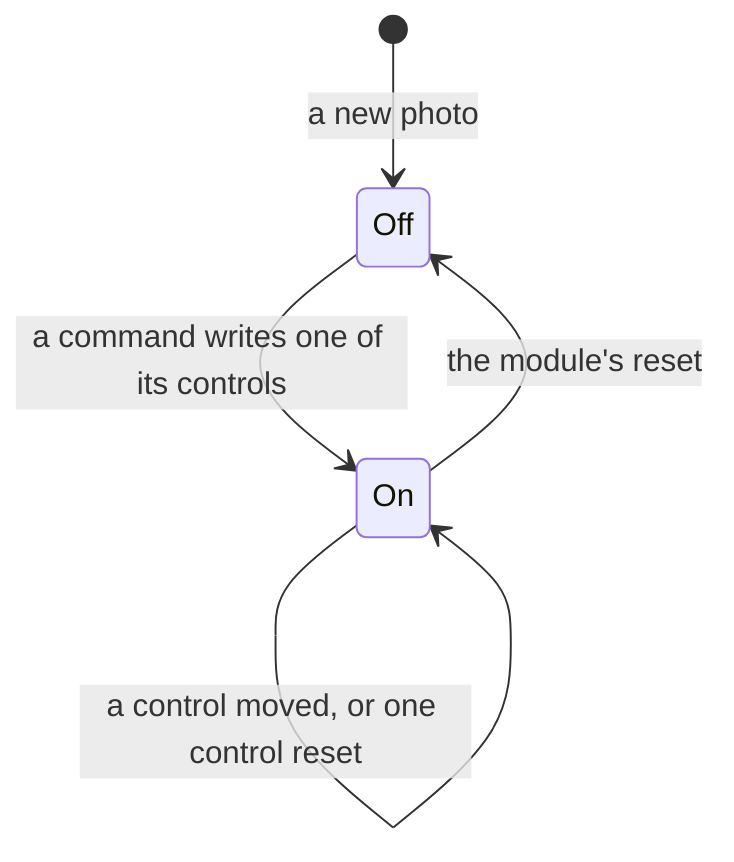
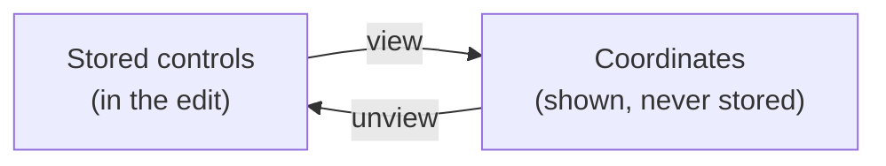

# Modules

The modules users edit with. In the first pass each is darktable's own: one module per darktable module Apertrust includes, under darktable's name and with darktable's controls (decision 2: rewrite first, improve later). Once the whole project is migrated (decision 2), Apertrust evolves on its own.

- A built module's controls, defaults and invariants are on its page here.
- What each operation ports, and how, is in its spec in [ports/](../ports/).
- A module still to build takes its controls from darktable's source at the reference release: the params struct's `$DESCRIPTION`s, `gui_init`, `gui_changed` and `gui_update` for when a row shows, and `init_presets` for its presets.

## The modules by tab

Every module's operation keeps darktable's place, darktable's v5.0 order throughout (decision 22; `src/common/iop_order.c`; [engine.md](../engine.md), Order): the tone equalizer at camera RGB 24.0, RGB curve and RGB levels at 42 and 43, before the tone mapper.

The side panel's tabs are Photos, Base, Colour, Correct, Effect and History (decision 38): darktable's "workflow: scene-referred" groups under darktable's labels, between Apertrust's own Photos and History, with no quick access panel or active-modules tab. Each module sits in darktable's group and is listed as darktable's right panel lists it, in pipeline order with the last module at the top. The app's `TAB_MODULES` holds these lists for the built modules, and a test holds them to `OPERATIONS` reversed. How the bar looks and behaves is [gui.md](../gui.md)'s (The side panel).

The tables below are in that order:

- **Built** means the module is in `apertrust-modules`'s `MODULES` and in the app; the details are on its page.
- **Switched** means a module darktable leaves off on a new photo ([rule 4](#the-rules)).
- A **slot** is darktable's: the stage, then the order number.

### Base

darktable's base group, with RGB levels and RGB curve after the tone mapper, Demosaic after Rotate and perspective and Raw black/white point last ([In no group](#in-no-group)). The Edit workspace opens on this tab.

| Module | darktable module | Operation, slot | Layers | Status | Docs |
| --- | --- | --- | --- | --- | --- |
| Local contrast | local contrast | `bilat`, display 54 | Yes | Operation ported, both modes; module planned (Phase 3), switched | [port](../ports/bilat.md) |
| AgX | AgX | `agx`, working 45.5 | Background; on layers when they come, as a replacement | Built, the default tone mapper; its pickers, actions and Show curve to come | [page](agx.md), [port](../ports/agx.md) |
| Sigmoid | sigmoid | `sigmoid`, darktable's 45.3 | Background; on layers when they come, as a replacement | Operation ported; module planned (Phase 3), a tone mapper | [port](../ports/sigmoid.md) |
| Filmic RGB | filmic rgb | `filmicrgb`, darktable's 46.0 | Background; on layers when they come, as a replacement | Operation ported, v3 to v7; module planned (Phase 3), a tone mapper | [port](../ports/filmicrgb.md) |
| RGB levels | rgb levels | `rgblevels`, working 43 | Yes | Operation ported; module planned (Phase 3), switched | [port](../ports/rgblevels.md) |
| RGB curve | rgb curve | `rgbcurve`, working 42 | Yes | Operation ported; built as the Tone curve's Luma curve, to be reshaped into RGB curve | [page](tone-curve.md), [port](../ports/rgbcurve.md) |
| Crop | crop | `crop`, camera RGB 24.5 | Background only | Planned (Phase 3) | — |
| Tone equalizer | tone equalizer | `toneequal`, camera RGB 24.0 | Yes | Built, switched (decision 32); the guided filters, wands and mask histogram to come | [page](tone-equalizer.md), [port](../ports/toneequal.md) |
| Exposure | exposure | `exposure`, camera RGB 21 | Yes | Built; its unported controls at their defaults, Contrast and Pivot left for Colour balance RGB | [page](exposure.md) |
| Orientation | orientation | `flip`, camera RGB 16 | Background only | Built, darktable's page; runs on every photo at auto, the photo's own orientation; its guides and presets to come | [page](orientation.md), [port](../ports/flip.md) |
| Rotate and perspective | rotate and perspective | `ashift`, camera RGB 15 | Background only | Planned (Phase 2) | — |
| Demosaic | demosaic | `demosaic`, raw 8 | Background only | Built; RCD and Markesteijn 1-pass ported, the method listing the sensor's methods | [page](demosaic.md), [port](../ports/demosaic.md) |
| Highlight reconstruction | highlight reconstruction | `highlights`, raw 4 | Background only | Built; inpaint opposed ported, the threshold starting at the photo's own | [page](highlight-reconstruction.md), [port](../ports/highlights.md) |
| White balance | white balance | `temperature`, raw 3 | Background only | Built; the camera's presets with Finetune designed (decision 27), to build | [page](white-balance.md), [port](../ports/temperature.md) |
| Raw black/white point | raw black/white point | `rawprepare`, raw 1 | Background only | Built; its levels start at the raw's own, flat field correction not ported | [page](raw-black-white-point.md), [port](../ports/rawprepare.md) |

- **Crop** has no angle of its own, as darktable's crop has none: its straighten tool writes Rotate and perspective's rotation.
- **RGB curve** keeps decision 31's fixed ends at (0, 0) and (1, 1); black and white are RGB levels'. Its graph is darktable's (decision 22).
- **Demosaic** keeps capture sharpening, in the raw stage, as darktable has it.
- **Local contrast,** once on, starts at darktable's local laplacian filter, detail 125 %, highlights and shadows 50 % and midtone range 0.5.

### Colour

darktable's color group, with Output colour profile first and Input colour profile last. darktable's color harmonizer is not in the first pass.

| Module | darktable module | Operation, slot | Layers | Status | Docs |
| --- | --- | --- | --- | --- | --- |
| Output colour profile | output color profile | `colorout`, display 70 | Background only | Built; an edit chooses sRGB only until the display converts from the edit's profile (decision 26) | [page](output-colour-profile.md), [port](../ports/colorout.md) |
| Colour balance RGB | color balance rgb | `colorbalancergb`, working 41.5 | Yes | Built, switched (decision 32); the graph, mask display and pickers to come | [page](colour-balance-rgb.md), [port](../ports/colorbalancergb.md) |
| Colour equalizer | color equalizer | `colorequal`, working 41.2 | Yes | Operation ported; module planned (Phase 2), switched | [port](../ports/colorequal.md) |
| RGB primaries | rgb primaries | `primaries`, working 28.9 | Yes | Built, switched (decision 32); the painted tracks to come | [page](rgb-primaries.md), [port](../ports/primaries.md) |
| Colour calibration | color calibration | `channelmixerrgb`, working 28.5 | Background only, until layers | Built, every tab, the CAT tab with follow writes; runs on every colour raw (decision 27) | [page](colour-calibration.md), [port](../ports/channelmixerrgb.md) |
| Input colour profile | input color profile | `colorin`, camera RGB 28 | Background only | Operation ported, runs on every photo; module planned (Phase 2) | [port](../ports/colorin.md) |

- **Input colour profile** owns every colorin parameter, the camera profile included.
- **Colour calibration's** grey tab is darktable's black and white: any grey weight off 0 makes the photo grey.
- **The colour equalizer** has no untouched value at darktable's defaults, so it is switched (decision 32).

### Correct

darktable's correct group. darktable's raw chromatic aberrations (`cacorrect`) is left out, since every change would rerun demosaic; its hot pixels, liquify, raster mask and astrophoto denoise are not in the first pass.

| Module | darktable module | Operation, slot | Layers | Status | Docs |
| --- | --- | --- | --- | --- | --- |
| Sharpen | sharpen | `sharpen`, working 35 | Yes | Planned (Phase 3), switched | — |
| Haze removal | haze removal | `hazeremoval`, camera RGB 14 | Yes | Built, switched at darktable's 0.2 (decision 32) | [page](haze-removal.md), [port](../ports/hazeremoval.md) |
| Chromatic aberrations | chromatic aberrations | `cacorrectrgb`, camera RGB 13.5 | Background only | Planned (Phase 3) | — |
| Lens correction | lens correction | `lens`, camera RGB 13 | Background only | Planned (Phase 3), switched; the embedded-metadata method specified (decision 25), Lensfun's later | [port](../ports/lens.md) |
| Denoise (profiled) | denoise (profiled) | `denoiseprofile`, camera RGB 9 | Yes | Planned (Phase 2), switched | [port](../ports/denoiseprofile.md) |

- **Sharpen,** once on, starts at darktable's radius 2, amount 0.5 and threshold 0.5.
- **darktable's retouch** is not a module of the first pass: it is ported as retouch layers, heal and clone, with layers in Phase 4 ([layers.md](../layers.md#retouch-layers), decisions 34 and 74).
- **Chromatic aberrations** keeps darktable's advanced parameters on its main page, under a group label (decision 29).

### Effect

darktable's effect group, with Soften after Vignetting and Bloom after Grain. darktable's contrast equalizer, framing, enlarge canvas, graduated density, composite, watermark, censorize and blurs are not in the first pass.

| Module | darktable module | Operation, slot | Layers | Status | Docs |
| --- | --- | --- | --- | --- | --- |
| Vignetting | vignetting | `vignette`, display 68 | Yes | Built, switched at darktable's −0.5 (decision 32), without dithering | [page](vignetting.md), [port](../ports/vignette.md) |
| Soften | soften | `soften`, display 66 | Yes | Built, switched at darktable's 50 % (decision 32) | [page](soften.md), [port](../ports/soften.md) |
| Grain | grain | `grain`, display 65 | Background only | Built, switched at darktable's 25 % (decision 32) | [page](grain.md), [port](../ports/grain.md) |
| Bloom | bloom | `bloom`, display 61 | Yes | Operation ported; module planned (Phase 3), switched | [port](../ports/bloom.md) |
| Diffuse or sharpen | diffuse or sharpen | `diffuse`, working, between 28.5 and 29 | Yes | Planned (Phase 3) | — |

- **Bloom** blooms every pixel above about L 89.4 even at strength 0, so it has no untouched value; once on it starts at darktable's 20 %, 90 % and 25 %.
- **Diffuse or sharpen** is one module, darktable's, with darktable's presets (lens deblur, local contrast, dehaze, bloom and others) but its two "sharpen demosaicing" ones (no AA filter and AA filter). darktable's manual has those used on an instance moved before input colour, and modules keep their place in the pipeline, layers included (decision 34). Demosaic's capture sharpening does that job at that place, as darktable has it.

### In no group

darktable's scene-referred preset lists these modules in no group; darktable reaches them through its active-modules tab, which Apertrust does not have. Each joins the tab darktable's other layouts give it, at its place in that tab's order (decision 38). darktable's module search is planned separately.

| Module | darktable's other placements | Its tab |
| --- | --- | --- |
| Output colour profile | "modules: all": color; `default_group`: color | Colour, first |
| Soften | "modules: all": effect | Effect, after Vignetting |
| Bloom | "modules: all": effect | Effect, after Grain |
| RGB levels | "workflow: display-referred": base; "modules: all": tone | Base, after the tone mapper |
| RGB curve | "workflow: display-referred": base; "modules: all": tone | Base, after RGB levels |
| Input colour profile | "modules: all": color | Colour, last |
| Demosaic | "modules: all": base | Base, after Rotate and perspective |
| Raw black/white point | "modules: all": base | Base, last |

### Photos, History and shared sections

- **Photos,** Apertrust's own tab, first (decisions 37, 38 and 73): Browse, pinned, with Folders in folder mode (Phase 2) and Albums and Smart albums (Phase 5); Filters, Keywords, Metadata and Styles (Phase 3).
- **Styles** are darktable's styles, bundles of module values with no parameters of their own, with content tabs All and Favourites. Applying one is one change, or a layer with opacity (Phase 4). It is in the Photos tab because darktable's styles module is a lighttable module.
- **History,** Apertrust's own tab, last (decision 38): Snapshots, planned, then the edit's history ([history.md](../history.md#the-history-tab)), with no Scopes. The Colour picker module, darktable's color picker utility, is hidden by default, its place to be decided ([pickers.md](../pickers.md#the-colour-picker-module), decision 79, planned).
- **Scopes** (decision 19): pinned over the modules in every tab but the Photos tab, as darktable's histogram sits over its groups. Its drags send Exposure's commands, so nothing is owned twice.
- **Layers** (Phase 4): Apertrust's own model, pinned in the four groups' tabs. A layer's mask, opacity and blend mode become the blend settings of each instance it adds; it owns no operation parameter.
- **AI denoise and AI erase** are Apertrust's own models (Phase 6), not darktable's, so in no darktable group; their tab is decided with their design.

## The rules

Port specs, module pages and code cite these by number.

1. **One darktable module, one module.** Each darktable module Apertrust includes is one module, under darktable's name in British spelling. Its id is its operation's (`exposure`, `toneequal`, `colorbalancergb`). Operations never appear in the UI: a module is a layer over its operation (decisions 4 and 28).
2. **Both white balances, as darktable has them** (decision 27). White balance is darktable's white balance over the raw-stage `temperature`, so a drag reruns demosaic (decision 12). Colour calibration is darktable's color calibration with its CAT tab. Improvements come after the rewrite works.
3. **Controls are darktable's, every one it shows** (decision 29).
   - In darktable's order, under its labels and ranges, ported or not; a control not ported is drawn disabled.
   - A fixed change of unit is allowed: a percentage for a factor, degrees for radians (decision 30).
   - Sliders are darktable's, soft ranges included (decision 30), and a range darktable moves with other controls moves with them (`Module::range`, decision 30).
   - No control sets several parameters.
4. **A module that is off is untouched** (decision 32).
   - A module whose operation every photo runs starts at the photo as first shown, the operation's defaults for it, and is untouched there.
   - A module darktable leaves off on a new photo is **switched**: off until a command writes one of its controls, then on with darktable's defaults for the rest, until its reset turns it off. Resetting one control leaves it on.
   - Nothing else shows that it is off: no dimming, no power button. Its reset is available only once it is on, and screen readers hear "Not applied".
5. **darktable's page, as darktable has it** (decisions 2 and 29). There is no Advanced controls toggle in the first pass.
   - darktable's section labels are group labels.
   - Each of darktable's collapsible sections is a **collapsible group**, closed at first, its open state kept in settings, never in the edit. A group never holds another.
   - **Every darktable tab is a content tab**, in darktable's order, masking, masks, options and advanced included. Rows darktable shows under every tab show whichever tab is chosen.
   - **Rows follow darktable's conditions.** A row darktable shows only in one mode is hidden otherwise. A control that cannot act in the current state is drawn disabled, never hidden (decision 30). One parameter shown under two labels by mode has one row per mode.
6. **Lossless views** (decision 2). Where darktable shows the same stored values twice, the second is a second row, an exact, invertible change of coordinates the module gives ([below](#lossless-views)). Nothing is stored twice.
7. **Presets are darktable's,** from `init_presets`, in the header's presets menu.
   - Applying one is one change and one history step.
   - darktable's auto-applied workflow presets are Apertrust's defaults already.
   - A preset that sets a fixed parameter or a mode not ported is left out, and the module's page says so.
8. **A choice lists darktable's options for the photo** (decisions 29 and 30; `Module::options`).
   - The definition holds every option darktable lists on some photo, each with a permanent id; a photo lists those darktable lists for it.
   - An option not ported is drawn disabled, and choosing it is refused. So is an option the photo does not list.
   - An edit from another photo that holds one keeps it, shown last, chosen and disabled, "Not available for this photo".
   - Options darktable lists on no photo, kept only for old darktable edits, are left out until the import of darktable's edits needs them (decision 51, planned).
9. **Left out:** every module darktable marks deprecated, and modules that do another's job: colour zones (the colour equalizer's), monochrome (colour calibration's grey), base curve and the other display-referred legacy tone tools. Tone mappers are the exception: each is a module of its own ([Tone mappers](#tone-mappers)).
10. **Quads, pickers and wands** are darktable's (decision 29): a picker on a row, a showmask view mode, an Auto quad that computes one control. Each is an action that writes controls, never stored. A picker is declared in `Definition::pickers` with darktable's flags and applied by `Module::pick` ([pickers.md](../pickers.md), decision 79). The module's Auto has no header button. Readouts and read-only graphs are drawn as darktable shows them.
11. **Layers** replace darktable's instances and per-module masks (decision 34; [layers.md](../layers.md)). A module works on layers unless the tables above say background only.
12. **darktable's interface settings** (decision 29).
    - darktable's own settings for a tool, kept in darktablerc and never in an edit, are rows of the module (`Row::ToolSetting`), kept in `settings.toml` under `[tools.<module>]` once the tool comes (decision 43).
    - A control darktable shows only under a preference that is off by default, or only for an edit made with an older algorithm, is not shown; its parameter stays at darktable's default or current value.
13. **Follow writes** (decision 27). Where darktable's GUI writes other parameters with a control, to keep one quantity consistent (colour calibration's illuminant writing `x`, `y` and the temperature; White balance's coefficients writing `preset`), the module gives those writes (`Module::follow`) and the session applies them in the same change.
    - A preset row's option takes none: it writes every control itself (`Module::preset`).
    - A range that follows other controls clamps a value it leaves outside in the same change (decision 30).
    - darktable's session memory, values its GUI keeps but no edit stores, is not mirrored.

### Switched modules

A switched module's life, by rule 4:

Off, it renders as no edit. On, every control it was not given takes darktable's default.

Built for the Tone equalizer, Colour balance RGB, RGB primaries, Haze removal, Vignetting, Soften and Grain, each at version 2 (`Definition::switched`). A version 1 edit migrates on where it rendered something, its values as they were, and off, its values dropped, where it rendered nothing. The other modules marked switched in the tables are switched as they are built.

### Fixed parameters

A parameter with no editing meaning and no darktable widget is fixed at darktable's value, owned by its module with no control ([Owners by operation](#owners-by-operation)). `--param` and `Command::Set` refuse it (`EditError::Fixed`).

**Edits** store each module's values with its version. Operation parameters are derived from them by the bindings, and old edits keep their look through versioned migrations (decisions 4, 28 and 43).

### Tone mappers

AgX now, Sigmoid and Filmic RGB as they come, each a module of its own, as in darktable, in the Base tab (decision 38).

- A setting chooses the tone mapper for new photos and which module the Base tab shows.
- Each edit names its tone mapper's module and keeps it; an edit that names none is AgX's. Exactly one tone mapper operation is planned.
- A photo using another tone mapper shows that module, with a note. Switching an existing photo is an explicit action, one undo step.
- The background has exactly one tone mapper, its parameters global. Planned with layers: a layer may choose its own tone mapper, any of the three, which replaces the background's within its mask, never stacked on it, so a pixel is tone-mapped once; darktable's masked tone-mapper instances import onto such layers (decision 33).

### Owners by operation

Each operation parameter has exactly one owning module (decisions 4 and 28). For the ported operations:

| Operation | Slot | Owner | Fixed, or without an owner |
| --- | --- | --- | --- |
| rawprepare | raw 1 | Raw black/white point | the crop margins, not shown (rule 12) |
| temperature | raw 3 | White balance | — (`various` not ported, which Settings writes) |
| highlights | raw 4 | Highlight reconstruction | — |
| demosaic | raw 8 | Demosaic | — |
| flip | camera RGB 16 | Orientation | — |
| exposure | camera RGB 21 | Exposure | — |
| toneequal | camera RGB 24.0 | Tone equalizer | — |
| colorin | camera RGB 28 | Input colour profile | `intent`, `blue_mapping` (no widget) |
| channelmixerrgb | working 28.5 | Colour calibration, every parameter (decision 27) | `version`, at 3 (rule 12) |
| colorbalancergb | working 41.5 | Colour balance RGB | — |
| rgbcurve | working 42 | RGB curve | the end nodes, at (0, 0) and (1, 1) (decision 31) |
| rgblevels | working 43 | RGB levels | — |
| agx | working 45.5 | AgX | — |
| grain | display 65 | Grain | `channel` (no widget) |
| vignette | display 68 | Vignetting | `unbound` (no widget) |
| colorout | display 70 | Output colour profile | `intent`, not shown (rule 12) |

### Lossless views

darktable draws some stored values twice: the tone equalizer's bands as sliders and as a curve, the colour equalizer's hues as sliders and as a curve, colour calibration's illuminant as its type's controls and as hue and chroma, and White balance's coefficients as temperature and tint. In the first pass:

- **Built:** Colour calibration's hue and chroma of `x` and `y`, and White balance's temperature and tint of its coefficients (decision 27). The tone equalizer's graph shows the bands themselves, the identity view, so it is a custom row naming the band controls (`Widget::Equalizer`), with no coordinates of its own.
- **To come:** the colour equalizer's curves, once their widget exists.

How a view with coordinates works ([engine.md](../engine.md), Preset rows and lossless views):

- The module gives it, as pure methods of `Module`: the coordinates from the stored values (`view`) and back (`unview`).
- A coordinate is addressed like a control, and the session reports every view's coordinates with the values. Nothing is stored under a coordinate's id.
- Marks and reset belong to the stored controls. Once every coordinate is back at its default, the stored values are reset exactly.
- A view with fewer coordinates than controls (temperature and tint over three coefficients) writes the controls as darktable's GUI does, normalised. A view may read the camera, through the photo's image context.

### Planned changes to built modules

Each is separate work.

- **The Tone curve becomes RGB curve,** `rgbcurve`, one instance with darktable's controls: the Luma curve is its linked curve, Preserve colours its preserve colours, and the RGB, Red, Green and Blue tabs give way to the mode and the channel tabs. `tone_curve` joins `RETIRED`, so an edit holding it loses those values with a warning and stays editable (decision 43).

## Invariants

Each module's page holds its invariants table (decision 28; the `tool-bindings` skill). It says what each control changes, what stays fixed, what zero means, and the control's range and response.

It then lists one row per invariant, and each row is a test in `crates/modules/tests/<id>.rs`. A control whose rows cannot be tested is not yet defined.

The tables come before the bindings. A tolerance or a choice that a page marks as proposed is still open. A page with open questions ends with them and their options.

A first-pass module's table needs only the rows every table has (below) and the darktable match (decision 22). The Tone curve is built as the Luma curve, which becomes RGB curve's linked curve in the first pass (decision 2).

### Rows every table has

- **Defaults:** the module at its defaults renders byte-identical to no edit, on every image.
- **First step,** for a module that adds an operation: the operation added at the module's own defaults, against the untouched render: darktable's behaviour, measured and reported without a bound (decision 22).
- **Moved and reset:** a control moved and then reset renders byte-identical to no edit.
- **Order:** the same values set in any order render byte-identical.
- **On a layer** (Phase 4): a control on a full-mask layer at full opacity changes the image as the same value does on the background.

**A switched module** ([rule 4](#the-rules), decision 32) has these in place of the defaults, first step and moved-and-reset rows, numbered after the module's last, a withdrawn row's number left unused, and no row at zero for its controls:

- **Off:** untouched, or with controls only kept, the module renders byte-identical to no edit, its plan and cache keys too, on every image.
- **On at darktable's defaults:** the module's defaults, each made explicit, bind its operations' defaults for the photo exactly (`check::switched_defaults`, on the CPU), so the module on and untouched is darktable's new instance.
- **First step:** the module on at darktable's defaults, against no edit: darktable's behaviour, measured and reported without a bound.
- **Moved and reset:** each control moved, then the module's reset (`ResetModule`), renders byte-identical to no edit, the module off; each moved control reset alone (`ResetControl`) leaves the module on, rendering as on at darktable's defaults.
- **An older edit,** once, for a module that became switched: its earlier version's edits, migrated, bind the parameters they bound before.
- **Order** and **on a layer**, as above.

Every module also has the CPU tests the `tool-bindings` skill lists under "Testing a module": ownership, rows and messages, the empty binding, range sweeps and transfer functions.

### Row ids

A letter per module and a number: A for AgX, D for Demosaic, O for Output colour profile, E for Exposure, C for Colour calibration, Q for the Tone equalizer, B for Colour balance RGB, P for RGB primaries, Z for Haze removal, G for Grain, S for Soften, V for Vignetting, R for Raw black/white point, K for Highlight reconstruction, T for Tone curve, W for White balance. A test's name starts with its row's id, such as `e4_exposure_scales_every_pixel_alike`. Ids are permanent: a dropped row leaves its number unused.

## Sliders against darktable

A first-pass module's sliders are darktable's (rule 3, decision 30). Each module's page records them, audited against darktable's params and `gui_init`, and a test in the module's source holds its definition to that table through `testing::slider_differences`. It compares every slider row and number tool setting with darktable's (`testing::DarktableSlider`: the hard range, the soft range, the factor and offset it shows by, its digits). What is compared, in the units shown:

- **The range** a value may hold, the control's: darktable's hard range, the params' `$MIN` and `$MAX`, times the factor plus the offset. A typed value, a script or a preset may reach it. Where darktable's `gui_changed` moves it with other controls, as AgX's pivot's spans black to white relative exposure, the range, the track and the step are compared for given values through `Module::range`, at the module's defaults and, in the module's own test, at others; the definition's range is then the widest any values give (decision 30).
- **The track's span at rest:** darktable's soft range (`dt_bauhaus_slider_set_soft_range`), `Slider::soft`, else the range. The track widens to show a value beyond it, and keeps that span until the row is reset, as darktable's `dt_bauhaus_slider_set` widens its visible range; a drag and the keys stay inside the span shown (`docs/gui.md`, How the rows are laid out).
- **The factor and offset:** `dt_bauhaus_slider_set_factor` and `_offset`, or the factor of 100 that `dt_bauhaus_slider_set_format(…, "%")` gives a slider whose hard maximum is within ±10, taking two of its digits. A module stores the value as shown, and its binding converts back.
- **The decimals:** darktable's digits as `gui_init` leaves them; `dt_bauhaus_slider_from_params` gives a float `max(2, −⌊log₁₀(top / 100) + 0.1⌋)`, top the smaller of the hard range's width and its larger end's size.
- **The step:** what a key moves.
  - At rest, for a slider given none, as every float from params is, `dt_bauhaus_slider_get_step`: 1 in the parameter's units where the soft range's top reaches 100, else a hundredth of it in the units shown, taken to the power of ten at or just below it (within a tenth of a decade above), times 5 where it lies more than half a decade above that power: 0.04 EV gives 0.05, 0.2 % gives 0.1 %.
  - Once the track widens, the step is darktable's for the span shown, as its zoom step (`bauhaus/zoom_step`, on by default) makes it, never less than the step at rest.
  - A key's move, Alt's tenth included, is never less than the last decimal shown, darktable's `min_visible`. A drag or a typed value rounds to the decimals shown instead, as darktable's `_slider_set_normalized` rounds to its digits.
  - A whole number from params, an int, steps by the 1 `dt_bauhaus_slider_from_params` gives it (`testing::DarktableSlider::whole`), as the tone equalizer's Filter diffusion does.

## Test images

| Name | What it is | Runs |
| --- | --- | --- |
| Ramp | Neutral greys in linear Rec2020, one column per 1/16 EV from 2⁻¹⁶ to 2⁴, with RGB 0.18 and 0.1744 among them; "extended" adds greys up to 2⁶ | CI's software GPUs |
| Sweep | The golden harness's synthetic sweep (`apertrust-golden`, `synthetic::sweep`): 360 hues, 23 saturations from neutral to beyond the gamut (negative channels included) and 8 levels from 0.001 to 4. It moves to a crate both can use | CI |
| Step chart | Flat grey patches 1/2 EV apart, from −8 to +4 EV around RGB 0.18. Each patch is at least four times the widest spatial filter's diameter, and is read over its central quarter. For operations with a neighbourhood, such as the tone equalizer's mask | CI |
| Corpus | The 29 raw.pixls.us samples of Phase 1's exit test. Rows name the ones they need: Canon EOS 90D (exposure bias −0.67 EV), Nikon Z 6 (bias 0), Fujifilm X-T5 (X-Trans), Sony ILCE-1 (bias +1 EV) | Locally, `#[ignore]` |
| Chart | `mire1.cr2` from darktable's integration images: a colour chart with saturated patches, test 0083's input | Locally |

"Every image" means all of them.

- Synthetic images enter after demosaic, already in the working space and white balanced.
- A test plans the operations its row needs, from exposure on, and leaves colorin out; a test that picks operations names them (decision 28).
- Colour calibration, which every colour raw runs (decision 27), adapts a synthetic image from the pipeline's own illuminant, D50, unless the edit sets one: the camera's, a raw's default, would balance it a second time.
- The image context is a colour raw's, with an exposure bias of 0 or −0.67 EV as the row says, so relative controls are tested over a base that is not zero.

## Where rows measure

| Measure | Read from |
| --- | --- |
| Scene | The image entering the tone mapper: linear Rec2020 RGBA f32, read back from a plan that ends before AgX |
| Module output | The image leaving the module's last operation, against the image entering its first. Used where a row is about the module's own maths rather than the light it changes, as Tone curve's rows are |
| Frame | The export pipe's output before rounding to 8 bits, as the exit test reads it. Exact rows check the viewport pipe's frame too |
| EV | log₂ of a grey's luminance, from the working space's luminance row, relative to the grey the row names |
| ΔE2000 | Per pixel between two frames, in the output profile, as `apertrust-golden pipeline` computes it: the mean, the share of pixels over a threshold, the max |
| Chromaticity | Yrg's (r, g), colour balance rgb's own space, or the channel ratios where the row says so |
| Exact | Byte for byte: the frames' bytes, and `bind`'s output, the plan's instances and its cache keys, equal |
