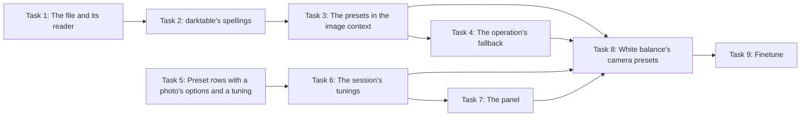

# White balance

Module `temperature`, version 1. Background only, with no Auto.

It is darktable's white balance module as its page has it, over the raw-stage `temperature` operation (raw 3, `docs/ports/temperature.md`; decision 27). Every raw runs the operation, so the module adds none. It has no first step, and at its defaults it sets nothing and leaves the plan, the cache keys and the frame as they were.

A change runs the raw stage and demosaic again (decision 12; `docs/engine.md`, Pipes). The light the photo is adapted for is Colour calibration's CAT tab's (`colour-calibration.md`), as in darktable's scene-referred workflow.

**Status:** built, in `crates/modules/src/white_balance.rs` (decision 27), after Demosaic in `MODULES`. The app draws it in the Base tab from its definition (`docs/gui.md`, Module panels from definitions), after Highlight reconstruction and before Raw black/white point (decision 38). darktable's model of temperature and tint is `apertrust_color::white_balance`. Its id is its operation's ([README.md](README.md), rule 1).

- A first-pass table (decision 22): the rows every table has, and darktable's match.
- Every row is a test in `crates/modules/tests/white_balance.rs`, the corpus's in `w_rows_on_the_corpus`; [Results](#results) gives what they measured.
- One proposed bound fails where darktable's own model does: W3's 0.01 K, kept as an ignored test (decision 30). A coefficient reset control by control leaves darktable's own state, as built (W1).
- Temperature and tint reach coefficients outside the operation's 0 to 8 on every corpus camera. The module reports this rather than narrowing the ranges, and the session refuses such coordinates; the operation taking them, as darktable's does, is planned ([Gaps](#gaps)).
- The [design choices](#design-choices) are settled.
- Measures and test images are in [README.md](README.md).

## Controls

Each control is darktable's parameter as it is, its default the operation's for the photo (`Operation::defaults`, darktable's scene-referred `reload_defaults`): the as-shot coefficients over green, with "as shot to reference" where the camera has a colour matrix and "as shot" without; every coefficient 1 and "as shot" on an image that is not a raw, which Apertrust does not open yet.

darktable's page, top to bottom: the button bar, Settings, Finetune, the SCENE ILLUMINANT TEMP label with Temperature and Tint, and the closed Channel coefficients group. As built: Settings, the label with Temperature and Tint, and the group; the camera's presets and Finetune are designed ([below](#the-cameras-presets-and-finetune), decision 27) and wait for their build, the button bar for its own (Gaps).

| Control | Row | Kind and range | Default | Parameter |
| --- | --- | --- | --- | --- |
| `settings` | Settings, a preset row (`Row::Preset`), first | Not stored: options `as_shot` (as shot), `spot` (from image area), `user` (user modified), `d65` (camera reference) and `d65_late` (as shot to reference), each writing `red`, `green`, `blue`, `various` and `preset`; then, under a heading with the camera's maker and model, the camera's presets (`PresetRow::camera`, darktable's 90 names, the photo's listed by `Module::listed`), each writing the same five; its tuning `finetune` (decision 27, designed) | Shows "as shot to reference", or "as shot" without a colour matrix | — |
| `finetune` | After Settings, a `Row::Slider` naming Settings' tuning (`PresetRow::tuning`), drawn only while the session reports it | Not stored: a whole number, the matched camera preset's tunings, its track those within −9 to 9, step 1, 0 decimals, mired (`Unit::Mired`); shown while the coefficients are a camera preset's that has tunings, as darktable's `gui_update` shows it; applies the preset Settings names at that tuning (decision 27, designed) | The preset's untuned entry, 0 | — |
| `temperature`, `tint` | After the SCENE ILLUMINANT TEMP group label: coordinates of the view `temperature_tint` of `red`, `green` and `blue` | Temperature 1901 to 25000 K, no soft range, 0 decimals, step 1; tint 0.135 to 2.326, no soft range, 3 decimals, step 0.01, below 1 magenta and above 1 green; unavailable without a colour matrix | As shot's | — |
| `red`, `green`, `blue` | The Channel coefficients collapsible group, closed at first | Number, 0 to 8, no soft range, 3 decimals, step 0.1 | The as-shot coefficient over green, held to 0 to 8 | `red`, `green`, `blue` |
| `various` | None of its own: Emerald, which darktable shows on a four-colour sensor alone; Settings writes it | Number, 0 to 8, 3 decimals; not ported (`Control::unported`), so it takes only its default, temperature porting no four-colour sensor | The fourth as-shot coefficient, or 1, which it is on every corpus raw | `various` |
| `preset` | None of its own: Settings shows it with the coefficients | Choice: darktable's five, `as_shot`, `spot`, `user`, `d65`, `d65_late`, then darktable's camera presets by name, 90 permanent ids (`CAMERA_PRESETS`, decision 27, designed), the photo listing its camera's (`Module::options`); darktable stores a camera preset's position in its list instead | `d65_late` with a colour matrix, `as_shot` without | `preset`, a camera preset written as the operation's `camera` |

**Settings** writes what darktable's `_preset_tune_callback` writes, all four coefficients (`_temp_params_from_array`) and `preset`:

- `as_shot`: the as-shot coefficients and `preset` as shot.
- `d65`: the camera's D65 coefficients (`_calculate_bogus_daylight_wb`, the temperature port's daylight multipliers, Emerald's 1, darktable's being no number on a three-colour sensor) and `preset` camera reference.
- `d65_late`: the as-shot coefficients and `preset` as shot to reference, under which colorin applies the late correction (decision 21).
- `spot`, from image area, is the picker's, drawn disabled until the picker comes (`Module::preset` gives `None`); choosing it turns the picker on, and a pick stores it ([below](#controls), After a pick).
- `user`, user modified, is never applied. darktable restores the coefficients its session last had from temperature and tint (`mod_coeff`), which no edit stores (principle 5's first pass, decision 27), so its `preset` gives `None` and it is drawn disabled.

The first three are offered on every photo, as darktable lists them. Without a colour matrix, camera reference writes darktable's D65 coefficients then, every one 1, darktable's own. Its `reload_defaults` looks for the camera's Daylight preset there, but compares the file's names, which its reader lowercases, with "Daylight" and "DirectSunlight", so it never finds one (decision 27).

**Its label** is darktable's `gui_update` match, in darktable's precision (`dt_dev_equal_chroma`, 1e-5 on the first three coefficients), against the coefficients the options write, as darktable compares the parameters with the `as_shot` and `D65coeffs` it wrote. So the module overrides `matching`:

- as shot to reference with the as-shot coefficients and `preset` as shot to reference;
- as shot with the as-shot coefficients;
- camera reference with the D65 ones;
- where the coefficients are any of the camera's presets, the stored `preset` (decision 27, [below](#the-cameras-presets-and-finetune));
- user modified otherwise, which `matching` names though no command applies it.

**After a pick** (decision 79, [pickers.md](../pickers.md#the-first-passs-pickers)), Settings shows "from image area", the `preset` the pick stored, as darktable's combobox shows it at once (`temperature.c:1967`), and only in the session it was picked. Whenever the module is shown again, darktable's `gui_update` works the label out from the coefficients alone, as above (`temperature.c:1195-1360`), and a picked balance matches nothing, so it is "user modified" (`DT_IOP_TEMP_USER`, `:1338`):

- **When:** as the photo opens, and when Undo, Redo or a `GoTo` bring back White balance's values, as darktable redraws the module then; never right after a pick or a Settings change.
- **The stored setting** becomes user modified in the session's edit, as darktable sets `p->preset`, and is saved only with the next change. It is never a history step of its own, and nothing is written on open (decision 77).

An option writes its values as they are, with no follow writes, as `_preset_tune_callback` writes its parameters without `gui_changed`.

**Temperature and tint** are darktable's model of the coefficients (`_mul2temp`, `_XYZ_to_temperature`, `_temp2mul`), a view ([README.md](README.md), rule 6) with two coordinates over three coefficients whose scale the model drops:

- `view`: CAM = 1 / coefficient (0 where a coefficient is not positive); XYZ = CAM_to_XYZ · CAM, through the camera's colour matrix as darktable's `dt_colorspaces_conversion_matrices_xyz` takes it (a DNG's embedded matrix where valid, else the camera's XYZ to camera matrix, inverted by darktable's pseudoinverse); the temperature is the one between 1901 and 25000 K whose spectrum's XYZ has the same Z/X, and tint is that spectrum's Y/X over the coefficients'.
- A temperature's spectrum: over darktable's CIE 1931 2° observer (`src/external/cie_colorimetric_tables.c`, 380 to 780 nm), a black body below 4000 K (Planck's law with darktable's two constants) and CIE daylight from 4000 K (S0 + m1 S1 + m2 S2 at the daylight locus's chromaticity, which darktable takes from lcms2's `cmsWhitePointFromTemp`; restated in Rust, with no lcms2, decision 5), its XYZ scaled to a largest component of 1.
- `unview`: that spectrum's XYZ with Y divided by tint, CAM = XYZ_to_CAM · XYZ, and the coefficients 1 / CAM over green's, so green is 1, as darktable's `_temp_tint_callback` writes them. `various` is left as stored: darktable writes 1 / 0 into it on a three-colour sensor, where nothing reads it.
- darktable bisects the temperature to 1 K. The view bisects to convergence in `f64`, so its round trip holds (W3): it reads darktable's temperature at darktable's 0 decimals but within a kelvin of a rounding. darktable clamps the read-back to the two ranges; the view reports where the coefficients put it, the field showing the value and the track at its end (rule 6).
- darktable's model is not monotone at 4000 K, where the light changes from a black body to daylight: Z/X rises with the temperature but steps down there, from 0.638165 just below to 0.611897 at it, so the temperatures from 3900.33 to 4102.41 K come in twins with the same Z/X, and the coefficients either gives read back as one of the two, as in darktable.
- On a photo without a colour matrix, temperature and tint are unavailable (decision 30), the coefficients' rows still there: the session reports the coordinates so (`CoordinateState::available`), and the view reads the coefficients through sRGB's matrix meanwhile, darktable's for an image that is not a raw.

The view reads the camera, so the session's `Photo` carries the photo's image context to the app, whose pending display computes the view with the same context as the session (decision 27; `docs/engine.md`, Preset rows and lossless views).

**The binding** sets each control's parameter as it is, nothing at the defaults; a camera preset in `preset` it will write as the operation's `camera` (decision 27, planned).

**Follow writes** ([README.md](README.md), rule 13): moving `red`, `green`, `blue`, temperature or tint writes `preset` user modified, as darktable's `gui_changed` and `_temp_tint_callback` do, in the same change and history step. So through the session's commands the late correction is on only with "as shot to reference" and the as-shot coefficients, the states darktable reaches. The channelmixerrgb port's deliberate difference for the late correction with other coefficients is reached only by the CLI's `edit`, which applies no follow writes (Gaps).

**Commands.**

- A script sends `SetControl { module: "temperature", control: "temperature", value: 5500 }`: the session holds tint, writes the three coefficients and `preset` user modified.
- `ApplyPreset { module: "temperature", preset: "settings", option: "d65" }` gives camera reference.
- `apertrust-cli edit --set temperature.red=2.1` sets a coefficient, `preset` left as it was.
- `--param temperature.red` is refused, since the module owns it, and a value an edit holds that way is dropped with a warning.

### The camera's presets and Finetune

Designed by decision 27, under decision 2's rule, and planned ([Build](#build)). The design follows darktable's `src/iop/temperature.c` (`_generate_preset_combo`, `_preset_tune_callback`, `gui_update`, `_find_coeffs`, `reload_defaults`) and `src/common/wb_presets.c` (`dt_wb_presets_init`, `dt_wb_preset_interpolate`), read at the reference release.

It was checked in darktable's panel on a copy of the corpus X-T5 raw (tunings −9, 0 and 9) through Lua actions, its sidecar read back:

- Daylight shows Finetune at "+0 mired" on a −9 to 9 track.
- Finetune at +5 shows "+5 mired".
- Choosing Cloudy then keeps +5 and stores `preset` 7 (the five, the heading at 5, Daylight at 6) with the coefficients 2.059603, 1 and 1.9215693 and `various` 0: the interpolation below, to the bit.

Build's last task checks a D850 and the X-E4.

**The data.** darktable's `data/wb_presets.json`, carried verbatim at `data/wb_presets.json` (decision 45) and parsed once by `apertrust-raw` as darktable's reader reads it: each preset's name lowercased (`g_utf8_strdown`), a missing `tuning` read as 0, the four channels as the file gives them, in the file's order. `apertrust-raw` looks the decoded camera up by darktable's names, its `make` and `alias`, then its `make` and `model`, exactly, as darktable matches `camera_maker` and `camera_model` with `strcmp`, the names already in darktable's spelling where it differs from rawler's (Nikon's `Z 6_2`, `OM System`, Fujifilm's `GFX100S`; decision 27, [plugins.md](../plugins.md#the-cameras-names)). It puts the camera's entries in the image context, `Camera::white_balance_presets`.

The file lists 485 models; rawler's names reach 450 of them, 21 of them corpus cameras.

**The ids.** The `preset` control's options are darktable's five, then darktable's 90 names, each a permanent id (`CAMERA_PRESETS`), in the order the file first gives them.

- An id is the name with each run of characters other than a to z and 0 to 9 replaced by one underscore, and none at the ends: `cool white fluorescent` is `cool_white_fluorescent`, `high temp. mercury-vapor fluorescent` is `high_temp_mercury_vapor_fluorescent`, `flash (auto mode)` is `flash_auto_mode`, `black & white` is `black_white`.
- A kelvin preset, a number then `k`, is `kelvin_` and the number: `5000k` is `kelvin_5000`.
- A test holds the list to the file's names, one to one.

darktable stores the list's position (6 on, after the five and the camera's heading), which names another preset on another camera or with another file. The id means the camera's Daylight on every photo, as decision 30 has a choice's options. The binding writes the operation's `preset` as `camera`, a sixth option standing for darktable's positions 6 on, under which colorin applies no late correction, as darktable's `commit_params` reads `preset` only as as shot to reference or not. An id the photo's camera does not list is kept, as decision 30 keeps a choice's option.

**Their words.** Each id's label in sentence case and British spelling (Daylight, Cool white fluorescent, High temp. mercury-vapour fluorescent, Flash (auto mode)); a kelvin preset its temperature with the kelvin sign (2500 K). They are `module-temperature-preset-settings-option-<id>` and `module-temperature-control-preset-option-<id>`, in en-GB, uk and pl, darktable's own Ukrainian and Polish translations of its standard names a reference for the drafts. Finetune's words are a control's: `module-temperature-control-finetune-label` "Finetune", `-full` "Fine-tune of the camera's white balance setting", after darktable's tooltip, and `-promise`; its unit is `unit-mired`.

**The list** (`Module::listed`, darktable's `_generate_preset_combo`, on a raw): one option per name, in the order the camera's entries give the names, each name's entries contiguous in the file (a test holds it), at most 50, which no camera reaches (the Coolpix P1000 has 44). After the five, the panel draws a heading with the camera's maker and model, darktable's combobox section `camera_maker camera_model`, then the options; nothing when the camera has no presets. `Module::options("preset")` gives the five and these.

**A preset's tunings.** Its first entry is its lowest, its entry with tuning 0 its untuned one, and the largest tuning met scanning its entries its highest. A preset whose first entry's tuning is 0 has no tunings, whatever follows: the EOS 77D's Flash, from 0 down to −9, and the DMC-G2's Cloudy, at 0 twice. 1,280 of the file's presets have tunings, in 176 models, from −3 to 3 up to −14 to 14; 380 of them have gaps between their tunings.

**Applying preset P at tuning t** (`Module::preset`, darktable's `_preset_tune_callback`) writes `red`, `green`, `blue`, `various` and `preset`:

1. among P's entries from its lowest to its highest, the first whose tuning is t: its first three channels, each as `f32`;
2. else two consecutive entries of P with tunings a < t < b: darktable's `dt_wb_preset_interpolate` in `f64`, c = 1 / ((1 − s) / c_a + s / c_b) with s = clamp((t − a) / (b − a), 0, 1), for each of the three, then `f32`;
3. else the coefficients as they are, so only `preset` changes, as darktable's callback leaves them (its `break`, commented "hysteresis"; reported upstream).

Green is the file's, not normalised: 207 presets have green other than 1. `various` is 1, Emerald being a control not ported that takes only its default, where darktable writes the fourth channel, 0, which nothing reads on a three-colour sensor. `preset` is P.

Where a coefficient falls outside 0 to 8 the option gives `None`, as the session refuses temperature and tint there ([Gaps](#gaps), the reach): the Olympus C5050Z's Incandescent and White fluorescent at +7 (blue 8.07 and 8.09), the file's only two.

Choosing P from Settings applies it at the tuning Finetune shows, `Module::tuning`'s value, 0 where none, as darktable's callback reads the slider, and with no follow writes, as `_preset_tune_callback` runs without `gui_changed`.

**The label and Finetune** (`Module::matching` and `Module::tuning`, darktable's `gui_update`, comparing the first three coefficients as `f32` within 1e-5, `dt_dev_equal_chroma`):

1. the as-shot coefficients with `preset` as shot to reference: as shot to reference;
2. the as-shot coefficients: as shot;
3. the D65 coefficients: camera reference;
4. for each of the camera's presets in the list's order, each of its entries in turn (every one, an untuned preset's later entries included): equal, found at that entry's tuning;
5. else for each preset in that order, each gap between consecutive entries, tunings a and b with b > a + 1, and each whole tuning from a + 1 to b − 1: the interpolation equal, found at that tuning;
6. found, the label is the stored `preset`, whichever option it holds, as darktable's combobox ends on `p->preset`; else user modified.

Steps 1 to 3 leave Finetune at 0, hidden. Found, Finetune's value is the tuning found, shown while the preset found has tunings: its range those tunings, its track those within −9 to 9, darktable's track for the first camera preset a session shows, its default the preset's untuned tuning, 0. Not found, 0 and hidden.

On 107 of the file's 485 models two presets reach the same coefficients (the X100S's Daylight and Underwater), so the stored name tells them apart, as darktable's stored position does, and the coefficients alone could not. darktable writes `preset` back in `gui_update` (as shot, camera reference, user modified); Apertrust's label only names it.

**Finetune's commands.**

- `SetControl { module: "temperature", control: "finetune", value }`, a whole number in the range shown, applies the option Settings names at that tuning, as darktable's slider runs the list's callback with the list's position. `done` merges a drag into one history step. It is refused while Finetune is hidden.
- Where Settings names one of the five, which only an edit written by hand or by the CLI holds with a camera preset's coefficients, that option applies with the tuning ignored, and user modified is refused, `preset` giving `None` for it.
- `ResetControl` applies the preset's untuned tuning, darktable's double-click; `Keep` keeps or releases the five controls.

**Not mirrored** (decision 27's rule on session state):

- darktable's hidden slider keeps its last value until the next `gui_update`. So in one session Daylight +3, then as shot, then Cloudy gives Cloudy +3, and after a reload Cloudy at 0. Apertrust applies a preset at the tuning the values show, 0 there, darktable's after a reload.
- darktable's track only narrows within a session (`dt_bauhaus_slider_set_hard_min` keeps `MAX(d->min, hard_min)`). So a D850's −12 to 12 shows −9 to 9, and where a camera's presets differ in range (a Minolta DiMAGE A2's −3 to 3 and −2 to 4), one preset's track narrows the next's. Apertrust's is each preset's tunings within −9 to 9.
- darktable's scan of the list starts at the camera's heading, whose data it dereferences for the file's first camera, the PowerShot A630. Apertrust's starts at the camera's first preset.

**The operation's fallback** (`_find_coeffs`). A raw with no usable as-shot multipliers and no colour matrix takes the camera's first entry, whatever its name and tuning (an EOS R5's Daylight at −9), its first three channels over green's, before darktable's 2, 1, 1.5: `apertrust_color::as_shot_multipliers` takes `white_balance_presets`' first entry, so the operation's defaults and the module's agree. No corpus raw lacks a matrix.

A script sends `ApplyPreset { module: "temperature", preset: "settings", option: "cloudy" }` for the camera's Cloudy at Finetune's tuning, and `SetControl { module: "temperature", control: "finetune", value: 3 }` for +3.

### Sliders against darktable

Read from darktable's `src/iop/temperature.c` (`gui_init`; the params' `$MIN` and `$MAX`), with the step `dt_bauhaus_slider_get_step` gives a slider created with none ([README.md](README.md), Sliders against darktable). The module's source holds its definition to this table through `testing::slider_differences`, and none differs. The coefficients step by 0.1: `dt_bauhaus_slider_get_step` over 0 to 8 gives 8 / 100, 0.08, whose power of ten is 0.1, under the half-decade that would make it 0.05.

| Slider | darktable: range, soft range | Digits | darktable's step | Apertrust: range, track | Decimals, step | Differs |
| --- | --- | --- | --- | --- | --- | --- |
| Temperature | 1901 to 25000 K; none | 0 | 1 K | 1901 to 25000 K; the range | 0; 1 | No |
| Tint | 0.135 to 2.326; none | 3 | 0.01 | 0.135 to 2.326; the range | 3; 0.01 | No |
| Red, Green, Blue | 0 to 8; none | 3 | 0.1 | 0 to 8; the range | 3; 0.1 | No |
| Emerald | 0 to 8; none, a four-colour sensor only | 3 | 0.1 | — | — | Not ported |
| Finetune (with the camera's presets) | −9 to 9 mired at creation, then the preset's tunings; the soft range narrowed within a session | 0 | 1 | The matched preset's tunings; those within −9 to 9 | 0; 1 | The track's narrowing within a session, not mirrored (decision 27); designed, planned |

## Invariants

A first-pass table (decision 22): the rows every table has, and darktable's match. The module adds no operation, so it has no first step. The coefficients, temperature, tint and the setting describe one quantity, the coefficients and their provenance, so they set it last-wins ([README.md](README.md), rule 13); W2 holds the pair that must commute.

| Row | Control | Moved to | Measured | Must | Tolerance | Images |
| --- | --- | --- | --- | --- | --- | --- |
| W0 | None: every control at its default, written or kept | | `bind`; the module's defaults against the operation's for the photo; the plan's instances and cache keys; the frame | `bind` returns nothing; every default is the operation's; instances, keys and frames as with no edit | Exact | The small raw through the export and the viewport; every corpus raw (defaults, instances and keys) |
| W1 | Each control, moved and reset | Each coefficient, temperature and tint, and each Settings option; each reset by `ResetControl` and by `ResetModule` | Frame | Changes when moved, Settings' "as shot to reference" at its defaults excepted; as W0 once reset by `ResetModule`, and once an option's controls are reset; a coefficient, temperature or tint reset control by control as Settings' as shot, its follow write left, as darktable's is | Exact | The small raw through the viewport |
| W2 | Order | Temperature then tint, and tint then temperature | `red`, `green`, `blue`; frame | The same coefficients whichever came first, the session holding the other coordinate | Exact | CPU, session; the small raw |
| W3 | The view | Temperature across 1901 to 25000 K and tint across 0.135 to 2.326, but for darktable's twins from 3900.33 to 4102.41 K; each corpus camera's as-shot coefficients | `view` of `unview` where the coefficients lie in their range; `unview` of `view` | Each coordinate back where it was; the coefficients back normalised to green 1 | 1e-6 of the temperature and 1e-6 in tint; 4 `f32` units in each coefficient (proposed: 0.01 K everywhere) | CPU: the small raw's camera, the 40D and the X-T4; every corpus camera |
| W4 | darktable's model | The coordinates of W3 | `view` and `unview` against darktable's `_mul2temp` and `_temp2mul` restated in `f64`, its 1 K bisection included | The same coefficients from the same coordinates; the same temperature within darktable's 1 K bisection and the same tint at it | 1e-9 relative in the coefficients; 1 K; 1e-6 in tint | CPU: the same cameras |
| W5 | Settings | Each option, on every corpus raw; with and without a colour matrix | The values written; `matching` | darktable's: as shot and as shot to reference the as-shot coefficients, camera reference the D65 ones, every one 1 without a matrix, all four coefficients with its `preset`; `matching` names each, user modified a moved coefficient, from image area and user modified unavailable | Exact | CPU: the same cameras, and each without its matrix; every corpus raw |
| W6 | Follow writes | A coefficient, temperature and tint, each moved from "as shot to reference"; a Settings option | `preset`; the operation's parameters | `preset` user modified, kept, in the same change and history step, so no late correction, as darktable stores it; an option writes none | Exact | CPU, session; the synthetic raw |
| W7 | darktable's match | The temperature parameters of darktable's golden sidecars at version 4 (test 0174's "as shot to reference", and the coefficients the integration tests store), set as the module's controls | The parameters the edit binds | darktable's own for the sidecar, so the raw stage's `raw-run` against darktable is the module's | Exact | CPU; the golden sidecars |
| W8 | On a layer | | The definition | Background only: never offered on a layer, as the raw stage | Exact | CPU |
| W9 | Availability | A photo without a colour matrix; a three-colour sensor | `available`; the session's coordinates; Settings' options | Temperature and tint unavailable without a matrix (decision 30), the coefficients and Settings available, Settings offering as shot, camera reference and as shot to reference with a matrix or without, as darktable; Emerald not ported, in no row | Exact | CPU, session |

Proposed with the camera's presets and Finetune (decision 27), planned; each is a test against a restatement of darktable's functions in the test, over the file as `apertrust-raw` reads it:

| Row | Control | Moved to | Measured | Must | Tolerance | Images |
| --- | --- | --- | --- | --- | --- | --- |
| W10 | Settings' camera presets | Each preset the camera lists, at Finetune 0 | The values written; `matching`; `tuning` | darktable's `_preset_tune_callback` at tuning 0: the untuned entry's three channels as `f32`, `various` 1, `preset` the preset; `matching` the preset; Finetune 0, shown where the preset has tunings | Exact | CPU: every model the file lists, as an image context of its own; the corpus raws the file lists; synthetic runs with a gap, the EOS 77D's descending Flash and the DMC-G2's twin Cloudy |
| W11 | Finetune | Each whole tuning of each preset with tunings, its entries and its gaps; then another preset chosen; then a tuning the next preset lacks | The values written; `tuning`; `matching` | darktable's: an entry's channels, else `dt_wb_preset_interpolate` in `f64` then `f32`; `tuning` back at that tuning, the label the stored preset; a preset chosen next at the same tuning; one lacking it writes only `preset`, as darktable's; refused while hidden, and above 8 (the C5050Z at +7) | Exact | CPU: every tuned model the file lists; session: one drag one history step |
| W12 | The list | | `listed`; `options("preset")` | darktable's `_generate_preset_combo` on every model: one option per name in the file's order, at most 50; the five and those for `preset`; nothing on a camera the file lacks; every name an id of `CAMERA_PRESETS`, one to one | Exact | CPU: every model the file lists |
| W13 | The fallback | A colour raw with no as-shot multipliers and no matrix, with and without presets | The defaults; Settings' camera reference | The camera's first entry over green's, then 2, 1, 1.5 without presets, the module's defaults the operation's; camera reference 1, 1, 1, darktable's, whose daylight lookup never matches | Exact | CPU |
| W14 | darktable's panel | The X-T5 (tunings −9, 0 and 9, interpolated; checked, above), a D850 (−12 to 12) and the X-E4 (Underwater −9 to 8), copied out of the corpus | The list and its heading; Finetune's visibility, range, track and value; the coefficients after Daylight +5, then Cloudy, then a preset without +5 | Apertrust's panel as darktable's shows them, but for the rows Not mirrored names | Screenshots, recorded in Results | darktable with a configuration folder of its own (`--configdir`), one instance |

Where `unview` at a point of the two ranges gives a coefficient outside the operation's 0 to 8, the session refuses the coordinates (`EditError::Coordinate`), as it refuses any coordinate that puts a control outside its own; darktable's ranges do so on every camera (Results, the reach).

## Results

Run on the M4: `cargo test -p apertrust-modules --test white_balance`, and on the raw.pixls.us corpus with `APERTRUST_RAW_CORPUS` and `--ignored` (31 colour raws).

| Row | Result |
| --- | --- |
| W0 | Holds, exactly: every control written at its default, or kept there, binds nothing and renders the untouched frame through the export and the viewport; on every corpus raw the module's defaults are the operation's, and the plan's instances and cache keys are the untouched edit's |
| W1 | Holds as stated: a reset control by control renders as Settings' as shot, as darktable's does (below) |
| W2 | Holds, exactly: 4300 K then tint 1.1, and the reverse, give the same edit and the same frame |
| W3 | Holds within the CI bounds on the small raw's camera, the 40D, the X-T4 and every corpus camera; the proposed 0.01 K fails twice, kept in `w3_temperature_and_tint_round_trip_to_0_01_k_everywhere` (below) |
| W4 | Holds, on the three cameras and every corpus camera, anchored by hard-coded numbers (below) |
| W5 | Holds, exactly, on the three cameras, each with and without its matrix, and every corpus raw: as shot and as shot to reference write the as-shot coefficients and camera reference the D65 ones, every one 1 without a matrix, all four with its `preset`, and `matching` names each back; a moved coefficient reads user modified; from image area and user modified give nothing |
| W6 | Holds, exactly: a coefficient, temperature and tint each write `preset` user modified, kept, in the same change, so the operation's parameters carry no late correction. Through the session (`a_white_balance_coefficient_writes_user_modified_and_a_setting_writes_none`), red at 2.5 writes user modified in one change and one write, and camera reference then reads camera reference, no follow write turning it into user modified |
| W7 | Holds, exactly, on the six golden sidecars whose `temperature` is at version 4: the module's controls bind darktable's parameters. Older versions, which darktable migrates with `preset` unknown, are left out |
| W8 | Holds: background only |
| W9 | Holds, exactly: without a colour matrix temperature and tint are unavailable, through `available` and in the session's report, the coefficients and Settings available, Settings offering its three options with a matrix or without; Emerald is a control not ported, in no row, which Settings writes |

**W1 in detail.** Each coefficient, temperature 3500 K and tint 1.2 change the frame, and so do as shot and camera reference. `ResetModule` gives the untouched frame, and so does an option once the five controls it writes are reset.

A coefficient, temperature or tint reset control by control leaves its follow write, `preset` user modified with the as-shot coefficients. That is darktable's own state then, which `gui_update` labels as shot and renders without the late correction: Settings' as shot's frame, not the untouched one.

**W3 in detail.** On the three cameras, the temperature comes back within 0.0078, 0.0098 and 0.0137 K, at most 6.0e-7 of itself, the tint within 1.2e-7, and the as-shot coefficients within 0.52 `f32` units (the X-T4's; the others exactly). The proposed 0.01 K fails twice:

- across 4000 K, where darktable's twins read back as each other;
- above about 20000 K, where an `f32` temperature steps by 0.002 K and the coefficients' own rounding moves it a few steps.

**W4 in detail.** It is anchored by hard-coded numbers alone (`w4_the_x_t50_s_as_shot_reads_as_darktable_s_panel`), since the restatement below calls the model.

- The Fujifilm X-T50's as-shot coefficients in darktable's sidecar, 2.1655629, 1 and 1.5264901, under rawler's X-T50 D65 matrix, read 6310.66 K and tint 1.02166: darktable's panel's 6311 K and 1.022 at its digits.
- 6311 K at tint 1.022 gives 2.16399, 1 and 1.52593, within the panel's rounding of the sidecar's (0.003), pinned to 1e-6.
- An independent restatement of `_temp2mul` matched the model to 6e-13.
- Over a 41 × 41 grid of the two ranges, the coefficients are darktable's `_temp2mul` within 1e-9 relative. Where they lie in 0 to 8, the temperature is darktable's `_mul2temp` within its 1 K bisection, and the tint darktable's at the temperature its bisection last tried within 1e-6.

**The reach** of temperature and tint, on each corpus camera (`w_rows_on_the_corpus` prints it): darktable's ranges reach coefficients outside the operation's 0 to 8 on every one, 10 to 28 % of a 61 × 61 grid of the two ranges, the corners 1901 K and 25000 K at tint 0.135 among them, from −21,826 (the Pixel 4a) to 1,412,763 (the D850). Every temperature stays in range only for tints from 0.39 to 0.79 up to 1.96 to 2.33, by camera; on the Phase One IQ3, from 1.267. Widening the operation's range, as decision 27 widened Colour calibration's `x` and `y`, cannot hold the negative ones; the session refuses such coordinates until the operation takes every coefficient darktable's model reaches ([Gaps](#gaps)).

As-shot readings, for instance: the 5D Mark III 3584 K at tint 0.970, the X-T5 5828 K at 1.015, the Phase One IQ3 4569 K at 1.300.

## Design choices

- **Emerald (`various`):** a control not ported, in no row, which Settings writes with the other three, as `_temp_params_from_array` writes all four. darktable shows it on a four-colour sensor alone, temperature ports none, and a row drawn disabled on every photo would show what darktable never does. Settings writes the fourth as-shot coefficient, or 1, and camera reference 1, darktable's D65 fourth being no number on a three-colour sensor.
- **`preset`:** a control in no row of its own, shown by Settings, which writes it. `Definition::check` allows a control in no row when a placed preset row writes it.
- **Settings' options and follow writes:** none. `ApplyPreset` writes the option's values as they are, as `_preset_tune_callback` does without `gui_changed`.
- **The view's matrix without one:** sRGB's, darktable's for an image that is not a raw, so the view is always given. The session reports the coordinates unavailable (`CoordinateState::available`, from `Module::available` on the coordinate's own id).
- **The twins across 4000 K:** the view's bisection finds one of a twin pair, as darktable's does; W3 leaves the band out and says why.
- **W3's bound in CI:** 1e-6 of the temperature, since `f32` steps by 0.002 K above 20000 K; the proposed 0.01 K kept ignored.
- **Coefficients the ranges reach outside 0 to 8:** reported, the ranges darktable's, the coordinates refused by the session. Narrowing the ranges is ruled out by decision 30, and clamping would store other values than darktable's. `builtin.rs` exempts `temperature.temperature_tint` from its grid by id and holds every temperature in range at a colour raw's as-shot tint instead, which holds on the corpus too; the whole grid is an ignored test until the operation takes every coefficient darktable's model reaches ([Gaps](#gaps)).
- **A coordinate's availability:** reported by the session with each coordinate, a control it moves available and the module's `available` for its id. The app draws the row disabled where either says no.

## Gaps

What is not built yet, and what brings it:

- **The button bar:** darktable's five settings as icon toggles above Settings, the one Settings names pressed, shown by darktable's `button_bar` preference, on by default; a second row of the Settings preset row, waiting for a row that draws a preset row's options as buttons.
- **The camera's presets with Finetune:** designed by decision 27 ([The camera's presets and Finetune](#the-cameras-presets-and-finetune)), planned in the tasks of [Build](#build). Camera reference without a colour matrix is not among them: its 1, 1, 1 is darktable's own, whose fallback to the camera's Daylight preset never matches.
- **From image area:** the picker, designed in [pickers.md](../pickers.md) (decision 79, its pull request 79.8): its toggle and Settings' `spot` turning it on, its pick writing the coefficients and `preset` from the mosaic's means over the area.
- **The trouble message:** "white balance applied twice (details)" while Colour calibration adapts and the coefficients are off the camera's reference (decision 27), planned after this module.
- **Painted tracks:** darktable's coloured-sliders preference ("no color" by default; a click on SCENE ILLUMINANT TEMP cycles it), an interface setting with its tool ([README.md](README.md), rule 12); plain tracks meanwhile.
- **A monochrome raw:** darktable shows "white balance disabled for camera" in place of the controls; the pipeline takes no monochrome raw yet. A four-colour sensor's labels (cyan, yellow, green, magenta, reordered) and Emerald wait with temperature's port of one.
- **Colour calibration's as shot in camera after a white balance change:** choosing it writes `x`, `y` and `temperature` from the camera's light at the camera's reference, since `camera_light` assumes the reference coefficients (darktable's `custom_wb` 1) and `Module::follow` sees only Colour calibration's own values, not `temperature`'s.
  darktable's `_get_white_balance_coeff` turns the light by White balance's coefficients over the D65 ones once they are off the reference. So after a White balance change the light written differs from darktable's, and leaving as shot in camera for custom, D or Planckian keeps the difference. The render while as shot in camera is chosen agrees, since `prepare` reads the light through the coefficients the image description carries (`docs/ports/channelmixerrgb.md`, Setup on the CPU, 7). A known gap, not fixed: `follow` would need another module's values.
- **The CLI:** `apertrust-cli edit` applies no follow writes, as it reads no image context (`docs/engine.md`, follow writes), so `--set temperature.red=2.1` keeps "as shot to reference" with other coefficients, the state darktable never reaches, unless `--set temperature.preset=user` comes with it; it takes no coordinate in `--set` and has no `--preset` yet.
- **The reach:** darktable's operation takes any coefficient its model reaches, negative ones included, rendered by the same multiplication, its parameters' `$MIN` and `$MAX` being the sliders' and not a check. Planned, as darktable: the operation takes them too, only non-finite values guarded, with tests at the extremes and on the two camera presets past 8, the Olympus C5050Z's Incandescent and White fluorescent at +7 (decision 27). Until then the session refuses them ([Results](#results), the reach).
- **The pending display** shows a Settings option, and the label a coefficient's follow write gives, once the session reports them, a report behind the sliders (`docs/gui.md`, Showing a chosen option before the session reports it).

## Phases

- **Phase 2:** the module with W0 to W9, built. Then the trouble message. The picker, after the picker's engine and app ([pickers.md](../pickers.md#the-plan)).
- **Phase 3:** the camera's presets with Finetune (decision 27, its tasks in [Build](#build), the generic ones free to start before).

## Build

Decision 27's tasks, all planned, each one deliverable reviewed before the next that needs it. Tasks 1 to 4 and 5 to 7 are two independent lines; 8 needs 3, 4, 6 and 7, and 9 needs 8.

1. **The file and its reader.**
   - Deliver:
     - `data/wb_presets.json`, darktable's file verbatim (`git show $DT_TAG:data/wb_presets.json` in a darktable checkout).
     - Its row in `data/README.md`: provenance "darktable's `data/wb_presets.json` (the reference release, blob e2f522db6b, 4,569,039 bytes, SHA-256 10df2f7c469832b7d00417c321bcf6df1eda6a9d339ad6494da7f7f48d86702d): the cameras' white balance presets, which began as UFRaw's table by Udi Fuchs and moved to JSON in darktable in 2022", licence "GPL-3.0-or-later, as darktable carries it (UFRaw's table GPL-2.0-or-later)", read by "`apertrust-raw`, into the image context (decision 27)".
     - A sentence in CREDITS.md's darktable paragraph saying Apertrust carries darktable's white balance presets, `data/wb_presets.json`, unchanged under the same licence, their values begun as UFRaw's by Udi Fuchs.
     - `apertrust_plugin::WhiteBalancePreset { name: String, tuning: i32, channels: [f64; 4] }`.
     - `apertrust-raw`'s reader: `include_str!` of the file, parsed once on first use with serde_json (a workspace dependency, after `cargo deny check`, then `tools/credits.sh`) by darktable's rules (version at most 1, names lowercased, a missing `tuning` 0), with a lookup by exact make and model giving the entries in the file's order.
   - Tests: the SHA-256 and the size (sha2, a dev-dependency); 16 makers, 485 models, 20,284 presets, 90 names; each name's entries contiguous; at most 44 names a model; the X-T5's Daylight entries by hand, its untuned one with no `tuning` read as 0; the parse's time logged under `-d perf` and reported for release and dev builds on the M4 (past 50 ms in release, a build script is weighed).
   - Files: `data/wb_presets.json`, `data/README.md`, `CREDITS.md`, the root `Cargo.toml`, `crates/raw/Cargo.toml`, a new `crates/raw/src/white_balance_presets.rs`, `crates/raw/src/lib.rs`, `crates/plugin/src/image.rs` (the type alone).
   - Out of scope: the image context's field, aliases and darktable's spellings, the operation, the module.
2. **darktable's spellings.**
   - Deliver, in `apertrust-raw`'s identity, darktable's spellings where they differ from rawler's, applied to `make`, `model` and `alias`, keyed by rawler's clean make and name:
     - Fujifilm `GFX 100S` and `GFX 100 II` as `GFX100S` and `GFX100 II`;
     - Nikon `Z 5 II`, `Z 50 II`, `Z 6 2`, `Z 6 3` and `Z 7 2` as `Z5_2`, `Z50_2`, `Z 6_2`, `Z6_3` and `Z 7_2`;
     - maker `OM Digital Solutions` as `OM System`;
     - Minolta `DYNAX 7D` as `Dynax 7D`.
   - Tests: each entry's source is a name rawler's camera files give (`CAMERAS_TOML`) and its target a make and model task 1's reader finds; `crates/raw/tests/corpus/expected.txt` blessed again, its diff the OM-1 Mark II's line alone.
   - Files: `crates/raw/src/identity.rs`, `crates/raw/src/lib.rs`, `crates/raw/tests/corpus/expected.txt`.
   - Out of scope: the presets in the image context, the denoise crate.
3. **The presets in the image context.**
   - Deliver `Camera::white_balance_presets: Arc<[WhiteBalancePreset]>`, empty by default, filled at decode by `apertrust-raw` (by `make` and `alias`, then `make` and `model`) and copied by `apertrust-engine::raw::image_context`, every `Camera` built in tests given it.
   - Tests: over rawler's whole camera list, the lookups that succeed only by the alias are the FinePix S6000fd, D800E, DC-TZ96 and DMC-GX85; on the corpus (`--ignored`), the 23 files of the 21 corpus cameras the file lists get their presets (the 5D Mark III's DNG and the OM-1 Mark II's ORF among them) and the others none.
   - Files: `crates/plugin/src/image.rs`, `crates/raw/src/lib.rs`, `crates/raw/src/white_balance_presets.rs`, `crates/engine/src/raw.rs`, the tests that build a `Camera`.
   - Out of scope: the operation's fallback, the module.
4. **The operation's fallback.**
   - Deliver `apertrust_color::as_shot_multipliers` taking the camera's first preset entry, used for a raw with no usable as-shot multipliers and no colour matrix before 2, 1, 1.5 (`_find_coeffs`), the operation's `defaults` and the module's `as_shot_coefficients` passing `white_balance_presets`' first entry. Also: the module's `daylight` doc comment corrected (darktable's own 1, 1, 1); `docs/ports/temperature.md`'s deliberate difference "No camera white balance presets" removed and its Defaults step 1 made exact.
   - Tests: W13.
   - Files: the `apertrust-color` file holding `as_shot_multipliers`, `crates/op/temperature/src/lib.rs`, `crates/modules/src/white_balance.rs` (those two functions), `crates/modules/tests/white_balance.rs` (W13), `docs/ports/temperature.md`.
   - Out of scope: the list, Finetune.
5. **Preset rows with a photo's options and a tuning.**
   - Deliver in `apertrust-modules`:
     - `PresetRow::camera` and `PresetRow::tuning`, `Module::listed` and `Module::tuning` with `Tuning`, `Module::preset` widened to `(preset, option, tuning, values, image)` and the provided `matching` with it (`docs/engine.md`, Planned: a photo's options and a tuning);
     - `Definition::check`: the camera options' ids, each once, none of the row's own; the tuning's id unique with controls, coordinates and preset rows, in one `Row::Slider`;
     - `messages::of` (the camera options' words, the tuning's as a control's) and `Unit::Mired` with `unit-mired` and `unit-mired-value` in `ui.ftl`'s three languages;
     - `crates/modules/tests/builtin.rs` holding listed options to the row's `camera`, a shown tuning's range finite with its default and value inside, and every option at every tuning of a range within its controls' ranges or `None`;
     - `testing::Sample` gaining a listed option and a tuning, the worked example;
     - the modules that implement `preset` adapted with no change of behaviour.
   - Files: `crates/modules/src/definition.rs`, `lib.rs`, `messages.rs`, `check.rs`, `testing.rs`, `white_balance.rs` (the signature alone), `crates/modules/tests/builtin.rs`, `crates/ui/locales/*/ui.ftl`.
   - Out of scope: the session, the panel, White balance's presets.
6. **The session's tunings.**
   - Deliver `PresetState::listed`, computed once as the photo opens, and `PresetState::tuning` (`TuningState`), recomputed after every change, both guarded as `matching` is; `ApplyPreset` at the row's tuning, refusing a camera option the photo does not list (`EditError::NotListed`); `SetControl`, `ResetControl` and `Keep` on a tuning's id as `docs/engine.md` states, merged by `done`, with no follow writes, and their refusals.
   - Tests with `testing::Sample`.
   - Files: `crates/engine/src/edit.rs`, `crates/engine/src/session.rs`, the engine's session tests.
   - Out of scope: the app, the CLI's `--preset`, White balance.
7. **The panel.**
   - Deliver:
     - `apertrust_ui::components::Choice`'s heading entry (darktable's combobox section: drawn left-aligned in the list, not selectable, skipped by the keys and the pointer, to AccessKit the label of the options after it), in the gallery and its snapshots;
     - the renderer drawing a preset row's own options, the heading with the camera's maker and model from the `Photo`'s image context, then `PresetState::listed`;
     - the tuning's `Row::Slider` as a `SliderRow` only while `PresetState::tuning` is reported, its range, track and step from it, its value whole, sending `SetControl`, `ResetControl` and `Keep` with its id;
     - `modules::Pending::show` following a pending tuning through `preset`, `matching` and `tuning`.
   - Files: `crates/ui/src/components/` (the choice), the gallery, `crates/app/src/modules.rs`, the app's tests.
   - Out of scope: White balance's data, the button bar.
8. **White balance's camera presets.**
   - Deliver `CAMERA_PRESETS`, the `preset` control's options, the operation's `preset` gaining `camera` with the binding writing it, Settings' `camera`, `options("preset")`, `listed`, `preset` for a camera preset at a tuning, `matching` as [above](#the-cameras-presets-and-finetune), the words in three languages; Finetune not yet (`tuning` still `None`).
   - Tests: W10 at tuning 0 and W12.
   - Files: `crates/modules/src/white_balance.rs`, `crates/modules/tests/white_balance.rs`, `crates/op/temperature/src/lib.rs` (`PRESETS`), `crates/ui/locales/{en-GB,uk,pl}/modules.ftl`.
   - Out of scope: Finetune, the picker, the CLI.
9. **Finetune.**
   - Deliver Settings' `tuning`, the Finetune row after Settings, `Module::tuning` and `preset` at any tuning, interpolation included, as [above](#the-cameras-presets-and-finetune); its slider held to darktable's per tuned preset with `testing::slider_differences`.
   - Tests: W10 at every tuning and W11, the X-T5's Cloudy at +5 pinned to darktable's stored 2.059603, 1 and 1.9215693; W14, darktable's panel on copies of a D850 and the X-E4, the results and screenshots in Results.
   - Files: `crates/modules/src/white_balance.rs`, `crates/modules/tests/white_balance.rs`, `crates/ui/locales/{en-GB,uk,pl}/modules.ftl`, this file's Results.
   - Out of scope: the button bar, the CLI's `--preset`, the reach.
