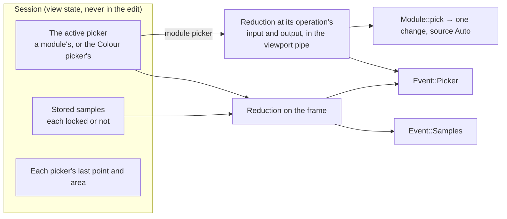

# Colour pickers

A colour picker reads the colour of a point or an area of the photo. A module's picker turns what it reads into the module's controls: Exposure's sets the exposure that maps the area to a target lightness, White balance's the coefficients that make it neutral. The Colour picker module shows what the photo holds under a point or an area, the live sample, and keeps numbered stored samples to compare. This document describes them as one API: the session's commands and events, how the engine measures on the GPU, how a module declares its pickers and what it does with a reading, the picker button and the area on the photo, the Colour picker module, and how the work is built. The session's other commands and events are in [session-protocol.md](session-protocol.md) and [events.md](events.md); history's steps in [history.md](history.md).

**Status.** [Decision 79](decisions/0079-colour-pickers-one-api-for-modules-and-the-colour-picker.md) records the design, with the options considered. Built, 79.1 of [The plan](#the-plan): the Colour picker module's own picker through the session, `Command::Picker` with `On`, `Point`, `Area`, `Switch`, `Reset` and `Off`, and `Event::Picker` with its frame part; its region kept in the original image's coordinates through the geometry; the reduction's `picker_rgba` and `picker_combine` on the frame; the staging pair the scopes share, `readback.rs`; `Region`, `Stats` and `PickKeys` in the modules crate. Built, 79.2: the modules crate's side, [Declaring pickers](#declaring-pickers), `Definition::pickers` with their checks, `Quad::Picker(id)`, `Row::Pickers` and `Module::pick`, `testing::Sample`'s three pickers, and Exposure's, Colour balance RGB's six and AgX's four slider pickers declared and named by their quads, none picking yet. Built, 79.3: the engine's side of module pickers, the reduction at an operation's input and output in the live viewport pipe, `picker_mosaic` per CFA colour, denoise, buffers larger than one binding read in row windows, `On`'s capture with the operation as the edited instance, sample-only renders, a pick applied through `Module::pick` as one change, a drag's one gesture, the module's last reading, turning off, `Tools` and `Channel`, the pickers' buffers counted in the plan's memory, and the moved area's budgets measured on the M4. Built, 79.4: the design system's on-photo overlay primitives ([gui.md](gui.md#on-photo-overlays)). Built, 79.5: the design system's `PickerButton` and `PickerMarks` ([The picker button](#the-picker-button), [On the photo](#on-the-photo)), in the gallery. Built, 79.6: the app's side, driven by `testing::Sample`: the quads and rows of pickers drawn with their state, the marks over the photo, the central bar's words, the pointer's and the keys' tables, the keys taken before the app's actions, focus and the live region; a module's pickers are drawn once its pick is built, so no built module's yet. The rest is planned in Phase 2, in the pull requests of The plan: each module's pick, White balance's and Colour calibration's pickers and AgX's Auto tune levels with their rows, stored samples, the other spaces, and the Colour picker section; the rows darktable gives the pickers' settings are drawn disabled (`Row::ToolSetting`, `Row::Action`).

## What it serves

| Client | What it needs |
| --- | --- |
| A module's pickers | Exposure, White balance, Colour calibration, Colour balance RGB, AgX, RGB curve and RGB levels in the first pass, then Filmic RGB and the Colour equalizer; each reads its operation's input, or its output too, and writes its controls as one step |
| The Colour picker module | darktable's color picker utility: the colour under a point or an area of the photo as it is shown, the live sample and stored samples, statistics and colour modes, samples shown on the photo, the scopes restricted to the area |
| Pickers that only show | RGB curve's and blending's "show colour", the Colour equalizer's hue: drawn on the module's graph, writing nothing |
| Later | Blending's pickers on a layer (Phase 4), in LCh, HSL or JzCzhz; Colour calibration's colour checker, its patches' means; the assistant and MCP, picking an area by its coordinates |

Every client of a session uses the same commands and receives the same readings. The app's mouse and keys are one way to send them; a script names a point in the photo's coordinates and gets the same values and the same step.

## darktable's pickers

The reference release's design, which Apertrust mirrors (decision 2):

- **One active picker** (`color_picker_proxy.c:54-58`): `darktable.lib->proxy.colorpicker.picker_proxy` is a module's picker or the color picker utility's, never two. Turning one on turns the one before it off (`:166-172`); a click on the active one turns it off (`:237-252`).
- **A picker's kinds** (`color_picker_proxy.h:34-44`): `DT_COLOR_PICKER_POINT`, `_AREA` or both; `_DENOISE`, a B-spline blur before sampling, 4-channel images only; `_IO`, the module's output measured as well as its input. A picker with both kinds turns on as an area with Ctrl held or the right button, else as a point (`color_picker_proxy.c:177-193`).
- **Its colour space,** `picker_cst` (`color_picker_proxy.h:51-56`): the module's own, LCh for Lab modules or HSL for RGB ones, set by blending; `dt_color_picker_new_with_cst` fixes another, JzCzhz for the colour equalizer and none for white balance, which then reads whatever the pipe holds there, the raw mosaic included (`temperature.c:2082-2090`).
- **Turning one on** turns its module on (`color_picker_proxy.c:174-175`), takes the picker's last point or area, or the default, the photo's centre or 2 % to 98 % of it (`:194-210`, `lib.c:1602-1612`), gives the module focus (`:225-229`) and forces the next reading to be applied (`:235`).
- **Where it measures** (`pixelpipe_hb.c:1182-1198`, `:1568-1588`): in the preview pipe, a downscaled whole image, so an area outside the visible part still measures; only for the focused module while it is enabled; its input and, for `_IO`, its output, each in `picker_cst`; then `DT_SIGNAL_CONTROL_PICKERDATA_READY`.
- **What it measures** (`color_picker.c:456-565`): per channel the mean, the minimum and the maximum over the box; on a mosaic, per CFA colour (`:277-305`); in a converted space, a fourth channel holding the third moved half a turn, so a hue round 0 has a minimum and a maximum (`_update_stats_4ch`, `:46-57`); denoised first with `blur_2D_Bspline` at one scale (`:476-502`).
- **The box** (`color_picker.c:394-454`): the point or area is kept in the original image's coordinates; its four corners are mapped forward to the module's input or output, sorted, the two lowest and the two highest averaged on each axis, at least one pixel, clamped to the image; one wholly outside it measures nothing (`:443-444`).
- **When a reading is applied** (`color_picker_proxy.c:288-328`): only when the point or area moved since the last, at the picker's start, or after its colour space changed (`_record_point_area`, `:76-104`). A reading after an edit elsewhere is measured and shown, never applied.
- **When a picker turns off:** another turned on; the module changed from its GUI (`dt_iop_gui_changed`, `imageop.c:3997-4006`) or redrawn (`gui_update`, as `exposure.c:683`), unless the picker is "keep-active" (`color_picker_proxy.c:127`), as RGB curve's show colour (`rgbcurve.c:1502`); the module losing focus (`imageop.c:2414-2416`); another image (`darkroom.c:1100-1102`). The utility's picker turns off on any focus change unless "restrict scope to selection" is on (`imageop.c:2393-2395`).
- **The color picker utility** (`libs/colorpicker.c`) samples the gamma module's input, the display-referred frame, for the active picker, its primary sample, and each of its "live samples", the stored samples here (`pixelpipe_hb.c:1113-1172`, `:3017-3027`): RGB in the display profile, converted to the histogram profile and to Lab.

## The model



- **One active picker** per session, as darktable has it: a module's, named by its module and its id, or the Colour picker module's (`PickerRef::ColourPicker`, darktable's primary picker with no module).
- **The live sample** is what the active picker measures on the frame, darktable's primary sample; **stored samples** are darktable's "live samples": areas or points copied from the active picker, numbered, each measured on every frame unless locked, any number, coexisting with the active picker. The interface uses the wireframe's words, live and stored; darktable's code names the second kind live samples.
- **Both are view state:** the session keeps them, as it keeps what the scopes count and the eye's hidden modules; nothing is saved in the edit, and they stay across photos for the session's life, as darktable keeps its "live samples" across images. The active picker turns off as another photo opens.
- **A module picker measures twice:** at its operation's place, for the module; and on the frame, for the Colour picker module, which shows the colour under the active picker whichever picker it is, as darktable's utility shows its primary sample.

## Regions

**The photo's coordinates.** Every command and event names a point or an area in the photo's coordinates: 0 to 1 across the photo as export renders it, after crop and the geometry, (0, 0) its top left, x to the right and y down. They do not depend on the zoom, the window or the photo's size, so a script and the app name the same place.

**Kept in the original image's coordinates,** as darktable keeps them (`color_picker.c:307-330`): the session maps a point, or an area's four corners, back through every geometry's `backward` (decision 16) to demosaic's output at full resolution, 0 to 1, clamped. So an area stays on the same part of the scene when the photo is rotated, cropped or flipped later, as in darktable.

**Mapped forward where it is measured,** as `dt_color_picker_box` maps it (`color_picker.c:394-454`): the four corners through each geometry up to the operation, darktable's `DT_DEV_TRANSFORM_DIR_BACK_INCL` for the input and `_EXCL` for the output (the same for every operation with a picker, none of which has a geometry of its own), sorted, the two lowest and the two highest averaged on each axis, scaled to the buffer's pixels at its pipe's scale, at least one pixel wide and high, clamped to the buffer. An area wholly outside the buffer measures nothing. A point is the one pixel it falls in.

**Shown as drawn,** as `dt_color_picker_transform_box` draws it (`color_picker.c:350-391`): the event gives each region forward-mapped to the photo's coordinates, an area as the average of its sorted corners, so a client draws a rectangle on the frame with no geometry of its own (the `desktop-architecture` skill: points go through the engine).

```rust
/// In the photo's coordinates, 0 to 1.
pub enum Region {
    Point([f32; 2]),
    /// Left, top, right, bottom.
    Area([f32; 4]),
}
```

**Defaults,** darktable's (`lib.c:1602-1612`): a point at the photo's centre, an area from 2 % to 98 % of it on each axis, mapped back as any region is.

**Built** (79.1, `apertrust_engine::picker`): `Geometries` maps a point back and forward through every operation that moves pixels, each at its input's extent at full resolution, which today is orientation's `flip` alone; a geometry that gives a point no place leaves it where it is. `Place` keeps a point, or an area's four corners, in the original image's coordinates, and gives the region as drawn; `pixels` makes darktable's box in a buffer from it, its sides truncated toward zero as C converts a float, so a point on the photo's right or bottom edge falls in no pixel and measures nothing, as in darktable. Each picker's point and area are kept for the session's life, across photos, as darktable keeps its pickers' places. 79.3 maps a module picker's region forward through the geometries before its operation only, into the operation's stage, then `boxed` makes the box in the operation's buffer: at the pipe's scale and held to the buffer's region after the downscale, and in the raw stage on the sensor, from the declared area's corner to the mosaic's own.

## Measuring on the GPU

### Where

**A module's picker measures at its operation's place in the live viewport pipe:** the operation's input, and with `output` its output, in the buffers the viewport's plan already holds, never a host copy of the image. Only a small result comes back: three statistics of four channels, 48 bytes a region.

- **The operation's input or output buffer** is what the reduction reads, right after the operation's last pass in the render's encoder, while both are intact: the planner writes an operation's output into a buffer that is not its input (engine.md, Planning), and nothing writes either before the next operation runs.
- **Its colour space** is the stage's: the mosaic in the raw stage, camera RGB, the working space, as each operation's slot names it (decision 21). A picker's `space` converts each pixel before its statistics, as `picker_cst` does ([The kernel](#the-kernel)).
- **The frame samples,** the Colour picker module's, read the display buffer the frame was copied into, after colorout and before any rounding to 8 bits, as the scopes count it (decision 19): darktable's gamma input in its preview pipe (`pixelpipe_hb.c:3017-3027`). In a zoomed view they read the display output of the small whole-image pipe the scopes read then ([gui.md](gui.md#the-scopes)), never the visible region alone, so their values are the same at every zoom. Denoised where the sample is: the active picker's with its picker's denoise, a stored sample with the denoise it was copied with (`libs/colorpicker.c:613`, `pixelpipe_hb.c:1154`). Today the frame is sRGB, which is darktable's default display and histogram profile, so its values are both darktable's `display` and `scope` RGB.

### The scale

**The fitted viewport's,** darktable's preview pipe's place in Apertrust (decision 63: the export's processing at the view's scale, never darktable's preview shortcuts):

- **After the downscale** (every operation after demosaic: Exposure, Colour calibration, the tone mapper, Colour balance RGB, the curves): at the viewport's size, 2400×1600 for a full-screen photo, which is darktable's preview pipe's role.
- **In the raw stage** (White balance over `temperature`): at full resolution, since the raw stage runs there in every pipe (decision 12). White balance's mean is then the export's photosites' mean over the area, where darktable's is its preview's downscaled mosaic's; the two agree but for the area's edges, and a minimum or a maximum, which White balance does not read, would differ more.
- **A zoomed view** (Phase 2's 100% view, which renders only the visible region) still measures the fitted whole image: the small whole-image pipe the zoomed view keeps for the scopes and readouts (engine.md, Readouts) holds every buffer a picker reads and the frame its samples read, so an area outside the visible part measures, as darktable's preview pipe does, and a pick gives the same values at every zoom. That pipe is still open in decision 19 and comes with the zoomed view; pickers in a zoomed view depend on it, and until it is built the view is fitted, its frame the whole image.
- **Exports, stills, tiles, golden cases and derivative passes** never measure: pickers are the live viewport's, as readouts are.

### The kernel

The engine's own kernel, `crates/engine/slang/picker.slang`, one for every operation, as the scopes' kernel is for every frame (in `pipeline::KERNELS` for the naga test). It is no operation's pass: no derivatives, no golden case, no fusion.

| Entry point | Reads | Writes |
| --- | --- | --- |
| `picker_rgba` | An RGBA `f32` buffer and up to 64 boxes in its pixels, with each box's space and denoise flag | Per box and per workgroup: the sum, minimum and maximum of each of four channels |
| `picker_mosaic` | The mosaic, its CFA pattern (Bayer `filters` or the X-Trans 6×6) and the boxes | The same per CFA colour, with each colour's count |
| `picker_combine` | The partials | Per box: the mean, minimum and maximum, in a fixed order |

- **Statistics** are darktable's `_update_stats_by_ch` (`color_picker.c:35-44`): the mean is the sum over the box's pixels divided by their number, or on a mosaic each CFA colour's over its own count (`:299-304`); the minimum and the maximum are exact.
- **The sums** are pairwise, a tree in workgroup memory; then one workgroup a box adds its workgroups' partials, each invocation those 256 apart in their index order, then the 256 as a tree again, so the result never depends on scheduling. On the CPU the same tree gives the same bits; across GPUs `f32` addition is correctly rounded, and a backend that contracts or reorders adds may differ by a few units in the last place, which no pick's write can feel. The kernel writes each box's sum, and the engine divides it by the box's pixels on the CPU, as darktable's `acc / (float)size`, since a GPU's division need only be within 2.5 ulp.
- **Denoise** (`DT_COLOR_PICKER_DENOISE`) is darktable's `blur_2D_Bspline` at one scale (`color_picker.c:480-502`, `src/common/bspline.h`): the 5×5 B-spline, weights 1, 4, 6, 4, 1 over 16 on each axis, its edges as darktable's, negatives kept. darktable blurs the whole image first; the kernel blurs only the box's pixels, reading two pixels round it, which gives the same values.
- **Spaces,** darktable's `dt_color_picker_helper` (`color_picker.c:505-543`): `Space::Operation`, the stage's own values; `Space::Lch` for a Lab stage (`dt_Lab_2_LCH`); `Space::Hsl` for an RGB one (`dt_RGB_2_HSL`); `Space::Jzczhz` for an RGB one through the working profile's matrix to XYZ D50, D65, JzAzBz and JzCzhz (`:59-82`). In each converted space the fourth channel is the third moved half a turn, `[2] < 0.5 ? [2] + 0.5 : [2] − 0.5`, as `_update_stats_4ch` makes it (`:53`): the hue in LCh and JzCzhz, but L in HSL, whose third channel is lightness. In `Space::Operation` the fourth channel is the stage's own fourth, and on a mosaic the fourth CFA colour's. A mosaic is read per CFA colour only (`:547-556`). The spaces other than `Operation` come with their first picker ([The plan](#the-plan)).
- **Rules:** `fp32`; no write at a run-time index, the four channels through `set_at` and `add_at` (decision 10); no NaN checks, the operations before it sanitising their outputs; the `slang-kernels` skill's "A count" adapted to sums, minima and maxima.
- **Built** (79.1): `picker_rgba` and `picker_combine`, in the buffer's own values with no denoise, the frame's case. Each invocation adds 4 × 4 pixels 16 apart, so a workgroup covers 64 × 64 of one box; each box's workgroups follow the last box's in one dispatch, as many across as the device allows, then down. The uniforms hold the pass header, then the boxes, each its bounds and its first workgroup, workgroups across, count and flags. The sums, and so the means, the minima and the maxima, are the CPU's restatement's to the bit on the M4.
- **Built** (79.3): `picker_mosaic`, each photosite added to its CFA colour's channel by `add_at` and `set_at`, its colour from the pattern at the mosaic's place on the sensor, Bayer or X-Trans, from the uniforms; the engine counts each colour's photosites in the box on the CPU from the pattern, darktable's `weights`, and a colour with none has a mean of 0 and the minimum and maximum the kernel starts from, as darktable's. Denoise, a box's flag, blurs each pixel the box reads from the 25 around it, clamped to the buffer, before its statistics, within 4 units in the last place of the restatement on the M4, where a GPU may fuse the multiply-adds. One reduction reads up to two buffers, an operation's input and output, each its own pair of passes, its results after the last's. The sums of a mosaic's boxes are the restatement's to the bit; dispatched across and down, under a test's cap on workgroups across, they are the same bits as in one row.

**Several boxes in one dispatch:** the module picker's one box at its operation, and on the frame the active picker's and every unlocked stored sample's, so the frame is read once however many samples there are. Colour calibration's colour checker will read its patches the same way, up to its chart's patches in one dispatch.

### When it runs

A reading has a key, as a readout's does (decision 19): what it reads, the box in that buffer's pixels, its space and denoise. A reading runs only while its key differs from the last one measured.

- **A render** that rewrites the picked operation's input or output (a change at or before the operation) dispatches the module picker's reduction in the same encoder after the operation's last pass. A render that restarts after the operation, as a drag of a later module does, leaves its key unchanged and measures nothing at the operation.
- **A region change with no edit** needs no frame, since the frame is unchanged: the session runs a sample-only render, from the newest cache point at or before the operation through the operation, then the reduction, and publishes no frame, as a readout asked without a current reading does (decision 19).
  - **Turning a module's picker on makes its operation the edited instance** (engine.md, Caching), as darktable focuses the module (`color_picker_proxy.c:228`). `On` runs a capture: its sample-only render copies the operation's input into the edit cache, as the first render after a change does. After the downscale an input reading of a moved area then reads the edit cache directly, with no pass of the pipeline, and an output reading runs the operation's own passes from it.
  - **The override lasts** until another operation's key changes, which makes that operation the edited instance as any change does. After a rebuild, which captures nothing (engine.md, A rebuild keeps what still holds), the first moved area renders from the newest cache point at or before the operation, and captures again.
  - **Sample-only renders submit as frames do,** through `Pipeline::writes` and the submit gate, one turn each, behind the live frame and before background stills.
  - **In the raw stage** there is no edit cache: White balance's moved area reruns rawprepare from the uploaded mosaic, then measures temperature's input.
  - **Built** (79.3, `Pipeline::render_probing` and `Pipeline::sample`): the key hashes the operation's input key, and its output key with `output`, each box, denoise and `output`. A render that runs the operation records the reduction right after its last pass, its readback's copy in the same submission, so the frame and the reading take one turn. A sample-only render reads the edit cache with no pass where it holds the operation's input and only the input is read; otherwise it runs from the newest cache point before the operation, or from the edit cache where it holds the input of the operation or of one before it, up to the operation, and through it where its output is read; it captures the operation's input where the edit cache takes it, and changes no cache point after the last operation it ran. Before it, `Pipeline::sample_writes` cancels a still that reads what it writes, as `Pipeline::writes` does before a frame. It is not waited for: its reading arrives as a frame's does. Where the last render did not render the plan as it is, it runs nothing, and the next frame measures.
- **The frame samples** are measured after each frame while the active picker or an unlocked stored sample is there, in a submission of their own after the frame's copy and the scopes' count (decision 19), and on a region or sample change on the frame shown, with no render. Built for the active picker: the frame shown is measured again after a picker command that moved its region in a batch that publishes no frame, none rendered or the render failed.
- **A locked stored sample** is not measured again; the session keeps its last reading.

**Readback** is the scopes' and the readouts': the results copied into whichever of the pickers' two staging buffers is free, mapped and polled between commands, never waited for, the latest replacing the last while both are busy, so the last reading always arrives (`crates/engine/src/readback.rs`, the helper the scopes, readouts and pickers share; built, the scopes' `Meter` and the pickers' `Reducer` on it). A frame never waits for a reading. The session keeps two reducers, the frame's and the operation's, each with its own buffers and staging pair, so a reading at the operation waiting for a staging buffer is never replaced by the frame's; the operation's records its copy in the render's encoder (`Readback::record`) and maps it once the encoder is submitted (`Readback::sent`).

### Memory, strips and failures

- **Buffers:** the boxes' uniforms, the partials and the results, the session's own, counted in the plan's memory as a readout's counts buffer is. The partials take 48 bytes a workgroup, at most the frame's 64 boxes in one dispatch, about 2.9 MB at 2400×1600, which also holds one box over a 61 MP mosaic at 64 × 64 photosites a workgroup; more boxes take more dispatches. Built (79.3): each reducer grows its partials to what a reduction needs, 45 KB for the whole 2400×1600 frame and 715 KB for one box over the 7R V's mosaic, the input's and output's reductions sharing them; the viewport is planned within `engine.memory_budget` less `picker::reserved`, the two reducers' most for the viewport's size and the photo's mosaic: the frame's partials for 64 boxes over the whole frame and the operation's for one box over the larger of the frame and the mosaic, their results and staging pairs, and their uniform blocks, one a dispatch, at worst a window a row of workgroups for the operation's input and output, about 4.1 MB at 2400×1600 for the 7R V. A compile as a photo opens plans within the same. The reducers' partials and uniform blocks only grow, never shrinking for a smaller photo, so after a larger one the reserve counts up to about 1 MB less than they hold.
- **Strips:** a buffer larger than one binding, as the 61 MP mosaic on lavapipe, is bound in row windows, each window's workgroups writing their partials at their index in the whole box, so the result is the whole box's (decision 14). Every buffer after the downscale is at the viewport's size, so a picker there never reads a tile. Built (79.3): a tiled viewport (decision 14) runs the raw stage's operations from its split on once a tile, in the tiles' own buffers, as on lavapipe with a 61 MP raw or within a small memory budget, so a picker whose operation lies in the tiles, as temperature does where no whole-image pass keeps the raw stage whole, gives no reading at its operation: its reading is sent with no module part, nothing is applied, and the session logs it under `pipe`. Windows: box by box, strips of whole workgroups' rows, each a dispatch over the window of the rows it reads, a denoised box's two rows either side included, its offset aligned to the device's; a window that cannot hold one workgroup's rows refuses the reduction. Opened to bind 256 KiB, a mosaic and an RGBA buffer, denoised and not, give the bits they give bound whole.
- **Failures:** a reduction the GPU refuses, inside the frame's submission, makes the session render that frame again without pickers, then turns pickers off for the session, reported once as `SessionError::Pickers`; a mapping that fails does the same. A picker never costs the frame, as the scopes and readouts never do. Built for the frame samples, in a submission of their own: a reducer that cannot be made, a reduction the GPU refuses or a mapping that fails turns the pickers off for the session, reported once as `SessionError::Pickers`, followed by a `Picker` with no reading where one was on; the frame is published all the same, and `On` is refused from then on with the same error. Built (79.3) at the operation: a render whose submission the GPU refuses is rendered again from a new pipeline without the reduction only where one was in it; where that one renders, the reduction was to blame and the pickers turn off, and where it fails too, or no reduction was in the submission, the error is the frame's and the pickers stay as they were; a reduction whose windows cannot bind, a sample-only render the GPU refuses, or a mapping that fails turns them off the same way, the frame unaffected; a pick that is refused turns the picker off ([What a pick writes](#what-a-pick-writes)).

### Cost

The frame samples measured in 79.1, the moved area's budgets in 79.3, both on the M4:

- **Frame samples,** measured on the M4 at 2400×1600, both passes' GPU timestamps, median of 50 after 10 to warm up, in two runs (`cargo test --release -p apertrust-engine --test picker -- --ignored --nocapture`): a box over the whole frame, its 61 MB read once, 0.98 and 0.99 ms of GPU time (min 0.96); the default area 0.95 and 1.12 ms (min 0.91); a 5 % area 0.09 ms; a point 0.08 ms, the two passes' fixed cost. A reading is picked up 1.8 to 1.9 ms after its submission for the whole frame, 0.4 ms for a point, when nothing else runs. A whole frame costs half again the scopes' totals pass, 0.64 ms, for the tree's barriers and three statistics where the scopes count.
- **The budgets:** a moved area's reading within 16 ms of its command after the downscale, and within 50 ms in the raw stage. Measured on the M4 with the 7R V's 61 MP raw (`7RM5-LosslessCompressedLarge.ARW`) at 2400×1600, each of 50 moves of an area of 90 % to 96 % of the photo on each side after 10 to warm up, from the command to its reading at the operation picked up as the session's thread picks it up, in two runs (`cargo test --release -p apertrust-engine --lib -- moved_area --ignored --nocapture`):

| Moved area | Median | Min | Max |
| --- | --- | --- | --- |
| Exposure's input, after the downscale: the edit cache read with no pass | 1.38 and 1.68 ms | 0.13 ms | 2.10 ms |
| temperature's input, in the raw stage: rawprepare from the uploaded mosaic, then about 52 MP of photosites read | 8.98 and 10.04 ms | 8.55 ms | 10.51 ms |

- **Within both,** so the raw stage keeps no cache point for a picker's operation: a moved area reruns rawprepare each time.
- **White balance's pick,** once applied, changes the coefficients, and that change reruns the raw stage and demosaic at full resolution, about 240 ms at 61 MP on the M4, as any White balance change does (engine.md, Where the viewport's scale applies).

## Through the session

### Commands

`Command::Picker(PickerCommand)` and `Command::Samples(SamplesCommand)`. Built: `Command::Picker` with `On`, `Point`, `Area`, `Switch`, `Reset` and `Off` for `PickerRef::ColourPicker` (79.1), and for `PickerRef::Module` with `On`'s `tools` and `channel`, `Tools` and `Channel` (79.3), as below; `Samples` is planned (79.14). Neither is a command on the edit (`on_edit`): they are view state, as `Scopes` and `Readouts` are, so they end no gesture. `On` is refused before the photo is live and, for a module's picker, on a photo open for viewing only (below); the Colour picker's picker and `Samples` work on a photo open for viewing only. A pick's own write is a change on the edit ([What a pick writes](#what-a-pick-writes)).

```rust
pub enum PickerRef {
    /// A module's picker, by its module's id and the picker's id in its definition.
    Module { module: &'static str, picker: &'static str },
    /// The Colour picker module's, darktable's primary picker with no module.
    ColourPicker,
}

/// The keys held, which some modules read as darktable reads `dt_key_modifier_state`.
pub struct PickKeys {
    /// Ctrl, Cmd on the Mac.
    pub command: bool,
    pub shift: bool,
}

pub enum PickerCommand {
    On { picker: PickerRef, area: bool, keys: PickKeys, tools: Vec<(&'static str, ControlValue)>, channel: Option<&'static str> },
    Point { at: [f32; 2], done: bool, keys: PickKeys },
    Area { from: [f32; 2], to: [f32; 2], done: bool, keys: PickKeys },
    Switch,
    Reset,
    Tools { module: &'static str, tools: Vec<(&'static str, ControlValue)> },
    Channel { channel: Option<&'static str> },
    Off,
}
```

| Command | What it does |
| --- | --- |
| `On { picker, area, keys, tools, channel }` | Turns the picker on, the one on before it off. A picker with both kinds takes an area with `area`, else a point; one kind, that kind. It starts at the picker's last point or area this session, else the default. Its module is turned on, as darktable's is, and its operation becomes the edited instance. `tools` are the module's picker settings ([Tool settings](#tool-settings)); `channel` is the channel tab the module shows, RGB levels' and RGB curve's. Its first reading is applied, one completed change |
| `Point { at, done, keys }` | The active picker's point moved, a click or a drag's step; `done` on the release |
| `Area { from, to, done, keys }` | The active picker's area from one corner to the other, a drag's step or its release; any order of corners |
| `Switch` | darktable's Ctrl-click on the photo (`darkroom.c:4017-4034`): point to area or back, each at its last place; a completed change |
| `Reset` | The picker's default for its kind: the default area, darktable's right-click on the photo with an area (`darkroom.c:4125-4132`), or the default point, which Delete alone reaches, darktable's right-click doing nothing with a point; a completed change |
| `Tools { module, tools }` | The module's picker settings changed: kept, and the module's latest reading measured applied again where its pick reads them, as Exposure's target lightness in correction mode applies again (`exposure.c:1154-1176`). The session keeps each module's latest reading after its picker turns off, for the photo, as darktable keeps `picked_color`; with none, nothing is applied |
| `Channel { channel }` | The channel tab the active picker's module shows changed, as the client sends `tools`; kept for its next pick, applying nothing, as darktable's tab switch applies nothing (`rgblevels.c:756-766`) |
| `Off` | The active picker off; its point and area kept for its next `On` |

- **Built,** in the details: `Point` and `Area` set the active picker's point or area and make it measure that kind, its other place kept, and `Switch` changes the kind, whatever kinds the picker takes, as darktable's Ctrl-click on the photo switches the primary sample whatever its picker (`darkroom.c:4017-4034`); the kinds limit only `On`. `On` for the picker already on starts it again, its first reading applied. `Off` with no picker on changes nothing and sends nothing; `Channel` with none on changes nothing; `Tools` with no reading of the module kept, or none whose picker reads a setting named, applies nothing.
- **Refused,** each as `SessionError::Refused` with the command's number: `On` before the photo is live (`NotLive`) or, for a module's picker, on a photo open for viewing only (`ViewOnly`), as commands on the edit are (decision 77); a picker no module declares, or whose operation the plan lacks after its module is turned on (`UnknownPicker`); a point or area command, `Switch` or `Reset` with no picker on (`NoPicker`); `On` or `Tools` naming settings the module's pickers do not read (`UnknownTool`).
- **The region** is in the photo's coordinates, clamped to 0 to 1. A drag sends its steps with `done: false` and its release with `done: true`; the session makes the steps one gesture.
- **Keys** ride with every command that can apply a reading, so a module reads them as darktable reads the modifiers when its reading arrives: Colour balance RGB's hue picker takes the colour itself with `command`, else its opposite (`colorbalancergb.c:1289-1290`); RGB curve's create-curve picker makes a positive curve with `command`, a negative one with `shift` (`rgbcurve.c:557-564`).

```rust
pub enum SamplesCommand {
    Add,
    Lock { id: u32, locked: bool },
    Load { id: u32 },
    Store { id: u32 },
    Remove { id: u32 },
    Clear,
}
```

| Command | What it does, after `libs/colorpicker.c` |
| --- | --- |
| `Add` | The active picker's point or area as a new stored sample, unlocked, last in the list, with the active picker's denoise (`_add_sample`, `:597-673`, `:613`); refused with no picker on, as darktable's add button is insensitive then (`:268-269`) |
| `Lock { id, locked }` | A sample locked keeps its reading and is no longer measured (`:527-531`) |
| `Load { id }` | darktable's first right-click on a sample's patch (`:539-582`): the sample's place into the Colour picker's own picker, turning it on whenever it is not the active one, a module's picker on then being turned off; the sample marked loaded. On the photo, a right-click on a sample while samples are shown loads its place into the active picker instead, whichever it is, only where its kind is one that picker takes (`darkroom.c:4087-4123`) |
| `Store { id }` | darktable's second right-click while a sample is loaded (`:543-558`, `:573-582`): the Colour picker's place into the sample, then the Colour picker's picker turned off |
| `Remove { id }` | The sample gone (`:508-521`) |
| `Clear` | Every sample gone and the Colour picker's picker off, its reset (`gui_reset`, `:887-929`) |

**Ids and numbers.** `id` is a sample's stable handle in commands and events, counting from 1 in the session and never reused. The number shown beside a sample, and in its accessibility names, is its place in the list, from 1, as darktable lists them, so removing one renumbers those after it.

### Events

Two facts ([decision 59](decisions/0059-one-event-system.md)), each its whole topic:

```rust
/// Fact::Picker. `None` while no picker is on.
pub struct PickerReading {
    /// As `Frame::through` counts them, every command the session had applied when it measured: the frame's, and any after it that rendered nothing.
    pub through: u64,
    pub picker: PickerRef,
    /// As drawn, in the photo's coordinates.
    pub region: Region,
    /// A module picker's statistics at its operation; `None` for the Colour picker's.
    pub module: Option<ModuleReading>,
    /// The frame's colour under the region; `None` until measured, or where the region misses the frame.
    pub frame: Option<FrameReading>,
}

pub struct ModuleReading {
    /// `None` where the region misses the operation's image, as darktable's empty box.
    pub input: Option<Stats>,
    /// With the picker's `output` only.
    pub output: Option<Stats>,
    /// What the module's pick made of the reading for its panel; `None` where it made nothing.
    pub picked: Option<Shown>,
}

/// darktable's `lib_colorpicker_stats`: per channel, in the picker's space, the fourth
/// channel a hue moved half a turn where the space has a hue, else the stage's alpha,
/// or on a mosaic the fourth CFA colour.
pub struct Stats {
    pub mean: [f32; 4],
    pub min: [f32; 4],
    pub max: [f32; 4],
}

/// darktable's `display`, `scope` and `lab` of a sample: mean, min and max.
pub struct FrameReading {
    /// The frame's RGB, as the window shows it and the scopes count it.
    pub rgb: [[f32; 3]; 3],
    /// Each of the three converted to Lab D50, as darktable converts mean, min and max.
    pub lab: [[f32; 3]; 3],
}

/// Fact::Samples: every stored sample, in the order added; its number shown is its place here.
pub struct StoredSample {
    pub id: u32,
    pub region: Region,
    pub locked: bool,
    pub frame: Option<FrameReading>,
}
```

- **Built:** `Event::Picker` with `through`, `picker`, `region` and `frame` (79.1), and `module` (79.3); `Event::Samples` comes with stored samples (79.14). `through` is every command the session had applied when it measured: the frame's, and any after it that rendered nothing, so a reading of the frame shown after a move includes the move. A command that changes nothing brings no reading with a newer `through`, so a client must not wait for one. A reading goes out when its region, its module part or its frame part differs from the last sent; the module part and the frame part arrive apart, each a reading carrying the latest of the other, so after a move one may carry the other's part of the last region until its own arrives. A module part's `picked` is what the last reading applied made, kept by the readings an edit caused. A `Picker` with no reading goes out in the batch that turns the picker off, its `through` every command applied then, so a client knows a picker it just turned on was turned off again before its first reading, as another photo opens before that photo's events, and the readings on their way are dropped.
- **`Event::Picker { through, reading: Option<PickerReading> }`** is sent when a picker turns on, once its first reading arrives; after each reading that changed its module part or its frame part; and with no reading as it turns off. During a drag of another module the frame part changes every frame, so a reading follows each frame while a picker is on, about 200 bytes.
- **`Event::Samples(Vec<StoredSample>)`** is sent after each command that changes the list and after each frame that changed an unlocked sample's reading.
- **Order:** a reading after the `Frame` it measured, as the scopes' readings come, and before the `Values` of the change a pick applies. Readings of a photo that closed never arrive.
- **The types** live in `apertrust_engine::picker` and `apertrust_modules::pick`, re-exported by the session: plain data that moves into `apertrust-protocol` unchanged. `Region`, `PickKeys`, `Stats` and `Shown` are the modules crate's, since `Module::pick` takes and gives them.

### Turning off

The session turns the active picker off, sending a `Picker` with no reading, when:

- `Off`, or `On` for another picker;
- another photo opens, or the photo closes (`darkroom.c:1100-1102`);
- its module changes by any command other than its own picks: a control set, reset or kept, a preset, `ResetModule`, `Reset`, Undo, Redo or a `GoTo` that changes it, as `dt_iop_gui_changed` and `gui_update` reset it; unless the picker is `keep`, darktable's "keep-active";
- its module turns off, since darktable picks only while the module is enabled (`pixelpipe_hb.c:1194-1196`).

Built (79.3): all but Undo, Redo and `GoTo`, which turn it off as they come with history. A command on the edit that names the picker's module, `SetControl`, `ResetControl`, `ResetModule`, `Keep`, `ApplyPreset` or `CancelGesture`, or `Reset`, turns it off once applied, never one that is refused; a switched module turns off only through such a command, so that covers it. `Set`, of an operation's parameter, names no module.

**Focus is the client's,** as the desktop-architecture skill has it: the app is to send `Off` when the module whose picker is on loses focus (`imageop.c:2414-2416`), and when any module takes focus while the Colour picker's picker is on, unless Restrict scope is on (`imageop.c:2393-2395`). Planned with the Colour picker section (79.16), with a module's focus in the app, which it has none of yet. A script that never focuses keeps the picker until it turns it off.

### What a pick writes

**The session applies a module's reading itself,** on the engine thread, as the reading arrives: it calls the module's `pick`, a pure function as `bind` is, and applies what it returns to the edit. Every client gets the same write; no client runs module code.

- **Which readings apply,** darktable's `_record_point_area` rule (`color_picker_proxy.c:76-104`, `:305-327`): the first reading after `On`, the reading after each `Point`, `Area`, `Switch`, `Reset` or `Load`, and after `Tools` its last reading again. A reading measured because an edit changed the operation's input is sent, never applied, so a pick never feeds back on its own write.
- **A pick is a change of source Auto** ([history.md](history.md#merging-consecutive-changes)), its target the picker. A drag's readings are one gesture: each `done: false` region's pick is a gesture's change and the `done: true` region's completes it, one step, merged with a quick repeat on the same picker as a control's change is (decision 78). `On`, `Switch`, `Reset`, `Load` and `Tools` are completed changes. Where a release's region equals the last measured, no new reading is due, and the session completes the gesture with the values already written.
- **It counts as the `Picker` command that asked for it** for `through` and merging: the `Values` after it includes that command, and its step joins the gesture that command continues ([history.md](history.md#merging-consecutive-changes)).
- **A switched module turns on** with the pick, as with any write of its controls (decision 32), and with `On` itself where the module is off, as darktable turns the module on with its picker: that is the first step of a picker that only shows.
- **A pick that gives a value that is not finite,** as `log2` of zero or less where darktable's rule has no floor, writes nothing: the pick is dropped, with no step.
- **A gesture under way is closed as a step** when the picker turns off or fails mid-drag, as any other command on the edit ends a gesture as completed (decision 42).
- **A picked value is stored as darktable stores it:** each module's own rules apply, as in its `color_picker_apply` ([The first pass's pickers](#the-first-passs-pickers)), with no limit to a slider's soft range. The one bound is the parameter's hard limits, darktable's `$MIN` and `$MAX`, the control's range that the session already holds every value to (decisions 21 and 30): a value darktable's rule leaves past them is held at the nearer limit, a hue wrapped onto its turn instead, the same angle. A value beyond the soft range shows as any value set from outside does: the track widens to it, its handle at the end, and the value field shows the true value, as darktable's `dt_bauhaus_slider_set` does ([gui.md](gui.md#how-the-rows-are-laid-out)).
- **Refused writes** write nothing and turn the picker off, reported as `SessionError::Refused` naming the command that asked for the reading. A module's picker cannot turn on while the photo is open for viewing only; the Colour picker's can, and its readings are sent there.
- **A reading measured before a change** that the picker's module has since received is dropped, since that change turned the picker off.
- **Every completing command is answered** (79.6): a module picker's `On`, `Switch`, `Reset` or a move's release gets a `Saved` through it once its drag is complete, released with no reading of it to come, and `Tools` at once where no change of the edit's own is unsaved, whether it applies a pick or not: the pick's write, or, where it wrote nothing, the edit reported held as after a cancel, written again where its last write failed, or, while a change of the edit's own is unsaved, as a slider's gesture under way, that change's save; a picker turned off or failing answers one still owed the same way. A write handed over while a command's pick is still to come is through the command before it, never answering it early. So the app waits for each as for any completed change, Saving… showing and Quit waiting to report a failed write, and none is left waiting. The Colour picker's commands write nothing and are never waited for.
- **Built** (79.3), until a pick is a step of source Auto: a pick makes no step of its own and joins the next, as `Set` does ([history.md](history.md#what-makes-a-step)). A pick is written as a change with no follow writes (`Edit::pick`), each control kept; a drag's `done: false` picks leave the edit unsaved and the release's saves it, as a slider's gesture is saved; `On`, `Switch`, `Reset` and `Tools` save theirs. A pick also ends a slider's gesture under way. Each drag is saved once, on its release, never merged with the next: `On` and a move after a release begin a drag, each reading to apply carries its drag's number, and a drag's picks are handed to the writer once it is released and no reading of it is still to come, so a release with nothing on its way saves at once, and one whose reading misses the image or whose pick is dropped saves what the drag wrote; a later drag's pick saves an earlier drag's first, as `On` and `Tools` save a drag under way before their own change. A release that the next drag's first step replaces in the same batch is not measured: its drag is saved with the writes its steps made. Readings are handed over in the order of the commands they measured, each waiting for any measured before it still on its way, so a release that needs no GPU never overtakes its drag's step, and the last reading sent carries the latest region. A reading to apply that waits for a staging buffer and is replaced by a newer one passes its application on where the newer has none; a GPU error that drops the readings on their way asks again for the newest application among them, with the next measurement, which stands for all of them. A pick that panics, writes a control outside its picker's `writes`, or gives a value its control cannot take or an option the photo does not list is the module's failure, `EditError::PickFailed`, refused as above; from `Tools`, the command is refused and the module's picker turned off where it is on. A hue, a control in degrees over a whole turn, wraps; every other number is held to the range the module's values give its control now. The session keeps two readings of each module for the photo, cleared as another opens or it closes: its latest measured while its picker was on, applied or not, darktable's `picked_color`, which every run of the pipe overwrites (`pixelpipe_hb.c:1574-1580`), and which `Tools` applies again as Exposure's settings callback applies it (`exposure.c:1171-1175`), the reading then sent with what the pick showed; and its last applied, passed to `pick` as `last`, as RGB levels' `last_picked_color` (`rgblevels.c:788-796`), recorded only once a pick is written, so a write the edit refuses leaves it as it was. The tool settings, each module's as the client last sent them, last for the session.

### Tool settings

Some pickers read darktable's own settings, kept in its darktablerc and never in an edit: Exposure's area mode and target lightness, Colour calibration's area mode, channel mixing and target L, h and c (modules rule 12). They become settings in `settings.toml` under `[tools.<module>]`, declared in the settings schema with `owner = "module:<id>"` (decision 43), and their rows name those settings in place of their `Row::ToolSetting` kinds.

- The engine reads no settings file, so the client sends their values with `On` and `Tools`, as the tool's command carries its value (decision 43).
- **Measure mode** writes no control: the pick returns the settings it measured, as darktable's measure mode writes its target sliders and darktablerc (`exposure.c:900-934`), in `Shown::tools`, and the app keeps them in its settings.

## The module side

### Declaring pickers

A module's definition lists its pickers, each darktable's `dt_color_picker_new` call:

```rust
pub struct Picker {
    /// snake_case and unique among the module's pickers, a namespace of their own: one on
    /// a slider's quad takes its control's id, as Exposure's `exposure`.
    pub id: &'static str,
    /// The operation whose input, and with `output` output, it reads: one the module owns
    /// a parameter of.
    pub operation: &'static str,
    /// darktable's POINT, AREA or POINT_AREA.
    pub kind: PickerKind,
    /// DT_COLOR_PICKER_DENOISE.
    pub denoise: bool,
    /// DT_COLOR_PICKER_IO.
    pub output: bool,
    /// darktable's picker_cst.
    pub space: Space,
    /// darktable's "keep-active": stays on when its module changes.
    pub keep: bool,
    /// The controls its pick may write; empty for one that only shows.
    pub writes: &'static [&'static str],
    /// The tool settings its pick reads.
    pub tools: &'static [&'static str],
}

pub enum PickerKind { Point, Area, PointArea }
pub enum Space { Operation, Lch, Hsl, Jzczhz }
```

- **`Definition::pickers`** holds them. `Definition::check` holds each to its module: `writes` among its controls and `tools` among its tool settings, each once, and each picker in exactly one row, a row of pickers holding at least one. `check::accept`, which knows the operations, holds the rest: the operation one the module owns a parameter of, and a mosaic, the raw stage's, read only in `Space::Operation` with no denoise (darktable's denoise is 4-channel only).
- **Where its button sits,** by its row:
  - **`Quad::Picker(id)`** on a slider row, and on a choice row once Filmic RGB brings one ([Later modules](#later-modules)): darktable's quad (`dt_color_picker_new` on a bauhaus widget, `color_picker_proxy.c:411-427`), its tooltip darktable's quad tooltip, "pick color from image" where the module sets none;
  - **`Row::Pickers { label, pickers }`**, one line: an optional label at the start and the picker buttons at the row's end, darktable's toggle buttons packed in a box (`:394-410`): AgX's Auto tune levels, RGB levels' black, grey and white, RGB curve's two, Colour calibration's readout row, with its CCT text and swatch when that row comes.
- **`Module::pick`,** a provided method that gives nothing for a picker the module does not run:

```rust
fn pick(
    &self,
    picker: &str,
    reading: &Reading,           // input and, with `output`, output Stats
    values: &Controls,           // every control, the edit's over the defaults
    image: &ImageContext,        // the camera's matrices and the pipe's profiles
    tools: &[(&str, ControlValue)],
    channel: Option<&str>,       // the channel tab the module shows
    last: Option<&Reading>,      // the module's last reading applied
    keys: PickKeys,
) -> Option<Picked>;

pub struct Reading {
    pub input: Stats,
    /// With the picker's `output` only.
    pub output: Option<Stats>,
}

pub struct Picked {
    /// Each control it writes with its value, within `writes`.
    pub writes: Controls,
    /// What its panel shows of the reading.
    pub shown: Shown,
}

pub struct Shown {
    /// The input patch.
    pub patch: Option<Patch>,
    /// Tool settings measure mode set.
    pub tools: Vec<(&'static str, ControlValue)>,
}

pub struct Patch {
    /// Its colour for the screen: sRGB, encoded, 0 to 1.
    pub srgb: [f32; 3],
    /// Its L, C and h: CIE LCh of Lab D50, h in degrees.
    pub lch: [f32; 3],
}
```

- **A reading** always holds the input: a region that misses the operation's image measures nothing ([Events](#events), `ModuleReading::input`), and nothing is picked from it.
- **Tool settings' values** are `ControlValue`s, as a `Row::ToolSetting`'s kind is a control's.

Pure, as `bind` and `follow` are, so the module's tests drive it with readings and no GPU. **The module's last reading** is RGB levels' `last_picked_color` (`rgblevels.c:80`, `:788-796`), one per module, shared by its pickers: the session keeps each module's last reading applied, for the photo, cleared as a photo opens, and passes it as `last`. Apart from it the session keeps darktable's per-module `picked_color`, the latest reading measured, applied or not, which `Tools` applies again ([What a pick writes](#what-a-pick-writes)). The module's follow writes (decision 27) do not run after a pick: a pick writes what darktable's `color_picker_apply` writes, every control it keeps consistent included, as a preset row's option does.

### The first pass's pickers

Each module's picker, as the reference release declares and applies it. Every one reads its operation's input in the operation's own space unless the table says otherwise.

| Module | Picker id | darktable's widget and kind | Writes, from the reading | Source |
| --- | --- | --- | --- | --- |
| Exposure | `exposure` | Quad on Exposure; area | Correction: Exposure `−log2(Y / Y_target)` of the mean's luminance Y, through the input profile's matrix to XYZ, against the target lightness's, less the camera's bias where Compensate camera exposure is on, plus the highlight preservation bias where that is on, unbounded by darktable; nothing written where it equals the stored value; Black, where it is at or above the new white, set to white − 0.01 (`_exposure_set_black`, `:796-814`). Measure: no control, the target lightness the area gives at the current exposure. The patch: the area as a grey of its L, and "L : 45.2 %" | `exposure.c:866-973`, `:1211-1218`, `:763-779` |
| White balance | `spot` | A toggle in the button bar, and Settings' "from image area"; area; space none, so the mosaic per CFA colour | Each coefficient `(1 / mean) / (1 / green's mean)`, held by darktable's own rule to 0 to 8, a mean of 0.001 or below taken as giving 1, green 1; `preset` from image area | `temperature.c:1948-1969`, `:2082-2095`, `:1816-1822` |
| Colour calibration | `illuminant` | A toggle on the CAT tab's readout row; area | Correction: the illuminant `custom`, its x and y `D50 ∘ LMS / LMS_target` in the adaptation's LMS, each Y-normalised, the target first through the inverse mixer with Take channel mixing into account (`:4286-4410`), and the temperature `_check_if_close_to_daylight` gives for them; no bound of darktable's own. Measure: the target L, h and c the area gives. The patch with its L, h and c | `channelmixerrgb.c:4161-4421`, `:4486-4489` |
| Colour balance RGB | `global_hue`, `shadows_hue`, `midtones_hue`, `highlights_hue` | Quads on the four hues; area | The hue the opposite of the area's, its own with `command`: `atan2` of the mean's Ych in degrees plus the module's 30° shift, plus 180° for the opposite, so −150° to 390°, which darktable stores as it is and Apertrust wraps onto 0° to 360°; the chroma the mean's chroma times its luminance, unbounded by darktable. Ych through the working profile | `colorbalancergb.c:1278-1338`, `:1875-1953` |
| Colour balance RGB | `white_fulcrum`, `grey_fulcrum` | Quads; area | White fulcrum `log2` of the maximum's luminance; contrast grey fulcrum the mean's luminance; neither bounded by darktable | `colorbalancergb.c:1324-1333`, `:2019-2024` |
| AgX | `white`, `black` | Quads on white and black relative exposure; area, denoised | `log2(max(ε, v) / 0.18)` of the channels' largest maximum, or of the smallest minimum, floored at AgX's `_epsilon` first (`agx.c:1110`, `:1126`), scaled by 1 + Dynamic range scaling, held by darktable's own rule to −20 to −0.1 EV for black and 0.1 to 20 EV for white; then the pivot kept at its exposure, held within the new range (`_update_pivot_x`); Curve y gamma left alone, as Keep the pivot on the diagonal leaves it (`agx.c:2657-2690`; `docs/modules/agx.md`, deliberate difference 3; decision 63) | `agx.c:1103-1133`, `:1021-1040`, `:2043-2057` |
| AgX | `range` | Auto tune levels, a toggle on a row of its own; area, denoised | Both at once; Curve y gamma left alone, as above | `agx.c:1135-1160`, `:2072` |
| AgX | `pivot`, `pivot_output` | Quads on Pivot relative exposure and Pivot target output; area, denoised | The pivot at `log2(max(ε, Y) / 0.18)` of the mean's luminance through the working profile, floored at `_epsilon` (`:1178`), held by darktable's rule within black and white relative exposure; with Pivot target output, also the output the curve gave that pivot before, linearised by the curve's gamma, so its brightness stays; Curve y gamma left alone, as above | `agx.c:1171-1220`, `:1823-1840` |
| RGB curve | `show` | A toggle beside the channel tabs; point or area; output too; keep-active | None: the graph draws the input's and the output's mean, minimum and maximum, and the stored samples | `rgbcurve.c:1496-1503`, `:930-1035` |
| RGB curve | `create` | A toggle; area; output too | The shown channel's curve reset, then nodes at the minimum, the mean and the maximum, the mean moved 0.05 up with `command` or down with `shift`; where that makes five nodes, a fourth added midway between the second and the fourth, moved the same way (`:573-578`) | `rgbcurve.c:534-583`, `:1505-1518` |
| RGB levels | `black`, `grey`, `white` | Three toggles in a row; point | For the shown channel, the first channel's mean (`*self->picked_color`, `:786`), applied only when it differs from the module's last one picked (`last`, `:788-796`): black takes it unless it is above grey, then grey − `FLT_EPSILON`; grey takes it only if it lies between black and white, otherwise it is left unchanged; white takes it unless it is below grey, then grey + `FLT_EPSILON`; a step only when a point changed (`:832-837`) | `rgblevels.c:774-838`, `:1068-1077` |

- **AgX's Dynamic range scaling** is the pickers' margin only (`docs/modules/agx.md`, Gaps 2; decision 63): it scales the range a pick writes and writes nothing itself.
- **White balance's Settings** shows "from image area" after a pick, as darktable's combobox shows it at once (`temperature.c:1967`), its stored `preset` `spot`; choosing "from image area" turns the picker on, as darktable's `_preset_tune_callback` does (`temperature.c:1816-1822`). Only in the session it was picked: as the photo opens, and when Undo, Redo or a `GoTo` bring White balance's values back, the label is worked out from the coefficients as darktable's `gui_update` does (`temperature.c:1195-1360`), and a picked balance is "user modified" (`:1338`), the stored `preset` too, in the session's edit, saved only with the next change, never a step of its own, nothing written on open (`docs/modules/white-balance.md`, After a pick).
- **RGB levels' picked point** is stored by darktable's rule above, with no other bound than its parameter's 0 to 1, as `docs/ports/rgblevels.md`'s Tool binding notes state.

### Later modules

| Module | Pickers | Brings |
| --- | --- | --- |
| Filmic RGB | Grey, white and black of the scene, and Auto tune levels on a choice row's quad; area, denoised (`filmicrgb.c:4365-4420`, `:2701-2714`) | A quad on a choice row |
| Colour equalizer | The hue shift's quad, point or area, denoised, in JzCzhz, keep-active, showing the hue on the graph; White level's, area (`colorequal.c:3003-3012`, `:3094`, `:2541-2560`) | `Space::Jzczhz` |
| Blending (Phase 4) | Show colour, point or area, output too, keep-active, and set the range from the area, each in the blend space (`blend_gui.c:2578-2595`, `:1757`) | `Space::Lch` and `Space::Hsl`; a layer's instance in `PickerRef` |
| Colour calibration's colour checker | Its patches' means through the chart's frame | Many boxes in one reading |

**Layers** (Phase 4) add the instance to `PickerRef::Module`: a layer and an instance, as history's entries gain them, the reading taken at that instance's place.

## The picker button

A component of `apertrust-ui`, `PickerButton`, an `IconButton` toggle that draws no engine type: the renderer hands it whether it is on and enabled, and it reports what was pressed.

- **Its look:** Lucide's `pipette`, 18 by 18 in a slider or choice row (before the value or the option, gui.md, How the rows are laid out) and in a `Row::Pickers`; RGB curve's create-curve picker draws darktable's set-values shape (`dtgtk_cairo_paint_colorpicker_set_values`), a pipette with a plus at its top left, drawn for Apertrust in Lucide's style, Lucide's `pipette` with a `plus`.
- **Its states:** an icon button's, with no plate (decision 81; gui.md, Checkboxes, text buttons and icon buttons): off, the outlined pipette in secondary text; under the pointer, the same in `text_strong`; held down, in `accent_text`; on, while picking, the filled pipette (`pick-filled`) in `text_strong`; disabled, dimmed, on a photo not yet live and, for a module's picker, on a photo open for viewing only, with the tooltip saying why; focused, the focus ring.
- **Its tooltip** is darktable's words for it ("set the exposure adjustment using the selected area", "pick opposite color from image / ctrl+click to pick selected color"), ending, for a picker with both kinds, with darktable's "ctrl+click or right-click to select an area", on a quad "ctrl+click to select an area" (`colorequal.c:3010-3011`), Cmd-click on the Mac. Where darktable's own tooltip already holds that line (`rgbcurve.c:1500-1501`, `libs/colorpicker.c:778`), the module's message holds only its first line and the button adds the rest.

| The user | `PickerAction` | Command |
| --- | --- | --- |
| Clicks it while off | `On { area: false }` | `On`: a point, or the picker's one kind |
| Right-clicks a toggle button, or Ctrl-clicks either (Cmd-click on the Mac), Ctrl alone held | `On { area: true }` | `On` as an area where the picker has both |
| Right- or middle-clicks a quad | As a click | |
| Clicks it while on | `Off` | `Off` |
| Space or Enter while focused | As a click | |
| Shift+F10 or the Menu key while focused | `On { area: true }`, on a quad too | As above |

- **A toggle button and a quad** press as darktable's do. Its toggle button (`dtgtk_togglebutton`) takes a right-click as an area (`color_picker_proxy.c:178-179`); its quad takes every mouse button alike, the bauhaus quad calling back with no event (`:259-263`, `:422-424`), so there only Ctrl picks an area. Ctrl must be held alone, as `dt_modifier_is` compares the whole mask: Ctrl+Shift is a click. The keyboard's Shift+F10 and Menu key pick an area on both, as the app's keyboard way to one.

**Built** (79.5, `apertrust_ui::components`): `PickerButton::new(name, on)`, with `tip` (by default `picker-tip`, darktable's "pick color from image"), `point_or_area` (the tooltip's `picker-tip-area`, or `picker-tip-area-quad` on a quad, Ctrl or Cmd by the platform), `quad`, `disabled(why)`, `shortcut` and `state`; `show` gives its `Response` and a `PickerAction`, `On { area }` or `Off`. Any press while on is `Off`, a right-click, Shift+F10 or the Menu key included, as darktable's press on the active toggle button or quad (`color_picker_proxy.c:237-252`). It draws as an `IconButton` toggle (decision 81): on, the filled pipette (`pick-filled`) in `text_strong`, no plate; at rest, under the pointer, held down, focused and disabled, an icon button's states. To AccessKit it is a button with its toggled state, its tooltip its description, disabled with no focus while disabled.

**Built** (79.6, the app's `modules.rs`): a slider's `Quad::Picker(id)` is a `PickerButton` in its quad mode (`SliderRow::picker`, reported as `SliderAction::Picker`), and a `Row::Pickers` its label at the start and toggle `PickerButton`s at the row's end. Each is on while the mirror shows its picker on, its full name `module-<module>-picker-<picker>-full` and its tooltip `-promise` (`messages::picker`), disabled on a photo opening, saying "Opening IMG_2041…", and for a module's picker on one open for viewing only, saying which version wrote its edit; disabled with the row where its slider is. A press sends `On` with the keys held, or `Off` for the picker on, and shows the picker on or off at once, before the session answers. The panel draws a module's pickers only once its pick is built (`modules::PICKING`, each module joining with its pick, Exposure's first), so a quad with nothing behind it is never drawn; until a module's pickers read tool settings, `On` carries none and no channel.

On a Mac, Control-click is the right-click, as everywhere in the app (gui.md, Popups). Turning a picker on moves the keyboard focus to the photo, as darktable gives the centre view the focus (`lib.c:1590`, `:1598`); turned on from outside its section, by the Colour picker's Pick colour action, it is to open its module's section if it is closed (planned with 79.16; a module's own button sits in its open section). The renderer gives every quad its picker's state from the mirror's `Picker` fact, and the app sends the tool settings the module's pickers read with `On`.

## On the photo

The central panel draws the active picker and the stored samples over the frame and turns the pointer into commands, from the regions in the photo's coordinates that the events carry. Every mark is drawn with the design system's on-photo overlay, one line and two handles for every mark on the photo ([gui.md, On-photo overlays](gui.md#on-photo-overlays)), as the wireframe's Pickers frame draws them; the app owns the commands.

**The picker's marks,** darktable's `_darkroom_pickers_draw` (`darkroom.c:331-470`) in that language:

| Mark | Drawn as |
| --- | --- |
| The active picker's area | Its rectangle, the normal weight, with a square handle on each corner, stroked |
| A stored area | Its rectangle, secondary, dashed 4 on 4 |
| The active picker's point | A circle of radius 4 half-pixels, 16 points at Fit, with a crosshair through it of the same reach; at its centre its sampled colour |
| A stored point | The crosshair alone, its arms 5 half-pixels, 20 points at Fit, with its sampled colour at its centre |
| The sample under the pointer in the Colour picker's list | Its lines twice as thick; a point's crosshair twice as large and its centre a disc of twice the half-pixel; an area the same size, solid rather than dashed |

- **Sizes are in points,** darktable's logical pixels, as the overlay's are ([gui.md](gui.md#on-photo-overlays)).
- **The half-pixel** is half a frame pixel measured in points, rounded, never less than 4 points, as darktable's `half_px`, so the marks keep their size at Fit and grow only once a frame pixel spans 9 points or more.
- **The centre,** darktable's rule (`darkroom.c:458-465`): while a frame pixel spans under 7 points, its half rounding below 4, a disc of radius 4 points; from 7 points on, a square one frame pixel wide whose top edge runs through the point, showing the very pixel sampled; for the sample under the pointer, a disc of twice the half-pixel.
- **The sampled colour** is the sample's frame mean, or the statistic the Colour picker module shows: with the mask's display colour, the only colour the overlay puts on the photo.
- **When:** the active picker while it is on; the stored samples while Show samples on the photo is on, else only the one under the pointer in the list (`darkroom.c:801-829`). Nothing is drawn while the photo is not live (decision 77).
- **Built** (79.5): `PickerMarks::new(PickerPlace)`, `Point { at, colour }` or `Area(rect)` in the photo's coordinates, `focused`, and `paint` on the photo's `Overlay`: the active area and the active point as the table draws them, and focused, the overlay's ring round the area with its handles or round the point's reach (`Overlay::focus_rect`, `focus_circle`). Stored samples' marks come with them (79.14, 79.16).
- **The central bar,** while a picker is on, says which picker it is and how to use it, as the wireframe's Pickers frame has it; the module's row shows the patch with what was measured (`Shown::patch`).

**The central bar's words,** Fluent messages in `ui.ftl`, Ctrl written Cmd on the Mac by the app's modifier rule:

| Part | Message | British English |
| --- | --- | --- |
| Its start: the module and the control or picker | `picker-bar-name` | "{ $module } · { $picker }": "Colour calibration · Illuminant", "RGB levels · Grey point" |
| An area | `picker-bar-area` | "Drag an area on the photo. Ctrl-click switches to a point. Esc ends." |
| A point, after the picker's own sentence | `picker-bar-point` | "{ $what } Ctrl-click switches to an area. Esc ends." |

- **The picker's own sentence** names what to pick, as its row's tooltip does, as Colour calibration's "Pick the illuminant from a neutral area of the photo": a point picker's `module-<module>-picker-<picker>-what` message. A picker starts as a point on a plain click where it is a point picker, as RGB levels' black, grey and white (`DT_COLOR_PICKER_POINT`, `rgblevels.c:1069`), or a point-and-area one, as RGB curve's show picker and the Colour picker; the example is RGB levels' grey picker, "RGB levels · Grey point" with "Click or drag the point on a neutral grey." An area picker switched to a point by Ctrl-click, as White balance's, which always starts as an area, has no sentence of its own and says "Click or drag the point on the photo." (`picker-bar-point-what`). The words are the same whatever kinds the picker has, since darktable's Ctrl-click on the photo switches the kind of every picker (`darkroom.c:4019-4034`).
- **The picker's name** is its control's label where it sits in a quad ("Exposure"), else its row's or its button's words ("Illuminant", "Auto tune levels", "Grey point"), `module-<module>-picker-<picker>-label`.
- **The Colour picker module's own picker** names "Colour picker" alone.

**The pointer,** darktable's `button_pressed`, `mouse_moved` and `button_released` (`darkroom.c:3815-3948`, `:3984-4140`), while a picker is on:

| The user | Command |
| --- | --- |
| Presses with a point picker | `Point { at, done: false }`; a drag moves it, each step `done: false`; the release `done: true` |
| Presses within 6 points of an area's corner | That corner taken, the opposite one held; the drag sends `Area` from the held corner to the pointer, the release `done: true` |
| Presses elsewhere with an area | A new area 2 % of the photo's width each way of the press, as tall on screen, the press held; the drag sends `Area` from the press to the pointer, at least one frame pixel each way, the release `done: true` |
| Ctrl-clicks (Cmd-click on the Mac) | `Switch` |
| Right-clicks, with Show samples on the photo on, on a stored sample of a kind the picker takes | `Load { id }`, within `max(26, round(3 × zoom))` points of a point sample, `zoom` the points a frame pixel spans, so the reach grows with the zoom (`darkroom.c:4108-4113`), or inside an area sample |
| Right-clicks otherwise, with an area | `Reset` |

- The photo does not pan while a picker takes its drags; in a zoomed view, dragging past the view's edge scrolls it, as darktable's does (`darkroom.c:3895-3902`). The pointer is the move cursor during an area's drag.
- **What is drawn follows the pointer at once:** the app draws the area or point it sent until a reading includes it, as the panel shows a pending value (gui.md, The renderer), so the drag never waits for a reading.

**Keys,** with the picker's point or area focused on the photo: Apertrust's own, darktable having none there, following the quality bar's "everything can be reached by keyboard". While its node has the focus, it takes these keys before the app's actions, so the arrows, Space and Backspace move the picker rather than going to the next or previous photo (gui.md, Next Photo and Previous Photo; Who owns the keys):

| Key | Does |
| --- | --- |
| Arrow keys | Move the point, or the whole area, one frame pixel; Shift ten |
| Alt+arrow keys | Move an area's right or bottom edge one frame pixel, growing or shrinking it; Shift+Alt ten |
| Space | `Switch`, point to area or back |
| Delete or Backspace | `Reset`, the picker back to its default point or area |
| Esc | `Off`, the focus back to the picker's button |

Each press is a completed change, so a held arrow's repeats merge into one step, as a slider's do (decision 78).

**Built** (79.6, the app's `pickers.rs`):

- **The marks** are `PickerMarks` on the photo's overlay at the frame's zoom, the region the reading gives or, until a reading includes it, the one the app sent; nothing before a picker's first reading, and nothing while the photo is not live. A point's centre is the reading's frame mean.
- **The pointer's table** as above, a corner taken where the press is strictly within 6 points of the area's nearest edge on each axis, as darktable's `MIN(dx0, dx1) < hx` (`darkroom.c:4050-4062`); on the Mac, Control-click is the right-click, resetting an area, and Cmd-click switches; a new area's half side 2 % of the photo's width, as tall on screen, clamped to the photo, the drag from the press at least a frame pixel each way; a corner taken and let go where it was sends nothing; a right-click on a point does nothing. Stored samples' `Load` comes with them (79.14).
- **The keys' table** as above, while the picker's node on the photo has the keyboard's focus: the focused widget keeps the arrows, Space, Delete, Backspace and Esc from the app's actions (gui.md, Who owns the keys), and egui moves no focus on them. A move holds the area inside the photo at its size; a resize keeps it at least a frame pixel; Alt with the arrows on a point does nothing.
- **Focus:** turning a picker on moves the focus to its node on the photo, once its first reading shows it; a press on the photo takes the focus too; Esc gives it back to the picker's button.
- **The central bar's words** take the place of the values under the cursor ([gui.md](gui.md#the-central-bar)), as the table above has them, how left out where it does not fit; the Colour picker's come with its section (79.16).

## Accessibility

- **The button** is a toggle button to AccessKit, named by its full name ("Exposure: pick from the photo", the module's name and the picker's words), pressed while on, its keys as its shortcuts, its tooltip its description.
- **The picker on the photo** is a node of its own while a picker is on, a slider-like group named "Picker area, Exposure" or "Picker point, Colour picker", its value the region in percent of the photo ("point at 52%, 40%", "area from 10%, 12% to 30%, 25%"), with Increment and Decrement moving it along x as → and ← do, the custom actions Move up and Move down moving it along y, and its keys as described.
- **The reading is read out** through a polite live region, once a reading follows a move or a pick and the pointer or the keys have rested half a second: the Colour picker's value in its colour mode ("mean RGB 128, 120, 99"), and for a module's pick what it changed ("Exposure +0.84 EV"), from the `Values` that follow.
- **The Colour picker module's rows** are labelled rows: each sample's patch a toggle button "Lock sample 2", its value text read with its mode, its remove button "Remove sample 2", the number its place in the list ([Commands](#commands), Ids and numbers).
- **Colour is never the only cue:** the swatches carry their values as text, and the area's lines are drawn light over dark, visible on any photo.
- **Built** (79.6): the button and the picker on the photo as above; the live region a polite status, saying each control the pick changed against the values as its gesture began, with its value as its row writes it ("Exposure +0.84 EV", `picker-said-control`), and where it changed none the frame's mean as RGB 0 to 255 ("mean RGB 128, 120, 99", `picker-said-rgb`), once a reading through the last move or press has come and the picker has rested half a second.

## The Colour picker module

darktable's color picker utility (`src/libs/colorpicker.c`, in the darkroom's left panel with its history and snapshots, position 800), as the wireframe's Pickers frame has it: a section of the History tab, under the Scopes pinned there as in every editing tab, closed by default and kept open or closed with the other sections (decision 38). Its rows, darktable's (`:696-865`) in the frame's order and words, top to bottom:

1. **The header,** the section's, with the picker button in it: darktable's picker button, its kind chosen as darktable's is, a click for a point, right-click or Ctrl-click (Cmd-click on the Mac) for an area (`:775-779`), its tooltip darktable's: "Turn on colour picker / Ctrl+click or right-click to select an area / Ctrl+click on the photo to switch between point and area".
2. **One row of two choices:** the statistic, Mean, Min or Max, then the colour mode, darktable's eight: RGB, RGB %, Lab, LCh, HSL, HSV, Hex and None (`:754-773`).
3. **The live sample:** a patch 52 points square and its values beside it, one channel per line, in IBM Plex Mono and selectable (`:786-815`). A click on the patch shows and hides darktable's large patch above the rows, hidden by default (`ui_last/colorpicker_large`, `:272-283`).
4. **Add sample,** a plate button (`Button`), enabled only while a picker is on (`:816-821`, `:268-269`).
5. **The stored samples,** numbered by their place in the list, from 1, one row each: its number, a small patch (a click locks it, a lock drawn on it; a right-click loads it into the active picker, or stores the picker's place into it, a store mark drawn on it while loaded), its values and × to remove it, in a `section_list` (`:597-673`).
6. **Two checkboxes:** Show samples on the photo, darktable's "display samples on image/vectorscope" (`:830-840`), and Restrict the scopes to the selection, darktable's "restrict scope to selection" (`:842-853`).

- **Values,** darktable's `_update_sample_label` (`:188-259`) from the reading's statistic: RGB, each channel of `rgb` times 255 rounded; RGB %, times 100 with one decimal; Lab, L clamped to 0 to 100 and two decimals; LCh, from Lab, h in degrees; HSL and HSV, from `rgb`, hue in degrees and the rest in percent; Hex, `0x` and the three bytes clamped; None, "◎". The patch is the statistic's `rgb` as the screen shows it.
- **The tooltip** of a value, darktable's (`:356-425`): a table of mean, min and max as RGB with their swatches and hex, Lab, and the colour's name from the mean's LCh (`Lch_to_color_name`, `src/common/color_vocabulary.c`, restated in `apertrust-color`).
- **Hovering a sample's row** marks it on the photo, as darktable's `selected_sample` (`:476-506`).
- **Restrict the scopes to the selection** makes the scopes count only the Colour picker's point or area while its picker is on, as darktable's histogram does (`src/libs/histogram.c:115-160`): `Command::Scopes` gains the restriction, and the scopes' kernel counts within the frame's rectangle it maps to. With it on, giving a module focus leaves the Colour picker's picker on.
- **Show samples on the photo** also marks each stored sample's mean on the vectorscope, as darktable's checkbox does (`src/libs/scopes/vectorscope.c:622-640`), placed on the plane by the scopes' own `Plane` (decision 19), and RGB curve's graph draws the stored samples, as `rgbcurve.c:936-990` does.
- **Its reset** in the header sends `SamplesCommand::Clear` and sets Mean, RGB and Show samples off (`gui_reset`).
- **Its settings,** darktable's `ui_last/colorpicker_*`: the statistic, the colour mode, the large patch, Show samples and Restrict the scopes, in `settings.toml` under `[colour_picker]`, declared in the settings schema; the stored samples last only for the session, as darktable's do.
- **Actions,** darktable's: Pick colour (the button, a toggle), Add sample, Show samples and Restrict the scopes, each bindable in Settings › Shortcuts, with no default keys, as darktable has none.

## Against darktable

| darktable 5.6.2 | Apertrust | Why |
| --- | --- | --- |
| Measured in the preview pipe, downscaled throughout, the mosaic included | In the fitted viewport pipe: after the downscale at the viewport's size, in the raw stage at full resolution | Decision 63: the export's processing at the view's scale; White balance's mean is the photosites the export reads |
| Measured on the CPU, or copied from the GPU to the host for it (`_pixelpipe_picker_cl`, `pixelpipe_hb.c:1008-1106`) | Reduced on the GPU, 48 bytes a region read back | GPU-resident pipeline (decision 8) |
| A picker's reading applied by the GUI's callback | Applied by the session through `Module::pick`, the same for every client | Every client through the session protocol (decision 58) |
| Each applied reading its own undo record (`dt_dev_add_history_item` with no target) | A drag's readings one gesture, one step of source Auto, merged as a control's | Decision 78 |
| No keys on the photo for a picker | With its point or area focused: arrows move it, Alt+arrows resize an area, Space switches point and area, Delete resets it, Esc turns it off; the region a node for screen readers | The quality bar: everything can be reached by keyboard |
| The utility in the darkroom's left panel, with the history | A section of the History tab, under its Scopes | One side panel (decision 38), the History tab holding what darktable's left panel holds |
| A picked value stored as its module's rule gives it, past a parameter's `$MIN` or `$MAX` where the rule has no bound | Held at the nearer hard limit | Every stored value within its parameter's range (decisions 21 and 30) |
| Colour balance RGB's picked hue stored from −150° to 390° | Wrapped onto 0° to 360°, the same angle | Within the hue's hard limits, the render unchanged |
| A reading applied only where the point or box differs from the last applied (`_record_point_area`, `color_picker_proxy.c:76-104`), so a Ctrl-click to the same box applies nothing | `Switch` always applies the reading of the kind it switches to | Point and area are each kept in the original image's coordinates, so the other kind's place is always another region; a client never needs to know which differs |
| The box dragged on the photo padded by one full pipe's pixel on each side (`darkroom.c:3844-3858`) | At least one frame pixel each way, in the photo's coordinates | The app draws the fitted frame and knows no other pipe's pixels; the session maps the region to each buffer's pixels and makes every box at least one pixel ([Regions](#regions)) |
| A click on the active picker's button turns it off (`color_picker_proxy.c:237-252`) | `On` for the active picker restarts it, its first reading applied; 79.6's app sends `Off` for that press | Every client turns a picker off by saying so; a script that sends `On` again gets a reading again |
| The Colour picker's button at the end of its statistic and colour mode row (`libs/colorpicker.c:772-775`) | In the section's header | The wireframe's layout |
| "Live samples", "display samples on image/vectorscope", "restrict scope to selection" | Stored samples, numbered; Show samples on the photo; Restrict the scopes to the selection | The wireframe's words; the behaviour darktable's, the vectorscope's marks included |

## Where the code lives

| Part | Where |
| --- | --- |
| `Picker`, `PickerKind`, `Space`, `Quad::Picker(id)`, `Row::Pickers`, `Module::pick`, `Reading`, `Stats`, `Picked`, `Shown`, `Region`, `PickKeys`; `Definition::check`'s rules | `apertrust-modules`, its `definition` and a `pick` module |
| Each module's pickers and `pick` | `apertrust-modules`, the module's file |
| The reduction kernel | `crates/engine/slang/picker.slang`, its WGSL generated beside it; `picker::Reducer` dispatches it |
| The active picker, stored samples, regions mapped through the geometry, keys, sample-only renders, applying a pick, the events | `apertrust-engine`'s `picker` module, its types, regions and reduction, and the session's `session/pickers.rs` |
| The staging pair | `crates/engine/src/readback.rs`, shared with the scopes and readouts |
| The on-photo overlay's primitives | `apertrust-ui`'s `overlay` ([gui.md](gui.md#on-photo-overlays)) |
| `PickerButton`, the picker's marks, the Colour picker's rows | `apertrust-ui`'s components, in the gallery |
| The quads and rows drawn | The app's `modules.rs` |
| The picker's mirror, its marks and commands on the photo, focus, the central bar's words, the live region | The app's `pickers.rs`, drawn from its central panel |
| The Colour picker section | The app's `colour_picker` module (planned) |
| The colour's name | `apertrust-color` |

## Tests

Built with 79.1:

- **The kernel** (`crates/engine/tests/picker.rs`): synthetic RGBA frames reduced on the GPU against `_color_picker_work_4ch` restated with the kernel's tree, the mean, the minimum and the maximum to the bit: boxes of one pixel at the corners and inside, a row, a column, odd sizes across workgroups' edges, the whole buffer, the buffer's edges, 64 boxes in one dispatch and one of them alone; darktable's box for a point and an area, a point on the right or bottom edge measuring nothing.
- **The session** (`session/tests/pickers.rs`): every command on the frame shown, each reading's region and the frame's own statistics under it; `On` taking each kind's last place after `Off`; a reading not sent again when nothing changed; coordinates clamped; a reading after the frame it measured, never waited for, and after its `Frame` through a session's thread; `On` refused with no photo and before live, for a module's picker, and a move, switch or reset with no picker on; the Colour picker's picker on a view-only photo; off as another photo opens and as it closes, the readings on their way dropped, its place kept; an area through every orientation, measured where it lies, and a point set on a turned photo mapped back; a refused reduction turning the pickers off once, the frames going on.

Built with 79.3:

- **The kernel** (`crates/engine/tests/picker.rs`, and `picker.rs`'s own): a mosaic's boxes per Bayer and X-Trans colour, each colour's photosites counted from the mosaic's place on the sensor, against `_color_picker_work_1ch` restated with the kernel's tree, to the bit; denoise against `blur_2D_Bspline` restated, within 4 units in the last place; a mosaic and an RGBA buffer, denoised and not, on a device binding 256 KiB, read in row windows, equal to the same buffers bound whole; an operation's input and output in one reduction, each in its own place; workgroups dispatched across and down under a cap on workgroups across, the same bits as in one row; each colour's count against counting every photosite; a region's box in a viewport buffer and in the mosaic.
- **The session** (`session/tests/pickers.rs`, with `testing::Sample`'s three pickers, Colour balance RGB's and a picker on temperature of the test's own): `On` with no edit, a sample-only render publishing no frame, its first reading applied, then the change's values and frame, then the reading that frame measured at the operation, sent and not applied; each move applied; an upstream turn's reading never applied; a sample-only reading equal to a render's, bit for bit, at exposure's input and output, and from the edit cache after a move; a drag's steps unsaved and its release, with no move, saving once; turning off mid-drag saving; a switched module turned on by `On`; the picker off as its module changes, kept with `keep` and as another module changes; the channel shown and the keys held as the pick reads them, a channel change applying nothing, a value past the hard limit held there; `On` refused for an unknown picker, an unknown tool and, for a module's picker, on a view-only photo; the raw stage's mosaic per CFA colour against the synthetic mosaic, an empty fourth colour, a move rerunning rawprepare with no frame; a release while a reading to apply is on its way saving once, with that reading, and one while only an edit's reading is on its way saving at once, the next drag's first step a step either way; a picker on temperature in a tiled viewport with no highlight reconstruction reading nothing and applying nothing; two steps on their way at a release saving once, nothing left to save; a release whose area misses the image completing the drag's change, and one whose drag's step is still on its way waiting for it, the last reading sent the release's region; a release and the next drag's first step in one batch saved apart; a GPU error dropping a release that missed, the next render completing the drag; `Tools` applying the latest reading measured, not the last applied, and sending its reading, and a refused `Tools` pick turning the picker off with the last reading kept, through a test module with a tool setting, and `Tools` mid-drag saving the drag's step first; a waiting reading replaced passing its application on; a GPU error rendering again without the reduction only where one was in the render.
- **Measured** (ignored, with the corpus): the moved area's budgets of [Cost](#cost).

Built with 79.5 (`crates/ui/tests/picker.rs`): the button's click, right-click, Ctrl-click, Space, Enter, Shift+F10 and the Menu key, each reported, any of them while on `Off`; Ctrl alone picking an area, the Mac's Cmd and Control too, Ctrl+Shift a click; on a quad, a right- or middle-click a click, Ctrl-click (with any button) and Shift+F10 an area, its tooltip's quad hint; its AccessKit node toggled, its description the tooltip, in each language and with Cmd on the Mac; disabled, no press reported and the reason its description; the gallery's Pickers section photographed at twice the size, dark and light (`picker-dark`, `picker-light`).

Built with 79.6 (the app's `pickers.rs`, `modules.rs`, `mirror.rs` and `main.rs`, and `apertrust-ui`'s `picker.rs` and `shell.rs` tests): `testing::Sample`'s three pickers in a scene wired as the app wires them, the quad's and the row's buttons on, off and pressed, a right-click and Ctrl-click with the keys held, the focus moving to the photo; a point's drag and an area's by its corner, strictly within 6 points, or drawn anew, Ctrl-click and a right-click on the photo, the Mac's Control-click a right-click; every key of the table, Esc giving the focus back; screen readers' Increment and Move down; the live region waiting for the rest and the reading, and forgetting as the picker changes or turns off; the focus given back lasting two frames; the mirror's part through refusals, a picker turned off before its first reading, another photo and a close; a pick waited for until its `Saved`, a release answered by `Saved` alone leaving a slider's drag after it unaffected; in the engine, a pick that writes nothing answered with a `Saved` through it, and the end's `through` after `Off`, a change of its module, a failure, another photo and a close; the bar's words; with the picker's node focused, the arrows, Space, Backspace and Delete reaching it and not Next Photo, Previous Photo or an action bound to them; the panel's pickers disabled saying why, and none drawn for a module whose pick is not built; a slider's picker quad and the central bar's words in the design system; Sample's rows of pickers, its quad on, beside the marks, photographed at twice the size, `pickers-dark` and `pickers-light`.

Planned, with each part:

- **The kernel:** each space against darktable's conversions restated, the hue's fourth channel included.
- **Regions:** the default point and area; corners mapped back and forward through orientation's `flip` (the first geometry) as darktable's sort-and-average gives them, then through each geometry as it lands; an area outside the image measuring nothing; a point the pixel it falls in.
- **The session:** a drag one step of source Auto, merged with a quick repeat (history's 9.1); the picker off after Undo, Redo and a `GoTo` that change its module; each module's own bounds and a hue wrapped, with its pick; a non-finite pick dropped with no step; the first moved area after a rebuild capturing again; a refused reduction at the operation rendering the frame again without it; stored samples added, locked, loaded, stored into and removed.
- **Each module's pick:** pure tests from readings to writes, each against darktable's `color_picker_apply` restated, the reading darktable's own on a fixed area where one was recorded: E50 for Exposure, W-rows for White balance, and each module's page's rows.
- **By hand against darktable:** each module's pick on the corpus' 7R V and X-T5 at the same areas in darktable 5.6.2's GUI, the values written recorded in the module's page's Results, with no bound, as the scale differs ([The scale](#the-scale)).
- **The app:** each module's pickers drawn as its pick lands; stored samples' marks and `Load` on the photo; the Colour picker's rows, values in every colour mode, and their snapshots.

## The plan

Phase 2 ([roadmap.md](roadmap.md#pickers)), one pull request each, each reviewed before the next that needs it. 79.1, 79.2 and 79.4 can start at once, 79.4 before any mark is drawn on the photo; switched modules (decision 32) come before the pickers of modules that are switched; a pick's own step, of source Auto, follows history's 9.1, and until then a pick joins the next step, as `Set` does.

| # | Delivers | Touches | Out of scope |
| --- | --- | --- | --- |
| 79.1 | Built: the reduction kernel, `picker_rgba` and `picker_combine`, on the frame; `Region`, `Stats` and `PickKeys` in the modules crate; `PickerCommand` for `PickerRef::ColourPicker` alone, with `On`, `Point`, `Area`, `Switch`, `Reset` and `Off`; regions mapped through orientation; `Event::Picker` with its frame part; the staging pair shared as `readback.rs`; the frame samples' cost measured at 2400×1600 on the M4 | modules, engine | module pickers, stored samples, the app |
| 79.2 | Built: the modules crate's side: `Picker`, `Definition::pickers`, `Quad::Picker(id)`, `Row::Pickers`, `Module::pick` with its `channel` and `last`, `Picked` and `Shown`, `check`'s rules, `testing::Sample`'s pickers; the built definitions' quads naming their pickers | modules | the engine, every real module's pick |
| 79.3 | Built: the engine's side: the reduction at an operation's input and output, `picker_mosaic`, denoise, row windows; `On`'s capture and the operation as the edited instance; sample-only renders through `Pipeline::sample_writes`, as frames through `Pipeline::writes`; applying a pick as a gesture, the module's last reading; turning off; `Tools` and `Channel`; the moved area's budgets measured on the M4 | engine | other spaces, the app |
| 79.4 | Built: the design system's on-photo overlay primitives ([gui.md](gui.md#on-photo-overlays)): the line in its three weights, the square and circle handles, the sampled-colour centre and the focus ring on the photo, in points over a photo's rectangle, in the gallery with snapshots over light, dark and busy photos | ui | any tool's marks |
| 79.5 | Built: `PickerButton` with its states, keys and AccessKit, and the picker's marks, `PickerMarks`, drawn with 79.4's primitives, in the gallery with snapshots | ui | the app |
| 79.6 | Built: the app: quads and `Row::Pickers` drawn with their state, the marks over the photo, the central bar's words and their messages, the pointer's and the keys' tables, the keys taken before the app's actions, focus, the live region; driven by `testing::Sample` | app | real modules |
| 79.7 | Exposure's picker: its pick, Area exposure mapping's settings in the settings schema, the patches and the L readout; E50 | modules, app, settings schema | Auto |
| 79.8 | White balance's picker: `spot` in Settings and its pick, the label "user modified" when the module is shown again; its rows on the module's page | modules, app | the button bar |
| 79.9 | Colour calibration's picker: the readout row with CCT and the swatch, Area colour mapping's settings, its pick in both modes | modules, app | the colour checker |
| 79.10 | Colour balance RGB's six pickers, `command` for the colour itself | modules | the mask display |
| 79.11 | AgX's five pickers, Dynamic range scaling as their margin, Auto tune levels as a `Row::Pickers` | modules | Read exposure, Show curve |
| 79.12 | RGB curve's two pickers and its graph's readings, with RGB curve (Phase 3) | modules, app | blending |
| 79.13 | RGB levels' three pickers, with RGB levels (Phase 3) | modules, app | Auto region |
| 79.14 | `SamplesCommand` and `Event::Samples`: stored samples measured on the frame, locked, loaded, stored into, removed and cleared | engine | the app |
| 79.15 | Restrict the scopes to the selection: `Command::Scopes` gaining the Colour picker's point or area, the scopes' kernel counting within it | engine | the app |
| 79.16 | The Colour picker section in the History tab: the header's picker button, the statistic and colour mode, the live sample with its 52-point patch, Add sample, numbered stored samples, Show samples on the photo with the vectorscope's and RGB curve's marks, Restrict the scopes, its settings and actions | ui, app, settings schema | blending |

**Later, with their modules:** Filmic RGB's pickers and a quad on a choice row (Phase 3); the colour equalizer's, with `Space::Jzczhz` (Phase 3); Colour calibration's colour checker, many boxes in one reading (Phase 3); masks' overlays on 79.4's primitives and blending's pickers, with `Space::Lch` and `Space::Hsl` and a layer's instance in `PickerRef` (Phase 4); picking by coordinates through MCP (Phase 6).
