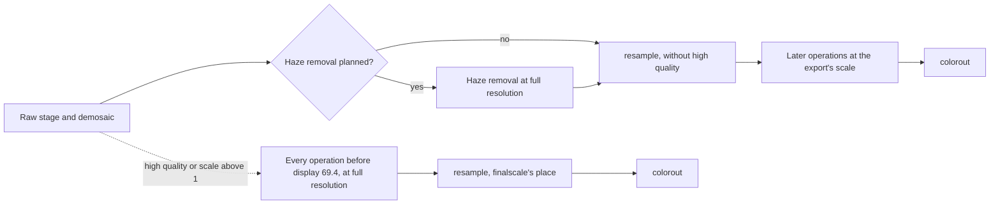

# Port spec: export size and resample (finalscale)

Source: darktable (the reference release, commit 20891f6c6f). The size: `src/imageio/imageio.c` (`dt_imageio_export_with_flags()`, `_get_pipescale()`), `src/imageio/imageio_module.c` (`dt_imageio_resizing_factor_get_and_parsing()`), `src/libs/export.c` (`_export_with_current_settings()`, `cm2pixels()`, `inch2pixels()`, `print2pixels()`), `src/control/jobs/control_jobs.c` (`dt_control_export()`, `_control_export_job_run()`), `src/cli/main.c` (`--width`, `--height`, `--hq`, `--upscale` and the format's cap) and the formats' `dimension()` (`src/imageio/format/jpeg.c`, `png.c`). The resample: `src/common/interpolation.c` (`dt_interpolation_new()`, `_maketaps_lanczos()`, `_compute_upsampling_kernel()`, `_compute_downsampling_kernel()`, `_prepare_resampling_plan()`, `dt_interpolation_resample()`, `dt_interpolation_resample_roi()`), `src/common/math.h` (`dt_vector_sin()`, `ceil_fast()`, `M_PI_F`), `src/develop/imageop_math.c` (`dt_iop_clip_and_zoom_roi()`), and its two callers: `src/iop/finalscale.c` (`modify_roi_in()`, `process()`, `commit_params()`) and `src/iop/demosaic.c` (`modify_roi_in()`, `_demosaic_full()`, `process()`); its place from `src/common/iop_order.c` (`v50_order`). The reference is darktable's CPU path.

Status: **ported, not yet measured on a second vendor.**

- **Code:** `apertrust-export`'s `size` (`crates/export/src/size.rs`), the engine's `resample` kernel (`crates/engine/slang/resample.slang`) with its plan on the CPU (`crates/engine/src/resample.rs`), `Pipe::Resampled` and its tiles in the planner and `export::export_at` (decision 56; `docs/gui.md`, The Export dialog).
- **Commands:** `apertrust-cli export`'s `--width`, `--height`, `--hq` and `--upscale`, and `apertrust-golden pipeline --width --height --hq --upscale`, which measures a scaled export against darktable-cli's at the same size without a bound.
- **Whole-image passes at a size** (decision 15): after the resample they cover its output, and in a tiled export take their first round in the output's own tiles at the export's scale; without high quality the resample comes after haze removal while it is planned (Neighbourhood and scale). They are measured against darktable-cli without high quality and with it (`apertrust-golden pipeline --add CASE --darktable-hq BOOL`; Results); which of them become golden cases is open.
- **With a geometry of whole pixels,** orientation's turns and mirrors (`Geometry::whole_pixels`), the resample runs in the stage its place gives, as darktable's does: after demosaic in the photo's own stage, its sides the output's turned back, the turn after it; at finalscale's place in the turned image. **Not built:** an export at a size with a geometry that interpolates or crops.

finalscale is no darktable module a person edits: it is darktable's hidden step that scales an export to its size. Apertrust has no operation for it; the engine plans the resample itself, as it plans the viewport's downscale.

## Purpose

An export at a size other than the photo's full resolution: a largest width and height in pixels, centimetres or inches at a resolution, or a scale, with Allow upscaling and High quality resampling, as darktable's export module and darktable-cli give them. darktable computes one scale for the whole pipe from the photo's size after its geometry, renders every operation after the resample at that scale, and resamples with its scaling interpolator, lanczos3 by default: right after demosaic without high quality, so every later operation runs on the smaller image, or at finalscale's place, just before output colour, with high quality or above a scale of 1, so every operation before it runs at full resolution.

## Pipeline

- **darktable position:** finalscale at 69.4 in the v5.0 order, after colorreconstruct (69.0) and vignette (68.0), before colorout (70.0); without high quality darktable switches it off for the export (`finalscale->enabled = FALSE`) and demosaic resamples instead (`dt_iop_clip_and_zoom_roi`, demosaic at 8.0), since its output is smaller than its input (`direct` is false). `_demosaic_full()` is true for an export, so demosaic always demosaics at full resolution first.
- **Apertrust slot:** no manifest. Without high quality the planner inserts the engine's `resample` where the raw stage ends, as it inserts the viewport's downscale, or after haze removal while it is planned (decision 15; Neighbourhood and scale); with it, or above a scale of 1, before the first operation after display 69.4 (`FINALSCALE`), colorout in every edit, and at the end of a plan with none after it.
- **Domain:** both, as its place says; it is linear filtering of whatever it is given.
- **Input and output:** RGBA in, RGBA out, all four channels filtered as darktable's `for_each_channel` does.
- **Layer support:** not applicable; it is the export's.

Where the resample goes:

## The size

As darktable computes it, in `apertrust_export::size`, a pure function of the request, the format's largest side and the photo's extent after its geometry, W × H (darktable's `processed_width` and `processed_height`), in f64 where darktable computes in double and f32 where in float.

1. **The limit, in pixels** (`max_width`, `max_height`, darktable's `plugins/lighttable/export/width` and `height`, always pixels): in centimetres `ceilf(cm × dpi / 2.54f)` and in inches `ceilf(inch × dpi)` (`cm2pixels()`, `inch2pixels()`, in f32, the dpi an integer), stored as pixels; in pixels as typed (`print2pixels()` takes `ceilf` of the value). `pixels_to_print` shows them back, `pixels × 2.54f / dpi` and `pixels / dpi`, at two decimals in the dialog.
2. **By scale**, the factor is the scale text as `dt_imageio_resizing_factor_get_and_parsing()` reads it: every `.` and `,` is the decimal point, then text without `/` is `atof(text)`, text starting with `/` is `1 / atof(rest)`, `a/b` is `atof(a) / atof(b)`; a numerator or denominator of 0 is 1, so empty text and `0` are 1. `atof` reads the longest decimal number at the start, after spaces, with a sign and an exponent, and 0 when there is none.
3. **Allow upscaling with a side at 0, in the dialog:** the other side times 100 (`MAX_ASPECT_RATIO`, `_export_with_current_settings()`), in every mode, as darktable's export module computes it before the job (`Request::dialog`). darktable-cli has no such rule: its side at 0 takes the photo's own (step 5), so along it the scale is at most 1, and the CLI keeps that. The module also turns upscaling off for an export at 0 × 0 outside the scale mode (`dt_control_export()`: `upscale = (max_width == 0 && max_height == 0 && !dimensions_scale) ? FALSE : upscale`), which changes nothing here, as both sides at 0 take the photo's and the scale is 1.
4. **The format's largest side caps a limit that is set**, as darktable-cli caps it (`fdata->max_width = (w != 0 && max_width > w) ? w : max_width`): JPEG 65535, PNG 2147483647 (`dimension()`); 0 stays no limit. darktable's export module caps a limit left at 0 too, taking the format's largest side as its limit (`_control_export_job_run()`).
5. **The scale** (`dt_imageio_export_with_flags()`): both sides 0 take W and H; the largest scale is 100 with upscaling (`doscale`, true with upscaling once a side is set or by scale) and 1 without; then a side still 0 takes its extent, and `scale = min(width > 0 ? min(width / W, largest) : largest, height > 0 ? min(height / H, largest) : largest)` (`_get_pipescale()`), in double; by scale, `min(factor, largest)` instead.
6. **The output** is `floor(scale × W)` by `floor(scale × H)`, in double: darktable's `processed_width` and `processed_height`. The operations see `(float) scale`, the roi's scale (`dt_dev_pixelpipe_process_no_gamma()` takes a float).
7. **Where it resamples:** at finalscale's place when `high_quality || scale > 1.0f`, darktable's `hq_process`; otherwise after demosaic. At a scale of 1 in double nowhere. At one that is 1 in float but not in double, such as 0.99999999, darktable's resample copies (`copymode`), and demosaic's region is its output's (`direct`), so the export is the image's first `floor(scale × W)` by `floor(scale × H)` pixels, 5999 × 3999 of 6000 × 4000: the planner cuts that part out where the image is more, at the resample's place.
8. **A side larger than the format's largest, or under one pixel, refuses the export** (D8), where darktable exports what it can.

darktable's double arithmetic is kept, so the output is darktable's to the pixel: on the Sony ILCE-7RM5's 9504 × 6336 at 2048 × 2048 the scale is 2048 / 9504 = 0.215488…, the output 2048 × 1365.

## The resample

`dt_interpolation_resample()` with darktable's scaling interpolator (`dt_interpolation_new(DT_INTERPOLATION_USERPREF)`, `plugins/lighttable/export/pixel_interpolator`, lanczos3 by default), through `dt_interpolation_resample_roi()`, which zeroes both regions' offsets: output pixel `x` lies at input `x / scale`, the images' top-left corners aligned. Each axis has a plan, computed on the CPU in f32 as darktable computes it, bound as tables:

- **Its input length** is the region darktable's pipe gives the resample, which can be a row or a column short of the image:
  - after demosaic, demosaic's `modify_roi_in()`: `max(8, (int)(out / scale))`, truncated in f32;
  - at finalscale's place, finalscale's: `max(16, min(ceilf(out / scale), W))`.

  On the 7R V at 2048 that is 9504 × 6334 after demosaic and 9504 × 6335 at finalscale's place, so the last rows are never read: darktable's, kept.
- **Downscaling** (`scale < 1`), per output pixel `x` (`_compute_downsampling_kernel()`): `xin = ceil_fast((x − 3) / scale)`, the first input pixel; `t = xin × scale − x`; `n = (int)((3 − t) / scale)` taps; the taps lanczos3 at `t, t + scale, t + 2 scale, …`.
- **Upscaling** (`scale > 1`, `_compute_upsampling_kernel()`): `fx = x / scale`, `first = (int)floorf(fx) − 2`, 6 taps at `fx − first, fx − first − 1, …`.
- **The taps** (`_maketaps_lanczos()`, width 3): for each `v`, `a = (int)v`, `r = v − a`, `sign` −1 for odd `a`, and `(3 × sign × sin(π r) × sin(π v / 3) + 1e−9) / (π² v² + 1e−9)`, the sines darktable's fast approximation `dt_vector_sin()` (`4/π² × x × (π − |x|)`, then `s × (0.225 (|s| − 1) + 1)`), π being `M_PI_F` and π² its f32 square.
- **Normalised** (`_prepare_resampling_plan()`): each output pixel's taps multiplied by `1 / Σ taps`, the sum in tap order; each tap's input index clipped to 0 to length − 1 (`BORDER_REPLICATE`).
- **Applied** across, then down, in f32 (`dt_interpolation_resample()`): for each output pixel, for each of its rows' taps in order, the row's sum of its column taps in order, `vhs += in × htap`, then `vs += vhs × vtap`.

The kernel runs it in two passes: `across` writes each needed input row's sums for each output column into scratch, the sums darktable's inner loop makes, and `main` adds them up by the rows' taps, so each output pixel adds the same products in the same order as darktable's single loop, in about a sixth of the reads.

**Its region map:** an output region's pixels need the input span from the first tap of its first pixel to the last of its last, on each axis, clipped as the taps are; the planner walks an export's tile back through it (decision 56), so a tile's raw stage and demosaic make exactly that span, and a tiled export equals the untiled one bit for bit.

## Neighbourhood and scale

- **Reach:** `3 / scale` input pixels on each side when downscaling, 3 when upscaling; the region map gives it exactly, so no radius is declared.
- **The operations after the resample** see the export's scale (`ImageContext::scale` and the pass header's), as darktable's pipe gives every module `roi_out->scale`, the viewport's structure, so decisions 15 and 63 hold for them as in the viewport.
- **Their whole image** (decision 15): darktable's non-hq export gives every module after demosaic the whole image at `processed_width` × `processed_height` as its `roi_in`, `buf_in` at full resolution (`dt_imageio_export_with_flags`). The planner gives every RGBA image its stage at the pipe's scale, `ImageDesc::scaled_extent`, after the resample the output, `floor(scale × W)` by `floor(scale × H)` in double, and `ImageContext::whole_image` returns it, so the tone equalizer, the colour equalizer, bloom and soften lay their scratch out as that image, and local contrast and filmic rgb take their input as it. Not from the f32 scale: `floor(f32(640 / 4928) × 4928)` is 640, darktable's 639.
- **Their radii** follow the export's scale with no change, each setup's lengths the full-resolution ones times it under decisions 15 and 63. darktable's own formulas at the scale differ: the tone equalizer's `(int)((blending × max_size × scale − 1) / 2)`, truncated after scaling, where Apertrust truncates at full resolution; bloom's and soften's one radius `ceilf(rad × scale)` for eight passes, where Apertrust's match the variance (r and r + 1); the colour equalizer's in-place branch on the scaled σ, where Apertrust's follows the export's. So these differ from darktable-cli `--hq false` by design (decision 56), measured against it in Results.
- **Haze removal** (decision 15): without high quality the resample comes after the last planned operation whose estimate is computed at full resolution (`Operation::whole_image_at_full_resolution`), haze removal at camera RGB 14, with demosaic's input lengths, so haze removal runs whole at full resolution, as in the full-size export, and its output is resampled. darktable's non-hq export estimates at the export's scale with its adaptive windows, `2 + ceil(4 s)` and `3 + ceil(6 s)`, 3 and 5 at the 7R V's 2048 (s = 0.2155), where Apertrust's windows at that scale would be 1 and 2; estimating at an eighth would be 4.6 mean ΔE2000 from the export downscaled at strength 0.9 (decision 15).
- **Their first round of tiles** (decision 15): after the resample, in the output's own tiles at the export's scale, each grown a pixel right and below within the output and walked back through the resample; before it, haze removal's, in tiles of the image at full resolution, as with high quality.
- **darktable's tiling** of finalscale (`IOP_FLAGS_TILING_FULL_ROI`, overlap 4) resamples each tile with its offsets ignored (`dt_iop_clip_and_zoom_roi`); darktable-cli at `resourcelevel=reference` does not tile it. Apertrust's tiles slice the whole image's plan instead.

## Precision and special values

- Plans in f32, as darktable's; the sums in f32 on the GPU. darktable's release build uses `-ffast-math`, which may contract `vhs += in × htap` into a fused multiply-add as the GPU may: the order is kept, the last bit is not.
- `ceil_fast()` truncates through `int`, as Rust's `as i32` does; `(int)v` likewise.
- No division can be by zero: a tap sum is about 1 / scale when downscaling, the taps lanczos3 sampled `scale` apart over a window of integral 1, and about 1 when upscaling, and the scale is positive.

## CPU and OpenCL differences in darktable

`dt_interpolation_resample_cl()` builds the same plans, but sums the vertical taps across a workgroup, and finalscale's OpenCL path does not upscale. The harness renders with `--disable-opencl`; Apertrust follows the CPU path.

## Deliberate differences

- **No memory term:** darktable's largest scale is `fmin(100, fmax(1, available pipe memory / (1 + 2.5 × plane)))`, so one edit exports at different sizes on two computers; Apertrust's is 100 (decision 56, principle 2). It only matters with upscaling, where darktable caps the scale by what its pipe may allocate.
- **0 is no limit in the dialog too:** darktable's export module, unlike darktable-cli, takes the format's largest side as a limit left at 0 (`_control_export_job_run()`). As it turns upscaling off at 0 × 0 and fills a single side at 0 a hundred times the other first, the one effect is on a photo wider or taller than the format's largest side, a JPEG over 65535 pixels, which darktable's module fits within it and Apertrust refuses, as darktable-cli exports at full size; Apertrust keeps darktable-cli's rule and darktable's own description of the setting ("or 0 if no scaling should be done", decision 56).
- **Refusals** (D8): a side larger than the format's largest, or under one pixel, refuses the export before it renders. darktable-cli hands the first, a photo past 65535 pixels at full size, to the format's writer as it is, and only notes the second in its debug log (`**missing size**`) and goes on.
- **The scaling interpolator is always lanczos3:** darktable reads its preference `plugins/lighttable/export/pixel_interpolator` (bilinear, bicubic, lanczos2 or lanczos3, lanczos3 by default); Apertrust has no such setting yet and resamples with darktable's default; the Settings dialog's Processing page is to bring the others (decision 56, planned).
- **The CLI's `--width` and `--height` take whole numbers only:** `-5` and `2048px` are refused, where darktable-cli's `MAX(atoi(…), 0)` reads them as 0 and 2048.
- **The operations before the resample run over the whole image,** where darktable's pipe runs them over the resample's input region, which can lack the last row or column (above): highlight reconstruction's and any whole-image pass's statistics then include it. The resample reads exactly darktable's rows and columns.
- **Text darktable's `atof` reads as hexadecimal, infinity or NaN** reads as no number, so a factor of 1; darktable's scale field filter (`_scale_changed()`) never lets such text through.
- **A scaled export with a geometry that interpolates or crops is not built:** it is refused with a plan error (Open questions); one with orientation's turns and mirrors resamples in its place's stage (above). Whole-image passes after the resample run whole or in tiles, their first rounds in the output's own tiles; local contrast and filmic rgb's reconstruction, which take no first round, run whole before the tiles.
- **Without high quality, haze removal before the resample** (decision 15): darktable resamples in demosaic, and estimates the haze at the export's scale; Apertrust resamples after haze removal while it is planned, so its estimate and output are the full-size export's (decision 15). An operation ported between demosaic and haze removal then runs at full resolution too while haze removal is on. In a tiled export haze removal's first round takes tiles of the image at full resolution and the tone equalizer's, after the resample, the output's own, each run's side its place against the resample in the plan (`Plan::resample`).
- **Without high quality, the lengths of the operations after the resample follow decisions 15 and 63** (decision 56; Neighbourhood and scale), not darktable's own formulas at the scale: the tone equalizer's radius truncated at full resolution, bloom's and soften's iterated radii, the colour equalizer's branch from the export's σ. Whether to keep that is an open question (`docs/engine.md`, Open questions, Export).
- **Whole-image passes before the resample take their first round of tiles at full resolution:** with high quality, or above 1, the operations with whole-image passes run before the resample, so their first round's tiles are the image's at full resolution, none larger than the region the largest output tile walks back to less its taps' reach, before the last round's tiles of the output walk back through the resample (decision 15, as at full size). darktable does not tile an export at `resourcelevel=reference`.

## Tool binding notes

No module owns the size: it is the Export dialog's Set size rows (`docs/gui.md`, The Export dialog) and darktable-cli's flags, `apertrust-cli export --width W --height H --hq true|false --upscale true|false`, darktable-cli's defaults 0, 0, true and false. **What is an identity:** a scale of 1, which plans no resample. The CLI has no scale mode, as darktable-cli has none.

## Gradients

None: the resample is an engine kernel, as the viewport's downscale and the region copy are, with no derivative entry points (`slang-kernels`, The engine's own kernels; `derivatives: false`). Nothing optimises through an export's size.

## Test plan

- `size` against darktable's arithmetic restated (`crates/export/src/size.rs`): each mode, the centimetre and inch rounding, fractions and decimals in the scale text, Allow upscaling with a side at 0 in the dialog and from the CLI, the format's cap, the output's floor, a scale of 1 in float but not in double, where the resample goes, the refusals.
- The plan against darktable's formulas worked by hand for chosen output pixels, its taps against lanczos3 in double, darktable's fast sine and `ceil_fast()`, and the input lengths on the 7R V (`crates/engine/src/resample.rs`).
- The kernel against the CPU restatement of `dt_interpolation_resample()` on synthetic images, down and up (`crates/engine/tests/resample.rs`).
- A tiled export equal to the untiled one bit for bit at scales 0.5, 1/3 and 2, after demosaic and at finalscale's place, Bayer and X-Trans; the tone equalizer and haze removal at a size taking a first round of tiles at full resolution, at 0.5, 1/3 and 2, under a 16 MiB budget and, for the tone equalizer, on a GPU binding 2 MiB at once, less than the image, each equal to the untiled export, and refused after a resample after demosaic, naming `--hq true`; a scale of 1 in float a pixel short, the full-size export's corner (`crates/engine/tests/tiles.rs`); a geometry at a size refused (`crates/engine/tests/geometry.rs`).
- A scaled export against darktable-cli's at the same size, `--hq` true and false, on corpus raws, with grain and vignetting added on both sides (`--add CASE`), measured without a bound and printed as measured (`apertrust-golden pipeline --width --height --hq --upscale`; Results), a golden case to be chosen with its numbers.
- Whole-image operations after the resample, untiled, without high quality: each whole-image operation after the resample covering the output, the D5100 at 640 covering 639 × 423, planned as for an export of that output alone at the export's scale (`crates/engine/tests/pipeline.rs`); an untiled export at 0.5 and 1/3 through each, which it changes (`crates/engine/tests/tiles.rs`); every plan without a resample unchanged byte for byte with its keys, each whole-image operation's plans held to those made with its stage by the pipe's kind (`crates/engine/tests/geometry.rs`).
- Whole-image operations after the resample, tiled, without high quality: tiled equal to untiled bit for bit at 0.5 and 1/3, Bayer and X-Trans, for the tone equalizer, bloom, soften and the colour equalizer after the resample, in two rounds, and local contrast and filmic rgb's reconstruction, in one, in tiles of several sizes; the four under a 16 MiB budget and on a 2 MiB binding, in several tiles (`crates/engine/tests/tiles.rs`).
- Haze removal before the resample, without high quality: haze removal and the tone equalizer at 640 on the D5100, planned as haze removal at a scale of 1, as in the full-size export with its key, then the resample and the tone equalizer, and with high quality the resample after both (`crates/engine/tests/pipeline.rs`); an export through both at 0.5 and 1/3, changed by haze removal, tiled equal to untiled bit for bit in three rounds, two first rounds at two scales, in tiles of 24 × 20 and 37 × 29 and, Bayer and X-Trans, under a 16 MiB budget; at a scale of 1, the export equal to the full-size export and, tiled, to the untiled one, and a pixel short of 1 too, with local contrast and filmic rgb (`crates/engine/tests/tiles.rs`); the plans at a size without haze removal, or with high quality, held to fixed fingerprints, with their keys (`crates/engine/tests/geometry.rs`).
- The measurement against darktable-cli, without high quality: `apertrust-golden pipeline --hq false --add CASE` with the golden cases of the tone equalizer, haze removal, the colour equalizer, bloom, soften and local contrast, against darktable-cli `--hq false` and, with `--darktable-hq true`, against darktable's high quality export, on the D5100, the 7R V, the X-T5 and the R5 at 2048 and 1000, measured without a bound (Results).

## Results

Measured on the Apple M4 (Metal), `apertrust-golden pipeline IMAGE... --width W --height H --hq BOOL [--upscale true]`: each raw through the default pipeline on both sides, rawprepare cropping it to its declared image on both, so both scale the same image, and darktable-cli exporting a 16-bit PNG with the same flags; CIEDE2000 in sRGB over the whole output, Apertrust's before it rounds to 8 bits. darktable-cli exported the size `size` computes in every case, 639 × 423 included where 640 / 4928 × 4928 rounds down in double. No bound is set; the whole-pipeline exit test's, a mean of 0.01 and 0.01 % of pixels over 2.3, holds in every case.

| Raw | Size asked | Output | High quality | ΔE2000 mean | p95 | max | Over 2.3 |
| --- | --- | --- | --- | --- | --- | --- | --- |
| Nikon D5100, 4928 × 3264 | 2048 × 2048 | 2048 × 1356 | yes | 0.002 | 0.005 | 2.88 | 0.0002 % |
| | | | no | 0.003 | 0.005 | 3.70 | 0.0005 % |
| | 1000 × 1000 | 1000 × 662 | yes | 0.001 | 0.002 | 0.35 | 0 |
| | | | no | 0.001 | 0.002 | 0.53 | 0 |
| | 640 × 640 | 639 × 423 | yes | 0.001 | 0.002 | 0.60 | 0 |
| | 6000 × 6000, upscaled | 6000 × 3974 | no, above 1 | 0.001 | 0.002 | 2.21 | 0 |
| Sony ILCE-7RM5, 9504 × 6336 | 2048 × 2048 | 2048 × 1365 | yes | 0.001 | 0.002 | 0.59 | 0 |
| | | | no | 0.001 | 0.002 | 0.40 | 0 |
| | 1000 × 1000 | 1000 × 666 | yes | 0.001 | 0.002 | 0.22 | 0 |
| | | | no | 0.001 | 0.002 | 0.24 | 0 |
| | 640 × 640 | 640 × 426 | yes | 0.001 | 0.002 | 0.14 | 0 |
| Fujifilm X-T5, 7728 × 5152, X-Trans | 2048 × 2048 | 2048 × 1365 | yes | 0.002 | 0.003 | 1.46 | 0 |
| | | | no | 0.002 | 0.003 | 1.81 | 0 |
| | 1000 × 1000 | 1000 × 666 | yes | 0.002 | 0.003 | 1.37 | 0 |
| | | | no | 0.002 | 0.003 | 0.76 | 0 |
| Canon EOS R5, 8192 × 5464 | 2048 × 2048 | 2048 × 1366 | yes | 0.001 | 0.002 | 0.42 | 0 |
| | | | no | 0.001 | 0.002 | 0.42 | 0 |
| | 1000 × 1000 | 1000 × 666 | yes | 0.001 | 0.002 | 0.65 | 0 |
| | | | no | 0.001 | 0.002 | 0.60 | 0 |

The same D5100 cropped to its declared image at full size gives a mean of 0.001 and a max of 2.43, so the resample adds next to nothing. The harness's base history, darktable's test's, holds a custom module order with finalscale after colorout, as darktable's v3.0 order has it; resampled there, after the output profile's encoding, the D5100 at 2048 with high quality differs by a mean of 0.076, p95 0.31 and max 13.95, so the measurement moves finalscale to darktable's v5.0 place for a new edit, before colorout, where Apertrust resamples (`raw_stage::finalscale_before_colorout`). A photo whose darktable history keeps the older order resamples there in darktable; Apertrust imports no darktable edits (decision 51).

**Grain and vignetting after the resample** (`--add grain`, `--add vignette`; the D5100 at 2048 × 2048): test 0059's grain (6400 ISO, strength 100 %, mid-tones bias 100 %), Apertrust's operation given darktable's offset for the width darktable renders it at, here the 2048 of the output, and test 0045's vignetting, each added to both sides after AgX. The two change darktable's render by a mean of 0.050 and 0.50 of the encoded range over its top 60 rows, so they are there on both sides:

| Added | High quality | ΔE2000 mean | p95 | max | Over 2.3 |
| --- | --- | --- | --- | --- | --- |
| grain | no, after the resample | 0.003 | 0.005 | 3.72 | 0.0005 % |
| | yes, before it | 0.004 | 0.007 | 3.84 | 0.0005 % |
| vignetting | no, after the resample | 0.002 | 0.004 | 3.69 | 0.0002 % |
| | yes, before it | 0.002 | 0.004 | 1.81 | 0 |

**Whole-image passes after the resample** (decision 15; measured on the M4, `apertrust-golden pipeline RAW... --width W --hq false --darktable-hq BOOL --add CASE`): Apertrust's export without high quality, against darktable-cli's without it (no hq) and with it (hq), each golden case of the tone equalizer, haze removal, the colour equalizer, bloom, soften and local contrast added to both sides after the default pipeline, one case a run, as grain and vignetting are above. Every case changes darktable's own render: at 2048 without high quality, by a mean absolute difference of 1.1 % (local contrast's test 0002, on every raw) to 27 % (bloom on the D5100) of the encoded range, haze removal's test 0026 next, 1.6 to 2.2 % (ImageMagick's MAE between darktable's renders with the case and without). Each cell is the mean ΔE2000, the 99th percentile, the max and the share of pixels over 2.3, in sRGB over the whole output; no bound is set. The scales are 0.416 and 0.203 for the D5100 (4928 wide) at 2048 and 1000, 0.216 and 0.105 for the 7R V (9504), 0.265 and 0.129 for the X-T5 (7728) and 0.250 and 0.122 for the R5 (8192). The tone equalizer's per-pixel path, `toneequal-max`, and the colour equalizer without its filter, `colorequal-no-filter`, are controls: they have no whole-image passes. The tone equalizer's two other per-pixel cases, `toneequal-geomean` and `toneequal-smoothing`, were not run, as they say no more than `toneequal-max`.

| Added | Width | darktable | D5100 | 7R V | X-T5 | R5 |
| --- | --- | --- | --- | --- | --- | --- |
| nothing | 2048 | no hq | 0.003 · 0.035 · 3.7 · 0.0005 % | 0.001 · 0.004 · 0.4 · 0 | 0.002 · 0.006 · 1.8 · 0 | 0.001 · 0.003 · 0.4 · 0 |
| | 2048 | hq | 0.027 · 0.251 · 9.7 · 0.009 % | 0.157 · 1.758 · 21.7 · 0.61 % | 0.101 · 1.316 · 13.3 · 0.28 % | 0.024 · 0.350 · 8.0 · 0.055 % |
| | 1000 | no hq | 0.001 · 0.003 · 0.5 · 0 | 0.001 · 0.002 · 0.2 · 0 | 0.002 · 0.008 · 0.8 · 0 | 0.001 · 0.003 · 0.6 · 0 |
| | 1000 | hq | 0.061 · 0.761 · 10.1 · 0.13 % | 0.256 · 2.222 · 18.3 · 0.93 % | 0.163 · 1.994 · 18.4 · 0.77 % | 0.057 · 1.032 · 8.0 · 0.19 % |
| `toneequal-max` | 2048 | no hq | 0.003 · 0.032 · 3.7 · 0.0006 % | 0.001 · 0.004 · 0.5 · 0 | 0.002 · 0.008 · 2.8 · 0 | 0.001 · 0.003 · 0.6 · 0 |
| | 2048 | hq | 0.041 · 0.439 · 16.0 · 0.035 % | 0.332 · 4.112 · 37.9 · 2.87 % | 0.210 · 2.545 · 33.1 · 1.26 % | 0.071 · 1.019 · 19.5 · 0.29 % |
| | 1000 | no hq | 0.001 · 0.003 · 0.5 · 0 | 0.001 · 0.002 · 0.2 · 0 | 0.002 · 0.010 · 1.1 · 0 | 0.001 · 0.003 · 0.9 · 0 |
| | 1000 | hq | 0.088 · 1.170 · 26.1 · 0.33 % | 0.548 · 5.685 · 40.6 · 5.81 % | 0.357 · 4.379 · 33.2 · 3.35 % | 0.153 · 2.475 · 17.1 · 1.13 % |
| `toneequal-eigf` | 2048 | no hq | 0.015 · 0.083 · 11.0 · 0.0008 % | 0.020 · 0.129 · 2.1 · 0 | 0.022 · 0.159 · 7.6 · 0.0003 % | 0.023 · 0.136 · 0.5 · 0 |
| | 2048 | hq | 0.074 · 1.561 · 17.1 · 0.66 % | 0.596 · 7.643 · 32.9 · 7.30 % | 0.394 · 5.417 · 18.4 · 4.17 % | 0.171 · 3.646 · 16.2 · 1.91 % |
| | 1000 | no hq | 0.060 · 0.351 · 0.8 · 0 | 0.017 · 0.105 · 0.5 · 0 | 0.064 · 0.465 · 1.9 · 0 | 0.068 · 0.400 · 0.9 · 0 |
| | 1000 | hq | 0.138 · 2.622 · 22.8 · 1.17 % | 0.867 · 8.499 · 34.6 · 10.92 % | 0.596 · 6.508 · 21.2 · 7.20 % | 0.316 · 5.505 · 15.6 · 3.86 % |
| `toneequal-average` | 2048 | no hq | 0.017 · 0.064 · 3.6 · 0.0006 % | 0.012 · 0.068 · 0.8 · 0 | 0.014 · 0.087 · 4.1 · 0.0001 % | 0.011 · 0.070 · 0.6 · 0 |
| | 2048 | hq | 0.038 · 0.353 · 10.1 · 0.017 % | 0.209 · 2.383 · 36.1 · 1.06 % | 0.119 · 1.560 · 30.0 · 0.53 % | 0.042 · 0.564 · 17.1 · 0.092 % |
| | 1000 | no hq | 0.044 · 0.170 · 0.6 · 0 | 0.027 · 0.139 · 0.7 · 0 | 0.032 · 0.199 · 1.2 · 0 | 0.027 · 0.170 · 1.1 · 0 |
| | 1000 | hq | 0.088 · 0.964 · 24.5 · 0.23 % | 0.361 · 3.538 · 37.2 · 2.25 % | 0.224 · 3.137 · 30.6 · 1.72 % | 0.095 · 1.321 · 18.4 · 0.37 % |
| `toneequal-power` | 2048 | no hq | 0.010 · 0.044 · 3.6 · 0.0007 % | 0.005 · 0.028 · 0.6 · 0 | 0.011 · 0.071 · 2.2 · 0 | 0.002 · 0.010 · 0.6 · 0 |
| | 2048 | hq | 0.038 · 0.438 · 16.1 · 0.041 % | 0.348 · 4.272 · 41.1 · 3.02 % | 0.220 · 2.528 · 26.5 · 1.24 % | 0.071 · 1.134 · 19.4 · 0.33 % |
| | 1000 | no hq | 0.010 · 0.042 · 0.5 · 0 | 0.013 · 0.075 · 0.2 · 0 | 0.012 · 0.079 · 1.1 · 0 | 0.009 · 0.056 · 0.9 · 0 |
| | 1000 | hq | 0.088 · 1.104 · 27.1 · 0.31 % | 0.577 · 5.749 · 39.9 · 5.98 % | 0.360 · 4.135 · 26.7 · 3.17 % | 0.148 · 2.363 · 15.4 · 1.04 % |
| `toneequal-eigf-iterations` | 2048 | no hq | 0.023 · 0.083 · 3.7 · 0.0007 % | 0.025 · 0.113 · 0.7 · 0 | 0.030 · 0.163 · 3.6 · 0.0001 % | 0.027 · 0.145 · 0.7 · 0 |
| | 2048 | hq | 0.044 · 0.367 · 11.5 · 0.015 % | 0.274 · 2.876 · 44.3 · 1.47 % | 0.165 · 1.871 · 33.0 · 0.60 % | 0.054 · 0.759 · 18.2 · 0.18 % |
| | 1000 | no hq | 0.115 · 0.421 · 1.3 · 0 | 0.091 · 0.398 · 2.2 · 0 | 0.104 · 0.545 · 2.4 · 0.002 % | 0.088 · 0.467 · 1.7 · 0 |
| | 1000 | hq | 0.112 · 1.038 · 27.2 · 0.22 % | 0.502 · 4.307 · 40.1 · 3.93 % | 0.307 · 3.245 · 34.3 · 1.93 % | 0.131 · 1.825 · 16.4 · 0.65 % |
| `hazeremoval` | 2048 | no hq | 0.224 · 1.048 · 3.9 · 0.006 % | 0.631 · 2.298 · 12.7 · 1.00 % | 0.412 · 2.294 · 10.4 · 0.99 % | 1.021 · 2.633 · 8.5 · 2.31 % |
| | 2048 | hq | 0.107 · 0.339 · 8.0 · 0.016 % | 0.435 · 2.151 · 25.8 · 0.88 % | 0.311 · 1.599 · 14.3 · 0.39 % | 0.960 · 2.897 · 10.6 · 2.78 % |
| | 1000 | no hq | 0.458 · 1.732 · 6.7 · 0.19 % | 0.868 · 2.832 · 15.2 · 1.82 % | 0.411 · 2.819 · 21.5 · 2.24 % | 1.070 · 3.116 · 9.5 · 2.88 % |
| | 1000 | hq | 0.139 · 0.888 · 10.8 · 0.16 % | 0.455 · 2.535 · 19.2 · 1.25 % | 0.670 · 2.435 · 19.2 · 1.14 % | 1.203 · 3.669 · 16.1 · 7.32 % |
| `hazeremoval-v2` | 2048 | no hq | 0.994 · 6.524 · 37.2 · 9.60 % | 4.126 · 18.214 · 65.3 · 64.35 % | 2.396 · 15.204 · 35.2 · 34.03 % | 2.075 · 11.747 · 39.9 · 25.73 % |
| | 2048 | hq | 0.049 · 0.552 · 13.7 · 0.063 % | 0.396 · 4.098 · 39.2 · 3.07 % | 0.277 · 3.355 · 31.7 · 1.96 % | 0.064 · 0.941 · 25.6 · 0.20 % |
| | 1000 | no hq | 1.904 · 10.750 · 33.0 · 25.47 % | 4.466 · 21.219 · 66.1 · 63.93 % | 3.585 · 19.032 · 51.3 · 50.54 % | 3.861 · 17.313 · 54.8 · 64.80 % |
| | 1000 | hq | 0.105 · 1.438 · 19.7 · 0.46 % | 0.649 · 5.063 · 40.8 · 6.18 % | 0.430 · 5.330 · 31.9 · 4.06 % | 0.137 · 2.236 · 30.2 · 0.95 % |
| `colorequal` | 2048 | no hq | 0.002 · 0.027 · 5.6 · 0.0006 % | 0.224 · 2.512 · 21.9 · 1.29 % | 0.950 · 6.171 · 21.2 · 9.43 % | 0.524 · 4.083 · 20.8 · 3.47 % |
| | 2048 | hq | 0.181 · 0.945 · 9.3 · 0.11 % | 0.319 · 2.479 · 19.9 · 1.20 % | 0.324 · 2.754 · 27.2 · 1.53 % | 0.193 · 0.831 · 8.8 · 0.076 % |
| | 1000 | no hq | 0.910 · 6.520 · 29.1 · 10.74 % | 0.166 · 1.863 · 12.9 · 0.45 % | 0.690 · 5.308 · 17.7 · 5.97 % | 0.396 · 3.614 · 19.5 · 2.37 % |
| | 1000 | hq | 0.244 · 1.713 · 16.0 · 0.55 % | 0.269 · 2.406 · 26.5 · 1.10 % | 0.304 · 2.917 · 22.3 · 1.63 % | 0.142 · 1.277 · 13.0 · 0.30 % |
| `colorequal-no-filter` | 2048 | no hq | 0.003 · 0.043 · 11.6 · 0.003 % | 0.001 · 0.004 · 0.5 · 0 | 0.002 · 0.006 · 4.4 · 0.0002 % | 0.001 · 0.003 · 0.3 · 0 |
| | 2048 | hq | 0.281 · 2.652 · 23.2 · 1.36 % | 0.335 · 4.121 · 27.5 · 3.27 % | 0.532 · 4.310 · 26.6 · 4.52 % | 0.237 · 1.288 · 10.6 · 0.15 % |
| | 1000 | no hq | 0.001 · 0.003 · 0.9 · 0 | 0.001 · 0.003 · 0.2 · 0 | 0.002 · 0.008 · 1.9 · 0 | 0.001 · 0.003 · 0.9 · 0 |
| | 1000 | hq | 0.466 · 3.904 · 36.8 · 3.02 % | 0.438 · 4.205 · 20.2 · 4.41 % | 0.647 · 4.522 · 31.8 · 5.97 % | 0.306 · 1.812 · 17.1 · 0.62 % |
| `bloom` | 2048 | no hq | 0.145 · 0.858 · 1.9 · 0 | 0.063 · 0.532 · 1.8 · 0 | 0.074 · 0.536 · 1.8 · 0 | 0.041 · 0.236 · 0.4 · 0 |
| | 2048 | hq | 0.043 · 0.293 · 5.3 · 0.005 % | 0.195 · 1.550 · 23.4 · 0.47 % | 0.110 · 1.004 · 15.1 · 0.17 % | 0.029 · 0.356 · 8.2 · 0.054 % |
| | 1000 | no hq | 0.322 · 1.893 · 3.6 · 0.41 % | 0.063 · 0.542 · 1.6 · 0 | 0.201 · 1.448 · 2.8 · 0.059 % | 0.166 · 0.956 · 1.7 · 0 |
| | 1000 | hq | 0.097 · 0.719 · 10.0 · 0.12 % | 0.414 · 2.291 · 21.7 · 0.99 % | 0.206 · 1.578 · 15.0 · 0.51 % | 0.080 · 1.238 · 6.5 · 0.22 % |
| `soften` | 2048 | no hq | 0.262 · 1.485 · 3.5 · 0.14 % | 0.198 · 0.929 · 2.8 · 0.055 % | 0.301 · 1.653 · 5.3 · 0.48 % | 0.199 · 1.357 · 2.5 · 0.004 % |
| | 2048 | hq | 0.019 · 0.080 · 0.9 · 0 | 0.058 · 0.363 · 7.0 · 0.007 % | 0.031 · 0.364 · 2.2 · 0 | 0.009 · 0.075 · 2.3 · 0 |
| | 1000 | no hq | 0.701 · 3.833 · 8.8 · 5.25 % | 0.502 · 2.359 · 6.9 · 1.09 % | 0.703 · 3.798 · 12.3 · 4.95 % | 0.562 · 3.627 · 6.4 · 4.97 % |
| | 1000 | hq | 0.045 · 0.204 · 1.5 · 0 | 0.147 · 0.696 · 6.8 · 0.037 % | 0.072 · 0.599 · 2.9 · 0.001 % | 0.031 · 0.290 · 1.3 · 0 |
| `bilat` | 2048 | no hq | 0.003 · 0.037 · 3.8 · 0.0006 % | 0.001 · 0.004 · 0.4 · 0 | 0.002 · 0.006 · 1.8 · 0 | 0.001 · 0.003 · 0.4 · 0 |
| | 2048 | hq | 0.135 · 0.472 · 9.2 · 0.017 % | 0.275 · 2.210 · 22.8 · 0.92 % | 0.194 · 1.788 · 16.5 · 0.53 % | 0.034 · 0.504 · 11.1 · 0.082 % |
| | 1000 | no hq | 0.001 · 0.003 · 0.5 · 0 | 0.001 · 0.002 · 0.2 · 0 | 0.002 · 0.008 · 0.8 · 0 | 0.001 · 0.003 · 0.6 · 0 |
| | 1000 | hq | 0.165 · 0.989 · 13.5 · 0.20 % | 0.382 · 2.719 · 20.9 · 1.53 % | 0.259 · 2.409 · 16.5 · 1.10 % | 0.104 · 1.347 · 9.1 · 0.32 % |
| `bilat-bilateral` | 2048 | no hq | 0.003 · 0.045 · 3.8 · 0.0005 % | 0.001 · 0.005 · 0.7 · 0 | 0.002 · 0.006 · 1.8 · 0 | 0.001 · 0.003 · 0.4 · 0 |
| | 2048 | hq | 0.059 · 0.644 · 16.7 · 0.098 % | 0.423 · 4.490 · 36.6 · 3.62 % | 0.288 · 3.450 · 18.9 · 2.70 % | 0.071 · 1.088 · 15.8 · 0.30 % |
| | 1000 | no hq | 0.001 · 0.004 · 0.5 · 0 | 0.001 · 0.002 · 0.2 · 0 | 0.002 · 0.008 · 0.8 · 0 | 0.001 · 0.003 · 0.6 · 0 |
| | 1000 | hq | 0.143 · 1.860 · 20.8 · 0.71 % | 0.713 · 5.644 · 24.6 · 7.66 % | 0.467 · 4.277 · 19.8 · 5.25 % | 0.164 · 2.672 · 18.1 · 1.31 % |

What each gap is:

- **Against darktable with high quality, the rows without an operation** are what resampling after demosaic rather than before colorout costs on its own: every operation from exposure to vignetting runs after the resample in Apertrust's export and before it in darktable's, and none of them, AgX least of all, commutes with a weighted mean of pixels. Apertrust's export with high quality is 0.001 to 0.002 from darktable's (above), and without from darktable's without, so darktable's own two exports differ by about as much: 0.024 to 0.256 mean ΔE2000, the 7R V's at 1000 the most. Every row against high quality carries it; a per-pixel operation adds its own non-linearity to it (`toneequal-max`, `colorequal-no-filter`: up to 0.548 and 0.647).
- **Local contrast** (both modes) and the two per-pixel controls are darktable's export without high quality to rounding, at every scale: means of 0.001 to 0.003, as without them. Its pyramid's depth and its grid follow the image at the export's scale as darktable's do (`docs/ports/bilat.md`, Neighbourhood and scale), and decision 15 keeps it at the pipe's scale, so against high quality it is further than the no-operation row, by up to 0.46 more (the bilateral grid, the 7R V at 1000): a pyramid of fewer levels and a coarser grid, not the full-size export downscaled.
- **The tone equalizer's mask filters** are 0.002 to 0.115 from darktable's export without high quality, mostly more at 1000 than at 2048, where the per-pixel path is 0.001 to 0.003: darktable truncates the radius after scaling it, `(int)((blending × max_size × scale − 1) / 2)`, and Apertrust at full resolution, then scales it unrounded (decision 15; Neighbourhood and scale), so their σ parts by up to a pixel at the export's scale, more of the radius the smaller the scale. Against high quality, test 0080's EIGF, `toneequal-eigf`, with a mask contrast of +0.79 EV, is 0.03 to 0.32 further than the per-pixel path, the most on the 7R V at 1000; the other three are at most 0.03 above it, or below: their masks, at the export's scale, are not the full-size mask downscaled, which decision 15's target bounds in the viewport.
- **Haze removal, test 0166** (`hazeremoval-v2`), is 0.99 to 4.47 from darktable's export without high quality and 0.05 to 0.65 from darktable's with it, within 0.40 of the no-operation row: Apertrust's estimate and `main` run at full resolution before the resample (decision 15), where darktable's export without high quality estimates on the downscaled image, with the fixed windows of 6 and 9 pixels its version 2 params migrate to (`adaptive` off; a version 3 instance's adaptive windows would be 3 and 5 at the 7R V's 2048; `docs/ports/hazeremoval.md`, Neighbourhood and scale). So it follows darktable's full-size export, as decision 15 means it to, and the rest of the gap is the operations after it at the export's scale, which a stronger haze removal makes larger.
- **Haze removal, test 0026** (`hazeremoval`), is 0.22 to 1.07 from darktable's export without high quality and 0.11 to 1.20 with it, the R5 the furthest in both: its params version 1 makes darktable use its compatibility mode, which is not ported, and its fixed windows of 6 and 9 at every scale, which are not either (`docs/ports/hazeremoval.md`, Deliberate differences, 1 and 2), so part of the gap is the mode and part the size. The full-size exit pipeline with it added is as far, a mean of 0.284 on the D5100 and 0.690 on the R5, so the case measures that mode, not the size.
- **Bloom and soften** are 0.04 to 0.70 from darktable's export without high quality, the most at 1000, and within 0.16 of the no-operation row against high quality, soften below it (it blurs the resample's own differences): darktable's box blur takes one radius, `ceilf(rad × scale)`, for all eight passes, where Apertrust alternates r and r + 1 so that their variance is the full-size export's (decision 63; Neighbourhood and scale). So they follow the full-size export rather than darktable's export without high quality.
- **The colour equalizer with its guided filter** is 0.002 from darktable's export without high quality on the D5100 at 2048, a scale of 0.42, and 0.17 to 0.95 elsewhere, at scales of 0.27 and below: there darktable blurs test 0159's effect radius in place, as its scaled σ no longer downsamples its grid, where Apertrust takes that choice from the full-size export's σ and blurs a copy (decision 15; `docs/ports/colorequal.md`, Neighbourhood and scale). Against high quality it is 0.14 to 0.32, closer than its own per-pixel path, `colorequal-no-filter`, at 0.24 to 0.65.

**Proposed golden cases**, not yet chosen and with no tolerance set (Open questions): (1) local contrast in both modes, `bilat` and `bilat-bilateral`, against darktable's export without high quality on the four raws at 2048 and 1000, which they meet within the exit test's numbers, a mean of 0.01 and 0.01 % of pixels over 2.3, as do the two per-pixel controls; (2) haze removal's test 0166, bloom and soften against darktable's export with high quality, where Apertrust's export without it is meant to land, their gaps read against the no-operation row's; (3) the tone equalizer's EIGF cases and the colour equalizer with its filter against darktable's export without high quality, as regression cases at the numbers above, since they differ from it by decision and from the full-size export too, until decision 15's open question is answered, whether these operations follow darktable's formulas at the export's scale or the full-size export; test 0026's haze removal not at a size, its gap being its compatibility mode's.

On the GPU the kernel matches the CPU restatement of `dt_interpolation_resample` within 2e-6 at scales from 0.2 to 3.25 (`crates/engine/tests/resample.rs`), and a tiled export at a size equals the untiled one bit for bit at 0.5, 1/3 and 2, in both places, Bayer and X-Trans, with vignetting placing its pixels at the export's scale (`crates/engine/tests/tiles.rs`). With whole-image passes before the resample, the export tiles in two rounds as at full size: the D5100 at 2048 with high quality and `--set toneequal.shadows=1` under `--max-binding 128` exports in 4 tiles and 2 rounds in 0.58 s; untiled up to the tone equalizer it would need demosaic's 245.4 MiB binding.

**Timing** (the Apple M4, `apertrust-cli -d perf export` of the Sony ILCE-7RM5's 61 MP raw to JPEG, its second and third runs, with other work sharing the GPU at times): at full size, 9504 × 6336 in 6 tiles, the export takes 884 to 1022 ms, 345 to 373 ms of it on the GPU, and 2.5 to 3.1 s with the JPEG written; at 2048 × 1365 with high quality, in 4 tiles, 553 to 572 ms, 347 to 354 ms on the GPU, and 0.85 to 0.92 s in all; without, 457 to 497 ms, 258 to 271 ms on the GPU, and 0.75 to 0.80 s in all. High quality costs what a full-size render costs, since every operation but colorout runs at full resolution. Untiled (`--runs 5`, medians), the resample's two passes take 28.9 ms of the GPU's 453 ms with high quality and 26.9 ms of 311 ms without, where every operation after it then takes 1.1 ms instead of about 30.

## Open questions

- **Golden cases at a size** (Results): which of the proposed cases to take, and their tolerances.
- **Geometry at a size:** how each stage's size at the export's scale rounds through a geometry that interpolates or crops (darktable's `modify_roi_out` chain against the viewport's one rounding), for crop and the warps; it sets each stage's `ImageDesc::scaled_extent` (decision 15). Through orientation's turns and mirrors, whole pixels, each stage's size is the output's taken back exactly (`docs/ports/flip.md`, Neighbourhood and scale).
