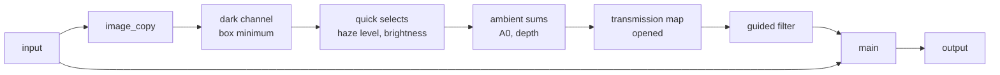

# Port spec: haze removal (hazeremoval)

## Source

darktable (the reference release, commit 20891f6c6f):

- `src/iop/hazeremoval.c`: `legacy_params()`, `process()`, `_dark_channel()`, `_transition_map()`, `_quick_select()`, `_partition()`, `_ambient_light()`.
- `src/common/guided_filter.c`: `guided_filter()`, `_guided_filter_tiling()`.
- `src/common/box_filters.cc`: `dt_box_min()`, `dt_box_max()`, `dt_box_mean()`, `dt_box_mean_horizontal()`, `dt_box_mean_vertical()`.

The reference is darktable's CPU path. Its OpenCL path is `process_cl()` with `data/kernels/hazeremoval.cl` and `data/kernels/guided_filter.cl`. In darktable, haze removal is the only user of `guided_filter()`, `dt_box_min()` and `dt_box_max()`.

## Status

**Ported**, in `crates/op/hazeremoval`: the whole module as darktable gives it to a new instance, with compatibility mode off and adaptive windows on.

- 24 whole-image passes estimate the ambient light, the image's depth and the filtered transmission on the GPU with no readback. They are one run, whose first pass alone reads the input (decision 15).
- One per-pixel pass, `main`, removes the haze. It exports `hazeremoval_backward` and `hazeremoval_forward_diff`.
- In the untiled viewport the estimate comes from the full resolution, and the transmission is downscaled for `main` (Neighbourhood and scale).
- The operation is in `OPERATIONS` at camera RGB 14 with `default_enabled` off, so the default pipeline is unchanged. The session plans it only while a module's binding sets it: the first pass's Haze removal module (decision 28, `docs/modules/haze-removal.md`).

Not ported: darktable's compatibility mode (its old quick select) and its fixed windows. Both serve only edits made before darktable 3.x's params versions 2 and 3 (Deliberate differences, 1 and 2).

**Golden results** (Apple M4; darktable tests 0026 and 0166, `mire1.cr2`, 3908×2602, colorin an identity so both renders are camera RGB):

| Case | Test | Settings | ΔE2000 mean | p95 | max |
| --- | --- | --- | --- | --- | --- |
| `hazeremoval` | 0026, params v1: compatibility mode | strength 0.2, distance 0.2 | 0.0213 | 0.0506 | 0.1319 |
| `hazeremoval-v2` | 0166, params v2: compatibility mode off | strength 0.9, distance 0.8 | 0.0025 | 0.0062 | 0.1291 |

Both pass `Tolerance::DARKTABLE`.

- Case 0026's gap is darktable's compatibility mode: darktable's own two modes differ by as much on it (Deliberate differences, 1).
- Case 0166's gap is the harness's: an f64 restatement of darktable's algorithm on the harness's input gets the same mean, p95 and max against darktable as the GPU (Results).

## Purpose

Haze removal takes atmospheric haze out of a photo, or adds it. Distant parts of a hazy scene are washed out towards the haze's colour; the module restores their contrast and colour in proportion to how hazy each region is, up to a distance the user sets.

It follows He, Sun and Tang's dark channel prior (2011): in a haze-free scene, most local patches have a pixel with one dark channel, so the darkest channel over a patch measures the haze there.

- The **ambient light** A0, the haze's colour, is the mean of the brightest of the haziest pixels.
- The **transmission** t, how much scene light survives the haze, is one less the strength times the darkest channel over A0, opened over a box and smoothed by a guided filter with the image as its guide.
- Each pixel becomes (I − A0) / max(t, t_min) + A0, where t_min, from the distance and the haze of the haziest pixels, stops the far distance from being amplified without limit.

In Apertrust it is the operation behind the first pass's Haze removal module, in the Correct tab (decisions 2 and 38; `docs/modules/README.md`, Haze removal).

## Pipeline

- **darktable position:** 14.0 in the v3.0 and v5.0 orders, after lens correction (13.0) and chromatic aberrations (13.5), before rotate and perspective (15.0), orientation (16.0) and exposure (21.0). In the legacy order 26.0, just before colorin (27.0). Test 0026's sidecar uses the v3.0 order, test 0166's the v5.0 order: the same place in both.
- **Apertrust slot:** `CameraRgb 14.0`, darktable's place (decision 22), after demosaic (raw 8) and before exposure (camera RGB 21).
- **Domain:** scene-referred, linear in and out.
- **Input and output:** RGBA, `default_colorspace()` `IOP_CS_RGB`: camera RGB before colorin, demosaiced and white balanced by temperature. Output in the same space.
- **Assumes earlier modules:** demosaic; white balance, so that haze is roughly neutral and the darkest channel means the same in every hue. Its depth estimate, the logarithm of the haze level, depends on the image's exposure, so exposure after it does not commute with it, nor does colorin's late white balance correction.
- **Layer support:** yes (`docs/modules/README.md`). An instance estimates A0, the depth and the transmission from its own whole input.
- **darktable's tiling:** `tiling_callback()` sets no overlap (`overlap = 0`). When darktable tiles the module, each tile estimates its own A0 and depth and filters without its neighbours, with seams at the tiles' edges. darktable-cli's export of the tests' 10 MP image does not tile (its `-d pipe` shows one `process` over 3908×2602). Apertrust never tiles the estimate (Neighbourhood and scale).

## Parameters

darktable params version 3, 16 bytes: `strength`, `distance` (f32), `compatibility_mode`, `adaptive` (gboolean, i32). There is no `commit_params()`: the data are the params, and `process()` computes everything from them.

| Name | darktable field | Type | Range | Default | Meaning | Owner |
| --- | --- | --- | --- | --- | --- | --- |
| Strength | `strength` | f32 | −1 to 1 | 0.2 | How much haze to remove; negative adds haze | Haze removal |
| Distance | `distance` | f32 | 0 to 1 | 0.2 | How far into the scene to remove it: t_min = exp(−distance × depth) | Haze removal |
| Compatibility mode | `compatibility_mode` | gboolean | | false | darktable's old, mis-partitioning quick select, for edits of params version 1 | fixed: off, a new instance's |
| Adaptive | `adaptive` | gboolean | | true | Windows scaled with the pipe; off, the full-resolution windows at every scale | fixed: on, a new instance's |

`gui_changed()` sets `compatibility_mode` off and `adaptive` on whenever a slider moves, so they are flags for old edits, never controls.

**The schema** (`crates/op/hazeremoval/src/lib.rs`) is version 1, Apertrust's own count: the two sliders under darktable's names, with the introspection's ranges and defaults as hard limits.

## Parameter versions

| Version | Change | Migration |
| --- | --- | --- |
| 1 | `strength`, `distance` | to 3 with `compatibility_mode` on and `adaptive` off |
| 2 | adds `compatibility_mode` | to 3 with `adaptive` off |
| 3 | adds `adaptive` | current |

`ports.rs` reads all three; the golden cases hold versions 1 (test 0026) and 2 (test 0166). Neither flag is a setting of the port, which renders both cases as a new instance would (Deliberate differences, 1 and 2).

## Setup on the CPU

From `process()` (`crates/op/hazeremoval/src/setup.rs`, `prepare`):

- **Windows:** darktable's `wscale = adaptive ? CLIP(roi_in->scale / piece->pipe->iscale) : 1`, then `w1 = 2 + ceil(4 × wscale)`, the radius of the dark channel's and the transmission's boxes, and `w2 = 3 + ceil(6 × wscale)`, the guided filter's: 6 and 9 at full resolution. Apertrust takes those, `DARK_RADIUS` and `GUIDE_RADIUS`, times the pipe's scale, rounded to the nearest integer (`radii`; Neighbourhood and scale).
- **The first quantile's rank:** darktable's `p = (size_t)(size * 0.95f)`, the product in f32, which rounds the pixel count above 2^24 (`rank`).
- **eps:** `sqrtf(0.025f)`, squared by the guided filter: `eps()`.
- **The depth without haze:** `logf(FLT_MAX) / 2`, for a critical haze level that is not positive.
- **The ambient sums' grid:** 4×4 pixels per invocation, one partial result per 16×16 workgroup.
- **The passes,** their uniforms (`HazeParams`, 80 bytes after the 48-byte header) and their scratch (On the GPU).
- **Keys:** only `main`'s uniforms hold the strength and the distance. Every whole-image pass has them zero and sees only the strength's sign, which decides which box filter comes first. So changing either leaves their bytes, their key under decision 15, unchanged (a test holds it).

## Per pixel and over the image (`process`)

darktable's CPU path, in order:

1. **Dark channel** (`_dark_channel()`): the smallest of R, G and B, `MIN(MIN(p0, p1), p2)`, then `dt_box_min` over a box of 2 w1 + 1, the box clipped to the image.
2. **Ambient light and depth** (`_ambient_light()`):
   1. the critical haze level, the dark channel's value of rank p in ascending order, found by `_quick_select()`;
   2. the brightness `p0 + p1 + p2` of every pixel whose dark channel is at or above it, the N_most_hazy haziest pixels;
   3. the critical brightness, the value of rank `(size_t)(N_most_hazy * 0.95f)` among those, by `_quick_select()` again;
   4. A0, the mean RGB of the pixels at or above both levels;
   5. the depth, `-1.125 * logf(critical haze level)` if the level is positive, otherwise `logf(FLT_MAX) / 2`: the haze of the haziest pixels in units of the characteristic haze depth, 1.125 times to make up for the quantile.
3. **Transmission** (`_transition_map()` and the `dt_box_min` after it): `1 - strength × min(p0 / A0_0, p1 / A0_1, p2 / A0_2)`, each channel multiplied by A0's inverse, then `dt_box_max` over 2 w1 + 1, then `dt_box_min` over the same box.
4. **Guided filter** (`guided_filter()` with the image as its colour guide, radius w2, eps, guide weight 1, no clipping):
   - the box means, `dt_box_mean` of radius w2 along the rows then the columns with Kahan sums, of the input p, the guide's R, G and B, their products with p and their six products with each other;
   - per pixel, the regularised covariance of the guide solved against its covariance with p by Cramer's rule, a = Σ⁻¹ cov and b = mean(p) − a · mean(I); a singular system (|det| ≤ 4 FLT_EPSILON) gives a = 0 and b = mean(p);
   - the box means of a and b, and the output mean(a) · I + mean(b).

   darktable processes it in tiles of 512 pixels, each with an overlap of `dt_round_size(3 w2, 16)`, 32 at w2 = 9. That is more than the 2 w2 its result depends on, so the tiles change only the rounding of the Kahan sums.
5. **Haze removal:** `t_min = CLAMP(expf(-distance × depth), 1/1024, 1)`, and each channel `(I - A0) / MAX(t, t_min) + A0`, the fourth channel included (darktable's A0 has 0 there).

## On the GPU

`crates/op/hazeremoval/slang/hazeremoval.slang` runs the same steps as whole-image passes (`PassKind::Reduction`, decision 15) into scratch, then one per-pixel pass.

| Passes | darktable | What they do | Reads | Writes |
| --- | --- | --- | --- | --- |
| `image_copy` | | the input's RGB and its smallest channel, at their place in the whole image (decision 15) | input | the image |
| `image_rows`, `plane_cols` | step 1 | the smallest channel's minimum along the rows, then the columns | the image | plane B: the dark channel |
| `select_begin`, then `select_count` and `select_scan` for each of three digits | step 2.1 | the critical haze level, exactly (below) | plane B | the selection's state |
| `select_count` and `select_scan`, three digits | steps 2.2 and 2.3 | the critical brightness among the pixels at or above the haze level, exactly | the image, plane B | state; the hazy count |
| `ambient_sums`, `ambient_combine` | steps 2.4 and 2.5 | A0's sums over 4×4 blocks, one partial result per workgroup, added up by one workgroup; the depth; A0's inverse | the image, plane B | state: A0, depth, inverse |
| `image_rows`, `plane_cols`, `plane_rows`, `plane_cols` | step 3 | the smallest channel over A0, eroded then dilated (dilated then eroded at a negative strength) | the image, state | plane B: the opened map O |
| `guide_coefficients`, `guide_result` | step 4 | the guided filter of O with the image as its guide | the image, plane B | coefficients; plane A: G |
| `main` | step 5 | t = 1 − strength × G, the haze-free pixel; alpha passes through | input, plane A, state | output |

### The quick selects, exactly

darktable's `_quick_select()` returns the value of a rank in ascending order. The GPU finds the same value as a radix select on the floats' bits.

- **The order key:** unsigned integers that keep the floats' order: negative values' bits flipped, positive values' sign bit set, −0 taken as +0 as float comparisons take it.
- **Three digits** of 11, 11 and 10 bits. Each `select_count` counts the values whose higher digits match the prefix found so far, with integer atomics in shared memory and then in a buffer of 2048 bins (decision 19's counting, inside an operation). `select_scan`, one workgroup, finds the bin holding the rank, extends the prefix, subtracts the counts below and clears the bins. After the third digit the prefix is the value.
- **The hazy count:** the pixels at or above the critical haze level, N_most_hazy, follow from the ranks without another pass: all of them less the rank selected, plus the rank among equal values left at the end.

No float atomics, no sorting, no readback. The result is the exact value of the rank, which darktable's quick select means to find but usually misses by a few ranks (Deliberate differences, 7).

### The box filters

**The box minimum and maximum** are separable and exact: one invocation per pixel reads its 2 w1 + 1 neighbours along a row or a column of a plane, so their order gives darktable's result whatever it is.

**The guided filter** keeps darktable's thirteen box means and its solve. The solve is in `slang/common/guided_filter.slang`, beside the kernel as decision 15 asks of `src/common` helpers; it is a module `tools/build-kernels.sh` does not compile as a kernel. The box means stay in the kernel, as they read its buffers.

- Its box means run tile by tile in shared memory. A workgroup of a 16×16 tile takes the tile's rows and w2 rows above and below, 8 at a time. It loads each chunk's pixels (the tile's columns and w2 more each side, the guide's RGB with p) into shared memory once and adds up each row's means for the tile's columns from there, all thirteen in one sweep. Each invocation then adds up the rows of its own column among them, and solves. The second pass does the same for a and b.
- It takes 11 KB of shared memory, within WebGPU's default 16 KB.
- The box means sum directly in f32 rather than as darktable's running Kahan sums: the same to about 1e-7 relative.
- The counts take 4×4 pixels per invocation, and the guided filter stages its chunks, because WebGPU zero-initialises a workgroup's shared memory before it starts (below).

**Workgroup memory's zero-initialisation.** wgpu's default asks naga to zero-initialise workgroup memory, which naga's Metal backend does from one invocation per workgroup (`write_workgroup_variables_initialization`). On a layout of the guided filter with 11 KB of shared memory per 16×16 tile, reading one pixel per row mean so that memory did not hide it, its passes took 140 and 155 ms at 10 MP on the M4 with it, against 13 and 34 ms with it off (`PipelineCompilationOptions::zero_initialize_workgroup_memory: false` in `ImageKernel`); the counts, one pixel per invocation, 44 ms against 17. The port works round it, the counts with fewer, larger workgroups and the guided filter with its staged chunks, where it no longer shows.

Planned engine work: zero-initialisation turned off per kernel, by a flag a kernel sets once it writes its workgroup memory before reading it, on by default; highlight reconstruction's sums and the scopes, the other kernels with shared memory, measured first. The kernel rule "write workgroup memory before reading it" joins the kernel guidelines with it.

### The strength last

darktable filters 1 − strength × m. Apertrust filters m and applies the strength in `main`.

- Box minimum and maximum commute with that monotone map, also in floats, since every float operation is monotone. A negative strength turns the map around and swaps the order of the two filters.
- The guided filter is linear in its input and keeps constants.

So it is the same transmission but for the guided filter's rounding (Deliberate differences, 3). It keeps the strength out of the whole-image passes, which then compute only from the input and the strength's sign, and makes the strength's derivative exact (Gradients).

### Scratch

Bindings 10 to 16:

| Buffer | Size |
| --- | --- |
| Two planes | one f32 a pixel each |
| The guided filter's coefficients | four f32 a pixel |
| The image: the input's RGB with its smallest channel | four f32 a pixel |
| Bins | 2048 |
| State | 16 words |
| Partial sums | one per workgroup |

In all 40 bytes a pixel: 407 MB at 10 MP, 2.4 GB at 61 MP (2297 MiB for the 7R V's 9504×6336).

The planes, the coefficients and the image are laid out as the whole image at the pipe's scale (`ImageContext::whole_image`), so a tile of an export holds its part at its origin. Every scratch buffer is bound whole (decision 14's windows are for images; decision 15's image-shaped scratch in strips is planned), so each plane must fit one binding.

**Memory and software GPUs.** The scratch is held by the export across its rounds beside one tile's buffers (decision 15), and logged under `-d memory` where it and the largest plan's other buffers exceed the budget. On lavapipe, which binds 128 MiB, the coefficients and the image, four floats a pixel each and bound whole, cannot bind above 8.4 MP. So a large export with haze removal is refused there, naming the pass before any tile size is tried (`ExportError::HeldScratch`). With `apertrust-cli --max-binding 128` the 7R V's export gives `hazeremoval's image_copy binds 918.8 MiB of whole-image scratch at once, which no tile size makes smaller, more than the GPU allows (128.0 MiB)`. That is an accepted limit of software GPUs (decision 7) until image-shaped scratch binds in windows (decision 15), planned engine work before Phase 3's exit, which lifts the same limit for local contrast, bloom, soften, the colour equalizer and filmic rgb.

### One run

The whole-image passes read the input only in their first, `image_copy` (decision 15).

- `image_copy` writes the input's RGB and its smallest channel, the dark channel's value, into the image, at each pixel's place in the whole image.
- Every later whole-image pass reads only scratch: the image in place of the input, the guided filter's colour guide among it. The brightness and the smallest channel over A0 are computed where they are read, the latter needing A0.
- The values are the input's, bit for bit.

Haze removal says so through `Operation::tiles_whole_image_passes`, so an export takes a first round of tiles for it (decision 15):

1. Each tile runs from the raw stage's output through demosaic to `image_copy`, writing its own pixels.
2. The round's last tile then runs the other 23 whole-image passes once over the image.
3. The last round runs `main` in every tile, binding the scratch the export holds.

With haze removal, only the raw stage runs whole before the tiles (`pipeline::split`). An export whose buffers, but the held scratch, fit the budget runs whole, in one round, since tiles would save nothing of it (decision 15). `crates/engine/tests/tiles.rs` holds a tiled export to the whole one, bit for bit, in two rounds, in tiles of four sizes, at test 0166's settings and at a negative strength.

**The tile search** sizes each tile without the scratch the export holds (decision 15), which no tile size changes, and logs it under `-d memory` where it exceeds the budget. Otherwise no tile of a 61 MP export would fit the 2 GB budget beside haze removal's scratch.

Measured on the M4 at the default budget:

- The 7R V's 61 MP raw at test 0166's settings exports in 6 tiles of up to 4096 in two rounds, holding 2297 MiB, its PNG byte-identical to the untiled export's. 2.9 to 3.6 s in all over three runs, kernels compiled; 1.41 to 1.50 s rendering and 0.94 to 1.02 s on the GPU.
- The Panasonic S5 II's 96 MP raw exports in 6 tiles, holding 3662 MiB.

## Neighbourhood and scale

- **Neighbourhood:** two boxes of radius w1 and two means of radius w2: 2 × 6 + 2 × 9 = 30 pixels at full resolution, and the whole image through A0 and the depth.
- **Tile overlap needed:** none. In an export's first round each tile copies its own pixels, and in the last round `main` reads its own pixel and the whole image's scratch.
- **An accepted overlap:** every first round's tile is grown a pixel right and below (decision 15, for the tone equalizer's grid samples), so `image_copy` also writes the column and row it shares with its neighbours, which they write too. It writes them the same values, bit for bit, since the tiles' demosaic equals the untiled one and the tiles run one after another. So the copy stays the whole input exactly, as the tiled export's test holds. `tiles_whole_image_passes`' promise, each tile writing only what it owns, holds up to that one overlap of equal values, as bloom's `threshold` and soften's `overexpose` share it.
- **Region-of-interest changes:** none (no `modify_roi_in()` or `modify_roi_out()`).

### Whole image, every pipe

Every pass but `image_copy` and `main` runs over the whole image at the pipe's scale, never a visible region or a tile (decision 15), so the manifest's radius is 0. `image_copy` writes its own pixels, which in an export's first round of tiles are its tile's; `main` reads its own pixel and the whole-image results at its absolute place.

| Pipe | Where the estimate runs |
| --- | --- |
| Export | the whole image at scale 1: darktable-cli's untiled export exactly, tiled or not |
| Untiled viewport | the full-resolution image the downscale read, with no copy of it; then `plane_downscale` and `main` at the viewport's scale |
| Tiled viewport (as on lavapipe above 8.4 MP) | after the downscale, at the viewport's scale |

**darktable's pipes** (`process()`) differ:

- In the darkroom, the preview pipe (the whole image, small) computes A0 and the depth at its own scale and stores them.
- The full pipe, which sees only the visible region, takes the preview's, waiting for it, unless darktable's high-quality processing is on; then the full pipe computes its own and stores them too.
- An export, with no GUI, computes them from its own region of interest, the whole image when untiled.
- Each pipe filters the transmission at its own scale with its adaptive windows, `2 + ceil(4 × scale)` and `3 + ceil(6 × scale)`. The preview's windows are wider than its scale alone would give (3 and 4 at an eighth), to make the preview's data "more consistent" with the full pipe's, as its comment says.

Apertrust follows principle 2 instead: every pipe estimates from the whole image, with the full-resolution windows times the scale, rounded to the nearest (decision 15's rule for a length that needs an integer): 6 and 9 at scale 1, darktable's; 4 and 6 at 2400×1600 of the 10 MP test image (0.614); 3 and 5 at a half.

### The viewport at full resolution

The estimate is not scale-invariant. The dark channel's box minimum over a downscaled image is higher than the export's downscaled, since the downscale has averaged away the noise and texture whose lows the minimum finds, and the strength magnifies that in the transmission.

So the operation opts in through `Operation::whole_image_at_full_resolution` (decision 15; `docs/engine.md`, Pipes, Whole-image results at full resolution). In the untiled viewport:

- the whole-image passes bind the full-resolution image the downscale read (`Resource::FullResolution`) in the image's place, with no `image_copy`, and run at full resolution with darktable's windows;
- `plane_downscale` takes plane A, the filtered transmission, to the viewport's size by the viewport's box filter;
- `main` reads it at the viewport's scale, with A0 and the depth as they are.

Decision 15's baseline, every value a pixel reads from other pixels computed at full resolution and downscaled by the viewport's box filter, is this viewport. So the share decision 15's target applies to is 0, and the whole gap, `main`'s per-pixel gap at the viewport's scale, is within the target too.

**Measured** on the M4 (`crates/golden/tests/hazeremoval.rs`, ignored, run locally), mean ΔE2000 from the export downscaled:

| Image and settings | 2400×1600 | 1/2 | 1/4 | 1/8 |
| --- | --- | --- | --- | --- |
| Test 0166, strength 0.9 | 0.0052 | 0.0079 | 0.0234 | 0.0540 |
| Test 0026, strength 0.2 | 0.0005 to 0.0064 across the four sizes | | | |
| The corpus's 31 colour mosaics at test 0166's settings, the largest | 0.0284 | 0.0095 | 0.0298 | 0.0758 |

On the corpus each raw is developed up to haze removal by an export and measured at the same settings and boxes (`the_viewport_follows_the_export_downscaled_on_the_corpus`, as soften's). The largest gaps are the Fujifilm GFX 50S's, at 2400×1600 and at an eighth; none is over the target.

**Caching** (decision 15's keys; `docs/engine.md`, Caching):

- The passes through `guide_result` are keyed on the full-resolution image and `plane_downscale` on the viewport.
- A drag of strength or distance runs `main` alone, not the whole-image passes, which only a change of the strength's sign runs again, since it orders the transmission's filters. On the M4 at 2400×1600 from the 7R V's 61 MP raw, a strength drag runs 6 passes instead of 29: 12.6 to 16.1 ms from submission to done, against 33 to 40.
- A resize of the 7R V's viewport runs `plane_downscale` and `main`: 22 to 34 ms from submission to done in place, against 395 to 463 ms for the whole estimate.

**Planned:** an operation ported between demosaic and haze removal reaches the estimate through the 100% view's round, an engine change made before the first of their modules ships; orientation offers it with geometry after haze removal. Until each is built, the viewport estimates at its own scale there, logged under `-d pipe`, as it does in a tiled viewport.

### At the viewport's own scale

A tiled viewport still estimates at its own scale. Measured on the two cases' images (`the_viewport_follows_the_export_downscaled`, ignored, run locally): the viewport's mean ΔE2000 against the export downscaled, and the part of it the filtering makes (the same less a render with the filtering left out, windows 0, the statistic kept), decision 15's measure:

| Case | | 2400×1600 | 1/2 | 1/4 | 1/8 |
| --- | --- | --- | --- | --- | --- |
| 0026, strength 0.2 | viewport | 0.126 | 0.208 | 0.306 | 0.434 |
| | filtering's share | 0.108 | 0.177 | 0.242 | 0.307 |
| 0166, strength 0.9 | viewport | 1.333 | 2.136 | 3.304 | 4.637 |
| | filtering's share | 1.233 | 1.964 | 2.913 | 3.900 |

Decision 15's provisional target, at most 0.15 at 2400×1600 and at a half and 0.4 at a quarter and an eighth, holds there for test 0026's settings but at a half, and nowhere for test 0166's. On the corpus, estimating at its own scale gives up to 2.085, 1.323, 2.094 and 3.909, the Sony ILCE-1's at an eighth the largest.

A restatement in numpy at a half on test 0166 separates the two parts of the estimate:

- The half-scale render with the export's filtered transmission downscaled is within a mean ΔE76 of 0.2 of the export downscaled, against 3.4 as it is. The statistic (A0 and the depth) makes the rest.
- The opened map's mean is 0.246 at a half, against 0.230 for the export's downscaled.
- Other windows at a half (4 and 6, darktable's adaptive ones; 5 and 7; 4 and 5) leave 2.7 to 3.0.

### An export at a size

Decisions 15 and 56; `docs/ports/finalscale.md`.

- **With high quality, or above a scale of 1,** the operation runs before the resample at full resolution, its first round of tiles at full resolution.
- **Without high quality,** darktable resamples in demosaic and estimates A0, the depth and the transmission on the downscaled image: a new instance with its adaptive windows (3 and 5 at the 7R V's 2048, scale 0.2155), and versions 1 and 2, golden cases 0026 and 0166 among them, with their fixed windows of 6 and 9 (Deliberate differences, 2). Apertrust resamples after haze removal instead while it is planned, so the estimate and `main` are the full-size export's (decision 15), and only the operations after it run at the export's scale. The operation needs no change for it.

One export can take haze removal's first round of tiles at full resolution and the tone equalizer's after the resample at the export's scale.

## Precision and special values

- **No fp64** in darktable here. The GPU's sums differ from darktable's in order: A0's partial sums by workgroup against darktable's OpenMP reduction, the box means' direct sums against its running Kahan sums. Both are within about 1e-7 relative.
- **Divisions.** darktable divides by A0 unguarded: a black A0 gives an infinite inverse and NaN downstream. The GPU guards the inverse with `away_from_zero(A0, NORM_MIN)` (Deliberate differences, 4); A0 itself, in the output, is darktable's. t ≥ t_min ≥ 1/1024, so the output's division is safe. The guided filter divides by its window's pixel count and by det0, which its regularisation keeps at or above about eps³ ≈ 1.6e-5 for any guide, so the singular branch practically never runs.
- **The critical haze level.** A positive one gives the depth's logarithm; zero or negative gives `logf(FLT_MAX) / 2`, as darktable. A critical level above 1, an image hazier than white, makes the depth negative and t_min 1, so no haze is removed: darktable's behaviour, kept.
- **t_min's exponent,** −distance × depth, is clamped to ±80 before `exp`, so a depth far from any image's, from a critical level near `FLT_MAX`, cannot overflow. t_min's own clamp to [1/1024, 1] gives the same value either side.
- **NaN** in the input reaches the selections as a key above +∞, so they still end, and the box filters' min and max as the GPU's min and max do. Nothing checks for it (AGENTS.md, Kernels).
- **The order key** takes −0 as +0, so the critical levels compare as darktable's floats do.

## CPU and OpenCL differences in darktable

- `_ambient_light_cl()` copies the image to the host and runs the CPU `_ambient_light()`: the same estimate.
- `guided_filter_cl()` keeps thirteen single-channel images, sums without Kahan compensation, and tiles by rows with an overlap of 3 w2 when the device lacks memory. When the share of valid rows is too small, it falls back to the CPU filter. The differences are rounding.
- The OpenCL box minimum and maximum (`hazeremoval_box_min_x`, `_y`, `_max_x`, `_y`) are exact, as the CPU's.
- Apertrust follows the CPU path.

## Deliberate differences

1. **Compatibility mode is not ported.** darktable migrates params version 1 to compatibility mode, whose `_partition()` and `_quick_select()` mis-partition (the pivot is assumed to land in the middle), so the selected "quantiles" depend on the pixels' order. A sequential, order-dependent selection cannot run on the GPU without a host round trip, and only edits from before params version 2 use it. Apertrust does not import darktable edits (decision 51), and a new instance in darktable runs the exact selection.

   The harness renders test 0026 (version 1) with the exact selection. darktable's own render of test 0026 with compatibility mode differs from its render with it off by a mean ΔE2000 of 0.0218, p95 0.0518, max 0.135, with A0 2% apart (0.5455, 0.5428, 0.5592 against 0.5350, 0.5321, 0.5474, darktable's `-d verbose`). The port's result on the case is that gap.
2. **Fixed windows (`adaptive` off) are not ported.** darktable migrates versions 1 and 2 to them: w1 = 6 and w2 = 9 at every scale. At scale 1, where the golden cases and every full-size export render, they are the adaptive windows, so the cases see no difference. At smaller scales Apertrust scales the windows (Neighbourhood and scale).
3. **The strength after the filters.** darktable filters 1 − strength × m, Apertrust m, applying the strength in `main`: the same transmission in real arithmetic (On the GPU, The strength last), rounding apart in floats. The GPU's output is within 1e-6 of an f64 restatement of darktable's order on the GPU test's image, at strengths −0.5 to 1. It keeps the strength out of the whole-image passes' keys and makes its derivative exact.
4. **A0's inverse is guarded** against a black A0, where darktable's is infinite and its output NaN. Elsewhere it is darktable's.
5. **Alpha passes through**, as in every Apertrust kernel; darktable divides the fourth channel by t too.
6. **Every pipe estimates from the whole image,** at full resolution in an export and in the untiled viewport (decision 15). darktable's darkroom takes the preview pipe's A0 and depth, estimated at the preview's own scale, for the visible region, and darktable's tiled export estimates per tile. An untiled export, which the golden cases compare, is darktable's. The viewport follows principle 2, the export downscaled, which is no departure in decision 15's sense, and is measured above. A tiled viewport estimates at its own scale.
7. **The quick selects are exact; darktable's are not.** darktable's `_quick_select()` with compatibility mode off means to return the value of the rank, as its comment says. But its `_partition()` starts its scan from the end on the pivot's own slot (`last++`, then `last--` before the first comparison), so the pivot can be swapped away before `_quick_select()` moves "the pivot" to the returned place, and the partition is not always a partition.

   On arrays of a million values, darktable's two functions, copied unchanged, against a sort:

   - 97 of 100 arrays of continuous values in [0, 1] give a value other than the exact 95% quantile, at most 44 ranks and 4.7e-5 from it;
   - 2 of 100 arrays of 5000 levels give one level (2e-4) from it.

   The GPU's radix select returns the exact value, which is darktable's intent and what a correct quick select returns. Reproducing the error would need darktable's sequential, order-dependent partitioning, as compatibility mode would (1). On test 0166's input darktable's select finds the exact critical haze level, but a critical brightness 1.2e-5 below the exact one, which takes 25 429 pixels into A0 instead of 25 425 and moves A0 by 7e-6 (Results).

**At its defaults** (strength 0.2, distance 0.2) the operation is not an identity on any pixel where the transmission falls below 1, which is nearly every pixel.

**At strength 0** the transmission is 1 everywhere and each value becomes (I − A0) + A0: the input within one rounding at A0's magnitude, at most `f32::EPSILON` for an A0 below 1 (a GPU test holds it). The module's first step is the operation planned at a strength of 0 (`docs/modules/haze-removal.md`, row Z1).

## Tool binding notes

The first pass's Haze removal module (`crates/modules/src/haze_removal.rs`, `docs/modules/haze-removal.md`) mirrors darktable's:

- Strength and distance, on darktable's page, under darktable's labels and ranges, with darktable's tooltips ("amount of haze reduction", "limit haze removal up to a specific spatial depth"). Distance shows three decimals, as darktable's slider.
- `compatibility_mode` and `adaptive` have no widget in darktable and are fixed, off and on.
- darktable defines no presets for the module.
- Both parameters are the kernel's own units; no transfer function.

The module is untouched at a strength of 0, darktable's 0.2 its "darktable's default" preset once the presets menu comes. The strength is written whenever the operation is planned, since this schema's default is darktable's 0.2. Its first step, the operation at a strength of 0, is measured as row Z1.

**Planned** (decision 32): the module switched, off until a control changes, then darktable's 0.2 and 0.2, the module's defaults and this schema's, until its reset; the preset then goes.

## Gradients

`main`'s derivative entry points differentiate the haze-free pixel with respect to (strength, distance), with the guided filter's output, A0 and the depth from the scratch the forward render left (decision 15). The strength enters only through t = 1 − strength × G, the distance only through t_min, so both derivatives are exact.

The harness runs them as a one-instance plan, `Pipeline::derivative` binding the pass that writes the output, `main`, with the derivative buffers (Apple M4, step 0.001):

| Case | Parameter | Reverse | Finite differences | Relative error | Forward against reverse, per pixel |
| --- | --- | --- | --- | --- | --- |
| `hazeremoval` | strength | −2.254962e6 | −2.254967e6 | 2.3e-6 | 4.1e-8 |
| | distance | 0 | 0 | 0 | 0 |
| `hazeremoval-v2` | strength | −4.638856e6 | −4.638809e6 | 1.0e-5 | 4.3e-8 |
| | distance | −3.572868e4 | −3.572669e4 | 5.6e-5 | 4.4e-8 |
| `hazeremoval`, `--synthetic` | strength | −2.002257e4 | −2.002283e4 | 1.3e-5 | 4.3e-8 |
| | distance | 0 | 0 | 0 | 0 |
| `hazeremoval-v2`, `--synthetic` | strength | −2.538345e4 | −2.538338e4 | 2.8e-6 | 4.3e-8 |
| | distance | 0 | 0 | 0 | 0 |

The distance's derivative is 0 wherever no pixel's transmission falls below t_min: test 0026's (t_min 0.74 at distance 0.2), and the synthetic sweep's, whose levels up to 4 put its critical haze level above 1, its depth below 0 and t_min at 1.

Test 0166's case checks it, and so does a GPU test that CI runs (`crates/golden/tests/hazeremoval.rs`). That test uses the test's hazy scene without its negative and −0.0 channels, which otherwise take the critical haze level to 0 and t_min to its lowest, with a loss weighting the channels 0.25, 0.5 and 1 (M4, step 0.001, relative to finite differences):

| Settings | Strength | Distance | Forward against reverse, at most |
| --- | --- | --- | --- |
| 0.9, 0.8 (test 0166's) | 5.3e-5 | 3.6e-5 | 2.7e-8 |
| 0.7, 0.95 | 2.4e-4 | 1.4e-4 | 1.8e-8 |
| −0.5, 0.4 | 1.3e-5 | 0 (both are 0) | 1.6e-10 |

**Non-smooth spots:**

- max(t, t_min), where a pixel's transmission crosses t_min; an optimiser would smooth it with a soft maximum;
- the clamp of t_min at 1/1024 and 1;
- the strength's sign, which swaps the box filters' order (at strength 0 the transmission is 1 either way);
- the selections and the box minimum and maximum, piecewise constant in the input.

Derivatives with respect to the input image are not exported (a gather's reverse mode is a scatter; `port-module`, Spatial modules).

## Test plan

- **Golden cases** (`crates/golden/src/cases.rs`):
  - test 0026 (`hazeremoval`), basecurve off; its params version 1 runs darktable's compatibility mode, which the port does not reproduce;
  - test 0166 (`hazeremoval-v2`), version 2 with the mode off, the exact selection a new instance runs; its exposure off and temperature's "as shot to reference" edited to "user modified" (the same coefficients without colorin's late correction), both after haze removal and not commuting with it;
  - colorin edited to the linear Rec2020 input profile in both, an identity, as in the tone equalizer's cases, so both renders and the kernel's input are camera RGB.
- **Tolerance:** `Tolerance::DARKTABLE`.
- **The harness** runs both as one-instance plans of the engine (decision 15; `run_plan` and `gradient_plan` in `crates/golden/src/main.rs`, shared with the tone equalizer's mask filters and local contrast; haze removal's arms in `ports::plan_values`, `plan_context` and `perturbed_values`). `run` compares the plan's output and times its renders; `gradient` checks the output pass's derivatives, `main`'s, over the forward render's scratch. `Pipeline::derivative` picks the pass that binds the output, decision 15's definition, and returns `ComputeError::Derivative` for an empty plan, an operation with no output pass, or an output pass in row strips.
- **GPU tests** (`crates/golden/tests/hazeremoval.rs`, no darktable):
  - the plan follows darktable's `process()` restated in Rust (exact selections by sorting, A0 and the guided filter in f64) within 2e-5 at strengths 0.2 to 1 and −0.5, on a 70×300 image with plateaus of equal values, negative and −0.0 channels and edges, across the guided filter's tiles, partial ones at the edges (1e-6 on the M4);
  - a pipe at a half follows it with windows 3 and 5;
  - strength 0 changes each value by one rounding at most;
  - the output stays finite for black, negative and very bright images;
  - `main`'s reverse mode is within 1e-4 of forward mode and 1e-2 of central finite differences of whole renders, for both parameters, with a loss weighting the channels unequally: at test 0166's settings and a lighter one, where the sky's transmission falls below t_min so the distance's derivative is not zero, and at a negative strength, where it is (Gradients);
  - ignored and run locally, the viewport against the export downscaled, on the two images and on the corpus (Neighbourhood and scale).
- **Engine tests** (`crates/engine/tests/tiles.rs`): an export through the default pipeline and haze removal in tiles of four sizes equals the whole one, bit for bit, in two rounds, at test 0166's settings and at a negative strength. An export at a budget of haze removal's held scratch alone, 40 bytes a pixel and its fixed buffers, still tiles, equal to the whole one, as decision 15's tile search lets it.
- **Unit tests** (`crates/op/hazeremoval`): the uniforms' size, the windows at each scale, the rank's f32 product, eps, the passes and their scratch, 40 bytes a pixel, one run (only `image_copy` and `main` read the input), a tile's passes and scratch covering the whole image, the strength's sign ordering the box filters, the whole-image passes' bytes independent of the strength and distance, mosaics `NotPorted`, the schema and the opt-in.

## Results

### Golden

Means 0.0213 and 0.0025 (Status).

On test 0166's case an f64 numpy restatement of darktable's algorithm on the harness's input gets the same mean (0.0025), p95 (0.0062) and max (0.1291) against darktable as the GPU. So the GPU adds nothing visible to the gap, which is the harness's:

- Its input, darktable's render of the module's input through an identity colorin and colorout, is about 0.04% from what darktable's module saw: darktable's `-d verbose` A0 is 0.5419, 0.5365, 0.5475, the restatement's on the harness's input 0.5421, 0.5366, 0.5477. That moves the depth and t_min.
- darktable's inexact quick select (Deliberate differences, 7) is not the gap. Its `_ambient_light()`, copied into C and run on the harness's input, gives A0 0.542059, 0.536624, 0.547658 with darktable's select and 0.542066, 0.536631, 0.547663 with an exact one: 7e-6 apart, a thirtieth of the 2e-4 between darktable's A0 and the restatement's, with the same critical haze level and depth.

### Timing

Apple M4, 3908×2602, GPU timestamps; the fastest of runs, since runs differ by up to 2× with the MacBook Air's throttling and other work on the GPU.

- A render, 25 passes: the fastest of three runs 75.8 to 79.9 ms, medians 96.9 to 100.2 ms.
- By pass: the guided filter's two passes about 46 ms (`guide_coefficients` 27 ms, `guide_result` 19 ms), the six counts 8 ms, the six box passes 12 ms, `main` about 5 ms.
- darktable's CPU path takes 155 ms on the same image on four threads (0.42 s of CPU, its `-d perf`).
- A render at the viewport's 2400×1600 has 38% of the pixels.
