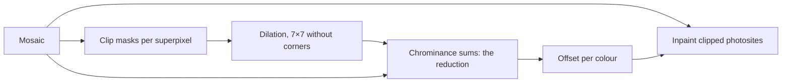

# Port spec: highlight reconstruction (highlights)

## Source

darktable at the reference release, commit 20891f6c6f. The reference is darktable's CPU path.

- `src/iop/highlights.c`: `reload_defaults()`, `legacy_params()`, `commit_params()`, `modify_roi_in()`, `process()`.
- `src/iop/hlreconstruct/opposed.c`: `_process_opposed()`, `_mask_dilated()`.
- `src/iop/hlreconstruct/segbased.c`: `_calc_refavg()`.
- OpenCL: `data/kernels/basic.cl` (`highlights_initmask`, `highlights_dilatemask`, `highlights_chroma`, `highlights_opposed`).

## Status

Ported, inpaint opposed only. The kernel is `slang/highlights.slang` in `crates/op/highlights`, its setup `src/lib.rs`.

- **Ported:** Bayer and X-Trans mosaics. The chrominance offset is a reduction (decision 15).
- **Not ported:** the other methods, linear raws (sraw), four-colour sensors and monochrome raws, which return `NotPorted`.
- **Checks:** it matches a restatement of darktable's CPU loops within 2e-6 relative on synthetic mosaics. It matches darktable itself on 29 of the 33 corpus mosaics, every one whose decoders and camera matrices agree (Results). Checked on one GPU, the Apple M4.
- **Module:** Highlight reconstruction is built ([../modules/highlight-reconstruction.md](../modules/highlight-reconstruction.md); Tool binding notes).

## Purpose

The third operation of the raw stage. Where a photosite has clipped, its true value is unknown, and a clipped green beside unclipped red and blue turns highlights magenta.

Inpaint opposed, darktable's default method, replaces each clipped photosite with an estimate from the two colours opposing its own around it. The estimate is offset by a chrominance the whole image gives, and the photosite keeps the larger of the estimate and the clipped value.

The signal stays scene-referred: nothing is clipped to 1, so later operations can still bring reconstructed highlights down.

## Pipeline

- **darktable position:** after temperature (order 4.0), before demosaic.
- **Domain:** scene-referred, raw.
- **Input and output:** the prepared, white-balanced mosaic, `f32`, in and out (`Format::Mosaic`), the same size.
- **Assumes earlier modules:** rawprepare and temperature. The clipping level is the white point times temperature's coefficient for each colour, and temperature's preset decides the late correction (decision 21).
- **Layer support:** background only, as for the whole raw stage.

## Parameters

darktable params version 4, 48 bytes: `mode`, `blendL` and `blendC` (unused), `strength`, `clip`, `noise_level`, `iterations`, `scales`, `candidating`, `combine`, `recovery`, `solid_color`. Inpaint opposed reads only `mode` and `clip`. The other fields belong to the other methods and come with them (decision 51).

| Name | darktable field | Type | Range | Default | Owner | Meaning |
| --- | --- | --- | --- | --- | --- | --- |
| Method | `mode` | choice by darktable's value: `clip`, `lch`, `inpaint`, `laplacian`, `segments`, `opposed` | | `opposed` | Highlight reconstruction | The reconstruction method; only `opposed` is ported |
| Clipping threshold | `clip` | f32 | 0 to 2 | 1 | Highlight reconstruction | Where clipping starts, as a fraction of each colour's white point; inpaint opposed uses 0.987 of it |

darktable forces the method "clip" for images that are not raws and for four-colour sensors, and switches the module off by default for monochrome raws.

Its default threshold is the lower of 1 and the DNG tag LinearResponseLimit (`reload_defaults`, read in `exif.cc` when the tag holds one value), and so is Apertrust's. `apertrust-raw` reads the tag and the image context carries it, 1 when unrecorded. Every corpus DNG that records it says 1.

## Parameter versions

- **v1:** `mode`, `blendL`, `blendC`, `blendh`, `strength`.
- **v2:** adds `clip`.
- **v3:** adds `noise_level`, `iterations`, `scales`, `candidating`, `combine` and `recovery`, for guided laplacians and segmentation.
- **v4:** drops `blendh` and adds `solid_color`.

`legacy_params` migrates each older version straight to v4, filling the new fields with defaults (`clip` 1 for v1). The harness writes v4, so no migration is ported. The import of darktable's edits will need them (decision 51, planned).

## Setup on the CPU (`commit_params` and `_process_opposed`)

- **Clipping levels:** `0.987 × clip × coefficient`, temperature's coefficient for each colour (`highlights_clip_magics`).
- **Late correction:** with temperature's preset "as shot to reference", the opposing averages weigh each colour by the camera's D65 multipliers over its as-shot ones (`chr->D65coeffs / chr->as_shot`), the correction colorin applies later. Otherwise 1 (`apertrust-color::late_correction`).
- **The masks' grid:** a superpixel per 3×3 photosites, `width / 3` by `height / 3`. darktable allocates each mask with both sides rounded up to 8 and keeps six masks one after another.
- **The colours:** a 6×6 tile of filter colours from the mosaic's corner, X-Trans's pattern or Bayer's repeated.

## Per photosite (`_process_opposed`)

1. **Clip masks.** For each superpixel but the grid's last row and column, a colour's mask is set when one of its photosites of that colour is at or above the colour's clipping level.
2. **Dilation.** Superpixels at least 3 from the grid's top and left edges and 4 from its bottom and right get each mask dilated over a 7×7 square without its corners (`_mask_dilated`). The others keep their own.
3. **Chrominance.** This is the reduction. It runs over every photosite whose value lies strictly between a fifth of its colour's clipping level and the level, with its colour's dilated mask set at its superpixel `(row / 3) × mwidth + col / 3`. Per colour it sums value minus its opposing average and counts the photosites. A colour's offset is the mean if more than 100 photosites contributed, else 0.
4. **Inpaint.** A photosite at or above its colour's clipping level becomes `max(value, opposing average + offset)`. The others pass through.

The **opposing average** of a photosite (`_calc_refavg`): over the 3×3 around it, each colour's mean of `max(0, value)`, times the late correction, then its cube root. The two colours opposing the photosite's own are averaged and the result cubed. As in darktable, the window stops before the mosaic's last row and column (`dymax = MIN(height - 1, row + 2)`).

## Neighbourhood and scale

- **Neighbourhood radius:** 1 photosite for the opposing averages. The chrominance offset needs the whole mosaic.
- **Scale dependence:** none. darktable runs it on the full mosaic in every pipe (`modify_roi_in` asks for the whole input at scale 1).
- **Tile overlap needed:** the whole mosaic, as darktable asks (`modify_roi_in`, and `process_tiling_ready` off). The reduction passes cover it by definition (decision 15). The inpaint, though its window is only 3×3, indexes the whole mosaic, as demosaic does. Exports run the raw stage whole and tile after it (decision 13).
- **Region-of-interest changes:** `modify_roi_in` takes the whole mosaic; the output is the input's size.

### Row strips

Where the mosaic is larger than the GPU binds at once (lavapipe's 128 MiB, at 33 MP), the passes that read it run in bands of rows, each binding a window of it (decision 14). Each pass finds its rows from the pass header's origin and indexes the whole mosaic less the header's `input_base` and `output_base`.

| Pass | In bands | How |
| --- | --- | --- |
| Clip masks | yes | Over the grid's rows of `mask_width` entries, until `mask_size` is covered (the padding entries stay 0), so a row of its invocations reads three rows of the mosaic |
| Dilation | yes, as the mosaic's | Its invocations' rows, `mask_stride` entries each, count from the header's origin, binding the masks whole. Each entry depends only on the finished clip masks, so a band computes what the whole pass would |
| Sums | yes | In bands of whole workgroup rows, multiples of 64 rows of photosites (3,456 for the 7R V at 128 MiB). Each workgroup's sums are written at its index in the whole mosaic, so the combination and the offsets are the whole mosaic's |
| Combination | no | One workgroup, run whole |
| Inpaint | yes | Reads a row above and below its band |

The masks and the sums stay whole. A mask takes under half a byte a photosite, so it reaches 128 MiB only at about 300 MP. darktable's read past the dilated mask wraps to its first rows, which a band at the bottom would not bind.

A job's export cuts the dilation into steps of about 8 MP, since it is otherwise its longest pass.

## Precision and special values

`f32` throughout, as darktable's. Photosites below 0 count as 0 in the opposing averages and pass through unchanged.

WGSL has no `cbrt`: the kernel takes `pow(x, 1/3)` and one Newton step, which comes as close as the C library's `cbrtf`.

The sums run in a tree, darktable's in each thread's order, so the offsets differ in the last bits.

## CPU and OpenCL differences in darktable

The OpenCL path rounds the masks' size to 4, not 8, keeps only the three dilated masks, and adds the per-row sums up on the CPU. Its kernels otherwise follow the CPU loops. Apertrust follows the CPU path, masks' layout included.

## Deliberate differences

- **darktable's reads past its masks:** the last rows and columns of the mosaic map to superpixels beyond the grid, and darktable reads them as the entries that follow in memory: the next row's first superpixel, the padding, and past the end of one dilated mask the next colour's. Apertrust reproduces this, and reads past the last mask, which darktable does not own, as unset.
- **No shared state between pipes:** darktable keeps the full pipe's offsets with the image (`img_oppchroma`) so its preview pipe, which sees a downscaled image, reuses them. Apertrust's pipes all run the raw stage on the full mosaic (decision 12), so every pipe computes the same offsets. The engine's cache will keep them (engine.md, Caching).
- **The sums' order:** a tree of workgroups, not darktable's threads (Precision).
- **The dilation reads each entry once.** darktable's `_mask_dilated` tests one colour's mask at a time, reading the 45 entries of the square three times. The kernel ORs the entries' bits once and keeps the three colours'. The bits are the same, since a colour's dilated bit is set exactly when one of the entries has it, so the masks, the offsets and every photosite are darktable's bit for bit.
- **Only inpaint opposed.** Clip, LCh, inpaint, guided laplacians and segmentation return `NotPorted`, with linear raws, which darktable reconstructs with `_process_linear_opposed`.
- **No derivatives:** the raw stage exports none (decision 21).

## Tool binding notes

In the first pass (decision 2) the Highlight reconstruction module is darktable's: method and clipping threshold, the other methods' controls coming with their methods (`docs/modules/README.md`).

The module is built (`crates/modules/src/highlight_reconstruction.rs`, [../modules/highlight-reconstruction.md](../modules/highlight-reconstruction.md)). It owns both parameters:

- the method takes only inpaint opposed;
- the threshold starts at this operation's default for the photo, which the module restates from the image context, its tests holding the two together, and it sets `clip` only off it.

The other methods' controls are in its definition, not ported, at darktable's defaults, with no parameter here until their methods come.

The method lists darktable's methods for the photo, as `reload_defaults` rebuilds its list (`Module::options`, decision 30). Reconstruct colour, which darktable lists on no photo, is left out.

An edit from another photo that holds a method this photo does not list renders as darktable's darkroom renders it:

- guided laplacians on a raw that is not Bayer, and LCh, reconstruct colour or segmentation on a linear raw, as inpaint opposed. Only darktable's `gui_changed` writes this, so the binding does here. darktable-cli, which has no panel, runs its Bayer laplacian on an X-Trans mosaic;
- every method on an image that is not a raw, or on a four-colour sensor, as clip, as darktable's `commit_params` does.

The module's table holds this in an invariant row.

A change re-runs the raw stage and demosaic (decision 12).

## Gradients

None: the raw stage exports no derivatives (decision 21).

## Test plan

- **`crates/engine/tests/highlights.rs`:** the pipeline on a GPU against darktable's CPU loops restated in Rust.
  - Synthetic Bayer and X-Trans scenes with clipped highlights at the corners and in the middle, at sizes that are not multiples of 3. The Bayer grid is 48 × 40, so the last rows read past one dilated mask into the next. The X-Trans case runs with the late correction.
  - The same scenes on the GPU opened to bind 40 KiB at once, so every pass that reads the mosaic runs in two bands, the dilation too, and the middle highlight crosses the sums' boundary at row 64 and the dilation's. They give the same offsets, counts and photosites bit for bit (decision 14). A dilation that left out the header's origin fails it.
- **`apertrust-golden raw-run`:** the raw stage with highlight reconstruction, demosaic and colorin, against darktable with the same parameters, highlights v4 written into its history. By default with temperature "as shot to reference", so the opposing averages weigh by the late correction (decision 27), and with `--as-shot` without it.
- **Unit tests:** the clipping levels and grid, the uniform block's size, the late correction, the default threshold from LinearResponseLimit, what is not ported.

## Results

Apple M4. Against the restatement of darktable's loops: within 2e-6 relative on every photosite, Bayer and X-Trans.

### Against darktable

`raw-run --as-shot` on darktable's five test raws and the 40 raw.pixls.us samples, highlight reconstruction in the chain: 29 of the 33 mosaics match darktable to a mean of 7.9e-9 to 1.4e-7, the same 29 as without it. The other 4 differ for their decoders or camera matrix.

The table lists the raws with clipped highlights, photosites at or above 0.987 of white. 15 of the samples have none, so there highlight reconstruction changes nothing on either side.

| Raw | Clipped photosites | Mean \|Δ\| | Pixels over 1e-4 | Result |
| --- | --- | --- | --- | --- |
| Pentax K-3 Mark III | 14.4% | 7.4e-8 | 0.0005% | pass |
| OM System OM-1 Mark II | 0.44% | 2.0e-8 | 0.0000% | pass |
| Panasonic S5 Mark II | 0.44% | 3.0e-8 | 0.0002% | pass |
| Fujifilm X100VI (X-Trans) | 0.16% | 1.1e-7 | 0.0050% | pass |
| Nikon Z 9 | 0.023% | 1.1e-8 | 0.0002% | pass |
| Canon 90D | 0.007% | 1.8e-8 | 0.0003% | pass |
| Canon R6 Mark II | 0.004% | 1.8e-8 | 0.0002% | pass |
| Canon 40D | 0.021% | 2.2e-6 | 0.0006% | camera matrix (colorin.md) |
| Sony RX100 III (`hlrecovery.arw`), A6400, A1 | 3.3%, 0.42%, 1.46% | 1.5e-4, 6.7e-5, 9.1e-5 | | the lossy ARW dither's seed (decision 23) |

The K-3 Mark III's 14% are genuine: 12% of its photosites sit at the 14-bit ceiling and the rest in the spread where its green and blue saturate, above highlight reconstruction's level (`docs/ports/rawprepare.md`). On it highlight reconstruction changes 16% of the exported image, and on `hlrecovery.arw` 5%, so the passes compare reconstructed highlights, not untouched ones.

### Timing

GPU time on the M4:

| Size | The dilation | All five passes |
| --- | --- | --- |
| 61 MP | 6.1 to 8.6 ms | 18 to 19 ms |
| 40 MP | 4.0 to 6.0 ms | |

## Open questions

- The Sony lossy ARWs cannot check highlight reconstruction against darktable until rawler seeds its dither as darktable's decoder does (decision 23).
