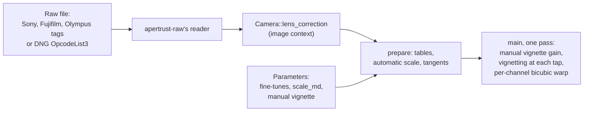
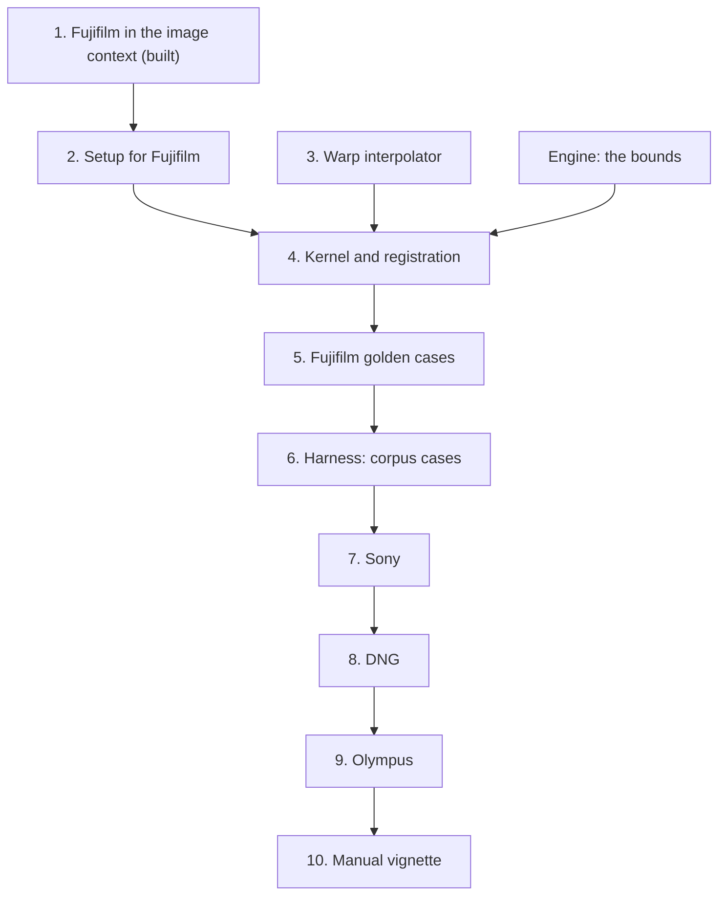

# Port spec: lens correction (lens), embedded-metadata method

## Source

darktable at the reference release, commit 20891f6c6f. The reference is darktable's CPU path.

- **The module:** `src/iop/lens.cc`: `legacy_params()`, `reload_defaults()`, `commit_params()`, `_get_method()`, `_commit_params_md()`, `_init_coeffs_md_v1()`, `_init_coeffs_md_v2()`, `_get_autoscale_md_v1()`, `_interpolate_linear_spline()`, `_check_corrections_md()`, `process()`, `_process_md()`, `_init_vignette_spline()`, `_calc_vignette_spline()`, `_preprocess_vignette()`, `modify_roi_in()`, `_modify_roi_in_md()`, `distort_transform()`, `_distort_transform_md()`, `distort_backtransform()`, `_distort_backtransform_md()`, `_distort_mask_md()`, `tiling_callback()`, `_tiling_callback_md()`, `gui_init()`, `gui_changed()`.
- **The metadata:** `src/common/exif.cc` (`dt_exif_img_check_additional_tags()`, `_check_dng_opcodes()`, `_check_lens_correction_data()`), `src/common/dng_opcode.c` (`dt_dng_opcode_process_opcode_list_3()`) and `src/common/image.h` (`dt_image_correction_type_t`, `dt_image_correction_data_t`).
- **The warp interpolator:** `src/common/interpolation.c` (`dt_interpolation_new()`, `_compute_upsampling_kernel()`, `_maketaps_bicubic()`, `dt_interpolation_compute_sample()`, `_mirror()`), with its default from `data/darktableconfig.xml.in` (`plugins/lighttable/export/pixel_interpolator_warp`, bicubic).
- **Helpers:** `dt_fast_hypotf()` from `src/common/math.h`.
- **The OpenCL path:** `process_cl()` and `_process_cl_md()`, with `md_vignette`, `md_lens_correction`, `lens_man_vignette` and `interpolation_compute_single` in `data/kernels/basic.cl`.

## Status

**Specified (decision 25); the operation is not ported yet.** The first build task is done: Fujifilm's corrections are read into the image context (Slices, 1).

This spec covers the embedded-metadata method only: darktable's `DT_IOP_LENS_METHOD_EMBEDDED_METADATA`, with the manual vignette correction that every method applies. The Lensfun method is a later part and is marked as such throughout. darktable's module is large (4,702 lines of C++, three methods, two versions of the embedded algorithm), so the port is split into build tasks, listed in order under Slices.

**Golden cases planned:**

- darktable's tests 0145-lens-metadata-xtransIV-modversion-6 and 0146-lens-metadata-xtransIV-modversion-7 (`xtransIV.raf`, a Fujifilm X-T3 with a Sigma 18-50mm F2.8 DC DN), the only integration tests of the embedded method;
- edited sidecars on raw.pixls.us corpus raws for Sony, DNG and OM System, which darktable's test images do not cover (Test plan; decision 25).

## Purpose

Lens correction removes a lens's optical flaws:

- barrel or pincushion **distortion**;
- transverse (lateral) **chromatic aberration**, where red and blue are imaged at slightly different sizes than green;
- **vignetting**, the darkening towards the corners.

The embedded-metadata method takes the corrections from the raw itself. Sony, Fujifilm and OM System (Olympus) cameras record the mounted lens's profile in the file, and a DNG can carry them as the WarpRectilinear and FixVignetteRadial opcodes.

Algorithmically, the metadata becomes, per channel, a piecewise-linear function of the normalised radius giving the input radius as a multiple of the output radius, and a piecewise-linear gain. Every output pixel samples each channel of the vignetting-corrected input at its own warped position with darktable's warp interpolator, bicubic by default. A user scale (and an automatic one) crops or extends the result, and fine-tunes from 0 to 2 scale each correction. A manual vignette correction, a radial gain shaped by strength, radius and steepness, applies first, in every method.

In Apertrust it is the operation behind the first pass's Lens correction module, in the Correct tab (decisions 2 and 38; `docs/modules/README.md`, Lens correction). It is the first port that changes an image's geometry through the engine's maps (decision 16).

## Pipeline

- **darktable position:** 13.0 in the v5.0 order (`src/common/iop_order.c`, `v50_order`). It comes after demosaic (8.0), denoise (profiled) (9.0), bilateral (10.0), rotate pixels (11.0) and scale pixels (12.0), and before chromatic aberrations (`cacorrectrgb`, 13.5), haze removal (14.0), rotate and perspective (15.0) and orientation (16.0). The tests' sidecars use the v3.0 order (`iop_order_version` 2), which has it at 13.0 too.
- **Apertrust slot:** camera RGB 13, darktable's (decision 22), between denoise (profiled) (camera RGB 9, specified) and haze removal (camera RGB 14). Its row in `crates/operations/order.md`'s table, added with the kernel: `lens | camera RGB 13 | no | 13.0, after denoise (profiled), before chromatic aberrations and haze removal | Lens correction`.
- **Domain:** scene-referred, linear in and out.
- **Input and output:** RGBA in camera RGB (`default_colorspace()` is `IOP_CS_RGB`), white balanced by temperature, before the input colour profile. The output is in the same space and of the same size: lens has no `modify_roi_out`, so darktable's default keeps the input's size.
- **Assumes earlier modules:** demosaic. The corrections act on the camera's own red, green and blue, which is why the module sits before colorin: per-channel warps do not commute with a matrix that mixes channels.
- **Layer support:** background only (`docs/modules/README.md`): it moves pixels, and its maps carry layers' masks (decision 16).
- **On by default:** no. darktable's lens correction is off until the user turns it on. `lens.cc` has no `init`, so `dt_iop_default_init` leaves `default_enabled` false, and no `init_presets`, so no workflow preset applies it (`_dev_auto_apply_presets` applies only presets marked auto-apply). Apertrust's manifest has `default_enabled` off.
- **darktable's tiling:** `_tiling_callback_md`: factor 4.5, maxbuf 1.5, overlap 4, align 1, with `IOP_FLAGS_TILING_FULL_ROI`, so darktable's tiling asks `modify_roi_in` for every tile's input. darktable-cli's export of the cases at `resourcelevel=reference` does not tile.

## Parameters

darktable params version 10, 356 bytes:

- `method`, `modify_flags`, `inverse` (enums, i32);
- `scale`, `crop`, `focal`, `aperture`, `distance` (f32);
- `target_geom` (enum);
- `camera[128]`, `lens[128]` (char);
- `tca_override` (gboolean);
- `tca_r`, `tca_b`, `cor_dist_ft`, `cor_vig_ft`, `cor_ca_r_ft`, `cor_ca_b_ft`, `scale_md_v1` (f32);
- `md_version` (enum);
- `scale_md` (f32);
- `has_been_set` (gboolean);
- `v_strength`, `v_radius`, `v_steepness` (f32);
- `reserved[2]` (f32).

The embedded-metadata method reads `method`, `modify_flags`, `cor_dist_ft`, `cor_vig_ft`, `cor_ca_r_ft`, `cor_ca_b_ft`, `md_version`, `scale_md`, `scale_md_v1` (version 1 only), `has_been_set` (in `commit_params`) and the manual vignette's `v_strength`, `v_radius` and `v_steepness`. Every other field is the Lensfun method's.

| Name | darktable field | Type | Range | Default | Meaning | Owner |
| --- | --- | --- | --- | --- | --- | --- |
| Correction method | `method` | choice | embedded metadata (0), Lensfun database (1), only manual vignette (2) | embedded metadata when the photo carries corrections, else Lensfun (`reload_defaults`) | which data correct the lens | Lens correction; Lensfun not ported in this part |
| Corrections | `modify_flags` | choice | none (0), all (7), distortion & TCA (5), distortion & vignetting (6), TCA & vignetting (3), only distortion (4), only TCA (1), only vignetting (2) | all; distortion & vignetting on a monochrome image | which corrections apply; bits TCA 1, vignetting 2, distortion 4 | Lens correction |
| Distortion | `cor_dist_ft` | f32 | 0 to 2 | 1 | fine-tune of the warp: 0 none, 1 the metadata's, 2 twice; for a DNG it scales the whole warp, its chromatic aberration included | Lens correction, Fine-tuning |
| Vignetting | `cor_vig_ft` | f32 | 0 to 2 | 1 | fine-tune of the vignetting correction | Lens correction, Fine-tuning |
| TCA red | `cor_ca_r_ft` | f32 | 0 to 2 | 1 | fine-tune of red's chromatic aberration (version 2; not DNG) | Lens correction, Fine-tuning |
| TCA blue | `cor_ca_b_ft` | f32 | 0 to 2 | 1 | fine-tune of blue's | Lens correction, Fine-tuning |
| Image scale | `scale_md` | f32 | 0.1 to 2 | 1 | the output's scale over the automatic scale; outside 0.1 to 2 `commit_params` uses 1 | Lens correction, Fine-tuning |
| Strength | `v_strength` | f32 | 0 to 1 | 0 | manual vignette correction's amount, shown as a percentage | Lens correction, Manual vignette correction |
| Radius | `v_radius` | f32 | 0 to 1 | 0.5 | radius of the uncorrected centre | Lens correction, Manual vignette correction |
| Steepness | `v_steepness` | f32 | 0 to 1 | 0.5 | steepness of the correction outside the radius | Lens correction, Manual vignette correction |
| Algorithm version | `md_version` | enum | version 1 (0), version 2 (1) | version 2 for a photo with corrections (`reload_defaults`) | the embedded algorithm: version 1 for edits made before darktable 4.4 | fixed: version 2 (Deliberate differences, 1) |
| Scale fine-tune | `scale_md_v1` | f32 | 0.9 to 1.1 | 1 | version 1's scale; outside its range an automatic scale | fixed: version 1 only |
| Set | `has_been_set` | gboolean | | false | darktable's bookkeeping: until a control changes, `commit_params` renders `reload_defaults`' values with the history's method | fixed: resolved by `ports.rs` (Parameter versions) |
| Lensfun's | `inverse`, `scale`, `crop`, `focal`, `aperture`, `distance`, `target_geom`, `camera`, `lens`, `tca_override`, `tca_r`, `tca_b` | | | from the EXIF and lensfun's database | the Lensfun method | Lens correction, the later part |
| | `reserved[2]` | f32 | | 0 | padding | none |

**The schema** (version 1, Apertrust's count), proposed:

- `method` and `modify_flags` as choices named from darktable's descriptions: `embedded_metadata`, `lensfun`, `only_vignette`; `none`, `all`, `distortion_tca`, `distortion_vignetting`, `tca_vignetting`, `distortion`, `tca`, `vignetting`;
- the four fine-tunes, `scale_md` and the manual vignette's three, with darktable's introspection ranges and defaults;
- `md_version`, `scale_md_v1` and `has_been_set` left out (fixed).

Lensfun's parameters join with its port, as schema version 2 filling them with their defaults; no edit can hold them before.

**Defaults from the image** (`Operation::defaults(image)`, as `reload_defaults`): `method` is `embedded_metadata` when the image context carries corrections and `lensfun` otherwise; `modify_flags` is `distortion_vignetting` on a monochrome image and `all` otherwise.

## Parameter versions

darktable's `legacy_params` migrates every version straight to 10. "Version 1 comes from ancient times and seems to be forgotten by now": it has no migration.

| Version | Change | Migration to 10 |
| --- | --- | --- |
| 2 | Lensfun only: `modify_flags` (lensfun's bits), `inverse`, `scale`, `crop`, `focal`, `aperture`, `distance`, `target_geom` (lensfun's type), `camera[52]`, `lens[52]`, `tca_override`, `tca_r`, `tca_b` | flags and lens type to darktable's enums; `tca_r` and `tca_b` swapped, as version 2 had them swapped; method Lensfun; fine-tunes, scales 1; `md_version` 2; `has_been_set` true; manual vignette 0, 0.5, 0.5 |
| 3 | `camera[128]`, `lens[128]` | as version 2, not swapped |
| 4, 5 | append `modified` | as version 3; `has_been_set` = `modified`, and `legacy_params` returns −1 when it is 0 |
| 6 | prepend `method`; enums darktable's own; append `cor_dist_ft`, `cor_vig_ft` before `modified` | kept; `cor_ca_*_ft` 1, `scale_md_v1` 1, `scale_md` 1; `md_version` 1 if the method is embedded metadata, else 2; `has_been_set` = `modified`, −1 when 0 |
| 7 | `modified` replaced by `cor_scale` | `scale_md_v1` = `cor_scale`; `md_version` as version 6; `has_been_set` false |
| 8 | append `cor_ca_r_ft`, `cor_ca_b_ft`, `scale_md_v1`, `md_version`, `scale_md` | kept; `has_been_set` false |
| 9 | append `has_been_set` | copied |
| 10 | append `v_strength`, `v_radius`, `v_steepness`, `reserved[2]` | current; the migrations above fill 0, 0.5, 0.5, 0 |

A return of −1 makes `dt_iop_legacy_params` report "auto init", which `dev_read_history` treats as success: it changes nothing but `has_been_set`.

**What the cases hold:**

- Test 0145 is version 6 with `method` embedded metadata, `modify_flags` all, both fine-tunes 1 and `modified` 0.
- Test 0146 is version 7 with `cor_scale` 0.97232.
- Both migrate to `md_version` 1 with `has_been_set` false. So `commit_params` ignores them and renders `reload_defaults`' values with the method kept: version 2, every correction, every fine-tune 1, `scale_md` 1, manual vignette off.
- Edited sidecars are version 10 with `has_been_set` true.

`ports.rs` decodes versions 6, 7 and 10 and applies the migration exactly. It resolves `has_been_set` false to the defaults with `_get_method`'s fallback (embedded metadata without corrections becomes Lensfun), so the kernel gets what darktable renders.

## The metadata

### What darktable reads (`src/common/exif.cc`, `src/common/dng_opcode.c`)

On every raw darktable loads (`dt_imageio_open_rawspeed`, and LibRaw's loader for CR3), `dt_exif_img_check_additional_tags` reads the file's EXIF with Exiv2. It runs `_check_dng_opcodes`, then `_check_lens_correction_data`, which fill `dt_image_t::exif_correction_type` and `exif_correction_data` (`dt_image_correction_data_t`, a union by type). They are not kept in the library's database.

Each check overwrites the type when it finds its data, in this order: DNG opcodes, then Sony, Fujifilm and Olympus. Nothing resets it to none but a Fujifilm knot mismatch. The Sony, Fujifilm and Olympus checks need Exiv2 0.27.4 or later. `_exif_read_exif_tag` finds a key and requires its value to be non-empty.

**Sony** (`CORRECTION_TYPE_SONY`; `sony.nc`, `distortion[16]`, `ca_r[16]`, `ca_b[16]`, `vignetting[16]`, all `short`):

- Tags 0x7037 DistortionCorrParams, 0x7035 ChromaticAberrationCorrParams and 0x7032 VignettingCorrParams, SSHORT, counts 17, 33 and 17 on every corpus ARW. All three come from `Exif.SubImage1` (the first SubIFD of IFD0, the ARW's raw image), or, if any is missing, all three from `Exif.Image` (IFD0, where darktable's own DNG export copies them).
- Valid when `nc = DistortionCorrParams[0]` is at most 16, `ChromaticAberrationCorrParams[0] = 2·nc` and `VignettingCorrParams[0] = nc`. Then `distortion[i] = D[i + 1]`, `ca_r[i] = C[i + 1]`, `ca_b[i] = C[nc + i + 1]`, `vignetting[i] = V[i + 1]` for i below nc.
- Units, from `_init_coeffs_md_v2`:
  - distortion is `1 + D · 2⁻¹⁴`, the input radius over the output radius;
  - chromatic aberration a factor `1 + C · 2⁻²¹` on red's and blue's;
  - vignetting a brightness `2^(0.5 − 2^(V · 2⁻¹³ − 1))`, 1 at V = 0.
- The knots are fixed: knot i at radius `(i + 0.5) / (nc − 1)`, the radius normalised to the half-diagonal.

**Fujifilm** (`CORRECTION_TYPE_FUJI`; `fuji.nc`, `cropf`, `knots[11]`, `distortion[11]`, `ca_r[11]`, `ca_b[11]`, `vignetting[11]`, `float`):

- Tags `Exif.Fujifilm.GeometricDistortionParams` (0xf00b), `ChromaticAberrationParams` (0xf00f) and `VignettingParams` (0xf010), SRATIONAL, in the RAF's own TIFF-like directory: the FujiIFD (0xf000) at the offset the RAF header holds at byte 100.
- `Exif.Fujifilm.CropMode` (0x104d, SHORT), in the Fujifilm maker note of the EXIF at the header's offset at byte 84.
- Exiv2's `toFloat` is the numerator over the denominator in f32, 0 for a denominator of 0.
- **X-Trans IV and V layout** (counts 19, 29, 19): nc 9. The knots are `D[1..9]`, which must equal `C[1..9]` and `V[1..9]` exactly, or the type becomes none. Distortion is `D[10..18]`, `ca_r` `C[10..18]`, `ca_b` `C[19..27]`, vignetting `V[10..18]`. The first value of each, as 3749/9, and the CA tag's last are not read.
- **X-Trans I to III layout** (counts 23, 31, 23): nc 11. The knots are `D[1..11]`. The CA tag lacks the first knot, 0, so knot 0 must be 0 in `D` and `V` and knots 1 to 10 must equal `C[1..10]`. Distortion is `D[12..22]`; `ca_r[0] = ca_b[0] = 0`, `ca_r[i] = C[i + 10]`, `ca_b[i] = C[i + 20]` for i from 1; vignetting `V[12..22]`.
- Any other counts: no Fujifilm correction (the GFX 50S's 17, 25 and 17).
- `cropf` = 1.25 when CropMode is 2 or 4 (the 1.25× crop modes), else 1, the tag missing included.
- Units:
  - distortion in percent, `1 + D / 100`;
  - chromatic aberration a factor `1 + C`;
  - vignetting the brightness in percent, `V / 100`.
- The knots are radii normalised to the half-diagonal, multiplied by `cropf`. On the X-Trans IV raws the last is 1506/1420 = 1.0606, past the corner.

**DNG** (`CORRECTION_TYPE_DNG`; `dng.planes`, `cwarp[3][6]`, `centre_warp[2]`, `cvig[5]`, `centre_vig[2]`, `has_warp`, `has_vignette`, `float`):

- Tag OpcodeList3 (51022) from `Exif.SubImage1`, or, if missing, `Exif.Image` (a DNG without a preview has its opcodes in IFD0), bytes as stored (`Exiv2::invalidByteOrder`). OpcodeList2, read beside it, holds the gain maps rawprepare applies, not lens correction's.
- The list is big-endian: a u32 count, then per opcode a u32 id, a u32 version, u32 flags and a u32 parameter size, then the parameters. `has_warp` and `has_vignette` start false. An opcode whose parameters run past the buffer stops the parse, keeping what came before. The flags (optional, skippable for previews) are not looked at.
- **WarpRectilinear** (id 1): u32 planes, which must be 1 or 3 (otherwise the parse stops); per plane six doubles, `kr0`, `kr1`, `kr2`, `kr3`, `kt0`, `kt1`; then the centre, two doubles; stored as floats. Sets `has_warp` and type DNG. darktable uses only `kr0` to `kr3`: the tangential `kt0`, `kt1` and the centre are ignored, the centre taken as the image's. A later WarpRectilinear replaces an earlier one.
- **FixVignetteRadial** (id 3): five doubles `k0` to `k4`, then the centre. Sets `has_vignette` and type DNG; the centre is ignored.
- Units, from the DNG specification as darktable evaluates it, both with r normalised to the half-diagonal:
  - the warp is `kr0 + kr1 r² + kr2 r⁴ + kr3 r⁶`, the input radius over the output radius per plane (red, green, blue);
  - the vignetting gain is `1 + k0 r² + k1 r⁴ + k2 r⁶ + k3 r⁸ + k4 r¹⁰`, by which a pixel is multiplied.

**Olympus and OM System** (`CORRECTION_TYPE_OLYMPUS`; `olympus.has_dist`, `dist[4]`, `has_ca`, `ca[6]`, `float`):

- Tags 0x150a and 0x150c of the Olympus maker note's ImageProcessing IFD (0x2040), Exiv2's `Exif.OlympusIp.0x150a` and `0x150c`, FLOAT. They are unnamed in Exiv2 and ExifTool alike: Exiv2 lists them only with `-u`, ExifTool only with `-u` as `Olympus_ImageProcessing_0x150a`.
- 0x150a with count 4: `dist[i]` its values; `has_dist` when any of the first three is non-zero (no correction is "0 0 0 1"). 0x150c with count 6: `ca[i]`; `has_ca` when any is non-zero. Type Olympus when either holds.
- Units:
  - `dist[0..2]` are `dk2`, `dk4`, `dk6` and `dist[3]` is `drs`, the corner's radius: the input radius `Rin = Rout·drs·(1 + dk2 (Rout·drs)² + dk4 (Rout·drs)⁴ + dk6 (Rout·drs)⁶)`, both normalised to their corners;
  - `ca` is `car0`, `car2`, `car4`, `cab0`, `cab2`, `cab4`: red's input radius `Rin·((1 + car0) + car2 Rin² + car4 Rin⁴)`, blue's likewise;
  - no vignetting.

### On the corpus

Read with Exiv2 0.28.9's command-line tool (`exiv2 -u -pv` with darktable's keys) on the 40 raw.pixls.us samples and darktable's five test images, applying darktable's checks by hand:

| Raw | darktable's type | Data |
| --- | --- | --- |
| Sony ILCE-7RM5, lossless large (FE 50mm F1.2 GM) | Sony | nc 16; vignetting up to 13312 (×2.06 at the last knot), distortion −79 to +168 |
| Sony ILCE-7RM5, lossless small | Sony | nc 16, as the large one; a 3-component image, not a mosaic |
| Sony ILCE-1 (FE 135mm F1.8 GM), lossy | Sony | nc 16, distortion up to 124, vignetting up to 2512 |
| Sony ILCE-6400 (E PZ 18-105mm F4 G OSS), lossy | Sony | nc 11, distortion up to 2156 (+13% at the last knot) |
| `hlrecovery.arw` (darktable's images) | none | distortion's nc 11, vignetting's 16: darktable's check fails |
| Fujifilm X-T5, X-H2S, X-E4, X100VI; `xtransIV.raf` (X-T3), `mire1-xtrans.raf` (X-T4) | Fujifilm, X-Trans IV and V layout | CropMode 0; the X100VI's distortion all 0, its lens fixed |
| Fujifilm GFX 50S | none | counts 17, 25, 17, a layout of 8 knots that darktable does not read |
| Leica Q2 DNG | DNG | WarpRectilinear, 3 planes (kr1 about −0.048, kr2 −0.098, kr3 0.055); no FixVignetteRadial |
| Google Pixel 4a DNG | DNG | WarpRectilinear, 1 plane, the identity (kr0 1, the rest 0) |
| GoPro HERO5 Black GPR | DNG | WarpRectilinear in IFD0, 3 planes, chromatic aberration only (red ×1.00037, blue ×1.00019); rawler cannot decode GPR |
| OM System OM-1 Mark II (M.12-40mm F2.8) | Olympus | `dist` −0.0200, 0.0112, −0.0032, 1; `ca` non-zero |
| Olympus E-M1 Mark III, 80 MP high resolution (M.12-40mm F2.8) | Olympus | `dist` 0.0070, 0.0062, −0.0028, 0.98977; `ca` non-zero |
| The other DNGs (Adobe DNG Converter's EOS 5D Mark III pair, iPhone 12 Pro, Pentax K-1 Mark II, Leica M Monochrom), Canon, Nikon, Panasonic, Pentax PEF, Phase One, Samsung, Sigma, Hasselblad | none | the lossy DNG has OpcodeList2 only |

No corpus raw has a FixVignetteRadial opcode or the X-Trans I to III layout.

### The corrections in the image context

The corrections reach the operation through the image context (decision 25, amending decisions 21 and 24):

- `apertrust-raw` reads them into `RawImage::lens_correction`, an enum of darktable's four types, each holding `dt_image_correction_data_t`'s values as darktable stores them.
- `apertrust-engine::raw` copies it to `apertrust_plugin::Camera::lens_correction: Option<LensCorrection>`, as it copies the other camera fields.
- All the maths stays in the operation. The module reads the corrections for darktable's conditions on its rows.
- The lens's identity, focal length, aperture and distance join with Lensfun's method.

Fujifilm's are read today (Slices, 1); the other three types are read in their slices.

### The reader in `apertrust-raw`

The reader is Apertrust's own, over rawler's public TIFF and maker-note parsers (decision 25), with no C or C++ (decision 5) and no new dependency. rawler 0.8.0 (LGPL-2.1) is already the decoder, so the tags come from the same bytes the decoder trusts, and the corpus test pins the values. It re-reads the file's IFDs once, a few milliseconds beside the decode.

| Type | What rawler offers | The reader |
| --- | --- | --- |
| DNG | Its decoder exposes its IFDs, `Decoder::ifd(WellKnownIFD::Root)`, `Raw` and `VirtualDngRawTags`, so OpcodeList3's bytes are reachable (`apertrust-raw` already reads a DNG's colour tags this way). rawler does not parse opcodes. | `Decoder::ifd` and a bounds-checked port of `dt_dng_opcode_process_opcode_list_3`, about 60 lines |
| Sony | The ARW decoder parses the TIFF structure, the raw IFD with tags 0x7032 to 0x7037 included (named in `rawler::tags::TiffCommonTag`), but implements no `Decoder::ifd`. Its TIFF parser is public: `rawler::formats::tiff::GenericTiffReader::new` over the file follows SubIFDs, and `IFD::get_entry` gives the SSHORT values (`force_i16`). | `GenericTiffReader`: the first SubIFD's three tags, else IFD0's, and darktable's check, about 30 lines |
| Fujifilm | rawler parses the FujiIFD into its RAF decoder's private IFD (`decoders::raf::parse_raf` is private) and names 0xf00b, 0xf00f and 0xf010 in the public `decoders::raf::FujiIFD`, CropMode in `RafMakernotes`. Its public `IFD::new_root_with_correction` reads the FujiIFD from the header's pointer as `parse_raf` does, and `IFD::parse_makernote` the Fujifilm maker note for CropMode. | The FujiIFD and maker note as `parse_raf` finds them, darktable's two layouts and the knot check, about 40 lines (built) |
| Olympus | `rawler::decoders::orf::parse_makernote(reader, exif_ifd)` is public and returns the maker note with the ImageProcessing IFD as a sub-IFD, where 0x150a and 0x150c are FLOAT (`force_f32`). | `orf::parse_makernote` inside `catch_unwind`, about 20 lines: it can `assert!` on an unexpected OM System header, so it runs as `apertrust-raw`'s other metadata does |

Two details of rawler's Fujifilm parsing matter:

- Its SRATIONAL to f32 is Exiv2's arithmetic, `n as f32 / d as f32`, but infinite for a zero denominator, where Exiv2 gives 0. The reader gives 0 (Deliberate differences, 3).
- rawler files the 0xF000 directory under its entry's TIFF type, 13, not its tag, so the reader looks the three tags up below the second structure's root (`get_entry_recursive`), as Exiv2 finds them by key.

rawler implementing `Decoder::ifd` for ARW, RAF and ORF (the raw IFD, the FujiIFD and the maker notes) would shrink the readers to lookups, and `orf::parse_makernote` could return an error where it now panics. That request is to be filed upstream once Apertrust's repository is public; it is a release away, so it blocks nothing. Meanwhile the Olympus reader catches the panic itself.

exiftool-rs (decision 50's metadata library, GPL-3.0-or-later, on `deny.toml`'s list) is not used for this part. Its documented API (0.7.3) reads tags by name as print-converted strings; ExifTool names neither 0x150a nor 0x150c and gives OpcodeList3 as an unparsed blob, so the opcode parser would be needed anyway; and it would bring a large dependency for four tag groups. It can be reconsidered when the metadata spike reads maker notes for the rest of the app.

## Setup on the CPU (`commit_params`, `_commit_params_md`)

From the parameters and the image context's corrections, in `crates/op/lens/src/setup.rs`, `prepare`.

### Defaults and the identity

- **Defaults** (`commit_params`): `has_been_set` false renders the defaults with the method kept, `_get_method`: embedded metadata without corrections falls back to Lensfun. That is `ports.rs`'s job (Parameter versions); Apertrust's edits always hold their values.
- **Monochrome:** the TCA bit is cleared from the data's flags (`dt_image_is_monochrome`). The tables come from the parameters' flags, so a monochrome image whose parameters ask for TCA keeps it in the tables, as in darktable.
- **No corrections or no flags:** `nc = 0` when the image has no corrections (`_have_embedded_metadata`), and `nc = 0` or `modify_flags` none copies the input to the output.

### Tables, version 2 (`_init_coeffs_md_v2`)

The setup builds knots `knots_dist[16]`, `knots_vig[16]`, values `cor_rgb[3][16]` and `vig[16]`, and `nc`, per type, in f32 as darktable computes them. `ft_d`, `ft_v`, `ft_r`, `ft_b` are the fine-tunes; the flags are the parameters'.

**Sony:**

- `nc` from the data. `knots_dist[i] = knots_vig[i] = (float)(i + 0.5) / (nc − 1)`.
- `cor_rgb[c][i] = ft_d · D[i] · 2⁻¹⁴ + 1` with distortion on, else 1.
- With TCA on, `cor_rgb[0][i] *= ft_r · R[i] · 2⁻²¹ + 1` and `cor_rgb[2][i] *= ft_b · B[i] · 2⁻²¹ + 1`.
- `vig[i] = 2^(0.5 − 2^(ft_v · V[i] · 2⁻¹³ − 1))` with vignetting on, else 1.

**Fujifilm:**

- A knot `(0, 1)` comes first when the first knot is above 0 (none for the X-Trans I to III layout, whose first knot is 0): `knots_in = 0`, `cor_rgb_in = 1`, CA 0, `knots_vig = 0`, `vig = 1`.
- Then, for each of the data's knots: `knots_in = knots_vig = cropf · knot`, `cor_rgb_in = ft_d · D / 100 + 1` (whatever the flags), `cor_ca_r_in = ft_r · R`, `cor_ca_b_in = ft_b · B`, `vig = 1 − ft_v · (1 − V / 100)` with vignetting on, else 1. There are `ncin` of them.
- The distortion spline is then turned from the input's radius to the output's. For i from 0 to 15: `rin = i / 15`, `m = L(knots_in, cor_rgb_in, ncin, rin)`, `knots_dist[i] = rin / m`, `cor_rgb[c][i] = m` with distortion on, else 1. With TCA on, `cor_rgb[0][i] *= L(knots_in, cor_ca_r_in, ncin, rin) + 1`, and blue likewise. `nc = 16`.
- So the knots move with the distortion even while distortion is off, and the vignetting table keeps `ncin` (10) knots but is read with `nc = 16` (Precision).

**DNG:**

- `nc = 16`, `knots_dist[i] = knots_vig[i] = r = i / 15`, tables 1.
- With `has_warp` and distortion or TCA on, per plane: `r_cor = kr0 + kr1 r² + kr2 r⁴ + kr3 r⁶` (`powf(r, 2.0f)` and so on), `cor_rgb[c][i] = ft_d · (r_cor − 1) + 1`. One plane copies to all three.
- With `has_vignette` and vignetting on: `dvig = k0 r² + k1 r⁴ + k2 r⁶ + k3 r⁸ + k4 r¹⁰`, `vig[i] = 1 / (1 + ft_v · dvig)`.
- The TCA fine-tunes are not read: a DNG's chromatic aberration is in its warp.

**Olympus:**

- `drs, dk2, dk4, dk6` from `dist` with `has_dist`, else 1, 0, 0, 0; `car0, car2, car4, cab0, cab2, cab4` from `ca` with `has_ca`, else 0.
- `nc = 16`, `knots_dist[i] = knots_vig[i] = r = i / 15`.
- With distortion on: `rs2 = (r · drs)²`, `r_cor = drs · (1 + rs2 (dk2 + rs2 (dk4 + rs2 · dk6)))`, `cor_rgb[c][i] = ft_d · (r_cor − 1) + 1`; else 1.
- With TCA on and `r > 0`: `rd = cor_rgb[1][i] · r`, `rd2 = rd²`, `cor_rgb[0][i] += ft_r · rd · (car0 + rd2 (car2 + rd2 · car4)) / r`, and blue with `cab`.
- `vig[i] = 1`.

### The automatic scale and `scale_md`

The end of `_init_coeffs_md_v2`, for every type:

1. `iwd2 = 0.5 · W`, `iht2 = 0.5 · H`, with W × H the lens's input at full resolution: darktable's `img->p_width`, `p_height`, rawprepare's output; Apertrust's `ImageContext` width and height, the developed image before any geometry.
2. `srr = min(iwd2, iht2) / √(iwd2² + iht2²)`.
3. `scale` is the largest of `L(knots_dist, cor_rgb[c], nc, x)` over the three channels and `x = srr + (1 − srr) · k / 199`, k from 0 to 199 (`float` k, as darktable's loop counts).
4. `knots_dist[i] *= scale` and `cor_rgb[c][i] /= scale`, so the spline becomes `x ↦ f(x / scale) / scale`. `knots_vig` is not scaled.

darktable's comment calls it the scale that shows the largest visible image box after the correction, walking the radii from the shorter edge's midpoint to the corner.

On test 0145's X-T3 data, emulated in f32 at 6240 × 4160 (the case's real size comes with its render): `scale` 0.96804, the output corner sampling green at input radius 0.9528 and red and blue within 3·10⁻⁴ of it, the vignetting gain 1.93 at the corner.

**`scale_md`** is the parameter, or 1 outside 0.1 to 2.

### The linear spline

`L(xi, yi, n, x)` (`_interpolate_linear_spline`):

- `yi[0]` for `x < xi[0]`;
- otherwise the first segment i from 1 with `xi[i−1] ≤ x ≤ xi[i]`: `yi[i−1] + (x − xi[i−1]) · (yi[i] − yi[i−1]) / (xi[i] − xi[i−1])`;
- past every segment, `yi[n−1]`.

### Version 1, not ported

`_init_coeffs_md_v1` and `_get_autoscale_md_v1`, recorded for completeness (Deliberate differences, 1):

- `scale = 1 / scale_md_v1`, or an automatic `scale_md_v1` when it lies outside 0.9 to 1.1: the largest of the splines at scale 1 over `x = 0.5 + 0.5 · k / 199`, 1 for a DNG.
- Sony: the version 2 tables times `scale`, chromatic aberration without fine-tunes, `vig` squared.
- Fujifilm: `knots = cropf · knot`, `cor_rgb = (ft_d · D / 100 + 1) · scale`, CA `× (C + 1)` without fine-tunes, `vig = (1 − ft_v (1 − V / 100))²`, `nc` the data's.
- DNG: version 2's tables times `scale`.
- Olympus: none (`nc = 0`).
- No automatic scale of the knots.

### The manual vignette's spline

`_init_vignette_spline`, in f64, stored as f32: `spline[i] = v + mul · tanh(b · (1 − i / 511))` for i from 0 to 511, with `v = v_steepness`, `b = 1 + 10 · v_radius`, `mul = −v / tanh(b)`. It is 0 at the centre and `v` at the corner. Its strength is `2 · v_strength`.

### The corrections done

`_check_corrections_md` is the module's readout, computed only in darktable's preview pipe:

- TCA when the flag is on and the three channels' tables differ anywhere;
- vignetting when the flag is on and `vig` differs from 1 by more than 1e-7 anywhere;
- distortion when the flag is on and any `cor_rgb` differs from 1 by more than 1e-7, which the automatic scale makes almost always true.

The readout shows the description of the `modify_flags` value with those bits ("all", "distortion & TCA", …). Upstream changed this after the reference release (6eca513300, "do not report distortion for chromatic aberration alone"); the port follows the reference release.

The operation crate offers `corrections_done(params, image)`, a pure port of the reference release's `_check_corrections_md` (decision 25). The engine's session, which holds the operations, computes it when the module's values or the photo change and reports it with the module's state. The renderer draws the `modify_flags` option those bits name. `apertrust-modules` stays free of operation crates (decision 28).

## Per pixel (`process`, `_process_md`)

At the pipe's scale s:

- `w2 = 0.5 · s · W`, `h2 = 0.5 · s · H` (darktable's `0.5f * roi_in->scale * piece->buf_in.width`, not half the scaled image's integer width);
- `ρ0 = 1 / √(w2² + h2²)`;
- `(X, Y)` is an output pixel's absolute position at the pipe's scale, `(x, y)` an input pixel's.

In processing order:

1. **Manual vignette** (`process`, `_preprocess_vignette`; every method, when `v_strength > 0`): for every input pixel of the input region, `ρ = √((x − w2)² + (y − h2)²) · ρ0` and `g = max(0, 2 · v_strength · S(ρ))`, then `rgb · (1 + g)`. `S` is the 512-entry spline read as `_calc_vignette_spline` reads it: the last entry from ρ ≥ 1; else `t = ρ · 511`, `i = (int)t`, `S[i] + (S[i+1] − S[i]) · (t − trunc(t))`. Alpha is kept, or becomes `g` while the mask is shown (a darkroom view state, not ported).
2. **Nothing to do** (`!d->nc || modify_flags == NONE`): the output is the input region copied, after step 1.
3. **Vignetting** (with the vignetting flag on): for every input pixel of the input region, the same `ρ` (`cx = x − w2`, with no `scale_md`), `sf = L(knots_vig, vig, nc, ρ)`, and all four channels divided by `max(1e-4, sf)`, alpha included.
4. **Distortion and chromatic aberration** (always, once step 2 passed; with distortion and TCA off the tables are 1 and the warp is the image scale alone): for every output pixel, `cx = (X − w2) · (1 / scale_md)`, `cy` likewise, `ρ = ρ0 · √(cx² + cy²)`. Per channel c, alpha taking green's: `d = L(knots_dist, cor_rgb[c], nc, ρ)`, `xs = clamp(d · cx + w2 − roi_in.x, 0, roi_in.width − 1)`, `ys` likewise, and the channel is sampled at `(xs, ys)` of step 3's buffer by the warp interpolator (below). There is no clamp on the output: the bicubic's overshoot can leave small negatives near edges, which are kept.

**One pass** (decision 25). The port runs all four steps in one pass, `main`: step 1's gain and step 3's vignetting at each tap (48 tap gains a pixel), then step 4 per channel. That gives exact derivatives and needs no scratch, where darktable's order in two passes would hold 16 bytes a pixel, about 1 GB at 61 MP, and cost one more full pass, about 27 ms at 61 MP on the M4.

### The warp interpolator

`dt_interpolation_new(DT_INTERPOLATION_USERPREF_WARP)` takes darktable's preference "pixel interpolator (warp)": bicubic by default, with bilinear and lanczos2 its other choices. The golden harness's fresh configuration leaves it at bicubic. `dt_interpolation_compute_sample` with bicubic (width 2):

- **Taps per axis** from `_compute_upsampling_kernel`: `f = ⌊t⌋ − 1`, first tap `u = t − f` in [1, 2), the four weights `k(u)`, `k(u − 1)`, `k(u − 2)`, `k(u − 3)` by `_maketaps_bicubic`. That is Keys' cubic with a = −0.5: for `|v| ≤ 1`, `((3v² − 5|v|) · |v| + 2) · 0.5`; else `(|v| · (5|v| − 8 − v²) + 4) · 0.5`. The norm is 1 by construction.
- **The sample** is `Σᵢ kv[i] · Σⱼ kh[j] · I(ix − 1 + j, iy − 1 + i)`, `ix = (int)xs`, summed in that order, times `1 / (normh · normv)`, which is 1.
- **At the borders** of the buffer, the region `roi_in` (in Apertrust the bounds in every tile, Geometry), rows and columns reflect without repeating the edge (`_mirror`: `−i` below 0, `2 · max − i` above `max`). The inside and border paths do the same arithmetic.

With fine-tunes 0 and `scale_md` 1 every table is 1 and every position an integer, where the bicubic weights are exactly 1, 0, 0, 0: the output equals the input bit for bit on finite values.

## Geometry (`modify_roi_in`, `distort_transform`, `distort_backtransform`)

### darktable's maps for this method

- **No `modify_roi_out`:** the output has the input's size (darktable's default copies the region).
- **`_modify_roi_in_md`:** the input region is the output region, unless `nc = 0` or the flags are none. Otherwise, at the region's scale (`orig_w = scale · W`, `w2 = 0.5 · orig_w`):
  1. It sweeps the output region's top and bottom rows and left and right columns through all three channels' maps (step 4's `d · cx + w2`, without the clamp), for the bounding box `[xm, xM] × [ym, yM]`.
  2. With the interpolator's width `iw1` (2 for bicubic) and `iw2 = 2 · iw1`: `x = (int)(xm − iw1)`, `y = (int)(ym − iw1)`, `width = (int)(xM + iw2 − xm + 1)`, `height` likewise, each truncated as darktable's float-to-int assignments do.
  3. It clamps `x` to `[0, ⌊orig_w − 2⌋]`, `width` to `[1, ⌊orig_w⌋ − x]`, and `y` and `height` likewise.

  Sweeping the border is enough while each channel's map `ρ ↦ ρ · d(ρ)` increases with ρ: the map keeps rays from the centre and their order, so an interior point lands between two border points' images.
- **`_distort_backtransform_md`** (an output point to the input, at full resolution, `w2 = 0.5 · W`): green's map, `(d · cx + w2, d · cy + h2)`, with `cx = (px − w2) / scale_md`.
- **`_distort_transform_md`** (an input point to the output): a fixed-point iteration on green's map, starting at the point itself. Up to 10 times: `cx`, `cy` from the estimate, the residual `target − (d · cx + w2)` per axis; stop when both are under 0.5 pixels, else add the residual.
- **`_distort_mask_md`:** step 4 on one channel with green's map, the result clipped to [0, 1]; for layers' masks (Phase 4).
- With `nc = 0` or no flags, the point maps return false (no change) and `distort_mask` copies.

### What the operation needs from the engine's geometry

From decision 16, with the bounds of decision 25:

- **`Operation::geometry(params, image)`** returns, for this method: `extent` the identity; `input_region` as `_modify_roi_in_md` at the pipe's scale with bicubic's margin; `backward` and `forward` as `_distort_backtransform_md` and `_distort_transform_md` at full resolution, in f32. At `nc = 0`, flags none, or fine-tunes 0 with `scale_md` 1 the geometry is the identity, which decision 16 lets run no pass. With the manual vignette's strength above 0 the operation still runs its gain, as a per-pixel pass.
- **`ImageDesc`'s extent and origin** (decision 16): the kernel needs the stage's full-resolution extent W × H and the pipe's scale (for `w2`, `h2` and `ρ0`), its output region's origin (`roi_out.x`, `.y`), and its input buffer's origin and size. A test holds the kernel's green positions to `backward` on a grid.
- **The edge box, the bounds** (decision 25; `docs/engine.md`, Geometry, The bounds). darktable clamps sample positions to its input region and mirrors at that region's edges, not the image's. Every tile and pipe clamps and mirrors at that same box, so a tiled export equals the untiled one and darktable's (details below). The bounds are a planned step of the engine's geometry, built before this port's kernel (Slices).
- **Interpolation** in the kernel from storage buffers, darktable's bicubic in fp32, never hardware filtering (decision 16), from the warp interpolator's shared Slang module (Slices, 3).
- **No strips** (decision 16). Export tiles go through the geometry, a tile's region inside the bounds. There is no `Operation::reach` (the manifest's radius 0): the geometry's region replaces darktable's tiling overlap of 4.
- **Drags** re-plan, since the distortion and TCA fine-tunes and `scale_md` move the region (decision 16); the vignetting fine-tune and the manual vignette do not. In the viewport the warp runs after the downscale at the viewport's scale. With haze removal on, decision 15's full-resolution whole-image results run it at full resolution in their first round, the 100% view's round (`docs/engine.md`, Pipes), which this port extends to a geometry, planned at scale 1 as an export plans it.

**The bounds in detail.** In an untiled export darktable's region is `modify_roi_in` of the whole output: the sweep's box grown by the interpolator's width and truncated, which can end inside the image. Its left and top edges lie at least two pixels before every sample, but its last column and row lie between 0 and 2 pixels past the largest sample, so the samples nearest its right and bottom edges can read taps mirrored inside it.

So the bounds are `input_region` of the untiled output requirement at the pipe's scale: the whole output, or crop's window when a crop follows. The planner works them out and tells `prepare`.

A tile's input region holds the taps of its pixels' positions clamped to the bounds, and lies inside them. `_modify_roi_in_md` of the tile alone would not hold them, since its last column can stop one tap short (sweep extremes 10.9 and 20.1: column 21, the last tap 22). So the operation gives a tile's region with the bounds in hand.

## Neighbourhood and scale

- **Neighbourhood:** each output pixel reads a 4 × 4 neighbourhood per channel at its warped position, anywhere in the input region: a gather whose reach is the geometry's, not a radius.
- **Scale dependence:** none beyond the pipe's scale itself. Radii are normalised to the half-diagonal at that scale, the tables do not depend on it, and `w2`, `h2` are `0.5 · s · W`, so every pipe computes darktable's export at its scale (principle 2). darktable's preview pipe runs the same maths at its scale.
- **Tile overlap needed:** none fixed. The tile's input region comes back through the geometry with the bounds in hand, and must contain every tap once clamped to and mirrored at the bounds (decision 25; a test on the corpus' tables, tile grids off the workgroup grid included).
- **Region-of-interest changes:** above (Geometry).

## Precision and special values

- **fp64:** only the manual vignette's spline (`tanh` in double), computed on the CPU and stored as f32. The DNG's doubles are stored as floats when read, as darktable stores them.
- **f32 setup:** the tables, the automatic scale and the maps are computed in f32 in darktable's order, so they match to the last bit where the arithmetic is the same. `powf` (Sony's vignetting, the DNG's powers) is the platform's libm in both. But darktable's fast-math build may turn `powf(2, x)` into `exp2f(x)` and fuse multiply-adds (`fp-contract=fast`, on by `#pragma` in the embedded-metadata section, which arm64 builds honour): differences in the last bits of the tables and positions, to measure with the cases. `dt_fast_hypotf` is `sqrtf(x² + y²)` in darktable's release builds.
- **Divisions darktable leaves unguarded:**
  - a spline segment of zero width (equal knots: Fujifilm's `rin / m` can repeat only for a degenerate profile);
  - Sony's knots for `nc ≤ 1` (division by `nc − 1`);
  - a Fujifilm rational with a zero denominator (Exiv2 reads 0, rawler infinity).

  The port takes the segment's start value, refuses `nc ≤ 1` as no correction, and reads a zero denominator as 0, as Exiv2 does. Each changes only inputs where darktable divides by zero (Deliberate differences, 3).
- **Fujifilm's vignetting table** is read with `nc = 16` but holds `ncin` knots. Its entries past them are 0, from the pipe data's `calloc` (`init_pipe`), never written for the same image. A radius past the last knot then finds no segment and takes `vig[15] = 0`, so the pixel is divided by the floor, 1e-4.
  - On the X-Trans IV layout the last knot is 1.0606 and the radius at most 1, so it cannot happen. On the X-Trans I to III layout it would if the last knot lay inside the corner, which no corpus raw shows.
  - It is ported literally (decision 25): darktable renders it so, and its master at 928a30a967 still does. Holding the last knot's value past it instead would depart from darktable where it brightens a corner ten thousand times.
  - The reader's corpus test holds that no corpus raw reaches it (`cropf` times the last knot at least 1). A raw that does would need a decision of its own; there is no upstream report until a raw shows it.
- **The floor 1e-4** on the vignetting divisor, kept.
- **NaN and infinity:** the embedded-metadata section compiles with `finite-math-only`; nothing checks for them. The kernel relies on none: the tables are finite once the setup's guards hold, positions are clamped to the box, and the divisor is at least 1e-4. Non-finite input stays where darktable leaves it, multiplied by a bicubic weight.
- **Negative input** passes through the gains and the interpolation; the output is not clipped.
- **Alpha:** darktable's CPU path divides alpha by the vignetting gain and samples it at green's position; the port does the same. The golden cases compare RGB.
- **Metadata bounds:** darktable trusts the opcodes' parameter sizes beyond the buffer check, and reads Sony's and Fujifilm's values by index without checking counts beyond the layouts. The reader checks every index and size, which changes only malformed files (Deliberate differences, 4). Upstream validated DNG opcode payload sizes after the reference release (e43fbf3f73).

## CPU and OpenCL differences in darktable

- **`md_vignette`** keeps alpha; the CPU divides it too.
- **`md_lens_correction`** divides by `scale_md` where the CPU multiplies by its inverse. It samples through `interpolation_compute_single`, which has no inside fast path and divides by the norm where the CPU multiplies by its inverse (the norm is 1 for bicubic). Its interpolator ids map 1 to bicubic, 2 to lanczos and anything else to bilinear, so lanczos3 (id 3), which the warp preference does not offer, would be bilinear.
- **`lens_man_vignette`**'s spline lookup multiplies the radius by `splinesize − 2` (510) where the CPU's `_calc_vignette_spline` multiplies by 511, stretching the manual vignette slightly. Apertrust follows the CPU.
- `process_cl`'s comment says it runs only for Lensfun; its code runs the embedded method too.
- The references are rendered on the CPU (`--disable-opencl`). darktable's own tests allow 1,200 (test 0145) and 11,000 (0146) pixels between its CPU and GPU renders.

## Deliberate differences

From decision 25:

1. **Version 1 of the embedded algorithm is not ported:** `prepare` returns `NotPorted` for it, with a test. darktable gives every new instance version 2 and shows "use latest algorithm" only for an edit made with version 1, which Apertrust does not import (decision 51; `docs/modules/README.md`, rule 12). `ports.rs` migrates versions 6 and 7 to it as darktable does, and the cases' `has_been_set` false then renders version 2.
2. **The Lensfun method is not in this part:** `NotPorted`, with a test, until lensfun's port (decision 5). So is embedded metadata on an image without corrections, which darktable sends to Lensfun. The module does not list it there (decision 30). An edit pasted from another photo that holds it keeps it, shown "Not available for this photo", and the session leaves the module out of the render and reports it, as for any setting not ported (decision 28).
3. **Divisions guarded** where darktable divides by zero (Precision): a zero-width spline segment, Sony `nc ≤ 1`, a zero denominator read as 0.
4. **Bounds-checked metadata:** a malformed opcode list or tag gives no correction, or what was read before it, where darktable can read past its buffer.
5. **Bicubic only in this part:** darktable's warp interpolator is a darktable preference, bicubic by default, which the harness keeps. Bilinear and lanczos2 come with the preference, through rotate and perspective's port (decision 16). This is not a departure from any reference.

None departs from what darktable-cli exports reproducibly for the cases, so no setting only the harness reaches is needed (decision 15).

Two behaviours that could differ follow darktable: the clamping and mirroring at darktable's box, the bounds, rather than at the image's edges; and Fujifilm's table past its knots.

## Tool binding notes

The first pass's Lens correction module mirrors darktable's page (`docs/modules/README.md`, Lens correction; decisions 2 and 29), in `gui_init`'s order:

- **Correction method** (`method`), always: embedded metadata, Lensfun database (drawn disabled until its port), only manual vignette (ported with the manual vignette; it is the same gain and a copy, so it costs no maths of its own, and the module lists it, rule 8). darktable lists embedded metadata only while the photo carries corrections (`reload_defaults` rebuilds the list), and so does the module (`Module::options`, decision 30). On a photo without corrections it lists Lensfun database and only manual vignette, and its method is Lensfun, darktable's default there: drawn disabled, "not ported yet", until Lensfun's port, and the module makes no correction on such a photo.
- **Corrections** (`modify_flags`) and the **corrections done** readout (Setup, The corrections done), hidden for only manual vignette: darktable's eight options in its enum's order.
- **Embedded metadata:** "use latest algorithm" is not shown (rule 12).
- **Fine-tuning**, a collapsible group closed at first, under darktable's conditions (`gui_changed`):
  - Distortion (`cor_dist_ft`, 3 digits; darktable's tooltip "tune the warp and chromatic aberration correction"), shown unless the photo is a DNG without WarpRectilinear;
  - Vignetting (`cor_vig_ft`), shown unless it is a DNG without FixVignetteRadial, so it shows for Sony, Fujifilm and Olympus, though Olympus records no vignetting;
  - TCA red and TCA blue (`cor_ca_r_ft`, `cor_ca_b_ft`), shown unless the photo is a DNG;
  - Image scale (`scale_md`, 4 digits) with its refresh quad, "automatic scale to available image size", which sets 1, the automatic scale being built into the tables.

  While Corrections is none, the fine-tunes and image scale are drawn disabled (decision 30), since they can change nothing.
- **Lensfun database** (the later part): camera model and find camera, lens model and find lens, focal length, aperture and distance, target geometry, scale (Auto), mode, TCA override, TCA red and TCA blue.
- **Manual vignette correction**, a collapsible group, under every method: Strength (`v_strength`, a percentage, with the showmask quad "show applied optical vignette correction mask", a view mode, not stored), Radius (`v_radius`, a percentage), Steepness (`v_steepness`, a percentage).

**What is an identity:** `modify_flags` none with manual vignette strength 0 (darktable copies), or every fine-tune 0 with `scale_md` 1 and strength 0 (every table 1, every position an integer: bit for bit on finite input). darktable's defaults for a new instance, every correction at 1, change the image.

**The module's untouched state** is off. The module is switched (decision 32), as every module darktable leaves off on a new photo:

- off until a control changes;
- then on with `reload_defaults`' values for the photo: every correction (distortion and vignetting on a monochrome image), darktable's method, the fine-tunes at 1, the image scale at 1 and the manual vignette at darktable's defaults;
- its reset turns it off.

darktable has no presets for lens correction (no `init_presets`), and the module has none.

## Gradients

Under decision 11 (a slot only where the output pass's derivative entry points equal finite differences of whole renders): the four fine-tunes, `cor_dist_ft`, `cor_vig_ft`, `cor_ca_r_ft`, `cor_ca_b_ft`, in that order. With the one-pass structure each is exact through it.

- **Structure:** the tables are the setup's, so `prepare` also computes their tangents and passes them as tables: the derivative of every knot and value in each fine-tune through darktable's f32 setup, and the automatic scale's at its maximising sample and channel. The kernel's forward mode takes them through:
  - the spline lookup: its segment chosen by a `no_diff` search, then a differentiable linear interpolation of the entries it read (never a branch choosing which entries a differentiable function reads);
  - the positions;
  - the bicubic weights' derivative in position (Keys' cubic is C¹);
  - the vignetting gain at each tap.

  The backward entry point is each slot's forward derivative dotted with dLoss/dOutput, four forward sweeps, as grain's noise and denoise's non-local means do, rather than Slang's reverse mode through loops.
- **Not differentiated:**
  - `scale_md` (decision 25): a fifth slot would take one of these, and an optimiser over the image scale would need a slot of its own or RGB curve's slot substitution;
  - the manual vignette's three, in a 512-entry spline built in f64 on the CPU;
  - the method and flags (choices);
  - the input image: a gather's reverse mode is a scatter (`port-module`, Spatial modules), so its derivatives are not exported.
- **Non-smooth spots:** the spline's knots (piecewise linear in the radius, Fujifilm's knots moving with the distortion fine-tune), the automatic scale's maximum switching sample or channel, the positions' clamp to the box and the vignetting divisor's floor 1e-4. A DNG's TCA slots are 0, its TCA fine-tunes unread; an Olympus's vignetting slot is 0, as it records no vignetting.
- **`--synthetic`:** the sweep needs an image context with corrections, the case's camera's, from `plan_context`.

## Test plan

### Golden cases

In `crates/golden/cases/`, sidecars with the camera-RGB edit the tone equalizer's, haze removal's and denoise's cases use: colorin set to the linear Rec2020 input profile, an identity, so both renders stay camera RGB and the per-channel warps compare exactly.

| Case | Raw | What it holds |
| --- | --- | --- |
| `lens-fuji` | test 0145, `xtransIV.raf` | version 6, `has_been_set` false, so darktable's defaults: version 2, every correction, fine-tunes 1, scale 1. `disable: ["filmicrgb", "exposure"]`: the harness renders the input with only the module off, so every later operation must commute with it, and exposure's black offset (−0.000244 in the test) does not commute with the vignetting gain. The X-T3's orientation is normal, so the flip after it changes nothing. |
| `lens-fuji-v7` | test 0146, `xtransIV.raf` | version 7, the same settings by the same rule, under decision 2's rule to mirror darktable's own tests. `disable: ["filmicrgb", "exposure", "channelmixerrgb"]`, colour calibration mixing channels after colorin. |
| `lens-fuji-finetune` | `xtransIV.raf` | version 10, `has_been_set` true, distortion 1.5, vignetting 0.5, TCA red 2, TCA blue 0.5, image scale 1.05 |
| `lens-fuji-tca` | `xtransIV.raf` | only TCA, where Fujifilm's knots move with a distortion that is off |
| `lens-vignette` | `xtransIV.raf` | the manual vignette: strength 0.5, radius 0.3, steepness 0.7 |
| `lens-sony` | corpus ILCE-7RM5, lossless large | nc 16, strong vignetting |
| `lens-sony-11` | corpus ILCE-6400 | nc 11, strong distortion; its lossy decode does not matter, since the case's input is darktable's render and only its metadata is read |
| `lens-dng` | corpus Leica Q2 | three warp planes, no vignetting |
| `lens-olympus` | corpus OM System OM-1 Mark II | distortion and chromatic aberration |

- **Corpus raws** (decision 25): darktable's test images carry no valid Sony, DNG or Olympus data (`hlrecovery.arw` fails darktable's own Sony check). So the harness takes a case's raw from the raw.pixls.us corpus as well (Slices, 6). Their sidecars are written from test 0145's history with the same operations disabled, and flip too where the raw's orientation is not normal.
- All run as one-instance plans (decision 15). `plan_context` gives the case's camera with its corrections, read from the case's raw by Apertrust's reader, and darktable's input size, the input PFM's, so the automatic scale sees darktable's W × H.
- **Tolerance:** `Tolerance::DARKTABLE` (mean ΔE2000 ≤ 0.767, max ≤ 2.3), unless a measurement argues otherwise.

### Other tests

- **The reader** (`apertrust-raw`), on the corpus:
  - every raw's type and values equal Exiv2's dump above after darktable's checks: the GFX 50S and `hlrecovery.arw` none, the 7R V's two files nc 16, the Pixel 4a's identity warp, the GPR's warp read though it does not decode;
  - no Fujifilm raw's vignetting reaches past its last knot (`cropf` times the last knot at least 1; decision 25);
  - a synthetic FixVignetteRadial list and an X-Trans I to III layout read as darktable reads them;
  - truncated and malformed tags give none without a panic.
- **The setup:** each type's tables restated from darktable's arithmetic in f32 (the X-T3's automatic scale among them); fine-tunes 0 and `scale_md` 1 give tables of 1 for every type; `NotPorted` for version 1 and Lensfun; `ports.rs`' migrations of versions 6 and 7, `has_been_set` false resolving to the defaults, and `_get_method`'s fallback.
- **The maps:**
  - `backward` equals the kernel's green positions on a grid;
  - `forward` then `backward` returns within 0.5 pixels;
  - `input_region` of the whole output equals `_modify_roi_in_md`'s region, the bounds, restated in f32;
  - a tile's region contains every tap of every output pixel once clamped to and mirrored at the bounds, and lies inside them, for every corpus raw's tables and tile grids off the workgroup grid.
- **Invariants:** identity bit for bit at fine-tunes 0 and scale 1, at flags none and on the Pixel 4a's warp; finite output for zero, negative and very bright input, fine-tunes at 0 and 2, `scale_md` at 0.1 and 2 (positions clamped to the box); a tiled export equal to the untiled one bit for bit (decision 16).
- **Gradients:** `gradient` and `gradient --synthetic` on every case, exit 0.

## Slices

The port's build tasks, in order, each one deliverable, reviewed before the next starts. Fujifilm comes first because darktable's own tests cover it and the harness needs no change for it.

Dependencies on other work:

- the engine's geometry (decision 16), built, comes before task 2's `Geometry`;
- the engine's bounds (decision 25; `docs/engine.md`, Geometry), planned, come before task 4's kernel;
- task 3's interpolator comes from rotate and perspective's port if that lands first.

1. **Fujifilm's corrections in the image context** (built).
   - A `LensCorrection` type in `apertrust-raw` on `RawImage`: darktable's four types, each holding `dt_image_correction_data_t`'s values as read.
   - The Fujifilm reader over rawler's public FujiIFD and maker-note parsers, with darktable's two layouts, knot check and `cropf`.
   - `Camera::lens_correction` in `apertrust-plugin` (decision 25), copied by the engine; `-d raw` logs the type read.
   - `crates/raw/tests/lens.rs` holds every corpus RAF and darktable's two X-Trans test images to Exiv2 0.28.9's dump (`crates/raw/tests/corpus/lens-exiv2.txt`), with darktable's arithmetic restated; the GFX 50S and every other raw give none; every RAF's last knot times `cropf` is at least 1 (1506/1420 on all six).
   - `info` and the decoding corpus's `expected.txt` are unchanged.
   - Files: `crates/raw/src/{lib.rs, lens.rs}`, `crates/raw/tests/lens.rs`, `crates/raw/tests/corpus/lens-exiv2.txt`, `crates/plugin/src/image.rs`, `crates/engine/src/raw.rs`, and the tests that build a `Camera`.
2. **The operation's setup for Fujifilm.** The crate `apertrust-op-lens`:
   - manifest (camera RGB 13, `default_enabled` off, differentiable, radius 0, provenance), schema version 1 (Parameters), `defaults(image)`;
   - `prepare`'s Fujifilm version 2 tables, automatic scale and tangents;
   - `Operation::geometry`: identity extent, `input_region`, `forward`, `backward`, and a tile's region through the bounds once the engine's step provides them;
   - `corrections_done(params, image)` for the module's readout (Setup, The corrections done);
   - `NotPorted` for version 1, Lensfun and the other types until their slices;
   - unit tests restating darktable's arithmetic.

   Files: `crates/op/lens/{Cargo.toml, src/lib.rs, src/setup.rs, src/geometry.rs}`, the root `Cargo.toml` (`members`). Out of scope: the kernel.
3. **The warp interpolator** (if rotate and perspective's port has not built it): darktable's bicubic, `_compute_upsampling_kernel` and `dt_interpolation_compute_sample`'s mirror, as a Slang module with its Rust reference. It goes in `apertrust-color` from the start, since rotate and perspective, its second user, is scheduled (decision 65), and its documentation names it. Bilinear and lanczos2 come with the preference. Files: `crates/color/slang/interpolation.slang`, `crates/color/src/interpolation.rs`, `crates/color/src/lib.rs`. Out of scope: lens.
4. **The kernel and registration.**
   - `main` in one pass (Per pixel): step 1's gain when strength is above 0 and step 3's at each tap, step 4 per channel through the interpolator, clamped to and mirrored at the bounds from the uniforms; the four slots' `lens_forward_diff` and `lens_backward`; the generated WGSL.
   - `OPERATIONS` and `KERNELS`; order.md's row; AGENTS.md's crate table.
   - GPU tests for the identity, the maps against the kernel, finiteness and tiles.
   - A timing at 26 and 61 MP on the M4. If one pass is slower than two would be (a per-pixel gain pass plus the warp with vignetting off), two passes become a decision of their own, weighing their 16 bytes a pixel of scratch.

   Files: `crates/op/lens/{slang/lens.slang, generated/lens.wgsl, src/lib.rs, tests/*.rs}`, `crates/operations/{Cargo.toml, src/lib.rs}`, `crates/operations/order.md`, `AGENTS.md`. Out of scope: golden cases.
5. **Fujifilm's golden cases.** `lens-fuji`, `lens-fuji-v7`, `lens-fuji-finetune` and `lens-fuji-tca`; `ports.rs`' decoding of versions 6, 7 and 10 and `has_been_set`; `plan_values`, `perturbed_values` and `plan_context` with the raw's corrections and darktable's input size; `run`, `gradient`, `gradient --synthetic`; a timing at 26 MP on the M4; results into this spec. Files: `crates/golden/src/{cases.rs, ports.rs}`, `crates/golden/cases/lens-fuji*.xmp`, this spec.
6. **The harness: cases on corpus raws** (decision 25): `Case`'s image found in the raw.pixls.us corpus as well as darktable's test images, and the `golden-tests` skill's line for it. Files: `crates/golden/src/{cases.rs, main.rs}`, `.claude/skills/golden-tests/SKILL.md`. Out of scope: lens cases.
7. **Sony:** the reader (first SubIFD, else IFD0, darktable's check), the setup's tables, the cases `lens-sony` and `lens-sony-11`, results. Files: `crates/raw/src/lens.rs`, `crates/raw/tests/corpus/expected.txt`, `crates/op/lens/src/setup.rs`, `crates/golden/src/{cases.rs, ports.rs}`, `crates/golden/cases/lens-sony*.xmp`, this spec.
8. **DNG:** the opcode reader (OpcodeList3 from the first SubIFD, else IFD0), the setup's tables, `lens-dng` on the Leica Q2, the Pixel 4a's identity as a test, a synthetic FixVignetteRadial list as a unit test. Files as task 7's, `lens-dng.xmp`.
9. **Olympus:** the reader through `orf::parse_makernote` inside `catch_unwind`, the setup's tables, `lens-olympus` on the OM-1 Mark II. Files as task 7's, `lens-olympus.xmp`.
10. **The manual vignette and only manual vignette** (decision 25): the spline table, the gain in the kernel, the only-manual-vignette method as the gain then a copy, with no geometry, `lens-vignette`. Files: `crates/op/lens/{src/setup.rs, slang/lens.slang, generated/lens.wgsl}`, `crates/golden/src/{cases.rs, ports.rs}`, `crates/golden/cases/lens-vignette.xmp`, this spec.

**Later:**

- the Lens correction module (Correct tab; switched, decision 32; the corrections done readout, computed by the operation crate and reported by the session), separate work, since a port is done only with its module;
- the Lensfun method and its database;
- the warp preference's bilinear and lanczos2;
- `distort_mask` for layers' masks (Phase 4).
