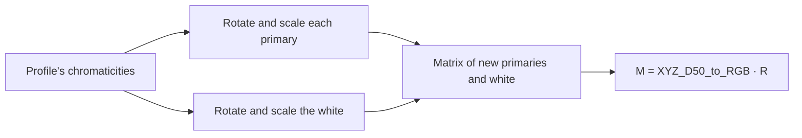

# Port spec: rgb primaries

## Source

darktable at the reference release, commit 20891f6c6f. The reference is darktable's CPU path.

- `src/iop/primaries.c`: `_calculate_adjustment_matrix()` and `process()`.
- `src/common/custom_primaries.c`: `dt_rotate_and_scale_primary`.
- `src/common/colorspaces.c`: `dt_make_transposed_matrices_from_primaries_and_whitepoint`, `dt_colorspaces_get_primaries_and_whitepoint_from_profile` and `cmsCIEXYZ_to_xy`.
- `src/common/matrices.c`: `mat3SSEinv`.
- OpenCL: the `primaries` kernel in `data/kernels/extended.cl`.

## Status

Ported: the whole module, which has one algorithm and no modes, in Slang (`crates/op/primaries`), with its manifest, schema and `prepare` (`Primaries`). Checked on one GPU, the Apple M4.

It is in `OPERATIONS` with `default_enabled` off, as darktable has rgb primaries off until the user turns it on. It is planned only while a module sets one of its parameters (decision 28). Once decision 32 switches its module (planned), it is planned while that module is on. The module, RGB primaries, is built (`docs/modules/rgb-primaries.md`).

## Results

Golden case `primaries`, darktable test 0152-rgb-primaries, mire1.cr2, 3908×2602, Apple M4:

| Measure | Value |
| --- | --- |
| ΔE2000 against darktable | mean 0.0000, p95 0.0000, max 0.0002, no pixel over 2.3 |
| The module's effect | mean 7.80, p95 12.47, max 26.54 |
| Time | 4.0 to 4.1 ms a pass (median, three runs) |
| The matrix darktable applied, fitted from its input and expected renders | the port's within 2.8e-7 in every entry |

Gradients (details under Gradients):

- every slot passes on the case, within 3.8e-4 of finite differences;
- on the synthetic sweep the tint's two pass, and `gradient --synthetic` skips the two primaries' as sweep-blind, since their totals cancel below what finite differences resolve there, while per pixel they agree;
- GPU tests check all eight settings' derivatives per pixel against the setup's f64 matrix.

## Purpose

Colour grading for the photographer: turn each of the working space's red, green and blue towards its neighbours, make it purer or duller, and tint the greys towards a hue. All of it happens at once and linearly, so tones and the relations between colours keep their shape.

Algorithmically it is one 3×3 matrix:

1. each primary's chromaticity is rotated about the white and moved along that direction to a fraction of the distance to the gamut's edge;
2. the white is moved towards a hue the same way;
3. the pixel's RGB, read as amounts of the new primaries that add up to the new white, goes back to the working space.

It is the RGB primaries module in the Colour tab (`docs/modules/README.md`, RGB primaries), darktable's module in the first pass (decision 2).

## Pipeline

- **darktable position:** 28.5 in the v5.0 order, last of the operations at 28.5 in darktable's list (color calibration, diffuse or sharpen, censorize, negadoctor, blurs, then rgb primaries), before astrophoto denoise (`nlmeans`, 29.0). Test 0152's sidecar uses the v3.0 order, which has it at 28.5 too, after color calibration and before sigmoid (45.3).
- **Apertrust slot: working space 28.9**, darktable's place: after colour calibration (28.5) and before colour balance rgb (41.5). Decision 22's rule gives darktable's other operations at 28.5 numbers between 28.5 and 29 in darktable's list order. rgb primaries comes last of them, so 28.9 leaves 28.6 to 28.8 for diffuse or sharpen, censorize, negadoctor and blurs, which come before it (`docs/engine.md`, Order).
- **Domain:** scene-referred: darktable's description says "linear, RGB, scene-referred" in and out.
- **Input and output:** RGBA in the working space, linear Rec2020, in and out; alpha passes through. Nothing is clipped: negative and very bright values go through the matrix.
- **Assumes earlier modules:** demosaic and the input profile. The primaries it moves are the working profile's, so the matrix is linear Rec2020's.
- **Layer support:** yes (`layers: true`): darktable supports blending it, and it is per pixel, with no statistics of the image.

## Operation

| Manifest field | Value |
| --- | --- |
| `id` | `primaries` |
| `version` | 1 |
| `slot` | working space, 28.9 |
| `domain` | scene |
| `layers` | true |
| `differentiable` | true: `primaries_backward` and `primaries_forward_diff` |
| `radius` | 0 |
| `default_enabled` | false |
| `provenance` | darktable, commit 20891f6c6f; `src/iop/primaries.c`, `src/common/custom_primaries.c`, `src/common/colorspaces.c`, `src/common/matrices.c`, `data/kernels/extended.cl` |

`prepare` gives one per-pixel pass of `main`, with the 192-byte `PrimariesParams` (`PARAMS_SIZE`) and no tables. It ignores the image context: nothing in darktable's setup reads the image.

## Parameters

darktable params version 1, 32 bytes, eight f32 in this order: `achromatic_tint_hue`, `achromatic_tint_purity`, `red_hue`, `red_purity`, `green_hue`, `green_purity`, `blue_hue`, `blue_purity`. The schema (version 1) has darktable's field names, its ranges (the introspection `$MIN` and `$MAX`, π as f32) and its defaults. darktable has no `reload_defaults` for the module.

| Name | Type | Range | Default | Meaning | Owner |
| --- | --- | --- | --- | --- | --- |
| `achromatic_tint_hue` | float, radians | −π to π | 0 | The hue the white moves towards, measured from the red primary's direction about the white | RGB primaries |
| `achromatic_tint_purity` | float | 0 to 0.99 | 0 | How far the white moves: the fraction of the distance from the white to the gamut's edge in that direction | RGB primaries |
| `red_hue`, `green_hue`, `blue_hue` | float, radians | −π to π | 0 | The primary's rotation about the white | RGB primaries |
| `red_purity`, `green_purity`, `blue_purity` | float | 0.01 to 5 | 1 | The primary's distance from the white, as a fraction of the distance to the gamut's edge in its rotated direction: 1 on the edge, below 1 inside, above 1 outside | RGB primaries |

darktable shows the hues in degrees, to a tenth, with soft ranges of ±20° but for the tint's. It shows the purities as percentages: the primaries' less 100 (1 is 0%) with a soft range of 50% to 150% (−50% to +50%), the tint's from 0% with a soft range of 0% to 20% (Tool binding notes).

## Parameter versions

| Version | Change | Migration |
| --- | --- | --- |
| 1 | The only version (`DT_MODULE_INTROSPECTION(1, …)`); no `legacy_params` | None |

## Setup on the CPU (`_calculate_adjustment_matrix`)

Matrices are column-vector, `M · v`. darktable stores them transposed and applies them with `dt_apply_transposed_color_matrix`, which is the same product.



1. **The working profile's chromaticities** (`dt_colorspaces_get_primaries_and_whitepoint_from_profile`): the xy of its red, green and blue colorant tags, which lcms has Bradford-adapted to D50, and of its media white, which lcms writes as D50. Each goes through `cmsCIEXYZ_to_xy`, darktable's `dt_D50_XYZ_to_xyY`, which clips negative XYZ to 0 first. For linear Rec2020 the adapted red colorant has a Z of about −0.002, so its chromaticity is slightly off the profile's matrix: red (0.70705, 0.29295), green (0.19021, 0.77537), blue (0.12925, 0.04714), white D50 (0.34570, 0.35854). In Apertrust this is `RgbSpace::chromaticities` in `apertrust-color`, which AgX shares.
2. **Each primary i** (`dt_rotate_and_scale_primary`, `rotate_and_scale_primary` in `apertrust-color`):
   - the angle of the primary about the white, `atan2(y_i − y_w, x_i − x_w)`, plus its hue;
   - along that direction, the distance from the white to the nearest of the three lines through the triangle's edges that the ray meets ahead (`_find_distance_to_edge`: an edge parallel to the ray, or met behind the white, counts as `FLT_MAX`);
   - the new primary is the white plus its purity times that distance along the direction.
3. **The white:** the same with the tint's purity and hue, from the red primary's direction (index 0). At purity 0 it is the profile's white exactly.
4. **The matrix of the new primaries and white** (`dt_make_transposed_matrices_from_primaries_and_whitepoint`, Lindbloom; `rgb_to_xyz_from_chromaticities` in `apertrust-color`). Each primary's column is `(x/y, 1, (1 − x − y)/y)`, with y held at least `FLT_EPSILON` from 0 (`_sanitizeY`), scaled so the columns add up to the white's `(x/y, 1, (1 − x − y)/y)`: `R = A · diag(A⁻¹ w)`. darktable inverts A with `mat3SSEinv`, which refuses a determinant under 1e-7 in magnitude and leaves the inverse at 0, so R is then 0 (Precision).
5. **The adjustment:** `M = XYZ_D50_to_RGB · R`, with the working profile's output matrix.

`adjustment` (`crates/op/primaries/src/setup.rs`) does all five in f64, with the colour library's functions AgX's primaries use, and `prepare` rounds M to f32 once.

The uniform also carries the settings, the profile's chromaticities, its output matrix and whether A was singular. Only the derivative entry points read these: they build M again in Slang from the settings, so that the derivatives reach them (Gradients).

## Per pixel (`process`)

`out.rgb = M · in.rgb`, `out.a = in.a` (`primaries.c:process`, `dt_apply_transposed_color_matrix`). Nothing else: no clip, no norm, no table.

### At the defaults, not quite an identity

As in darktable, the operation at its defaults is not quite an identity. Step 1's clip moves the red primary's chromaticity, so the matrix of the unrotated, unscaled primaries is not the profile's. M at the defaults is

```text
1.0000000    0.0000000    0.0000000
0.0000248    0.9999752    0.0000000
0.0024245    0.0000000    0.9975755
```

Every row adds up to 1, so greys stay grey: white goes to white whatever the primaries, while the tint's purity is 0. Blue becomes B + 0.0024 (R − B) and green G + 0.000025 (R − G). A pure Rec2020 red (1, 0, 0) comes out (1, 0.000025, 0.0024), a pure blue (0, 0, 0.9976).

darktable does the same. Its render of test 0152's sidecar with the module at its defaults applies this matrix (fitted from the render, within 3e-8), and the port's defaults match that render within a ΔE2000 mean of 0.0000, max 0.0002 (a local check, not a case).

So a module's first step, which adds the operation (decision 28), moves colours that are not grey as darktable's first step does: on the case's input, a ΔE2000 mean of 0.028, p95 0.117, max 0.380.

## Neighbourhood and scale

- **Neighbourhood radius:** none; a per-pixel module.
- **Scale dependence:** none.
- **Tile overlap needed:** none.
- **Region-of-interest changes:** none.

## Precision and special values

- **fp64:** darktable computes the matrix in f32 (`atan2f`, `cosf`, `sinf`, the intersections, `mat3SSEinv`). `prepare` computes it in f64 and rounds once. On the case's settings the matrix darktable applied, fitted from its renders, is the port's within 2.8e-7 in every entry.
- **A primary's y at 0:** a purity above 1 can carry a primary past the spectral locus to y ≤ 0 (blue from a purity of about 1.15). `_sanitizeY` holds y at least `FLT_EPSILON` from 0, keeping its sign, in the primaries and the white; the colour library and the kernel's setup do the same. A column then has entries up to about 10⁷, which the scale from A⁻¹ cancels: M stays bounded. At every end of every range, from the defaults and from test 0152's settings, M's entries stay under 1000 but where singular (a unit test).
- **The edge distance:** the white lies inside the triangle, so a ray always meets an edge ahead. `FLT_MAX` stands for an edge it does not meet, as in darktable.
- **NaN and infinity:** the matrix of a finite input is finite. Neither darktable nor the kernel checks for NaN or infinity in the image. Like the input profile's matrix, the kernel passes a non-finite input through the product, and its output is then non-finite as darktable's is.

### A singular matrix

Any settings that put the three new primaries on one line make A singular.

- **A primary turned into the opposite sector.** A primary at purity 1 lies on an edge of the triangle. Turned past a neighbour's direction into the sector opposite it, its ray meets the edge between the other two primaries, so it lands on their line. With those two unmoved, that is a whole range of hues: for red, any hue from +120.7° to 180° and from −180° to −114.5°, and green and blue likewise.
- **Two primaries on one edge.** Red at 150° and green at +60°, both at purity 1, both land on the edge through blue (a unit test).

What darktable does: its `mat3SSEinv` refuses a determinant under 1e-7 in magnitude, leaving the inverse 0, which would make M 0 and the image black, alpha kept. But in f32 the determinant of collinear points is rounding, about 1e-6 in magnitude, so darktable does not refuse it and inverts noise. Its render of test 0152's sidecar with red at 150° and every other setting at its default applied a matrix with entries up to 1.1·10⁸ and gave values up to 2·10⁸ from an input under 5.2. The kind of outcome is the same on every darktable build, since the rounding is always far above the threshold; only its values depend on how the build rounds.

What Apertrust does: the f64 determinant there is about 1e-15, so the setup refuses it, as `mat3SSEinv` means to. The colour library's `rgb_to_xyz_from_chromaticities` returns the zero matrix under darktable's threshold, `prepare` sets `singular`, and the image is black (Deliberate differences).

A purity just off 1 at such a hue gives a determinant proportional to its distance from 1, and entries growing as one over it, finite.

AgX never reaches a primary's opposite sector: its rotations are within ±30° and its reverse rotations within ±60° (±30° times a master ratio of up to 2), short of the nearest neighbour's direction, 114.5° from red. It does reach a singular primaries' matrix where two outbound primaries sit on the white. This zero matrix then reaches its outbound inverse, which its setup refuses in turn and renders black (`docs/ports/agx.md`, Precision).

## CPU and OpenCL differences in darktable

None in the maths: `process_cl` computes the same matrix on the CPU, transposes it for `matrix_product_float4` and applies it per pixel, alpha kept.

## Deliberate differences

- **The matrix in f64**, rounded to f32 once; darktable computes it in f32. The two differ by at most 2.8e-7 in any entry on the case's settings, far below what ΔE2000 resolves.
- **Singular settings render black, where darktable renders noise** (Precision): any settings that put the three new primaries on one line, such as a primary at purity 1 turned into the sector opposite it.
  - darktable's values there are not reproducible: rounding in its f32 determinant, inverted into entries of order 10⁸ that depend on how its binary rounds.
  - The setup takes the decision `mat3SSEinv` was written to make, with the determinant in f64, where the rounding is 1e-15: the zero matrix. The size: black against values of order 10⁸.
  - The kernel's derivative entry points read the setup's decision rather than their own f32 determinant, so their derivatives are 0 there, as `main`'s output is constant.
- **No GUI:** the hue and purity sliders' painted stops (`_paint_hue_slider`, `_paint_purity_slider`) are interface, the module's to draw.

## Tool binding notes

In the first pass (decision 2) the RGB primaries module is darktable's and owns all eight parameters. It is built (`crates/modules/src/rgb_primaries.rs`, `docs/modules/rgb-primaries.md`), each control shown with darktable's slider factor and offset. darktable's page has no tabs, no collapsible groups and no presets: eight sliders in this order (`gui_init`):

| Control | Parameter | Shown as | Soft range | Tooltip |
| --- | --- | --- | --- | --- |
| red hue | `red_hue` | degrees, one decimal (`RAD_2_DEG`) | ±20° | shift red towards yellow or magenta |
| red purity | `red_purity` | %, one decimal: 100 × purity − 100 | 50% to 150%, shown −50% to +50% | red primary purity |
| green hue | `green_hue` | degrees | ±20° | shift green towards cyan or yellow |
| green purity | `green_purity` | % less 100 | as red's | green primary purity |
| blue hue | `blue_hue` | degrees | ±20° | shift blue towards magenta or cyan |
| blue purity | `blue_purity` | % less 100 | as red's | blue primary purity |
| tint hue | `achromatic_tint_hue` | degrees | none: −180° to 180° | tint hue |
| tint purity | `achromatic_tint_purity` | %, 100 × purity | 0% to 20% | tint purity |

- **Every control at its default is untouched:** hues 0, purities 1, the tint's purity 0. The module at its defaults sets nothing, so the operation is not planned and the photo is unchanged. Its first step adds the operation, with the red leak above (Per pixel), as darktable's first step does.
- **The tint's hue changes nothing while its purity is 0** (the module's row P6). darktable draws it as any other slider, and so does the module.
- **A primary's hue typed past a neighbour's direction at purity 100%**, the others untouched, blacks the image out (Precision; darktable shows noise there). The soft range of ±20° keeps a drag far from it; only a typed value or a wide drag reaches it.
- **Units:** the schema is in darktable's units, radians and plain ratios. The module shows degrees and percentages as darktable does.
- **Hue's ends:** −π and π give the same matrix, so the hue sliders wrap without a jump.
- **Derivatives:** any four of the eight per dispatch, through the uniform's gradient slots (Gradients).

## Gradients

The derivative entry points differentiate against four of the eight parameters, named by the uniform's gradient slots, each darktable's field index (0 `achromatic_tint_hue` to 7 `blue_purity`), in darktable's units.

- They rebuild M in the kernel from all eight settings and the profile's chromaticities and output matrix, steps 2 to 5 of the setup in f32 (`adjustment` in `slang/primaries.slang`), and take the derivative of `M · in` through it. `main` reads M from the uniform and never runs that setup.
- The finite differences go through `prepare`'s f64 matrix, so the check also holds the kernel's setup to the colour library's.
- `prepare` gives the slots `red_hue`, `green_purity`, `achromatic_tint_hue` and `achromatic_tint_purity`, one of each path through the setup (a primary's rotation, a primary's scale, the white's rotation and scale), which the case checks. Two slots naming one parameter each get its whole gradient.
- GPU tests check all eight against f64 finite differences of `prepare`'s matrix (Test plan).
- **Four of eight per dispatch:** an optimiser over all eight dispatches twice with two sets of slots, as for RGB levels' nine levels, until the derivative interface takes more than four parameters per pass, planned with reference matching in Phase 3 (`docs/ports/channelmixerrgb.md`, Gradients).
- **The input derivative** is M itself. The per-pixel function takes the pixel as `no_diff` until the derivative interface gains input-derivative entry points, planned with reference matching in Phase 3, per-pixel operations first (`docs/ports/agx.md`, Gradients).

Results, Apple M4, step 1e-3, the sum of output RGB as the loss: relative error of reverse mode against central finite differences, and the per-pixel difference between forward and reverse mode.

| Parameter | Case: relative error | Case: forward vs reverse | Synthetic: relative error | Synthetic: forward vs reverse |
| --- | --- | --- | --- | --- |
| `red_hue` | 2.2e-4 | 1.4e-6 | sweep-blind, skipped (totals 1.0e-2 against −0.95) | 4.1e-7 |
| `green_purity` | 3.8e-4 | 1.3e-6 | sweep-blind, skipped (totals −7.1e-4 against −0.42) | 3.6e-7 |
| `achromatic_tint_hue` | 5.6e-5 | 9.7e-8 | 1.2e-4 | 9.8e-8 |
| `achromatic_tint_purity` | 2.8e-5 | 3.1e-7 | 1.7e-5 | 2.3e-7 |

### The sweep cannot see a primary

The synthetic sweep cannot see a primary's hue or purity. This is an understood gap of the check, not of the derivatives.

- **Why:** the matrix sends grey to the white whatever the primaries are, `M · (1, 1, 1)` depending on the tint alone, and the sweep, every hue at every saturation, is grey on average. So the derivative of the sum of RGB with respect to a primary's setting is a sum of per-pixel terms up to 1.3 in size that cancel, over the sweep's 66,240 pixels, to about 0.01.
- **The finite differences** of that sum are then rounding, chiefly of the f32 matrix entries `main` reads, each step's change rounded to about 6e-8 and multiplied by the sweep's summed input.
- **Per pixel** the modes and the finite differences agree (`--explain`): relative errors from −3.2e-4 to 1.3e-3 (`red_hue`) and −9.1e-4 to 1.6e-3 (`green_purity`) between the 5th and 95th percentiles, the largest at the brightest level, 4, where f32 output rounds most.
- **The tint** moves grey's image, so its two settings pass on the sweep too.

Any slot naming a primary's setting would fail the sweep this way, so `ports::sweep_blind` names them, with this reason, and `gradient --synthetic` skips them and reports them as sweep-blind. `gradient` on the case still checks all four slots, and, as for vignette's saturation, the GPU tests check every setting per pixel with unequal channel weights.

### The GPU tests

`crates/golden/tests/primaries.rs` checks every setting, on test 0152's settings and on a second set with every setting elsewhere, blue turned into its opposite sector at purity 1.37:

- forward mode within 5.6e-6 of central finite differences of the setup's f64 matrix, relative to the derivative matrix's largest entry;
- reverse mode within 1.0e-6 of forward mode under channel weights 0.3, 0.5 and 0.2.

The tests allow 1e-4 and 1e-5.

### Non-smooth spots

- A primary's ray passing through a corner of the triangle, where the nearest edge changes. At a hue of 0, every primary's ray meets its own corner, so the defaults sit on one.
- `_sanitizeY`'s steps at ±`FLT_EPSILON`.
- The singular fallback, past which every derivative is 0.

## Test plan

- **Golden case:** `primaries`, darktable's test 0152-rgb-primaries on mire1.cr2, its sidecar unchanged, sigmoid disabled (it runs after the module and changes the image). Every parameter is off its default: the tint hue 33.2° at purity 13.4%, red +9.5° at 84.3%, green −8.2° at 123.5%, blue +13.1° at 82%. `Tolerance::DARKTABLE`.
- **Unit tests** (`crates/op/primaries`):
  - the schema is darktable's eight fields in order with its ranges and defaults;
  - every parameter reaches its own field and round-trips through `values`;
  - `prepare` gives one per-pixel pass of 192 bytes and no table, the setup's bytes;
  - the defaults' matrix keeps every row's sum at 1 and is the red leak;
  - test 0152's matrix is that of a float64 model of darktable's maths written apart from the crate, within 1e-7;
  - white stays white without a tint, and the tint moves it;
  - hues of −π and π give the same matrix;
  - red turned into the sector opposite it at purity 1 is singular and gives the zero matrix, as are red at 150° and green at +60° together, and red is not singular within its own sectors or off purity 1;
  - the matrix is finite and under 1000 at every range end;
  - the uniform's layout.
- **In `apertrust-color`:** primaries on one point or one line give the zero matrix, and just off the line a finite one.
- **In `ports.rs`:** test 0152 reads as darktable stores it, its hues to the tenth of a degree its sliders show; its inputs through the operation equal the setup's, and every gradient slot moves them; of every case's slots, only `red_hue` and `green_purity` here are sweep-blind.
- **On the GPU** (`crates/golden/tests/primaries.rs`, run in CI):
  - the kernel applies the setup's f64 matrix within 1e-6 of the pixel's size, at the defaults, test 0152's and the second set, alpha kept;
  - at the defaults greys stay grey within 2.5e-7;
  - output, forward and reverse derivatives are finite for black, tiny, negative and very bright input at every range end, from the defaults and from test 0152's settings, and the six singular ends (red, green or blue at ±π from the defaults) give derivatives of 0;
  - every setting's derivative agrees with the setup's (Gradients).
- **Measured once, not cases:** the defaults against darktable's render of them (Per pixel), and darktable's render of a singular setting, red at 150° (Precision).
