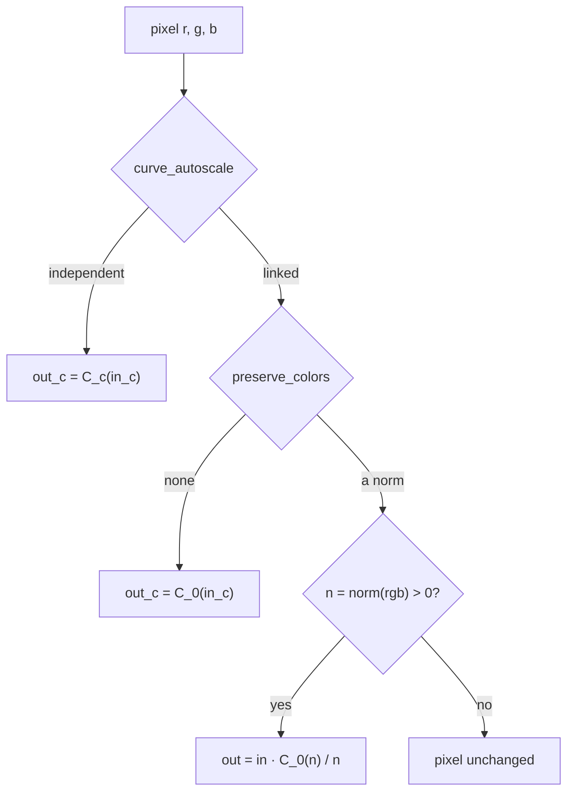

# Port spec: rgb curve

Source: darktable (the reference release, commit 20891f6c6f), `src/iop/rgbcurve.c` `commit_params()`, `_generate_curve_lut()` and `process()`, with helpers from:

- `src/common/curve_tools.c`: the interpolators and `CurveDataSample`;
- `src/gui/draw.h`: `dt_draw_curve_calc_values`;
- `src/develop/imageop_math.h`: `dt_iop_estimate_exp`, `dt_iop_eval_exp`;
- `src/common/rgb_norms.h`: `dt_rgb_norm`;
- `src/common/iop_profile.h`: `dt_ioppr_uncompensate_middle_grey`, `dt_ioppr_get_rgb_matrix_luminance`;
- `src/common/colorspaces_inline_conversions.h`: `dt_Lab_to_XYZ`.

The OpenCL kernel is `data/kernels/rgbcurve.cl`, with `color_conversion.h` and `rgb_norms.h`. The reference is darktable's CPU path.

## Status

Ported. Every mode is in Slang (`crates/op/rgbcurve`), with its manifest and schema: linked and independent channels, the three interpolations, all seven ways of preserving colours, and middle grey compensated or not.

The operation is in `OPERATIONS` with `default_enabled` off. An unedited photo does not run it, and the session plans it only while a module's binding sets one of its parameters (decision 28). The built Tone curve does, as one linked instance; the RGB curve module will (decision 2).

Golden result: nine cases on test 0060's mire1.cr2, 3908×2602, Apple M4, ΔE2000 mean 0.0007 to 0.0038, max 0.47 at most (Results).

## Purpose

Tone and colour curves for the photographer: lift shadows, add contrast, warm the highlights or cross-process a channel, by dragging points on a curve.

- **Linked:** one curve drives every channel, applied to each channel or, to keep hues, to a norm of the pixel that then scales all three.
- **Independent:** red, green and blue each have their own curve.

Algorithmically, each curve is an interpolating spline through up to 20 nodes, extended past its last node by a fitted power law. In the first pass it is darktable's RGB curve module. The built Tone curve drives one linked instance until its Luma curve becomes RGB curve's linked curve (decision 2).

## Pipeline

- **darktable position:** 42.0 in the v5.0 order (and the v3.0 order test 0060 uses), after color balance rgb (41.5), before rgb levels (43.0), sigmoid (45.3), AgX (45.5) and filmic rgb (46.0).
- **Apertrust slot:** darktable's, working space 42, after color balance rgb and before RGB levels (43) and the tone mapper (decision 22; `docs/engine.md`, Order). The manifest has working space 42 and the scene domain.
- **Domain:** it runs where darktable runs it, before the tone mapper, though darktable's description calls its input display-referred ("linear, RGB, display-referred" in, "non-linear, RGB" out). Values above 1 meet the extrapolation past the last node, as in darktable.
- **Input and output:** RGBA in the working space, linear Rec2020, scene-referred; alpha passes through.
- **Assumes earlier modules:** demosaic and the input profile. The luminance norm and middle grey compensation read the working space's matrices.
- **Layer support:** yes: per pixel, no statistics of the image.

## Parameters

darktable params version 1, 516 bytes: `curve_nodes[3][20]` (x, y pairs of f32), `curve_num_nodes[3]` (i32), `curve_type[3]` (i32), `curve_autoscale` (enum), `compensate_middle_grey` (gboolean), `preserve_colors` (enum). Curve 0 is red, or the linked curve; 1 green; 2 blue.

| Name | darktable field | Type | Range | Default | Meaning | Owner |
| --- | --- | --- | --- | --- | --- | --- |
| `curve_nodes_<c>_<k>_x`, `_y` | `curve_nodes[c][k].x`, `.y` | float | 0 to 1 | node 1 (1, 1), others (0, 0) | Node k of curve c; only the first `curve_num_nodes_<c>` count, in strictly increasing x | RGB curve |
| `curve_num_nodes_<c>` | `curve_num_nodes[c]` | int | 2 to 20 | 2 | Nodes in curve c | RGB curve |
| `curve_type_<c>` | `curve_type[c]` | choice | `cubic_spline`, `catmull_rom`, `monotone_hermite` | `monotone_hermite` | Curve c's interpolation | RGB curve |
| `curve_autoscale` | `curve_autoscale` | choice | `linked_channels`, `independent_channels` | `linked_channels` | One curve for every channel, or one each | RGB curve |
| `compensate_middle_grey` | `compensate_middle_grey` | bool | | false | Nodes are lightness, Lab L / 100, so middle grey sits at 0.5 | RGB curve |
| `preserve_colors` | `preserve_colors` | choice | `none`, `luminance`, `max_rgb`, `average_rgb`, `sum_rgb`, `norm_rgb`, `basic_power` | `luminance` | Linked only: the curve on each channel, or on this norm, scaling all three | RGB curve |

The defaults are darktable's (`init`): an identity curve per channel, (0, 0) to (1, 1), monotone Hermite, linked, preserving colours by luminance, middle grey not compensated. darktable gives `curve_num_nodes` no range; 2 is the fewest it can interpolate and 20 its `MAX_ANCHORS`.

## Parameter versions

| Version | Change | Migration |
| --- | --- | --- |
| 1 | The only version (`DT_MODULE_INTROSPECTION(1, …)`); no `legacy_params` | None |

## Setup on the CPU (`commit_params`, `_generate_curve_lut`)

### darktable

darktable defers the setup to `_generate_curve_lut`, which `process` calls:

1. **Middle grey** (`dt_ioppr_uncompensate_middle_grey`), when compensated: each node's x and y, a lightness v, becomes Lab (100 v, 0, 0), then XYZ D50 (`dt_Lab_to_XYZ`), then working RGB's red channel: `v' = (row 0 of XYZ→RGB · D50) · f⁻¹((100 v + 16) / 116)`, with `f⁻¹(t) = t³` above 6/29 and `(116 t − 16) / κ` below, κ = 24389/27. 0.5 becomes 0.1842.
2. **The table**, per curve (`dt_draw_curve_calc_values(curve, 0, 1, 0x10000)`, `CurveDataSample`): the interpolation's setup (`interpolate_set`), then 65536 samples, sample i at `x = i / 65535`:
   - below the first node (`i < (int)(x₀ · 65535)`), `(int)(y₀ · 65535)`;
   - past the last, `(int)(y_{n−1} · 65535)`;
   - otherwise the curve rounded, `(int)(curve(x) · 65535 + 0.5)` clamped to [0, 65535].

   The table holds sample / 65536. The interpolations (`curve_tools.c`), all in f32:
   - **Cubic spline** (`spline_cubic_set`, natural: zero second derivative at both ends): the second derivatives from a tridiagonal system solved without pivoting (`d3_np_fs`), evaluated by `spline_cubic_val`.
   - **Catmull-Rom** (`catmull_rom_set`): tangent `m_i = (y_{i+1} − y_{i−1}) / (x_{i+1} − x_{i−1})`, one-sided at the ends; evaluated as cubic Hermite segments (`catmull_rom_val`).
   - **Monotone Hermite** (`monotone_hermite_set`, Fritsch–Carlson): secants δᵢ, with δ_{n−1} = δ_{n−2}; tangents `m_i = (δ_{i−1} + δᵢ) / 2`, one-sided at the ends; then for i = 0 to n − 1 in order: if |δᵢ| < 2·FLT_MIN, mᵢ = m_{i+1} = 0; else with α = mᵢ/δᵢ, β = m_{i+1}/δᵢ, τ = α² + β², if τ > 9, mᵢ = 3αδᵢ/√τ and m_{i+1} = 3βδᵢ/√τ. Each step sees the tangent the previous one left. Evaluated by `catmull_rom_val`.
   - Every evaluation picks the first segment whose right node lies above x, or the last.
   - `interpolate_set` fails with one node or x not strictly increasing. `dt_draw_curve_calc_values` then still copies the curve's 16-bit samples into the table: those of its last successful build, uninitialised memory before the first (`dt_draw_curve_new` mallocs them). With no nodes, `CurveDataSample` draws the identity line, and the extrapolation reads node −1.
3. **The extrapolation** (`dt_iop_estimate_exp`), per curve: with x₀ the last node's x, the table at `0.7 x₀, 0.8 x₀, 0.9 x₀` and `x₀` (index `(int)(x · 65536)` clamped) gives y₀ (the last) and the exponent g, the mean of `ln(y_k/y₀) / ln(x_k/x₀)` over the samples with `y_k/y₀ > 0`, or 1 without one. Coefficients `(1/x₀, y₀, g)`.

### Apertrust

`prepare` is in `crates/op/rgbcurve/src/setup.rs`. The curve maths, a port of darktable's `curve_tools.c` with the extrapolation's fit, is in `apertrust-color` (`crates/color/src/curve.rs`), which the Tone curve module's panel shares to draw the curve.

1. The same uncompensation, in f32 (`WorkingProfile::uncompensate_middle_grey` in `apertrust-color`).
2. For each curve the mode uses, the tangents darktable's interpolation gives each node, by darktable's own code in f32. For a cubic spline, darktable's second derivatives become each node's slope, `mᵢ = (y_{i+1} − yᵢ)/hᵢ − hᵢ(2 ypp_i + ypp_{i+1})/6`, the last node's from the last segment's right end, in f64 rounded once. Every interpolation is then cubic Hermite segments through (x, y, m): on each segment the same cubic darktable samples.
3. The extrapolation by darktable's fit, sampling the curve itself at the same four points, so y₀ is the last node's y. A non-finite exponent becomes 1.
4. A curve the mode does not read (green and blue when linked) becomes the identity.
5. The kernel's inputs: a uniform with the working space's luminance row, each curve's node count, end value y₀ and end power g, the mode and the norm, and four gradient slots (Gradients); and a table at binding 3 of 3 × 20 knots, (x, y, tangent, 0).

## Per pixel (`process`)

darktable (`rgbcurve.c:process`), with `C(v) = v < x₀ ? table[clamp((int)(v · 65536), 0, 65535)] : y₀ · (v/x₀)^g` per curve:

1. **Independent channels:** `out_c = C_c(in_c)`.
2. **Linked, preserve colours none:** `out_c = C_0(in_c)`.
3. **Linked with a norm** (`dt_rgb_norm`): luminance (the Y row of working RGB → XYZ D50, `dt_ioppr_get_rgb_matrix_luminance`), max, average (r + g + b)/3, sum, norm √(r² + g² + b²), or basic power (r³ + g³ + b³)/(r² + g² + b²). If the norm n > 0, `out = in · C_0(n)/n`; otherwise the pixel is left as it is.
4. Alpha passes through.

The kernel (`slang/rgbcurve.slang`) does the same with `C(v) = v < x₀ ? clamp(H(max(v, x_first)), 0, 1) : y₀ · (v/x₀)^g`, H the cubic Hermite segment v falls in: flat at the first node's y below it, clamped to [0, 1] as darktable clamps its table. The segment, the side of the last node, the norm and the mode are found first (`locate_pixel`), outside the differentiable function, which gets them as arguments.

## Neighbourhood and scale

- **Neighbourhood radius:** none: per pixel.
- **Scale dependence:** none.
- **Tile overlap needed:** 0.
- **Region-of-interest changes:** none; no `modify_roi_*` or `tiling_callback`.

## Precision and special values

- **darktable's table quantises twice.** Its samples are 16-bit (±7.6e-6, and read back as sample/65536, so 1 becomes 1 − 1.5e-5). A value v reads entry `(int)(v · 65536)`, which holds the curve at `floor(65536 v) / 65535`: within 1/65535 of v on either side, below it near 0 and above it near 1. The kernel evaluates the cubic at v in f32.
- **No fp64** in darktable's per-pixel path; `catmull_rom_val`'s constants are double literals, f32 here.
- **The basic power norm** divides by r² + g² + b². darktable gets NaN for black, whose `n > 0` is false, so the pixel stays; Apertrust's norm is 0 there, with the same result.
- **Negative values:** a channel below the first node takes its y (darktable clamps the table index at 0), so in the channel modes the identity curve turns a negative channel to 0, in darktable too. A norm at or below 0 leaves the pixel unchanged, negative channels included.
- **NaN and infinity:** the extrapolation's exponent, a mean of logarithms, is checked finite on the CPU. A curve ending at 0 gives darktable an exponent of −∞; Apertrust's is 1, with the same output, 0.

## CPU and OpenCL differences in darktable

- OpenCL's `lookup_unbounded` (`color_conversion.h`) switches to the extrapolation at v ≥ 1, the CPU at the last node's x. For a curve whose last node is below 1, OpenCL reads the table between the two, flat at the last node's y, where the CPU extrapolates. Test 0060's green curve ends at 0.903, 0.769 uncompensated. Apertrust follows the CPU.
- OpenCL reads the tables as 256×256 images: the same values.

## Deliberate differences

- **No table: the curve is evaluated at the pixel's value.** darktable's 16-bit table makes the curve a staircase, with no derivative with respect to its nodes or its input; the kernel evaluates the cubic darktable samples. They differ by about 1e-5 of the curve's range, more where the curve is steep. That is visible in one place: a norm within a table step or two of the first node, where a spline leaves 0 steeply, makes `C(n)/n` of very dark saturated colours differ by up to a factor of two (case `rgbcurve-luminance`'s max, 0.47; Results). The kernel needs no 768 KB table upload per change, and keeps a 960-byte one.
- **The cubic spline in Hermite form:** the same cubic, with the slopes taken from darktable's second derivatives; rounding differs by under 2e-6 (`the_hermite_form_is_darktables_cubic_spline`).
- **The extrapolation fitted to the curve, not to its table:** y₀ is the last node's y rather than its 16-bit sample, so the curve is continuous at the last node, and the identity curve stays the identity above 1 within 1e-6.
- **A degenerate extrapolation exponent is 1** (a curve ending at 0, where darktable's is −∞): same output.
- **Nodes darktable cannot interpolate** (fewer than 2, more than 20, x not strictly increasing): darktable's table keeps the samples of the curve's last successful build, undefined before the first (Setup). `prepare` returns `NotPorted`, since there is no behaviour to port. Unused curves are not checked: darktable builds all three but reads only red's when linked. Planned with the RGB curve module, so that a saved edit always opens: when an edit is read, its nodes are sorted and those closer than 0.0025, darktable's editor's minimum, dropped, with a warning naming the curve; `prepare` keeps its refusal as a last guard.
- **The basic power norm of black** is 0, not NaN: same output.
- **No histogram, picker or GUI:** the curve editor, its histogram request and the "create curve from area" picker are interface, for the RGB curve module.

## Tool binding notes

In the first pass (decision 2) the RGB curve module is darktable's, one instance:

- its controls: mode, the curve with R, G and B tabs while independent, interpolation method, compensate middle grey and preserve colours;
- the curve's ends fixed at (0, 0) and (1, 1), as decision 31 stores them (proposed; `docs/modules/README.md`);
- at darktable's 42, before RGB levels and the tone mapper;
- darktable's graph, with compensate middle grey and darktable's graph scale, drawing the curve itself whatever preserve colours holds (decision 22).

The built Tone curve's Luma curve, one linked instance, becomes this module's linked curve.

- **Black and white point handles:** the ends stay fixed at (0, 0) and (1, 1). Black and white are RGB levels' own module, which runs after this one at 43, as in darktable (decisions 2, 22 and 31).
- **Interpolation:** monotone Hermite by default, the only one that never overshoots between monotone nodes; cubic spline and Catmull-Rom are darktable's other choices.
- **compensate_middle_grey** puts middle grey at 0.5 of the curve's axes, which suits a curve drawn over a perceptual histogram. It is a control of the module, as in darktable.
- **Presets:** darktable's (`init_presets`) are the module's presets: contrast compression; linear (gamma 1.0); contrast medium and high, linear and gamma 2.2; non-contrast curves gamma 2.0, gamma 0.5, logarithm base 2 and exponential base 2. All use cubic splines, the non-contrast ones monotone Hermite, and middle grey compensated.
- **Preserve colours:** every norm stays, a choice of the module as in darktable, each checked by a golden case. The built Tone curve offers six of them as one Advanced "Preserve colours" choice, luminance by default. RGB levels has the same `preserve_colors` with the same seven norms, darktable's shared `dt_rgb_norm`, here `rgb_norm` in `color.slang` and `RgbNorm` in `apertrust-color`, which both ports use.
- **The identity curve is not a no-op in every mode.** It changes no pixel within 1e-5 when linked with a norm. In the channel modes, independent and linked with `none`, it turns negative channels to 0, as darktable does (`crates/golden/tests/rgbcurve.rs`). So:
  - the built Tone curve leaves the operation out of the plan while its curve is straight, as `edit::instances` does (decision 28), and its no-op invariant test is the binding's;
  - RGB curve becomes a switched module (decision 32): off until a control changes, then on until its reset, a straight curve then clipping negatives as darktable's does. The Tone curve keeps the rule above until RGB curve replaces it.

## Gradients

The derivative entry points differentiate against four of the kernel's own values, named by the uniform's gradient slots: a knot's x, y or tangent (linear values, the tangent dy/dx), or a curve's end value or end power. The harness moves each slot's value directly, as AgX's check moves its power.

`main` ignores the slots: it passes `slots` as a literal false, which Slang emits as a run-time argument, and the comparisons then cost nothing measurable. With `--repeat 32`, test 0060's case takes 2.47 ms a pass and the luminance case 1.48 ms, the same as a kernel without slots (2.47 and 1.50 ms).

In darktable's units a node's y also moves the tangents (all of them for a cubic spline, its neighbours' for Catmull-Rom, a cascade through the monotone limiter) and the extrapolation. The kernel's gradients are with respect to its own knots, tangents and ends, so an optimiser over node positions needs either the setup in the kernel, as planned for AgX's curve (`docs/ports/agx.md`, Gradients), or the setup's Jacobian chained on the CPU, at most 20 nodes per curve. That choice is made with reference matching in Phase 3, when the derivative interface takes more than four parameters per pass.

Slots per case, knots in the range most pixels fall in and an end the brightest reach:

| Case | Slots |
| --- | --- |
| `rgbcurve` | R4 y, G2 tangent, B2 x, G end power |
| `rgbcurve-independent` | R2 y, G1 tangent, B1 x, B end value |
| Linked, uncompensated | the red curve's knot 2's y, knot 3's tangent and x, its end power |
| Linked, compensated | the red curve's knot 4's y and x, knot 5's tangent, its end power |

Results, Apple M4, step 1e-3, relative error of reverse mode against central finite differences per slot, and the largest per-pixel difference between forward and reverse mode over the four:

| Case | Slot 1 | Slot 2 | Slot 3 | Slot 4 | Forward vs reverse |
| --- | --- | --- | --- | --- | --- |
| `rgbcurve` | 2.0e-6 | 4.7e-5 | 6.8e-6 | 3.7e-5 | 1.4e-7 |
| `rgbcurve-independent` | 1.3e-5 | 1.2e-5 | 1.1e-5 | 1.8e-5 | 1.2e-7 |
| `rgbcurve-luminance` | 2.0e-6 | 1.6e-5 | 2.4e-5 | 2.5e-5 | 1.4e-7 |
| `rgbcurve-none` | 1.3e-5 | 4.4e-5 | 3.8e-5 | 6.9e-7 | 8.1e-8 |
| `rgbcurve-max` | 2.0e-6 | 1.2e-5 | 1.8e-5 | 2.2e-5 | 1.7e-7 |
| `rgbcurve-average` | 1.3e-5 | 1.4e-5 | 4.3e-5 | 6.4e-5 | 2.1e-7 |
| `rgbcurve-sum` | 2.0e-6 | 1.4e-5 | 1.0e-5 | 1.2e-5 | 1.5e-7 |
| `rgbcurve-norm` | 1.3e-5 | 4.7e-5 | 1.3e-5 | 1.3e-5 | 1.7e-7 |
| `rgbcurve-power` | 2.0e-6 | 4.3e-6 | 2.2e-5 | 8.7e-5 | 1.4e-7 |

With `--synthetic`, every slot passes at 1.2e-4 or better and forward and reverse agree within 2.5e-7, except `rgbcurve-max`'s R5 tangent at 2.8e-3. That gap is the finite differences' own. Every pixel is off by the same 6e-5, since adding ±1e-3 to a tangent near 1.5 in f32 moves it by 1e-3 ± 6e-8, and the knot's two segments pull in opposite directions, so the total nearly cancels and the relative error grows. It shrinks as the step grows (1.4e-2 at 1e-4, 2.3e-4 at 1e-2), as such an error does.

Known non-smooth spots, where finite differences straddle a kink, and what an optimiser would use instead, with `s(t) = log(1 + e^{kt}) / k` a softplus of sharpness k (around 10³ for values in [0, 1]):

- **The clamp to [0, 1]** stops the derivative where a spline overshoots: `y − s(y − 1) + s(−y)` instead.
- **Flat below the first knot** (`max(v, x_first)`): `x_first + s(v − x_first)` instead.
- **The change to the extrapolation at the last knot** is continuous in value, not in slope: a smoothstep blend of the cubic and the power law over a band of a few table steps around the knot.
- **A knot's x crossing pixels' values** moves them to the next segment. The curve is continuous there and only its slope with respect to x jumps, so an optimiser needs nothing smoother.

## Results

Apple M4, every case `Tolerance::DARKTABLE`. A single pass takes about 3.8 ms over 10 MP (exposure's 3.9 ms: memory-bound). With `--repeat 32`, 2.5 ms a pass for three independent curves and 1.5 ms for a linked one with a norm (colorbalancergb: 3.0 ms).

| Case | Module effect (mean ΔE) | ΔE2000 mean | p95 | max |
| --- | --- | --- | --- | --- |
| `rgbcurve` | 21.9 | 0.0038 | 0.0153 | 0.156 |
| `rgbcurve-independent` | 20.4 | 0.0036 | 0.0141 | 0.080 |
| `rgbcurve-luminance` | 8.6 | 0.0020 | 0.0098 | 0.472 |
| `rgbcurve-none` | 10.9 | 0.0028 | 0.0085 | 0.109 |
| `rgbcurve-max` | 7.2 | 0.0015 | 0.0062 | 0.108 |
| `rgbcurve-average` | 10.5 | 0.0013 | 0.0045 | 0.155 |
| `rgbcurve-sum` | 3.0 | 0.0007 | 0.0021 | 0.142 |
| `rgbcurve-norm` | 6.9 | 0.0008 | 0.0031 | 0.068 |
| `rgbcurve-power` | 8.0 | 0.0016 | 0.0078 | 0.094 |

The largest, `rgbcurve-luminance`'s 0.47, is in very dark saturated blues (luminance 0.0062 to 0.0063, blue 0.07). Their luminance sits a table step or two above the first node, 0.0062 linear, where the cubic spline rises from 0 steeply. A simulation of darktable's table on the CPU reproduces the expected render there (mean 3e-7), and the continuous curve's value at these pixels' luminance is up to twice the table's, which the ratio carries into their chroma.

## Test plan

### Golden cases

All in `crates/golden/src/cases.rs`, on mire1.cr2, `disable: &[]` (no later module in the sidecar changes the image), no mask. `rgbcurve` is test 0060 (rgbcurve-indep) unchanged. The other eight are test 0060's sidecar with the rgbcurve entry's curve types, mode, compensation and preserve colours edited and its nodes kept; the linked ones use the red curve's nine nodes, whose first sits above 0.

| Case | Mode | Interpolation | Middle grey compensated |
| --- | --- | --- | --- |
| `rgbcurve` | independent; monotone Hermite curves of 9, 5 and 5 nodes, the green ending below 1 | monotone Hermite | yes |
| `rgbcurve-independent` | independent | cubic spline, Catmull-Rom and monotone Hermite for red, green and blue | no |
| `rgbcurve-luminance` | linked, luminance | cubic spline | yes |
| `rgbcurve-none` | linked, none | Catmull-Rom | no |
| `rgbcurve-max` | linked, max | monotone Hermite | yes |
| `rgbcurve-average` | linked, average | cubic spline | no |
| `rgbcurve-sum` | linked, sum (a sum reaches the extrapolation) | Catmull-Rom | yes |
| `rgbcurve-norm` | linked, norm | monotone Hermite | no |
| `rgbcurve-power` | linked, basic power | cubic spline | yes |

Every interpolation meets both modes, every norm is covered, and compensation is on in half of them.

All nine run the operation where test 0060 does, at darktable's 42 on scene-referred values with no tone mapper, which is where Apertrust runs it.

### Tolerance

`Tolerance::DARKTABLE` (mean ΔE2000 ≤ 0.767, max ≤ 2.3) for every case.

### Invariants

- **On the GPU** (`crates/golden/tests/rgbcurve.rs`, run in CI):
  - the identity curve changes nothing in the norm modes, and only negative channels, to 0 as in darktable, in the channel modes, compensated or not, from black to 4;
  - each channel follows the CPU twin of the curve for each interpolation;
  - output stays finite for 0, ±1e6, 1e-30, negative and mixed input, for curves that lift black, overshoot or end at 0, in every mode.
- **On the CPU** (`setup.rs`, `lib.rs`, `apertrust-color` and its `curve.rs`):
  - every interpolation passes through its nodes; the Hermite form equals darktable's `spline_cubic_val`; the natural spline's ends; Catmull-Rom's tangents; monotone Hermite stays monotone over a step; darktable's refusals;
  - the identity is exact at its nodes; compensated nodes become linear (0.5 to 0.1842); the extrapolation of y = x² has power 2;
  - the uniform's layout; the schema's defaults are darktable's, and every parameter reaches the settings; nodes out of order are `NotPorted`.
- **In `ports.rs`:** test 0060's stored params read as darktable stores them; every case has kernel inputs and four gradient slots inside its curves.

## Changes after the reference release

`git log $DT_TAG..upstream/master` over the manifest's sources (`rgbcurve.c`, `curve_tools.c`, `rgb_norms.h`, `iop_profile.h`, `imageop_math.h`, `draw.h`, `rgbcurve.cl`) and the helpers the spec names (`colorspaces_inline_conversions.h`, `color_conversion.h`), upstream/master at 37d514c78c, 2026-10-14:

- **Bounds checks, no effect on valid params:** efd77b42de (after fdc1e0ed40 and its revert 3066f48caf) clamps a stored node count to 1 to 20 and refuses an unknown curve type in `interpolate_set` and `interpolate_val`, where the reference release could read out of bounds. Apertrust's schema already limits both.
- **No effect on linear Rec2020, Apertrust's working space:**
  - 4b0878d14a sends `dt_ioppr_uncompensate_middle_grey`'s result through the working profile's encoding (`dt_ioppr_encode_rgb`) where the reference release used the profile's curve only when non-linear. For a linear profile, whose transfer tables darktable marks as linear (`lut[0] = -1`), the encoding passes values through, and it is no HDR transfer.
  - Its `color_conversion.h` change and 6f95aa9f30's are OpenCL HDR transfer code, which the CPU path does not use.
  - a57cda46b0 only declares a new OpenCL image conversion in `iop_profile.h`.
  - 19558f22b6 and 17c17a0832 change JzAzBz in `colorspaces_inline_conversions.h`, which rgbcurve does not use.
  - `imageop_math.h` and `rgb_norms.h` have no changes.
- **No effect on output:** 257e632e67 (int to size_t in the pixel loop), and GUI work: 5524f19175, c033f0e8c5, 8a26f35f92, f8ca5e7679, 6e8673271a, 967628c03b, b8ff325ae0, 9f418626ed, cef1230a39, 36b71d89f9, c2dd84a409, 1cf3e707ec.
