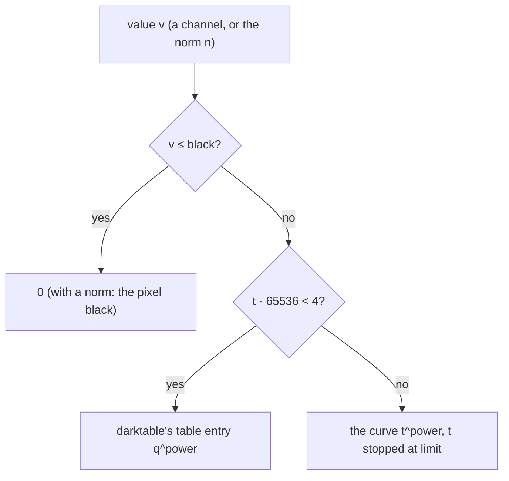

# Port spec: rgb levels

Source: darktable (the reference release, commit 20891f6c6f), `src/iop/rgblevels.c` `commit_params()`, `_compute_lut()` and `process()`, with `dt_rgb_norm` from `src/common/rgb_norms.h` and `dt_ioppr_get_rgb_matrix_luminance` from `src/common/iop_profile.h`. The OpenCL kernel is `data/kernels/rgblevels.cl` (program 29 in `programs.conf`), with `color_conversion.h` and `rgb_norms.h`. The reference is darktable's CPU path.

## Status

Ported. Every mode is in Slang (`crates/op/rgblevels`), with its manifest and schema: linked and independent channels, and all seven ways of preserving colours.

- The operation is in `OPERATIONS` with `default_enabled` off. An unedited photo does not run it, and the session plans it only while a module's binding sets one of its parameters (decision 28). The RGB levels module will (decision 2).
- `prepare` takes the levels darktable's own invariant allows, 0 ≤ black ≤ grey ≤ white with white above black, and returns `NotPorted` for any other.
- The kernel copies darktable's table within its first 4 entries above black, to match darktable, and evaluates the curve beyond (Deliberate differences).

Golden result: eight cases on tests 0054 and 0055's mire1.cr2, 3908×2602, Apple M4, 48-byte pass header. Every case passes, ΔE2000 mean 0.0004 to 0.0038, max 1.52 at most (Results).

Gradients: every parameter passes on every case and on the synthetic sweep, the black point at worst 3.2e-3 on the test image and 3.7e-3 on the sweep, the others 1.0e-4 or better; forward and reverse mode agree within 3.3e-7 (Gradients).

## Purpose

Levels for the photographer: set where black and white sit and where middle grey falls between them. That stretches a flat image, clips a haze, or brightens or darkens the midtones, on the three channels together or each on its own to neutralise a cast.

Algorithmically, each channel's levels give a power curve, `((v − black) / (white − black))^power`, 0 at or below black, its power set by where grey sits between black and white. Linked, the curve can also run on a norm of the pixel, which then scales all three channels, to keep hues, as RGB curve does. In the first pass it is darktable's RGB levels module (decision 2).

## Pipeline

- **darktable position:** 43.0 in the v5.0 order (and the v3.0 order tests 0054 and 0055 use), after rgb curve (42.0), before base curve (44.0), sigmoid (45.3), AgX (45.5) and filmic rgb (46.0).
- **Apertrust slot:** darktable's, working space 43, after RGB curve (42) and before the tone mapper (decision 22; `docs/engine.md`, Order). The manifest has working space 43 and the scene domain.
- **Domain:** it runs where darktable runs it, before the tone mapper, though darktable's description calls its input display-referred ("linear, RGB, display-referred" in, "non-linear, RGB, display-referred" out). Values above 1 continue the power curve.
- **Input and output:** RGBA in the working space, linear Rec2020, before the tone mapper; alpha passes through.
- **Assumes earlier modules:** demosaic and the input profile. The luminance norm reads the working space's matrix.
- **Layer support:** yes: per pixel, no statistics of the image.

## Parameters

darktable params version 1, 44 bytes: `autoscale` (enum, i32), `preserve_colors` (`dt_iop_rgb_norms_t`, i32), `levels[3][3]` (f32): per channel its black, grey and white points. Channel 0 is red, or the linked levels; 1 green; 2 blue.

| Name | darktable field | Type | Range | Default | Meaning | Owner |
| --- | --- | --- | --- | --- | --- | --- |
| `autoscale` | `autoscale` | choice | `linked_channels`, `independent_channels` | `linked_channels` | One set of levels for every channel, or one each | RGB levels |
| `preserve_colors` | `preserve_colors` | choice | `none`, `luminance`, `max_rgb`, `average_rgb`, `sum_rgb`, `norm_rgb`, `basic_power` | `luminance` | Linked only: the levels on each channel, or on this norm, scaling all three | RGB levels |
| `levels_<c>_black` | `levels[c][0]` | float | 0 to 1 | 0 | Channel c's black point: it and everything below become 0 | RGB levels |
| `levels_<c>_grey` | `levels[c][1]` | float | 0 to 1 | 0.5 | Channel c's grey point: where it sits between black and white sets the curve's power | RGB levels |
| `levels_<c>_white` | `levels[c][2]` | float | 0 to 1 | 1 | Channel c's white point: it becomes 1 | RGB levels |

The defaults are darktable's (`init`): every channel's levels at 0, 0.5 and 1, the identity, linked, preserving colours by luminance.

darktable's introspection gives `levels` no range. The range is its handles' (`_rgblevels_move_handle`), which keep every point in [0, 1], grey at least 0.05 from black and white, and grey's relative position when black or white moves. Its pickers are not limited (Tool binding notes).

## Parameter versions

| Version | Change | Migration |
| --- | --- | --- |
| 1 | The only version (`DT_MODULE_INTROSPECTION(1, …)`); no `legacy_params` | None |

## Setup on the CPU (`commit_params`, `_compute_lut`)

darktable:

1. **The levels** (`commit_params`): when linked, every channel's levels become channel 0's. It also requests the histogram, for the GUI.
2. **The power** (`_compute_lut`), per channel, in f32 but for the power of 10, in f64 and rounded: `delta = (white − black) / 2`, `mid = black + delta`, `tmp = (grey − mid) / delta`, `inv_gamma = 10^tmp`. Grey in the middle gives 1; at black, 0.1; at white, 10. darktable's handles keep tmp within about ±0.9, a power from 0.126 to 7.94.
3. **The table**, per channel: `lut[i] = (i / 65536)^inv_gamma` for i from 0 to 65535, a power in f64 rounded to f32.
4. **The scale** (`process`): `mult = 1 / (white − black)` per channel.

Apertrust's `prepare` (`crates/op/rgblevels/src/setup.rs`):

- does step 1, and gives the kernel the levels themselves and the working space's luminance row;
- refuses levels outside darktable's own order or not finite (`NotPorted`, Deliberate differences), which bounds the power to [0.1, 10].

Steps 2 and 4 are the kernel's setup, `shape()`, in the same f32 expressions with the power as `exp(tmp · ln 10)`, so its derivatives reach the levels; it adds the overflow limit (Precision). There is no table.

## Per pixel (`process`)

darktable (`rgblevels.c:process`), with `p = (v − black) · mult` and `C(v) = v ≤ black ? 0 : (v ≥ white ? powf(p, inv_gamma) : lut[clamp((int)(p · 65536), 0, 65535)])` per channel:

1. **Independent channels, or linked with preserve colours none:** `out_c = C_c(in_c)`.
2. **Linked with a norm** (`dt_rgb_norm`): luminance (the Y row of working RGB → XYZ D50, `dt_ioppr_get_rgb_matrix_luminance`), max, average (r + g + b)/3, sum, norm √(r² + g² + b²), or basic power (r³ + g³ + b³)/(r² + g² + b²). If the norm n > black, `out = in · C_0(n)/n`, all four channels; otherwise the pixel becomes 0, all four channels.

The kernel (`slang/rgblevels.slang`) does the same with, per channel, `C(v) = max(t, 0) · t^(power − 1)`, `t = min((v − black) · scale, limit)`:

- 0 at or below black, the curve itself above, written so that a power of 1 gives t exactly;
- for a norm, the ratio `C(n)/n` as `scale · (1 − black/n) · t^(power − 1)`, so that the default levels give exactly 1;
- within the table's first 4 entries above black, `0 < t` and `t · 65536 < 4`, darktable's entry instead, `q · q^(power − 1)` with `q = floor(65536 t)/65536` (entry 0 is 0), and for a norm that entry over n.

The mode, whether a norm lies above black, and the table entry, if any, are found first (`locate`), outside the differentiable function, which gets them as arguments. Alpha passes through.

## Neighbourhood and scale

- **Neighbourhood radius:** none: per pixel.
- **Scale dependence:** none.
- **Tile overlap needed:** 0.
- **Region-of-interest changes:** none; no `modify_roi_*` or `tiling_callback`. The auto levels in `process()` read the preview pipe's region, GUI only (Tool binding notes).

## Precision and special values

- **darktable's table** rounds the curve down to the entry at `floor(65536 p) / 65536`, up to one step below p, between black and white; above white it computes the curve.
  - For a power of 1 or more, that is at most power/65536 of the range (2e-5 at test 0054's 1.34).
  - For a power below 1 the curve is steep near black. Entry 0 is 0, so every p below 1/65536 becomes 0 where the curve reaches (1/65536)^power: 3e-3 at a power of 0.52 and 0.25 at 0.126, the lowest the handles reach. The next entries step as coarsely.
  - The kernel takes darktable's entries for the first 4 steps above black and evaluates the curve at p beyond them (Deliberate differences).
- **fp64:** darktable's power of 10 and its table's powers are f64 rounded to f32. The kernel's are f32, within 1e-6 relative of darktable's power (`the_power_is_darktables`).
- **Divisions:** white at black makes darktable's scale infinite and its power undefined, and a grey outside black and white overflows the power (black 0, grey 1 and white 0.05 give 10^39). `prepare` refuses both, and a black below 0, keeping darktable's own invariant, 0 ≤ black ≤ grey ≤ white with white above black, so the power stays within [0.1, 10]. A norm divides by n only when n > black ≥ 0, so n > 0.
- **Overflow:** darktable's `powf(p, inv_gamma)` overflows to infinity for p above FLT_MAX^(1/power), 70 000 at a power of 7.94 and 7 000 at 10, and a norm's infinite ratio times a channel at 0 is NaN. The kernel stops t at `limit = 2^(64 / max(power, 1))` in the power: 268 times the range at a power of 7.94, 84 at 10, 1.8e19 at a power of 1 or less.
  - In the channel modes the curve then stays below 2^64.
  - In the norm modes the ratio keeps the unclamped t/n, `scale · (1 − black/n)`, and stops only the factor `t^(power − 1)`. Past the limit the norm's curve grows linearly: finite and continuous, but no longer the power curve.
  - No pixel short of the limit changes.
- **The basic power norm** divides by r² + g² + b². darktable gets NaN for black, whose `n > black` is false, so the pixel becomes black; Apertrust's norm is 0 there, with the same result.
- **Negative values:** in the channel modes a channel at or below black (≥ 0) becomes 0, so a negative channel becomes 0, in darktable too. With a norm, a pixel whose norm is at or below black becomes black, and one above keeps its negative channels, scaled.

## CPU and OpenCL differences in darktable

- OpenCL divides by `white − black` where the CPU multiplies by its reciprocal: rounding.
- Alpha: OpenCL keeps it. The CPU's norm path multiplies it by the ratio and sets it to 0 for a black pixel; its channel path does not write it.
- OpenCL reads the tables as 256×256 images with the same indexing: the same values.
- Apertrust follows the CPU, and passes alpha through.

## Deliberate differences

- **No table beyond its first 4 entries above black: the curve is evaluated at the pixel's value.** darktable's table rounds the curve down to 1/65536 steps of the range, a staircase with no derivative with respect to the levels or the input. The kernel evaluates the power curve, continuous, which needs no 768 KB table upload per change. For a power of 1 or more they differ by at most power/65536 of the range: 2e-5 at test 0054's 1.34, 2.8e-5 at 1.85, 1.5e-4 at 10, the highest `prepare` accepts.
- **darktable's table within its first 4 entries above black, to match darktable.** There, below a power of about 0.8, the curve is steep and the table coarse: entry 0 turns everything within 1/65536 of the range above black to 0 where the curve reaches (1/65536)^power, 3e-3 at a power of 0.5. The curve alone would put very dark pixels a ΔE of 8 to 10 from darktable's render, past the default tolerance; with the band, `rgblevels-average` and `rgblevels-norm` pass (Results).
  - The band is 4/65536 of the black-to-white range, about 6e-5 of it.
  - Its value is darktable's entry; its derivatives are the curve's (Gradients), so the derivative entry points are those of the curve alone.
  - The band is two lines in `level` and `ratio` and its test in `locate`; without it, those two cases fail.
- **The power and scale computed in the kernel**, in f32, so the derivatives are with respect to the levels themselves, darktable's units; darktable takes the power of 10 in f64.
- **The overflow limit:** past `t = 2^(64 / max(power, 1))` a channel's curve stops below 2^64 and a norm's curve grows linearly, where darktable's overflow to infinity, and a norm mode's channels at 0 become NaN.
- **Alpha passes through**, as in darktable's OpenCL path; darktable's CPU path scales or clears it with the pixel. Apertrust's layers blend in the engine, not by alpha.
- **Levels outside darktable's order:** darktable's handles and pickers keep 0 ≤ black ≤ grey ≤ white with white above black. Outside it, its maths divides by zero, runs backwards or overflows the power, and a negative black lets a norm of 0 lie above black, where the ratio divides by it. `prepare` returns `NotPorted`, with a message for each:
  - a level that is not a finite number;
  - a black below 0;
  - a white at or below black;
  - a grey outside black and white.

  Unused channels are not checked: darktable reads only the first channel's levels when linked.
- **No auto levels, pickers or histogram:** they are GUI, for the RGB levels module (Tool binding notes).

## Tool binding notes

In the first pass (decision 2) the RGB levels module is darktable's: mode, black, grey and white levels with R, G and B tabs while independent, and preserve colours (`docs/modules/README.md`).

- **Grey point:** darktable's handles move grey with black and white, keeping its relative position (`drag_start_percentage`), and so the power; the module keeps darktable's behaviour.
- **Preserve colours:** every norm stays, a choice of the module as in darktable, as for RGB curve (`docs/ports/rgbcurve.md`, Tool binding notes). Both operations take darktable's `dt_iop_rgb_norms_t`, here `RgbNorm` in `apertrust-color`, and its kernel twin `rgb_norm` in `color.slang`. Every norm is checked by a golden case here too.
- **Auto levels** is GUI in darktable. On the preview pipe, `process()` takes the minimum and maximum of the input's non-negative channels (independent, or linked without a norm) or its non-negative norm, over the image or a drawn region. It clamps them to [0, 1], and sets black and white to them and grey to their middle, a power of 1. In Apertrust it would be an Auto for the module's levels: a reduction over the module's input (decision 15) that the binding reads, not part of this operation.
- **Pickers:** darktable's black, grey and white pickers set a point to the picked area's mean, keeping black below grey and white above it by FLT_EPSILON, and grey between them. They are the binding's. A picked area's mean can lie below 0 (negative channels) or above 1, which `prepare` and the schema refuse. The schema keeps darktable's 0 to 1, as its handles do. A picked point is stored by darktable's rule (`rgblevels.c:774-838`): the first channel's mean (`*self->picked_color`, `:786`), applied only when it differs from the last picked; black takes it unless it is above grey, then grey − `FLT_EPSILON`; grey takes it only between black and white, otherwise left unchanged; white takes it unless it is below grey, then grey + `FLT_EPSILON`; its one other bound the parameter's 0 to 1 ([pickers.md](../pickers.md#what-a-pick-writes), decision 79).
- **Presets:** darktable has none.
- **The default levels are not a no-op on every pixel.**
  - They change no pixel whose channels, or whose norm, are 4/65536 (6.1e-5) or more: bit for bit on the Apple M4, by the kernel's form; `crates/golden/tests/rgblevels.rs` allows 1e-6 for other GPUs' `pow` and `exp`.
  - Below that, where darktable's table rounds every value to 16 bits, they round a channel or norm down to darktable's entry, a multiple of 1/65536.
  - In the channel modes they turn a negative channel to 0, and with a norm they turn a pixel whose norm is 0 or less to black, as darktable does.

  So the operation is left out of the plan while its levels are the defaults, as `edit::instances` does (decision 28), and as RGB curve's is while its curve is straight; its no-op invariant test is the binding's. The RGB levels module becomes a switched module (decision 32): off until a control changes, then on until its reset, the default levels then rendering as darktable's do.

## Gradients

The derivative entry points differentiate against four levels named by the uniform's gradient slots, each a channel and a point (black, grey or white), in darktable's units. The kernel computes the power and scale from them, so no chaining on the CPU is needed. Linked, a slot naming green or blue stands for nothing and gets 0.

Within the table's first 4 entries above black the value is darktable's entry but the derivatives are the curve's: the kernel adds the entry's difference from the curve through Slang's `detach`, which carries no derivative. Forward and reverse mode see the same function, and finite differences, whose step of 1e-3 spans hundreds of entries, see the curve. The table's own derivatives, flat within the band but for the power, would not agree with finite differences for black.

The linked cases check the levels' black, grey and white; `rgblevels-independent` R black, G grey, B white and R white. `main` reads the levels without slots, so they cost nothing there.

Results, Apple M4, step 1e-3, relative error of reverse mode against central finite differences per parameter, and the per-pixel difference between forward and reverse mode, the largest over the parameters.

| Case | Black (R black) | Grey (G grey) | White (B white) | R white | Forward vs reverse |
| --- | --- | --- | --- | --- | --- |
| `rgblevels` | 3.6e-4 | 1.6e-5 | 2.5e-5 | | 3.1e-7 |
| `rgblevels-independent` | 3.7e-4 | 1.9e-5 | 2.4e-5 | 2.6e-5 | 3.1e-7 |
| `rgblevels-none` | 8.3e-4 | 2.6e-5 | 4.3e-5 | | 9.4e-8 |
| `rgblevels-max` | 1.4e-5 | 1.7e-5 | 1.1e-6 | | 3.3e-7 |
| `rgblevels-average` | 3.8e-5 | 3.1e-5 | 2.8e-5 | | 2.3e-7 |
| `rgblevels-sum` | 3.2e-3 | 1.4e-5 | 7.6e-5 | | 3.1e-7 |
| `rgblevels-norm` | 2.3e-3 | 1.7e-5 | 7.4e-6 | | 2.4e-7 |
| `rgblevels-power` | 2.4e-4 | 1.0e-5 | 2.2e-5 | | 3.2e-7 |

With `--synthetic`:

| Case | Black (R black) | Grey (G grey) | White (B white) | R white | Forward vs reverse |
| --- | --- | --- | --- | --- | --- |
| `rgblevels` | 6.9e-6 | 1.0e-4 | 6.0e-5 | | 1.2e-7 |
| `rgblevels-independent` | 1.4e-5 | 7.3e-5 | 8.6e-5 | 6.5e-5 | 7.6e-8 |
| `rgblevels-none` | 1.5e-3 | 2.3e-5 | 6.5e-6 | | 6.5e-8 |
| `rgblevels-max` | 7.8e-6 | 1.1e-5 | 5.7e-6 | | 1.8e-7 |
| `rgblevels-average` | 3.7e-3 | 3.1e-5 | 2.4e-5 | | 1.2e-7 |
| `rgblevels-sum` | 8.8e-7 | 6.6e-5 | 5.5e-5 | | 9.6e-8 |
| `rgblevels-norm` | 2.7e-3 | 2.9e-5 | 6.7e-6 | | 1.2e-7 |
| `rgblevels-power` | 1.4e-4 | 7.2e-5 | 5.2e-5 | | 1.3e-7 |

Every parameter passes on the test image and on the synthetic sweep.

### The black point and the synthetic sweep

The black point is the hardest. Below a power of 1 the curve's slope there is infinite, and finite differences with a step of 1e-3 measure the secant across the kink for every pixel within a few steps of black. The derivative with respect to black is `−power · p^(power − 1) · scale`.

- A black that is a value the sweep holds fails at a power near 0.5. Black 0.02 at a power of 0.52 lies 2e-9 above a channel of many level-0.05 pixels, 0.05 × 0.4, where the derivative is −8.8e3 (`--explain` shows −8.7976e3 for the pixel (0.05, 0.02, 0.0125)) and the secant −17: a relative error of 0.19.
- Moving black just off the sweep's values is not enough at a power of 0.52. A CPU emulation of the check, which reproduces the GPU's errors, gives at best about 7e-3 for blacks from 0.015 to 0.035, where the sweep's channels lie at most 2e-4 apart and the finite differences' errors from all those within a few steps of black add up to nearly 1%.
- At a power of 0.7 it stays below 2e-3 for a black at least 1e-4 from any sweep value.

So the low-power cases' blacks sit off the sweep's values (Test plan): `rgblevels-none`'s 0.0165, power 0.71, is 1.7e-4 from the nearest sweep value, and `rgblevels-norm`'s 0.008, power 0.50, 2e-3 from the nearest sweep norm. In the emulation they stay below 1.6e-3 and 3.0e-3 when black moves by ±1e-4; on the GPU they give 1.5e-3 and 2.7e-3.

### Non-smooth spots

Known non-smooth spots, and what an optimiser would use instead, with `s(t) = log(1 + e^{kt}) / k` a softplus of sharpness k (around 10³ for values in [0, 1]):

- **The black point**, where the curve leaves 0: continuous in value, and in slope for a power above 1. Below 1 its slope is infinite there, and the derivative with respect to the power, `ln(p) · p^power`, grows without bound as p falls. `s((v − black) · scale)` in place of `max(t, 0)` smooths it.
- **A norm crossing black** turns a pixel black: continuous, since the curve reaches 0 there.
- **darktable's table entries** within 4/65536 of the range above black: the value jumps at each entry and at the band's end, from entry 3 to the curve. The derivatives are already the curve's, the smooth approximation an optimiser would use; to optimise the value itself, it would drop the band and use the curve alone.
- **The overflow limit**, at 2^64: never reached by an image worth optimising.

## Results

Apple M4, 48-byte pass header (decision 14's), every case `Tolerance::DARKTABLE`. A single pass takes about 3.8 ms over 10 MP, 3.6 to 4.3 between runs (exposure's 3.9 ms: memory-bound). `--repeat 32` says little here: repeating the levels drives most pixels below black, where the kernel returns at once.

| Case | Power | Module effect (mean ΔE) | ΔE2000 mean | p95 | max | Pixels over 2.3 | |
| --- | --- | --- | --- | --- | --- | --- | --- |
| `rgblevels` | 1.34 | 4.73 | 0.0010 | 0.0028 | 0.029 | 0 | pass |
| `rgblevels-independent` | 1.34, 1.31, 1.77 | 18.49 | 0.0016 | 0.0044 | 0.018 | 0 | pass |
| `rgblevels-none` | 0.71 | 11.80 | 0.0038 | 0.0135 | 0.489 | 0 | pass |
| `rgblevels-max` | 0.84 | 4.36 | 0.0012 | 0.0037 | 0.166 | 0 | pass |
| `rgblevels-average` | 0.60 | 16.30 | 0.0015 | 0.0052 | 1.52 | 0 | pass |
| `rgblevels-sum` | 1.44 | 7.11 | 0.0004 | 0.0013 | 0.0068 | 0 | pass |
| `rgblevels-norm` | 0.50 | 15.93 | 0.0007 | 0.0023 | 1.15 | 0 | pass |
| `rgblevels-power` | 1.85 | 18.26 | 0.0007 | 0.0015 | 0.0044 | 0 | pass |

### darktable's table near black

The largest differences are darktable's table near black. A CPU simulation of darktable's `process()` with its table reproduces the expected renders (mean absolute difference 5e-8 to 6e-8, max 3.4e-4), and with the continuous curve in its place differs from them by up to 3e-3 to 5.5e-3 in value.

- The worst pixels have a channel, or a norm, within the first table step above black, where darktable's entry 0 gives 0. In `rgblevels-average` and `rgblevels-norm` they are very dark pixels whose norm lies 0.75 to 0.99 steps above black: black in darktable, a dark colour, up to 5e-3 in one channel, with the curve alone. Each costs ΔE 8 to 10.
- With the curve alone, `rgblevels-average` would reach a max of 10.48 and `rgblevels-norm` 8.84 (simulated); the band keeps them at 1.52 and 1.15.
- `rgblevels-none`, at a power of 0.71, would pass with the curve alone too (1.19, simulated), and passes at 0.49.
- At a power of 0.84 (`rgblevels-max`) the first step is 9e-5, and the case passes with the curve alone. For a power of 1 or more the table is within power/65536 of the range of the curve everywhere (2e-5 at 1.34, 2.8e-5 at 1.85, 1.5e-4 at 10).

## Test plan

### Golden cases

All in `crates/golden/src/cases.rs`, on mire1.cr2, `disable: &[]` (no later module in the sidecars changes the image), no mask. The six edited cases are test 0054's sidecar with the rgblevels entry's preserve colours and first (linked) levels edited.

| Case | Source | Mode | Levels (black, grey, white) | Power |
| --- | --- | --- | --- | --- |
| `rgblevels` | test 0054 (rgblevels-linked) unchanged | linked, luminance | 0.0116, 0.355, 0.621 | 1.34 |
| `rgblevels-independent` | test 0055 (rgblevels-indep) unchanged | independent, test 0054's three channels' levels | | 1.34, 1.31, 1.77 |
| `rgblevels-none` | edited | linked, none | 0.0165, 0.35, 0.8 | 0.71 |
| `rgblevels-max` | edited | linked, max | 0.02, 0.45, 0.95 | 0.84 |
| `rgblevels-average` | edited | linked, average | 0, 0.35, 0.9 | 0.60 |
| `rgblevels-sum` | edited | linked, sum (a sum often passes white) | 0.05, 0.6, 1 | 1.44 |
| `rgblevels-norm` | edited | linked, norm | 0.008, 0.25, 0.7 | 0.50 |
| `rgblevels-power` | edited | linked, basic power | 0.03, 0.55, 0.85 | 1.85 |

Every norm is covered, powers above and below 1, two of them (0.50 and 0.60) low enough to need darktable's table band, black at 0 and white at 1. The low-power cases' blacks lie off the synthetic sweep's values, so `gradient --synthetic` measures the black point away from its kink (Gradients).

All eight run the operation where tests 0054 and 0055 do, at darktable's 43 before the tone mapper, which is where Apertrust runs it.

### Tolerance

`Tolerance::DARKTABLE` (mean ΔE2000 ≤ 0.767, max ≤ 2.3) for every case.

### Invariants

- **On the GPU** (`crates/golden/tests/rgblevels.rs`, run in CI), on a sweep of greys, colours and out-of-gamut colours, negative channels included, at levels from 0 to 4:
  - the default levels change nothing in any mode but the channels or pixels darktable blackens and the values below 4/65536, which take darktable's table entries;
  - the kernel follows darktable's curve, with its table's first 4 entries above black and the kernel's overflow limit, in every mode, for test 0054's levels, a power below 1, the handles' extreme powers (0.126 and 7.94), the extremes `prepare` accepts (0.1 and 10, grey at black or at white) and black and white 0.05 apart;
  - linked, the other channels' levels change nothing;
  - output stays finite for 0, ±1e6, 1e-30, negative and mixed input with all of those levels, in every mode.
- **On the CPU** (`setup.rs`, `lib.rs`, `apertrust-color`):
  - the default levels have power and scale 1; the power is darktable's, 0.1 to 10 at grey's ends;
  - linked levels are the first channel's, the others unchecked;
  - a level that is not finite, a black below 0, a white at or below black and a grey outside black and white (black 0, grey 1, white 0.05 among them) are `NotPorted`, each with its own message, and grey at black or at white is accepted;
  - the uniform's layout; a slot moves its level; the schema's defaults are darktable's, and every parameter reaches the settings; the norms are darktable's.
- **In `ports.rs`:** test 0054's stored params read as darktable stores them, and test 0055's second entry is the active one; every case has kernel inputs and its gradient slots, each moving the kernel's inputs, and every norm has a case.

## Changes after the reference release

`git log $DT_TAG..upstream/master` over the manifest's sources (`rgblevels.c`, `rgb_norms.h`, `iop_profile.h`, `rgblevels.cl`) and the helpers the spec names (`color_conversion.h`, the OpenCL `rgb_norms.h`), upstream/master at 37d514c78c, 2026-10-14:

- **No effect on output:** 257e632e67 (int to size_t in the pixel loops), and GUI work: 70721dd83b, 4b07774dcb, cef1230a39, e3458e7070, 1cf3e707ec.
- **No effect on rgb levels:** 4b0878d14a and 6f95aa9f30 change HDR transfer code in `iop_profile.h` and `color_conversion.h`, which `dt_ioppr_get_rgb_matrix_luminance` and `lookup` do not use; a57cda46b0 only declares a new OpenCL image conversion in `iop_profile.h`. `rgb_norms.h` (both) and `rgblevels.cl` have no changes.
