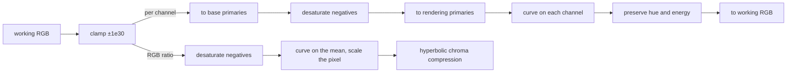

# Port spec: sigmoid

Source: darktable (the reference release, commit 20891f6c6f), `src/iop/sigmoid.c` `commit_params()`, `_calculate_adjusted_primaries()` and `process()` (`process_loglogistic_per_channel`, `process_loglogistic_rgb_ratio`, `_generalized_loglogistic_sigmoid`, `_desaturate_negative_values`, `_pixel_channel_order`, `_preserve_hue_and_energy`), with helpers from `src/common/custom_primaries.c` (`dt_rotate_and_scale_primary`), `src/common/colorspaces.c` (`dt_make_transposed_matrices_from_primaries_and_whitepoint`, the built-in profiles' primaries and white) and `src/common/iop_profile.c` (`dt_ioppr_add_profile_info_to_list`). OpenCL: `data/kernels/sigmoid.cl`. The reference is darktable's CPU path, as darktable's macOS arm64 release build, compiled by clang, computes it: the build the golden harness runs (Precision).

Status: **ported.**

- **Where:** the kernel is `slang/sigmoid.slang` in `crates/op/sigmoid`, its setup `src/setup.rs`, its manifest and schema `src/lib.rs`.
- **What:** every setting of params version 3: both colour processings (per channel, darktable's default, and RGB ratio), the hue preservation and the primaries section with all five base primaries, so `prepare` returns `NotPorted` for nothing. Where darktable's f32 curve breaks down at the ranges' corners, the kernel renders its breakdown.
- **In the pipeline:** in `OPERATIONS` at darktable's v5.0 place, working space 45.3, with `default_enabled` off. Nothing plans it until an edit can choose it as its tone mapper (decision 33), planned with the Sigmoid module.
- **Checks:** the five golden cases pass, and the gradient check passes on every case and on the synthetic sweep (Gradients). Checked on one GPU so far.

Golden results, Apple M4:

| Case | darktable test | Image | Settings | ΔE2000 mean | p95 | max | Module effect (mean) | One pass (median, min) |
| --- | --- | --- | --- | --- | --- | --- | --- | --- |
| `sigmoid` | 0097 | mire1.cr2, 3908×2602 | version 1, per channel, contrast 1.788, skew 0.36, hue preservation 50.62% | 0.0000 | 0.0001 | 0.0002 | 4.85 | 4.1 ms, 3.9 |
| `sigmoid-no-hue-preservation` | 0151 | mire1.cr2, 3908×2602 | 0097's with hue preservation 0 | 0.0000 | 0.0001 | 0.0002 | 5.00 | 3.8 ms, 3.6 |
| `sigmoid-default` | 0182 | hlrecovery.arw, 5492×3672 | version 3, darktable's defaults | 0.0000 | 0.0001 | 0.0002 | 4.59 | 11.9 ms, 8.9 |
| `sigmoid-rgb-ratio` | 0097, edited | mire1.cr2, 3908×2602 | version 3, RGB ratio, contrast 1.35, skew −0.3, white 95%, black 0.8%, primaries set (ignored) | 0.0000 | 0.0001 | 0.0002 | 2.18 | 4.0 ms, 3.8 |
| `sigmoid-primaries` | 0097, edited | mire1.cr2, 3908×2602 | version 3, per channel, contrast 1.6, skew −0.15, black 0.05%, hue preservation 70%, sRGB base, insets 0.12, 0.08, 0.2, rotations 2°, −1.5°, −3.5°, purity 0.4 | 0.0000 | 0.0001 | 0.0002 | 3.06 | 4.1 ms, 3.8 |

No pixel of any case is over 2.3.

Tests 0183 to 0185 render byte for byte as 0182 does in darktable, so they are not cases:

- 0184 differs only in its PQ output profile, which the harness replaces with linear Rec2020 and which the reference release's sigmoid does not read.
- 0183 and 0185 hold params version 4, which the reference release cannot read and renders with its defaults (Parameter versions).

## Purpose

Sigmoid is one of darktable's tone mappers, beside AgX and filmic rgb. It takes scene-referred light, unbounded and with middle grey at 0.1845, to the display, with a smooth curve whose two main controls are its contrast at middle grey and its skew between shadows and highlights. It keeps colours from clipping into flat primaries.

Algorithmically it is a generalised log-logistic curve, `white · (F / (P + F))^q` with `F = (fog + x)^p`, fitted so that black, middle grey and infinity reach the display's black, middle grey and white. It applies in one of two ways:

- **Per channel** (darktable's default): in a space whose primaries are inset towards white and rotated, with the middle channel's hue partly restored.
- **RGB ratio:** to the channels' mean, scaling the pixel, with a hyperbolic chroma compression into the display's range.

In the first pass it is the Sigmoid module, a tone mapper of its own in the Base tab, one tone mapper per edit (decision 2; `docs/modules/README.md`, Sigmoid).

## Pipeline

- **darktable position:** 45.3 in the v5.0 order (`src/common/iop_order.c`, `v50_order`): after rgb levels (43), base curve (44) and filmic (45), before AgX (45.5) and filmic rgb (46).
- **Apertrust slot:** working space 45.3, darktable's place: after RGB levels (43), before AgX (45.5), as `crates/operations/order.md`'s table has it (decision 22).
- **Domain:** scene-referred in, display-referred out (`Domain::Scene` in the manifest), as AgX's.
- **Input and output:** working RGB, linear Rec2020, in and out; alpha passes through. The output is linear and display-referred: middle grey 0.1845, the target white (1.0 by default) as the curve's limit. Hue preservation and the purity matrix can move channels slightly outside [0, white]; nothing clips them.
- **Assumes earlier modules:** demosaic, white balance or colour calibration, and exposure placing middle grey near 0.1845, which the curve keeps. Negative input (out-of-gamut camera colours) is handled by `_desaturate_negative_values`.
- **Layer support:** background only (`layers: false`) until layers come. The background's tone mapper runs once and its parameters are global. Planned with layers: a layer may choose its own tone mapper, sigmoid among them, which replaces the background's within its mask, never stacked on it (decision 33).

## Operation

| Manifest field | Value |
| --- | --- |
| `id` | `sigmoid` |
| `version` | 1 |
| `slot` | working space, 45.3 |
| `domain` | scene |
| `layers` | false |
| `differentiable` | true: `sigmoid_backward` and `sigmoid_forward_diff` |
| `radius` | 0 |
| `default_enabled` | false |
| `provenance` | darktable, commit 20891f6c6f; `src/iop/sigmoid.c`, `data/kernels/sigmoid.cl` (the shared helpers are AgX's port, in `apertrust-color`) |

`prepare` gives one per-pixel pass of `main`, with the 192-byte `SigmoidParams` (`PARAMS_SIZE`) and no tables. The kernel reads the colour processing from the uniform and takes one path or the other, as darktable's `process` does. It ignores the image context: nothing in `commit_params` reads the image.

## Parameters

darktable params version 3, 56 bytes, fourteen four-byte fields in this order. The schema (version 1) has darktable's field names, its ranges (`$MIN`, `$MAX`) and its defaults (`$DEFAULT`); darktable has no `reload_defaults` for sigmoid, so these are a new instance's, and what its auto-applied "scene-referred default" preset stores (NULL params). `Settings::default` holds them, and a test checks the schema against it.

| Name | darktable field | Type | Range | Default | Meaning | Owner |
| --- | --- | --- | --- | --- | --- | --- |
| Contrast | `middle_grey_contrast` | f32 | 0.1 to 10 | 1.5 | The curve's slope at middle grey, as the film power the fit derives from it; implicitly the input range the curve takes | Sigmoid |
| Skew | `contrast_skewness` | f32 | −1 to 1 | 0 | Shifts the compression towards the shadows (negative) or the highlights (positive): the paper power `q = 5^−skew` | Sigmoid |
| Target white | `display_white_target` | f32, % | 20 to 1600 | 100 | The display's white, the curve's limit, as a percentage | Sigmoid (Display luminance group) |
| Target black | `display_black_target` | f32, % | 0 to 15 | 0.0152 | The display's black, the curve's value at 0 | Sigmoid (Display luminance group) |
| Colour processing | `color_processing` | enum | 0 per channel, 1 RGB ratio | per channel | Where the curve applies (Purpose) | Sigmoid |
| Preserve hue | `hue_preservation` | f32, % | 0 to 100 | 100 | How far the per-channel processing restores the middle channel's hue | Sigmoid, per channel |
| Red, green, blue attenuation | `red_inset`, `green_inset`, `blue_inset` | f32 | 0 to 0.99 | 0 | Moves each primary towards white before the curve, so that colour desaturates sooner in the highlights | Sigmoid (Primaries group, per channel) |
| Red, green, blue rotation | `red_rotation`, `green_rotation`, `blue_rotation` | f32, radians | ±0.4 | 0 | Rotates each primary about white before the curve; the outbound matrix keeps the rotation | Sigmoid (Primaries group, per channel) |
| Recover purity | `purity` | f32 | 0 to 1 | 0 | The share of each inset the outbound matrix undoes: 1 undoes it entirely | Sigmoid (Primaries group, per channel) |
| Base primaries | `base_primaries` | enum | 0 working profile, 1 Rec2020, 2 Display P3, 3 Adobe RGB (compatible), 4 sRGB | working profile | The space whose primaries are inset and rotated | Sigmoid (Primaries group, per channel) |

The schema's choice names are darktable's descriptions, as AgX's are: `per_channel`, `rgb_ratio`; `working_profile`, `rec2020`, `display_p3`, `adobe_rgb`, `srgb`. RGB ratio reads neither the hue preservation nor the primaries, as darktable's GUI hides them for it.

## Parameter versions

| Version | Change | Migration (`legacy_params`) |
| --- | --- | --- |
| 1 | Six fields, contrast to hue preservation | Copied into zeroed version 3 params: no insets, rotations or purity, base primaries the working profile |
| 2 | Appends the insets, rotations and purity | Copied into zeroed version 3 params: base primaries the working profile |
| 3 | Appends `base_primaries` | Current in the reference release |
| 4 | Not in the reference release: master (228cbffe88, after the tag) appends `white_target_from_output` (gboolean), scaling the target white to an HDR output's peak | darktable cannot read version 4 and renders the module at its defaults, without a message in darktable-cli (tests 0183 and 0185 render as 0182). `ports.rs` refuses it |

`ports.rs` migrates versions 1 to 3 as darktable does; test 0097 and 0151 are version 1, 0182 and the edited cases version 3. The port follows darktable's latest stable release (decision 3): when a stable release has version 4, the port follows it.

## Setup on the CPU (`commit_params`)

`MIDDLE_GREY` g = 0.1845. The fit solves for the curve `f(x) = w · (F / (P + F))^q`, `F = (fog + x)^p`, with `f(0) = b`, `f(g) = g`, `f(∞) = w`, and the slope at g the contrast's whatever the skew:

1. **Reference slope:** the curve with no skew, a display from 0 to 1 and no fog at film power c (the contrast): `P_ref = g^c (1/g − 1)`, `r(x) = x^c / (P_ref + x^c)`, its slope at g by central differences, `(r(g + δ) − r(g − δ)) / 2δ`, δ = 1e-6.
2. **Paper power** `q = 5^−skew`; `w = 0.01 · display_white_target`, `b = 0.01 · display_black_target`.
3. **Skewed slope:** the curve at film power 1 with the targets, `X = (w/g)^(1/q)`, `P_1 = g (X − 1)`, `t(x) = w (x / (P_1 + x))^q`, its slope at g by the same differences.
4. **Film power** `p = reference slope / skewed slope`.
5. **Fog and paper exposure:** `A = (X − 1)^(1/p)`, `B = ((b/w)^(−1/q) − 1)^(1/p)`, `fog = g A / (B − A)`, `P = (fog + g)^p (X − 1)`. With b = 0, B is infinite and the fog 0.
6. **Hue preservation** `clamp(0.01 · hue_preservation, 0, 1)`; the rest copied.

**The fit follows darktable's release build bit for bit** (Precision): the f32 arithmetic of `commit_params` as darktable's `libsigmoid.so` computes it, read from its disassembly (Apple's arm64 build, the one the golden harness runs). `-ffast-math` folds:

- `g ± δ` to the f32 constants 0x3e3cedd4 and 0x3e3ced4e;
- the division by 2δ into a multiplication by 500000;
- `0.01 · target / g` into `target · (0.01 · (1/g))` (0x3d5e0164, not the correctly rounded quotient 0x3d5e0163);
- `g (X − 1) + (g ± δ)` into `g X + ((g ± δ) − g)`;
- `powf(x, 1)` and the magnitude 1 away.

`Curve::new` writes exactly that sequence, and a unit test holds the constants to the binary's.

**Reading the build again**, for a later reference release: `otool -tV -p _commit_params /Applications/darktable.app/Contents/Resources/lib/darktable/plugins/libsigmoid.so` (on Linux, `objdump -d --disassemble=commit_params libsigmoid.so`). Compare with `Curve::new`:

- the constants each `mov`/`movk` pair loads (in the reference release 0x3e3ced91 for g, 0x3e3cedd4 and 0x3e3ced4e for `g ± δ`, 0x408d7116 for `1/g − 1`, 0x48f42400 for 500000, 0x3d5e0164 for `0.01/g`, 0x35860000 and 0xb5860000 for `(g ± δ) − g`, 0x3c23d70a for 0.01);
- the eleven calls to `powf` and their arguments;
- around them, which operations are `fmul`, `fdiv`, `fadd` or `fsub`, in which order, and whether any is a fused `fmadd` (none is in the reference release's fit).

Then update `the_fits_constants_are_the_builds` and rerun the cases.

The kernel takes the paper exposure as `log2 P = p log2(fog + g) + log2(X − 1)` from the same f32 terms, in f64, finite for every setting.

Where darktable's f32 curve breaks down (Precision), the setup finds the breakdown in f32 and hands it to the kernel as values to compare film values with, so the kernel never tests for infinity:

- `film_overflow`: the smallest film value `fog + x` whose `powf(film, p)` overflows (f32's largest value where none does);
- `film_underflow`: the largest whose `powf` rounds to 0 (0 where only 0 does);
- whether darktable's f32 `P` is finite, infinite or 0 (`PaperExposure`).

Both film limits are found by a binary search over f32's bit patterns.

**Primaries** (`_calculate_adjusted_primaries`), matrices as `M · v` (darktable stores them transposed), in f64 as AgX's are:

- The base profile: the working profile, or darktable's built-in Rec2020, Display P3, Adobe RGB (compatible) or sRGB, as lcms builds them (`RgbSpace`, AgX's port). darktable looks a built-in profile up by type and filename, so Rec2020 on a linear Rec2020 working space is the working profile's own entry.
- `pipe_to_base = base_out · work_in`, the identity when the base is the working profile (darktable then skips the product); `base_to_pipe` its inverse.
- Inbound: each primary rotated about the base white by its rotation and moved towards it to `1 − inset` of its distance to the gamut's edge (`dt_rotate_and_scale_primary`, in D50 chromaticities as darktable reads them back from the profile); `base_to_rendering = base_out · (matrix of those primaries and the base white)`.
- Outbound: the same with `1 − purity · inset` and the same rotation; `rendering_to_pipe = base_to_pipe · (base_out · its matrix)^−1`, or 0 where `mat3SSEinv` refuses that inverse (Precision). Purity 1 makes the way out the inverse of the way in (a unit test).

At zero insets `base_to_rendering` is the identity for sRGB and Adobe RGB and very nearly for Rec2020 and Display P3 (up to 0.0024), because darktable clamps a negative XYZ of their adapted red primary, as AgX's spec describes; the way out undoes the way in either way.

## Per pixel (`process`)

The input is clamped to ±1e30 (Deliberate differences). Then, by colour processing:

**Per channel** (`process_loglogistic_per_channel`):

1. `base = pipe_to_base · rgb`.
2. `_desaturate_negative_values`: `mean = max((r + g + b) / 3, 0)`, `m = min(r, g, b)`; where `m < 0`, `s = −mean / (m − mean)`, else 1; `rgb = mean + s (rgb − mean)`. A negative mean makes the pixel black.
3. `rendering = base_to_rendering · base`.
4. The curve on each channel (`_generalized_loglogistic_sigmoid`): `w · (F / (P + F))^q`, `F = (fog + max(x, 0))^p`; darktable maps a NaN to w. With `film = fog + max(x, 0)`, the kernel gives what darktable's f32 gives where it breaks down:
   - w where `film ≥ film_overflow` (`inf / inf`) or `P` is 0 (`F / F`, or `0 / 0`);
   - 0 where `film ≤ film_underflow` (`0 / P`) or `P` is infinite (`F / inf`);
   - elsewhere the curve in the log domain, `F / (P + F) = 1 / (1 + 2^u)`, `u = log2 P − p log2(film)`, `w · 2^(−q log2(1 + 2^u))`, with `log2(1 + 2^u)` as `u + log2(1 + 2^−u)` for `u > 0` (Deliberate differences).
5. The channel order of `rendering` (`_pixel_channel_order`), ties as darktable breaks them: r ≥ g > b; b > r ≥ g; r ≥ b > g; r ≥ g = b; g > r ≥ b; b > g > r; g ≥ b > r.
6. `_preserve_hue_and_energy`, on the curve's output `c` with the input `rendering` (min, mid, max by that order):
   - `midscale = (mid − min) / (max − min)` of the input (0 when max = min);
   - `full = c_min + (c_max − c_min) · midscale`, `naive = (1 − h) c_mid + h · full`;
   - `E_pc = c_r + c_g + c_b`, `E_naive = c_min + naive + c_max`;
   - `blend = 2 min / (min + mid)` of the input (0 when the sum is 0), `E = blend · E_pc + (1 − blend) · E_naive`;
   - if `naive ≤ c_mid`: `mid' = ((1 − h) c_mid + h (midscale · c_max + (1 − midscale)(E − c_max))) / (1 + h (1 − midscale))`, `min' = E − c_max − mid'`, `max' = c_max`;
   - otherwise `mid' = ((1 − h) c_mid + h (c_min (1 − midscale) + midscale (E − c_min))) / (1 + h · midscale)`, `min' = c_min`, `max' = E − c_min − mid'`.
7. `out = rendering_to_pipe · (min', mid', max')`.

**RGB ratio** (`process_loglogistic_rgb_ratio`), in working RGB, no primaries:

1. `_desaturate_negative_values` as above; `luma = (r + g + b) / 3`.
2. `mapped = curve(luma)`; `scaled = (mapped / luma) · rgb` where `luma > 1e-9`, else `(mapped, mapped, mapped)`.
3. With ε = 1e-6, `low` and `high` the smallest and largest channel of `scaled`: `d_white = (w − mapped) / (high − mapped + ε)`, `d_black = (b − mapped) / (low − mapped − ε)`, `d = min(d_white, d_black)`, `k = (mapped − low) / (mapped + ε)`.
4. Hyperbolic compression: `H = 2k / (1 − k² + ε) / (k d + ε)`, `factor = H / (1 + √(H² + 1)) · d`; `out = mapped + factor · (scaled − mapped)`.

The kernel reads channels chosen at run time by one-hot vectors and dot products, and writes them by their sum, so nothing is written at a run-time index (decision 10).

**At the defaults the operation is not an identity**: it is a tone mapper, and middle grey is the only value it keeps (within 1e-4 on the GPU tests).

## Neighbourhood and scale

- **Neighbourhood radius:** none; a per-pixel module.
- **Scale dependence:** none.
- **Tile overlap needed:** none.
- **Region-of-interest changes:** none (no `modify_roi_in` or `modify_roi_out`).

## Precision and special values

### Arithmetic

- **fp64:** darktable's processing path is f32 throughout; it has no doubles. The port's fit is f32, as darktable's build computes it (below), its `powf` f64 `pow` rounded once. The matrices are f64, rounded once, and so is `log2 P`.
- **The fit's finite differences magnify the last bit.** δ = 1e-6 at g = 0.1845, where an f32 ulp is 1.49e-8, so each slope is a whole number of ulps of `r(g ± δ)` times 500000.
  - The film power moves in steps of about 0.6% as the contrast moves: at the stored contrast of test 0097 it is 2.7222223, one ulp lower 2.7083333 (a unit test).
  - It differs from the exact slopes' `c (1 − g) / (q (1 − 1/X))` by up to 11% on a grid over darktable's ranges (41 contrasts × 21 skews × 21 whites × 16 blacks): −0.5% at test 0097, +0.3% at the defaults.
  - A one-ulp change in any value the slopes take moves the result by as much, so the port follows the build's arithmetic exactly, as grain's zoom does (`docs/ports/grain.md`).
  - With the exact slopes instead the cases would differ from darktable by ΔE2000 means of 0.019 to 0.098 and maxima of 0.043 to 0.25 (measured on the five cases), where the build's arithmetic gives 0.0000 and 0.0002.
- **The reference is one build of darktable:** its macOS arm64 release build, compiled by clang, which the golden harness runs. Builds by GCC, darktable's Linux packages and its Windows build (MSYS2), likely fold the fit's constants and reassociate its sums differently. An emulation of GCC's folding gives a film power 0.9% to 2.1% lower at three of the five cases and ΔE2000 maxima up to about 0.25 against this port, not measured against a GCC build. A run of the cases against another platform's darktable-cli will therefore not show 0.0000. The macOS build is the reference, and its reading can be redone for a later release (Setup on the CPU).
- **`powf` as f64 `pow` rounded once.** darktable calls its C library's `powf`. Apple's differs from f64 `pow` rounded once in about 0.58% of arguments (20 million random ones), and other platforms' differ in other places, so with the platform's `powf` the curve would differ between Apertrust's platforms.
  - The setup computes `powf` as `f64::powf` rounded to f32. That calls the platform's `pow` too, but `pow`'s last bit decides the f32 result only for an exact value within an f64 ulp of an f32 halfway point, about one argument in 10^8. So the curve is the same everywhere in practice, without a dependency.
  - Over the grid above, Apple's `powf` gives the same film power at every point with contrast 0.7 to 3, skew within ±0.7, target white 50 to 200% and target black up to 1% (1764 points; 127 of them differ in the fog alone). It moves it by more than 0.1% at 5.4% of the grid's points, all outside that box, by at most 3.2% (contrast 10, skew 0.9, white 336%).
  - darktable's Linux and Windows builds, with other compilers and C libraries, need not agree with its macOS build there either. The five cases' fits are bit for bit the same with either `powf`, so they do not tell the two apart.

### darktable's breakdown at the ranges' corners

**darktable's curve breaks down at the ranges' corners, and the port renders the breakdown.**

- darktable's f32 `P` is infinite at 1.2% of the grid's points, and `log2 P` spans −297 to 436 over it, so it underflows to 0 too.
- `F` overflows or underflows wherever `p log2(fog + x)` passes 128 or about −150. At the defaults that is from a film value of 4.1e25 and below 9.7e-31, beyond any photo, but at high contrasts within an image.
- darktable then renders the target white where `F` overflows (`inf / inf`, NaN, its check) or `P` is 0 (`F / F`), and black where `F` underflows (`0 / P`) or `P` is infinite and `F` finite (`F / inf`).

Every IEEE f32 build overflows and underflows at the same places, so this is darktable's behaviour, not a build's:

| Settings | What happens | Image |
| --- | --- | --- |
| contrast 10, skew −1, white 20%, black 15% | fog 14, film power 99, `F` overflows at every input | every pixel the target white (unit and GPU tests) |
| contrast 9, skew 1, white 1600%, black 15% | `P` overflows | black but where `F` overflows |
| contrast 6, skew 1, white 20%, black 0 | `P` underflows | white |

The setup finds these limits in f32 and the kernel compares film values with them (Setup on the CPU). Over the corners of darktable's ranges the kernel's curve equals darktable's f32 curve within 2e-4 relative (a unit test), but where darktable's `F` is subnormal (below). Master's commit 228cbffe88 notes the same overflow ("renders midtones black") and caps its HDR white for it.

**Only settings near f32's limits depend on a build's rounding:**

- a `P` within rounding of overflow (log2 P near 128), where darktable's `P + F` can overflow too and render black, which the port does not follow;
- a `P` or `F` near the smallest subnormal (log2 near −149), where an f32 subnormal keeps fewer bits and a build that flushes subnormals to 0 renders black. At one corner (white 1600%, black 0, contrast 10, skew 1) a subnormal `F` of about 2^−147, two or three significant bits, just above the underflow puts darktable's value 1.9% from the port's log-domain one, near black (3.9e-4 of a white of 16). The port keeps its curve there.

**The film power reaches 121** at the ranges' corners (0.0275 at the other end), where `p log2(fog + x)` reaches thousands and its f32 rounding limits either form of the curve to about 1e-4 relative. At the presets' and the cases' settings the log-domain curve equals darktable's form within 2e-5 relative from 2^−30 to 2^20 (a unit test).

### Divisions, NaN and infinity

- **Divisions** are darktable's guards: the hue preservation's `max − min` and `min + mid` compared with 0, its denominators at least 1; RGB ratio's `high − mapped + ε` and `low − mapped − ε` at least ε from 0, and `mapped + ε` positive. `k d + ε` could reach 0 only for a mapped luma below the target black, which the fit excludes but for rounding, as in darktable. The desaturation's `m − mean` is negative wherever it divides.
- **NaN and infinity:** darktable maps a NaN curve value to the target white. The kernel needs no such check, since the setup tells it where darktable's NaN arises and its curve is finite for every finite input. It clamps the input to ±1e30 so sums of channels and the matrices stay finite. Output and both derivative modes stay finite for 0, 1e-30, ±1e30, f32's largest values and mixed signs at the ranges' corners and the primaries' extremes (GPU tests).

### A singular outbound matrix

The way out inverts `base_out · (matrix of the outbound primaries)` with `mat3SSEinv`. That matrix is singular wherever the white lies on the line through two outbound primaries, so it is no mix of them with the third, or the three lie on one line. The outbound scaling `1 − purity · inset` is at least 0.01, so no primary reaches the white, as AgX's can; but two surfaces of the settings reach it, inside the sliders' ranges, over Display P3 and sRGB base primaries:

- *Two outbound primaries opposite each other across the white*: green turned negative and blue positive until they are 180° apart, whatever the insets and purity, since a primary's direction from the white is its rotation's alone. The rotations' ±0.4 reach it over Display P3 (green −0.3834 and blue +0.3834, ∓21.97°, or any pair 0.7667 apart) and sRGB (∓0.3389, ∓19.42°, 0.6778 apart), not over Rec2020 (∓27.6°), the working profile, or Adobe RGB (∓25.8°). The plain inverse has entries of 1.1e7 to 3.6e7 there, or is NaN where f64 rounding leaves the determinant exactly 0.
- *Three outbound primaries on one line*: past that surface the white lies outside the outbound primaries' triangle, and red, close to the white where its outbound scaling is small, can sit on the line through green and blue: with a red outbound scaling up to about 0.067 over sRGB and 0.017 over Display P3 (recover purity times red attenuation at least 0.933 and 0.983), for example sRGB, purity 100%, red attenuation 99%, green −0.4 and blue +0.3069 (measured with searches over the rotations and scalings). `rgb_to_xyz_from_chromaticities` turns the primaries' matrix to 0 there (`docs/ports/primaries.md`, Precision), and the plain inverse is NaN.

**What darktable renders there.** Where the determinant is under 1e-7 in magnitude, darktable's `mat3SSEinv` refuses it and returns without writing, and `_calculate_adjusted_primaries` declares `rendering_to_base` without initialising it, so darktable renders whatever its stack held. Where the f32 rounding of a singular matrix escapes the refusal instead, darktable inverts that rounding. darktable-cli (macOS, arm64), on `sigmoid-primaries`'s sidecar (sRGB base), rendered:

- values from −9.5e3 to 4.4e4 (median magnitude 19.5) with green and blue turned ∓0.33888614, its insets and purity kept;
- values from −4.9e6 to 8.3e5 (median 2.2) at the example on the second surface;

where the curve's limit is the target white of 1. That is no result to follow: an uninitialised read, or rounding inverted.

**What the port renders.** The setup takes the decision `mat3SSEinv` is written to make, with the determinant in f64 (`checked_inverse_d` in `apertrust-color`), and uses the zero matrix there: the per-channel image is black (Deliberate differences); RGB ratio reads no matrix.

- The refusal is narrow: two f32 steps of a rotation at the first surface, about four at the second.
- Off it, the matrix is darktable's, its entries growing as one over the distance: 2.8e6 to 8.3e6 one f32 step of a rotation from the first surface.
- The sliders' values (tenths of a degree) never reach the first surface's refusal, since green's and blue's differ by a whole number of tenths and the surface lies at least 5.2e-4 rad from one. The nearest, −21.9° and +22.0° over Display P3 and ±19.4° over sRGB, give entries of 1.2e3 and 8.0e2 with the `sigmoid-primaries` insets and purity.
- A unit test holds the guarded settings to 0 and a slider's value nearby to the plain inverse.
- The inbound matrix is never inverted: on the first surface the rendering space loses a dimension, finite, as in darktable.

## CPU and OpenCL differences in darktable

None that change results. `sigmoid.cl` computes the per-channel curve on a `float4` and picks RGB ratio's lowest and highest channels with `fmin` and `fmax` rather than the channel order, which gives the same values; its `_desaturate_negative_values` touches alpha, which it restores. The references are rendered on the CPU (`--disable-opencl`).

## Deliberate differences

- **The curve in the log domain** (Per pixel, 4): `1 / (1 + 2^u)` for `F / (P + F)`, taking `log2 P` from the setup, where darktable's f32 `F` and `P` are within f32's range; darktable's breakdown outside it is followed (Precision). The arithmetic differs, not the behaviour: within 2e-5 relative of darktable's form at the presets' and the cases' settings, within 2e-4 at the ranges' corners, and the cases' maxima are 0.0002. Not followed: darktable's `P + F` overflowing to black where `P` is within rounding of f32's largest value, and its subnormal `F`'s lost bits near the underflow, both down to its build's rounding (Precision).
- **`powf` as f64 `pow` rounded once in the fit** (Precision): the same curve on every platform; the same film power as darktable's macOS build wherever the usual settings lie, up to 3.2% apart at the ranges' corners.
- **Input clamped to ±1e30**: darktable does not clamp; no photo comes near.
- **Matrices in f64, rounded once**; darktable builds them in f32, `mat3SSEinv` included. Measured as part of the `sigmoid-primaries` case's 0.0002.
- **Singular outbound settings render black, where darktable reads an uninitialised matrix** (Precision): the white on the line through two outbound primaries (green and blue turned opposite each other, over Display P3 and sRGB base primaries) or the three outbound primaries on one line (past that, with red close to the white), within `mat3SSEinv`'s refusal of a determinant under 1e-7.
  - darktable leaves `rendering_to_base`, never initialised, as the stack held it, or inverts f32 rounding where that escapes the refusal: values of −4.9e6 to 4.4e4 on the build measured, reproducible on no build.
  - The setup refuses with the determinant in f64 and uses the zero matrix, as the AgX port does for its singular outbound settings (`docs/ports/agx.md`) and the rgb primaries port for its own (`docs/ports/primaries.md`).
  - The size: black against darktable's undefined values, a few f32 steps of a rotation wide, and on the first surface at none of the rotation sliders' values (tenths of a degree). The output is constant there, so its derivatives are 0. RGB ratio reads no matrix and is unchanged.
- **Params version 4 refused**, where darktable silently renders its defaults.
- **Not ported (GUI only):** the module's widgets and their soft ranges, which belong to the Sigmoid module.

## Tool binding notes

In the first pass (decisions 2 and 29) the Sigmoid module is darktable's page (`docs/modules/README.md`, Sigmoid): no content tabs. Its controls, in darktable's `gui_init` order and under its labels:

- On the page: Contrast (`middle_grey_contrast`, soft range 0.7 to 3, three digits), Skew (`contrast_skewness`), Colour processing (per channel, RGB ratio), Preserve hue (`hue_preservation`, as %, shown only for per channel).
- **Primaries**, a collapsible group shown only for per channel: Base primaries (the five), red, green and blue attenuation (`*_inset` shown as %, factor 100, soft range 0 to 50%, one digit) and rotation (`*_rotation` shown in degrees, factor 180/π, one digit), Recover purity (`purity`, %, no digits).
- **Display luminance**, a collapsible group: Target black (`display_black_target`, %, soft range 0 to 1%, four digits), Target white (`display_white_target`, %, soft range 50 to 100%).

The module stores darktable's values and units (radians, fractions, percentages as darktable stores each); the degrees and percentages are display factors, exact changes of unit.

**Presets** (`init_presets`), each with the targets at 100% and 0.0152%:

| Preset | Contrast | Skew | Processing | Hue preservation | Primaries |
| --- | --- | --- | --- | --- | --- |
| scene-referred default | the defaults | | | | |
| neutral grey | 1.22 | 0.65 | per channel | 100% | none |
| ACES 100-nit like | 1.6 | −0.2 | per channel | 0% | none |
| Reinhard | 1.0 | 0 | RGB ratio | | none |
| smooth | 1.5 | −0.2 | per channel | 0% | insets 0.1, 0.1 and 0.15, rotations 2°, −1° and −3°, purity 0, base primaries Rec2020 |

The scene-referred default is darktable's auto-applied preset in its sigmoid workflow, so Apertrust's default for the module.

Green and blue rotations turned opposite each other (green −21.97° and blue +21.97° over Display P3, ∓19.42° over sRGB, or any pair as far apart) black the per-channel image out (Precision; darktable shows values far outside the display there), and close to it colours are boosted without bound. Of the sliders' values (tenths of a degree) none reaches it, and the nearest give matrix entries of about 1e3. The defaults, rotations 0, are far from it, and Rec2020, the working profile and Adobe RGB never reach it.

The operation at its defaults is no identity; as a tone mapper it needs none. Exactly one tone mapper runs on the background, the one the edit chooses (decision 33), and the module at its defaults is darktable's scene-referred default. An edit choosing it is planned with the Sigmoid module.

## Gradients

The kernel differentiates against `SigmoidCurve`: the target white and black, `log2 P`, the fog, the film and paper powers and the hue preservation. Its entry points return, in this order:

1. the film power;
2. the paper power;
3. the target white;
4. the hue preservation per channel, or the target black with RGB ratio, the one each processing reads.

The fog and the paper exposure are differentiated but not returned. These are the kernel's own coefficients: the fit that derives them from the contrast, the skew and the targets runs on the CPU, and in f32 it is a staircase whose derivative is 0 almost everywhere (Precision). So the render keeps darktable's staircase, and an optimiser over those controls differentiates the smooth fit instead, the exact slopes, which differ from darktable's renders by up to ΔE2000 0.25 on the cases. That is the one exception to decision 11's rule that a derivative is exact: the derivative is the smooth fit's, within ΔE2000 0.25 of the render. It is settled with reference matching if sigmoid is optimised. The matrices, so the insets, rotations and purity, are not differentiated.

Results, Apple M4, step 1e-3, the sum of output RGB as the loss: relative error of reverse mode against central finite differences, and forward against reverse mode per pixel.

| Case | film_power | paper_power | white_target | hue_preservation | Forward vs reverse (largest) |
| --- | --- | --- | --- | --- | --- |
| `sigmoid` | 7.3e-5 | 1.2e-5 | 1.7e-5 | 3.0e-5 | 4.5e-7 |
| `sigmoid-no-hue-preservation` | 7.3e-5 | 1.2e-5 | 1.7e-5 | 1.2e-3 | 3.3e-7 |
| `sigmoid-default` | 4.7e-5 | 1.7e-5 | 1.7e-5 | 9.5e-6 | 3.2e-6 |
| `sigmoid-rgb-ratio` | 4.7e-5 | 4.7e-5 | 1.3e-5 | (black target: below) | 8.7e-8 |
| `sigmoid-primaries` | 4.7e-5 | 4.7e-5 | 1.7e-5 | 1.5e-5 | 1.9e-6 |
| synthetic, `sigmoid` | 3.6e-5 | 1.2e-5 | 2.2e-5 | 1.9e-5 | 1.7e-7 |
| synthetic, `sigmoid-no-hue-preservation` | 4.0e-5 | 1.3e-5 | 2.2e-5 | 8.6e-5 | 1.4e-7 |
| synthetic, `sigmoid-default` | 7.0e-5 | 1.3e-5 | 2.1e-5 | 1.4e-5 | 1.9e-7 |
| synthetic, `sigmoid-rgb-ratio` | 5.4e-5 | 5.0e-5 | 1.3e-5 | (black target: below) | 8.5e-8 |
| synthetic, `sigmoid-primaries` | 4.6e-5 | 4.5e-5 | 1.7e-5 | 9.2e-6 | 5.6e-7 |

**The target black with RGB ratio is invisible to the check's loss.** It acts only in the chroma compression, `mapped + factor · (scaled − mapped)`, whose channels' sum is `3 · mapped` whatever the factor, so R + G + B sees rounding alone (on the case: relative error 0.23, forward and reverse 0.14 apart per pixel). Nor does a loss with the same unequal weights at every pixel see it on the synthetic sweep, whose hues cancel any chroma-only change (a total of 6e-4 against 4.2e4 for the target white, at weights 0.25, 0.5 and 1).

So `ports.rs` names only three slots for the RGB ratio cases, and `crates/golden/tests/sigmoid.rs` checks all four slots of both processings with each pixel's channels weighted by its own colour, `Σ (w + max(input, 0)) · output` with w (0.25, 0.5, 1), on the sweep, at the cases' settings in either processing:

- the target black within 9.9e-4 to 4.4e-3 of finite differences, forward and reverse within 6.1e-9;
- every other slot within 9.1e-4, forward and reverse within 3.2e-8.

The same loss checks the target white's part in the compression, which R + G + B also misses.

**The hue preservation at 0 sits on a branch's boundary.** `_preserve_hue_and_energy` chooses its branch by `naive ≤ c_mid`, that is by the sign of `h (full − c_mid)`. At h = 0 both branches give the same value, but a move of h up takes the second for pixels with `full > c_mid`, a move down the first, and their derivatives move the max channel and the min channel respectively. The output matrix, nearly the identity here, makes the two differ slightly in R + G + B: on `sigmoid-no-hue-preservation` the gap is 1.2e-3, 98% of it in 1% of the pixels (oranges and yellows with r > g > b), and the same at steps of 1e-2 (1.5e-3) and 1e-4 (5.1e-3, noisier). Autodiff takes the first branch's slope, darktable's choice at h = 0; an optimiser at h = 0 sees one side.

Other non-smooth spots, where finite differences straddle a kink and per-pixel gradients jump: the curve's `max(x, 0)` at 0, the desaturation of a negative channel, the channel order's ties, RGB ratio's `min(d_white, d_black)` and its `luma > 1e-9`, and darktable's breakdown, whose white and black are constants (the white's derivative 1 in the target white, every other 0), with a jump at `film_overflow` and `film_underflow`. The softplus's branch at u = 0 is smooth: both sides are the same function.

## Test plan

- **Golden cases:** `sigmoid` (test 0097, version 1, per channel), `sigmoid-no-hue-preservation` (test 0151, two entries, the second active), `sigmoid-default` (test 0182, version 3 at darktable's defaults, on hlrecovery.arw's clipped highlights), all three unchanged; and two edits of test 0097's sidecar, its sigmoid entry's params replaced by version 3 ones, for what no integration test covers: `sigmoid-rgb-ratio` (RGB ratio, with primaries set that it ignores) and `sigmoid-primaries` (insets, rotations and purity over sRGB base primaries, partial hue preservation). No later tone mapper is on in these sidecars, so none is disabled. Tests 0183 to 0185 render byte for byte as 0182 (Golden results). darktable's tests have no case of the other base primaries; AgX's cases cover Adobe RGB's and sRGB's chromaticities, and unit tests every base's matrices.
- **Tolerance:** `Tolerance::DARKTABLE`.
- **Unit tests** (`crates/op/sigmoid`):
  - the schema is version 3's fourteen fields in order with darktable's defaults; every parameter reaches its own field and round-trips through `values`; the choices round-trip;
  - `prepare` gives one per-pixel pass of the setup's 192 bytes;
  - the fit's constants are the build's; the fit at test 0097's settings is the build's staircase value, 0.5% under the exact one;
  - at the presets' and moderate settings the curve meets its targets and rises, and its log-domain form equals darktable's within 2e-5;
  - the coefficients and the film limits are finite at every corner of the ranges; the film limits are `powf`'s own;
  - at contrast 10, skew −1, white 20% and black 15% darktable's curve and the kernel's are the target white at every input from 0 and 2^−30 to 2^30;
  - with the paper exposure overflowed (contrast 9, skew 1, white 1600%, black 15%) and underflowed (contrast 6, skew 1, white 20%, black 0) the kernel's curve is darktable's at every such input;
  - at every corner of the ranges it is darktable's within 2e-4 but where darktable's film response is subnormal;
  - the hue preservation is clamped;
  - the working profile and Rec2020 need no conversion; full purity undoes the inset for every base; every matrix keeps white;
  - on either singular surface (green and blue turned opposite each other over Display P3 and sRGB, and three outbound primaries on one line over sRGB) the outbound matrix is 0 and the uniform finite, where the plain inverse has entries over 1e7 or is NaN, and a slider's value nearby is inverted normally.
- **In `ports.rs`:** each case reads as darktable stores it (versions 1 and 3, the active entry of test 0151, test 0182's defaults); version 4 is refused; every case's inputs come through the operation's `prepare` from schema values as from the setup, every slot moves them, both processings have a case.
- **On the GPU** (`crates/golden/tests/sigmoid.rs`, run in CI): greys follow darktable's curve within 1e-4 relative from 2^−20 to 2^10, and middle grey stays, in both processings at every case's settings; at the three breakdowns above, greys from 0 and 2^−40 to 2^60 and 1e30 render darktable's white or black in both processings; output and both derivative modes are finite at extreme inputs and settings; the derivatives match finite differences with each pixel's own channel weights (Gradients).
- **The whole pipeline:** not in it, since nothing plans sigmoid yet; once an edit can choose it, the module's first-step invariants are its own.
