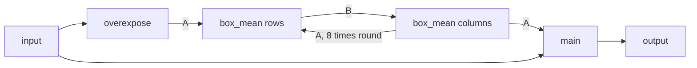

# Port spec: soften

## Source

darktable (the reference release, commit 20891f6c6f):

- `src/iop/soften.c`: `commit_params()` and `process()`;
- `src/common/colorspaces.h`: the HSL conversions, `rgb2hsl`, `hue2rgb`, `hsl2rgb`;
- `src/common/box_filters.cc` and `box_filters.h`: the box mean, `dt_box_mean`, `_box_mean`, `_blur_horizontal`, `_blur_vertical`, `BOX_ITERATIONS`;
- `src/common/imagebuf.c`: the mix, `dt_iop_image_linear_blend`;
- `src/common/math.h`: `dt_fast_hypotf` and `CLIP`; `src/common/dttypes.h`: `max3f` and `min3f`;
- `src/develop/pixelpipe_hb.c`: the pipe's input size, `dt_dev_pixelpipe_create_nodes`.

The OpenCL path is `process_cl` with `data/kernels/soften.cl`. The reference is darktable's CPU path.

## Status

**Ported**, in Slang (`crates/op/soften`), as an operation with its manifest, schema and `prepare` (`Soften`): every parameter and darktable's one algorithm; nothing is `NotPorted`.

- The box mean is the colour library's, shared with bloom (decision 65), unchanged.
- It is in `OPERATIONS` with `default_enabled` off, as darktable has soften off until the user turns it on. It is planned while its switched module is on, from a write of one of its controls to its reset (decision 32): the first pass's Soften module (`docs/modules/soften.md`).
- Checked on one GPU so far.

**Golden result** (case `soften`, darktable test 0051-soften, mire1.cr2, 3908×2602, Apple M4, a one-instance plan of the engine): ΔE2000 mean 0.0001, p95 0.0003, max 0.0042, no pixel over 2.3, against a module effect of mean 8.39, p95 18.94, max 53.59.

The amount's gradient slot is exact: reverse mode within 1.4e-3 of finite differences at the harness's step, 9.2e-7 at a step of 1 (Gradients).

## Purpose

The Orton effect for the photographer ("create a softened image using the Orton effect", darktable's description): a brightened, saturated and blurred copy of the image mixed into it, a dreamy glow over the whole picture. Bloom, by contrast, only lets highlights glow.

Algorithmically:

1. each pixel's HSL saturation and lightness are scaled and clipped to [0, 1];
2. that image is blurred by eight passes of a box mean whose radius is a percentage of 1% of the image's diagonal;
3. the blur is mixed linearly into the input.

It is the Effect tab's Soften module (`docs/modules/README.md`), on layers too.

## Pipeline

- **darktable position:** 66.0 in the v5.0 order (`v50_order`), after grain (65.0), before splittoning (67.0) and vignette (68.0); the same in v3.0, test 0051's order. A creative, display-referred module after the tone mappers.
- **Apertrust slot:** display 66.0, darktable's place and number: after grain (display 65), before vignette (display 68) (decision 22; `docs/engine.md`, Order).
- **Domain:** display-referred. darktable's description: "linear, RGB, display-referred" in, "linear, RGB" in processing, "linear, RGB, display-referred" out; "creative" purpose. Test 0051 has no tone mapper, so there it runs on scene-referred values.
- **Input and output:** darktable's soften is an RGB module (`default_colorspace` returns `IOP_CS_RGB`): the working space, linear Rec2020, in and out, as Apertrust's pipeline is. The HSL is taken of the working RGB as it is, with no transfer function. Alpha passes through (Deliberate differences).
- **Assumes earlier modules:** none.
- **Layer support:** yes. The whole-image passes see the operation's whole input, as darktable's module processes its whole region before blending; a layer's mask (Phase 4) blends the output.

## Operation

| Manifest field | Value |
| --- | --- |
| `id` | `soften` |
| `version` | 1 |
| `slot` | display, 66.0 |
| `domain` | display |
| `layers` | true |
| `differentiable` | true: `soften_backward` and `soften_forward_diff`, the derivatives of `main`, the pass that writes the output (Gradients) |
| `radius` | 0: the whole-image passes see the whole image (`PassKind::Reduction`, decision 15's whole-image kind under its code name), and `main` reads only its own pixel and scratch |
| `default_enabled` | false (decision 28) |
| `provenance` | darktable, commit 20891f6c6f; `src/iop/soften.c`, `src/common/box_filters.cc`, `src/common/colorspaces.h`, `src/common/imagebuf.c` |

`tiles_whole_image_passes` is true: the one pass that reads the input, `overexpose`, writes exactly the pixels of the tile it runs in, at their place in the whole image (Neighbourhood and scale).

## Parameters

darktable params version 1, 16 bytes: `size`, `saturation`, `brightness`, `amount` (floats). The schema (version 1) has darktable's field names, its introspection ranges and defaults. `Settings::default` holds them, and a test checks the schema against it.

| Name | darktable field | Type | Range | Default | Meaning | Owner |
| --- | --- | --- | --- | --- | --- | --- |
| `size` | `size` | float | 0 to 100 | 50 | "the size of blur", in percent of the largest radius, `mrad`, 1% of the image's diagonal: the box mean's radius at full resolution, `⌊mrad · min(100, size + 1) / 100⌋` | Soften: Size |
| `saturation` | `saturation` | float | 0 to 100 | 100 | "the saturation of blur", in percent: the HSL saturation's factor, `saturation / 100` | Soften: Saturation |
| `brightness` | `brightness` | float | −2 to 2 | 0.33 | "the brightness of blur", in EV: the HSL lightness's factor, `2^brightness` | Soften: Brightness |
| `amount` | `amount` | float | 0 to 100 | 50 | "the mix of effect", in percent (darktable's label "mix", `$DESCRIPTION`): the blurred image's weight in the linear mix | Soften: Mix |

darktable's sliders show size, saturation and mix as percentages and brightness in EV, over the same ranges.

## Parameter versions

| Version | Change | Migration |
| --- | --- | --- |
| 1 | `size`, `saturation`, `brightness`, `amount`, 16 bytes | current; darktable has no `legacy_params` for soften |

Test 0051 is version 1. `ports.rs` reads it and refuses other versions and sizes.

## Setup on the CPU (`commit_params`, the start of `process`)

`commit_params` copies the parameters. `process` derives, before its loops:

1. **The factors:** `brightness = 1.0 / exp2f(-brightness)` and `saturation = saturation / 100.0`, each computed in double from f32 values and stored as f32. One operation on f32 operands computed in double and rounded to f32 is the f32 operation (double has more than twice f32's precision, so the double rounding is innocuous). So they are `1.0f / exp2f(-brightness)` and `saturation / 100.0f`: √2 at test 0051's 0.5 EV, 1 at its 100 %.
2. **The largest radius:** `mrad = (int)(dt_fast_hypotf(w, h) * 0.01f)` with `w = piece->iwidth * piece->iscale` and `h` likewise.
   - `piece->iwidth` and `iheight` are not the module's input but the pipe's: every piece takes `pipe->iwidth` (`dt_dev_pixelpipe_create_nodes`, `pixelpipe_hb.c` line 530), the image the pipe starts from. For a raw that is its readout as decoded, before rawprepare's crop, as for the tone equalizer's radius (`docs/ports/toneequal.md`, Setup). Times `iscale` it is that readout at full resolution in every pipe.
   - darktable's release builds compile with `-ffast-math`, where `dt_fast_hypotf` is `sqrtf(x * x + y * y)`.
   - mire1's readout, 3944×2622, gives 4736.0 and 47; its developed image, 3908×2602, would give 46. Test 0051 cannot tell the two apart: at its size of 33 both give a radius of 15 (15.98 and 15.64, truncated). The readout rests on darktable's source and on the tone equalizer's measurement, where the readout's radius brings test 0080's max to 0.0013 against 0.19 with the developed size (`docs/ports/toneequal.md`, Setup).
3. **The radius at full resolution:** `rad = (int)(mrad * (fmin(100.0, size + 1.0f) / 100.0))`: `size + 1` an f32 sum, the rest double, truncated. 15 at test 0051's 33 (47 · 0.34 = 15.98), 23 at the default 50, 47 from 99 up, 0 at 0 for any image whose diagonal is under 10,000 pixels. A 61 MP image, 9504×6336, has `mrad` 114 and blurs by 1 at size 0.
4. **The radius at the pipe's scale:** `radius = MIN(mrad, ceilf(rad * roi_in->scale / piece->iscale))`, `rad` at scale 1.
5. **The mix:** `amt = amount / 100.0f`, 0.75 at test 0051's 75.

`prepare` (`crates/op/soften/src/setup.rs`) computes the same: the double steps in f64, and `exp2f` through Rust's `f32::exp2`, the same libm call on the reference build. It takes the largest radius from `ImageContext::camera`'s readout, or the image's own size when it is no raw, and scales the radius as decision 63 says (Neighbourhood and scale).

## Per pixel and over the image (`process`)

On the working RGB, `in` the module's input:

1. **The softened image** (`process`, the first loop): `rgb2hsl(in) → h, s, l`; `s *= saturation`; `l *= brightness`; `hsl2rgb(out, h, CLIP(s), CLIP(l))`, `CLIP` clamping to [0, 1].
   - `rgb2hsl` (`colorspaces.h`): `pmax = max3f`, `pmin = min3f`, `delta = pmax − pmin`, `l = (pmin + pmax) / 2`. Where `delta ≠ 0`, `s = delta / fmaxf(pmax + pmin, 2^−16)` for `l < 0.5`, else `delta / fmaxf(2 − pmax − pmin, 2^−16)`; the hue is `(g − b) / delta` where `pmax` is red, `2 + (b − r) / delta` where green, `4 + (r − g) / delta` where blue, over 6, wrapped into [0, 1]. Where `delta = 0`, hue and saturation are 0.
   - `hsl2rgb`: grey `l` where `s = 0`. Otherwise `m2 = l · (1 + s)` for `l < 0.5`, else `l + s − l · s`, and `m1 = 2l − m2`. Each channel is `hue2rgb(m1, m2, ·)` of the hue times 6, shifted by +2 (red, or −4 from 4 up), 0 (green) and +4 (blue, or −2 above 2): `m1 + (m2 − m1) · hue` below 1, `m2` below 3, `m1 + (m2 − m1) · (4 − hue)` below 4, `m1` from 4. Its alpha is set to 0.

   So the softened image is in [0, 1]: a lightness clipped to 1 is white, to 0 black.
2. **The blur** (`dt_box_mean(out, height, width, 4, radius, BOX_ITERATIONS)`, `BOX_ITERATIONS` = 8): darktable's box mean on four channels without Kahan summation (`_box_mean<4>`), exactly bloom's walk on each channel (`docs/ports/bloom.md`, Per pixel).
   - Eight times, every row, then every column: each value becomes the mean of the values within the radius of it along the line that lie inside the image, kept as a running sum in f32 in darktable's order, the window clipped at the image's edges.
   - darktable's channels are independent: its vertical pass walks `4 · width` columns of floats, its horizontal pass four sums along each row.
   - A radius of 0 is the identity.
3. **The mix** (`dt_iop_image_linear_blend(out, amt, in, …)`): every float `out = amt · out + (1 − amt) · in`, `1 − amt` computed once in f32. Alpha too, so darktable's output alpha is `(1 − amt)` times the input's.

**In the kernel** (`crates/op/soften/slang/soften.slang`, with darktable's HSL in `slang/common/hsl.slang`):

- `overexpose` writes the softened RGB of the input's pixels into scratch A, three planes laid out as the whole image at the pipe's scale, at each pixel's place in it.
- `box_mean` runs darktable's line walk (`box_mean_line` in the shared `box_filter.slang`, on `float3`), one invocation per row or column, from one scratch image into the other: A to B along the rows and B to A along the columns, eight times.
- `main` reads the blur from A at its place and mixes it into the pixel, alpha passing through.

darktable's fourth channel, the blur's alpha, is 0 and reaches no RGB, so it is not blurred.

## GPU plan

Every pass is `[numthreads(16, 16, 1)]`.

**Scratch:** two images of the whole image at the pipe's scale, each three planes of one f32 a pixel, red, green and blue: A (scratch 0 to 2) and B (scratch 3 to 5). Bindings 10 to 12 are the planes a pass reads, 13 to 15 those it writes.

| Pass | Kind | Size | Reads | Writes |
| --- | --- | --- | --- | --- |
| `overexpose` | whole-image | the operation's input, one invocation a pixel | the pixel | its softened RGB at its place, into A |
| `box_mean` along the rows, ×8 | whole-image | one invocation a row | A | B |
| `box_mean` along the columns, ×8 | whole-image | one invocation a column | B | A |
| `main` | per pixel | the image | the pixel, A at its place | the pixel |

18 passes in all, one run (decision 15): the pass that reads the input, then sixteen that read only scratch.

The passes' uniforms hold only what they read (decision 15):

- `overexpose`: the image's size and the two factors;
- the box passes: the size, the radius and their axis;
- `main`: the size and the mix.

So a drag of the mix leaves every whole-image pass's key unchanged and reruns `main` alone in the viewport, and a change of the saturation or the brightness leaves the box passes' bytes alone (a unit test). At most seven storage buffers a pass, the derivative entry points' six among them, within WebGPU's eight.

### Design choices

1. **The softened image in planes,** one f32 a pixel each, red, green and blue, not a float4 image. Two scratch images of three planes take 24 bytes a pixel (244 MB for mire1, 1.46 GB at 61 MP), where two float4 images would take 32. A float4 image measures no faster (Results, Speed). The planes bind 4 bytes a pixel, as bloom's lights, so lavapipe's 128 MiB refuses soften only above about 33.5 MP, bloom's limit (Limits), where a float4 image would be refused above about 8.4 MP, below most cameras' raws. Four planes, alpha included, would add one that no output reads.
   - The line passes walk whole lines, so they cannot run in strips (decision 15), and each buffer must fit one binding, the rule that makes the tone equalizer's grid float2 halves (`docs/engine.md`, Whole-image passes).
   - The shared `box_mean_line` takes it as it is, generic over the value (`float3`) and the line's storage (`IBoxLine`), so bloom's kernel and results are unchanged.
2. **Two scratch images, ping-ponged**, as bloom's, so no pass reads what it writes. darktable's in-place walk keeps a copy of the values leaving the window in a per-thread buffer, which on the GPU would be a local array written at a run-time index (decision 10).
3. **One invocation per line**, darktable's running sum, as bloom's: 2602 invocations along mire1's rows and 3908 along its columns, each walking its line. A direct sum of the `2r + 1` values at each pixel would be parallel per pixel but take 31 reads a value at test 0051's radius, and sum in another order.
4. **`overexpose` as a pass of its own**, rather than folded into the first row pass, so it owns its pixels per tile and the export can take the first round of tiles, as bloom's `threshold`.
5. **darktable's HSL in a Slang module of its own beside the kernel** (`slang/common/hsl.slang`, `import common.hsl;`), with its Rust restatement in `src/hsl.rs`, not in the colour library. darktable's colorize, splittoning, colorbalance, channelmixer, clahe, colorreconstruction and graduatednd call `rgb2hsl` or `hsl2rgb` too, but none is ported or scheduled, so it stays with its one port until a second is (decision 65).

## Neighbourhood and scale

- **Neighbourhood radius or reach** (decision 13): eight box means of radius `r` reach `8r` pixels each way, 120 at test 0051's 15 and 376 at the largest size on mire1 (912 at 61 MP). As a blur, that is a standard deviation of `√(8 · r(r + 1) / 3)` per axis, 25 pixels at 15.
  - darktable's `tiling_callback` asks for an overlap of `⌈3σ⌉` with `σ = √((8 r(r + 1) + 2) / 3)`, 76 at 15, its OpenCL Gaussian's half-width, short of the box means' `8r`.
  - Soften's blur is whole-image passes, as bloom's is, and its reach is 0 (`Operation::reach`'s default from the manifest's radius 0): `main` reads only its own pixel and scratch. A reach of the true `8r` would make tiles exact too, with the planned regions (decision 13); bloom's shape, which this follows, is exact at any tile size now.
- **Scale dependence:** darktable scales the radius with the pipe, `ceilf(rad · roi_in→scale / piece→iscale)`, so its preview gets a smaller blur in proportion, from the same `mrad`, always the full-resolution readout's. In Apertrust the radii follow the pipe's scale from darktable's `rad`, truncated once at full resolution (decision 15), by decision 63's rule for an iterated box mean, as bloom's:
  - each of the eight iterations takes `r` or `r + 1`, the larger first, so that their blur's variance, `Σ r_i (r_i + 1) / 3`, is the export's times the scale squared, `8 s² R (R + 1) / 3` (`apertrust_color::box_filter::iterated_radii`);
  - each is at most `mrad`, and each iteration's row pass and column pass take its radius in their own uniforms;
  - at scale 1, an export, its tiles and the 100% view, every pass is darktable's radius exactly.

  On mire1 for test 0051's 15:

  | Scale | Radii | darktable's ceiling |
  | --- | --- | --- |
  | 2400 wide (0.614) | 9 in every pass | 10 |
  | 1/2 | 8, 8 and six of 7 | |
  | 1/4 (976 wide) | three of 4 and five of 3 | |
  | 1/8 (488 wide) | three of 2 and five of 1 | 2 |
- **What Apertrust computes at each scale** (decision 15; principle 2): the softened image and its blur over the whole image at the pipe's scale in every pipe, never a visible region. darktable's darkroom runs the module on the visible region at the zoom's scale, its box means clipped at that region's edges, so its view of soften near the edges of a zoomed view differs from its export; Apertrust's does not.
- **Geometry** (decision 16): `prepare` takes the whole image from `ImageDesc::scaled_extent`, the stage at the pipe's scale in every pipe, and `origin` (`ImageContext::whole_image`; decision 15, so that after an export's resample it is at the export's scale), as bloom, the colour equalizer and the tone equalizer do. So after a geometry its passes cover their stage's extent at the pipe's scale (`docs/engine.md`, Geometry, What is built).
- **Tile overlap needed:** none for `main`, which reads only its pixel and scratch. darktable tiles only when memory runs short, with the overlap above, short of the box means' reach, so its tiled result can differ from its untiled one near tile edges. The golden renders do not tile.
- **Tiling in Apertrust:** soften opts in to a first round of tiles (`Operation::tiles_whole_image_passes`, decision 15), as the tone equalizer's EIGF, bloom and the colour equalizer do.
  - `overexpose`, the one pass that reads the input, writes the softened RGB of the tile's own pixels at their place in the whole image. So the tiles together write what one pass over the whole image would, every value by the same arithmetic. The first round's tiles overlap by a pixel to the right and below, where two tiles write the same value.
  - The box passes then run once, in the round's last tile, over the whole scratch, and the second round's `main` reads it.
  - `a_tiled_export_with_soften_equals_the_whole_one` (`crates/engine/tests/tiles.rs`) holds a tiled export bit-identical to the whole one, in two rounds.
  - The export's tile search sizes each tile without the whole-image scratch the export holds, 24 bytes a pixel, and logs that scratch under `-d memory` where it exceeds the budget (decision 15; Results, Exports of the largest raws).
- **Region-of-interest changes:** none (`modify_roi_in` and `_out` are darktable's defaults).

## Precision and special values

- **fp64 in darktable:** `process` writes several steps with double constants.
  - Each that is one operation on f32 operands, rounded to f32 (the factors, `(pmin + pmax) / 2.0`, the hue's `2.0 +`, `4.0 +`, `/= 6.0` and wrap, `2.0 * l - m2`), is the f32 operation, as Setup says.
  - Two steps are two operations each in double, rounded once: `2.0 - pmax - pmin` in `rgb2hsl`'s saturation for a lightness of 0.5 or more, and `l * (1.0 + s)` in `hsl2rgb`'s `m2` for a lightness below 0.5. The kernel computes them in f32, rounding twice: a last bit of the saturation or of `m2`. The Rust restatement (`crates/op/soften/src/hsl.rs`) keeps darktable's doubles, and the GPU tests compare the kernel with it (Results).
  - The radius goes through `fmin`, a double function. `prepare` computes it in f64 where darktable does, truncated, so only a size whose `mrad · (size + 1) / 100` lies within rounding of an integer could tell f64 from f32 apart.
- **`-ffast-math`:** darktable's release builds compile with it (`src/CMakeLists.txt`), and `box_filters.cc` asks for it again by pragma. It may turn the box mean's `sum / hits` into a multiplication by its reciprocal, `amount / 100.0f` into `amount * 0.01f` (0.75 either way at test 0051's 75), and contract the mix's and `hsl2rgb`'s products and sums into fused multiply-adds, each a last bit. The kernel computes as the source reads. Nothing magnifies these bits, as grain's offset does: the HSL conversion and the clips are continuous, and the blur and the mix linear.
- **The running sums** accumulate f32 rounding along each line, darktable's as much as ours, since the order is the same: up to 3908 terms on mire1's rows.
- **Clips:** the saturation and the lightness are clipped to [0, 1] after their factors (`CLIP`), so every softened pixel is in [0, 1], and every pixel with `(pmax + pmin) / 2 · brightness ≥ 1` is white: at test 0051's √2, a lightness of 0.71 or more. The clips are continuous, so only their derivatives jump; none is differentiated (Gradients).
- **Branches:** `rgb2hsl`'s and `hsl2rgb`'s `l < 0.5`, the hue's sector and `hue2rgb`'s ranges each meet continuously at their boundaries. So a pixel that the GPU's rounding puts on the other side of one from darktable's moves by a last bit.
- **NaN and infinity:** darktable checks for neither. The kernel relies on neither: `rgb2hsl` divides only by `delta` where it is not 0 and by denominators floored at 2^−16, and `hits` is at least 1.
- **A guard, not darktable's: each input channel is bounded at ±10⁶ before the HSL conversion** (`MAX_INPUT` in `overexpose`, the operation's boundary, as AGENTS.md's kernel rules ask).
  - Without it an infinite channel makes `delta` infinite or NaN (∞ − ∞), and a saturation of 0 times an infinite one NaN. The box passes keep running sums along whole lines, so one non-finite softened value would make its row non-finite and, subtracted again in the column passes, the whole image NaN, at every mix, a mix of 0 included, as darktable's own running sums would.
  - With it every softened value is finite, in [0, 1]. It changes no output a photo can have: a channel of 10⁶ or more puts the lightness past 1 / brightness, at most 4, and so the pixel white, unless another channel is below −10⁶ + 8.
  - An infinite pixel softens into its neighbours as white and leaves every other pixel finite (`an_infinite_pixel_leaves_the_rest_of_the_image_finite`).
- **Negative values and values above 1:** darktable clamps neither on input, and neither does the kernel beyond the guard. `rgb2hsl` takes them as they are, and the clips bring the softened pixel into [0, 1]. The mix passes the input's share through unclamped.

## CPU and OpenCL differences in darktable

- **The blur on OpenCL** (`soften_hblur`, `soften_vblur`) is not the box mean but one separable Gaussian of `σ = √((8 r(r + 1) + 2) / 3)` ("sigma-radius correlation to match opencl vs. non-opencl. identified by numerical experiments but unproven", its comment), truncated at `⌈3σ⌉`, normalised, reading the image clamped to its edges. It is close to eight box means in the bulk, and different near the borders, where the CPU clips each window.
- **A radius of 0 skips the blur** on OpenCL when `rad` is 0. On the CPU the box mean of radius 0 is the identity, the same result.
- **The mix on OpenCL** (`soften_mix`) clips the blurred image to [0, 1] (`clip4`) and keeps the input's alpha. The CPU's blurred image is in [0, 1] up to rounding, and its alpha is `(1 − amt)` times the input's.
- The port follows the CPU path; the references are rendered on the CPU.

## Deliberate differences

- **Alpha passes through**, as the kernel interface has it for every operation (`slang-kernels`, Entry points) and as darktable's OpenCL path keeps it. darktable's CPU path mixes the blur's alpha, 0, into it, leaving `(1 − amt)` times the input's. darktable uses alpha for its mask display, which Apertrust's layers do in the engine; no RGB changes, and the golden cases compare RGB.
- **The arithmetic is darktable's, but for its two double steps and `-ffast-math`'s reciprocals and contractions** (Precision): a last bit.
- **darktable's fourth channel is not blurred:** its value is 0 and reaches no RGB, so leaving it out changes nothing and saves a quarter of the scratch.
- **The radii at a pipe's scale below 1 match the export's variance** (decision 63): `r` and `r + 1` across the eight iterations, from darktable's full-resolution radius (decision 15), where darktable's own preview rounds `rad · s` up in every pass. Not a departure for exports, where the scale is 1 and every pass is darktable's radius.
- **The whole image at every pipe's scale** (Neighbourhood and scale), where darktable's darkroom processes the visible region: principle 2's same processing at each scale, not a departure from darktable's export.
- **Each input channel is bounded at ±10⁶** (Precision), a guard against an infinite pixel that changes no value an image reaches.

## Tool binding notes

In the first pass (decision 2) the Soften module is darktable's and owns every parameter (`docs/modules/README.md`; `crates/modules/src/soften.rs`, `docs/modules/soften.md`):

- Size, Saturation, Brightness and Mix, under darktable's labels and in its order (`gui_init`);
- Size, Saturation and Mix shown as percentages and Brightness in EV;
- darktable's tooltips: "the size of blur", "the saturation of blur", "the brightness of blur", "the mix of effect";
- darktable has no presets for soften.

The module is switched (decision 32): off until a control changes, then on with darktable's defaults, a mix of 50 % among them, until its reset. Its first step, darktable's new instance, is measured as row S1, and its values for test 0051 bind the golden case's parameters bit for bit (row S4).

- **What is an identity:** Mix 0, whatever the other settings. The mix is then `0 · blur + 1 · in`, every pixel its input exactly (a negative zero becomes a positive one), an infinite pixel included, since the guard keeps the blur finite (`a_mix_of_zero_changes_nothing`).
  - No other setting is one. Size 0 still mixes in the softened image unblurred (its radius is 0 below a diagonal of 10,000 pixels). Saturation 100 % and Brightness 0 EV are factors of 1 that still clip the lightness and saturation and blur them.
  - The Soften module is switched (decision 32) rather than untouched at a mix of 0: off, the operation is not planned; on, a mix of 0 is this identity.
- **Derivatives:** slot 0, the amount, in percent, darktable's units (Gradients).

## Gradients

The derivative entry points are those of `main`, the pass that writes the output, over the scratch the forward render left (decision 15). Under decision 11 an operation's gradient slots are exact, equal to finite differences of whole renders, or not declared.

- **The amount** (slot 0, `soften_backward` component 0, and `soften_forward_diff` direction component 0): only `main` reads it, and the mix is linear in it, `∂out/∂amount = (blur − in) / 100`, so `main`'s derivative is the whole render's. The kernel differentiates the per-pixel function with respect to the mix as a fraction, `amount / 100`, computed in `prepare` as darktable computes `amt`, and the entry points report a hundredth of it, the derivative with respect to darktable's amount in percent. The case names it (`ports.rs`).
- **The saturation and the brightness** feed `overexpose`, a whole-image pass whose result `main` holds fixed, so `main`'s derivatives with respect to them are 0, not the whole render's; no slot. Their derivatives would need tangents through the sixteen box passes (decision 11's forward-mode tangents), which no fitted parameter asks for yet.
- **The size** sets an integer radius: piecewise constant, its derivative 0.

Results for the amount (Apple M4, the sum of output RGB as the loss):

| Image | Step | Reverse | Finite differences | Relative error | Forward vs reverse, per pixel |
| --- | --- | --- | --- | --- | --- |
| Test 0051 (`gradient soften`) | 1e-3, 1e-2, 0.1, 1 | 2.147819e4 | 2.150740e4, 2.148175e4, 2.147791e4, 2.147817e4 | 1.4e-3, 1.7e-4, 1.3e-5, 9.2e-7 | 1.1e-7 |
| The synthetic sweep (`--synthetic`) | 1e-3, 1e-2, 0.1, 1 | −476.6475 | −477.6381, −476.7496, −476.6430, −476.6468 | 2.1e-3, 2.1e-4, 9.4e-6, 1.4e-6 | 6.7e-8 |

The error falls as the step grows, as f32 rounding of two renders does for a linear function: the derivative is exact.

Known non-smooth spots: the radius's integer steps; the clips of the saturation and the lightness, and `rgb2hsl`'s floors, none of them differentiated.

## Results

### Golden

Apple M4, a one-instance plan of the engine: `soften`, ΔE2000 mean 0.0001, p95 0.0003, max 0.0042, no pixel over 2.3. The module's effect, darktable's input against its output, is a mean of 8.39, p95 18.94, max 53.59.

### Speed

Apple M4, a render of the plan, GPU timestamps, 3908×2602, medians of each run with minimums, bloom run alongside. Other work on the machine put its load average between 6 and 55, so the runs are compared pairwise.

| Layout | Render | Box passes, all 16 | `overexpose` | `main` | Bloom alongside: render, box passes |
| --- | --- | --- | --- | --- | --- |
| Planes, three f32 (as built) | 127 to 148 ms (min 115 to 129) | 120 to 136 ms | 7.9 ms | 8.9 ms | 37 to 45 ms (min 31 to 39), 34 ms |
| One float4, for comparison | 140 to 189 ms (min 128 to 140) | 124 to 126 ms | 4.2 ms | 8.2 ms | 39 to 44 ms (min 33 to 36) |

The box passes take 3.5 to 4 times bloom's in either layout, in proportion to the bytes a step moves, 12 or 16 a pixel against bloom's 4: the line passes are bound by memory, not by how many buffers they read. `overexpose` writes a quarter less with float4's one store, a few milliseconds, which the box passes' noise covers. So the planes are as fast, and smaller (GPU plan, Design choices, 1).

### On the GPU, needing no darktable

`crates/golden/tests/soften.rs`:

- the operation equals its restatement on the CPU (darktable's HSL with its doubles, the shared box mean on each channel and the mix) within 3.4e-6 of each pixel's largest channel at radii 0, 2, 10 and 72 on a 61×47 image; 1.6e-7 at radius 0, where only the HSL's f32 against darktable's doubles differs;
- a mix of 0 returns every pixel exactly;
- the amount's derivative matches central differences of whole renders within 1e-3.

In `crates/engine/tests/tiles.rs`, a tiled export through the default pipeline and soften at darktable's defaults and at size 100 equals the whole one bit for bit at every tile size, in two rounds.

### The viewport against the export

Decision 15's target, `the_viewport_is_within_decision_80s_target_of_the_export`, ignored, run by hand; Apple M4. On test 0051's input: the operation on the fitted image against the export downscaled by the viewport's box filter, mean ΔE2000.

- The baseline, the viewport's mix with the export's blur downscaled, is decision 15 (4)'s. The mix is linear, so the box filter commutes with it and the baseline is rounding.
- The share is the softened image's at the viewport's pixels and the blur's, with decision 63's radii.

| Scale | Radii | Viewport against the export | Baseline: the export's blur | Share | Target |
| --- | --- | --- | --- | --- | --- |
| 2400×1598 | 9 × 8 | 0.0494 (p95 0.129, max 0.43) | 0.0000 | 0.0493 | 0.15 |
| 1/2, 1954×1301 | 8 × 2, 7 × 6 | 0.0200 (p95 0.113, max 0.36) | 0.0000 | 0.0200 | 0.15 |
| 1/4, 976×650 | 4 × 3, 3 × 5 | 0.0405 (p95 0.213, max 0.90) | 0.0000 | 0.0405 | 0.4 |
| 1/8, 488×325 | 2 × 3, 1 × 5 | 0.1333 (p95 0.448, max 2.24) | 0.0000 | 0.1333 | 0.4 |

Every scale meets the target. At 2400 wide what remains is the softened image taken at the viewport's pixels, where the export takes it before the downscale's footprints average them.

### On the corpus

Decision 15's measurement, `the_viewport_is_within_decision_80s_target_on_the_corpus`, ignored, run by hand with `APERTRUST_RAW_CORPUS`; Apple M4.

- The same measure and baseline on each of the 31 raw.pixls.us samples the pipeline takes.
- The input: each raw through its default pipeline up to soften's place, exported at full resolution, the three largest with the export run whole in the test.
- Soften at test 0051's size 33 %, saturation 100 % and brightness +0.5 EV, with darktable's mix of 50 %.
- The share is the viewport against the export downscaled, less the baseline, the viewport's mix with the export's blur downscaled. The baseline is 0.0000 on every raw at every scale, so the mean equals the share to the fourth decimal, but for the IQ3 at 2400×1600 (0.0281) and the 12-bit D850 at 1/2 (0.0007).

| Raw | 2400×1600 | 1/2 | 1/4 | 1/8 |
| --- | --- | --- | --- | --- |
| Canon EOS 5D Mark III (DNG) | 0.0119 | 0.0012 | 0.0038 | 0.0407 |
| Canon EOS 5D Mark IV | 0.0213 | 0.0009 | 0.0027 | 0.0213 |
| Canon EOS 7D Mark II | 0.0064 | 0.0017 | 0.0041 | 0.0200 |
| Canon EOS 90D | 0.0182 | 0.0009 | 0.0024 | 0.0239 |
| Canon EOS M50 | 0.0096 | 0.0013 | 0.0044 | 0.0304 |
| Canon EOS R5 | 0.0078 | 0.0010 | 0.0028 | 0.0180 |
| Canon EOS R6 Mark II | 0.0111 | 0.0015 | 0.0053 | 0.0333 |
| Fujifilm GFX 50S | 0.0147 | 0.0005 | 0.0016 | 0.0169 |
| Fujifilm X-E4 | 0.0111 | 0.0005 | 0.0012 | 0.0147 |
| Fujifilm X-H2S | 0.0125 | 0.0005 | 0.0021 | 0.0232 |
| Fujifilm X-T5 | 0.0179 | 0.0008 | 0.0021 | 0.0297 |
| Fujifilm X100VI | 0.0142 | 0.0011 | 0.0035 | 0.0309 |
| Google Pixel 4a | 0.0417 | 0.0121 | 0.0431 | 0.1281 |
| Leica Q2 | 0.0123 | 0.0040 | 0.0081 | 0.0217 |
| Nikon D5100 | 0.0233 | 0.0081 | 0.0173 | 0.0460 |
| Nikon D850, 12-bit lossless | 0.0067 | 0.0006 | 0.0013 | 0.0130 |
| Nikon D850, 14-bit compressed | 0.0068 | 0.0006 | 0.0012 | 0.0130 |
| Nikon Z 6 | 0.0101 | 0.0009 | 0.0031 | 0.0398 |
| Nikon Z 9 | 0.0185 | 0.0022 | 0.0063 | 0.0402 |
| OM System OM-1 Mark II | 0.0643 | 0.0371 | 0.1169 | 0.2555 |
| Olympus E-M1 Mark III, 80.6 MP | 0.0167 | 0.0004 | 0.0008 | 0.0164 |
| Panasonic DC-GH6 | 0.0283 | 0.0044 | 0.0105 | 0.0551 |
| Panasonic DC-S5M2, 24 MP | 0.0363 | 0.0168 | 0.0535 | 0.1376 |
| Panasonic DC-S5M2, 96 MP | 0.0418 | 0.0071 | 0.0266 | 0.0765 |
| Pentax K-1 Mark II | 0.0246 | 0.0010 | 0.0039 | 0.0360 |
| Pentax K-3 Mark III | 0.0124 | 0.0019 | 0.0071 | 0.0357 |
| Phase One IQ3 100MP | 0.0280 | 0.0043 | 0.0144 | 0.0397 |
| Samsung NX1 | 0.0167 | 0.0045 | 0.0099 | 0.0276 |
| Sony ILCE-1 | 0.1029 | 0.0371 | 0.1153 | 0.2645 |
| Sony ILCE-6400 | 0.0083 | 0.0006 | 0.0013 | 0.0259 |
| Sony ILCE-7RM5 | 0.0199 | 0.0036 | 0.0118 | 0.0380 |
| **Worst** | **0.1029** (ILCE-1) | **0.0371** (ILCE-1, OM-1 Mark II) | **0.1169** (OM-1 Mark II) | **0.2645** (ILCE-1) |
| Target | 0.15 | 0.15 | 0.4 | 0.4 |

Every raw meets the target at every scale, and at 2400×1600 the means, at most 0.1029, stay within `Tolerance::DARKTABLE`'s 0.767.

- The 2400×1600 box is the smallest scale for the largest raws, a fifth for the 96 MP S5M2, so its share is often above the half's.
- The largest shares, at every scale, are the ILCE-1's and the OM-1 Mark II's, at most 0.69 of the target, the ILCE-1's at 2400×1600.

### Exports of the largest raws

The two scratch images, 24 bytes a pixel of the whole image, are whole-image scratch the export holds across its tiles. The tile search sizes each tile without it and logs it under `-d memory` where it exceeds the budget (decision 15).

At the engine's default budget of 2048 MiB (`engine.memory_budget`), `apertrust-cli export --set soften.amount=50` on the Apple M4, whose binding of 4096 MiB is not the limit, exports the corpus's three largest raws:

| Raw | Size | Tiles | Held scratch |
| --- | --- | --- | --- |
| Phase One IQ3 | 101 MP | 9 | 2314 MiB |
| Olympus E-M1 Mark III | 80.6 MP | 6 | 1845 MiB |
| Panasonic DC-S5M2 | 96 MP | 6 | 2197 MiB |

Each logs under `-d memory` its held scratch with its tiles over the budget.

## Limits

**lavapipe's 128 MiB binding.** Each scratch plane binds whole, 4 bytes a pixel of the whole image. Above 33,554,432 pixels, where a plane reaches 128 MiB, no tile plan fits lavapipe's binding and the export is refused (`ExportError::NoTiles`; calculated, not run). The reason is bloom's: a column pass's running sum walks its whole column in darktable's order, which decision 15's windows of rows cannot cut. This limit is accepted under decision 7, beside bloom's, on the list in `docs/engine.md`, Software GPUs ("Bloom and soften above about 33.5 MP"). Transposed line passes are the remedy.

## Test plan

- **Golden case:** `soften`, darktable's test 0051-soften on mire1.cr2, unchanged: size 33, saturation 100, brightness 0.5 EV, mix 75, after darktable's default pipeline without a tone mapper. `Tolerance::DARKTABLE`, a one-instance plan of the engine (decision 15), its image context with the case raw's camera from rawler (`ports::plan_context`), so the largest radius is measured on mire1's readout as darktable's is.
- **Unit tests** (`crates/op/soften`):
  - the schema's defaults are darktable's and its values round-trip; every parameter reaches its setting;
  - the largest radius and the radius are darktable's at full resolution (47 on mire1's readout, 46 on its developed size; 15, 23, 0 and 47; 1 at size 0 at 61 MP); the radii follow the pipe's scale by decision 63, each iteration's row and column pass taking its radius; a raw's readout gives the largest radius;
  - `iterated_radii`'s own tests in `apertrust-color`: decision 63's worked values, every pass darktable's radius at scale 1 for every radius to 2048, each radius `r` or `r + 1`, the larger first, the variance within half a step;
  - the factors and the mix are darktable's;
  - `prepare`'s passes, sizes, bindings and scratch, every pass within seven storage bindings, only `main` per pixel and writing the output;
  - the uniforms each pass holds: a change of the saturation or the brightness leaves the box passes and `main` alone, of the mix every whole-image pass, of the size `overexpose` and `main`; the uniforms' layout;
  - in a tile, the scratch and the box passes cover the whole image;
  - the manifest says the operation is differentiable, and the operations' own test that its kernel agrees;
  - darktable's HSL (`hsl.rs`): primaries, greys and a hue that wraps; the round trip within the unit cube; grey at a saturation of 0; the saturation's floors.
- **In `ports.rs`:** test 0051 reads as version 1 with size 33, saturation 100, brightness 0.5 and amount 75, and names the amount as its gradient parameter; other versions and sizes are refused.
- **On the GPU** (`crates/golden/tests/soften.rs`, run in CI):
  - the operation equals its restatement on the CPU (darktable's HSL with its doubles, `apertrust_color::box_filter::box_mean` on each channel, the mix) on a 61×47 image of patches with hues, greys, colours past white and below black, from a raw whose readout makes `mrad` 72, at radii of 0, 2, 10 and 72, the last wider than the image, which checks the Slang box mean on `float3` against its Rust twin;
  - alpha passes through;
  - a mix of 0 changes nothing, bit for bit in value, an infinite pixel included;
  - output stays finite for black, 1e-30, negative, very bright (10⁶) and saturated input at the settings' ends, and an infinite pixel leaves every other pixel finite (the guard, Precision);
  - the amount's derivative against central differences of whole renders, and forward against reverse mode (Gradients);
  - ignored, run by hand: the viewport's target on test 0051's input and on the corpus (Results).
- **In `crates/engine/tests/tiles.rs`**, run in CI: a tiled export through the default pipeline and soften, at darktable's defaults and at a size giving the image's largest radius, changes some pixel's RGB by more than 0.1 against the export without soften, and equals the whole one bit for bit at every tile size, in two rounds.
