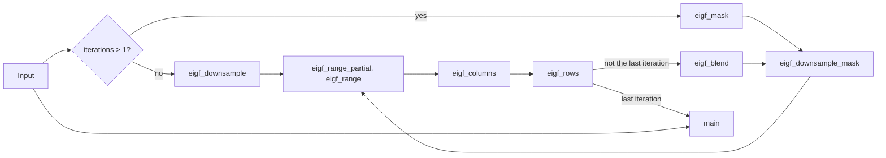

# Port spec: tone equalizer (toneequal)

Source: darktable (the reference release, commit 20891f6c6f), `src/iop/toneequal.c` (`legacy_params()`, `commit_params()`, `modify_roi_in()`, `toneeq_process()`, `compute_luminance_mask()`, `apply_toneequalizer()`). Its helpers come from:

- `src/common/luminance_mask.h`: the estimators;
- `src/common/fast_guided_filter.h`: `fast_surface_blur()`;
- `src/common/eigf.h`: `fast_eigf_surface_blur()`;
- `src/common/box_filters.cc`: `dt_box_mean()`;
- `src/common/gaussian.c`: `dt_gaussian_blur()`, `dt_gaussian_blur_4c()`;
- `src/iop/choleski.h`: `pseudo_solve()`.

darktable has no OpenCL path for this module, so its CPU path is the only reference.

Status: **ported, but for the guided filters.** In Slang, in `crates/op/toneequal`, with its manifest and schema:

- every luminance estimator with no mask filter (darktable's "preserve details: no");
- EIGF, darktable's default, and averaged EIGF, with iterations and quantisation;
- the band curve evaluated directly, its fit in f64.

It runs at darktable's place, camera RGB 24.0 (decision 22; Pipeline), and renders darktable's curve, the ripple at zero bands included (decision 22; Setup). EIGF's mask is built by whole-image passes over the whole image at the pipe's scale (decision 15; GPU plan). Its filters are a Slang module and a Rust reference inside this crate (`slang/filters/eigf.slang`, `src/filters.rs`). An export's tiles take two rounds (Notes, Tiling), and the golden cases run as one-instance engine plans.

`prepare` returns `NotPorted` for the guided filter and the averaged guided filter, which are planned (Planned), as are the iterated mask in row strips and the pass kind's rename. The whole-image passes are keyed apart from `main`, so a band change in the viewport runs `main` alone (`docs/engine.md`, Caching).

The operation is in `OPERATIONS` with `default_enabled` off, so the default pipeline is unchanged. The session plans it only while a module's binding sets it: the first pass's Tone equalizer (decision 28; `docs/modules/tone-equalizer.md`).

Golden result (seven cases on tests 0080, 0129, 0131, 0133 and 0134's `mire1.cr2`, in the tests' own module order with colorin an identity, 3908×2602, Apple M4): ΔE2000 mean 0.0004, max 0.0015 at most, within the port's own tolerance of mean 0.01 and max 0.05 (Results).

## Purpose

The tone equalizer relights the scene by tones. It brightens or darkens each octave of brightness by its own amount, the way an audio equalizer sets a gain per frequency band.

- Nine bands sit one EV apart, from −8 EV to 0 EV of a luminance mask, each with a gain of −2 to +2 EV.
- A curve through them, a sum of eight Gaussians fitted to the nine gains by least squares, gives every mask value its exposure correction, and each pixel's RGB is multiplied by that correction.
- The mask is the pixel's brightness by one of seven RGB estimators. It is optionally smoothed by an edge-aware filter (a guided filter or its exposure-independent variant, EIGF), so that the correction follows regions rather than pixels and local contrast survives.

Because the correction is one gain per pixel, hue and chromaticity never change.

In Apertrust it is a tonal control that works on layers, so it acts on scene-referred light before the one global tone mapper (architecture decision 33). In the first pass (decision 2) it is darktable's module, Tone equalizer, each parameter a control of its own (Tool binding notes).

## Pipeline

- **darktable position:** order 24.0 in the v3.0 and v5.0 orders, after exposure (21.0), mask manager (22.0) and tonemap (23.0), before crop (24.5) and colorin (28.0). Its comment calls it the "last module that need enlarged roi_in". In the legacy order (version 1, which every integration test below uses) it is 21.5, after flip (20.0) and clipping (21.0), before crop (21.7) and colorin (27.0). In the JPEG orders (`v30_jpg_order`, `v50_jpg_order`) it comes after colorin, in the working space, but before color calibration.
- **Domain:** scene-referred, linear in and out.
- **Input and output:** RGBA; `default_colorspace()` is `IOP_CS_RGB`. Before colorin, as in every raw order, that is camera RGB, demosaiced and white balanced by temperature; the module's own documentation says it is "intended to work in scene-linear camera RGB". Output: the input times one gain per pixel, in the same space. darktable also multiplies the fourth channel (`for_each_channel` covers four).
- **Assumes earlier modules:** demosaic; white balance, so that a neutral has roughly equal channels; and exposure, since the bands are absolute positions of the mask (0 EV is a mask value of 1.0), shifted only by the mask's exposure compensation.
- **Layer support:** yes. In darktable each instance computes its mask from its own input. How a layer's instance computes its mask is settled in Phase 4 with layers and the import of darktable's masked instances, likely per instance as darktable does, so that imports are exact (Planned).
- **darktable's tiling:** none. `flags()` lacks `IOP_FLAGS_ALLOW_TILING` and there is no `tiling_callback()`, so darktable always processes the whole region of interest at once.

**Where it sits in Apertrust:** darktable's place, slot `CameraRgb 24.0` (decision 22; `docs/engine.md`, Order), after Exposure's exposure (`CameraRgb 21.0`) and before colorin (`CameraRgb 28.0`), so before the tone mapper as decision 33 requires. The mask is computed on camera RGB, white balanced to the camera's reference (decision 12 leaves the temperature operation there and adapts in color calibration, after colorin). The golden cases render the tests in their own module order (Test plan).

## Parameters

darktable params version 2, 72 bytes, 18 four-byte fields in this order: `noise`, `ultra_deep_blacks`, `deep_blacks`, `blacks`, `shadows`, `midtones`, `highlights`, `whites`, `speculars`, `blending`, `smoothing`, `feathering`, `quantization`, `contrast_boost`, `exposure_boost` (f32), `details` (enum, i32), `method` (enum, i32), `iterations` (i32).

Defaults are the introspection's; toneequal has no `reload_defaults()`, and darktable leaves the module off by default. In the first pass the Tone equalizer module owns every parameter (Tool binding notes).

| Name | darktable field | Type | Range | Default | Meaning |
| --- | --- | --- | --- | --- | --- |
| −8 EV gain | `noise` | f32, EV | −2 to 2 | 0 | Gain of the band at mask −8 EV; darktable's label "blacks" |
| −7 EV gain | `ultra_deep_blacks` | f32, EV | −2 to 2 | 0 | label "deep shadows" |
| −6 EV gain | `deep_blacks` | f32, EV | −2 to 2 | 0 | label "shadows" |
| −5 EV gain | `blacks` | f32, EV | −2 to 2 | 0 | label "light shadows" |
| −4 EV gain | `shadows` | f32, EV | −2 to 2 | 0 | label "mid-tones" |
| −3 EV gain | `midtones` | f32, EV | −2 to 2 | 0 | label "dark highlights" |
| −2 EV gain | `highlights` | f32, EV | −2 to 2 | 0 | label "highlights" |
| −1 EV gain | `whites` | f32, EV | −2 to 2 | 0 | label "whites" |
| 0 EV gain | `speculars` | f32, EV | −2 to 2 | 0 | label "speculars" |
| Smoothing diameter | `blending` | f32, % | 0.01 to 100 (soft 1 to 45) | 5 | The filter's diameter in percent of the image's longer side |
| Curve smoothing | `smoothing` | f32 | none in the introspection; the GUI's slider gives 0.6306887 to 2.5227547 (soft 1 to 2) | √2 | σ of the curve's Gaussians, in EV. The slider shows `s` with `smoothing = √2^(1 + s)`, `s` in −2.33 to 1.67 |
| Edges refinement / feathering | `feathering` | f32 | 0.01 to 10000 (soft 0.1 to 50) | 1 | The filter's regularisation is its inverse, ε = 1/feathering: higher follows edges more closely |
| Mask quantisation | `quantization` | f32, EV | 0 to 2 | 0 | Posterises the filter's guide in steps of this many EV; 0 is off |
| Mask contrast compensation | `contrast_boost` | f32, EV | −16 to 16 (soft −2 to 2) | 0 | Stretches the mask around −4 EV before filtering; guided filter and EIGF only |
| Mask exposure compensation | `exposure_boost` | f32, EV | −16 to 16 (soft −4 to 4) | 0 | Shifts the mask before filtering, so the bands fall on other tones |
| Preserve details | `details` | enum | 0 no, 1 averaged guided filter, 2 guided filter, 3 averaged EIGF, 4 EIGF | 4, EIGF | The mask's filter |
| Luminance estimator | `method` | enum | 0 RGB average, 1 HSL lightness, 2 HSV value / RGB max, 3 RGB sum, 4 RGB euclidean norm, 5 RGB power norm, 6 RGB geometric mean | 4, euclidean norm | How a pixel's RGB becomes its mask value |
| Filter diffusion | `iterations` | i32 | 1 to 20 (soft max 5) | 1 | How many times the filter runs |

**The field names are not the bands' labels.** Below −2 EV, darktable's `$DESCRIPTION`s are one step brighter than the field names suggest: the field `shadows` is the −4 EV band, labelled "mid-tones", and `blacks` is −5 EV, labelled "light shadows". Apertrust's schema keeps darktable's field names (decision 21), so the binding must go by each band's EV, never by its name.

**The schema** (`crates/op/toneequal/src/lib.rs`) is version 1, Apertrust's own count (Design choices, 7). It holds darktable params version 2's eighteen fields under darktable's names (decision 21), with the introspection's ranges and defaults as hard limits.

- `smoothing`, which the introspection leaves without a range, takes the slider's, 0.6306887 to 2.5227547, its ends exactly (Design choices, 3). The soft range of 1 to 2 is for the binding's control.
- The choices are named, in darktable's order, `none`, `averaged_guided_filter`, `guided_filter`, `averaged_eigf` and `eigf` for `details`, and `rgb_average`, `hsl_lightness`, `hsv_value`, `rgb_sum`, `rgb_euclidean_norm`, `rgb_power_norm` and `rgb_geometric_mean` for `method`.
- `details` defaults to darktable's EIGF.

## Parameter versions

| Version | Change | Migration |
| --- | --- | --- |
| 1 | Older than darktable's repository: the module's first commit (5f78447450, 2018-12-16) already has version 2 and the migration from 1. 64 bytes: `noise` to `speculars`, `blending`, `feathering`, `contrast_boost`, `exposure_boost`, `details`, `iterations`, `method` | `legacy_params` copies every field, sets `quantization` to 0 and `smoothing` to √2, and moves `method` before `iterations` |
| 2 | Current, unchanged since then | |

Every integration test below stores version 2, so `ports.rs` needs only version 2; older versions wait for the import of darktable's edits (decision 51, planned).

## Setup on the CPU (`commit_params`, `modify_roi_in`)

**Straight conversions** (`commit_params`): `blending / 100`; ε = `1 / feathering`; the linear compensations `e = 2^exposure_boost` and `c = 2^contrast_boost`; the rest as given.

**The band curve** (`get_channels_factors`, `build_interpolation_matrix`, `pseudo_solve`, `compute_correction_lut`):

- Band centres `μ_i = i − 8`, i = 0…8 (`centers_params`), with gains `y_i = 2^(gain_i)`.
- Eight curve centres `ν_j = −8 + 8j/7`, j = 0…7 (`centers_ops`: −8, −6.857, …, −1.143, 0), so eight Gaussians span the nine bands, deliberately one fewer: "an approximation rather than an interpolation", which "helps reducing a bit the oscillations".
- `G(d) = exp(−d² / 2σ²)` with σ = `smoothing`; `A_ij = G(μ_i − ν_j)`, a 9×8 matrix.
- The weights `x` solve `AᵀA x = Aᵀ y` (least squares): `pseudo_solve` builds the lower triangle of `AᵀA` and `Aᵀy` with sequential f32 sums, then a Cholesky factorisation (Cholesky–Banachiewicz) and two triangular solves, all in f32.
- The curve: `curve(E) = clamp(Σ_j x_j G(E − ν_j), 0.25, 4)`, valid on E in [−8, 0] EV.
- darktable tabulates it (`compute_correction_lut`): 80,001 entries, 10,000 per EV, `lut[k] = curve(−8 + k/10000)`.

darktable runs the same solve in two places: in darktable-cli and exports (no GUI) with `verbose = TRUE`, ignoring its result; and in the darkroom through the GUI cache. When the factorisation fails (a negative pivot), the two differ. The darkroom keeps the last good weights, while the CLI path keeps the right-hand side unsolved, so the first eight linear gains become the Gaussians' weights. Master makes a failed solve a no-op (f6ba36d09c, after the reference release).

### What the numbers say

These come from numpy restatements of darktable's f32 solve (with sequential sums, with fused multiply-adds, and with pairwise sums) against an f64 least-squares solve, which are not in the repository. `setup.rs`'s tests restate darktable's solve in its source's order in Rust and check the f64 fit against it up to σ = 1.5.

- **Conditioning.** cond(AᵀA) is 6.4e4 at σ = √2, 1.3e8 at 2 and 4.9e10 at 2.52, the slider's top. The fit's weights grow with σ and alternate in sign: for test 0131's bands, up to about 3 at √2, 71 at 2 and 1,000 at 2.52.
- **Where the f32 Cholesky fails.** Over the slider's 0.01 steps from smoothing 1.98 to 2.52 (69 positions), the restated solve fails at 39 positions with sequential sums, 35 with fused multiply-adds and 37 with pairwise sums, each at a different set; none fails below 1.979.
  - darktable's release builds compile with `-O3 -ffast-math -fno-finite-math-only` (`src/CMakeLists.txt`, line 722), which lets the compiler fuse and reorder these sums, so which values fail in darktable-cli cannot be known without rendering them.
  - Where it fails, darktable-cli's fallback (above) makes all-zero bands render 1.4 to 2 EV brighter, up to the 4× clamp.
  - An f64 solve succeeds over the whole range.
- **f32 against f64, on the golden cases' four sets of bands** (the largest gap in the curve over the four, with sequential sums; with fused multiply-adds where it is larger):

  | Smoothing σ | Largest gap |
  | --- | --- |
  | 1.0 | 4e-6 EV |
  | 1.2 | 3e-5 EV |
  | √2 (darktable's default, and every golden case) | 8e-4 EV |
  | 1.5 | 9e-4 EV |
  | 1.6 | 4e-3 EV |
  | 1.7 | 0.02 EV |
  | 1.8 | 0.055 EV |
  | 1.9 | 0.15 EV (0.28 with fused multiply-adds) |
  | 2.0, the soft range's top | 0.08 EV (test 0131) to 0.45 EV (0129); 0.49 with fused multiply-adds |

  Above about 1.6, darktable's own curve depends on how its binary rounds: the restatements disagree with each other about as much as with f64. No port can match darktable there; up to 1.5 any careful solve does.
- **All bands at 0 is not an identity.** The least-squares fit of eight Gaussians to nine ones ripples.
  - At σ = √2 the correction runs from 0.9907 to 1.0177: up to +0.025 EV (1.8%) at mask −7.5 and −0.5 EV, down to −0.013 EV (−0.93%) at −6.5 and −1.5 EV, and it misses the nodes by up to 0.0096 EV (at −4 EV).
  - At σ = 1 the ripple is −0.035 to +0.065 EV, at σ = 2 about ±0.005 EV, and at σ = 0.63, the bottom of the range, it reaches +0.08 EV.
  - Over the whole range, every 0.01, the correction runs from 0.9708 (−0.043 EV, at σ = 0.80) to 1.0661 (+0.092 EV, at σ = 0.72).

  So darktable's tone equalizer, switched on at its defaults, changes the image by up to 0.025 EV (1.8%). Apertrust renders the same curve and keeps zero untouched by leaving the operation out of the plan (decisions 22 and 28; Design choices, 1).
- **A single band cannot be set on its own.** One band at +1 EV with the others at 0: the −4 EV band reaches only +0.80 EV, with the curve dipping to −0.29 EV and its neighbours swinging by ±0.3 EV; the −6 and −2 EV bands reach +0.91, with dips to −0.40 EV; the end bands, −8 and 0 EV, reach +0.996.

  A smooth profile is followed closely: a Gaussian bump of +1 EV with a standard deviation of 1 EV is matched within 0.05 EV at every node. darktable's on-image editing writes exactly such bumps and then stores the fitted curve's own values at the nodes. The golden cases' bands look written that way: the fit reproduces them to better than 5e-4 EV. The binding must drive the bands with smooth profiles (Tool binding notes).

### In Apertrust

`prepare` in `crates/op/toneequal/src/setup.rs`:

- **The fit** (`fit` and `Curve` in `apertrust_color::tone_equalizer`, which the setup and the Tone equalizer module's band graph share, decision 65). The same 9 × 8 least squares, with `y_i = 2^gain_i` and the centres of darktable's f32 constants, solved in f64 by a Householder QR factorisation of `A` itself rather than by Cholesky on `AᵀA` (Design choices, 2).
  - `A`'s condition is the square root of `AᵀA`'s, 2.2e5 at the slider's top, so the fit holds to about 1e-11 there, and the weights are rounded to f32 once.
  - Against the f32 solve restated in Rust on test 0131's bands it differs by less than 1e-4 EV at σ = 1.2 and 1e-3 EV at √2 (`the_fit_matches_darktables_where_darktable_is_reproducible`).
  - Like `pseudo_solve` it can fail, returning `None` where the triangle has a zero pivot or a weight is not a number. Only a σ of 0 or one that is not a number gives that: over the schema's smoothing range it never fails, and `prepare` would refuse such a curve rather than hand the kernel weights that are not numbers.
- **darktable's curve** (decision 22): the kernel's `weights` are the fitted `x`, so the correction is `clamp(Σ x_j G_j, 0.25, 4)`, darktable's `pixel_correction` evaluated directly.
  - Zero bands give darktable's ripple, within 2e-5 EV of darktable's f32 solve at σ = 1.2 and √2 (`the_fit_matches_darktables_where_darktable_is_reproducible`).
  - A uniform offset of k EV scales `y` by `2^k`, so `x` is the zero bands' fit times `2^k`, and the correction the zero bands' ripple times `2^k`, up to the clamp: within 1.8e-7 relative for σ from 1 to 2 (`a_uniform_offset_scales_the_ripple`).
- **The gradient directions** (Design choices, 5): four vectors `v_k` in band space, EV per unit. Since `x` is linear in `y`, its derivative along `v_k` is the fit of `ln 2 · y_i · v_k,i`, computed in f64 and passed as `direction0` to `direction3`. The kernel's weights are `weights + Σ_k t_k direction_k`, differentiated against `t` at 0. `prepare` uses `DEFAULT_DIRECTIONS`, the −6, −4, −2 and 0 EV bands alone; `prepare_with_directions` takes the binding's.
- **The rest:** `inverse_denominator = 1 / (2σ²)` from darktable's f32 `2σ²`, `exposure_boost` as `2^exposure_boost` in f32, and the estimator. `ToneEqualParams` is 176 bytes: ten `float4` (the weights and the four directions, each in two halves), then `inverse_denominator`, `exposure_boost`, the estimator and a word of padding.

### The filter's radius

`modify_roi_in` does only this:

- `diameter = (blending / 100) · max(piece->iwidth, piece->iheight) · roi_in->scale`, f32. `iwidth` and `iheight` are not the module's input but the pipe's: every piece takes `pipe->iwidth` and `iheight` (`dt_dev_pixelpipe_create_nodes`, `pixelpipe_hb.c` line 530), set by `dt_dev_pixelpipe_set_input` to the image the pipe starts from, for a raw its readout as decoded, before rawprepare's crop.
- `radius = (int)((diameter − 1) / 2)`, truncated towards zero, so 0 for a diameter below 3.

It leaves `roi_in` equal to `roi_out` (the pipe initialises it so, `pixelpipe_hb.c`): the module never asks for a border, despite the comment about padding the zoomed-in view.

For the golden image, `mire1.cr2`, whose readout is 3944×2622 for a developed image of 3908×2602:

| Blending | Diameter | Radius |
| --- | --- | --- |
| 5% | 197.2 | 98 |
| 3% (stored as 2.9999998) | 118.32 | 58 |
| 8% (stored as 7.99999905) | 315.52 | 157 |
| 2% | 78.88 | 38 |

The readout matters: on the developed image the radius would be 97 for 5% and 155 for 8%, and EIGF would miss darktable by a mean ΔE2000 of 0.0101 and a max of 0.19 on test 0080, against 0.0003 and 0.0013 with 98. 3% and 2% give the same radius either way.

In Apertrust `ImageContext::camera`'s readout is darktable's `piece->iwidth`, the image's own size when it is no raw. The golden cases' plans take the case raw's camera from rawler for it (`ports::plan_context`). For mire1 rawler's readout gives darktable's radii. On other cameras rawler's readout can differ from the uncropped size rawspeed gives darktable (decision 23, which trusts rawler's camera data), and the radius then follows rawler's, half the blending times the difference away from darktable's.

## Masking paths

`compute_luminance_mask()` builds the mask `L` at the input's size, then `apply_toneequalizer()` uses it. Each path below is a separate item for the port.

### 1. Luminance estimators (`luminance_mask.h`, `pixel_rgb_*`)

| `method` | darktable name | Estimator `n(R, G, B)` | A neutral grey `v` gives |
| --- | --- | --- | --- |
| 0 | RGB average | `(R + G + B) / 3` | `v` |
| 1 | HSL lightness | `(max + min) / 2` of the three channels | `v` |
| 2 | HSV value / RGB max | `max(R, G, B)` | `v` |
| 3 | RGB sum | `abs(R) + abs(G) + abs(B)` | `3v`, +1.58 EV |
| 4 | RGB euclidean norm (default) | `√(R² + G² + B²)` | `√3·v`, +0.79 EV |
| 5 | RGB power norm | `(abs(R)³ + abs(G)³ + abs(B)³) / (R² + G² + B²)` | `v` |
| 6 | RGB geometric mean | `abs(R·G·B)^(1/3)` (`powf`) | `v` |

The average, lightness and max keep signs; the norms use absolute values. The power norm divides 0 by 0 on a black pixel; in a build that honours NaN, the NaN then loses the comparison in `MAX(·, MIN_FLOAT)` and becomes the floor (Precision has the build caveat). For a neutral, the choice of estimator alone moves the mask by up to 1.58 EV.

### 2. Exposure and contrast compensation (`linear_contrast`)

`L = max((e · n − F) · c + F, 2^−16)`, applied per pixel before any filter.

- "no", averaged guided filter and averaged EIGF: `F = 0`, `c = 1`, so `L = max(e · n, 2^−16)`; `contrast_boost` is ignored (and hidden in darktable's GUI).
- Guided filter and EIGF: `F = 2^−4`, the middle of the bands, and `c = 2^contrast_boost`. The comment: guided filters "tend to flatten the luminance mask a lot around an average ± 2 EV", and the contrast spreads it back over the bands.

`2^−16` (`MIN_FLOAT`) is the floor of every mask value, so `log2 L ≥ −16`.

### 3. No filter (`details` = 0)

The mask is item 2's `L`, per pixel. Global and local contrast both change, as with a tone curve.

### 4. Guided filter (`details` = 2, `fast_surface_blur` with `DT_GF_BLENDING_LINEAR`)

On a grid downscaled by 4, with the image as its own guide (He and Sun's fast guided filter):

1. **Downscale** (`interpolate_bilinear`): `w = (size_t)(W / 4.0f)`, `h = (size_t)(H / 4.0f)`; grid sample `(i, j)` is the bilinear sample of `L` at `(j · W / w, i · H / h)`, corner-aligned (no half-pixel offset), clamped to the edge. A point sample, with no prefilter.
2. **Radius on the grid:** `r = radius < 4 ? 1 : (int)(radius / 4.0f)`.
3. **Each iteration** (`iterations` times):
   1. **Guide** `I = quantise(p)` of the current grid image `p` (item 8); `I = p` when quantisation is off.
   2. **Statistics** (`variance_analyse`): box means (item 9) of `I`, `p`, `I²` and `I·p` over a (2r + 1)² window.
   3. **Coefficients:** `a = (mean(Ip) − mean(I)·mean(p)) / max(mean(I²) − mean(I)² + ε, 1e−15)`, `b = mean(p) − a · mean(I)`.
   4. **Box means of `a` and `b`** with the same radius.
   5. Before the last iteration only: `p = max(a · p + b, 2^−16)` on the grid. The blend is applied to `p`, not to the guide `I`; they differ only when quantising.
4. **Upscale** `a` and `b` bilinearly to W × H (full-resolution pixel `(y, x)` reads the grid at `(x · w / W, y · h / H)`).
5. **Blend:** `L' = max(a · L + b, 2^−16)`.

The file's comment says iterations grow the kernel by √2 each time; the code keeps `r`. The `scale` argument is never used, and toneequal never sets it.

The guided filter is not exposure-independent. ε is absolute, so where the mask is bright the variance outweighs ε, `a` nears 1 and edges stay; in the shadows `a` nears 0 and the mask flattens. That is what EIGF fixes.

### 5. Averaged guided filter (`details` = 1, `DT_GF_BLENDING_GEOMEAN`)

As item 4, without the contrast compensation, and the final blend is `L' = √(L · max(a · L + b, 2^−16))`: the geometric mean of the unfiltered and filtered masks, an average in EV. Intermediate iterations still blend linearly on the grid.

### 6. EIGF, the exposure-independent guided filter (`details` = 4, `fast_eigf_surface_blur` with `DT_GF_BLENDING_LINEAR`)

toneequal passes its integer `radius` as EIGF's float `sigma`.

1. **Grid:** `s = clamp(sigma, 1, 4)` (so less downscaling below a radius of 4), `w = (size_t)(W / s)`, `h = (size_t)(H / s)`, and the Gaussian's σ on the grid `σ_g = max(sigma / s, 1)`.
2. **Each iteration** (`iterations` times), from the full-resolution mask `L` (updated in place each time):
   1. **Downscale** `L` to the grid (item 4's sampling), giving `g`.
   2. Without quantisation (`eigf_variance_analysis_no_mask`): the channel ranges `[min g, max g]` and `[min g², max g²]` over the grid (a reduction), then Gaussian blurs (item 10) of `g` and `g²` with σ_g, inputs clamped to those ranges; `avg = blur(g)`, `var = blur(g²) − avg²`.
   3. **Upscale** `avg` and `var` bilinearly to W × H.
   4. **Blend** per full-resolution pixel (`eigf_blending_no_mask`): `norm = max(avg · L, 1e−6)`, `v = var / norm`, `a = v / (v + ε)`, `b = avg − a · avg`; `L = max(a · L + b, 2^−16)`. The last iteration uses the module's blend: linear here.
   5. With quantisation (`quantization ≠ 0`; `eigf_variance_analysis`, `eigf_blending`): `Q = quantise(L)` at full resolution, both `L` and `Q` downscaled; four channels `Q`, `Q²`, `L`, `L·Q` with their four ranges; `avg_g`, `var_g`, `avg_m`, `cov = blur(LQ) − avg_g · avg_m`. Then `norm_g = max(avg_g · L, 1e−6)`, `norm_m = max(avg_m · Q, 1e−6)`, `a = (cov / √(norm_g · norm_m)) / (var_g / norm_g + ε)`, `b = avg_m − a · avg_g`, `L = max(a · L + b, 2^−16)`. darktable pairs the guide's average with the unquantised pixel and the image's with the quantised one, and applies `a` to `L` rather than to `Q`; the port follows it.

Unlike the guided filter there is no second blur of the coefficients ("much less halos", says `eigf.h`). The coefficients are formed at full resolution from upscaled statistics, and every iteration downscales the full-resolution mask again.

**Exposure independence.** Without contrast compensation and quantisation, and away from the floors, scaling `L` by `k` scales `avg` by `k`, `var` and `norm` by `k²`, leaves `a` unchanged and scales `b` and the result by `k`. The filtered mask's EV moves by exactly `log2 k`. So for averaged EIGF, and EIGF at zero contrast, `exposure_boost` is a pure shift of the bands, which the binding and the gradients can use.

### 7. Averaged EIGF (`details` = 3, `DT_GF_BLENDING_GEOMEAN`)

As item 6 without the contrast compensation; the last iteration's blend is `L = √(L · max(a · L + b, 2^−16))`.

### 8. Quantisation (`quantize`)

`q = quantization`: 0 copies; otherwise `clamp(2^(⌊log2 v / q⌋ · q), 2^−14, 4)` (darktable has a separate track for `q = 1`, the same formula). The guided filter quantises the grid image each iteration; EIGF quantises the full-resolution mask and downscales it.

### 9. Box mean (`dt_box_mean`, `_blur_horizontal`, `_blur_vertical`)

The mean over the window's pixels inside the image (`hits` counts them), rows first, then columns. Each line is a running sum in f32: subtract the value leaving the window (read from a saved copy, since the line is overwritten in place), then add the one entering, and store `sum / hits` (`box_filters.cc`, lines 225 to 227). Two and four channels go through the same code, without Kahan summation here.

### 10. Recursive Gaussian (`dt_gaussian_blur`, `dt_gaussian_blur_4c`, `_compute_gauss_params`)

Deriche's second-order recursive filter, order 0, in f32, columns first, then rows:

- `α = 1.695 / σ`, `e = exp(−α)`, and `e₂ = exp(−2α)`, computed separately rather than as `e²` (`gaussian.c`, line 42); `k = (1 − e)² / (1 + 2αe − e₂)`; `a0 = k`, `a1 = k(α − 1)e`, `a2 = k(α + 1)e`, `a3 = −k e₂`, `b1 = −2e`, `b2 = e₂`; `coefp = (a0 + a1) / (1 + b1 + b2)`, `coefn = (a2 + a3) / (1 + b1 + b2)`.
- Causal: `y⁺[j] = a0 x[j] + a1 x[j−1] − b1 y⁺[j−1] − b2 y⁺[j−2]`, starting from `x[−1] = x[0]` and `y⁺[−1] = y⁺[−2] = coefp · x[0]`.
- Anticausal: `y⁻[j] = a2 x[j+1] + a3 x[j+2] − b1 y⁻[j+1] − b2 y⁻[j+2]`, with `x` beyond the end equal to the last sample and `y⁻` starting at `coefn` times it.
- `y = y⁺ + y⁻`. Every input sample, including the column pass's output when the row pass reads it, is clamped to its channel's range first; the row pass's output is not.

### 11. Mask display (GUI)

`display_luminance_mask`: grey `√(clamp((L − 2^−8) / (1 − 2^−8), 0, 1))`, alpha copied, and the pipe set to pass the result through to the screen. In Apertrust this becomes the module's mask preview, darktable's Display exposure mask, a view mode rather than part of the edit (Planned).

## Per pixel (`apply_toneequalizer`)

1. `E = clamp(log2 L', −8, 0)`, with `L'` the mask from the chosen path (`fast_clamp`).
2. `correction = lut[(unsigned) roundf((E + 8) · 10000)]`: the curve, rounded to 1e-4 EV. darktable keeps the direct version, `clamp(Σ_j x_j G(E − ν_j), 0.25, 4)`, behind `DT_TONEEQ_USE_LUT`, "for further reference (e.g. for implementing a gpu version)".
3. `out = correction · in`, for all four channels.

So a mask brighter than 0 EV gets the 0 EV band's correction, one darker than −8 EV the −8 EV band's.

**In the kernel** (`crates/op/toneequal/slang/toneequal.slang`):

- `mask_value` is the pixel's mask as `compute_luminance_mask` leaves it.
- `compensated` computes the estimator on the pixel, clamped to ±1e6, times `exposure_boost`, its contrast compensated around the fulcrum (0, and 1 but for EIGF) and floored at 2^−16. Without a filter that is the mask, recomputed per pixel as darktable's would be read back from its full-resolution mask.
- With EIGF, `eigf_blend_at` blends it, or, when iterating, the mask the earlier iterations left in scratch, with the grid's statistics upsampled at the pixel's place, as the last iteration of `fast_eigf_surface_blur` does: linearly for EIGF, by the geometric mean for averaged EIGF (GPU plan).
- `mask_exposure` is its log2 clamped to [−8, 0]; `gaussians` gives the eight `G_j` as two `float4`.
- `correction` is the clamped curve above, the only differentiable part, since the mask does not depend on the bands.
- `toneequal`, the per-pixel function, multiplies RGB by it. Alpha passes through.

## Neighbourhood and scale

- **Neighbourhood radius:** none for "no". Guided filter: two box means per iteration, each over (2r + 1)² grid pixels, about the smoothing diameter in full-resolution pixels, plus the bilinear taps. EIGF: a recursive Gaussian of σ about `radius` full-resolution pixels, whose support is the whole image. Blending reaches 100% of the image's longer side, so in practice the mask depends on the whole image.
- **Scale dependence in darktable:** the radius scales with `roi_in->scale` against the full-resolution size; the downscaling factors (4, or `clamp(radius, 1, 4)` for EIGF) and the grid's size follow the processed image's size. darktable's preview pipe, at a small scale, therefore gets small radii, where EIGF downscales less and the guided filter's grid radius floors at 1.
- **Scale dependence in Apertrust:** the lengths follow the pipe's scale from their full-resolution values (decision 15).
  - The radius is darktable's, truncated once at full resolution, then times the scale without rounding, EIGF's σ being a float; the downscaling factor and σ on the grid follow from it as darktable derives them.
  - Where an integer is needed, the scaled `radius` rounds to the nearest, and what darktable derives from it keeps darktable's rounding: the guided filter's grid radius stays `radius < 4 ? 1 : (int)(radius / 4.0f)`, so a radius of 155 gives 38, not the 39 rounding would give (test 0132's is 157, from the readout, so 39 either way).
  - At scale 1 every length is darktable's exactly.
  - For EIGF (`prepare`): σ is the radius, measured on the readout and truncated at full resolution, times the pipe's scale, a float. The downscaling `clamp(σ, 1, 4)`, the grid `(W / scaling)` truncated, at least 1, and σ on the grid `max(σ / scaling, 1)` follow from it, from the whole image at the pipe's scale, W × H.
- **Tile overlap needed:** the whole image for the mask; nothing for the per-pixel correction once the mask's grid exists.
- **Region-of-interest changes:** none. `modify_roi_in` leaves the region alone, so darktable's zoomed-in darkroom computes the mask on the visible part only, with a grid anchored at that part's corner and box means normalised at its edges: its 100% view does not match its export near the frame or where the grid's phase matters. Apertrust computes the mask on the whole image at the pipe's scale in every pipe, never on a visible region, so its 100% view is its export (decision 15; GPU plan).
- **A grid at a fixed resolution** for every pipe, which would make the viewport's mask the export's, is not used: a grid from the image downscaled by 4 departs from darktable at export by up to 0.27 mean ΔE2000, with up to 0.78% of pixels over 2.3, and gains the viewport no more than the export's own grid would, 0.01 to 0.07 at 2400×1600.
- **Crop.** darktable's crop (order 24.5) comes after toneequal, and its `modify_roi_in` (`crop.c`, line 576) passes only the crop rectangle upstream. So darktable's export computes the mask on the cropped area only, while the radius is still measured from the uncropped `piece->iwidth` and `piece->iheight`, the raw's readout (Setup). Apertrust runs the operation at darktable's place, before crop (decision 22), and decision 16 settles the rest: a whole-image pass covers the region the untiled whole output needs, so the mask is computed on crop's window, as darktable's export computes it, never on the visible region, and its radius stays darktable's, from the image's size before the crop. This is built with crop's port (Phase 3), which checks both against darktable on a cropped case; the golden cases have no crop.

## GPU plan

### Shape

One operation, two kinds of pass (decision 12's planning; whole-image passes, decision 15):

- **The mask's grid passes**, whole-image passes (decision 15: every whole-image result, a statistic or this grid).
  - They read the whole image at the pipe's scale and leave their result in scratch buffers: the grid of coefficients (`a`, `b`) for the guided filter or of statistics (`avg`, `var`, …) for EIGF, at a sixteenth of the pixels for a radius of 4 or more. Later passes read it with no readback.
  - The result's size is its scratch buffers', counted in the plan's memory like any buffer.
  - They form runs, each the passes that read the operation's input and then those that read only scratch, and each run is one first round of an export's tiles (Notes, Tiling).
  - They are keyed apart from `main` (Notes, The viewport), so their uniforms and tables are a block of their own holding only what they read: the mask settings, sizes and grid geometry, never the band curve's weights, which only `main` reads. (Highlight reconstruction's passes share one block, which is right for it, since every one of its parameters feeds its statistic.)
  - Every grid buffer is a float2 half, never a float4 (quantised EIGF's four channels and the guided filter's four means are two float2 buffers each), because the line passes walk whole lines and cannot run in strips, so each buffer must fit one binding.
- **One per-pixel pass, `main`**, which recomputes the pixel's estimator, reads the grid bilinearly at the pixel's absolute position (the pass header's origin plus its coordinates), blends, and applies the correction.
  - `prepare` passes the image's size W × H and the grid's w × h in the uniforms, computed from the image it receives, rather than letting the kernel derive them from the header's full size times the scale, which can round differently from the viewport's real size. The radius comes from the full-resolution size, truncated there, times the scale (Neighbourhood and scale).
  - In a tile, the grid's geometry is the whole image's at the pipe's scale, never the tile's.
  - `main` needs no neighbouring pixels, so its manifest radius is 0, and a tile or region runs only this pass.
  - Master's OpenCL path (after the reference release) reaches the same structure: it samples the grid inside the blend instead of upscaling it to a full-size buffer (b2f637fcd3).

With "no", `main` is the only pass: the operation is then an ordinary per-pixel operation.

Notation below: W × H the image at the pipe's scale, w × h the grid.

### Guided filter and averaged guided filter (`n` iterations)

Planned (Planned):

| Pass | Kind | Runs over | Reads | Writes |
| --- | --- | --- | --- | --- |
| `gf_downsample` | Whole-image | w × h | input (estimator and compensation at the 2×2 taps) | grid image `p`, f32 |
| `gf_rows` (each iteration) | Whole-image | one invocation per grid row | `p` | row means of `I`, `p`, `I²`, `I·p`, float4 (`I = quantise(p)` on the fly) |
| `gf_columns` | Whole-image | one invocation per grid column | row means | `a`, `b`, float2 |
| `gf_rows_ab` | Whole-image | per grid row | `a`, `b` | row means of `a`, `b` |
| `gf_columns_ab` | Whole-image | per grid column | those | mean `a`, `b`; before the last iteration also `p = max(a·p + b, 2^−16)` |
| `main` | per-pixel | W × H | input, mean `a`, `b` | output |

`2 + 4n` passes, all but one at a sixteenth of the pixels.

### EIGF and averaged EIGF (`n` iterations)

As built (`Prepared::passes` in `src/setup.rs`). Every whole-image pass is `PassKind::Reduction`, the kind decision 15 names `WholeImage`; the rename is planned (Planned).

| Pass | Runs over | Reads | Writes |
| --- | --- | --- | --- |
| `eigf_mask` (only when `iterations > 1`) | the operation's output, W × H or a tile | input (estimator and compensation) | `mask`, W × H f32 at the pixel's place; bound whole, not in row strips |
| `eigf_downsample` (one iteration) or `eigf_downsample_mask` (several) | w × h | input at the four nodes, or `mask` | `samples`, float2: the mask and its quantised guide (the mask itself without quantisation, as `quantize` copies it) |
| `eigf_range_partial`, then `eigf_range` | w × h, then one workgroup | `samples`, then `partials` | `partials`, two float4 per workgroup; then `ranges`: the guide's and its square's minima and maxima (the square's from the guide's, which is positive, with f32 squaring monotonic), the mask's and the product's, from `eigf_variance_analysis`'s starting values 1e7 and 0 |
| `eigf_columns` | one invocation per grid column | `samples`, `ranges` | `columns_guide` (the guide and its square), with quantisation `columns_mask` (the mask and the product): causal sums written, anticausal added |
| `eigf_rows` | one invocation per grid row | `ranges`, the columns | `statistics_guide` (average and variance), with quantisation `statistics_mask` (the mask's average and the covariance) |
| `eigf_blend` (each iteration but the last) | W × H | `mask`, the statistics | `mask`, in place, the linear blend |
| `main` | the operation's output | input, `mask` when iterating, the statistics | output |



- **Pass count:** `6n` passes, and `eigf_mask` when iterating: six for one iteration, five of them on the grid or its ranges.
- **One run.** Only the first pass reads the input (`eigf_downsample` for one iteration, `eigf_mask` for several), so the whole-image passes are one run, whatever the iterations, and `main` reads the input and, when iterating, the mask (decision 15).
- **Bindings.** The eight scratch buffers are bound at 10 to 17 in this order. Those the settings leave unused (the quantised half without quantisation, `mask` with one iteration, all but three without a filter) are 16 bytes, bound and never read. So `main` binds the same three, the statistics and `mask`, in every mode, and one pair of derivative entry points, `toneequal_backward` and `toneequal_forward_diff`, serves every mode with `main`'s bindings (Design choices, 8). Without a filter, too, the operation is `main` alone over three 16-byte buffers.
- **Uniforms.** The whole-image passes' uniforms hold the mask's parameters and zeros in place of the curve's 176 bytes, so a band's change leaves their bytes as they are, which a test holds.
- **Quantisation.** Quantised and unquantised take the same entry points, the quantised half's work behind a uniform flag.
- **The line passes** step darktable's recursion and clamps per channel, two channels at a time as float2, so the four channels with quantisation are two halves of darktable's `dt_gaussian_blur_4c`, the same arithmetic channel by channel. `CLAMPF` is restated exactly, taking the minimum when a value is below it even if the minimum exceeds the maximum.

### Where the filters live

The filters are a Slang module of their own beside the kernel, `slang/filters/eigf.slang`, in a folder `tools/build-kernels.sh` does not compile as a kernel (the script compiles every `slang/*.slang`), and their Rust references are a module of their own, `src/filters.rs`. They stay inside `apertrust-op-toneequal` until a second operation needs them; then they move as they are into a shared crate (decision 65).

darktable shares these filters widely:

- the box mean with bloom, soften, highpass, the generic guided filter (`guided_filter.c`, which haze removal uses beside `dt_box_min` and `dt_box_max`) and highlight reconstruction's guided laplacians and segmentation;
- the bilinear resampling of `fast_guided_filter.h` with color equalizer, highlight reconstruction and cacorrectrgb;
- the recursive Gaussian with cacorrectrgb, shadows and highlights, lowpass and blend masks.

EIGF itself is toneequal's alone in the reference release: color equalizer includes `eigf.h` but runs its own guided filter on `dt_gaussian_mean_blur`. darktable's recursive Gaussian and bilinear resampling now live in `apertrust-color` (`gaussian.slang`, `bilinear.slang`), which the colour equalizer uses; EIGF taking them from there is planned (Planned).

### Notes

- **Order of arithmetic.** The row and column passes walk their line sequentially, one invocation per line, as darktable's loops do: running sums subtracted and added in darktable's order, the recursion stepped exactly as in item 10. That makes the masks agree with darktable as closely as its fast-math build allows (Precision), which matters because a mask error is an exposure error. Parallelism is only a grid's width or height (650 to 2400 lines), but the grid holds a sixteenth of the pixels. If it proves slow, per-window sums (2r + 1 taps) or prefix sums in workgroup memory are the alternatives for the box, and a block-parallel recursive filter for the Gaussian; both change the rounding.
- **Dispatch.** A line pass runs one invocation per line in 16 × 16 workgroups: `Pass::size` of 16 by ⌈lines / 16⌉, with the line index `y · 16 + x`.
- **Scratch at 61 MP** (9504 × 6336, grid 2376 × 1584 at a downscaling of 4):

  | Filter | Scratch |
  | --- | --- |
  | Guided filter (planned) | about 135 MB: `p` 15 MB, four-channel means 60 MB, two `a, b` buffers 30 MB each |
  | EIGF, as built, float2 grid buffers (`samples`, `columns_guide`, `statistics_guide`, and with quantisation `columns_mask` and `statistics_mask`), 8 bytes a cell | about 90 MB without quantisation, 150 MB with it |
  | EIGF with `iterations > 1` | plus a 244 MB full-resolution mask |
  | EIGF below a radius of 4 (blending under about 0.1% at full resolution) | the grid reaches full resolution as the downscaling falls to none: about 1.2 GB at 61 MP, 2.4 GB with quantisation |

  All of it is scratch, counted in the plan's memory (decision 15). Each grid buffer must fit one binding, since the line passes cannot run in strips. On lavapipe's 128 MiB that refuses two exports, naming the pass (an extension of decision 7):
  - blending typed below about 0.1%, outside the slider's soft range, above 16.7 MP at a radius of 1, 67 MP at 2 and 151 MP at 3, quantised or not;
  - any blending above about 268 MP, where a grid buffer takes half a byte a pixel, just under decision 7's 300 MP.

  float4 buffers would refuse from 134 MP at any blending, and from 8.4 MP at a radius of 1 with quantisation. The iterated mask is laid out as an image, to be bound in row strips (Planned); bound whole as it is now, an export with more than one iteration is refused on lavapipe above about 33 MP, naming `eigf_mask`.
- **Cost, measured** on the M4, `apertrust-golden run`, the median GPU time of a whole render of the one-instance plan at 10 MP over three runs: 4 to 5 ms without a filter; 7 to 9 ms for one iteration (six passes; one run of the power case gave 13.5); 26 to 29 ms for five iterations (31 passes). Each further iteration adds a downscale, the grid passes and a full-resolution blend, about 5 ms at 10 MP.
- **Decision 10.** No local vector component or array element is written at a run-time index:
  - the running sums and the recursion's state are float2 or float4 vectors updated whole (darktable's `for k < ch` loops become vector arithmetic);
  - the range reduction keeps one `groupshared` float array per channel (array elements may be written at a run-time index, vector components in workgroup memory may not);
  - the curve reads its eight weights by index, which is allowed;
  - the mask histogram (Tool binding notes) bins with atomic adds into a `groupshared` or storage array, never into a per-invocation local array, and the decile search walks the bins in one workgroup.

  The band solve stays on the CPU.
- **Tiling (decisions 13, 14 and 15).** In an export, `split()` in `crates/engine/src/pipeline.rs` runs every operation up to and including the last one with a whole-image pass untiled, unless that operation takes a first round of tiles; the viewport counts only the raw stage's (decision 14). Run whole, toneequal's grid passes would take demosaic and everything after it up to toneequal with them, over budget for large images: RCD's planes alone take about 2.2 GB at 60 MP (decision 21), and 61 MP exports already tile because they exceed the 2 GB budget (decision 13). So toneequal takes **two rounds of tiles** (decision 15; `docs/engine.md`, Tiling):

  ```mermaid
  flowchart LR
      subgraph r1[First round, every tile]
          t1[Tile, a pixel larger right and below] --> up[Operations up to toneequal] --> wi[Whole-image passes that read the input]
      end
      wi --> held[(Scratch the export holds)]
      held --> once[Passes that read only scratch, in the last tile]
      once --> held
      subgraph r2[Last round, every tile]
          t2[Tile] --> up2[Operations up to toneequal] --> m[main and the rest]
      end
      held --> m
  ```

  - **The first round** runs each tile up to toneequal and through its grid passes that read the input, each tile writing its part into the whole result in scratch, which the export holds across every tile and round. A grid sample at (x, y) belongs to the tile holding (⌊x⌋, ⌊y⌋), which reads one pixel past its right and bottom edges (Design choices, 9). With `iterations > 1`, `eigf_mask` writes the tile's part of the full-resolution mask. The passes that read only scratch then run once.
  - **The second round** renders the tiles again through `main` and the rest, planned without the grid passes and binding the result the export holds.
  - **One run, whatever the iterations.** The guided filter iterates on the grid and EIGF on its full-resolution mask in scratch, so both are one run and two rounds in all. Recomputing EIGF's mask in each iteration's downscale instead would take a first round per iteration and bind every earlier iteration's grid, up to 20, beyond WebGPU's 8 storage buffers per stage.
  - **The cost** is the stretch from demosaic to toneequal run twice, about 270 ms at 61 MP on the M4. Assembling toneequal's input whole between the rounds would save the second demosaic but hold 16 bytes a pixel, 2.4 GB at 150 MP, more than lavapipe's and WARP's largest buffer; it is a later optimisation where it fits, to measure against the two rounds.

  As built (`crates/engine/src/export.rs`, `pipeline.rs`):
  - `split` counts the raw stage's whole-image passes, and those after demosaic of an operation that cannot take a first round. `runs` lists the operations after it with whole-image passes, each taking a first round of its own.
  - An operation takes one only when it says so, overriding `Operation::tiles_whole_image_passes`, `false` by default, as `ToneEqual` does for every mode it plans, and when its whole-image passes are one run: those that read the input first, then those that read only scratch, then the rest. Any other runs whole with every operation before it. An export holding two instances of one operation in its tiles fails an assertion, since their scratch is held by operation ID.
  - In a first round each tile's region is a pixel larger to the right and below but at the image's edges (`grown`). Its plan holds the instances up to the run's operation, with that operation's passes cut by `Plan::retain_passes` to its whole-image passes that read the input (`reads_the_whole_image`) and, in the last tile, those that read only scratch too, and an earlier run's operation without its whole-image passes.
  - The first tile's pipeline makes the run's scratch buffers; the export holds them (`Pipeline::scratch_of`) and binds them in every later pipeline of either round in place of their own (`Pipeline::holding`, `update_holding`, the held `Kept::scratch`), so no rebuild drops them.
  - The last round plans every tile without the whole-image passes.
  - In a tile, `eigf_downsample` computes a grid sample only when the tile holds its north-west node but in its last column and row, unless they are the image's, so the overlapping tiles compute each sample once, from nodes they hold.
  - A test exports exposure and the tone equalizer, EIGF with one iteration and averaged EIGF with two, in 20 tiles of 23 × 17 on a 97 × 61 image, bit for bit equal to the untiled export (`a_tiled_export_in_two_rounds_equals_the_whole_one`).
- **The viewport (decisions 12 and 15).** The whole chain runs at the viewport's size, at about 600 × 400 on the grid, cheap.
  - The grid passes are keyed apart from `main`, on the key the untiled plan at the viewport's scale gives their input and their own bytes only, which hold no band weight. Their result stays in scratch between renders and across a rebuild (`docs/engine.md`, Caching), so a band drag is a single per-pixel pass from the edited operation's input; a test holds that a band change leaves their key unchanged.
  - A change upstream (Exposure, White balance) or to the mask settings reruns the grid passes at the viewport's size.
  - On the M4 at 2400×1600 from the 7R V's 61 MP raw, a band drag runs 5 passes instead of 10, 12.2 to 12.4 ms from submission to done, against 14.5 to 17.8 ms with the grid passes rerun.
- **Its mask is the same processing at the viewport's scale, within a measured target** (decision 15). At a smaller scale the radius and the grid shrink together, so the viewport approximates the export's mask, as darktable's preview pipe does; at scale 1, the export, its tiles and the 100% view, it is the export's exactly.
  - Measured on a CPU restatement on mire1 and four corpus photos, the viewport differs from the export downscaled by the per-pixel gap every nonlinear operation shows after the downscale, measured with the mask compensated as the filter compensates it, then unfiltered: 0.01 to 0.60 mean ΔE2000 at 2400×1600, up to 1.68 at 1/8.
  - With one iteration the filter adds about nothing beyond it, for EIGF with test 0080's contrast compensation (−0.08 to +0.03 at every scale) as for averaged EIGF; five iterations add 0.004 to 0.07 at 2400×1600 and up to 0.30 at 1/8; at most 0.58 in all at 2400×1600.
  - The export's grid shared with the viewport would remove only 0.01 to 0.07 of it at 2400×1600, at the cost of the full-resolution chain from demosaic on every change upstream.
  - The target is in the Test plan; the GPU measurement, on mire1 for the four filtered cases, is in Results: the filter's share is −0.063 to +0.006 at every scale.

## Precision and special values

- **darktable's build.** Release builds compile with `-O3 -ffast-math -fno-finite-math-only` (`src/CMakeLists.txt`, line 722): the compiler may reassociate sums, fuse multiply-adds and replace divisions by reciprocals, so reproducing darktable's order of operations (the running sums, the recursion, the solve) is best effort.
  - `toneequal.c` also includes `common/extra_optimizations.h`, whose `#pragma GCC optimize (…, "finite-math-only")` Clang ignores and GCC applies: in a GCC-built darktable-cli the power norm's 0/0 floor (Masking paths, 1) is undefined.
  - The references come from the official macOS arm64 build of the reference release. Its object paths show darktable's GitHub Actions runner, and its minimum macOS (15.0) and SDK (26.2) match the reference release's macOS workflow, which builds Release with Xcode 26.3's AppleClang 17. The binary records no compiler name, so Clang is inferred from the workflow, not read from the binary.
- **fp64:** none in darktable's processing path. The band solve is f32, depends on rounding above σ ≈ 1.6 and fails at scattered values from 1.98 (Setup). The port solves on the CPU in f64 (Deliberate differences; Design choices, 2).
- **The curve in f32 on the GPU.** Even with f64 weights, the curve is evaluated in f32: the weights alternate in sign and cancel, costing up to 7e-6 EV at σ = √2, 8e-5 at 2 and 8e-4 at 2.52.
- **The power norm's 0/0** on a black pixel becomes the floor in a Clang-built darktable through the NaN's comparison. The kernel guards the denominator instead, `max(Σc², 1e−30)`, with the same result.
  - The geometric mean's product is guarded likewise, `max(|R·G·B|, 1e−30)`, so `pow0` never sees 0 and `log2` never sees a denormal a GPU flushes: a product below the guard has a cube root under 1e−10, which stays below the floor even at the largest exposure compensation, 2^16.
  - Both give darktable's mask wherever its mask is above the floor, and the floor itself is 8 EV below the curve's range, so any mask under 2^−8 takes the −8 EV band's correction alike.
- **Overflow:** `R² + G² + B²` and the power norm's cubes overflow f32 above about 1e19 and 1e12. The kernel clamps the estimator's input to ±1e6 (as AgX clamps its input), so `log2` never sees infinity.
  - For channels within ±1e6 that changes nothing. Beyond, the max and the norms change nothing either, since their mask is then past 0 EV at any mask exposure from −16 EV.
  - The estimators that keep signs or multiply can change: the RGB average of (3e6, −1e6, 0) is 6.7e5, the 0 EV band, and 0 once clamped, the floor; the geometric mean of (3e6, 1e-3, 1) is 14.4, and 10 clamped.
  - No scene-referred pixel comes near a million times white. Every estimator here is positively homogeneous of degree 1, so dividing the pixel by a power of two into range, and multiplying the estimate back, would remove the exception, if a case ever needs it.
  - The output is the unclamped input times the correction.
- **Logarithms:** every mask value is at least `2^−16` and quantisation's at least `2^−14`, so `log2` and the quantiser's `floor` are safe. EIGF's normalisers are floored at `1e−6`, the guided filter's denominator at `1e−15`.
- **Variance by subtraction:** `mean(I²) − mean(I)²` cancels in f32. With ε = 1/feathering at least 1e-4 and masks up to a few units, the error stays well below ε; darktable has the same cancellation.
- **Running sums** accumulate rounding along a line, about 1e-7 times the line's length relative; the same order of operations reproduces them as far as darktable's fast-math build allows.
- **The recursive Gaussian** has poles near 1 for large σ (e = 0.93 at σ_g = 24), so rounding differences persist along a line. Stepping the recursion in darktable's order keeps them small, but whether the CPU and the GPU fuse the same operations is not controlled. Measured against the loops restated in Rust (`src/filters.rs`) on a 97 × 61 scene with edges, a dark band and texture: the output within 2.9e-6 relative without quantisation, for every estimator, downscalings of 4, 2 and 1, a radius past the grid and up to three iterations (`eigf_follows_darktables_loops`).
- **The quantised guide is ill-conditioned twice over.**
  - Where a pixel's mask lies on a quantisation step, its guide takes one level or the next by the last bit of the arithmetic. On mire1 with mask exposure −1.57 EV, 933 pixels lie within 1e-6 of a 0.5 EV step, and the restatement in Rust, calling the macOS libm as darktable's macOS build presumably does, puts 3 of them on the other side from darktable-cli, the GPU 2. A pixel whose guide flips changes alone with one iteration, by up to 6.4 ΔE2000. Each further iteration spreads it through the grid to its neighbours, whose masks then cross steps of their own: with five iterations 0.16% of the pixels end over 0.05 ΔE2000, up to 11.5.
  - Where the mask lies far below its neighbourhood, the blend's slope `a` exceeds 1 and its offset `avg_m − a · avg_g` cancels, multiplying the covariance's rounding. On the 97 × 61 scene, moving the grid by a unit in the last place moves the restatement's own mask by 1.7e-4 next to the dark band, and the GPU's output differs from the restatement's by up to 1.2e-3 relative there.

  darktable's own result at quantised settings depends on how its binary rounds; the port computes darktable's arithmetic and cannot match it there (Deliberate differences; Test plan).
- **Bilinear positions** are computed in f32 as darktable does, `(j / W_out) · W_in`. WGSL's division need not be correctly rounded, so a node can fall one pixel earlier with a weight within rounding of 0, which the interpolation's continuity makes harmless; the tests above include it.
- **Grid of zero size:** below 4 pixels on a side darktable's grid is empty; the port makes each grid side at least 1, as master's OpenCL path does.
- **NaN and infinity** at the input are the operation boundary's job; the kernel never tests for them.

## CPU and OpenCL differences in darktable

None in the reference release: the module has no `process_cl`, so an OpenCL pipe hands it to the CPU. Master adds an OpenCL implementation after the tag (75bfb4e664, pull request 22051, with follow-ups such as b2f637fcd3 and 5de081821e). It is useful orientation for the GPU plan, but the port follows the reference release's CPU code.

## Deliberate differences

The operation renders darktable's curve, its ripple at zero bands included (decision 22; Design choices, 1). It differs from darktable in these ways:

- **The curve is evaluated directly**, eight exponentials per pixel, instead of read from the 80,001-entry table by rounding: about 1e-4 EV at most, no table to upload, and a smooth function of the band gains for the derivatives. darktable's own comment keeps this version for a GPU (Design choices, 4).
- **The band solve in f64** on the CPU, by QR, rounded to f32 once (Design choices, 2).
  - Up to σ = 1.5, which covers darktable's default √2 and every golden case, it stays within 1e-3 EV of darktable's f32 solve.
  - Above, it departs from darktable by 4e-3 EV at 1.6, 0.02 EV at 1.7, 0.055 EV at 1.8, 0.15 EV at 1.9 and 0.08 to 0.45 EV at 2.0 (Setup), where darktable's own curve depends on its binary's rounding.
  - From 1.98 darktable's solve fails at scattered values and darktable-cli renders 1.4 to 2 EV too bright, where the f64 solve gives the intended curve.
- **Alpha passes through**, as in every Apertrust kernel; darktable multiplies it by the correction.
- **The power norm's denominator and the geometric mean's product are guarded**, and the estimator's input clamped to ±1e6 (Precision); none of them changes a pixel whose channels are within ±1e6.
- **The guided filters are not ported yet:** `prepare` returns `NotPorted` for the guided filter and the averaged guided filter, a test covers it, and they are planned (Planned).
- **Quantised settings follow darktable's arithmetic, not its binary's last bits** (Precision). Where a mask lies on a quantisation step, darktable's own guide depends on how its build rounds, so no port matches it there. Measured on mire1 with test 0080's bands and the "compress shadows/highlights | EIGF | strong" mask settings, quantisation 0.5 EV:

  | Iterations | Mean ΔE2000 | p95 | Pixels over 0.05 | Max |
  | --- | --- | --- | --- | --- |
  | 1 | 0.0003 | 0.0008 | 2 | 6.4 |
  | 5 | 0.0025 | 0.0011 | 0.16% | 11.5 |

  No golden case sits at quantised settings, as no case sits above σ ≈ 1.5 (Test plan; Planned).
- **The mask is computed on the whole image at the pipe's scale** in every pipe, never on a visible region (Neighbourhood and scale; decision 15). At scale 1 it is what darktable-cli exports; how smaller views compute it follows principle 2, not darktable's preview pipe, so neither this nor the next difference is a departure in decision 15's sense.
- **The radius at a pipe's scale below 1** is the full-resolution radius times the scale, unrounded, where darktable's preview pipe truncates its own radius at its scale; at scale 1 both are darktable's (decision 15). The viewport is never compared with darktable; measured against the export downscaled, the unrounded σ is never worse (0.480 against 0.502 mean ΔE2000 at 1/8 on mire1).
- **Crop and the radius** (Phase 3): darktable computes the mask on the cropped area with a radius from the uncropped size. At darktable's position, before crop, where Apertrust runs it (decision 22), the mask sees what crop's region passes upstream, as darktable's does, its radius settled with crop's port (Neighbourhood and scale).
- **Grid sides are at least 1** (Precision), where darktable's grid is empty below 4 pixels on a side.
- **Not ported (GUI only):** the luminance cache and its hashes; the on-image cursor readout and scroll editing; the auto-adjust wands for exposure and contrast compensation; the mask display, which becomes the mask preview (Planned).
- **The mask's histogram and its deciles**, which darktable's GUI computes from the preview pipe's mask (`compute_log_histogram_and_stats`), become a readout of the operation, `mask_histogram`: its own pass in the viewport, counting the mask `main` uses into darktable's 512 bins, read back by the session and decoded with darktable's arithmetic into the graph's 256 bins and the 5th and 95th percentiles (decision 19; `docs/engine.md`, Readouts). Planned.
- **The curve graph**, with its drag's `set_new_params_interactive`, is the module's panel's (`docs/modules/tone-equalizer.md`, In the panel).

## Tool binding notes

**In the first pass** (decision 2) the tone equalizer is darktable's module, Tone equalizer. Its three tabs are darktable's, Simple, Advanced and Masking, ordinary content tabs with no Advanced controls toggle (decision 29):

- the nine bands on Simple;
- curve smoothing and mask exposure and contrast compensation on Advanced;
- the luminance estimator, preserve details, filter diffusion, smoothing diameter, edges refinement and mask quantization on Masking, each owned by it;
- darktable's band graph, a lossless view of the bands, a row of the Advanced tab (decision 2; `docs/modules/README.md`, Lossless views).

The module is darktable's whole tone equalizer, so the guided filters join it with their port (Planned).

- **Bands by EV, not by name** (Parameters). The bands sit at mask −8 to 0 EV; a pixel's mask EV is `log2(n) + exposure_boost`, plus the contrast stretch for the non-averaged filters. A neutral grey `v` therefore sits at `log2 v + k + exposure_boost`, with `k` = 0 for average, lightness, max, power norm and geometric mean, +0.79 for the euclidean norm and +1.58 for the sum. With Exposure putting mid-grey at 0.18 (−2.47 EV), the default euclidean norm puts it at −1.68 EV, between the −2 and −1 EV bands, and anything from +1.7 EV above mid-grey upward shares the 0 EV band's correction.
- **darktable's on-image editing:** a step of `s` EV at mask EV `E₀` adds `s · exp(−(μ_i − E₀)² / (σ⁴/2))` EV to band i (for σ = √2, a Gaussian of 1 EV standard deviation). darktable then refits and stores the fitted curve's values at the nine nodes, clamped to ±2 EV; the band graph's drag follows it.
- **The bands interact.** Neighbouring Gaussians overlap (σ = √2 EV against 8/7 EV spacing) and the fit is least squares over all nine, so a band's gain moves the curve over about ±2 EV and slightly beyond. The invariants table should test what stays fixed on rendered values, not on band values.
- **Off is a no-op** with the instance absent (`docs/layers.md`, Sequencing: only adjusted controls create instances). Decision 28 leaves the operation out of the plan while its module is at its defaults (decision 22), and decision 32 makes the module switched, off until a control changes and then on until its reset. Its first change then switches darktable's ripple on everywhere at once, up to 0.025 EV at the default smoothing, which the first-step row measures and reports without a bound, as darktable's behaviour (`tool-bindings`).
- **EIGF is exposure-independent** (Masking paths, 6): with it, `exposure_boost` only slides the bands, so a binding can treat it as a band offset. The guided filter smooths shadows more than highlights.
- **Presets** (`init_presets`), all with darktable's RGB scene blend colour space. They are the Tone equalizer's presets.

  | Preset | Settings |
  | --- | --- |
  | simple tone curve | no filter, power norm, exposure −0.5 |
  | mask blending \| all purposes | EIGF, euclidean norm, 5%, feathering 1, 1 iteration |
  | mask blending \| people with backlight | 1%, feathering 10, 3 iterations |
  | compress shadows/highlights \| EIGF \| strong, medium, soft | euclidean norm, exposure −1.57; bands set by `compress_shadows_highlight_preset_set_exposure_params` at steps 0.65, 0.45 and 0.25: +1⅔ step at −7 and −6 EV down to −1⅔ step at −2 and −1 EV; feathering 20, 7 or 1 with blending 2, 3 or 5 and 5, 3 or 1 iterations |
  | compress shadows/highlights \| GF \| strong, medium, soft | as the EIGF ones, with feathering 500 |
  | contrast tone curve \| soft, medium, strong | no filter, the inverse curve, 15/9 of the step at the ends |
  | relight: fill-in | EIGF, exposure −0.5, bands 0, 0.15, 0.6, 1.15, 1.33, 1.15, 0.6, 0.15, 0 |
- **Mask preview:** darktable's Display exposure mask shows item 11's grey; it is a view state of the viewport, not part of the edit (Planned).
- **The wands** need the mask's histogram. darktable's (`compute_log_histogram_and_stats`) bins `log2 L` over −10 to +6 EV in 512 bins and finds the 5th and 95th percentiles (which it calls deciles). Its wands then solve, on those two percentiles with the current compensations undone, for the exposure and contrast compensation that map them to −7 and −1 EV:
  - `e = F(s₁ + s₂) / (s₂ · p₅ + s₁ · p₉₅)` and `c = (s₂ · p₅ + s₁ · p₉₅) / (F (p₉₅ − p₅))`, with `F = 2^−4`, `s₁ = 2^−4 − 2^−7`, `s₂ = 2^−1 − 2^−4`;
  - the contrast wand adds an empirical correction for the guided filter (`0.0235 + 1.1225 c`) and for EIGF at feathering below 10.

  The histogram and its percentiles are the operation's `mask_histogram` readout (decision 19; `docs/engine.md`, Readouts), which the wands read in the session (Planned).

## Gradients

Measured (Results): forward mode within 8.2e-6 of reverse mode per pixel on every case and the synthetic sweep, filtered or not.

The cases without a filter use the harness's step of 1e-3 EV. The filtered cases take 3e-2 EV as their own step (`ports::gradient_step`), where every parameter passes, on the cases within 1.3e-3 and on the sweep within 8.3e-4 (Results). At 1e-3, four parameters exceed 1%, each with a small total, the filtered modes' smallest: averaged EIGF's 0 EV band on its case (1.5e-2) and −2 EV band on the sweep (8.0e-2), and five iterations' −6 and −4 EV bands on the sweep (5.5e-2, 4.8e-1). Each falls as the step grows, below 5e-3 at 1e-2 but the last (1.6e-2) and below 1e-3 at 3e-2: the f32 rounding of finite differences, not the derivative.

How:

- **Differentiated parameters: the band gains**, through four directions in band space. The derivative entry points return at most four gradients (binding 9 is a float4 per pixel), and there are nine bands.
  - The parameters carry four 9-vectors `v_k` (EV per unit); the kernel's weights are `x = x₀ + Σ_k t_k D_k` with `D_k = (∂x/∂gain) · v_k` from the CPU (f64, the solve is linear in `2^gain`), and the entry points differentiate against `t` at 0, in the order `direction0` to `direction3`.
  - The directions are the −6, −4, −2 and 0 EV bands alone, the harness's `deep_blacks -6 EV`, `shadows -4 EV`, `highlights -2 EV` and `speculars 0 EV` (Design choices, 5). Nine gradients would need a wider derivative interface.
- **Exact by construction:** the mask does not depend on the bands, so treating it as a constant in `main` gives the total derivative, filtered or not: the derivative entry points read the mask as `main` does, from the whole-image passes' scratch.
- **Not differentiated:** the mask settings.
  - `exposure_boost` and `contrast_boost` act through the whole-image filter in every mode but "no", where `exposure_boost` is per pixel and could be added. For averaged EIGF it is an exact shift (Masking paths, 6) and could be added by applying it after the filter, a restructuring left for later.
  - `blending` is truncated to an integer radius; `iterations`, `details` and `method` are discrete; `quantization` is a floor.
  - `smoothing` acts through the CPU solve; moving the 8 × 8 Cholesky into a differentiable Slang setup function, with fully unrolled loops to satisfy decision 10, would bring it in.
  - No derivative with respect to the input image, as for every module so far.
- **Non-smooth spots** where finite differences can straddle a kink: the correction's clamp to [0.25, 4] (an optimiser would use a soft clamp in the log domain, such as `2 · tanh(log2(c) / 2)` EV); the mask's clamp to [−8, 0] EV (zero derivative of the correction with respect to the mask outside, but the band gradients stay); the `2^−16` floors; and, for derivatives with respect to the mask settings if they come, the max and min estimators, the absolute values, quantisation's floor and the integer radius.
- **Traps:** no `pow` (the geometric mean uses `pow0`), no table read chosen by a branch (the direct curve has none).
- **The check:** `gradient` on each case and with `--synthetic`, below 1% against finite differences and forward against reverse within 1e-4 per pixel. `perturbed_inputs` moves the band gains by the step along the direction and fits the curve again, so the finite differences take in the whole setup, the f64 directions included. The case images populate all four bands; the synthetic sweep's levels, 0.001 to 4, reach −10 to +2 EV.
- **f32 finite differences and the curve's cancellation.** The fitted weights alternate in sign and cancel, ±3 at σ = √2 and ±70 at 2, so the f32 output's rounding grows with σ. The largest relative error without a filter, 4.1e-3 on the smoothing case's −2 EV band over the synthetic sweep, falls to 1.3e-4 with a step of 0.01: it is the finite differences' rounding, not the derivative.
- **Without darktable**, so on CI's software GPUs too, `derivatives_agree_with_finite_differences` (`crates/golden/tests/toneequal.rs`) checks forward mode per pixel against central differences of the curve in f64 at σ = 1, √2 and 2, and reverse against forward. Each is within 32 f32 units in the last place of the size of the terms the derivative adds up, `Σ_j |D_kj| G_j`. At σ = 2 the two modes add those terms, up to 2,900, to slopes of at most 1.3, in different orders, and differ by up to 3e-3 relative on a pixel whose slope is over 0.01, though never by more than one f32 unit in the last place of the terms' size (Apple M4).
- **Harness** (decision 15): every toneequal case runs as a one-instance engine plan (`ports::plan_values`, `plan_context`) on the case's RGBA input, through `pipeline::plan` (the export pipe; the plan takes the input's description, so it needs no mosaic). Its parameters are schema values decoded from darktable's. Its derivatives are those of `main`, the pass that writes the output, which reads the grid from the scratch buffers the whole-image passes filled. `Pipeline::derivative` dispatches `toneequal_backward` and `toneequal_forward_diff` with `main`'s bindings but the output, and the derivative buffers at 8 and 9, over the scratch the last render left; the pipeline compiles them once with its other kernels. Finite differences render the plan with the bands moved.

## Results

On the Apple M4 (Metal), `apertrust-golden run` and `gradient` at full resolution, 3908×2602, with the module at darktable's place and the sidecars in the tests' own order, colorin an identity (decision 22; Test plan). The filtered cases take each case raw's readout as darktable's `piece->iwidth` (Setup). Times are the median GPU time per whole render of the one-instance plan. Other vendors' GPUs are still to run, so the status is ported, not verified.

| Case | Module effect, mean ΔE2000 | ΔE2000 mean | p95 | max | Pixels over 0.05 | Median GPU time per render, three runs |
| --- | --- | --- | --- | --- | --- | --- |
| `toneequal-max` | 6.065 | 0.0002 | 0.0006 | 0.0009 | 0 | 3.9 to 4.3 ms, 1 pass |
| `toneequal-geomean` | 7.111 | 0.0002 | 0.0006 | 0.0010 | 0 | 4.1 to 4.8 ms, 1 pass |
| `toneequal-smoothing` | 6.065 | 0.0002 | 0.0006 | 0.0007 | 0 | 3.9 to 5.0 ms, 1 pass |
| `toneequal-eigf` | 9.080 | 0.0003 | 0.0007 | 0.0013 | 0 | 7.6 to 9.2 ms, 6 passes |
| `toneequal-average` | 8.013 | 0.0004 | 0.0011 | 0.0015 | 0 | 6.8 to 8.1 ms, 6 passes |
| `toneequal-power` | 5.583 | 0.0002 | 0.0006 | 0.0012 | 0 | 7.5 to 13.5 ms, 6 passes |
| `toneequal-eigf-iterations` | 9.888 | 0.0002 | 0.0007 | 0.0013 | 0 | 26.0 to 28.7 ms, 31 passes |

- A max of 0.0010 ΔE2000 is under 1e-4 EV, well inside the 1e-3 EV the tolerance allows for (Test plan): on test 0131's bands the f64 fit and darktable's f32 solve agree more closely than the worst of the four sets.
- About 4 ms for 10 MP is the memory-bound cost of any per-pixel pass on the M4 (decision 8).
- The filtered cases match darktable as closely as the per-pixel ones: the mask's rounding, through the recursion and the blend, adds about 0.0001 to the mean and 0.0005 to the max, far inside the tolerance.
- darktable's loops restated on the CPU in `src/filters.rs`, with the f64 curve, render the same four filtered cases at means of 0.0002 to 0.0004 and maxima of 0.0012 to 0.0015 (`the_restated_filters_render_darktables_cases`, ignored as it needs darktable).
- Quantised, outside the cases (Deliberate differences): test 0080's bands with the preset's mask settings and quantisation 0.5 EV give a mean of 0.0003, p95 0.0008 and a max of 6.36, 2 pixels over 0.05, with one iteration, and a mean of 0.0025, p95 0.0011 and a max of 11.50, 16,151 pixels over 0.05, 0.16%, with five. The restatement in Rust gives 6.27 with 3 pixels over, and 11.08 with five iterations.

### Gradients without a filter

Relative error of reverse mode against central finite differences (step 1e-3 EV) for the four directions, and in brackets forward mode's per-pixel difference from reverse mode:

| Case | `deep_blacks -6 EV` | `shadows -4 EV` | `highlights -2 EV` | `speculars 0 EV` |
| --- | --- | --- | --- | --- |
| `toneequal-max` | 3.2e-5 (5.5e-6) | 7.8e-4 (1.2e-6) | 9.6e-6 (1.1e-6) | 1.1e-3 (4.4e-6) |
| `toneequal-geomean` | 4.2e-5 (5.4e-6) | 1.3e-3 (1.1e-6) | 1.3e-5 (1.1e-6) | 1.3e-3 (4.7e-6) |
| `toneequal-smoothing` | 4.8e-4 (1.5e-6) | 5.0e-5 (5.2e-7) | 2.2e-5 (3.4e-7) | 1.1e-4 (1.3e-6) |
| `toneequal-max`, synthetic | 1.1e-3 (7.3e-6) | 5.3e-4 (1.8e-6) | 1.8e-3 (7.8e-6) | 7.8e-5 (1.9e-7) |
| `toneequal-geomean`, synthetic | 1.8e-3 (6.6e-6) | 9.2e-4 (1.8e-6) | 2.0e-3 (4.7e-6) | 7.1e-5 (2.2e-7) |
| `toneequal-smoothing`, synthetic | 6.1e-5 (1.5e-6) | 6.5e-4 (6.7e-7) | 4.1e-3 (2.1e-6) | 6.4e-5 (9.1e-8) |

All pass, below 1e-2 and 1e-4. The largest, 4.1e-3, is 1.3e-4 with a step of 1e-2 (Gradients).

### Gradients of the filtered cases

At the filtered cases' own step of 3e-2 EV (`ports::gradient_step`; Gradients); every parameter passes:

| Case | `deep_blacks -6 EV` | `shadows -4 EV` | `highlights -2 EV` | `speculars 0 EV` |
| --- | --- | --- | --- | --- |
| `toneequal-eigf` | 1.8e-4 (4.5e-6) | 1.1e-4 (1.2e-6) | 1.1e-4 (1.6e-6) | 3.1e-6 (2.7e-6) |
| `toneequal-average` | 5.6e-5 (5.4e-6) | 1.9e-4 (1.0e-6) | 7.4e-5 (1.1e-6) | 1.3e-3 (5.0e-6) |
| `toneequal-power` | 7.6e-5 (5.9e-6) | 8.9e-5 (1.4e-6) | 6.9e-5 (1.1e-6) | 8.2e-5 (4.5e-6) |
| `toneequal-eigf-iterations` | 1.1e-4 (6.7e-6) | 9.9e-5 (5.3e-7) | 1.6e-4 (2.2e-6) | 4.0e-4 (8.2e-6) |
| `toneequal-eigf`, synthetic | 7.0e-5 (6.3e-6) | 9.7e-5 (2.1e-6) | 1.8e-4 (5.7e-6) | 6.9e-5 (1.9e-7) |
| `toneequal-average`, synthetic | 1.2e-5 (6.1e-6) | 1.1e-4 (2.4e-6) | 6.0e-6 (4.8e-6) | 8.7e-5 (2.0e-7) |
| `toneequal-power`, synthetic | 7.1e-5 (6.8e-6) | 9.5e-5 (1.8e-6) | 1.7e-4 (6.7e-6) | 7.2e-5 (1.9e-7) |
| `toneequal-eigf-iterations`, synthetic | 8.3e-4 (6.2e-6) | 4.8e-4 (1.7e-6) | 2.1e-4 (2.7e-6) | 6.8e-5 (2.9e-7) |

- The averaged EIGF case's 0 EV band stays at 1.3e-3 from a step of 1e-2 to 3e-2, the largest left; forward against reverse does not depend on the step.
- Why the larger step: on averaged EIGF's case the 0 EV band's error goes from 1.9e-1 at a step of 1e-4 to 1.5e-2 at 1e-3 and 1.3e-3 at 1e-2, inversely with the step. That is rounding's signature; a kink straddled would shrink with the step. These parameters' totals are the smallest of their cases, 4.4e4 against up to 2.5e6, and 26 on the sweep for five iterations' −4 EV band against 3e4, so the f32 rounding of two renders of every pixel outweighs them at a small step.

### The viewport against the export

Measured on the GPU (`the_viewport_follows_the_export`, ignored as it needs the integration images; Test plan). Each cell gives the mean ΔE2000 of the viewport's render against the export downscaled by the engine's box filter, then the same for the compensated, unfiltered baseline, and the filter's share, their difference:

| Case | 2400 × 1600 | 1/2 | 1/4 | 1/8 |
| --- | --- | --- | --- | --- |
| `toneequal-eigf` | 0.131, 0.134, −0.004 | 0.191, 0.194, −0.002 | 0.315, 0.354, −0.039 | 0.479, 0.543, −0.063 |
| `toneequal-average` | 0.077, 0.080, −0.003 | 0.108, 0.116, −0.008 | 0.213, 0.232, −0.019 | 0.367, 0.393, −0.026 |
| `toneequal-power` | 0.090, 0.091, −0.002 | 0.132, 0.133, −0.001 | 0.257, 0.281, −0.024 | 0.422, 0.481, −0.060 |
| `toneequal-eigf-iterations` | 0.070, 0.069, +0.000 | 0.105, 0.100, +0.005 | 0.197, 0.205, −0.008 | 0.356, 0.350, +0.006 |

All within decision 15's target: the filter's share at most +0.006 against 0.15 and 0.4, the whole gap at 2400 × 1600 at most 0.131 against 0.767. The CPU restatement's measurement for test 0080 on mire1 gave 0.132 at 2400 × 1600, which the GPU confirms. The filtered viewport is a little closer to the export than the per-pixel baseline at small scales, since the filter smooths the mask the downscale's per-pixel gap would otherwise follow. Tests 0079, 0130 and 0132, the guided filters', and the corpus raws are not measured yet.

## Test plan

**Golden cases**, from darktable's integration tests (darktable-tests commit 3f2d1ab), all on `mire1.cr2` (3908 × 2602): params version 2, legacy module order, no exposure module, no tone mapper to disable, the module unmasked (its blendop's mask mode is 0, so no `unmask_like`). All use smoothing √2, one iteration and no quantisation. Several sidecars hold successive history entries for one instance; the last one below `history_end` is the one that renders.

| Case | darktable test | Rendering entry | Filter | Estimator | Blending (radius) | Feathering | Contrast, exposure compensation |
| --- | --- | --- | --- | --- | --- | --- | --- |
| `toneequal-gf` | 0079-toneequal-gf | the only one | guided filter | euclidean norm | 5% (98) | 1 | +2.64, −1.95 EV |
| `toneequal-eigf` | 0080-toneequal-eigf | second of two | EIGF | euclidean norm | 5% (98) | 1 | +0.79, −0.51 EV |
| `toneequal-average` | 0129-toneeq-RGB-average | the only one | averaged EIGF | RGB average | 3% (58) | 3 | (0.79 unused), +0.13 EV |
| `toneequal-lightness` | 0130-toneeq-HSL-lightness | second of two | averaged guided filter | HSL lightness | 3% (58) | 3 | (0.79 unused), +0.13 EV |
| `toneequal-max` | 0131-toneeq-RGB-max | third of three | no | RGB max | (unused) | (unused) | (unused), +0.13 EV |
| `toneequal-sum` | 0132-toneeq-RGB-sum | fourth of four | guided filter | RGB sum | 8% (157) | 3 | +0.79, −1.07 EV |
| `toneequal-power` | 0133-toneeq-power | the only one | EIGF | power norm | 8% (157) | 3 | +0.27, +0.15 EV |
| `toneequal-geomean` | 0134-toneeq-geomean | the only one | no | geometric mean | (unused) | (unused) | (unused), +0.15 EV |

Band gains, −8 to 0 EV:

| Tests | Gains |
| --- | --- |
| 0079 | +0.217, +1.086, +1.775, +1.569, +0.997, +0.599, −0.285, −0.986, −1.199 |
| 0080 | +0.450, +1.291, +1.841, +1.576, +0.998, +0.597, −0.283, −0.987, −1.198 |
| 0129 and 0130 | +0.450, +1.292, +1.843, +1.591, +1.084, +0.731, −0.208, −1.094, −1.364 |
| 0131 to 0134 | −1.283, −0.788, +0.445, +1.148, +1.321, +0.994, +0.211, −0.449, −0.755 |

All within ±2 EV, as the on-image editing leaves them.

Together they cover all seven estimators and all five filters, with and without contrast compensation. Five run now: the two with no filter, `toneequal-max` and `toneequal-geomean`, and the three with EIGF or averaged EIGF, `toneequal-eigf`, `toneequal-average` and `toneequal-power`. The three with a guided filter, `toneequal-gf`, `toneequal-lightness` and `toneequal-sum`, wait for the guided filters (Planned). The radii are measured on the raw's readout, 3944 × 2622 (Setup). On the grid: 977 × 650 for every case; the guided filter's grid radius is 24 (5%), 14 (3%) or 39 (8%), EIGF's σ_g 24.5, 14.5 or 39.25.

**The input's colour space.** darktable runs the module before colorin in these sidecars, so its mask sees camera RGB. The estimators are not invariant under colorin's matrix, so the references must be in camera RGB too, at darktable's place (decision 22):

- each sidecar keeps the test's own module order (legacy, `iop_order_version` 1);
- its colorin entry's input profile is linear Rec2020 (`DT_COLORSPACE_LIN_REC2020`, 4, in place of the enhanced matrix, 12), an identity in both renders, as `raw_stage.rs` already does;
- so both renders, and the kernel's input, are camera RGB; `ports.rs`'s test holds the sidecars to both.

**Edited cases** for what the tests lack, each saying in its comment what changed:

- `toneequal-eigf-iterations`: 0080 with darktable's "compress shadows/highlights | EIGF | strong" mask settings as the preset has them (blending 2%, radius 38, feathering 20, 5 iterations, contrast 0, exposure −1.57), for EIGF's full-resolution intermediate blends. It has no quantisation (Design choices, 10): there darktable's own result depends on its binary's last bits wherever the mask sits on a quantisation step, which the iterations spread to 0.16% of the pixels (Precision; Results). The quantised path is checked against darktable's loops restated in Rust on the GPU tests' scene, whose pixels are kept off the steps, and measured on mire1 in Results. A quantised golden case needs a tolerance that allows a few pixels over its max (Planned).
- `toneequal-gf-iterations` (planned with the guided filters): 0079 with 3 iterations and quantisation 1, for the guided filter's grid iterations and the quantiser's `q = 1` track. Its quantised guide meets the same steps as EIGF's, so its quantisation is to reconsider when it comes.
- `toneequal-smoothing`: 0131 (no filter, single pass) with smoothing 1.2 in the rendering entry, where darktable's f32 solve and an f64 one differ by 3e-5 EV, so the case tests the smoothing path, not the solve's rounding. No case can usefully sit above σ ≈ 1.5: there darktable's result is rounding that depends on how its binary was built (Setup).

**Tolerance:** mean 0.01 and max 0.05, `cases::TONEEQUAL`, stricter than `Tolerance::DARKTABLE` (Design choices, 6).

- Per pixel the kernel's correction differs from darktable's by the band fit (at most 1e-3 EV up to σ = 1.5 over the four sets of bands the tests use, Setup) and the table's rounding (half of 1e-4 EV in the mask, times the curve's slope, under 1e-4 EV), together about 1e-3 EV.
- A gain error of δ EV moves CIELAB lightness by `(L* + 16) / 3 · ln 2 · δ`, at most about 15δ in ΔE2000 once its lightness weighting is applied, and chroma by less, so 1e-3 EV is about 0.015 ΔE2000 on any colour.
- The max allows three times that, for GPUs whose `exp` and `log2` round differently; the mean is a fifth of the max.
- The filtered cases take the same tolerance: the mask's rounding adds about 0.0001 to their mean and 0.0005 to their max (Results), well inside it.

**Unit and engine tests:**

- **Estimators, compensation and quantiser** against darktable's C restated in Rust, on edge values (black, negative, one channel zero, very bright). In `crates/golden/tests/toneequal.rs`, which runs on CI's software GPUs: the seven estimators without compensation, `every_estimator_follows_darktables`; the compensation and the quantiser through `eigf_follows_darktables_loops` below; EIGF's colour ratios and finite output for black, negative and very bright pixels at mask exposures of ±16 EV, `eigf_keeps_colour_ratios_and_stays_finite`.
- **The setup**, in `crates/op/toneequal/src/setup.rs`: the fit against darktable's f32 solve at 1.2 and √2, the normal equations held over the whole range, darktable's ripple at zero bands, a smooth bump followed within 0.05 EV, and the directions against central differences of the fit; the radius and grids of every case on the readout (98, 58, 157, 38; 977 × 650; σ_g 24.5, 14.5, 39.25, 9.5), the radius at a scale of 1/8 unrounded, the downscalings of 2 and 1, Deriche's coefficients, the passes' order and bindings, and that a band change leaves the whole-image passes' bytes unchanged. In `src/lib.rs`: the radius from a raw's readout and a tile's grid from the whole image.
- **The grid passes** on the GPU against darktable's loops restated in Rust (`src/filters.rs`: `luminance_mask`, `interpolate_bilinear`, `quantize`, `dt_gaussian_blur`, `eigf_variance_analysis` with and without a mask, the blends, `fast_eigf_surface_blur`), on a 97 × 61 scene with edges, a dark band and texture: every estimator, downscalings of 4, 2 and 1, a radius past the grid, iterations and both quantiser tracks (`eigf_follows_darktables_loops`, within 2e-5 relative without quantisation and 4e-3 with it, Precision). The guided filter's box mean comes with the guided filters. The restatement itself against darktable's renders of the four cases: `the_restated_filters_render_darktables_cases`, ignored as it needs darktable.
- **Tiled exports:** a tiled export, in two rounds of tiles (decision 15), equals the whole one bit for bit, on tiles that cut grid samples at odd places: `a_tiled_export_in_two_rounds_equals_the_whole_one`, EIGF in one iteration and averaged EIGF in two, in 20 tiles. Planned with regions: the 100% view's region equals the export's part, bit for bit.
- **The viewport's restart:** a band change restarts after the grid passes, which do not run, and the frame equals a full render bit for bit; a mask setting or an upstream change reruns them (decision 15). The engine's `viewport.rs` holds it, across a rebuild too, and the setup's test holds their bytes to the band-free block they need.

**Invariants:**

- **All bands at zero render darktable's ripple**, for every mask setting: the input times the zero bands' curve, 0.971 to 1.066 over the smoothing range (Setup). On the GPU, against the setup's curve in f64 at darktable's mask, for every estimator, mask exposures of −3, 0 and +2 EV and five smoothings across the range, within 2e-5 relative plus 32 f32 units in the last place of the size of the terms the curve adds up (on the M4 at most 2.3e-6 relative, 3.1 units), alpha unchanged (`every_band_at_zero_ripples_as_darktables`); in the setup, the ripple's ends at √2 and over the range.
- **A uniform band offset of k EV** is k EV of exposure on the zero bands' ripple, up to the clamp: in the setup, for k from −2 to +2 EV and smoothings from 1 to 2, within 1e-6 relative (at most 1.8e-7).
- **Hue and chromaticity unchanged:** output RGB ratios equal input ratios, within 1e-6 relative of the brightest channel.
- **Finite output** for very bright, zero and negative input, in every mode: inputs from 0 to 3e37, negative and mixed, bands at ±2 EV, mask exposures at ±16 EV.
- **The viewport against the export** (decision 15; `docs/engine.md`, Pipes). Principle 2 asks that smaller views use the same processing, scaled down; the mask is recomputed at the viewport's scale, the same processing at that scale, so it is close, not exact.
  - The target, on mire1 and corpus raws, for each filtered golden case's settings: the viewport render at 2400×1600 fitted and at 1/2, 1/4 and 1/8 against the export downscaled by the engine's box filter, mean ΔE2000, less the same comparison for the same edit with the mask compensated exactly as the filtered mode compensates it, contrast included, then left unfiltered (the per-pixel gap any nonlinear operation shows after the downscale). At most 0.15 at 2400×1600 and 1/2, and at most 0.4 at 1/4 and 1/8; and at 2400×1600 within `Tolerance::DARKTABLE`'s mean, 0.767. No maximum: the per-pixel gap alone reaches 3.6 to 11 at hard edges.
  - That baseline is not `details` = no, which ignores contrast compensation as darktable's does, so it needs a setting only the tests reach, never in the schema, an edit or a module: a test-only operation, `CompensatedUnfiltered`, that the test plans in the operation's place.
  - Measured on mire1 for tests 0080, 0129 and 0133 and the five iterations: the filter's share is −0.063 to +0.006 at every scale and the whole gap at 2400×1600 at most 0.131 (`the_viewport_follows_the_export`, ignored as it needs the integration images; Results).
  - The target is provisional for tests 0079, 0130 and 0132, the guided filters', until each is measured. The corpus raws wait for a test through the whole pipeline.

## Design choices

The choices this port settles, each with its reason:

1. **The zero bands render darktable's curve**, its ripple included (decision 22), as decision 32 accepts colour balance rgb's gamut mapping. Zero stays untouched, since the module at its defaults leaves the operation out of the plan (decision 28), and the first step off zero brings the ripple everywhere, up to 0.025 EV at the default smoothing. No schema parameter or hidden setting turns the ripple off.
2. **The band fit is least squares in f64 by Householder QR** of the 9 × 8 matrix, rounded to f32 once. darktable's f32 Cholesky, restated, is reproduced by no restatement above σ ≈ 1.6 and fails from 1.98. The normal equations in f64 would square the condition, to 4.9e10 at the slider's top, and hold to about 1e-6 there rather than 1e-11.
3. **The smoothing range is darktable's slider**, 0.6306887 to 2.5227547, its ends as `smoothing_callback` computes them in f32, correctly rounded, as the schema's hard limits, with 1 to 2 as the soft range for a control. Above 2.0 the weights reach ±1,000 and the GPU's f32 evaluation loses up to 8e-4 EV (8e-5 at 2.0). No golden case reaches above 1.5 (Test plan).
4. **The curve is evaluated directly**, not read from darktable's 80,001-entry table (Deliberate differences): about 1e-4 EV, smooth in the bands for the derivatives, and no table to upload. The table, rounded as darktable reads it, would match darktable to the last bit but give the derivatives a staircase.
5. **The gradient directions** are four directions in band space in the uniforms, by default the −6, −4, −2 and 0 EV bands alone, until a binding replaces them through `prepare_with_directions`. The mask settings have no derivatives. Nine gradients would need a wider shared derivative interface.
6. **The cases' tolerance** is mean 0.01 and max 0.05, from the error the deliberate differences allow (Test plan). `Tolerance::DARKTABLE`, mean 0.767 and max 2.3, would let through errors of 0.05 EV and more, far larger than anything this port's maths should produce.
7. **The schema's version is 1**, Apertrust's own count, holding darktable's params version 2's fields, as every operation's schema starts at 1 whatever darktable's version (AgX's holds darktable's version 7). Numbering it 2 would suggest a version 1 to migrate from.
8. **One output pass for every mode.** `main` writes the output with or without a filter, binding the same three scratch buffers, 16 bytes each where unused. So its derivative entry points, `toneequal_backward` and `toneequal_forward_diff`, serve every mode as decision 15 expects of the output pass, and the engine's derivative dispatch needs no naming rule. The cost: without a filter the operation binds three buffers of 16 bytes, and its golden cases and GPU tests run as engine plans rather than one kernel.
9. **The first round's tiles overlap.** Each first-round tile is a pixel larger to the right and below but at the image's edges, and computes the grid samples whose north-west node it holds but in its last column and row unless they are the image's. So every sample is computed once, by the arithmetic the untiled pass uses, from nodes the tile holds; the export does the growing (`grown`), the kernel the owning. Tiles as they are lack the next node a sample on their edge reads, and a manifest radius does not reach past demosaic, whose tiles write exactly their region.
10. **The iterations case has no quantisation** (Test plan): darktable's preset as it is, reproducible, with the quantised path checked against darktable's loops restated and measured against darktable on mire1. With quantisation 0.5 it fails at 0.16% of the pixels by darktable's own rounding (Planned).

## Planned

- **The guided filter and the averaged guided filter** (GPU plan), with their golden cases `toneequal-gf`, `toneequal-lightness` and `toneequal-sum`, the edited case `toneequal-gf-iterations` and the box mean. The Tone equalizer module lists them disabled until then.
- **The iterated mask in row strips** (decision 15's choice C of EIGF's iterations): scratch laid out as an image whose window's base is in the pass header. Until then an export of more than one iteration above about 33 MP is refused on lavapipe, naming `eigf_mask` (Notes, Scratch).
- **A first round per run** for an operation whose whole-image passes form several runs, in the engine: such an operation, or one that does not override `Operation::tiles_whole_image_passes`, runs whole with every operation before it, and a first round holds one instance's scratch, by operation ID. Needed when an operation with several runs must tile at sizes that do not fit whole.
- **The pass kind's rename**, `PassKind::Reduction` to `WholeImage` (decision 15), a mechanical change across the plugin crate, the engine and the operations.
- **EIGF on `apertrust-color`'s recursive Gaussian and bilinear resampling** (Where the filters live).
- **The mask histogram readout**, `mask_histogram` (Deliberate differences; decision 19).
- **Crop and the mask**, with crop's port in Phase 3 (Neighbourhood and scale).
- **A quantised golden case:** darktable's own result at quantised settings depends on its binary's rounding at pixels on a quantisation step: on mire1, 2 to 3 pixels of 10 million with one iteration, 0.16% with five (Precision; Results). `Tolerance` has a mean and a max only, so no quantised case can pass. Planned: a golden tolerance kind allowing a share of pixels over the max, as the exit test allows 0.01% over 2.3 (decision 62), recorded as a baseline decision since it loosens a tolerance (`golden-tests`), and a case at one iteration with quantisation 0.5.
- **The mask preview,** an engine feature in Phase 3: one viewport-only "show mask" mechanism for every module with a mask button (the tone equalizer, haze removal, highlight reconstruction, colour balance rgb). The session sets a flag for the instance whose mask the module shows, and the engine shows that operation's mask output, bypassing the operations after it as darktable's passthrough does; never in the edit or its sidecar, and in a cache entry of its own.
- **The wands, the on-image picker and scroll editing** (Phase 3): the wands' maths ported as pure Rust functions with the mask histogram readout; the picker and scroll editing, which need a mask readback at the cursor, the refit loop and cursor handling, with the on-image tools. How a wand turns the readout into values is settled with the first Auto (`docs/engine.md`, Open questions, Auto).
- **Masks on layers** (Phase 4): a layer's instance would build its mask from an image the background instance, and lower layers, already changed (decision 34), so its bands would fall on other tones than the same slider's on the background, and every layer would add its own whole-image grid passes. It is settled with layers and the import of darktable's masked instances, likely per instance as darktable computes each instance's mask from its own input, so that imported edits render exactly. Meanwhile the grid code stays shareable between instances.
