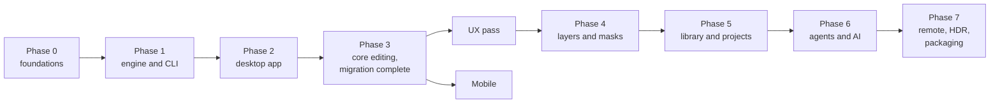

# Roadmap

As of 6 November 2026.

What Apertrust is building, in the order it is building it, from the first commit on. It is written for anyone following the project: photographers curious about it, people who might contribute, and darktable's developers, whose colour science Apertrust starts from.

**How to read it.**

- `[x]` is built and on the main branch today. `[ ]` is planned, or in progress where it says so.
- The work runs in phases. Each phase ends with a test it has to pass, its gate, before the next one counts as started. Work from the next phase sometimes starts early, and is checked where it has landed.
- Dates are not promises. Apertrust is a part-time project; the effort estimates [below](#the-plan-at-a-glance) assume about ten hours a week.
- This page is the one place for the plan: the phases with their exit criteria and gates, what is built and what remains, and [the library's steps](#the-librarys-steps). What Apertrust is, and what it will not do, is in [principles.md](principles.md); every decision behind the plan is in [decisions/](decisions/README.md), and how the parts fit is [architecture.md](architecture.md).

**Where things stand.** Phase 0's gate has passed. Phase 1's engine renders 27 of its 29 test raws as darktable does; two wait for a fix in the raw decoder. The desktop app's Phase 2 is well under way: it opens and edits one photo with sixteen migrated modules, and opens a folder. The migration from darktable is planned to be complete at the end of Phase 3.

## The plan at a glance

Thin vertical slices, each ending in something usable and testable, with early go/no-go gates so the project can stop cheaply if the core bet fails. Effort assumes part-time work, about 10 hours a week.

| Phase | Goal | Exit criteria | Rough effort | State |
| --- | --- | --- | --- | --- |
| 0. Foundations and spikes | Prove the core bet cheaply | Three ported kernels within ΔE tolerance; viewport latency acceptable; the Slang decision made | 3–5 weeks | Done |
| 1. Engine and CLI | Render a raw correctly with no UI | Every raw.pixls.us sample both decoders read as a colour mosaic, 29 of the 40, renders as `apertrust-cli export` does before rounding to 8 bits within a mean ΔE2000 of 0.01 of darktable's 16-bit render, at most 0.01% of pixels over 2.3, with Apertrust's crop and levels on both sides (decisions 23 and 62) | 5–7 weeks | 27 of 29 pass |
| 2. GUI minimum | Edit one photo end to end with the first pass's modules | Open, edit, save a sidecar, reopen with the same look; every first-pass module at its defaults leaves the render byte for byte as it was | 5–7 weeks | Under way |
| 3. Core editing complete | Usable for daily editing, and the editor sets the sliders | About 15 scene-referred operations work on real photos (rawprepare, white balance, highlight reconstruction, demosaic, input colour, exposure, color calibration, sigmoid or AgX, color balance rgb, tone equalizer, denoise, lens correction, crop, output colour); the matching test reproduces the reference on real photo pairs within its threshold; the migration complete, every first-pass module in the app and passing its golden comparisons, Apertrust's own renders the baselines from then on (decision 2) | 7–10 weeks, plus the matching slice | Started early in places |
| UX pass, after 3 | Controls people find and predict | The usability tests meet the principles' first targets | Not estimated yet | — |
| Mobile, after 3 | Edit on phones and tablets | Set when the phase is planned | Not estimated yet | — |
| 4. Layers and masks | Local editing | Sky and subject edits work as designed, range masks evaluated on the background included | 5–7 weeks | — |
| 5. Library | Manage thousands of photos, on any storage and several computers | Fast browsing and search of a real archive, a query under 50 ms and an open under 1 s at 100,000 photos (spike L2's targets); the cache rebuilt from the files alone; a library copied to another computer and system opening with its edits, albums and roots | 5–7 weeks | — |
| 6. Agents and AI | The signature features | An agent can edit a photo; "match this look" produces editable settings | Ongoing | — |
| 7. Remote, HDR, packaging | Reach and polish | Editing from a browser on the home server; installers for all three platforms | Ongoing | — |

A version usable for daily editing, at the end of Phase 3, is roughly 6 to 9 months away at this pace; the full plan is 18 months or more. The UX pass and the mobile phase have names rather than numbers, so the phases after them keep theirs. Both come after Phase 3, the UX pass first, before layers.

### Go/no-go gates

1. **After Phase 0, about a month in:** do AI-assisted ports match darktable's quality, and does the viewport feel fast? If not, stop; the month still yields tools and knowledge useful for darktable. **Passed.**
2. **After Phase 2:** does a photo edited with the first pass's modules render as darktable renders it, as fast as the viewport spike promised? The UX bet is the UX pass's gate, and the matching test Phase 3's.
3. **After Phase 3:** is Apertrust replacing darktable or a commercial editor in daily use? If not for its author, not for anyone. And does the editor set the sliders, the matching test passing on real photo pairs (decision 11)?
4. **After the UX pass:** does editing feel better than darktable on real photos? Usability tests with photographers new to Apertrust, from darktable and from commercial raw editors, measure the principles' first targets: 4 of 5 get an edit they are happy with within 15 minutes, and 4 of 5 predict what a slider will do before moving it. The tests confirm or revise the targets ([principles.md](principles.md), How we will know it works).

### Practices throughout

- Product choices follow [principles.md](principles.md) (decision 1).
- The same porting workflow for every darktable port (decision 2): spec from darktable's source, Slang kernel, golden tests, provenance in the manifest.
- Project conventions written down for agents: widgets only emit commands; fp32 kernels; no reliance on NaN checks; one owning module per parameter; a module that is off, or untouched, a no-op, with its test; invariant tests for every module.
- [decisions/](decisions/README.md) as the decision log: every architectural choice is recorded there, one file each.
- Regular testing on the homelab GPUs (NVIDIA, AMD, Apple at minimum) with self-hosted runners, not only on software rendering.
- Image-quality results published where photographers can see them (decision 1; [testing.md](testing.md)).

## The migration, then Apertrust's own way

A major part of Apertrust is built on darktable's trusted colour science. The plan has two stages.

1. **The migration, Phases 0 to 3.** darktable's processing and editing modules are rewritten for the GPU, one module at a time, each with its controls under darktable's labels. The golden-image tests compare every migrated step with darktable's own render, and a step counts as migrated only when it matches. Nothing of darktable is loaded or linked: the code is Apertrust's, written from darktable's source. The migration is complete when the first pass's modules, [listed below](#the-migrated-modules), are all in the app and pass their comparisons, at the end of Phase 3.
2. **Apertrust's own way, after the migration.** Once the whole project is migrated, Apertrust evolves on its own: usability work on the interface, layers, editing towards a goal. Its own renders become its baselines from then, and edits made with the migrated modules keep rendering exactly as before.

## Phase 0: foundations and spikes

Goal: prove the core bet cheaply, before building on it. Gate: do migrated kernels match darktable, and does the viewport feel fast? **Passed.**

- [x] A Rust workspace with continuous integration on macOS (Metal), Windows (Direct3D 12) and Linux (Vulkan), the GPU tests running on software GPUs where there is no hardware one.
- [x] The golden-image harness, the migration's check: each migrated step compared with darktable-cli's render by ΔE2000, with a tolerance per case.
- [x] Raw decoding with rawler, a decoder written in Rust, pinned by a corpus of 40 raw.pixls.us samples.
- [x] The kernel spike: kernels written in Slang and compiled to WGSL, with automatic derivatives, as fast as hand-written WGSL.
- [x] The viewport spike: a 60 MP raw with a live exposure slider, in correct colour on macOS and on Linux under Wayland.
- [x] Every golden case passing on an Apple M4, an NVIDIA RTX 5060 and an AMD Radeon 780M.

## Phase 1: engine and command line

Goal: render a raw correctly, with no interface. Migration: the eight steps every photo needs. Exit criterion: every raw.pixls.us sample both decoders read as a colour mosaic, 29 of the 40, renders within a mean ΔE2000 of 0.01 of darktable's 16-bit render, with at most 0.01% of pixels over 2.3.

- [x] The pipeline: every intermediate image kept on the GPU, planned once per change, cached so that a change reruns only what follows it (the pipeline core: planning, GPU-resident buffers, caching, tiling, row strips for small bindings).
- [x] The operation interface, and one crate per operation (decision 20).
- [x] The eight processing steps every photo needs, one pass each (decision 22): raw black and white points, white balance, highlight reconstruction, demosaic (RCD for Bayer, Markesteijn for X-Trans), exposure, input colour profile, AgX tone mapping and output colour profile.
- [x] A fast viewport pipe: an exposure change costs about 5.5 ms of GPU time on an M4, whatever the photo's size.
- [x] Tiled exports for images too large for GPU memory, equal to an untiled export bit for bit.
- [x] Software GPUs (lavapipe on Linux, WARP on Windows) run the same kernels, with large images split into strips and tiles to fit their limits.
- [x] Edits saved in a readable `.apxmp` file beside the raw; the original is never touched.
- [x] `apertrust-cli`: `info`, `edit`, `export` and `preview`.
- [x] The whole-pipeline exit test: 27 of the 29 samples match darktable at a mean ΔE2000 of about 0.001.
- [ ] The last two samples, Sony's lossy ARWs, waiting for rawler's dither-seed fix.
- [x] Timings on WARP.
- [ ] Timings on lavapipe, waiting for the timing workflow's next run.

## Phase 2: the desktop app, one photo end to end

Goal: open, edit, save and reopen a photo with the first pass's modules. Migration: a module in the app for every step already migrated, and the modules most edits use. Exit criterion: a photo reopens with the same look, and every first-pass module at its defaults leaves the render exactly as it was. Gate: a photo edited with these modules renders as darktable renders it, as fast as the viewport spike promised.

### The window and the shell

- [x] A design system, translation and the egui shell, in [gui.md](gui.md)'s build order (decision 36). The design system: dark (the default), grey, light and high-contrast themes checked for contrast, with a neutral surround for the photo; IBM Plex Sans; icons.
- [x] Translation: British English, Ukrainian and Polish from the start (the translations are drafts awaiting native review), and American English as an overlay of British English's spelling.
- [x] Screen readers: every control reports its name, role and value through AccessKit.
- [x] The shell: the top panel, the side panel with its tabs, the central bar, the photo with its shooting data under it, and the grid panel.
- [x] The Mac's window: the traffic lights in the top panel, and the native menu bar.
- [x] Linux's window (X11 and Wayland): its own title bar, caption buttons and one menu button.
- [x] Windows' window: its own title bar, caption buttons and one menu button.
- [ ] Windows' Alt pressed and released alone, and native hit testing.
- [x] Actions with a default keyboard map, shown in tooltips and menus; keys can be overridden in the settings file.
- [x] Settings kept in a file, with `--user-data-dir` and darktable's `--conf` for one run; a Settings window for the theme and language.
- [ ] The Settings window's other pages, key rebinding among them.
- [x] A log window, Help › Show Log: this session's log kept in memory while Settings' Diagnostics says so, filtered, copied or saved as the terminal writes it ([gui.md](gui.md#the-log-window)).
- [x] The photo's background: six neutral greys from black to white, chosen from the surround's right-click menu or the View menu, the theme's own the default, those for judging colour within ISO 12646.
- [x] File › Open… for one or more raws, their folder opened behind the first (decision 46); a folder or raws dropped onto the window; View › Browse (L) choosing the first tab holding Browse (decisions 37 and 73).
- [x] Dialogs as native windows on the Mac, and its system alerts.
- [x] Wayland modal dialogs and drawn alerts on Linux; X11's native hints come later.
- [ ] Native dialogs and alerts on Windows: their frame is built; the owner disabled while one is open and the task dialog are left.
- [x] An edit written by a newer Apertrust opens for viewing only and is never overwritten.

### Editing

- [x] The viewport with app-managed colour.
- [x] The module layer with bindings (`apertrust-modules`, decision 28) and `.apxmp` version 1.
- [x] A module panel drawn from each module's definition (decisions 29 and 42): darktable's page, its tabs and collapsible groups, sliders that show values as darktable writes them, choices that list only what the photo allows.
- [x] Edits save themselves after each change.
- [x] Sixteen migrated modules, listed [below](#the-migrated-modules), each darktable's module with its parameters as controls (decision 2, [modules/README.md](modules/README.md)): White balance and Colour calibration with its CAT tab (decision 27); the Tone equalizer, its mask keyed apart from its band curve, with two rounds of export tiles (decision 15); Colour balance RGB, run only while used (decision 32).
- [x] The side panel's tabs are darktable's scene-referred groups (decision 38): Base, Colour, Correct and Effect, between Photos and History.
- [ ] Input colour profile, RGB levels and RGB curve as modules (their processing is ported), the built Tone curve reshaped into RGB curve.
- [x] Switched modules (decision 32): modules darktable leaves off on a new photo start off, turn on with darktable's defaults when a control changes, and turn off again on reset; the Tone equalizer, Colour balance RGB, RGB primaries, Haze removal, Vignetting, Soften and Grain, each version 2 with its migration.
- [ ] Undo, redo and the History tab, with the history saved in the sidecar as its log of steps (decisions 47 and 78; [history.md](history.md), [the library's step 9](#the-librarys-steps)).
- [ ] Per-pixel steps fused into fewer GPU passes, once a spike measures how.
- [ ] A fine-control popup for sliders, as darktable's (decision 42).
- [x] The slider's marker as a setting, Triangle, Circle or Square, Square by default, kept whole at the track's ends (decision 75).

### Pickers

darktable's colour pickers and its Colour picker module, one API (decision 79; [pickers.md](pickers.md#the-plan)), one pull request each, each reviewed before the next that needs it:

- [x] 79.1 The reduction kernel on the frame and the Colour picker's picker through the session, regions mapped through the geometry.
- [x] 79.2 Module pickers in the modules crate: `Picker`, `Quad::Picker(id)`, `Row::Pickers`, `Module::pick` and its checks.
- [ ] 79.3 Module pickers in the engine: the reduction at an operation's input and output, sample-only renders, a pick applied as one change.
- [x] 79.4 The design system's on-photo overlay primitives, one language for every mark on the photo, before any mark is drawn.
- [ ] 79.5 The picker button and the picker's marks in the design system.
- [ ] 79.6 The app: quads and picker rows, the marks over the photo, the pointer, the keys and focus.
- [ ] 79.7 to 79.13 Each module's pickers: Exposure, White balance, Colour calibration, Colour balance RGB, AgX, then RGB curve and RGB levels with their modules.
- [ ] 79.14 Stored samples through the session.
- [ ] 79.15 The scopes restricted to the Colour picker's selection.
- [ ] 79.16 The Colour picker module in the History tab: the live sample, numbered stored samples, statistics and colour modes, samples on the photo.

### Scopes

- [x] Histogram, waveform, RGB parade and vectorscope, counted on the GPU after each frame, with clipping totals (decision 19).
- [ ] Clipping overlays on the photo.

### Folder mode

Folders first, before any library: a folder of raws opens as it is, with nothing to import. These are the library's steps 1 to 9c, [listed below](#the-librarys-steps) (decisions 37, 46 and 50).

- [x] Listing a folder's raws and their edits, cancellable, also from the command line (`apertrust-cli library scan`).
- [x] Safe writes: an edit is replaced whole or not at all, never left half written.
- [x] A reader and writer for XMP, keeping everything other tools wrote, checked against ExifTool and exiv2.
- [x] Open a folder in the app: Folders in the first tab, and the folder's photos in the grid panel.
- [x] The Photos tab and its Browse in folder mode: its top line listing the recents, ＋ and ⋯, and Folders, the tree of the folder opened, its root fixed and a click choosing the active folder, each subfolder's own listed as it opens (decisions 37 and 73).
- [x] Thumbnails from the camera's embedded pictures in the grid panel.
- [x] The grid bar's Sort and Zoom, the grid panel resized from its edge in whole rows or columns, and its position at the bottom, left or right.
- [x] The thumbnail alone at its square's bottom centre, or filling it with square thumbnails, its rings round the picture and its marks on its corner; under it a caption of the file name, with the reject, rating and colour labels' line drawn once the ratings come; and the grid bar's Labels, which shows or hides the captions.
- [x] The thumbnail cache, kept within a size limit, its size seen and cleared in Settings › Storage and from the command line (decision 76, [cache.md](cache.md)), and the live photo's own rendered thumbnails.
- [ ] Rendered thumbnails for other photos, including refreshing their stale pictures.
- [x] A photo that opens in stages (decision 77, [engine.md](engine.md#opening-a-photo)): at once the best picture in hand, unmarked; within milliseconds its values from the sidecar, read-only, before the raw is decoded on a job worker; then the live frame in one swap, with editing and the scopes. A newer open cancels an older one, one decode at a time, and kernels are kept across photos. Built on the camera's embedded picture, the rendered thumbnail read first once the thumbnail cache has them (step 6). Before the ways in (step 9b).
- [ ] Faster listing on network drives.
- [ ] The edit file's next version: the photo's identity, and clocks for editing on several computers.
- [ ] Several photos shown at once, the active one live and the rest still images, once spike W1 has measured it (decision 37).
- [x] One photo from a terminal, writing nothing but its edit and never in the recents, with Browse's Open This Folder; a folder from a terminal in folder mode (decision 46).
- [x] Open With and a double-click opening the photo's folder with it active (decision 46).
- [x] The start window: what was open last reopened at the start, File › Close, and the recent folders with the ways to open one, libraries and projects joining it with the library (step 22; [gui.md](gui.md#the-start-window)).

### The jobs window and the job API

Each job reports everything its row in the jobs window shows, in its own events, and the app's mirror folds them with no code for any kind of job (decision 72; [events.md](events.md#a-jobs-events), [gui.md](gui.md#the-jobs-window)). Six steps, each a pull request reviewed before the next. They start once pull requests 5 (the CI fixes) and 7 (CI in three layers) have merged.

- [x] **1. Base's job events and the throttle** (`crates/base/src/jobs/`): `JobEvent`'s new fields and events, `Progress`, `Destination`, `Failure` and `Offer`, the `Job` builder and `Context`'s setters, the throttle over progress, title, detail and destination, the end's time. The engine's and the app's callers change only as far as they compile, reporting what they do now. Tested by base's tests: the throttle's table for each value, `Ended` with what the body set, a panic as `panicked`.
- [x] **2. The export reports itself** (`crates/engine/src/export_job.rs`): its total, destination and queued detail as it is added; the photo under way and the photos done; its first file; its outcome, first failure and `Retry` offer at its end. `Event::Export` unchanged. Tested by the export job's tests: `an_export_s_events_come_in_order` with every new event, a failure's cause, item and file, no `Retry` after a cancel.
- [x] **3. The session and the protocol carry them** (`crates/engine/src/session.rs`): `Event::Job` with the new events, their facts by job (`Title`, `Detail`, `Destination`), `-d event`'s kinds. Tested by the session's tests: every event's kind, a job's events in order, the observer's map of the jobs shown.
- [x] **4. The app's mirror as a fold** (`crates/app/src/jobs.rs`, `Job` in `crates/ui/src/components/jobs.rs`): each event sets its part of a row; `Mirror::sent`, the export rows and `ExportDetails` go; the window drawn as now from the new rows. Tested by the app's jobs tests as event sequences in and rows out, an export and a folder's reading through the same code, and the gallery's snapshots unchanged.
- [x] **5. The window's new look** (`crates/ui/src/components/jobs.rs`, the app's `jobs::Window`): stacked rows with the kind's icon, the 8-point accent bar, the ✕ that cancels, the indeterminate bar, Dismiss on a failed row, Clear Finished in the footer, five rows before the list scrolls, the spinner only while a job runs and the warning sign after a failure; the window closing itself about 2 seconds after the jobs it opened for end well, unless one failed or was cancelled or it was touched. Tested by `tests/jobs.rs` and the gallery's snapshots, reviewed as golden images, its names, values and Tab order for screen readers, and a hand check on the Mac.
- [x] **6. Try again through the job's offer** (`session.rs`, `export_job.rs`, `crates/app/src/jobs.rs`): the export hands the session its retry, `Command::RetryJob` runs it and `NotRetryable` refuses it, its `Added` naming `retries`; the app sends `RetryJob` and the new row takes the old one's place. Tested by a session test, an export with a photo that fails tried again, exporting that photo alone, refused a second time, and the app's test from Try again to the new row.

### Installable builds

- [x] Packages built by one tool, cargo-packager, from one config (decision 68; [packaging.md](packaging.md)): an app bundle and a disk image for each architecture on macOS, Apple silicon and Intel, an NSIS installer and a portable zip on Windows, an AppImage and a tarball on Linux, each with the CLI and the licences, and the raw file types on every platform. Built and checked on the Mac; signed ad hoc, not notarised.
- [ ] Nightly builds of Apertrust Dev, which installs beside Apertrust, each package on its own platform (`nightly-builds.yml`; [packaging.md](packaging.md#nightly-builds)): written, done once a run on main has built and published every package, verifying Windows' and Linux's.
- [ ] A release workflow for version tags, building every package on its own platform.

## Phase 3: core editing complete

Goal: usable for daily editing, and the editor sets the sliders for a goal. Migration: the first pass's remaining modules, completing it. Exit criteria: about 15 modules work on real photos (raw black and white points, white balance, highlight reconstruction, demosaic, input colour profile, exposure, colour calibration, sigmoid or AgX as the tone mapper, colour balance RGB, the tone equalizer, denoise, lens correction, crop and output colour profile); a command-line test matches a reference photo on real photo pairs; and the migration is complete. Gate: is Apertrust replacing another editor in its author's daily use?

### Matching a reference photo

- [ ] A command-line test that matches a reference photo by fitting ordinary, editable settings through the kernels' derivatives, the phase's first engine work, with the input derivatives and the backward pipe it needs (decisions 1 and 11; [ai.md](ai.md#the-differentiable-pipeline)). Every differentiable kernel already exports its derivatives.

### The rest of the migration

- [x] Haze removal, RGB primaries and Soften (built ahead of this phase).
- [ ] Local contrast, Colour equalizer and Bloom (their processing is ported).
- [ ] Sigmoid and Filmic RGB as tone mappers, one per edit (their processing is ported; decision 33).
- [ ] Lens correction (from the corrections the raw carries, then Lensfun's), chromatic aberrations, rotate and perspective, orientation and crop.
- [ ] Denoise (profiled), diffuse or sharpen, and sharpen.
- [ ] darktable's presets and styles; copy and apply an edit.
- [ ] Before and after, and warnings.
- [ ] Colour calibration's colour checker, darktable's, with its chart data and fit.
- [ ] Show mask: one way to see a module's mask on the photo, for every module with a mask button, never saved in the edit.
- [ ] Every module's values stored as darktable's sliders round them, so the processing gets darktable's parameters bit for bit.
- [ ] Software GPUs: large images' scratch bound in windows (decision 15), lifting the size limits of Local contrast, Bloom, Soften, Colour equalizer, Filmic RGB and Haze removal.

### Export

- [x] On the command line: JPEG and PNG with darktable's sRGB profile, at darktable's sizes and resampling, file names from darktable's variables, several files at once.
- [x] Exports run as background jobs beside live editing, with a jobs window for progress and cancel.
- [x] The Export dialog on the Mac: File on disk, JPEG and PNG, darktable's four size modes, high-quality resampling, the overwrite question, and Export Again (decision 56; [gui.md](gui.md#the-export-dialog)).
- [x] The Export dialog on Windows and Linux, as a modal window, with Overwrite's alert on Linux.
- [ ] Alerts on Windows, for Overwrite and the quit question; Linux's are built.
- [ ] Export presets, and several presets in one go.
- [ ] Metadata in exported files, and styles applied on export.

### Culling, metadata and several computers, in folder mode

The library's steps 10 to 20 and 15b, [listed below](#the-librarys-steps) (decisions 46, 47, 52 and 53), and metadata through the XMP layer (decision 50).

- [ ] Ratings, a reject and colour labels, set from the caption under the photo and its keys and written to the `.apxmp`, so photos can be culled in folder mode before the Library ([gui.md](gui.md#the-caption-under-the-photo)).
- [ ] Keywords and darktable's metadata fields, in the Keywords and Metadata modules; darktable's ratings, labels and keywords read from its XMP files.
- [ ] Filters over the open folder, by rating, label, date, camera, keywords and the rest (decision 73).
- [ ] Culling in the Photo layout with the grid panel and the caption's ratings, with no Grid layout; the selected photos side by side, up to 11 and a 12th cell for the rest (decision 37).
- [ ] Rating, Apply edit and Export on every selected photo, with one undo.
- [ ] Changes made outside Apertrust noticed; nothing overwritten without reading it first.
- [ ] Virtual copies.
- [ ] Two computers editing the same photo: both versions kept, never one lost.
- [ ] Snapshots, and photo groups (raw and JPEG together).
- [ ] Move, rename, copy and delete photos with their edits.
- [ ] Import by copy, as darktable's copy and import.

### The migration complete

- [ ] Every module of the first pass in the app and matching darktable's render in its golden comparisons. From here on, Apertrust's own renders are its baselines.

## The UX pass

Goal: controls people find and predict, the first step on Apertrust's own way: usability work on the interface. It comes right after Phase 3, before layers. Gate: in usability tests, 4 of 5 photographers new to Apertrust get an edit they are happy with within 15 minutes, and 4 of 5 predict what a slider will do before moving it.

- [ ] Usability tests with photographers coming from darktable and from commercial raw editors.
- [ ] Fixes to the interface from what the tests find (decision 1). From then on Apertrust evolves on its own (decision 2).

## Mobile, after Phase 3

- [ ] A native app for phones and tablets over the session protocol, designed for touch rather than adapted from the desktop layout (decision 1; [session-protocol.md](session-protocol.md#web-tablets-and-remote-access)). Its scope is set when the phase is planned.

## Phase 4: layers and masks

Goal: local editing.

- [ ] Spikes first: the layer graph (15 layers, 100 brush strokes and 5 AI parts at 60 MP), masks on the GPU, shapes through the geometry, AI parts through ONNX Runtime (decision 34).
- [ ] Layers as masked instances of modules (decision 34, [layers.md](layers.md)): filled layers and opacity first, a slider scaled in its own unit; darktable's blend modes.
- [ ] Gradients and shapes, then Feather and Edge, range parts, the brush, paths and a mask overlay, combined top to bottom, ported from darktable's master (decision 74).
- [ ] Colour calibration's adaptation on a masked layer, for mixed light.
- [ ] Retouch layers, heal and clone, darktable's retouch ported from its master (decision 74), then AI erase.
- [ ] AI masks for subject, sky, background, people and a clicked object, and a depth part, run locally through ONNX Runtime's WebGPU provider (decision 60), recomputed once per photo when copied.
- [ ] The binary sidecar, `.apdata` (decision 49).

## Phase 5: the library and projects

Goal: manage thousands of photos, on any storage and several computers: the Library (decisions 46, 47 and 52 to 55), the library's steps 21 to 35, then the Project, steps 36 to 42 ([listed below](#the-librarys-steps)). Culling is Phase 3's, in the Photo layout, and the thumbnails come in Phase 2 (decision 37). Exit criteria: fast browsing and search of a real archive, with a query under 50 ms and an open under a second at 100,000 photos (spike L2's targets); the library's cache rebuilt from its files alone; and a library copied to another computer, on another operating system too, opening with its edits, albums and roots (the folders it holds).

- [ ] A library file kept wherever you choose, with its folders found again when drives move.
- [ ] Albums and smart albums, with darktable's filters and sorts; keywords; full-text search.
- [ ] Import into a library, in place or by copy.
- [ ] Offline drives, local copies and cloud folders.
- [ ] Projects: a shoot's folders with roles (capture, selects, output), a watched capture folder and templates.
- [ ] The library on the command line.

## Phase 6: agents and AI

Goal: the signature features.

- [ ] Matching a look: show a photo, and get editable settings that reach it, through the differentiable pipeline, building on Phase 3's matching test.
- [ ] AI denoise and AI erase, run locally (erase removes small distractions; it never generates new content).
- [ ] An MCP server in the app and on the command line, so assistants edit through the same sliders and history as you, and check their work.

## Phase 7: remote, HDR and packaging

Goal: reach and polish.

- [ ] A self-hosted server with sync, after Phase 5's library (decision 71; [library.md](library.md#a-server)): a Docker container on a NAS, amd64 and arm64, that the app optionally connects to; the originals and their sidecars in its folders, the desktop editing local copies and sending back only what changed; server roots in a library beside folders; listing from the server's index. The server does no processing: thumbnails are the desktop's.
- [ ] `apertrust-cli serve` and a web client with frame streaming, editing from a browser on a home server, from the same server.
- [ ] HDR display, managed by the system.
- [ ] Signed installers: a notarised macOS app with a Developer ID, a code-signed Windows installer and MSIX, and Flatpak.

## Later, with no phase yet

**Map, Print and Slideshow** have no phase yet (decision 37). The map is a layout of the centre, shown only when the user asks, after Phase 5. Its tiles, planned with the Map layout, are offline first: a low-zoom Natural Earth basemap (public domain) shipped with the app and regional PMTiles files the user adds (OpenStreetMap-derived, ODbL, attributed). Online tiles, as darktable has them (OpenStreetMap and other sources, cached on disk), stay off until the person turns them on, since tile requests tell a tile server where the photos were taken (principle 3); OpenStreetMap's own servers forbid prefetching for offline use. Their TLS is the platform's own (`native-tls`: Security framework, SChannel, the system's OpenSSL), which decision 5's rule for platform libraries loaded at run time covers, so it needs no exception. Print is a full-window sheet, starting after Phase 5 as a print-ready file (PDF or TIFF at size, through the printer's profile, which needs a 3D-LUT kernel) on every platform, then the system's print path platform by platform. Slideshow is an action, not a view.

- [ ] A map of where photos were taken, with geotags and GPX tracks.
- [ ] Print, first as a print-ready file through the printer's profile.
- [ ] A slideshow.
- [ ] Tethering and import from a camera.
- [ ] More export formats as encoders allow.
- [ ] Scripting.

## The library's steps

Decisions 46, 47, 52 to 55, 71 and 76. Each step delivers one thing and is reviewed before the next starts. Folder mode comes first, twenty steps in Phases 2 and 3 before any library exists; then the library, then the project.

**Built, in Phase 2:**

- [x] `apertrust-library` lists one folder (its raws by the decoder's extensions and their `.apxmp` sidecars, with names, sizes and modified times) on a cancellable worker, in chunks; `apertrust-cli library scan DIR` (step 1).
- [x] `apertrust-library`'s `sidecar` module, the `.apxmp` format's text layer, which the engine's typed reading sits on; the committed version-1 sidecar reads with no warning and writes back byte for byte (step 2).
- [x] Safe writes: a hidden temporary, flushed, renamed; Windows' refused renames retried; nothing written when the bytes are the same; leftover temporaries removed as a folder is listed (step 3).
- [x] The open folder's `Index` in memory: the listing plus each sidecar read 16 at a time, which photos have edits, each sidecar's version and hash, which open view-only (step 4).
- [x] The open folder through the session (step 5), on the session's outbox and the app's reducer (decision 59):
  - `apertrust-library`'s `ops`: `LibraryCommand::Open(Source::Folder)` and `Close`; `LibraryEvent`'s `Opened`, `Subfolders`, `Listed` in chunks with each photo's edit state, `Failed` and `Closed`, each naming its command's number and each a notice; the folder's subfolders as the system's file browser sorts them;
  - the reading a cancellable `UserBackground` job of the session's control, as darktable's film import, its progress `Event::Job`, a new open or a close cancelling it, as does `CancelJob` (decision 57);
  - in the app, Folders in the first tab (Open Folder…, the folder's subfolders, the recent folders) and the grid panel showing the open folder, each photo's file name standing in until its thumbnail comes; the reducer's arms for the library's events, an earlier open's dropped by its number.
- [x] The XMP layer (decision 50): `apertrust-library`'s `xmp` module, with `sidecar`'s `Document` parsed and written through it (step 7b).
- [x] The camera's embedded pictures as thumbnails (step 6's first part):
  - `apertrust-raw` reads a raw's embedded picture without decoding the mosaic: rawler's thumbnail where it is at least the size asked, else its preview, else the larger; at most the size asked on its longer side; turned upright by the EXIF Orientation; 8-bit RGBA;
  - `LibraryCommand::Thumbnails { photos, size }` asks for the open folder's photos by name, each a `SystemForeground` job of the session's control with no progress, deduplicated by the open, photo and size, the newest asked first, as darktable's thumbnail loads (decision 57); each answered by `LibraryEvent::Thumbnail` with its picture or none, naming the folder's open; a new open or a close cancels those not yet sent;
  - in the app, the mirror keeps them by photo and size with the folder and a generation number, the grid panel asks for the cells it draws at the cell's size rounded up to one of four, and each cell draws its picture fitted in its square from a texture made of the mirror's pixels, dropped with the folder. Each is read from the cache's `thumbnails` kind first, and written there on a miss.
- [x] The disk cache (decision 76; [cache.md](cache.md)):
  - base's `cache`: its kinds, each limited entry one file named by its slot's hash holding its version, written whole and read back with its last use, the walk, the tidy of old temporaries, eviction past the limit to 90% of it and clearing a limited kind;
  - its folder, chosen by `--cache-dir` or darktable's `--cachedir`, `APERTRUST_CACHE_DIR`, the user data folder's or the platform's, and created only by a program that writes it;
  - the settings `cache.limited`, `cache.limit` and `cache.unused_after`, on Settings › Storage as rows;
  - the session owning the cache the app opens: the start's tidy and walk, eviction after a write past the limit and when the limit is lowered, quitting never waiting for them;
  - the camera's embedded pictures kept in it as thumbnails, JPEG at quality 90, keyed by the photo's path, size and a version that changes with the raw and rawler's reading.
- [x] The cache's control through the session and the command line (step 6b's first part, decision 76; [cache.md](cache.md#through-the-session)):
  - `CacheCommand::Sizes`, answered by `Event::Cache`, a fact: at once with the session's own count, then again after a walk that counts other processes' writes; `NoCache` for a session with none;
  - `CacheCommand::Clear { kind }`, a limited kind cleared by a cancellable `UserBackground` job whose row's title, detail and outcome are its own messages in every language, the sizes sent again as it ends; a kept kind, a Clear under way and no cache refused;
  - `apertrust-cli cache info` and `cache clear [KIND...]`, on base's `cache` with no session and no GPU, creating nothing.
- [x] Settings › Storage (step 6b's second part, decision 76; [cache.md](cache.md#settings--storage)): the user data and cache folders, each with how it was chosen and Show in Finder; each limited kind's entries and size with its Clear, disabled until its job ends; the libraries' caches as one line until their Remove with step 27; the total against the limit; the sizes asked each time the page is shown and after the limit changes.

**Remaining, in Phase 2:**

- [ ] **Step 5.** (Its later part) The calls into a root on that root's queue (decisions 53 and 57), with step 10, when a folder is listed again while other calls into it run; `CollectionChanged` with darktable's reason and property, with the first change to a collection.
- [x] **Step 6, live-photo renders.** A thumbnail of the live photo's saved edit, after a one-second settle and when it stops being live, through its viewport pipe with no second decode or pipeline; a 1024 sRGB render and box averages for the three smaller slots, versioned by the sidecar bytes' hash and the render version. The grid's requested sizes update through thumbnail events, and the next open shows the cached render first. Default edits keep the embedded picture; quitting starts no render.
- [ ] **Step 6.** Its remaining parts: a cold walk timed on Windows and a hard disk (decision 76; [cache.md](cache.md#timing-the-walk)); rendering the other photos and refreshing their stale thumbnails, with their own decode and memory budget; nothing for cloud files not on the disk.
- [ ] **Step 7.** Bulk listing (`getattrlistbulk`, `FindFirstFileExW`, `statx`; in an `apertrust-fs` crate only if it needs FFI that safe crates do not cover), timed against step 1 on the NAS; spike L1 folded in.
- [ ] **Step 8.** Sidecar version 2's identity and clocks: the photo's name and fingerprint, its virtual copies (one at first) with ids and clock vectors, the machine id; version 1 still read. Written through the XMP layer. Built in two parts where history needs them (decision 78; [history.md](history.md#step-8-first-in-two-parts)):
  - [x] 8.1, before 9.1: the hybrid logical clock and the machine id (`apertrust_library::clock`);
  - [ ] 8.2, before 9.5: version 2's text layer with the photo's identity and fingerprint, and one virtual copy with its id, number, name, clock vector, log and end, each time an XMP Date (ISO 16684-1:2019); version 1 read as one step; a fixture with a history that ExifTool and exiv2 read without error.
- [ ] **Step 9.** Undo, redo and the edit's history (decision 78; each part's scope in [history.md](history.md#the-plan)), one pull request each, after switched modules (decision 32, [Editing](#editing)), which history relies on throughout:
  - [x] 9.1: the log in the session's memory, each completed change a step, `Reset` a step, `Undo` and `Redo` with the undo records, `Event::History` with its build time and size measured (its JSON over budget at 1,000 steps, so the remote protocol takes the planned fallback, [history.md](history.md#the-history-event)); the file still version 1;
  - [x] 9.2: `GoTo` and `Step`, and the app's changes of several commands, the tone equalizer's release and band reset, as one `Step`;
  - [x] 9.3: consecutive changes merged as darktable's undo merges them;
  - 9.4: Edit › Undo and Redo and their keys, naming what they would do;
  - 9.5, after 8.2: history saved in version 2, Undo back after reopening, a newer file taken in before a write;
  - 9.6: the History tab; 9.7: its eye, `Hide`; 9.8: Compress History and Truncate (Ctrl-click or Cmd-click on Compress);
  - 9.9: `apertrust-cli edit` adding a step, and `apertrust-cli history` with `--compress` and `--truncate`.
- [x] **Step 9b.** The ways in (decisions 37, 46 and 73). Built: Open With and a double-click opening the photo's folder with it active, the photo at once and the folder listed behind it (macOS's open-documents event, a drop on the Dock icon among them; `--in-folder` from the installer's and the desktop entry's registrations, [packaging.md](packaging.md#opening-a-raw-from-the-system)), looked at off the interface's thread and refused with the alert in the window as a drop is; `apertrust FILE` from a terminal opening one photo alone, nothing written but its edit, never in the recents, the grid panel holding it by itself and Browse's Folders holding Open This Folder, and `apertrust FOLDER` opening folder mode, a library's or project's file refused until Phase 5; the tab `photos`; Browse in folder mode, its top line listing the recents with Locate… and Remove from the List, ＋, ⋯ with Show in Finder, and Folders as the tree of the folder opened, its root fixed and a click choosing the active folder, each row's Show in Folder and a subfolder's own subfolders listed as it opens (`LibraryCommand::Subfolders`); File › Open… for one or more raws, the first opened with its folder behind it, a library's or project's file greyed out in its dialog until Phase 5, and Browse's ＋ running it; drag and drop onto the window, a folder as Open Folder…, raws as Open…, the first of several, anything else refused with an alert, nothing under a modal dialog, the photo and the grid panel outlined while something hovers; View › Browse (`show-browse`, L) choosing the first tab holding Browse. Selecting the other raws chosen, dropped or opened with the app waits for the grid panel's selection (Phase 3), and the notice for files from several folders for notices (step 12).
- [x] **Step 9c.** The start window: what was open last reopened at the start (`library.reopen_last`, on by default), the start window with its recents and buttons, File › Close, Open Recent listing the same ([gui.md](gui.md#the-start-window)). Built: the recents' state file, `state.toml`, the one list Open Recent, Browse and the start window read (`crates/app/src/recents.rs`); File › Open Recent with Clear Menu, on the Mac's bar and in the ☰; File › Close; what was open last reopened at the start, its photo active once listed (`library.reopen_last`); the start window, the main window in its start state at the start window's size whenever nothing is open (`crates/app/src/start.rs`), with the recents, missing ones offering Locate… and Remove from the List, Open Folder… and Open, the library's buttons and Browse… disabled until step 22, its keys, closing it hiding the app on the Mac until a click on the Dock icon and quitting elsewhere, and Close Window doing what Close does on the Mac's main window.

**Phase 3, several computers, virtual copies, metadata and Import, in folder mode:**

- [ ] **Step 10.** Outside changes: the open folder listed again on focus and every 30 s on network roots, watchers as hints; a copy only older replaced, the active photo taking the newer edit; every write a read first; until step 12 a diverged sidecar opens view-only.
- [ ] **Step 11.** Virtual copies: New Virtual Copy and New Virtual Copy from Original, in the photo's one sidecar, named and numbered, deleted with a tombstone; darktable's duplicate manager's actions.
- [ ] **Step 12.** Two virtual copies on divergence, named after the computer and time; spike L4's harness. Notices that are not jobs (`Event::Notice`) come with it, shown as darktable's `dt_control_log` shows its messages ([gui.md](gui.md#the-jobs-window)).
- [ ] **Step 13.** Conflict copies found by content, handled by step 12's rule, moved into the user data folder's `conflict-copies/` and removed 30 days later, never in the cache (decision 76); their count and size on Settings › Storage.
- [ ] **Step 14.** Ratings, the reject and colour labels as history steps, combining field by field, written as darktable writes them, its labels and reject beside the standard XMP rating, so they read both ways; their details are settled as it is built.
- [ ] **Step 15.** Keywords and darktable's metadata fields, combining likewise; darktable's XMP read for ratings, labels and keywords while a photo has no `.apxmp` (decision 51); the Keywords module, its list the folder's keywords with their properties and Recent in the user data folder's `keywords.toml`, and the Metadata module, darktable's image information and metadata editor in one (decision 73).
- [ ] **Step 15b.** Filters in folder mode (decision 73): the index's rules and counts over the open folder, the Filters module; first file name, rating, colour label, history, date taken and file type, then camera, lens and exposure read with the capture times, then keywords and the metadata fields.
- [ ] **Step 16.** Snapshots saved in the sidecar, each its edit whole, with History's Snapshots section ([history.md](history.md)).
- [ ] **Step 17.** Photo groups: raw and JPEG by base name, groups made by hand by id in the sidecars, the G toggle.
- [ ] **Step 18.** Renames outside Apertrust: orphan sidecars re-paired by fingerprint; Edits without a photo.
- [ ] **Step 19.** Move, Rename, Copy and Delete with their sidecars, `.apdata` and attached files, each a `UserForeground` job as darktable's: move, copy and rename cancellable, delete with a bar and not cancellable (decision 57).
- [ ] **Step 20.** Import… by copy in folder mode: darktable's copy & import with its patterns and variables, job code and date override; already imported photos ticked by fingerprint; import metadata; the destination opened; a cancellable `UserForeground` job, "importing N/M images", as darktable's `dt_control_import` (decision 57).

**Phase 5, the library:**

- [ ] **Step 21.** Spike L2, the cache's engine, on the M4.
- [ ] **Step 21b.** The storage interface (decision 54): every call into a root's files, the listing and the safe write among them, through one interface with the local-files backend, so the server's backend (decision 71) comes in beside it with nothing above it changing; in place before step 22 builds on the file system.
- [ ] **Step 22.** The library file: New Library…, Open… of its file, Open Recent and the start window, a double-click; `.apertrust/`; a library made from the open folder in place; its model built from its files; a newer format view-only.
- [ ] **Step 23.** Roots: Add Folder… with the root's id file, the root map per machine in the user data folder (decision 76), finding by relative path then mounted volumes, Locate…; every root's tree in Folders, offline roots marked.
- [ ] **Step 24.** Albums: one file each, nested, combining entry by entry, cycles resolved; the Albums section; Add to Album.
- [ ] **Step 25.** Smart albums: darktable's collect rules, filters and sorts, and "in album"; the Smart albums section; Filters' Save as Smart Album.
- [ ] **Step 26.** The library's keyword list: darktable's hierarchy, synonyms and flags in `keywords.toml`, merging by path, used inside the library in place of the user data folder's.
- [ ] **Step 27.** The per-machine cache, by spike L2: the `Index` saved and reopened, background rescans, Rebuild Cache, roots away browsed with their marks; each library's cache on Settings › Storage and in `apertrust-cli cache`, those unopened for `cache.unused_after` (90 days by default, or never) or not found offered for removal, locked while open (decision 76).
- [ ] **Step 28.** Full-text search.
- [ ] **Step 29.** Import… into a library: in place as a root, or by copy into `Photos/`.
- [ ] **Step 30.** Edits kept in the library: the setting, `.apertrust/edits/` mirrored by path, the root's id file naming the library; folder mode following it and saying so.
- [ ] **Step 31.** Offline drives: changes waiting in the library; local copies, the cache's kept kind `copies/`, and how they are cleared (decision 76).
- [ ] **Step 32.** Import library… of a library: one album with its albums inside, by copy or reference, keywords by path, Keep both or Link, the cost first, the notice on the old one.
- [ ] **Step 33.** Cloud files, after spike L3: the flags on Windows and macOS, materialisation off on macOS, cloud marks, Make Available Offline.
- [ ] **Step 34.** Silent winners: each machine's last-written copy of each sidecar in the user data folder (decision 76); iCloud's hidden versions through `NSFileVersion`.
- [ ] **Step 35.** The whole of `LibraryCommand` and `LibraryEvent` in the session protocol, and `apertrust-cli library`'s commands; MCP's tools in Phase 6.

**Phase 5, after the library, the project:**

- [ ] **Step 36.** Projects: New Project…, `Name.approject`, the roles made at its top or given to folders inside, marked in the Folders tree.
- [ ] **Step 37.** The roles at work: Import… into Capture, Move to Selects, Delete to the project's Trash and Empty Trash, Export's default destination Output; Output kept out of smart albums.
- [ ] **Step 38.** The job's settings: the next capture's folder, name pattern and job code; the start adjustments in `.apertrust/start.apxmp`, applied on import; the default Output folder and export preset.
- [ ] **Step 39.** The watched Capture folder.
- [ ] **Step 40.** Import library… of a project: Selects an album inside, Output and Trash left behind and counted.
- [ ] **Step 41.** Export as Project…, by copy or reference.
- [ ] **Step 42.** Project templates, saved into the user data folder and offered by New Project….

**Later:** the module-by-module merge, as a setting; tethering and import from a camera through libgphoto2, an exception to decision 5 decided when they are planned; a full merge on Import library… and importing the same one again; Move Edits…; the map, geotags and GPX, with the Photos tab's Location; presence notes; the server with sync (Phase 7, decision 71); Shared Project for a studio shoot, hosted on the server or on the tethering computer, with changes pushed and merged module by module (decision 71); scripting.

**Spikes:** L1, listing, folded into step 7; L2, the cache's engine, step 21; L3, cloud folders on macOS and Windows, before step 33; L4, two versions, the convergence harness built with step 12.

## The migrated modules

What the migration brings over from darktable, one module each. "Processing" is the algorithm rewritten for the GPU and matched to darktable's render; "module" is the panel you edit with in the app.

| darktable module | Processing | Module | Phase |
| --- | --- | --- | --- |
| raw black/white point | [x] | [x] | 1, 2 |
| white balance | [x] | [x] | 1, 2 |
| highlight reconstruction | [x] inpaint opposed | [x] | 1, 2 |
| demosaic | [x] RCD, Markesteijn 1-pass | [x] | 1, 2 |
| exposure | [x] | [x] | 1, 2 |
| input colour profile | [x] | [ ] | 1, 2 |
| AgX | [x] | [x] | 1, 2 |
| output colour profile | [x] sRGB, linear Rec709 and Rec2020 | [x] | 1, 2 |
| colour calibration | [x] | [x] | 2 |
| tone equalizer | [x] but the guided filters | [x] | 2 |
| colour balance rgb | [x] | [x] | 2 |
| rgb curve | [x] | [ ] its luma curve built as the Tone curve | 2 |
| rgb levels | [x] | [ ] | 2 |
| grain | [x] | [x] | 2 |
| vignetting | [x] without dithering | [x] | 2 |
| haze removal | [x] | [x] | 3 |
| rgb primaries | [x] | [x] | 3 |
| soften | [x] | [x] | 3 |
| local contrast | [x] | [ ] | 3 |
| colour equalizer | [x] | [ ] | 3 |
| bloom | [x] | [ ] | 3 |
| sigmoid | [x] | [ ] | 3 |
| filmic rgb | [x] | [ ] | 3 |
| lens correction | [ ] | [ ] | 3 |
| chromatic aberrations | [ ] | [ ] | 3 |
| rotate and perspective | [ ] | [ ] | 3 |
| orientation | [x] | [x] | 3 |
| crop | [ ] | [ ] | 3 |
| denoise (profiled) | [ ] | [ ] | 3 |
| diffuse or sharpen | [ ] | [ ] | 3 |
| sharpen | [ ] | [ ] | 3 |

Left out on purpose: darktable's deprecated modules, and modules that do another's job (colour zones, monochrome, base curve). darktable's edits are imported once every module they use is ported; darktable's ratings, labels and keywords are read from the start.

## Not planned

From [principles.md](principles.md), What we will not build: reordering the processing, several copies of a module outside layers, expert and legacy modules; accounts, subscriptions, cloud processing or telemetry; generative image content. Video is not planned yet.
