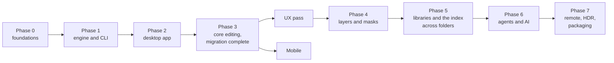

# Roadmap

As of 6 November 2026.

What Apertrust is building, in the order it is building it, from the first commit on. It is written for anyone following the project: photographers curious about it, people who might contribute, and darktable's developers, whose colour science Apertrust starts from.

**How to read it.**

- `[x]` is built and on the main branch today. `[ ]` is planned, or in progress where it says so.
- The work runs in phases. Each phase ends with a test it has to pass, its gate, before the next one counts as started. Work from the next phase sometimes starts early, and is checked where it has landed.
- Dates are not promises. Apertrust is a part-time project; the effort estimates [below](#the-plan-at-a-glance) assume about ten hours a week.
- This page is the one place for the plan: the phases with their exit criteria and gates, what is built and what remains, and [the library's steps](#the-librarys-steps). What Apertrust is, and what it will not do, is in [principles.md](principles.md); every decision behind the plan is in [decisions/](decisions/README.md), and how the parts fit is [architecture.md](architecture.md).

**Where things stand.** Phase 0's gate has passed. Phase 1's engine renders 27 of its 29 test raws as darktable does; two wait for a fix in the raw decoder. The desktop app's Phase 2 is well under way: it opens and edits one photo with seventeen migrated tools, and opens a folder. The migration from darktable is planned to be complete at the end of Phase 3.

## The plan at a glance

Thin vertical slices, each ending in something usable and testable, with early go/no-go gates so the project can stop cheaply if the core bet fails. Effort assumes part-time work, about 10 hours a week.

| Phase | Goal | Exit criteria | Rough effort | State |
| --- | --- | --- | --- | --- |
| 0. Foundations and spikes | Prove the core bet cheaply | Three ported kernels within ΔE tolerance; viewport latency acceptable; the Slang decision made | 3–5 weeks | Done |
| 1. Engine and CLI | Render a raw correctly with no UI | Every raw.pixls.us sample both decoders read as a colour mosaic, 29 of the 40, renders as `apertrust-cli export` does before rounding to 8 bits within a mean ΔE2000 of 0.01 of darktable's 16-bit render, at most 0.01% of pixels over 2.3, with Apertrust's crop and levels on both sides (decisions 23 and 62) | 5–7 weeks | 27 of 29 pass |
| 2. GUI minimum | Edit one photo end to end with the first pass's tools | Open, edit, save a sidecar, reopen with the same look; every first-pass tool at its defaults leaves the render byte for byte as it was | 5–7 weeks | Under way |
| 3. Core editing complete | Usable for daily editing, and the editor sets the sliders | About 15 scene-referred operations work on real photos (rawprepare, white balance, highlight reconstruction, demosaic, input colour, exposure, color calibration, sigmoid or AgX, color balance rgb, tone equalizer, denoise, lens correction, crop, output colour); the matching test reproduces the reference on real photo pairs within its threshold; the migration complete, every first-pass tool in the app and passing its golden comparisons, Apertrust's own renders the baselines from then on (decision 2) | 7–10 weeks, plus the matching slice | Started early in places |
| UX pass, after 3 | Controls people find and predict | The usability tests meet the principles' first targets | Not estimated yet | — |
| Mobile, after 3 | Edit on phones and tablets | Set when the phase is planned | Not estimated yet | — |
| 4. Layers and masks | Local editing | Sky and subject edits work as designed, range masks evaluated on the background included | 5–7 weeks | — |
| 5. Libraries and the index across folders | Manage hundreds of thousands of photos across folders, drives and computers | A query under 50 ms and an open under 1 s at 100,000 photos (spike L2's targets); the index rebuilt from the files alone; a folder copied to another computer and system opening with its edits and albums; a Library of 500,000 photos over five folders searched; a folder kept offline browsed after the cache has passed its limit, with no row lost; with step 27b, unless it moves to Later, a Library saved in a folder opened on a second computer with its albums, and changed on both, every change kept | 5–7 weeks | — |
| 6. Agents and AI | The signature features | An agent can edit a photo; "match this look" produces editable settings | Ongoing | — |
| 7. Remote, HDR, packaging | Reach and polish | Editing from a browser on the home server; installers for all three platforms | Ongoing | — |

A version usable for daily editing, at the end of Phase 3, is roughly 6 to 9 months away at this pace; the full plan is 18 months or more. The UX pass and the mobile phase have names rather than numbers, so the phases after them keep theirs. Both come after Phase 3, the UX pass first, before layers.

### Go/no-go gates

1. **After Phase 0, about a month in:** do AI-assisted ports match darktable's quality, and does the viewport feel fast? If not, stop; the month still yields tools and knowledge useful for darktable. **Passed.**
2. **After Phase 2:** does a photo edited with the first pass's tools render as darktable renders it, as fast as the viewport spike promised? The UX bet is the UX pass's gate, and the matching test Phase 3's.
3. **After Phase 3:** is Apertrust replacing darktable or a commercial editor in daily use? If not for its author, not for anyone. And does the editor set the sliders, the matching test passing on real photo pairs (decision 11)?
4. **After the UX pass:** does editing feel better than darktable on real photos? Usability tests with photographers new to Apertrust, from darktable and from commercial raw editors, measure the principles' first targets: 4 of 5 get an edit they are happy with within 15 minutes, and 4 of 5 predict what a slider will do before moving it. The tests confirm or revise the targets ([principles.md](principles.md), How we will know it works).

### Practices throughout

- Product choices follow [principles.md](principles.md) (decision 1).
- The same porting workflow for every darktable port (decision 2): spec from darktable's source, Slang kernel, golden tests, provenance in the manifest.
- Project conventions written down for agents: widgets only emit commands; fp32 kernels; no reliance on NaN checks; one owning tool per parameter; a tool that is off, or untouched, a no-op, with its test; invariant tests for every tool.
- [decisions/](decisions/README.md) as the decision log: every architectural choice is recorded there, one file each.
- Regular testing on the homelab GPUs (NVIDIA, AMD, Apple at minimum) with self-hosted runners, not only on software rendering.
- Image-quality results published where photographers can see them (decision 1; [testing.md](testing.md)).

## The migration, then Apertrust's own way

A major part of Apertrust is built on darktable's trusted colour science. The plan has two stages.

1. **The migration, Phases 0 to 3.** darktable's processing and editing modules are rewritten for the GPU, one module at a time, each with its controls under darktable's labels. The golden-image tests compare every migrated step with darktable's own render, and a step counts as migrated only when it matches. Nothing of darktable is loaded or linked: the code is Apertrust's, written from darktable's source. The migration is complete when the first pass's tools, [listed below](#the-migrated-tools), are all in the app and pass their comparisons, at the end of Phase 3.
2. **Apertrust's own way, after the migration.** Once the whole project is migrated, Apertrust evolves on its own: usability work on the interface, layers, editing towards a goal. Its own renders become its baselines from then, and edits made with the migrated tools keep rendering exactly as before.

## Phase 0: foundations and spikes

Goal: prove the core bet cheaply, before building on it. Gate: do migrated kernels match darktable, and does the viewport feel fast? **Passed.**

- [x] A Rust workspace with continuous integration on macOS (Metal), Windows (Direct3D 12) and Linux (Vulkan), the GPU tests running on software GPUs where there is no hardware one.
- [x] The golden-image harness, the migration's check: each migrated step compared with darktable-cli's render by ΔE2000, with a tolerance per case.
- [x] Raw decoding with rawler, a decoder written in Rust, pinned by a corpus of 40 raw.pixls.us samples.
- [x] The kernel spike: kernels written in Slang and compiled to WGSL, with automatic derivatives, as fast as hand-written WGSL.
- [x] The viewport spike: a 60 MP raw with a live exposure slider, in correct colour on macOS and on Linux under Wayland.
- [x] Phase 0's golden cases passing on an Apple M4, an NVIDIA RTX 5060 and an AMD Radeon 780M.

## Phase 1: engine and command line

Goal: render a raw correctly, with no interface. Migration: the eight steps every photo needs. Exit criterion: every raw.pixls.us sample both decoders read as a colour mosaic, 29 of the 40, renders within a mean ΔE2000 of 0.01 of darktable's 16-bit render, with at most 0.01% of pixels over 2.3.

- [x] The pipeline: every intermediate image kept on the GPU, planned once per change, cached so that a change reruns only what follows it (the pipeline core: planning, GPU-resident buffers, caching, tiling, row strips for small bindings).
- [x] The operation interface, and one crate per operation (decision 20).
- [x] The eight processing steps every photo needs, one pass each (decision 22): raw black and white points, white balance, highlight reconstruction, demosaic (RCD for Bayer, Markesteijn for X-Trans), exposure, input colour profile, AgX tone mapping and output colour profile.
- [x] A fast viewport pipe: an exposure change costs about 5.5 ms of GPU time on an M4, whatever the photo's size.
- [x] Tiled exports for images too large for GPU memory, equal to an untiled export bit for bit.
- [x] Software GPUs (lavapipe on Linux, WARP on Windows) run the same kernels, with large images split into strips and tiles to fit their limits.
- [x] Edits saved in a readable `.apxmp` file beside the raw; the original is never touched.
- [x] `apertrust-cli`: `info`, `edit`, `export` and `preview`.
- [x] The whole-pipeline exit test: 27 of the 29 samples match darktable at a mean ΔE2000 of about 0.001.
- [ ] The last two samples, Sony's lossy ARWs, waiting for rawler's dither-seed fix.
- [x] Timings on WARP.
- [ ] Timings on lavapipe, waiting for the timing workflow's next run.

## Phase 2: the desktop app, one photo end to end

Goal: open, edit, save and reopen a photo with the first pass's tools. Migration: a tool in the app for every step already migrated, and the tools most edits use. Exit criterion: a photo reopens with the same look, and every first-pass tool at its defaults leaves the render exactly as it was. Gate: a photo edited with these tools renders as darktable renders it, as fast as the viewport spike promised.

### The window and the shell

- [x] A design system, translation and the egui shell, in [gui.md](gui.md)'s build order (decision 36). The design system: dark (the default), grey, light and high-contrast themes checked for contrast, with a neutral surround for the photo; IBM Plex Sans; icons.
- [x] Translation: British English, Ukrainian and Polish from the start (the translations are drafts awaiting native review), and American English as an overlay of British English's spelling.
- [x] Screen readers: every control reports its name, role and value through AccessKit.
- [x] The shell: the Toolbar, the Tools panel with its tabs, the viewer bar, the photo with its shooting data under it, and the Browser.
- [x] The Mac's window: the traffic lights in the Toolbar, and the native menu bar.
- [x] Linux's window (X11 and Wayland): its own title bar, caption buttons and one menu button.
- [x] Windows' window: its own title bar, caption buttons and one menu button.
- [x] The menu button drawn as the app's icon, or ☰ as the Menu button setting chooses, and no separate mark: About in the app menu on the Mac and in Help elsewhere (decision 39).
- [ ] Windows' Alt pressed and released alone, and native hit testing.
- [x] Actions with a default keyboard map, shown in tooltips and menus; keys can be overridden in the settings file.
- [x] Settings kept in a file, with `--user-data-dir` and darktable's `--conf` for one run; a Settings window for the theme and language.
- [ ] The Settings window's other pages, Shortcuts first, with decision 98's steps below.
- [x] Hardware acceleration in Settings › Processing (decision 82): the Graphics API row and `--backend`, the graphics card as a list with CPU (no graphics card), the "In use" line and its warning, Restart now, a way back from a start that did not finish, and `--safe-mode`.
- [x] A log window, Help › Show Log: this session's log kept in memory while Settings' Diagnostics says so, filtered, copied or saved as the terminal writes it ([gui.md](gui.md#the-log-window)).
- [x] The photo's background: six neutral greys from black to white, chosen from the surround's right-click menu or the View menu, the theme's own the default, those for judging colour within ISO 12646.
- [ ] Help (decision 97; [gui.md](gui.md#help-and-the-apertrust-guide)): topics, the Guide's page paths, a tool's from its kind and id; Help last in every Tools panel tool's ⋯ and Apertrust Guide in the Help menu; the Apertrust Guide's repository, built with Astro and Starlight and published on GitHub Pages at `guide.apertrust.org` by version, with a page for every tool's topic and the checks between the two repositories.
- [x] Context menus' first slice (decision 91; [gui.md](gui.md#context-menus)): the API by which tools add items as data, each a registry action placed by section and order, a tool's own actions generated into the registry as `tool-<tool>-<action>` (#210); History's Reset in the photo's and a thumbnail's right-click menus (#223), a thumbnail's opening its photo first, keeping a selection that holds it; Orientation ▸ in the photo's, its four buttons as a submenu; and a History step's menu, Go to Step, Show Tool, Compress up to Here and Truncate after Here, the last two on Compress and Truncate at a step (#219).
- [x] A tool's ⋯ with the app's items (decision 91; [gui.md](gui.md#context-menus)): Reset first, enabled and run as the header's ↺, then Copy Settings and Paste Settings on a processing tool, drawn disabled until built; the tool's own items between them and the layout's (#217).
- [x] The Browser's own menu on its empty area (decision 91; #218): Select All, Select None, then the browser bar's options, read from the list the browser bar builds its own from; opened by a right-click there, or by Shift+F10 and the Menu key on the browser bar's Sort or Zoom.
- [x] File › Open… for one or more raws, opened alone together, the first active (decision 46); a folder or raws dropped onto the window; View › Collections (L) choosing the first tab holding Collections (decisions 37 and 73).
- [x] Dialogs as native windows on the Mac, and its system alerts.
- [x] Wayland modal dialogs and drawn alerts on Linux; X11's native hints come later.
- [ ] Native dialogs and alerts on Windows: their frame is built; the owner disabled while one is open and the task dialog are left.
- [x] An edit written by a newer Apertrust opens for viewing only and is never overwritten.

**The single-instance hand-off** (decision 89; [gui.md](gui.md#instances-and-windows)), one step, one pull request:

- [x] One instance and one window per user data folder, held by `instance.lock`; on Windows a named pipe and on Linux an abstract socket, each only the user's own, a second start or Open With handing its paths, already absolute, and its activation token to the running app and exiting; on macOS, where LaunchServices delivers opens to the running app, a second start from a terminal refused; on Windows Open With taking one file, several coming through Send To, one start with every file, or through Open where Apertrust is the type's default, one start per file, each handing off, those starts joined into one open while each comes within 500 ms of the one before, the hand-offs arriving while the instance starts joined with its own; the switch test, 15 raws, the most Explorer offers Open for with `Document`, Apertrust the type's default, opened on Windows 11 (#346), the app closed and running, the largest gap between the hand-offs' arrivals recorded, `DelegateExecute` replacing the join before the first release if it passes 250 ms, Send To, one start, no stand-in for it; a start with flags for one run refused; another user data folder's name in its window's title. An open from outside replaces the window's place, as now. Built, but for the switch test's measurement, which waits for Windows.

**One tool model** (decision 93; [gui.md](gui.md#one-tool-model)): every tool a processing tool or a utility, sharing one declaration and one header, in six steps, each reviewed before the next, 93.2 and 93.3 one pull request, 93.4 and 93.5 another:

- [x] 93.1. The renames and the parent, mechanical, with no behaviour change: `Definition` to `ProcessingDefinition`, `Utility` to `UtilityDefinition`, the trait `Tool` to `ProcessingTool`, `Definition::presets` to `preset_rows`, and the fields every tool shares into `ToolDefinition`; the docs' names with them.
- [x] 93.2. `UtilityTool` in the app, with one `Context`, History, Scopes and Collections implementing it, Collections joining `UTILITIES`.
- [x] 93.3. One header and ⋯ for every tool in `TOOLS` and `UTILITIES`, from `&ToolDefinition`, History's ⋯ items declared with it, Truncate History an item of its own; Export's with 93.5.
- [x] 93.4. The utilities on the page model, their widgets as custom rows and `UtilityDefinition::check` refusing a row that edits: Scopes first, then History, then Collections.
- [x] 93.5. Export on the tool model: Export implements `UtilityTool` and joins `UTILITIES`, drawn with the shared header, its ↺ its own and its presets button drawn disabled, its page custom rows drawing what it drew, so nothing a person sees changes.
- [x] 93.6. Export's page as setting rows naming the `export.*` keys by full key, before Import's sheet shares those rows ([Export](#export)): the page model grows setting rows naming a key in full with their words declared, a utility's settings kept in the store and never sent through `PickerCommand::Settings`, options disabled at run time, a No and Yes style, tooltips and notes the utility supplies, and settings counted in a group; Export's header drawn through the shell's head with its `photo` set.

**The window's parts named by their role** (decision 95): the top, side, central and grid panels become the Toolbar, Tools (the Tools panel), the Viewer and the Browser, the central and grid bars the viewer bar and the browser bar, and Browse Collections; recorded, then one pull request:

- [x] The rename, in one pull request of commits by layer, with no change of behaviour or look beyond the words: the code's identifiers; the words and their Fluent ids in British and American English, Ukrainian and Polish, View › Browse becoming View › Collections (L); the settings keys, action ids and Browse's id, with `settings.toml`'s version 2 migrating them and its test that an old file keeps every value; the themes' two sizes, the theme loader still reading their old names; then the docs, the decision records that name the parts among them, gui.md, library.md, settings.md, crates.md and the tool docs with their anchors.
- [ ] The UI wireframe's boards, and the agent kit's `ui-conventions` and `desktop-architecture` skills, with the new names: planned, once the rename lands.

**Workspaces** (decision 96; [gui.md](gui.md#workspaces)): a workspace its tabs, each tab's tools, the tools it hides and its toolbar, in a file of its own; a tool in no tab hidden, still reachable; Find Tool…. Seven steps, each one pull request usable on its own, reviewed before the next:

- [x] 1. The workspace model: `workspaces/<id>.toml` (tabs with id, title and icon; pinned and order per tab; hidden; seen; version), Default built in, its file `data/workspaces/default.toml`, a person's own workspaces defined by writing a file; `settings.toml`'s `workspace`; the tab last shown in `state.toml`.
- [x] 2. Switching: View › Workspace, and Essentials built in, `data/workspaces/essentials.toml`: Photos; Adjust with Scopes pinned over White balance, Exposure, AgX, Tone equalizer, Colour balance RGB and Orientation; History; every other tool hidden. No darktable workspace is built in (decision 38).
- [x] 3. Hidden tools: a tool in no tab, the Hidden tab with Show Hidden Tools, Show Hidden Tools in the Tools panel's ⋮ so every hidden tool can be reached, the dot on ⋮ while a hidden tool changes the photo; View › Collections and History's Shift-click revealing a hidden tool in the Hidden tab.
- [x] 4. ⋯'s layout items: Pin Tool or Unpin Tool, Move Tool to Tab ▸ and Remove Tool, and for a hidden tool Show Tool in Tab ▸ alone, so a hidden tool comes back before dragging exists; Alt+↑ and Alt+↓ on a focused header and the `section-*` actions, with ⋯ the routes a person has today; screen readers' custom actions (decision 83's), Move Tool Up and Move Tool Down among them, in the AccessKit tree, reaching screen readers once AccessKit's platform adapters pass custom actions on; each move written to the workspace's file whole, once the layout has stood still for a second, at once on a switch and on exit.
- [x] Move Tool Up and Move Tool Down in a tool's ⋯, after Pin Tool or Unpin Tool: one place in its list, the pinned or the scrolling one, as Alt+↑ and Alt+↓, disabled at the list's ends with a tip saying why, none for a hidden tool; the single-pointer alternative to the drag that WCAG 2.2's 2.5.7 asks for.
- [ ] 5. The tab bar's menu, on a right-click and in ⋮ beside step 3's Show Hidden Tools: Find Tool…, Show Hidden Tools, Workspace ▸ (ending in Restore Defaults, deleting a built-in workspace's file), Reset Tab, Processing Order. Find Tool… and Workspace ▸ in ⋮ are built ahead of it.
- [x] 6. Search: Find Tool… (Ctrl+Shift+F), the field in the tabs' place, the tabs disabled, the list empty until typing, hidden tools found too, Esc back to the tab.
- [ ] 7. Dragging a header, as decision 83 designs it: reorder, pin by a drop in the pinned area, move to another tab through its icon.

**Actions and shortcuts after darktable** (decision 98; [gui.md](gui.md#actions-after-darktable)): darktable's action and shortcut framework ported whole, by stable ids, `[keys]` keeping the differences. Phase 2's four steps, each one pull request usable on its own; steps 5 to 9 are [Phase 3's](#shortcuts):

- [ ] 1. The model: the shortcut with darktable's trigger, element, effect, speed, instance and device, the kinds with darktable's elements and effects, the owned registry shown as a tree, `[keys]`' inline form, always compared with the built-in defaults, `default = true` keeping a shortcut assigned while defaults are not loaded, and a person's key winning over a clashing default.
- [ ] 2. The tools' actions: every tool's node, tabs, controls (one action per control, acting on the row the current mode shows), preset rows, toggles, buttons, pickers and setting rows generated from its definition, a processing tool's effects sent as the session's commands and a utility's setting rows set through the app's settings store (decision 93); no `enable`, a tool never turned on or off explicitly (decision 32).
- [ ] 3. Settings › Shortcuts, darktable's page: the actions tree, the grouped shortcuts list, both searches, recording a key with its modifiers, editing element, effect, speed and instance, the clash questions, Restore… and Load default shortcuts at startup; Help › Keyboard Shortcuts.
- [ ] 4. Every shortcut in a control's tooltip, and darktable's toasts over the photo and to screen readers.

### Editing

- [x] The viewport with app-managed colour.
- [x] The tool layer with bindings (`apertrust-tools`, decision 28) and `.apxmp` version 1.
- [x] A tool panel drawn from each tool's definition (decisions 29 and 42): darktable's page, its tabs and collapsible groups, sliders that show values as darktable writes them, choices that list only what the photo allows.
- [x] Edits save themselves after each change.
- [x] Seventeen migrated tools, listed [below](#the-migrated-tools), each darktable's module with its parameters as controls (decision 2, [tools/README.md](tools/README.md)): White balance and Colour calibration with its CAT tab (decision 27); the Tone equalizer, its mask keyed apart from its band curve, with two rounds of export tiles (decision 15); Colour balance RGB, run only while used (decision 32).
- [x] The Default workspace's tabs by editing stage (decision 38; [gui.md](gui.md#the-tabs-by-editing-stage)): Photos, Adjust, Detail, Geometry, Effects, Raw and History, opening on Adjust.
  - [x] Each tab's list in editing order, Raw's in processing order, now `data/workspaces/default.toml` (decision 96), and `panel-tab-7`; Scopes pinned over the five editing tabs.
  - [x] The tab ids `adjust`, `detail`, `geometry`, `effects` and `raw`, darktable's old ids read as unknown in the Default workspace, and the labels in British and American English, Ukrainian and Polish.
  - [x] Five tab icons, one colour in Lucide's style with their filled forms, drawn on the wireframe first.
  - [x] The test that held each tab's list to `OPERATIONS` reversed replaced by one holding the Default workspace's lists to decision 38's, each tool in exactly one tab.
- [ ] Phase 2's tools are darktable's: raw black/white point, white balance, highlight reconstruction, demosaic, denoise (profiled), rotate and perspective, orientation, input colour profile, exposure, tone equalizer, colour calibration, RGB primaries, colour equalizer, colour balance RGB, AgX and output colour profile. Of these, left:
  - [x] Input colour profile as a tool.
  - [ ] Colour equalizer as a tool (its processing is ported).
  - [ ] Rotate and perspective, ported.
  - [ ] Denoise (profiled), ported, with darktable's noise profiles.
- [x] Exposure's page as redesigned, the one exception to darktable's page in the first pass, its edits and renders unchanged (decision 88; [tools/exposure.md](tools/exposure.md#the-page-as-redesigned)), one pull request each:
  - [x] 1. The camera's rows: hidden where the photo gives them nothing to do, their labels with the camera's value.
  - [x] 2. Automatic mode's page: Manual | Automatic, Automatic disabled on an image that is not a raw; Measure at, Place it at and This photo; Auto dropped from Exposure.
  - [x] 3. Picker target, Middle grey or Lightness, in place of Area exposure mapping; measure mode gone.
  - [x] 4. The reference: Picker target's Reference, kept across photos, with its own picker.
  - [x] 5. Last pick and the two warnings.
  - [x] 6. Checked against the wireframe's board in every variant.
- [x] Switched tools (decision 32): tools darktable leaves off on a new photo start off, turn on with darktable's defaults when a control changes, and turn off again on reset; the Tone equalizer, Colour balance RGB, RGB primaries, Haze removal, Vignetting, Soften and Grain, each version 2 with its migration.
- [ ] Undo, redo and the History tab, with the history saved in the sidecar as its log of steps (decisions 47 and 78; [history.md](history.md), [the library's step 9](#the-librarys-steps)).
- [ ] Tools, not modules (decision 4):
  - [x] 4.1 A tool's settings named settings in the code.
  - [x] 4.2 The docs say tool, the tools' pages in `docs/tools/`.
  - [x] 4.3 `apertrust-tools` in `crates/tools`, with its public names and the CLI's help.
  - [x] 4.4 The code's own names, tests and comments.
  - [x] 4.5 The Fluent ids `tool-…`, in `tools.ftl`.
  - [x] 4.6 The words people see and hear, in every language.
  - [x] 4.7 The sidecar's `apertrust:tool` and `apertrust:toolVersion`.
  - [ ] 4.8 The agent kit's skills, agents and commands.
- [ ] Per-pixel steps fused into fewer GPU passes, once a spike measures how.
- [ ] A fine-control popup for sliders, as darktable's (decision 42).
- [x] The slider's marker as a setting, Triangle, Circle or Square, Square by default, kept whole at the track's ends (decision 75).

### Pickers

darktable's colour pickers and its Colour picker, one API (decision 79; [pickers.md](pickers.md#the-plan)), one pull request each, each reviewed before the next that needs it:

- [x] 79.1 The reduction kernel on the frame and the Colour picker's picker through the session, regions mapped through the geometry.
- [x] 79.2 Tool pickers in `apertrust-tools`: `Picker`, `Quad::Picker(id)`, `Row::Pickers`, `ProcessingTool::pick` and its checks.
- [x] 79.3 Tool pickers in the engine: the reduction at an operation's input and output, the mosaic and denoise, sample-only renders, a pick applied as one change, the moved area's budgets measured.
- [x] 79.4 The design system's on-photo overlay primitives, one language for every mark on the photo, before any mark is drawn.
- [x] 79.5 The picker button and the picker's marks in the design system.
- [x] 79.6 The app: quads and picker rows, the marks over the photo, the viewer bar's words, the pointer, the keys and focus, the live region.
- [x] 79.7 Exposure's picker: its pick and its settings in settings; the design system's patches with their L readout.
- [x] 79.8 White balance's picker: Settings' from image area turns it on, its pick makes the area neutral where every mean is above darktable's 0.001 floor and every coefficient inside 0 to 8, and once history is read again it reads what the coefficients match, user modified for most picks.
- [x] 79.9 Colour calibration's picker: the readout row with the CCT and the light's colour, the area colour mapping live and kept in settings, its title "(active)", its pick in correction and measure mode.
- [x] 79.10 Colour balance RGB's six pickers: the four hues', the area's opposite colour or with Ctrl its own, with its chroma, and the white and contrast grey fulcrums'.
- [ ] 79.11 AgX's pickers.
- [ ] 79.14 Stored samples through the session.
- [ ] 79.15 The scopes restricted to the Colour picker's selection.
- [ ] 79.16 The Colour picker, hidden by default, its place to be decided: the live sample, numbered stored samples, statistics and colour modes, samples on the photo.
- [x] 79.17 The one-shot pick: `PickerCommand::Once`, a tool's picker on for one reading of a point or an area, applied as one step where it changes the edit and off again, for scripts, the MCP and assistants (decision 104's 104.1).

### Cursors

One cursor chosen at a time decides what a press on the photo does (decision 104; [cursors.md](cursors.md#the-plan)), one pull request each:

- [x] 104.1 The one-shot pick, 79.17 above.
- [x] 104.2 The declarations in `apertrust-tools`: `CursorDef`, the groups, `ToolDefinition::cursors` and its checks; White balance's and Exposure's picker cursors and their words; Colour calibration's and Colour balance RGB's four hue pickers' with their picks, a tool's advanced pickers having none.
- [x] 104.3 The well in the design system: one button per group, its face and its chevron's list of cursors and settings, its states, keys and screen readers, in the gallery.
- [x] 104.4 The app: Select, the default, Pan and Pick on the Toolbar between two empty strips, the gestures and pointers on the photo, Esc, A held and K, Show the last pick; its picker cursors pick once.
- [x] 104.5 The well shows the picker that is on, whichever door turned it on, and Select, or the cursor the person chose, once it turns off, each turn-off announced with its reason; Esc ends a picker wherever the focus is, but a field being typed in or an open list keeps the first Esc; A held pans over a picker; the crosshair over the photo; "Right-click resets the area." in the viewer bar.
- [ ] 104.6 The picker cursor as a second door to its tool's picker: choosing it sends `On`, never `Once`; disabled with the reason where the picker cannot turn on; Exposure's reference picker gets its cursor; the picker cursor's own gestures, the last pick's mark and Show the last pick go.
- [x] 104.7 The label on the picker's area naming its tool, and the pointer's badge, drawn by the overlay.
- [ ] 104.8 The Colour picker's own group in the well, after Pick, with the Colour picker section (79.16): its cursor on Shift+K, the second door to its picker, and Start as, Point or Area.

### Scopes

- [x] Histogram, waveform, RGB parade and vectorscope, counted on the GPU after each frame, with clipping totals (decision 19).
- [ ] Clipping overlays on the photo.

### Folder mode

Folders first, before any library: a folder of raws opens as it is, with nothing to import. These are the library's steps 1 to 9d, [listed below](#the-librarys-steps) (decisions 37, 46 and 50).

- [x] Listing a folder's raws and their edits, cancellable, also from the command line (`apertrust-cli library scan`).
- [x] Safe writes: an edit is replaced whole or not at all, never left half written.
- [x] A reader and writer for XMP, keeping everything other tools wrote, checked against ExifTool and exiv2.
- [x] Open a folder in the app: Folders in the first tab, and the folder's photos in the Browser.
- [x] The Photos tab and its Collections in folder mode: its top line listing the recents, ＋ and ⋯, and Folders, the tree of the folder opened, its root fixed and a click choosing the active folder, each subfolder's own listed as it opens (decisions 37 and 73).
- [x] Thumbnails from the camera's embedded pictures in the Browser.
- [x] The browser bar's Sort and Zoom, the Browser resized from its edge in whole rows or columns, and its position at the bottom, left or right.
- [x] The thumbnail alone at its square's bottom centre, or filling it with square thumbnails, its rings round the picture and its marks on its corner; under it a caption of the file name, with the reject, rating and colour labels' line drawn once the ratings come; and Show Labels, in the browser bar's options menu and the View menu, which shows or hides the captions.
- [x] The thumbnail cache, kept within a size limit, its size seen and cleared in Settings › Storage and from the command line (decision 76, [cache.md](cache.md)), and the live photo's own rendered thumbnails.
- [ ] Rendered thumbnails for other photos, including refreshing their stale pictures.
- [x] A photo that opens in stages (decision 77, [engine.md](engine.md#opening-a-photo)): at once the best picture in hand, unmarked; within milliseconds its values from the sidecar, read-only, before the raw is decoded on a job worker; then the live frame in one swap, with editing and the scopes. A newer open cancels an older one, one decode at a time, and kernels are kept across photos. Built on the camera's embedded picture, the rendered thumbnail read first once the thumbnail cache has them (step 6). Before the ways in (step 9b).
- [ ] Faster listing on network drives.
- [x] The edit file's next version: the photo's identity, and clocks for editing on several computers.
- [ ] Several photos shown at once, the active one live and the rest still images, once spike W1 has measured it (decision 37).
- [x] One photo from a terminal, writing nothing but its edit and never in the recents, with Collections' Open This Folder; a folder from a terminal in folder mode (decision 46).
- [x] Open With and a double-click from the system, on macOS through its open-documents event and on Windows and Linux through the registrations, which pass the files alone (decision 46).
- [x] Every photo opened, by any route, opening alone (decision 46): Open With, a double-click on a raw or its edit, File › Open…, raws dropped and `apertrust FILE`, never in the recents and with no folder tree, Open This Folder the one way to its folder; several opened together held together, from any folders, Windows' among them, where Open With takes one file and several come through Send To, one start with every file, or through Open where Apertrust is the type's default, one start per file, each handing off to the instance above, which joins the starts (step 9d).
- [x] The start window: what was open last reopened at the start, File › Close, and the recent folders with the ways to open one, Libraries joining it in Phase 5 (step 24; [gui.md](gui.md#the-start-window)).

### The jobs window and the job API

Each job reports everything its row in the jobs window shows, in its own events, and the app's mirror folds them with no code for any kind of job (decision 72; [events.md](events.md#a-jobs-events), [gui.md](gui.md#the-jobs-window)). Six steps, each a pull request reviewed before the next. They start once pull requests 5 (the CI fixes) and 7 (CI in three layers) have merged.

- [x] **1. Base's job events and the throttle** (`crates/base/src/jobs/`): `JobEvent`'s new fields and events, `Progress`, `Destination`, `Failure` and `Offer`, the `Job` builder and `Context`'s setters, the throttle over progress, title, detail and destination, the end's time. The engine's and the app's callers change only as far as they compile, reporting what they do now. Tested by base's tests: the throttle's table for each value, `Ended` with what the body set, a panic as `panicked`.
- [x] **2. The export reports itself** (`crates/engine/src/export_job.rs`): its total, destination and queued detail as it is added; the photo under way and the photos done; its first file; its outcome, first failure and `Retry` offer at its end. `Event::Export` unchanged. Tested by the export job's tests: `an_export_s_events_come_in_order` with every new event, a failure's cause, item and file, no `Retry` after a cancel.
- [x] **3. The session and the protocol carry them** (`crates/engine/src/session.rs`): `Event::Job` with the new events, their facts by job (`Title`, `Detail`, `Destination`), `-d event`'s kinds. Tested by the session's tests: every event's kind, a job's events in order, the observer's map of the jobs shown.
- [x] **4. The app's mirror as a fold** (`crates/app/src/jobs.rs`, `Job` in `crates/ui/src/components/jobs.rs`): each event sets its part of a row; `Mirror::sent`, the export rows and `ExportDetails` go; the window drawn as now from the new rows. Tested by the app's jobs tests as event sequences in and rows out, an export and a folder's reading through the same code, and the gallery's snapshots unchanged.
- [x] **5. The window's new look** (`crates/ui/src/components/jobs.rs`, the app's `jobs::Window`): stacked rows with the kind's icon, the 8-point accent bar, the ✕ that cancels, the indeterminate bar, Dismiss on a failed row, Clear Finished in the footer, five rows before the list scrolls, the spinner only while a job runs and the warning sign after a failure; the window closing itself about 2 seconds after the jobs it opened for end well, unless one failed or was cancelled or it was touched. Tested by `tests/jobs.rs` and the gallery's snapshots, reviewed as golden images, its names, values and Tab order for screen readers, and a hand check on the Mac.
- [x] **6. Try again through the job's offer** (`session.rs`, `export_job.rs`, `crates/app/src/jobs.rs`): the export hands the session its retry, `Command::RetryJob` runs it and `NotRetryable` refuses it, its `Added` naming `retries`; the app sends `RetryJob` and the new row takes the old one's place. Tested by a session test, an export with a photo that fails tried again, exporting that photo alone, refused a second time, and the app's test from Try again to the new row.

### Installable builds

- [x] Packages built by one tool, cargo-packager, from one config (decision 68; [packaging.md](packaging.md)): an app bundle and a disk image for each architecture on macOS, Apple silicon and Intel, an NSIS installer and a portable zip on Windows, an AppImage, a `.deb`, an `.rpm` (cargo-generate-rpm's) and a tarball on Linux, built on Ubuntu 22.04's glibc, each with the CLI and the licences, and the raw file types on every platform. Built and checked on the Mac; the Linux packages built in an Ubuntu 22.04 container and installed in containers of Ubuntu, Debian, Fedora and openSUSE; signed ad hoc, not notarised.
- [ ] Nightly builds, Apertrust Nightly, which installs beside Apertrust, each package on its own platform (`nightly-builds.yml`; [packaging.md](packaging.md#nightly-builds)): written, done once a run on main has built and published every package, verifying Windows' and Linux's.
- [ ] A release workflow for version tags, building every package on its own platform.

## Phase 3: core editing complete

Goal: usable for daily editing, and the editor sets the sliders for a goal. Migration: the first pass's remaining tools, completing it. Exit criteria: about 15 tools work on real photos (raw black and white points, white balance, highlight reconstruction, demosaic, input colour profile, exposure, colour calibration, sigmoid or AgX as the tone mapper, colour balance RGB, the tone equalizer, denoise, lens correction, crop and output colour profile); a command-line test matches a reference photo on real photo pairs; and the migration is complete. Gate: is Apertrust replacing another editor in its author's daily use?

### Matching a reference photo

- [ ] A command-line test that matches a reference photo by fitting ordinary, editable settings through the kernels' derivatives, the phase's first engine work, with the input derivatives and the backward pipe it needs (decisions 1 and 11; [ai.md](ai.md#the-differentiable-pipeline)). Every differentiable kernel already exports its derivatives.

### The rest of the migration

- [x] Haze removal, RGB primaries and Soften (built ahead of this phase).
- [ ] Local contrast and Bloom (their processing is ported).
- [ ] RGB levels and RGB curve as tools (their processing is ported), the built Tone curve reshaped into RGB curve, with their pickers (79.12 and 79.13).
- [ ] Sigmoid and Filmic RGB as tone mappers, one per edit (their processing is ported; decision 33).
- [ ] Lens correction (from the corrections the raw carries, then Lensfun's), chromatic aberrations and crop.
- [ ] Diffuse or sharpen, and sharpen.
- [ ] darktable's presets and styles; copy and apply an edit.
- [ ] Before and after, and warnings.
- [ ] Colour calibration's colour checker, darktable's, with its chart data and fit.
- [ ] Show mask: one way to see a tool's mask on the photo, for every tool with a mask button, never saved in the edit.
- [ ] Every tool's values stored as darktable's sliders round them, so the processing gets darktable's parameters bit for bit.
- [ ] Software GPUs: large images' scratch bound in windows (decision 15), lifting the size limits of Local contrast, Bloom, Soften, Colour equalizer, Filmic RGB and Haze removal.

### Export

- [x] On the command line: JPEG and PNG with darktable's sRGB profile, at darktable's sizes and resampling, file names from darktable's variables, several files at once.
- [x] Exports run as background jobs beside live editing, with a jobs window for progress and cancel.
- [x] The Export tool's first section, last in the Photos tab, in place of the dialog, on the Mac, Windows and Linux: File on disk, JPEG and PNG, darktable's four size modes, high-quality resampling, ↺ for Default settings, and Export… and Ctrl+E revealing it (decisions 56 and 90; [gui.md](gui.md#as-built)). The overwrite question is asked on the Mac and Linux; on Windows Overwrite is listed disabled until its alert is built. Export Again is built, on Ctrl+Shift+E.
- [ ] The setting rows Import's sheet and the Export tool share: a slider with no kept marker, the path row (labelled for Import, label-less for Export), note, field and size rows, an indented toggle (decisions 86 and 90).
- [ ] The rest of the Export tool, a utility last in the Photos tab (decision 90; [gui.md](gui.md#the-export-tool)), its page declared as setting rows in decision 93's step 93.6 ([The window and the shell](#the-window-and-the-shell)):
  - [ ] a spike measuring every export row at the Tools panel's 320 points in British English, Ukrainian, Polish and the pseudo-locale;
  - [x] the groups and the end: Storage options and Format options, always open, and Global options, collapsible and open at first; the path on one line; ↺, the presets button drawn disabled, and ⋯; the Summary group (Preset, File name, Size, Profile, Format, Destination), the warnings, Export N photos in each of its states and a failed export's line (the Summary's preset is Default settings or Custom until presets); names never guessed as exact;
  - [x] its page as setting rows naming the `export.*` keys, bound to `apertrust-export`'s settings, its snapshots unchanged (decision 93's step 93.6);
  - [x] the path's folder button, darktable's "select directory": the system's folder chooser, opening where the path is, the folder chosen put before the path's file part;
  - [ ] its presets, Default settings, For sharing and Full size JPEG built in, then the person's own, with the presets API every tool shares, processing and utility alike, whose decision comes first;
  - [x] the keys: Export Again on Ctrl+Shift+E, Ctrl+Return, Esc, the focus on the button after the reveal, and the wheel on the focused row;
  - [x] the preview's answer shown only for its latest request;
  - [ ] the preview sent only while the tool is in view, with `focus` once it covers the whole selection;
  - [x] Select › Previous Selection on Ctrl+Shift+D;
  - [ ] Collections' Import…, opening the Import sheet.
- [ ] The Import sheet's frame (decision 86; [gui.md](gui.md#sheets)): the sheet bar, the Browser's grid with check boxes as its choosing and day headings, a column on the Tools panel's side holding the Import tool, the footer with Help, Keep open, Close and the primary button, its keys and modality, each tool kept to its place; the warning button and the path row's ⌄ among the setting rows; then Import's first slice (the library's step 20a).
- [ ] Alerts on Windows, for Overwrite and the quit question; Linux's are built.
- [ ] Several presets in one go, Multi-preset export ([gui.md](gui.md#the-export-tool), step 17); the presets themselves come with the presets API every tool shares, processing and utility alike, as darktable's are, which needs a decision of its own first (planned).
- [ ] Metadata in exported files, and styles applied on export.

### Culling, metadata and several computers, in folder mode

The library's steps 10 to 20, 15b, 19b, 19c and 19d, [listed below](#the-librarys-steps) (decisions 46, 47, 52, 53 and 101), and metadata through the XMP layer (decision 50).

- [ ] Ratings, a reject and colour labels, set from the caption under the photo and its keys and written to the `.apxmp`, so photos can be culled in folder mode before the Library ([gui.md](gui.md#the-caption-under-the-photo)).
- [ ] Keywords and darktable's metadata fields, in the Keywords and Metadata tools; darktable's ratings, labels and keywords read from its XMP files.
- [ ] Filters over the open folder, by rating, label, date, camera, keywords and the rest (decision 73).
- [ ] Culling in the Photo layout with the Browser and the caption's ratings, with no Grid layout; the selected photos side by side, up to 11 and a 12th cell for the rest (decision 37).
- [ ] Rating, Apply edit and Export on every selected photo, with one undo.
- [ ] The Photos workspace for culling (decisions 37 and 96; [gui.md](gui.md#workspaces)).
- [ ] A visual editor for workspaces (decision 96): adding, naming and removing tabs, hiding and showing tools, a new workspace, with Save as, Rename and Delete Workspace; it replaces the Customise tabs dialog, which is not built on fixed lists.
- [ ] Floating panels inside the window, belonging to no tab, docked by a drop into any tab or back where they left by × or Dock; the ⋯ menu's Float, Dock and Position, Dock All Floating Panels, and their keys and screen readers' actions (decisions 83 and 96; [gui.md](gui.md#moving-pinning-and-floating-sections)).
- [x] Each workspace's own toolbar (decision 92; [gui.md](gui.md#customising-the-toolbar)): the Toolbar drawn from each workspace's list of items, kept in the workspace's file (decision 96), with spaces, the guards for the menu button, the save state and the jobs, an assistant's with the assistant (Phase 6), actions folding into » as it narrows, and Toolbar Labels; the toolbar menu on a right-click anywhere on it but the caption buttons and the menu button, whose right-click, where the Toolbar is the title bar on Windows and Linux, opens the system's window menu where the platform has one, as its own key does; tools' items from `ToolDefinition::toolbar` (decision 93). The cursors' well a part of the list, `cursors`, between two flexible spaces (decision 104).
- [x] The window's minimum width raised to what the Toolbar never folds (decision 92, #492).
- [ ] On Linux, the window widened to that minimum after a restore from maximised and at a start at a large interface size (#544).
- [ ] Copy and apply, a cursor of its own on the photo and the Browser's thumbnails, with Copy Parts; and a cursor's key held to borrow it until released, with the dispatcher (decision 104; [cursors.md](cursors.md#keys)).
- [ ] Changes made outside Apertrust noticed; nothing overwritten without reading it first.
- [ ] Virtual copies.
- [ ] Two computers editing the same photo: both versions kept, never one lost.
- [ ] Snapshots, and photo groups (raw and JPEG together).
- [ ] Move to… and Copy to… between any two folders, a checked copy across volumes, verified before the original is removed; rename and delete, with their edits.
- [ ] Include subfolders: a folder's photos with its subfolders', remembered per folder, search and filters following what the Browser shows.
- [ ] A folder's own albums and smart albums, kept in a hidden `.apertrust/` at its top and travelling with it; Save as Smart Album.
- [ ] Import by copy, as darktable's copy and import: a sheet of the card's photos beside the Import tool, those already imported told by the destination (decision 85; [gui.md](gui.md#the-import-sheet)).

### Shortcuts

Decision 98's steps 5 to 9 ([gui.md](gui.md#shortcuts-the-build-in-steps)), after Phase 2's four:

- [ ] 5. The dispatcher: keys at press or at release, double, triple and long presses, clicks and the six moves, the wheel and drags, with a key held, a move or a click with no key held left to the widget under the pointer, a key with a longer shortcut acting at release and a move or click cancelling its plain action; recording them on the Shortcuts page.
- [ ] 6. Fallbacks, off by default, a person's own added, changed and deleted on the Shortcuts page's fallbacks branch, recorded with no key, modifiers alone with or without a click or a move, as darktable records them, through step 5's recording, the one place a keyless trigger is recorded; speed adjustments and slider precision.
- [ ] 7. Visual mapping: Help › Map Shortcuts, a button on the Shortcuts page, and a Toolbar item outside the default list.
- [ ] 8. The files: Export… and Import… by device, Import extras from darktable's sample shortcuts, and a darktable user's `shortcutsrc` imported for the tools ported, the rest listed.
- [ ] 9. darktable's defaults: the default keyboard map audited against darktable's 247 default registrations, each difference moved to darktable's key or listed as a deviation; the tools' default keys as each lands, rotation's Ctrl+R, Ctrl+[ and Ctrl+] on Windows and Linux, where Alt with a letter is the menus', and darktable's Option+R, Option+[ and Option+] on the Mac; the accels window, Help › Shortcuts Overview, with no default key, H staying the peek.

### The migration complete

- [ ] Every tool of the first pass in the app and matching darktable's render in its golden comparisons. From here on, Apertrust's own renders are its baselines.

## The UX pass

Goal: controls people find and predict, the first step on Apertrust's own way: usability work on the interface. It comes right after Phase 3, before layers. Gate: in usability tests, 4 of 5 photographers new to Apertrust get an edit they are happy with within 15 minutes, and 4 of 5 predict what a slider will do before moving it.

- [ ] Usability tests with photographers coming from darktable and from commercial raw editors.
- [ ] Fixes to the interface from what the tests find (decision 1). From then on Apertrust evolves on its own (decision 2).
- [ ] Import's later parts (decision 85): Verify the copies, Eject the card, the Backup group after Destination (the same subfolders and names under another folder, each copy checked with step 19's verified copy), Adjustments with styles, and Filters' Date taken.

## Mobile, after Phase 3

- [ ] Touch mode for tablets: the one interface with Touch's sizes, spacing and gestures, Settings › General's Interface (Automatic, Standard, Touch) and View › Touch Mode, Touch the default on Android (decision 94; [gui.md](gui.md#touch-mode)). Its scope is set when the phase is planned.
- [ ] A phone's layout, a separate design over the same session protocol (decisions 1 and 94; [session-protocol.md](session-protocol.md#web-tablets-and-remote-access)).

## Phase 4: layers and masks

Goal: local editing.

- [ ] Spikes first: the layer graph (15 layers, 100 brush strokes and 5 AI parts at 60 MP), masks on the GPU, shapes through the geometry, AI parts through ONNX Runtime (decision 34).
- [ ] Layers as masked instances of tools (decision 34, [layers.md](layers.md)): filled layers and opacity first, a slider scaled in its own unit; darktable's blend modes.
- [ ] Gradients and shapes, then Feather and Edge, range parts, the brush, paths and a mask overlay, combined top to bottom, ported from darktable's master (decision 74).
- [ ] Colour calibration's adaptation on a masked layer, for mixed light.
- [ ] Retouch layers, heal and clone, darktable's retouch ported from its master (decision 74), then AI erase.
- [ ] The Mask and Retouch cursors on the Toolbar's well, sharing one state with the Layers section's buttons, with their group settings, amounts, `[` and `]` and keys (decision 104; [cursors.md](cursors.md)).
- [ ] AI masks for subject, sky, background, people and a clicked object, and a depth part, run locally through ONNX Runtime's WebGPU provider (decision 60), recomputed once per photo when copied.
- [ ] The binary sidecar, `.apdata` (decision 49).
- [ ] Shortcuts on layers (decision 98): a shortcut's instance, darktable's preferred-instance settings mapped onto layers, `<blending>` as the layers' and masks' actions, and visual mapping's instance.

## Phase 5: libraries and the index across folders

Goal: manage hundreds of thousands of photos across folders, drives and computers: the saved index per folder tree, and the optional Library, a named collection of folders (decisions 46, 47, 52 to 55 and 101), the library's steps 21 to 33 with 27b ([listed below](#the-librarys-steps)). Folders, their albums and Move to… are Phase 3's, culling Phase 3's in the Photo layout, and the thumbnails come in Phase 2 (decision 37). Exit criteria: a query under 50 ms and an open under a second at 100,000 photos (spike L2's targets); the index rebuilt from the files alone; a folder copied to another computer, on another operating system too, opening with its edits and albums; a Library of 500,000 photos over five folders searched; a folder kept offline browsed after the cache has passed its limit, with no row lost; and, with step 27b unless it moves to Later, a Library saved in a folder opened on a second computer with its albums, and changed on both, every change kept.

- [ ] A saved index per folder tree, built in the background, the open folder first, that never drops a photo.
- [ ] Libraries: named collections of folders from any drive, kept on this computer, with search, albums and smart albums across them; folders found again when drives move.
- [ ] Keep Available Offline: a folder browsed, rated and tagged while its drive is away.
- [ ] A Library saved in one of its folders, so a second computer opens it with its albums.
- [ ] Keep Edits on This Computer, for folders where nothing may be written.
- [ ] Cloud folders; full-text search.
- [ ] The library on the command line.

## Phase 6: agents and AI

Goal: the signature features.

- [ ] Matching a look: show a photo, and get editable settings that reach it, through the differentiable pipeline, building on Phase 3's matching test.
- [ ] AI denoise and AI erase, run locally (erase removes small distractions; it never generates new content).
- [ ] An MCP server in the app and on the command line, so assistants edit through the same sliders and history as you, and check their work.

## Phase 7: remote, HDR and packaging

Goal: reach and polish.

- [ ] `apertrust-cli serve` and a web client with frame streaming, editing from a browser on a home server, from the same server.
- [ ] HDR display, managed by the system.
- [ ] Signed installers: a notarised macOS app with a Developer ID, a code-signed Windows installer and MSIX, and Flatpak.

## Later, with no phase yet

**Map, Print and Slideshow** have no phase yet (decision 37). The map is a layout of the Viewer, shown only when the user asks, after Phase 5. Its tiles, planned with the Map layout, are offline first: a low-zoom Natural Earth basemap (public domain) shipped with the app and regional PMTiles files the user adds (OpenStreetMap-derived, ODbL, attributed). Online tiles, as darktable has them (OpenStreetMap and other sources, cached on disk), stay off until the person turns them on, since tile requests tell a tile server where the photos were taken (principle 3); OpenStreetMap's own servers forbid prefetching for offline use. Their TLS is the platform's own (`native-tls`: Security framework, SChannel, the system's OpenSSL), which decision 5's rule for platform libraries loaded at run time covers, so it needs no exception. Print is a full-window sheet, starting after Phase 5 as a print-ready file (PDF or TIFF at size, through the printer's profile, which needs a 3D-LUT kernel) on every platform, then the system's print path platform by platform. Slideshow is an action, not a view.

- [ ] A map of where photos were taken, with geotags and GPX tracks.
- [ ] Print, first as a print-ready file through the printer's profile.
- [ ] A slideshow.
- [ ] Tethering and import from a camera; later, if asked, a watched folder.
- [ ] Later, if asked: a self-hosted server with sync (decision 71; [library.md](library.md#a-server)), a container on a NAS that the app optionally connects to, the originals and their sidecars in its folders, the desktop editing local copies and sending back only what changed; editable previews and local copies of raws kept elsewhere; cloud storage folders, behind a spike; a presence note; album entries carried by Move to…; videos listed.
- [ ] More export formats as encoders allow.
- [ ] The Customise Toolbar window, a dedicated window for arranging the toolbar, its menu item drawn disabled until then (decision 92).
- [ ] Scripting, with darktable's action call by Apertrust's ids for the scripts the app runs (decision 98).
- [ ] MIDI controllers and gamepads as input devices for shortcuts, on demand, through midir and gilrs (decision 98).

## The library's steps

Decisions 46, 47, 52 to 55, 71, 76 and 101. Each step delivers one thing and is reviewed before the next starts. Folders come first, in Phases 2 and 3, their albums, Include subfolders and Move to… among them; then Libraries and the index across folders in Phase 5.

**Built, in Phase 2:**

- [x] `apertrust-library` lists one folder (its raws by the decoder's extensions and their `.apxmp` sidecars, with names, sizes and modified times) on a cancellable worker, in chunks; `apertrust-cli library scan DIR` (step 1).
- [x] `apertrust-library`'s `sidecar` module, the `.apxmp` format's text layer, which the engine's typed reading sits on; the committed version-1 sidecar reads with no warning and writes back byte for byte (step 2).
- [x] Safe writes: a hidden temporary, flushed, renamed; Windows' refused renames retried; nothing written when the bytes are the same; leftover temporaries removed as a folder is listed (step 3).
- [x] The open folder's `Index` in memory: the listing plus each sidecar read 16 at a time, which photos have edits, each sidecar's version and hash, which open view-only (step 4).
- [x] The open folder through the session (step 5), on the session's outbox and the app's reducer (decision 59):
  - `apertrust-library`'s `ops`: `LibraryCommand::Open(Source::Folder)` and `Close`; `LibraryEvent`'s `Opened`, `Subfolders`, `Listed` in chunks with each photo's edit state, `Failed` and `Closed`, each naming its command's number and each a notice; the folder's subfolders as the system's file browser sorts them;
  - the reading a cancellable `UserBackground` job of the session's control, as darktable's film import, its progress `Event::Job`, a new open or a close cancelling it, as does `CancelJob` (decision 57);
  - in the app, Folders in the first tab (Open Folder…, the folder's subfolders, the recent folders) and the Browser showing the open folder, each photo's file name standing in until its thumbnail comes; the reducer's arms for the library's events, an earlier open's dropped by its number.
- [x] The XMP layer (decision 50): `apertrust-library`'s `xmp` module, with `sidecar`'s `Document` parsed and written through it (step 7b).
- [x] The camera's embedded pictures as thumbnails (step 6's first part):
  - `apertrust-raw` reads a raw's embedded picture without decoding the mosaic: rawler's thumbnail where it is at least the size asked, else its preview, else the larger; at most the size asked on its longer side; turned upright by the EXIF Orientation; 8-bit RGBA;
  - `LibraryCommand::Thumbnails { photos, size }` asks for the open folder's photos by name, each a `SystemForeground` job of the session's control with no progress, deduplicated by the open, photo and size, the newest asked first, as darktable's thumbnail loads (decision 57); each answered by `LibraryEvent::Thumbnail` with its picture or none, naming the folder's open; a new open or a close cancels those not yet sent;
  - in the app, the mirror keeps them by photo and size with the folder and a generation number, the Browser asks for the cells it draws at the cell's size rounded up to one of four, and each cell draws its picture fitted in its square from a texture made of the mirror's pixels, dropped with the folder. Each is read from the cache's `thumbnails` kind first, and written there on a miss.
- [x] The disk cache (decision 76; [cache.md](cache.md)):
  - base's `cache`: its kinds, each limited entry one file named by its slot's hash holding its version, written whole and read back with its last use, the walk, the tidy of old temporaries, eviction past the limit to 90% of it and clearing a limited kind;
  - its folder, chosen by `--cache-dir` or darktable's `--cachedir`, `APERTRUST_CACHE_DIR`, the user data folder's or the platform's, and created only by a program that writes it;
  - the settings `cache.limited`, `cache.limit` and `cache.unused_after`, on Settings › Storage as rows;
  - the session owning the cache the app opens: the start's tidy and walk, eviction after a write past the limit and when the limit is lowered, quitting never waiting for them;
  - the camera's embedded pictures kept in it as thumbnails, JPEG at quality 90, keyed by the photo's path, size and a version that changes with the raw and rawler's reading.
- [x] The cache's control through the session and the command line (step 6b's first part, decision 76; [cache.md](cache.md#through-the-session)):
  - `CacheCommand::Sizes`, answered by `Event::Cache`, a fact: at once with the session's own count, then again after a walk that counts other processes' writes; `NoCache` for a session with none;
  - `CacheCommand::Clear { kind }`, a limited kind cleared by a cancellable `UserBackground` job whose row's title, detail and outcome are its own messages in every language, the sizes sent again as it ends; a kept kind, a Clear under way and no cache refused;
  - `apertrust-cli cache info` and `cache clear [KIND...]`, on base's `cache` with no session and no GPU, creating nothing.
- [x] Settings › Storage (step 6b's second part, decision 76; [cache.md](cache.md#settings--storage)): the user data and cache folders, each with how it was chosen and Show in Finder; each limited kind's entries and size with its Clear, disabled until its job ends; the libraries' caches as one line, the kept indexes' with their Remove from step 23; the total against the limit; the sizes asked each time the page is shown and after the limit changes.

**Remaining, in Phase 2:**

- [ ] **Step 5.** (Its later part) A folder tree's calls on its own queue (decisions 53 and 57), with step 10, when a folder is listed again while other calls into it run; `CollectionChanged` with darktable's reason and property, with the first change to a collection.
- [x] **Step 6, live-photo renders.** A thumbnail of the live photo's saved edit, after a one-second settle and when it stops being live, through its viewport pipe with no second decode or pipeline; a 1024 sRGB render and box averages for the three smaller slots, versioned by the sidecar bytes' hash and the render version. The grid's requested sizes update through thumbnail events, and the next open shows the cached render first. Default edits keep the embedded picture; quitting starts no render.
- [ ] **Step 6.** Its remaining parts: rendering the other photos and refreshing their stale thumbnails, with their own decode and memory budget; the hand checks on iCloud Drive and OneDrive that nothing is read for a cloud file not on the disk. Built: the slots keyed by the photo's fingerprint and copy rather than its path; nothing read for a cloud file not on the disk, its thumbnail, fingerprint or capture time.
- [ ] **The cache's cold walk on a hard disk,** apart from step 6, which does not wait for it: a cold walk of 100,000 entries timed on a spinning disk by [cache.md's method](cache.md#timing-the-walk), when one is at hand (decision 76). At most 5 s keeps the walk; over 5 s brings in the per-kind index of entries decision 76 keeps as its next step.
- [ ] **Step 7.** Bulk listing (`getattrlistbulk`, `FindFirstFileExW`, `statx`; in an `apertrust-fs` crate only if it needs FFI that safe crates do not cover), timed against step 1 on the NAS; spike L1 folded in.
- [x] **Step 8.** Sidecar version 2's identity and clocks: the photo's name and fingerprint, its virtual copies (one at first) with ids and clock vectors, the machine id; version 1 still read. Written through the XMP layer. Built in two parts where history needs them (decision 78; [history.md](history.md#step-8-first-in-two-parts)):
  - [x] 8.1, before 9.1: the hybrid logical clock and the machine id (`apertrust_library::clock`);
  - [x] 8.2, before 9.5: the clocks' drift bound, another machine's clock read more than 5 minutes past the wall clock ignored (decision 47); version 2's text layer (`sidecar::Edits`) with the photo's identity and fingerprint, and its virtual copies, each with its id, number, name, clock vector, log and end, each time an XMP Date (ISO 16684-1:2019); version 1 read as a step of each tool, sharing a batch; a fixture with a history that ExifTool and exiv2 read without error.
- [ ] **Step 9.** Undo, redo and the edit's history (decision 78; each part's scope in [history.md](history.md#the-plan)), one pull request each, after switched tools (decision 32, [Editing](#editing)), which history relies on throughout:
  - [x] 9.1: the log in the session's memory, each completed change a step of each tool it touched, several sharing a batch that Undo and Redo move whole, `Reset` one step, `Undo` and `Redo` with the undo records, `Event::History` with its build time and size measured (its JSON over budget at 1,000 steps, so the remote protocol takes the planned fallback, [history.md](history.md#the-history-event)); the file still version 1;
  - [x] 9.2: `GoTo` and `Step`, and the app's changes of several commands, the tone equalizer's release and band reset, as one `Step`;
  - [x] 9.3: consecutive changes merged as darktable's undo merges them;
  - [x] 9.4: Edit › Undo and Redo and their keys, naming what they would do;
  - [x] 9.5: history saved in version 2 with its end and clock vector, Undo and Redo back after reopening, a newer file taken in before a write, an edit with an unreadable history open for viewing only with its own caption, `apertrust-cli edit` adding a step of each tool, the crash test and the 1,000-step measurements on the M4's SSD (read in 6 to 16 ms, written in 12 to 22 ms; over SMB still to measure);
  - [x] 9.6: the History tab: its lines, numbers, tags and tooltips, a click going to a step or to Original, Shift-click on a step opening its tool, Reset in its header, and a tool this build does not know listed by its stored name; what each line changed, the control with a direction, on a rail with the undone steps marked; a batch one closed group, opened by its chevron or →, a batch's line going to its last step; a heading over each day's steps; the keys of a tree; the header staying at the tab's top as the list scrolls;
  - [x] The default steps: a photo with no history given a default step of each of darktable's default modules, written with the first change, Undo stopping above them, `GoTo` one showing the photo with the first k applied, numbered in the History tab as one closed group, Defaults ([history.md](history.md#original-and-the-default-steps));
  - [x] 9.7: its eye, `Hide`: held, a peek at the photo without a tool, as if reset, with no step and nothing saved;
  - [x] 9.8: Compress History, Truncate History, an item of its own (decision 93), and Discard History…, asking first with Don't ask again, in the History section's ⋯ and Edit, their commands in the engine;
  - [x] 9.9: `apertrust-cli edit --note`, and `apertrust-cli history` listing the history in words and moving it: `--undo`, `--redo`, `--go-to`, `--compress`, `--truncate` and `--discard`.
- [x] **Step 9b.** The ways in (decisions 37, 46 and 73). Built: Open With and a double-click (macOS's open-documents event, a drop on the Dock icon among them; the installer's and the desktop entry's registrations, [packaging.md](packaging.md#opening-a-raw-from-the-system)), looked at off the interface's thread and refused with the alert in the window as a drop is; `apertrust FILE` opening one photo alone, nothing written but its edit, never in the recents, the Browser holding it and Collections' Folders holding Open This Folder, and `apertrust FOLDER` opening folder mode, anything that is no raw, edit or folder refused; the tab `photos`; Collections in folder mode, its top line listing the recents with Locate… and Remove from the List, ＋, ⋯ with Show in Finder, and Folders as the tree of the folder opened, its root fixed and a click choosing the active folder, each row's Show in Folder and a subfolder's own subfolders listed as it opens (`LibraryCommand::Subfolders`); File › Open… for one or more raws, and Collections' ＋ running it; drag and drop onto the window, a folder as Open Folder…, raws as Open…, anything else refused with an alert, nothing under a modal dialog, the photo and the Browser outlined while something hovers; View › Collections (`show-collections`, L) choosing the first tab holding Collections. Every photo these ways open opens alone, several together (step 9d).
- [x] **Step 9c.** The start window: what was open last reopened at the start (`library.reopen_last`, on by default), the start window with its recents and buttons, File › Close, Open Recent listing the same ([gui.md](gui.md#the-start-window)). Built: the recents' state file, `state.toml`, the one list Open Recent, Collections and the start window read (`crates/app/src/recents.rs`); File › Open Recent with Clear Menu, on the Mac's bar and in the menu button's menu; File › Close; what was open last reopened at the start, its photo active once listed (`library.reopen_last`); the start window, the main window in its start state at the start window's size whenever nothing is open (`crates/app/src/start.rs`), with the recents, missing ones offering Locate… and Remove from the List, Open Folder… and Open, New Library… disabled until Phase 5, its keys, closing it hiding the app on the Mac until a click on the Dock icon and quitting elsewhere, and Close Window doing what Close does on the Mac's main window.
- [x] **Step 9d.** A photo opens alone (decision 46; [library.md](library.md#one-photo)): Open With, a double-click on a raw or its edit, File › Open…, raws dropped onto the window or the Dock icon and `apertrust FILE...` all opening one photo, with nothing in the recents or `state.toml`'s `[last]` and no folder tree, Collections' Open This Folder the one way into folder mode; several files opened together held together in one photo, from any folders, the Browser showing just them, the first active, each cell's thumbnail read from its own file or the cache by path (`LibraryCommand::PhotoThumbnails`), Open This Folder opening the active photo's folder; the app's command line taken as a drop's, after the window opens, refusals the alert in the window with their reason on stderr, so `apertrust IMG.ARW.apxmp` opens its photo; the registrations passing the files alone (`packaging/linux/org.apertrust.Apertrust.desktop`, `packaging/windows/installer.nsi`, `packaging/nightly-identity.txt`, `crates/app/tests/packaging.rs`), and `--in-folder` accepted and ignored, out of `--help`, until the first release is tagged.

**Phase 3, several computers, virtual copies, metadata, albums, Move to… and Import, in folder mode:**

- [ ] **Step 10.** Outside changes: the open folder listed again on focus and every 30 s on network folders, watchers as hints; a copy only older replaced, the active photo taking the newer edit; every write a read first; until step 12 a diverged sidecar opens view-only.
- [ ] **Step 11.** Virtual copies: New Virtual Copy and New Virtual Copy from Original, in the photo's one sidecar, named and numbered, deleted with a tombstone; darktable's duplicate manager's actions. New Virtual Copy from Original takes a key other than darktable's Ctrl+Shift+D, which is Previous Selection's (decision 90).
- [ ] **Step 12.** Two virtual copies on divergence, named after the computer and time; spike L4's harness. Notices that are not jobs (`Event::Notice`) come with it, shown as darktable's `dt_control_log` shows its messages ([gui.md](gui.md#the-jobs-window)).
- [ ] **Step 13.** Conflict copies found by content, handled by step 12's rule, moved into the user data folder's `conflict-copies/` and removed 30 days later, never in the cache (decision 76); their count and size on Settings › Storage.
- [ ] **Step 14.** Ratings, the reject and colour labels as history steps, combining field by field, written as darktable writes them, its labels and reject beside the standard XMP rating, so they read both ways; their details are settled as it is built.
- [ ] **Step 15.** Keywords and darktable's metadata fields, combining likewise; darktable's XMP read for ratings, labels and keywords while a photo has no `.apxmp` (decision 51); the Keywords tool, its list the folder's keywords with their properties and Recent in the user data folder's `keywords.toml`, and the Metadata tool, darktable's image information and metadata editor in one (decision 73).
- [ ] **Step 15b.** Filters in folder mode (decision 73): the index's rules and counts over the open folder, the Filters tool; first file name, rating, colour label, history, date taken and file type, then camera, lens and exposure read with the capture times, then keywords and the metadata fields.
- [ ] **Step 16.** Snapshots saved in the sidecar, each its edit whole, with History's Snapshots section ([history.md](history.md)).
- [ ] **Step 17.** Photo groups: raw and JPEG by base name, groups made by hand by id in the sidecars, the G toggle.
- [ ] **Step 18.** Renames outside Apertrust: orphan sidecars re-paired by fingerprint; Edits without a photo.
- [ ] **Step 19.** Move to…, Rename, Copy to… and Delete with their sidecars, `.apdata` and attached files, between any two folders (decision 101; [library.md](library.md#move-to-and-copy-to)), each a `UserForeground` job as darktable's: move, copy and rename cancellable, delete to the system's trash with a bar and not cancellable (decision 57); on one volume a move a rename, across volumes the checked copy, a photo moving whole or staying through a cancel, a crash or a write from elsewhere, its procedure settled in the step's spec; its spike, reading past the system's cache on each platform (`F_NOCACHE`, `O_DIRECT`, unbuffered reads) and its cost.
- [ ] **Step 19b.** Include subfolders, from the tree's walk, the index in memory over the tree; off by default and remembered per folder; search and filters following what the Browser shows, "37 more photos in subfolders", the tree's walk's count, with the switch beside it.
- [ ] **Step 19c.** A folder's albums in its `.apertrust/` (decision 101): one file each, nested, combining entry by entry, cycles resolved; nested `.apertrust/` folders shown under their folder's name; the Albums section; Add to Album; the album entries counted on Move to….
- [ ] **Step 19d.** A folder's smart albums, after step 15b's Filters: darktable's collect rules, filters and sorts, and "in album"; the Smart albums section; Filters' Save as Smart Album into the folder's `.apertrust/`.
- [ ] **Step 20.** Import… by copy in folder mode, darktable's copy & import on the Import sheet (decisions 85 and 86; [gui.md](gui.md#the-import-sheet), [library.md](library.md#import-in-folder-mode)), after steps 12 and 19 and the sheet frame, in three slices:
  - [ ] 20a: Ctrl+I, File, the Toolbar's Import…, Collections' and the start window's; the Import sheet on the frame; the Browser's grid with its bar, the embedded thumbnails, the already-imported mark, day headings with their three-state check box, the new photos checked and the first active, Select new, all and none, Checked only, Sort and Zoom; the Import tool, its groups Source (places, folders, Include subfolders, a card's `DCIM` whole), Destination (Import name first, Folder with its ⌄'s default folder, the folder open and the one last imported into, Subfolder with its ⌄'s fixed choices), Naming and After import (Open the destination), Metadata and Filters drawn disabled; no free text: the sample path, new or existing folders and the date used in the rows' tooltips, the disabled rows' reasons, the problems as warning buttons with their fixes, the dates-mixed fix among them; ⋯'s Open Folder Instead; the counts of files not imported yet; already imported told by Folder's tree and the default folder's less the source, by size and camera name then fingerprint, nothing written on the card; `PreviewImport`; a cancellable `UserForeground` job, "Importing 120 of 214 photos", as darktable's `dt_control_import` (decision 57), copying in path order, whole or not at all and never overwriting, folders made as photos land and removed when left empty, the sidecars and darktable's `.xmp` carried, with its failures and Try again; the destination opened as the first photo lands and filled as they land, the photo edited closing, the notice with Back to …; a card opened as a folder view-only, its banner with Import…; raws only; `apertrust-cli import`;
  - [ ] 20b: Metadata, with no initial rating by default; Filters; a raw and its JPEG as one cell, a JPEG left behind imported beside its raw; non-raws listed and copied (after steps 14, 15 and 17); the larger look while W is held;
  - [ ] 20c: the Import tool's presets, Original names and By capture date built in, with the presets API every tool shares; Folder's ⌄'s recent base folders and recent folders and Subfolder's recent patterns; the card's dot on the Toolbar's Import… and When a card is connected.

**Phase 5, Libraries and the index across folders:**

- [ ] **Step 21.** Spike L2, widened, on the M4: the index's engine; one tree of 500,000 photos on SMB, built in the background, darktable's XMPs read; five folders totalling 500,000 queried together.
- [ ] **Step 22.** Folder records (decision 53): the user data folder's `folders/`, volume ids from the platform's volume list as a hint, Locate… confirmed by fingerprints, a clone told apart.
- [ ] **Step 23.** The saved index per folder tree (decision 55): the open folder first, rescans that never block nor drop a row, Rebuild Index; the kept indexes on Settings › Storage and in `apertrust-cli cache`, those unopened for `cache.unused_after` (90 days by default, or never) offered for removal, an index whose record is removed becoming limited, locked while open (decision 76).
- [ ] **Step 24.** Libraries: New Library…, Add Folder…, Add to Library…, Remove from Library, Remove Library…, Collections listing each with its folders' trees, those away marked; the recents and the start window holding a Library by its id; a newer format view-only.
- [ ] **Step 25.** Search and filters across a Library's folders.
- [ ] **Step 26.** Albums and smart albums spanning a Library's folders.
- [ ] **Step 27.** Keep Available Offline: one 256 px thumbnail per photo in the cache's kept kind `offline/`, the away mark, pending changes in the folder record written back through decision 52.
- [ ] **Step 27b.** A Library that travels: Save Library in a Folder… and Keep Library on This Computer, the offer on opening its home folder, its folders found, away or located per computer, decision 52 over its files, the last copy for while its home is away. The last Library step, so it moves to Later alone if Phase 5 runs long.
- [ ] **Step 28.** Keep Edits on This Computer, routed to a Library, with `library.keep_edits_here` and its `--conf`; the known limit said on the setting.
- [ ] **Step 29.** Synced folders, after spike L3: the flags on Windows and macOS, materialisation off on macOS, cloud marks, Make Available Offline.
- [ ] **Step 30.** Full-text search.
- [ ] **Step 31.** Ratings, labels and keywords in standard XMP where digiKam and Immich read them.
- [ ] **Step 32.** Silent winners: each machine's last-written copy of each sidecar in the user data folder's `last-written/` (decision 76); iCloud's hidden versions through `NSFileVersion`.
- [ ] **Step 33.** The whole of `LibraryCommand` and `LibraryEvent` in the session protocol, and `apertrust-cli library`'s commands; MCP tools in Phase 6.

**Later:** the tool-by-tool merge, as a setting; tethering and import from a camera through libgphoto2, an exception to decision 5 decided when they are planned; the map, geotags and GPX, with the Photos tab's Location; scripting. **Later, if asked:** editable previews and local copies of raws kept elsewhere; cloud storage folders, behind a spike; the server with sync (decision 71), with changes pushed and merged tool by tool; the presence note, written only into an existing `.apertrust/`; carrying album entries on Move to…; videos listed; the watched folder, with tethering.

**Spikes:** L1, listing, folded into step 7; L2, the index's engine, step 21; L3, cloud folders on macOS and Windows, before step 29; L4, two versions, the convergence harness built with step 12; the checked copy's read-back, with step 19.

## The migrated tools

What the migration brings over from darktable, one module each. "Processing" is the algorithm rewritten for the GPU and matched to darktable's render; "Tool" is the panel you edit with in the app.

| darktable module | Processing | Tool | Phase |
| --- | --- | --- | --- |
| raw black/white point | [x] | [x] | 1, 2 |
| white balance | [x] | [x] | 1, 2 |
| highlight reconstruction | [x] inpaint opposed | [x] | 1, 2 |
| demosaic | [x] RCD, Markesteijn 1-pass | [x] | 1, 2 |
| exposure | [x] | [x] | 1, 2 |
| input colour profile | [x] the camera's matrix, linear Rec709 and Rec2020, gamut clipping (all four profiles), blue mapping | [x] | 1, 2 |
| AgX | [x] | [x] | 1, 2 |
| output colour profile | [x] sRGB, linear Rec709 and Rec2020 | [x] | 1, 2 |
| colour calibration | [x] | [x] | 2 |
| tone equalizer | [x] but the guided filters | [x] | 2 |
| colour balance rgb | [x] | [x] | 2 |
| rgb curve | [x] | [ ] its luma curve built as the Tone curve | 3 |
| rgb levels | [x] | [ ] | 3 |
| grain | [x] | [x] | 2 |
| vignetting | [x] without dithering | [x] | 2 |
| haze removal | [x] | [x] | 3 |
| rgb primaries | [x] | [x] | 3 |
| soften | [x] | [x] | 3 |
| local contrast | [x] | [ ] | 3 |
| colour equalizer | [x] | [ ] | 2 |
| bloom | [x] | [ ] | 3 |
| sigmoid | [x] | [ ] | 3 |
| filmic rgb | [x] | [ ] | 3 |
| lens correction | [ ] | [ ] | 3 |
| chromatic aberrations | [ ] | [ ] | 3 |
| rotate and perspective | [ ] | [ ] | 2 |
| orientation | [x] | [x] | 2 |
| crop | [ ] | [ ] | 3 |
| denoise (profiled) | [ ] | [ ] | 2 |
| diffuse or sharpen | [ ] | [ ] | 3 |
| sharpen | [ ] | [ ] | 3 |

Left out on purpose: darktable's deprecated modules, and modules that do another's job (colour zones, monochrome, base curve). darktable's edits are imported once every module they use is ported; darktable's ratings, labels and keywords are read from the start.

## Not planned

From [principles.md](principles.md), What we will not build: reordering the processing, several copies of a tool outside layers, expert and legacy tools; accounts, subscriptions, cloud processing or telemetry; generative image content. Video is not planned yet.
