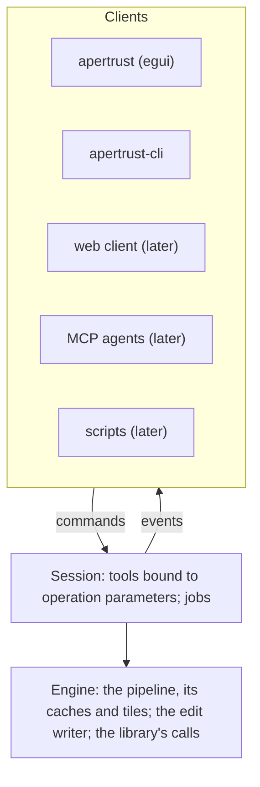

# Session protocol

Every client reaches the engine through one session protocol: the desktop app, the command line, and later the web client, MCP agents and scripts. A client sends commands and receives events; it never calls into the engine's state. This document describes the protocol: who speaks it, the commands as they are today, how they are numbered and batched, the transports, the commands planned, and what stays out on purpose. The events, their kinds, order and delivery, are in [events.md](events.md).

**Status.** The in-process protocol is built, as `apertrust_engine::session`'s `Command` and `Event` (decisions 17 and 28, and the decisions that add commands). The library's first commands, a folder opened and closed, are built, and so is the selection of the folder's photos (decision 37). The library's other commands, remote transports and several photos in one session are planned (decisions 37, 54 and 59); so are agents through `apertrust-mcp`, the remote protocol's first client, in Phase 6, but for their two foundation pieces, built (decision 108; [Agents](#agents)). The session's behaviour behind each command is in [engine.md](engine.md#session-and-threads).

## Every client through the session

- **The engine never depends on UI code** (AGENTS.md, Engineering rules). Every client, the desktop UI, the web UI, MCP and scripts, reaches it through the session protocol. Widgets only emit commands; they never touch engine state. This keeps undo, agents and the remote web mode behaving as the app does.
- **Clients speak tools, not operations** (decisions 4 and 28). A client sets, resets and keeps a tool's controls by the tool's and the control's ids. The session turns tool values into operation parameters through each tool's binding. No client translates tool values itself, so the CLI and MCP see what the app sees. Operations never appear in the protocol, apart from `Set`, which leaves it before the first release.
- **One session per window** (decision 37, planned until spike W1 measures it): the session holds every photo the window shows, the active one live, and serves the library's commands too, so every client sees one protocol.



## Where it lives

The protocol's types are `Command` and `Event`, with the types they carry, in `crates/engine/src/session.rs`. They are plain data, so that they can move unchanged.

They stay in the engine, as a `protocol` module once they need one, until a client must compile them without the engine. That will be the web client, and `apertrust-protocol` is to be made for it then, for decision 65's dependency-direction reason (decision 59). `Frame`, which carries a GPU buffer in process, maps to an encoded frame there.

**Built (decision 108):** every one of them derives serde's `Serialize` and `Deserialize`, across the engine, base, plugin, raw, tools, library and export, with no feature, in the JSON shape of [Remote clients](#remote-clients):

- **`Event::Frame` is the one exception,** skipped: serializing it is serde's error, and deserializing never gives it. The remote protocol sends a frame as a binary message. The tests' own commands (`Synthetic` and the `Hold…` ones) are skipped too; they never leave a test.
- **Ids are interned on the way in.** A `&'static str` id (a tool's, a control's, a preset's, an operation's, a job's kind) is written as text and read through `apertrust_base::wire::id`, which leaks each distinct text once into a process-wide set: at most 4096 ids of at most 256 bytes, past which reading fails. The session's own ids are a few hundred, and in-process clients never deserialize, so the app leaks nothing. Such a field is written `wire::Id`, the same type, where it is the id alone or an `Option` of it, so serde's derive does not take it as borrowed.
- **`apertrust_base::wire`** also writes an `io::Error` as its kind and its words, an `io::ErrorKind` by its name, and the scopes' GPU time, NaN where the device has no timestamps, as `null`. That is the one float non-finite by design: any other has no JSON form, since serde_json writes it as `null`, which reads back as an error, so a client sends `ViewScale::Fit`, never a factor that is not finite, and a value it sends is finite, as is what a refusal echoes of it. A number past an `f32`'s range, `1e39`, would read as infinite, so the numbers of a command's values and points (a control's number and curve, an operation's float, the view's factor and centre, a picker's point, area and region) are read through `wire::finite`, which refuses one. A file's modified time and a job's end are written through `wire::system_time`, as signed seconds and nanoseconds from 1970, since serde's own refuses a time before it, as a camera with its clock unset gives. An `Option` read through a helper is marked `default`, so a field left out is `None`, as a plain `Option`'s is. A cache kind is its id; the raw's histogram its counts, read back through `RawHistogram::new`; wgpu's poll and map errors go through serde's remote definitions.

Shape a new command so it moves unchanged: plain data, no references, no GPU objects (the `desktop-architecture` skill). A new command, event or carried type derives serde with the rest, or nothing that carries it compiles; a new variant of an enum the round-trip test indexes (`Command`, `Event`, the picker's, library's, selection's and cache's commands, the library's, job, export, batch and cache events, an exported photo's result and `SessionError`) fails the test until it has a sample ([Tests](#tests)). Other carried enums, `ViewScale` among them, are not gated. A new command also states its access, or `Command::access()`'s match does not compile (decision 108; [Numbers and batches](#numbers-and-batches)).

## The in-process session

Built. A client starts a session and talks to it through its handle:

- `Session::start(gpu, operations, tools, build, budget, cache, wake)` starts the engine thread on `gpu` with the binaries' `OPERATIONS` and `TOOLS`, the build that every edit written records (decision 44), the engine's memory budget (decision 12), the disk cache the binary opened with its limit, or none (decision 76; [cache.md](cache.md#through-the-session)), and `wake`, which the session calls when events arrive ([events.md](events.md#one-outbox-per-session)).
- `Session::send(command) -> u64` sends a command and returns its number. It never waits.
- `Session::events() -> Vec<Event>` drains the events that have arrived, oldest first. It never waits.
- Dropping the handle ends the session: the edit commands still queued apply, rendering nothing, up to one that opens another photo or closes this one, `Close`, a `Selection` command that leaves it out or a `Previous` that opens another; the edit is saved; then the jobs end, as the control's shutdown ends them.

The app sends commands from its frame and drains in `App::logic`, its `wake` `egui::Context::request_repaint`. The CLI runs the same session in-process: `apertrust-cli export` sends `Export` and waits on a channel its `wake` sends to, printing each photo's result as the job reports it (`crates/cli/src/main.rs`, `export_in_session`).

## Numbers and batches

- **Numbers.** Commands are numbered in the order sent, 1 for the first, by `Session::send`; the engine thread counts them in the same order, since one channel carries them. Events name the commands they include or answer ([events.md](events.md#numbers)).
- **Batches coalesce commands** (decision 17). The engine thread waits for a command, then takes every other that has arrived, and applies them in order as one batch. A folder's listing chunk that arrives after a command of the batch ends it: the chunk is applied first next turn, and the commands sent after it wait with it. A batch sends one `Values` after its commands on the edit, failed or not, and renders one `Frame`. So a fast drag renders only its latest value, and a client's pending value is replaced by the engine's either way. Nothing else merges commands: each is applied, and each refusal reported.
- **Commands on the edit.** Every command acts on the open photo's edit except `Open`, `Resize`, `View` (decision 99), `Scopes`, `Hide`, `Picker`, `CancelJob`, `RetryJob`, `Export`, `PreviewExport`, `Summarise`, `Library`, `Selection` and `Cache` (`on_edit` in `session.rs`). A command on the edit ends a gesture under way (decision 42), but for a change that goes on with it or takes it in and a `Step` refused as `DefaultSource` or `EmptyStep`, is followed by a `Values`, and is refused on a photo open for viewing only (decision 43), but `DiscardHistory` on an edit view-only because of a `sidecar::Problem`, never a newer build's (decision 78), and an `ApplyStyle` naming photos, which skips a view-only active photo and changes the rest (below), and from an `Open` until its `Values { live: true }`, as `NotLive` (decision 77). Refused rather than held, so `through` keeps counting what a report includes and a newer `Open` is never held behind it; a client that edits waits for `live`. A new command that changes no edit, as `Readouts` and `Samples` will be, must join that list.
- **Access** (decision 108; [Access](#access)). Every command states what a client must be granted to send it, `Command::access()`, an `Access`: `View`, `EditOpenPhoto`, `Photos`, `Export` or `Organise`, five levels each including those before it, or `Person`, the person's own, never granted to an agent ([Commands](#commands) gives each command's). It reads the command alone, so where the session's state decides what a command does, the active picker's moves, `CancelJob` by its job's kind and `RetryJob` by the command it runs again, it takes the most it can do. A `Step` takes the most its commands need, at least `EditOpenPhoto`, so one holding `Reset` needs `Person`; `Rate`, `SetMetadata` and `ApplyStyle` take `Photos` where they name photos, which may not be open. Every command on the edit needs at least `EditOpenPhoto`. Nothing checks it until agents join the session; the match has no wildcard, so a new command, or a new picker, library, selection or cache command, does not compile until it states its access.
- **Gestures.** A gesture is the `SetControl { done: false }` changes on one tool, of one source and note: they merge into one change on the `done: true` that ends them, or on a `Step` of their source and note writing their tool; a change of another source or note on the tool ends the gesture as a step of its own. Only a completed change saves the edit. `CancelGesture` takes a gesture back ([engine.md](engine.md#session-and-threads)). Another command on the edit that ends a gesture makes the gesture a step of its own first, as its own release refused does. Planned (decision 108), an agent's command on the edit is refused instead, `GestureUnderway`, while another client's gesture is under way ([Gestures](#gestures)). A client's quick completed changes to one control, or one preset row, may merge into the step before them, timed from when the client sent them, as darktable's undo merges a widget's ([history.md](history.md#merging-consecutive-changes)), so one `Undo` takes them all back.
- **Refusals.** A value out of range or of the wrong kind (decision 21), out of the range its tool's values give (decision 30), or an option the photo does not list (decision 30) is refused whole, the command changing nothing, and reported as `SessionError::Refused` with the command's number. `SetTool` is the exception for a number outside its range, which it brings inside and takes (decision 106). A `Step` of source `Default` and one holding nothing are refused as `DefaultSource` and `EmptyStep` in any state, before `NotLive` and `ViewOnly`.

## Commands

`Command` today. Each is described more fully on the session's side in [engine.md](engine.md#session-and-threads), and the export's in [engine.md](engine.md#export-jobs).

| Command | What it does | On the edit | Access |
| --- | --- | --- | --- |
| `Open(path)` | Opens a raw with the edit saved beside it, saving and closing the photo before it, in three stages (decision 77): `OpenPreview`, the opening photo's picture; `Opened` and `Values { live: false }` before the decode; then `Values { live: true }` and the first `Frame`, or `Failed(Open { open, .. })`, which may follow `Opened`. A newer `Open` cancels the older one's job ([events.md](events.md#a-photo-opening)) | no | `Photos` |
| `Close` | Closes the photo open, as File › Close does, and cancels the open under way: its edit saved first where anything in it is not on disk, reported `Saved` or failed as any write is, and nothing else sent of it; with none open, nothing. A client drops the photo's events whose `open` is below this command's number ([events.md](events.md#numbers)) | no | `Photos` |
| `Resize { width, height }` | The most physical pixels the photo may be shown in; renders again if it changed | no | `Person` |
| `View(View { scale, centre })` | The zoom and its centre (decision 99; [engine.md](engine.md#the-zoomed-view)): `scale` a `ViewScale`, `Small` (half of Fit, the fitted frame drawn at half), `Fit`, `Fill` or `Factor(f32)`, 1.0 being 100%, one photo pixel per physical pixel, a factor clamped to Fit and 16, one not finite or not above 0 Fit; `centre` in the photo's coordinates, 0 to 1, clamped so the view never passes the photo's edges. View state, as `Resize` is: one per session, shared by every client of it, the last `View` any client sends winning, within a batch too; it ends no gesture, makes no step, writes nothing and sends no `Values`, and is taken while the photo opens and while it is open for viewing only; kept across photos, its centre clamped to each, the clamp kept once that photo is live and not before, so a photo that fails to open leaves the view as asked, and the photo after a live one carries the centre the session holds as it is left, clamped at its latest placement, a live `Resize` or crop after the last `View` included, and mapped through its turns, a `View` in the batch that leaves the photo, never placed on it, going on as asked; a turn or a flip of the photo maps it onto the same point of the scene, as a client maps its own centre (`apertrust_engine::view::reoriented`). Answered by the `View` fact ([events.md](events.md#the-events-the-session-sends)) where it or its placement changed. `apertrust_engine::view::place(extent, bounds, &view)` places it, the client and the session alike. At Fit and Small the frame is the whole photo at the fitted scale, and a `View` between them renders nothing. Past Fit the frame is the visible region from the detail pipeline at the zoom's scale, at most 1, with the fitted frame as `Frame::overview`, but during a gesture whose change would rerun a whole-image round of the detail, the fitted frame alone, marked `Frame::detail_pending`, the detail following the gesture's end, its cancel or any other command that keeps the photo open; a `View` at the region's scale inside it renders nothing, but for a pending detail, which it renders, and one that moves the region or changes the scale renders the detail alone. Where the detail cannot render (an operation or a region its plan refuses, or no memory for its buffers) the `View` is refused with `SessionError::Zoom`, before the batch's facts, and the frame stays at Fit; the view is the session's all the same | no | `Person` |
| `SetControl { tool, control, value, done }` | Sets a tool's control, or a lossless view's coordinate (decision 2), which keeps it; its tool's follow writes in the same change (decision 27); `done` on a gesture's last change, which saves; zoomed past Fit, a batch of nothing but a gesture's changes that would rerun a whole-image round renders the fitted frame alone, the detail pending until the gesture ends, its cancel or another command in a later batch, `Scopes` among them (decision 99) | yes | `EditOpenPhoto` |
| `ResetControl { tool, control }` | A control, or a coordinate, back to its default for the photo, no longer kept | yes | `EditOpenPhoto` |
| `ResetTool { tool }` | Every control of a tool back to its default: the header's reset | yes | `EditOpenPhoto` |
| `SetTool { tool, values }` | A tool's values become exactly `values` as one change, as a preset, a style or an applied edit sets them (decision 106): each control `values` holds takes its value and its mark, every other back to its default, unmarked; a switched tool on or off as `values` says, off holding its marks alone (decision 32). Refused as `SetControl` is, for an unknown tool or control (`UnknownTool`, `UnknownControl`), a value of another kind, a value other than its default for a control that is not ported (`NotPorted`) or an option the photo does not list (`NotListed`); a number outside its range brought inside, as a saved edit's is. No follow writes, as `ApplyPreset`'s; one step of the tool. `sidecar::tool_values` turns a file's tool entry into `values`, or says why it is parked (`Parked`) | yes | `EditOpenPhoto` |
| `CancelGesture { tool }` | Puts the tool back as before the gesture's first `done: false` change, with no history step (decision 42) | yes | `EditOpenPhoto` |
| `Keep { tool, control, kept }` | Keeps or releases a control, leaving its value | yes | `EditOpenPhoto` |
| `ApplyPreset { tool, preset, option }` | Applies a preset row's option as one change (decision 2) | yes | `EditOpenPhoto` |
| `Set { operation, param, value }` | A parameter no tool owns, of an operation an unedited photo runs; leaves the protocol before the first release | yes | `EditOpenPhoto` |
| `Reset` | The whole edit back to nothing, as one history step noted `history-reset`, holding every tool it reset, switched tools off (decisions 32 and 78) | yes | `Person` |
| `Undo` | Takes back the newest undo record, one change's steps added, a batch's whole, the steps they dropped coming back; with none, as after reopening, moves the end back over the step before it and its batch, which the next `Redo` reverses, never over a new photo's default steps; a change not yet a step is made one first; answered by `History` (decision 78; [history.md](history.md#behaviour)) | yes | `Photos` |
| `Redo` | Puts back the newest record `Undo` took back; with none, moves the end forward over the next step and its batch, which the next `Undo` reverses | yes | `Photos` |
| `GoTo { step }` | Moves the end just after a step, one inside a batch among them, or to Original with `None`, as a click on a step in the History tab; the later steps stay until the next change drops them, but for a new photo's default steps, which it keeps and applies; with the end among the default steps, the tools darktable's workflow auto-applies after it are not applied; `Undo` takes it back, and after it a change, bringing the dropped steps back; a step not in the log refused, `UnknownStep`; the end where it is already changes nothing | yes | `Person` |
| `Compress { up_to }` | Compress History, darktable's compress (decision 78), at the end, or with `up_to` at that step, the end first just after it in the same undo record, a step not in the log refused (`UnknownStep`), as `GoTo`'s is: every default step kept; among the person's steps up to the end, each tool's last kept as it was, one whose entry is empty dropped; their steps after the end dropped; no step made, the end the last step kept up to it, so what the photo shows, at the end and at Original, does not change, with `up_to` once the end is at that step, which the photo then shows; at end 0 every step dropped and the default steps given again; `Undo` puts the log back, `Redo` compresses it again; one that changes nothing records nothing ([history.md](history.md#behaviour)) | yes | `Person` |
| `Truncate { after }` | darktable's Ctrl-click on compress: the person's steps after the end, or after `after`, the end then just after it, dropped, the rest kept as they are, the default steps after the end among them, as `Compress` otherwise | yes | `Person` |
| `DiscardHistory` | Discard History, darktable's discard: going to Original and then `Compress`, one undo record; the photo given its default steps again, the file holding no step until the first change. On a photo view-only because of a `sidecar::Problem`, the one command taken: a fresh log of a new photo's default steps and a step of each tool the edit holds as read, sharing a batch, noted `history-discard`, what could not be read dropped with the old log, `Opened` sent again, editable; refused on a newer build's edit, `ViewOnly` | yes, and on an edit view-only for a `sidecar::Problem` | `Person` |
| `Step { source, note, commands }` | Several commands on the edit, only `SetControl`, `ResetControl`, `ResetTool`, `SetTool`, `Keep`, `ApplyPreset`, `Set` and `Reset`, as one change of that source and note, a history step of each tool it writes, in the order written, sharing a batch id, which one `Undo` takes back, applied in order, all or none: one refused refuses the whole, `InStep { index, error }`, any other command inside `NotInStep`; the source `Default` refused, `DefaultSource`, and a `Step` holding nothing, `EmptyStep`, both before the gesture under way is touched; it takes in the gesture under way on a tool it writes when its source and note are the gesture's, one source per gesture, and a `Step` refused begins none ([history.md](history.md#commands)) | yes | the most its commands need, at least `EditOpenPhoto` |
| `ApplyStyle { name, file, mode, tools, photos }` | Decision 106: a style applied as one change of source Style, `Reset` first for `StyleMode::Replace`, then each tool's values as `SetTool` sets them, a step of each in the command's batch, one step's too (decision 109); the style put at the top of the edit's list of styles applied with each tool's state before and after it, the list a part of the log, so Undo puts the list back as it was before, a newly applied style off it and a re-applied one back to its earlier place; not allowed in a `Step`, `NotInStep`; on the active photo alone, or, with `photos`, on each photo it names as one batch, the others by a job (decision 109, [below](#commands-planned)) | yes | `EditOpenPhoto`; `Photos` where it names photos |
| `ClearStyle { name, file }` | Decisions 106 and 109: the item of the list that is the style `name` from `file`, by its file where either is a built-in's, else by its name; each tool the style set that still holds its state after it put back to its state before, the style taken off the list, one change of source Style noted `history-clear-style`; a tool changed since keeps its value; refused, `UnknownStyle`, where no item of the list is that style; not allowed in a `Step` | yes | `EditOpenPhoto` |
| `Rate { photos, change }` | Decision 110: the rating, reject or a colour label set, `RatingChange::Stars(n)` (0 to 5, the reject taken back), `Rejected(bool)` (the stars kept beneath it), `Label { label, on }` (0 red to 4 purple) or `ClearLabels`, the value given, never a toggle, so a script's command means one thing; each changed field the photo's current value with its clock in its `.apxmp`, never a history step, the log written as the file holds it, so a photo only rated keeps no default step and stays unedited. `photos` empty, or naming the active photo alone, for the active photo; naming others, one batch on all of them (decision 109): the active photo at once, the others by a quiet `UserForeground` job of kind `rate` reading no raw, written over the file as read, a photo with no sidecar given one with darktable's fields copied in, a raw not on the disk skipped, `Event::Batch` and `Rated` as each lands, `UndoBatch` taking it back where the fields still hold the values the batch left; for the active photo alone, refused with none open (`NoPhoto`, or `NotLive` while one opens before its values) and on a photo open for viewing only; allowed before it is live. Answered by `Rating` and `Rated` where it changed the rating and `History` for Undo's words; no `Values`. `Undo` takes it back, a quick repeat of one key within the merge times merged; `Reset`, `Compress`, `Truncate` and `DiscardHistory` leave it | no | `EditOpenPhoto`; `Photos` where it names photos |
| `SetMetadata { photos, fields, values }` | Decision 110: the Metadata tool's fields of the open copy of each photo `photos` names, or of the active photo where it names none, each named by its property's qualified name (`dc:title`, `apertrust_library::fields::FIELDS`) with what was typed, made a value by its kind: trimmed, a language alternative's `x-default` with its other languages kept, a list split at `;`, `True` or `False`, an XMP date; `None` or empty clears it. Each changed field the photo's current value with its clock in its `.apxmp`, never a history step, the log written as the file holds it, so a photo only titled stays unedited; several fields one change. Refused whole for a field none of `FIELDS` is, or the rating's (`UnknownField`), and for a value its field cannot hold (`FieldValue`), and as `Rate` is with no photo or one open for viewing only; allowed before it is live. Answered by `Metadata` and `History` for Undo's words (`Move::Metadata`), one that changes nothing by `Saved` with no write; no `Values`. Sent as the client drops its handle, it is set and saved as an edit's change is. `Undo` takes it back, a commit of the same fields again within the merge times merged; `Reset`, `Compress`, `Truncate` and `DiscardHistory` leave it. Naming another photo, each by its absolute path as `Selection::photos` names it, it is one batch, as `Rate`'s (decision 109): refused whole first for a field or a value as above, and while the active photo opens; the active photo at once, skipped and named where it is view-only; the others by a quiet, cancellable `set-metadata` job on `UserForeground`, in the queue of `apply-style`'s, reading each sidecar through the edit writer and no raw, a photo with no sidecar given one with darktable's fields copied in, each field's clock the batch's wall time after the photo's latest, written over the file as read; `Batch`'s `Changed` and `Ended`, its `what` `Batched::Metadata` with the properties; `UndoBatch`, or Undo on the active photo, takes it back on every photo whose field still holds the batch's value and clock. `values`, each field's value as it is (a `FieldValue`), never typed again, sets what a client chose from the values several photos hold, a list's item holding "; " kept whole; a value of another kind refused (`FieldValue`, `TypedError::WrongKind`) | no | `EditOpenPhoto`; `Photos` where it names photos |
| `RenameCopy { name }` | Decision 110: the open copy's name, `name` on one line and trimmed, an empty one clearing it, its `apertrust:name` with its clock, as `SetMetadata` sets a field; `Undo` names it `Move::CopyName` | no | `EditOpenPhoto` |
| `Scopes(graphs)` | What the scopes count of each frame, or nothing with `None` (decision 19) | no | `Person` |
| `Hide { tool, hidden }` | The History tab's eye, held: the live frame shows the tool as if it were reset, off where switched, its operations out of the plan as an off tool's, and at its defaults where every photo runs it, its operation kept, until `hidden` is false, the photo closes or another opens; view state, no step, nothing written, no export, still or thumbnail changed, taken on a photo opening or open for viewing only; answered by `Values`, `ToolState::hidden`, and a `Frame` where it changed; while a tool is hidden, a tool's picker on measures and applies nothing, its reading, and the answer that reading owes a command, waiting until all are shown, `Picker(Settings)` answered at once, its settings kept and nothing applied, and `Picker(On)` for a tool's picker refused at once, `Hidden`; a tool the session lacks refused, `UnknownTool` (decision 78; [history.md](history.md#commands)) | no | `Person` |
| `Picker(PickerCommand::On { picker, area, keys, settings, channel })` | Turns a colour picker on, the one on before it off, at its last point or area this session, else darktable's default, the photo's centre or 2 % to 98 % of it; answered by `Event::Picker` once it is measured. The Colour picker's, `PickerRef::ColourPicker`, works on a photo open for viewing only. A tool's, `PickerRef::Tool { tool, picker }`, turns its tool on, a change of the edit, makes its operation the edited instance and has its first reading applied through the tool's pick as a completed change; `settings` are the settings its pickers read, `channel` the channel tab the tool shows; refused on a photo open for viewing only, `ViewOnly`, while the History tab's eye hides a tool, `Hidden` (decision 78), for a picker no tool declares, `UnknownPicker`, for a setting none of its pickers reads, `UnknownSetting`, and for a picker its tool says cannot start with the settings sent, `NotReady`, as Exposure's toward a reference with none set (`ProcessingTool::picker_ready`, decision 88). Refused before the photo is live, `NotLive` (decision 79; [pickers.md](pickers.md#commands)) | no, though a tool's writes the edit | `Person` |
| `Picker(Point { at, done, keys })`, `Picker(Area { from, to, done, keys })` | The active picker's point, or its area from one corner to the other, in the photo's coordinates clamped to 0 to 1, which it then measures; the frame shown measured again where nothing renders, and a tool's picker at its operation by a sample-only render, the reading applied, a drag's `done: false` steps one change its release completes; refused with no picker on, `NoPicker`, and a `Point` for an area picker or an `Area` for a point picker, `OneKind` (decision 105) | no | `Person` |
| `Picker(Switch)`, `Picker(Reset)` | For a picker with both kinds, point to area or back, each at its last place, darktable's Ctrl-click on the photo; and the kind measured back to its default; a tool's picker's reading applied as a completed change; refused with no picker on, `NoPicker`, and `Switch` for a picker that takes one kind, `OneKind` (decision 105) | no | `Person` |
| `Picker(Settings { tool, settings })` | The settings `tool`'s pickers read, kept, and the tool's latest reading measured, darktable's `picked_color`, applied again as a completed change where its picker reads one of them; refused for a setting none reads, `UnknownSetting`, and a pick refused turns the tool's picker off; settings that leave the tool's picker on not ready turn it off, applying nothing (`NotReady`'s rule, decision 88) | no | `Person` |
| `Picker(Channel { channel })` | The channel tab the active picker's tool shows, kept for its next pick, applying nothing; with no picker on, nothing | no | `Person` |
| `Picker(Off)` | The active picker off, `Event::Picker` with no reading, through this command, its places kept for its next `On`, a pick's change under way completed; with none on, nothing. The session also turns it off as another photo opens or the photo closes, and a tool's as a command on the edit changes its tool, unless it is darktable's keep-active | no | `Person` |
| `Picker(Once { picker, region, keys, settings, channel })` | A one-shot pick, for scripts, the MCP and assistants (decisions 79 and 104; the app sends it from nowhere, its picker cursors sending `On`): the tool's picker on for one reading of `region`, in the photo's coordinates, an area read as sent and a point as darktable's click reads it, an area picker reading the area a press there starts; its pick applied and the picker off again, its tool's turning on and the pick's writes one completed change of source Auto and one step, which never merges, or none where neither changes anything; the picker's own point and area untouched; a picker on turned off first; answered by `Saved` as `On` is; refused with `On`'s reasons, the Colour picker's picker as `UnknownPicker` ([pickers.md](pickers.md#a-one-shot-pick)) | no, though it writes the edit | `EditOpenPhoto` |
| `CancelJob { job }` | Cancels a job with a progress; refused for one that cannot be cancelled (decision 57) | no | `Organise` |
| `RetryJob { job }` | Runs what a failed job offered to try again, once, as if sent now, its `Added` naming this command and the job it `retries`; refused for one with no retry kept, `NotRetryable` (decision 72) | no | `Organise` |
| `Export { photos, settings, places }` | An export job, one at a time, its `Added` naming this command (decision 56) | no | `Export` |
| `PreviewExport { photos, settings, places }` | Export's lines (`focus`, the photo they give in full: the window's active photo, or the first photo exported where the active one is left out; planned with the preview of the whole selection), answered by `ExportPreview`; the preview before it is cancelled | no | `Export` |
| `Summarise { photos }` | The Metadata tool's summary of several photos (decision 110), any of the collection's as `Selection` names them, answered by `Summary`: a `UserForeground` job with no progress, which reads the facts of the photos the session has none of yet, each photo's once (`Shot::read`), kept in the selection's collection for the next summary, answering as it reads, at most every 250 ms, the rows not read yet `Waiting`, then once all are; a later `Summarise` cancels it, the facts read by then kept; a photo the collection lacks counts as one with no facts | no | `View` |
| `Cache(CacheCommand::Limit(limit))` | The disk cache's limit as `cache.limited` and `cache.limit` now give it: lowered or turned on, an eviction, a `SystemBackground` job with no progress, unless one is queued or running, which takes it in; raised or turned off, none; with no cache, nothing (decision 76) | no | `Organise` |
| `Cache(CacheCommand::Sizes)` | The disk cache's sizes, answered by `Event::Cache`: at once with what the session's handle counts, once a walk has run, then by a `SystemBackground` walk with no progress, one at a time, which counts what other processes did; with no cache, `CacheEvent::NoCache`; a walk that fails, `Failed(CacheWalk { command, .. })` ([cache.md](cache.md#through-the-session)) | no | `View` |
| `Cache(CacheCommand::Clear { kind })` | A limited kind's entries removed: a cancellable `UserBackground` job of kind `cache-clear`, its progress as `Event::Job`, `Added` naming this command, `Event::Cache` sent again as it ends; refused for a kept kind (`CacheKept`), for a kind a Clear is clearing already (`CacheClearing`) and with no cache (`NoCache`) | no | `Organise` |
| `Library(LibraryCommand::Open(Source::Folder(path)))` | Opens a folder: a cancellable `UserBackground` job, its progress as `Event::Job`, `Added` naming this command, what it finds as `Event::Library` naming it too ([events.md](events.md#the-librarys-events)); the reading of the folder before it is cancelled. A folder outside the tree, or the tree's root again, starts the tree's walk, a `SystemBackground` job with no progress whose `LibraryEvent::Walked` batches name this command, cancelling the walk before it. Opens no photo | no | `Photos` |
| `Library(LibraryCommand::Close)` | Cancels the folder's reading and the tree's walk, and answers `LibraryEvent::Closed` naming this command | no | `Photos` |
| `Library(LibraryCommand::Open(Source::Photos(paths)))` | The photos opened alone ([library.md](library.md#one-photo)), in the order opened: the selection's collection ([The selection](#the-selection)). Closes the folder open as `Close` does, answered by nothing; nothing is read but each photo's sidecar, by a `SystemBackground` job with no progress, as a listing reads it, the next open or close cancelling it. Opens no photo | no | `Photos` |
| `Library(LibraryCommand::Thumbnails { photos, size })` | The open folder's photos' thumbnails, by file name, at most `size` pixels on their longer side, the first the most wanted: a `SystemForeground` job each with no progress, deduplicated by photo and size, the newest asked first, each answered by `LibraryEvent::Thumbnail` naming the folder's open ([events.md](events.md#the-librarys-events)); a new open or a close cancels those not yet sent; nothing with no folder open | no | `View` |
| `Library(LibraryCommand::PhotoThumbnails { paths, size })` | The thumbnails of photos opened alone, by path, as `Thumbnails` serves a folder's: from each photo's own file or the cache, its folder never listed, whatever is open, deduplicated by the latest open or close, the path and the size, each answered by `LibraryEvent::PhotoThumbnail` naming its path and the latest `Open` or `Close`; the next `Open` or `Close` cancels those not yet sent | no | `View` |
| `Library(LibraryCommand::Subfolders { folder })` | The subfolders of a folder inside the tree's root, the first folder opened, kept while each later `Open` lies inside it, as Collections opens it: a cancellable `UserBackground` job with no progress, answered by `LibraryEvent::SubfoldersOf` naming the folder's open, or why it could not be listed; a folder outside that root is refused; a new open or a close cancels it; nothing with no folder open | no | `View` |
| `Library(LibraryCommand::RawThumbnails(raw))` | From which size a photo with no edit, and no render made from it live of the raw as it is (`ops::Origin::Opened`, its stamp the raw's; one of a raw changed since is judged by the rule), shows a render of its raw rather than the camera's embedded picture, the setting `library.raw_thumbnails_from`, for the thumbnails and opening pictures asked for from then on; answered by nothing | no | `Organise` |
| `Library(LibraryCommand::ListSource { source, include_subfolders, base_folder, default_folder, places })` | Import's source listed (decision 85; [library.md](library.md#import-in-folder-mode)), whatever folder is open: a cancellable `UserBackground` job of kind `import-source` with no progress, a card's `DCIM` whole where the source is on a card, else the folder, raws only, nothing written on it, answered by `SourceListed` chunks then `SourceTaken`, or `SourceFailed`, naming this command, then checked against the trees of `base_folder` and `default_folder`, the patterns as the settings hold them, expanded from the client's `places`: `SourceChecked`, its check 1; the next `ListSource` cancels it | no | `Photos` |
| `Library(LibraryCommand::CancelListing { listing })` | Cancels the latest listing of Import's source and its check where `listing` names it, as the Import sheet closes: they send nothing more | no | `Photos` |
| `Library(LibraryCommand::CheckSource { listing, base_folder, default_folder, places })` | The latest listing checked again against these trees, as Folder changes: its next check, a `UserBackground` job with no progress once the listing is done, the check before cancelled, answered by `SourceChecked` in the listing's number | no | `Photos` |
| `Library(LibraryCommand::SourceThumbnails { listing, photos, size })` | The latest listing's photos' thumbnails, by their paths under the folder listed, as `Thumbnails` serves a folder's: `SystemForeground` jobs, from the cache by fingerprint or each photo's own file, whatever folder is open, each a `Thumbnail` in the listing's number naming the path asked; a path that is absolute or holds a `..` is refused; the next listing or a `CancelListing` cancels those not yet sent | no | `Photos` |
| `Library(LibraryCommand::ListVolumes)` | The cards and drives mounted, for Import's Source: a `UserBackground` job with no progress, answered by `Volumes`, which carries no number | no | `Photos` |
| `Library(LibraryCommand::PreviewImport { photos, settings })` | Where each of the source's checked photos would go and what stands in the way (decision 85; [library.md](library.md#import-in-folder-mode)): a `UserForeground` job of kind `import preview` with no progress, as Export's preview, the one before cancelled, answered by `ImportPreview` naming this command; nothing written or made | no | `Photos` |
| `Library(LibraryCommand::SourceSubfolders { folder })` | A place's subfolders, for the Import tool's Folders tree, as `Subfolders` lists the open folder's but whatever folder is open: a cancellable `UserBackground` job with no progress, answered by `SubfoldersOf` naming this command; refused for a relative folder or one with a `..`; a second ask for the folder or a `CancelListing` cancels it | no | `Photos` |
| `Selection(SelectionCommand::Set(photos))` | These photos in place of the selection (decision 37; [The selection](#the-selection)); the active photo closes unless it is among them | no | `Photos` |
| `Selection(Add(photo))`, `Selection(Remove(photo))` | A photo added to the selection, or taken out, the active photo closing should it be the one taken out; one selected already, or not selected, nothing | no | `Photos` |
| `Selection(Range { to, order })` | The photos from the active photo to `to` in `order`, the client's sort of the collection, in place of the selection, the active photo staying, as a Shift-click selects them; with no active photo, or where `order` lacks the active photo or `to`, as an order sent before the listing brought `to`, `to` alone with the active photo; a photo of `order` not in the collection passed over | no | `Photos` |
| `Selection(All)`, `Selection(Clear)` | Select All, every photo of the collection, the active photo staying; Select None, which closes the active photo | no | `Photos` |
| `Selection(Invert)` | The collection's photos not selected, in place of the selection: the active photo, selected before, closes | no | `Photos` |
| `Selection(Unedited)` | The collection's photos with no edit, in place of the selection, by the edit state the Browser's pencil and its Edited sort read: the folder's reading's, the open photo's as its edit stands then, a change earlier in the same batch included, though no `Values` has said so yet, and a photo closed as its sidecar holds it, which the edit writer classifies after its last write, so a change whose write failed or a panic dropped counts for nothing; one open for viewing only, one a newer Apertrust wrote, or whose sidecar cannot be read, counts as edited; the active photo closes unless it is among them | no | `Photos` |
| `Selection(Previous)` | The selection as it stood just before its last change, its photos and its active photo, which opens as `Open` opens one where it is not the photo open, numbered by this command, or closes where there was none; the selection it replaces becomes the earlier one, so a second goes forward again (decision 90; [The selection](#the-selection)). Always answered by a `Selection`, though nothing changed; refused with no earlier selection, `NoPreviousSelection`, changing nothing | no | `Photos` |

`places` are the person's folders and name, which the client passes since the engine reads no platform folder (decision 43). `LibraryCommand` and what its events carry are `apertrust_library::ops`'s, re-exported as `session::library`. `RetrySave`, a client's Try again after a failed write ([engine.md](engine.md#session-and-threads)), needs `EditOpenPhoto`, and `UndoBatch` ([Commands planned](#commands-planned)) `Photos`. A command planned takes its access as it lands, the match asking for it: `Readouts` and `Show` `View`; `Samples` `View`, unless a pick from it writes the edit, decided with it; `CacheCommand::Remove` `Organise`, as Move to…, Copy to…, Rename, Delete and Import… are. Nine more variants exist only in tests: `Synthetic`, `HoldExport`, `HoldPreview`, `HoldSummary`, `HoldFolder`, `HoldWalk`, `HoldThumbnails`, `HoldClear` and `HoldDecode`, each `Organise`, the top level granted, so none is the loosest case.

### The selection

The selection and the active photo are the session's (decision 37; [gui.md](gui.md#selection-and-the-active-photo)), so a script reads and sets them with the commands the app sends, `Command::Selection(SelectionCommand)`, as the Browser's gestures do, and hears them as one fact, `Event::Selection` ([events.md](events.md#the-selection)).

- **The collection** is the folder open, as its reading lists it, each chunk taken after the commands sent before it and before those after; or the photos opened alone, `Source::Photos`, in the order given, each told by its absolute path, `Unedited` reading their sidecars as a background job reads them; it never waits for those reads, so a photo whose sidecar is still being read is not known as unedited and is left out, but for the open photo, read by its edit as it stands. Photos opened alone again replace them, and a folder opened replaces them. With neither, the collection is empty, and the selection holds the active photo alone.
- **A photo named** by `Set`, `Add` or `Range`'s `to` must be one of the collection's or the active photo; any other refuses the command, `NotInCollection { photo }`, and the selection is as it was. `Remove` of such a photo, and one in `Range`'s `order`, are passed over.
- **A photo is known by its path made absolute,** as the client spelled it, with no disk asked: a listed photo as its folder's path joined with its name. Another spelling of the same file, through `..` or a link, names another photo, so a client names photos as the listing does.
- **The active photo** is the photo open or opening. `Open` of a photo outside the selection selects it alone; of a selected one keeps the selection.
- **The selection holds the active photo:** a command whose result leaves it out closes it, as `Close` does, its edit saved. A client that knows its sort then opens the nearest selected photo, as the Browser's Ctrl-click does ([gui.md](gui.md#selection-and-the-active-photo), The pointer).
- **A folder listed again,** opened anew while it is open, under its path or another with the same absolute form (a relative path and the absolute one it names; not a link to it, which is another folder), keeps the selection by photo, told in the new spelling; the photos its listing brings can be selected as they come, a photo of the folder opened before the listing brings it is one of the collection's too, and a photo is dropped only once a listing is done without it, whatever a listing it replaced had brought; every command names the photos the selection tells; a listing cancelled before it is done, as the jobs window's Cancel does, leaves the folder with no photo, as one that failed, and a cancel after the reading has claimed its last chunk changes nothing, as the Browser keeps the photos (the reading claims its last chunk or failure just before sending it, and that claim or a cancel, whichever comes first, stands, the other dropped); another folder, or a close, leaves the active photo selected alone.
- **One earlier selection** (decision 90), which `Previous` puts back: the photos selected and the active photo as they stood just before the last change of the photos selected, by any `Selection` command or an `Open` selecting a photo alone. The active photo moving within the same photos, as an `Open` of a selected photo, a command that changes nothing, and a change from no photo selected and none active, as the first `Open`, leave it. `Previous` from an empty selection, after `Clear`, still swaps, so a second goes back to none. View state, never a history step nor saved. Photos no longer in the collection when it comes back are left out; where the active photo is one, the nearest of those put back in the listing's order is active, the later of two as near, or none; an active photo opened alone outside the collection comes back. Another folder or photos opened alone, or a close, leave none; `Selection::previous` says whether there is one.
- **The sort** is the client's until the protocol carries it ([gui.md](gui.md#the-browser-bar)), so `Range` carries the client's order of the collection; the session works the range out from it.

## Commands planned

- **`ApplyStyle { photos, .. }`**, built, the app's Styles tool sending it with several photos selected (decision 109; [history.md](history.md#a-batch-on-several-photos)): `photos: Vec<PathBuf>`, empty for the active photo alone as now, else the photos named, each once, in the order given, as `Export` names them; the app sends the selection's when several are selected. One batch id for every photo's steps; the active photo, where named, changed at once as now; the others by a cancellable `UserForeground` job of kind `apply-style`, one such job at a time, reading each photo's metadata and sidecar and writing it over the file as read, with no decode or GPU ([engine.md](engine.md#writing-an-edit-without-opening-the-photo)). A photo that cannot take it, the active one open for viewing only or refusing a value (`NotListed`) among them, is skipped and named in `Event::Batch`, never refusing the command; still a command on the edit, refused whole while the active photo opens (`NotLive`). A command changing the active photo while an earlier batch's job still has it to come has that batch applied to it first. Its job is `quiet`: the jobs window does not open itself for it. `ClearStyle` keeps acting on the active photo alone.
- **`UndoBatch { batch }`**, built in the engine (decision 109): the notice's Undo of a batch on several photos, from any photo: on each of its photos what Undo would do there for it, the active one by its own Undo once live, the others by an `undo-batch` job moving their ends back, an active photo still opening among them, never refused `NotLive`, each routed as the batch's job routes it, any other batch still to reach the active photo applied to it first, a batch whose job still runs cancelled first, a photo changed since kept and named; a batch the session no longer remembers, of the latest 64, refused, `UnknownBatch`. `Undo` and `Redo` on the active photo cross such a batch on all its photos the same way.
- **`Readouts(Vec<ReadoutId>)`**, the readouts a client shows, by tool (decision 19; [engine.md](engine.md#readouts)).
- **A tool's action run by the session,** for scripts (decision 107). Until then a client runs one itself, as its writes, `SetControl`s, one change ([gui.md](gui.md#line-rows-and-end-items)), by the availability `Values` reports with the tool's state ([events.md](events.md#the-events-the-session-sends)).
- **`Samples(SamplesCommand)`**, the stored samples, answered by the `Samples` fact; and a pick's writes the session's own changes of source Auto, with history (decision 79; [pickers.md](pickers.md#through-the-session)).
- **`Show(cells)`**, the cells on screen, each a photo id and a size, with commands naming photos by id, the selection and the active photo the session's (decision 37).
- **The library's commands**, `Command::Library(LibraryCommand)` (decision 54). `LibraryCommand`, about forty commands in the end, is layer 4 of the library's API, served by the session from `apertrust-library`.
  - The long ones run as jobs of the session's control on darktable's queues: a folder's reading on `UserBackground`; thumbnails on `SystemForeground`; Move to…, Copy to…, Rename, Delete and Import… on `UserForeground`. Each call into a folder tree runs on that tree's queue (decisions 53 and 57).
  - The first five, `Open(Source::Folder)` and `Open(Source::Photos)`, `Close`, `Thumbnails`, `PhotoThumbnails` and `Subfolders`, are built, and Import's reading before a copy (decision 85): `ListSource`, `CancelListing`, `CheckSource`, `SourceThumbnails`, `ListVolumes`, `SourceSubfolders` and `PreviewImport` ([Commands](#commands)). `Show` and `Page` are planned; meanwhile the client keeps the photos listed and asks for the thumbnails of the cells it draws.
  - Clients see `PhotoRef`, `Target` and `Rules`, never the library's lower layers ([library.md](library.md#planned)). Its events are `Event::Library(LibraryEvent)` ([events.md](events.md#lower-crates-report-through-an-observer)).
- **A kept index removed**, `CacheCommand::Remove { index }`, with the library's step 23 (decisions 76 and 101): a `cache-clear` job as Clear's, skipping an index another process has open, and `Event::Cache` listing each kept index. The cache's types are `apertrust-base`'s `cache`, as the jobs' are its `jobs`.
- **`Sync`** and the handshake, for remote clients ([below](#remote-clients)).
- **For agents** (decision 108; [Agents](#agents)): `Render { size, region }`, a still for the client that asks, of its own topic; `Step`'s `seen`, the `through` the client last saw, refused as `Stale` when the open photo's edit changed after it, or another photo opened after it; `Picker(Once)`'s source and note, Assistant and the request's, from an agent; the refusals `GestureUnderway`, `NotOwnChange`, `NoAccess { needs }` and `PickerInUse`.
- **Masks and layers**, later phases.

## Transports

- **In process**, built: the app and the CLI, as above.
- **IPC, WebSocket or WebTransport**, later: `apertrust-cli serve` for web and tablet clients on a home server (`apertrust-server`; [architecture.md](architecture.md#programs)). The engine is the same; only the transport differs. The same server may later, if asked, sync the desktop app's photos (decision 71), through the library's storage protocol, not this one ([library.md](library.md#a-server)).
- **A local channel**, Phase 6: `apertrust-mcp` joining the running app's session, the remote protocol's first client, over a named pipe on Windows, an abstract socket on Linux and a socket in the per-user temporary folder on macOS, each only the user's own (decision 108; [The local channel](#the-local-channel)).
- **MCP**, Phase 6: `apertrust-mcp`, a program of its own, speaks MCP over stdio through `rmcp` and the session protocol on the local channel, a thin adapter between them; the app never speaks MCP and has no HTTP endpoint. Its MCP tools are generated from the tools' definitions and `LibraryCommand`'s schema, off until the person allows them and read-only unless writes are allowed (principle 8; decisions 54 and 108).

## Web, tablets and remote access

Planned (decision 58). The web browser and tablets are remote clients of a native engine; [gui.md](gui.md#why-egui) holds why the desktop and the web browser share one egui interface.

**Web mode** (decision 58). Desktop and web browser share mouse, keyboard and a large screen, so they share the UI. Two pieces are pluggable: the engine connection (in-process on the desktop, remote over WebSocket or WebTransport on the web) and the viewport's source (a GPU display buffer on the desktop, decision 17; streamed frames on the web). The remote engine on a GPU machine gives full native performance and full AI models.

**Why there is no in-browser processing.** It faces uneven WebGPU on Linux (as of September 2026, Chrome enables it only on Intel Gen12+ and recent NVIDIA, Firefox not at all), memory and buffer limits that force tiling, cross-origin isolation for threads, and smaller AI models through ONNX Runtime Web. The engine always runs natively, on the user's machine or a home server, and browsers and tablets connect to it on the local network or over the Internet.

**Remote access.** The main web use is a home server running the engine, reached from a browser or tablet at home or over the Internet. That adds requirements a local app does not have:

- Authentication and encrypted transport (HTTPS, secure WebSocket or WebTransport over TLS). Access through a VPN is the recommended default for Internet use, rather than exposing the server directly.
- Bandwidth-aware frame streaming: compressed frames at reduced resolution while dragging sliders, full quality when idle. Wide-gamut and HDR frames need a codec that keeps them.
- The photo library lives on the server; the client only browses and edits it.

**Touch** comes with the mobile phase, after Phase 3 (decisions 1 and 94): on tablets, Touch mode of the one interface, its tabs, tools, actions and session commands the same as Standard's, Touch changing sizes, spacing and gestures, with two named layout adaptations ([gui.md](gui.md#touch-mode)); a phone's layout is a later, separate design. A tablet reaches the engine through the session protocol as any client does.

## Remote clients

Planned (decision 59), with MCP, its first client (decision 108):

- **Per connection, notices are queued** in order, to a bound, 1024 to start with, **and facts are coalesced by topic**: a later fact replaces the queued one of its topic and takes its place after the notices before it, so the order guarantees still hold ([events.md](events.md#order-and-delivery)). A frame or a still is encoded only while none is in flight to that client.
- **A connection that overflows its notices is closed as lagged.** Its client reconnects and syncs; the engine never waits for it.
- **`Command::Sync`** sends the current facts and the open folder's listing again, as to a client joining late.
- **Versioning:** `Hello { protocol, client }` and `Welcome { protocol, build }`, with one protocol number, raised only by a change a client cannot ignore. New variants and fields with defaults keep it, and a client ignores what it does not know.
- **Encoding:** commands and events as JSON tagged by `type`, built ([Where it lives](#where-it-lives)): an enum with data adjacently tagged, its variant's name as `type` and its content as `data` (`{"type":"Open","data":"/photos/a.cr3"}`, `{"type":"Reset"}`, `{"type":"Library","data":{"type":"Close"}}`), a unit-only enum its variant's name (`"You"`), fields and variants named as in the code, unknown fields ignored. Step and batch ids are 16 hex digits, as `.apxmp` writes them, since a random 64-bit number would lose its last digits in a JavaScript client; job ids, clocks and command numbers stay numbers. Frames and stills as binary messages, planned.
- **Numbers** stay one sequence across connections, assigned as a command enters the inbox, each connection learning its own from the acknowledgement.
- **Client identity** (decision 108): every connection, the app's in-process handle among them, has a `ClientId`, and each command is tagged with it as it enters the inbox. A refusal goes to the client whose command it names.
- **Per-client facts** (decision 108): a client's renders, scopes readings, readouts, stored samples and Export's preview are facts of its own topic, keyed by its `ClientId` and sent to it alone, extending decision 90's rule for `ExportPreview`. `Sync` sends the shared facts and the client's own.

## Agents

Planned for Phase 6 with MCP, but for 108.1 ([Tests](#tests)) and 108.2 ([Access](#access)), built (decision 108). An agent reaches the person's session through `apertrust-mcp`, so the person sees its edits live, in the same history, and can undo them.

```mermaid
sequenceDiagram
    participant C as MCP client
    participant M as apertrust-mcp
    participant A as apertrust
    participant P as The person
    C->>M: launches it; a tool call over stdio
    M->>A: connect on the local channel; Hello with its name and the access it asks
    A->>P: the approval sheet: name, access
    P-->>A: Allow
    A-->>M: Welcome
    M->>A: Step of source Assistant, its note, seen
    A-->>M: Values and History with through, or a refusal
    M-->>C: the tool's result, with the new through
```

### Where it runs

- **`apertrust-mcp`** is a program of its own, the binary of the `apertrust-mcp` crate. It speaks MCP over stdio through `rmcp`, its stdout JSON-RPC alone and its logs on stderr, and the session protocol on the local channel. There is no `apertrust-cli mcp`, and the app never speaks MCP.
- **With no app running,** each MCP tool answers "Apertrust isn't running; open it to edit live". With the folder's lock held and no channel to join, the app running with assistants not allowed or a headless run on the folder: "Apertrust has this folder open with assistants not allowed (Settings › Assistants), or another assistant has it open headless". The adapter tells the two apart by trying the user data folder's `instance.lock`, letting it go at once where it takes it.
- **`--headless`** starts a session of its own in the adapter's process, as `apertrust-cli export` does, never as a silent fallback. It holds `instance.lock` while it runs, so the app refuses to start on that folder meanwhile, with decision 89's refusal worded for an assistant, and it is refused itself on a folder the app holds. A run with its own `--user-data-dir` works beside the app.
- **`--access LEVEL`** names the level of access it asks for and the MCP tools it lists, `view` by default ([Access](#access)).

### The local channel

A second endpoint beside decision 89's hand-off ([gui.md](gui.md#instances-and-windows)), with its own name and format version, bound by the app only while Allow assistants to connect is on, so with it off nothing listens. `<hash>` is the hand-off's.

| Platform | The channel | Who may connect |
| --- | --- | --- |
| Windows | `\\.\pipe\apertrust-mcp-<hash>`, created with `FILE_FLAG_FIRST_PIPE_INSTANCE`, so the app's bind fails, binding nothing, where another process already holds the name, and with `PIPE_REJECT_REMOTE_CLIENTS` | A security descriptor for the current user alone; the app checks the client's token, and `apertrust-mcp` checks the server's user (`GetNamedPipeServerProcessId`) |
| Linux | The abstract socket `apertrust-mcp-<uid>-<hash>` | `SO_PEERCRED`, both ways |
| macOS | A Unix socket in the per-user temporary folder, `confstr(_CS_DARWIN_USER_TEMP_DIR)`, mode 0700, named by the hash | `getpeereid`, both ways; a stale file removed as the app binds when nothing answers on it |

- **Sandboxed Linux packages,** Flatpak and Snap, sit in a network namespace of their own, which an abstract socket does not cross: there the channel is a socket file in a runtime folder both sides share, decided with packaging.
- **Limits:** a message from the adapter over 4 MiB, or one that is not a protocol message, closes the connection, the app's stills to it being binary messages of the size `Render` asks, which the session caps; no `Hello` within 5 s closes it; an idle connection closes after 10 minutes with a notice saying so, and the adapter reconnects on its next call, its approval and its `ClientId` kept for the app's run by a token the app gives it as it approves, held in its memory alone, so its own changes stay its own for Undo. The adapter rate-limits every tool call, reads and renders as well as edits, as MCP's tools page requires of a server.
- **One agent connection at a time:** a second asks "Replace *name*?", naming the client connected, in the app. Client identity is per connection from the start, so several can be added later without changing it.

### Shared and per client

| State | Shared or per client |
| --- | --- |
| The edit, its values and the history | Shared |
| The selection and the active photo | Shared: read under View, changed only under Photos |
| `View`, `Resize`, `Hide`, `Scopes` | The person's, acting on the one view every client shares: `Access::Person`, refused from an assistant's connection |
| Renders, scopes readings, readouts, stored samples, Export's preview | Per client ([Remote clients](#remote-clients)); a render through `Render { size, region }`, which MCP returns as an image |
| The live picker | The person's: its `On`, `Point`, `Area`, `Switch`, `Reset`, `Settings`, `Channel` and `Off` are `Access::Person`; an agent sends `Picker(Once)` alone, refused as `PickerInUse` while the person's picker is on, rather than turning it off |

### Gestures

- **An agent's command on the edit, its `Picker(Once)`, which writes the edit, and any command of its that would close or replace the open photo (`Open`, `Close`, a `Selection` that leaves the active photo out or opens another) are refused, `GestureUnderway`,** while another client's gesture is under way ([Numbers and batches](#numbers-and-batches)). The adapter retries for a few seconds, then tells the agent "the person is adjusting *tool*; try again", naming the tool.
- **The person's commands are never refused because of the agent:** the adapter sends edits as `Step`s alone, holding no `SetControl { done: false }`, each one completed change, so an agent never holds a gesture.
- **Gestures per client and per tool** come only if agents are often blocked in practice.

### History

- **Each request that edits is one `Step { source: Assistant, note }`,** its note the agent's own words, a step of each tool it writes in one batch, one Undo for the request ([history.md](history.md#commands)); a one-shot pick is `Picker(Once)` alone, which no `Step` holds, one Undo too unless the person's command splits it ([pickers.md](pickers.md#a-one-shot-pick)). The session sets the source of every `Step` from an agent's connection to Assistant itself, whatever it sends, so no agent's change is recorded as the person's.
- **An Assistant step never merges,** unless Merge an assistant's quick changes is on, and then only with a step of the same client (`ClientId`) and note ([history.md](history.md#merging-consecutive-changes)).
- **An agent's `Picker(Once)`** is a step of source Assistant with the request's note.
- **The agent undoes and redoes only its own newest change,** planned with MCP: today `Undo` and `Redo` are the session's, whoever sends them (decision 78). From an agent's connection they are refused, `NotOwnChange`, unless the newest done record, or for Redo the newest undone one, is that connection's Assistant step. `GoTo`, `Compress`, `Truncate`, `DiscardHistory` and `Reset` are `Access::Person`, refused from an assistant's connection. The person's Undo stays global and linear.

### Access

Five levels, each including those above it, and a class for the person alone, `Access` in the code (not "scope", which names the Scopes tool's graphs). A connection asks one level in `Hello`; the person approves it in the app's own window, never through MCP elicitation, but for a remembered client at View or Edit the open photo and a reconnect within the app's run, which connect with no sheet; a command beyond it is refused, `NoAccess { needs }`.

| `Access` | Commands |
| --- | --- |
| `View` | Reading: `Sync`, `Render`, the facts the session sends, `Summarise`, the library's thumbnails and subfolders, `Cache(Sizes)`; the default |
| `EditOpenPhoto` | Commands on the edit inside a `Step`, `Picker(Once)`, the open photo's rating, metadata, copy name and styles |
| `Photos` | `Open`, `Close`, `Selection`, the library's `Open` and `Close`, and Import's reading of a source, any folder as the library's `Open`, its `ListSource`, `CancelListing`, `CheckSource`, `SourceThumbnails`, `ListVolumes` and `SourceSubfolders`; edits of photos not open, `Rate`, `SetMetadata` and `ApplyStyle` naming photos, and `UndoBatch`; `Undo` and `Redo`, which move a batch on its other photos as they cross it (decision 109) |
| `Export` | `Export`, `PreviewExport`, allowed for the connection once granted; an export writes only new files, by the person's pattern |
| `Organise` | Move to…, Copy to…, Rename and Delete, each put to the person as a question before it runs, every time; the person's settings and files, `Cache(Clear)`, `Cache(Limit)` and `Library(RawThumbnails)`; `CancelJob` and `RetryJob`, the most they can stop or run again |
| `Person` | Never granted to an agent, at any level: `Resize`, `View`, `Scopes`, `Hide`, the live picker's `Picker` commands (all but `Once`), and `GoTo`, `Compress`, `Truncate`, `DiscardHistory` and `Reset` |

**`Command::access()`** (108.2, built, nothing calling it yet) gives each command's class through an exhaustive match beside `on_edit`, so each new command states where it belongs ([Numbers and batches](#numbers-and-batches); [Commands](#commands) gives each command's). A command whose effect depends on the session's state takes the most it can do; the session may narrow it later. Each command inside a `Step` is checked against its own class, so a `Step` holding `Reset` is refused whole, `NoAccess { needs: Person }`, applying none of its commands. The Toolbar's assistant connection shows the access granted ([gui.md](gui.md#the-toolbar)), and the app remembers a client by its self-declared name for View and Edit the open photo alone: a remembered client connects at that level with no sheet, in later runs of the app too, as does any process of the same account that sends the name, so no higher level is remembered ([settings.md](settings.md#the-settings-dialog), Settings › Assistants).

### What the agent learns

- **Tools first.** `get_state` returns the open photo's values, the history's tail, the selection and `through`; every editing tool's result carries the new `through`.
- **The guard:** an editing call may carry the `through` the agent last saw, `Step`'s `seen`, refused as `Stale` when the open photo's edit changed after it, or another photo opened after it, which the adapter words "the photo has changed; read it again".
- **Resources later,** with `subscriptions/listen` and `notifications/resources/updated` ([MCP, revision 2026-07-28](https://modelcontextprotocol.io/specification/2026-07-28/basic/patterns/subscriptions)), once the major MCP clients forward them to the model.
- **MCP tools generated** from the tools' definitions and `LibraryCommand`'s schema, each with a real JSON Schema, grouped by level of access.

## What stays out

On purpose, so that the protocol stays one boundary:

- **Operations.** Clients name tools and controls; `Set` is the one operation-level command, and it leaves before the first release.
- **Engine state.** No client holds a reference into the session, a GPU object outside the in-process `Frame`, or a lock; widgets never touch engine state.
- **Files the client should read.** The engine opens no settings file or folder (decision 43): a client reads its settings and an export preset and sends their values.
- **A bus.** No subscriptions and no handlers run inside the engine on a client's behalf ([events.md](events.md#against-darktable)).
- **A second API.** The library has no API beside its commands here: no SQL or query language beyond darktable's rules, no traits with one implementation (decision 54).
- **History in the client.** Undo and history are the session's; a client asks for them and draws the `History` fact ([history.md](history.md)).
- **MCP in the app.** The protocol is the one boundary; `apertrust-mcp` turns MCP into it outside the app (decision 108).

## Tests

Built (decision 108, 108.1): `crates/engine/src/session/tests/protocol.rs` sends a sample of every command and event to JSON and back, and the text read back writes the same again, a command reading back equal; `Frame`'s GPU buffer and the tests' own commands are the exceptions. Each enum of commands or events (`Command`, `Event`, the picker's, library's, selection's and cache's commands, the library's, job, export, batch and cache events, an exported photo's result and `SessionError`; no other) has a match on every variant, with no wildcard, giving its index: a new variant does not compile until it has one, and the test fails until it has a sample. Built too (108.2): `every_command_states_its_access` holds each command's access, by its content where that decides it, to the [Commands](#commands) table, a row of every variant of each enum of commands; `every_command_on_the_edit_needs_at_least_edit_open_photo` and `each_access_includes_those_before_it`. Planned with the remote protocol: an encoded frame for remote clients; a JSON fixture for each variant, read and written byte for byte, so a change on the wire is deliberate; a client that syncs mid-session mirrors what a client there from the start mirrors; a slow connection closed as lagged while the live frame keeps its time. The in-process side is held by the session's tests ([events.md](events.md#tests)).

## Open questions

- **Remote access:** which codec streams wide-gamut and HDR viewport frames efficiently over the Internet, and how does authentication work beyond VPN access?
