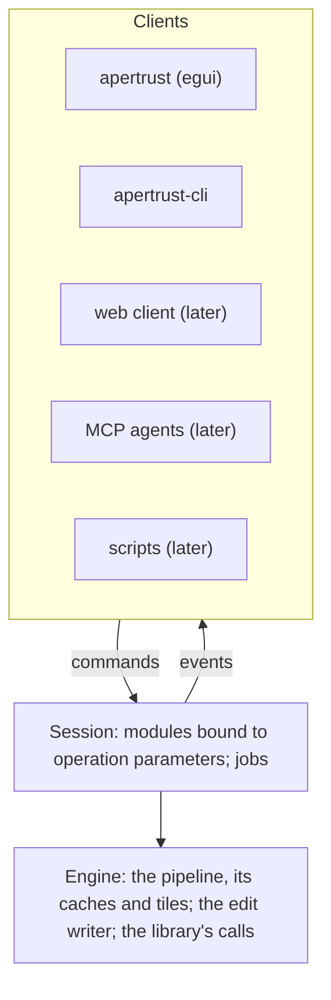

# Session protocol

Every client reaches the engine through one session protocol: the desktop app, the command line, and later the web client, MCP agents and scripts. A client sends commands and receives events; it never calls into the engine's state. This document describes the protocol: who speaks it, the commands as they are today, how they are numbered and batched, the transports, the commands planned, and what stays out on purpose. The events, their kinds, order and delivery, are in [events.md](events.md).

**Status.** The in-process protocol is built, as `apertrust_engine::session`'s `Command` and `Event` (decisions 17 and 28, and the decisions that add commands). The library's first commands, a folder opened and closed, are built. Its other commands, remote transports and several photos in one session are planned (decisions 37, 54 and 59). The session's behaviour behind each command is in [engine.md](engine.md#session-and-threads).

## Every client through the session

- **The engine never depends on UI code** (AGENTS.md, Engineering rules). Every client, the desktop UI, the web UI, MCP and scripts, reaches it through the session protocol. Widgets only emit commands; they never touch engine state. This keeps undo, agents and the remote web mode behaving as the app does.
- **Clients speak modules, not operations** (decisions 4 and 28). A client sets, resets and keeps a module's controls by the module's and the control's ids. The session turns module values into operation parameters through each module's binding. No client translates module values itself, so the CLI and MCP see what the app sees. Operations never appear in the protocol, apart from `Set`, which leaves it before the first release.
- **One session per window** (decision 37, planned until spike W1 measures it): the session holds every photo the window shows, the active one live, and serves the library's commands too, so every client sees one protocol.

## Where it lives

The protocol's types are `Command` and `Event`, with the types they carry, in `crates/engine/src/session.rs`. They are plain data, so that they can move unchanged.

They stay in the engine, as a `protocol` module once they need one, until a client must compile them without the engine. That will be the web client, and `apertrust-protocol` is to be made for it then, for decision 65's dependency-direction reason (decision 59). `Frame`, which carries a GPU buffer in process, maps to an encoded frame there.

Shape a new command so it moves unchanged: plain data, no references, no GPU objects (the `desktop-architecture` skill).

## The in-process session

Built. A client starts a session and talks to it through its handle:

- `Session::start(gpu, operations, modules, build, budget, cache, wake)` starts the engine thread on `gpu` with the binaries' `OPERATIONS` and `MODULES`, the build that every edit written records (decision 44), the engine's memory budget (decision 12), the disk cache the binary opened with its limit, or none (decision 76; [cache.md](cache.md#through-the-session)), and `wake`, which the session calls when events arrive ([events.md](events.md#one-outbox-per-session)).
- `Session::send(command) -> u64` sends a command and returns its number. It never waits.
- `Session::events() -> Vec<Event>` drains the events that have arrived, oldest first. It never waits.
- Dropping the handle ends the session: the edit commands still queued apply, rendering nothing, up to one that opens another photo; the edit is saved; then the jobs end, as the control's shutdown ends them.

The app sends commands from its frame and drains in `App::logic`, its `wake` `egui::Context::request_repaint`. The CLI runs the same session in-process: `apertrust-cli export` sends `Export` and waits on a channel its `wake` sends to, printing each photo's result as the job reports it (`crates/cli/src/main.rs`, `export_in_session`).

## Numbers and batches

- **Numbers.** Commands are numbered in the order sent, 1 for the first, by `Session::send`; the engine thread counts them in the same order, since one channel carries them. Events name the commands they include or answer ([events.md](events.md#numbers)).
- **Batches coalesce commands** (decision 17). The engine thread waits for a command, then takes every other that has arrived, and applies them in order as one batch. A batch sends one `Values` after its commands on the edit, failed or not, and renders one `Frame`. So a fast drag renders only its latest value, and a client's pending value is replaced by the engine's either way. Nothing else merges commands: each is applied, and each refusal reported.
- **Commands on the edit.** Every command acts on the open photo's edit except `Open`, `Resize`, `Scopes`, `Hide`, `Picker`, `CancelJob`, `RetryJob`, `Export`, `PreviewExport`, `Library` and `Cache` (`on_edit` in `session.rs`). A command on the edit ends a gesture under way (decision 42), but for a change that goes on with it or takes it in and a `Step` refused as `DefaultSource` or `EmptyStep`, is followed by a `Values`, and is refused on a photo open for viewing only (decision 43), but `DiscardHistory` on an edit view-only because of a `sidecar::Problem`, never a newer build's (decision 78), and from an `Open` until its `Values { live: true }`, as `NotLive` (decision 77). Refused rather than held, so `through` keeps counting what a report includes and a newer `Open` is never held behind it; a client that edits waits for `live`. A new command that changes no edit, as `Readouts` and `Samples` will be, must join that list.
- **Gestures.** A gesture is the `SetControl { done: false }` changes on one module, of one source and note: they merge into one change on the `done: true` that ends them, or on a `Step` of their source and note writing their module; a change of another source or note on the module ends the gesture as a step of its own. Only a completed change saves the edit. `CancelGesture` takes a gesture back ([engine.md](engine.md#session-and-threads)). Another command on the edit that ends a gesture makes the gesture a step of its own first, as its own release refused does. A client's quick completed changes to one control, or one preset row, may merge into the step before them, timed from when the client sent them, as darktable's undo merges a widget's ([history.md](history.md#merging-consecutive-changes)), so one `Undo` takes them all back.
- **Refusals.** A value out of range or of the wrong kind (decision 21), out of the range its module's values give (decision 30), or an option the photo does not list (decision 30) is refused whole, the command changing nothing, and reported as `SessionError::Refused` with the command's number. A `Step` of source `Default` and one holding nothing are refused as `DefaultSource` and `EmptyStep` in any state, before `NotLive` and `ViewOnly`.

## Commands

`Command` today. Each is described more fully on the session's side in [engine.md](engine.md#session-and-threads), and the export's in [engine.md](engine.md#export-jobs).

| Command | What it does | On the edit |
| --- | --- | --- |
| `Open(path)` | Opens a raw with the edit saved beside it, saving and closing the photo before it, in three stages (decision 77): `OpenPreview`, the opening photo's picture; `Opened` and `Values { live: false }` before the decode; then `Values { live: true }` and the first `Frame`, or `Failed(Open { open, .. })`, which may follow `Opened`. A newer `Open` cancels the older one's job ([events.md](events.md#a-photo-opening)) | no |
| `Close` | Closes the photo open, as File › Close does, and cancels the open under way: its edit saved first where anything in it is not on disk, reported `Saved` or failed as any write is, and nothing else sent of it; with none open, nothing. A client drops the photo's events whose `open` is below this command's number ([events.md](events.md#numbers)) | no |
| `Resize { width, height }` | The most physical pixels the photo may be shown in; renders again if it changed | no |
| `SetControl { module, control, value, done }` | Sets a module's control, or a lossless view's coordinate (decision 2), which keeps it; its module's follow writes in the same change (decision 27); `done` on a gesture's last change, which saves | yes |
| `ResetControl { module, control }` | A control, or a coordinate, back to its default for the photo, no longer kept | yes |
| `ResetModule { module }` | Every control of a module back to its default: the header's reset | yes |
| `CancelGesture { module }` | Puts the module back as before the gesture's first `done: false` change, with no history step (decision 42) | yes |
| `Keep { module, control, kept }` | Keeps or releases a control, leaving its value | yes |
| `ApplyPreset { module, preset, option }` | Applies a preset row's option as one change (decision 2) | yes |
| `Set { operation, param, value }` | A parameter no module owns, of an operation an unedited photo runs; leaves the protocol before the first release | yes |
| `Reset` | The whole edit back to nothing, as one history step noted `history-reset`, holding every module it reset, switched modules off (decisions 32 and 78) | yes |
| `Undo` | Takes back the newest undo record, one change's steps added, a batch's whole, the steps they dropped coming back; with none, as after reopening, moves the end back over the step before it and its batch, which the next `Redo` reverses, never over a new photo's default steps; a change not yet a step is made one first; answered by `History` (decision 78; [history.md](history.md#behaviour)) | yes |
| `Redo` | Puts back the newest record `Undo` took back; with none, moves the end forward over the next step and its batch, which the next `Undo` reverses | yes |
| `GoTo { step }` | Moves the end just after a step, one inside a batch among them, or to Original with `None`, as a click on a step in the History tab; the later steps stay until the next change drops them, but for a new photo's default steps, which it keeps and applies; with the end among the default steps, the modules darktable's workflow auto-applies after it are not applied; `Undo` takes it back, and after it a change, bringing the dropped steps back; a step not in the log refused, `UnknownStep`; the end where it is already changes nothing | yes |
| `Compress` | Compress History, darktable's compress (decision 78): every default step kept; among the person's steps up to the end, each module's last kept as it was, one whose entry is empty dropped; their steps after the end dropped; no step made, the end the last step kept up to it, so what the photo shows, at the end and at Original, does not change; at end 0 every step dropped and the default steps given again; `Undo` puts the log back, `Redo` compresses it again; one that changes nothing records nothing ([history.md](history.md#behaviour)) | yes |
| `Truncate` | darktable's Ctrl-click on compress: the person's steps after the end dropped, the rest kept as they are, the default steps after the end among them, as `Compress` otherwise | yes |
| `DiscardHistory` | Discard History, darktable's discard: going to Original and then `Compress`, one undo record; the photo given its default steps again, the file holding no step until the first change. On a photo view-only because of a `sidecar::Problem`, the one command taken: a fresh log of a new photo's default steps and a step of each module the edit holds as read, sharing a batch, noted `history-discard`, what could not be read dropped with the old log, `Opened` sent again, editable; refused on a newer build's edit, `ViewOnly` | yes, and on an edit view-only for a `sidecar::Problem` |
| `Step { source, note, commands }` | Several commands on the edit, only `SetControl`, `ResetControl`, `ResetModule`, `Keep`, `ApplyPreset`, `Set` and `Reset`, as one change of that source and note, a history step of each module it writes, in the order written, sharing a batch id, which one `Undo` takes back, applied in order, all or none: one refused refuses the whole, `InStep { index, error }`, any other command inside `NotInStep`; the source `Default` refused, `DefaultSource`, and a `Step` holding nothing, `EmptyStep`, both before the gesture under way is touched; it takes in the gesture under way on a module it writes when its source and note are the gesture's, one source per gesture, and a `Step` refused begins none ([history.md](history.md#commands)) | yes |
| `Scopes(graphs)` | What the scopes count of each frame, or nothing with `None` (decision 19) | no |
| `Hide { module, hidden }` | The History tab's eye, held: the live frame shows the module as if it were reset, off where switched and at its defaults where every photo runs it, its operation never skipped, until `hidden` is false, the photo closes or another opens; view state, no step, nothing written, no export, still or thumbnail changed, taken on a photo opening or open for viewing only; answered by `Values`, `ModuleState::hidden`, and a `Frame` where it changed; a module's picker on measures and applies nothing while a module is hidden, its reading waiting; while a module is hidden, answers to module picker commands wait until it is shown again; a module the session lacks refused, `UnknownModule` (decision 78; [history.md](history.md#commands)) | no |
| `Picker(PickerCommand::On { picker, area, keys, tools, channel })` | Turns a colour picker on, the one on before it off, at its last point or area this session, else darktable's default, the photo's centre or 2 % to 98 % of it; answered by `Event::Picker` once it is measured. The Colour picker module's, `PickerRef::ColourPicker`, works on a photo open for viewing only. A module's, `PickerRef::Module { module, picker }`, turns its module on, a change of the edit, makes its operation the edited instance and has its first reading applied through the module's pick as a completed change; `tools` are the settings its pickers read, `channel` the channel tab the module shows; refused on a photo open for viewing only, `ViewOnly`, while the History tab's eye hides a module, `Hidden` (decision 78), for a picker no module declares, `UnknownPicker`, and for a setting none of its pickers reads, `UnknownTool`. Refused before the photo is live, `NotLive` (decision 79; [pickers.md](pickers.md#commands)) | no, though a module's writes the edit |
| `Picker(Point { at, done, keys })`, `Picker(Area { from, to, done, keys })` | The active picker's point, or its area from one corner to the other, in the photo's coordinates clamped to 0 to 1, which it then measures; the frame shown measured again where nothing renders, and a module's picker at its operation by a sample-only render, the reading applied, a drag's `done: false` steps one change its release completes; refused with no picker on, `NoPicker` | no |
| `Picker(Switch)`, `Picker(Reset)` | darktable's Ctrl-click on the photo, point to area or back, each at its last place; and the kind measured back to its default; a module's picker's reading applied as a completed change; refused with no picker on, `NoPicker` | no |
| `Picker(Tools { module, tools })` | The settings `module`'s pickers read, kept, and the module's latest reading measured, darktable's `picked_color`, applied again as a completed change where its picker reads one of them; refused for a setting none reads, `UnknownTool`, and a pick refused turns the module's picker off | no |
| `Picker(Channel { channel })` | The channel tab the active picker's module shows, kept for its next pick, applying nothing; with no picker on, nothing | no |
| `Picker(Off)` | The active picker off, `Event::Picker` with no reading, through this command, its places kept for its next `On`, a pick's change under way completed; with none on, nothing. The session also turns it off as another photo opens or the photo closes, and a module's as a command on the edit changes its module, unless it is darktable's keep-active | no |
| `CancelJob { job }` | Cancels a job with a progress; refused for one that cannot be cancelled (decision 57) | no |
| `RetryJob { job }` | Runs what a failed job offered to try again, once, as if sent now, its `Added` naming this command and the job it `retries`; refused for one with no retry kept, `NotRetryable` (decision 72) | no |
| `Export { photos, settings, places }` | An export job, one at a time, its `Added` naming this command (decision 56) | no |
| `PreviewExport { photos, settings, places }` | The Export dialog's lines, answered by `ExportPreview`; the preview before it is cancelled | no |
| `Cache(CacheCommand::Limit(limit))` | The disk cache's limit as `cache.limited` and `cache.limit` now give it: lowered or turned on, an eviction, a `SystemBackground` job with no progress, unless one is queued or running, which takes it in; raised or turned off, none; with no cache, nothing (decision 76) | no |
| `Cache(CacheCommand::Sizes)` | The disk cache's sizes, answered by `Event::Cache`: at once with what the session's handle counts, once a walk has run, then by a `SystemBackground` walk with no progress, one at a time, which counts what other processes did; with no cache, `CacheEvent::NoCache`; a walk that fails, `Failed(CacheWalk { command, .. })` ([cache.md](cache.md#through-the-session)) | no |
| `Cache(CacheCommand::Clear { kind })` | A limited kind's entries removed: a cancellable `UserBackground` job of kind `cache-clear`, its progress as `Event::Job`, `Added` naming this command, `Event::Cache` sent again as it ends; refused for a kept kind (`CacheKept`), for a kind a Clear is clearing already (`CacheClearing`) and with no cache (`NoCache`) | no |
| `Library(LibraryCommand::Open(Source::Folder(path)))` | Opens a folder: a cancellable `UserBackground` job, its progress as `Event::Job`, `Added` naming this command, what it finds as `Event::Library` naming it too ([events.md](events.md#the-librarys-events)); the reading of the folder before it is cancelled. A folder outside the tree, or the tree's root again, starts the tree's walk, a `SystemBackground` job with no progress whose `LibraryEvent::Walked` batches name this command, cancelling the walk before it. Opens no photo | no |
| `Library(LibraryCommand::Close)` | Cancels the folder's reading and the tree's walk, and answers `LibraryEvent::Closed` naming this command | no |
| `Library(LibraryCommand::Thumbnails { photos, size })` | The open folder's photos' thumbnails, by file name, at most `size` pixels on their longer side, the first the most wanted: a `SystemForeground` job each with no progress, deduplicated by photo and size, the newest asked first, each answered by `LibraryEvent::Thumbnail` naming the folder's open ([events.md](events.md#the-librarys-events)); a new open or a close cancels those not yet sent; nothing with no folder open | no |
| `Library(LibraryCommand::Subfolders { folder })` | The subfolders of a folder inside the tree's root, the first folder opened, kept while each later `Open` lies inside it, as Browse opens it: a cancellable `UserBackground` job with no progress, answered by `LibraryEvent::SubfoldersOf` naming the folder's open, or why it could not be listed; a folder outside that root is refused; a new open or a close cancels it; nothing with no folder open | no |
| `Library(LibraryCommand::RawThumbnails(raw))` | From which size a photo with no edit shows a render of its raw rather than the camera's embedded picture, the setting `library.raw_thumbnails_from`, for the thumbnails and opening pictures asked for from then on and the live photo's render; answered by nothing | no |

`places` are the person's folders and name, which the client passes since the engine reads no platform folder (decision 43). `LibraryCommand` and what its events carry are `apertrust_library::ops`'s, re-exported as `session::library`. Eight more variants exist only in tests: `Synthetic`, `HoldExport`, `HoldPreview`, `HoldFolder`, `HoldWalk`, `HoldThumbnails`, `HoldClear` and `HoldDecode`.

## Commands planned

- **`Readouts(Vec<ReadoutId>)`**, the readouts a client shows, by module (decision 19; [engine.md](engine.md#readouts)).
- **`Samples(SamplesCommand)`**, the stored samples, answered by the `Samples` fact; and a pick's writes the session's own changes of source Auto, with history (decision 79; [pickers.md](pickers.md#through-the-session)).
- **`Show(cells)`**, the cells on screen, each a photo id and a size, with commands naming photos by id, the selection and the active photo the session's (decision 37).
- **The library's commands**, `Command::Library(LibraryCommand)` (decision 54). `LibraryCommand`, about forty commands in the end, is layer 4 of the library's API, served by the session from `apertrust-library`.
  - The long ones run as jobs of the session's control on darktable's queues: a folder's reading on `UserBackground`; thumbnails on `SystemForeground`; move, copy, rename, delete and Import… on `UserForeground`. Each call into a root runs on that root's queue (decisions 53 and 57).
  - The first four, `Open(Source::Folder)`, `Close`, `Thumbnails` and `Subfolders`, are built ([Commands](#commands)). `Show` and `Page` are planned; meanwhile the client keeps the photos listed and asks for the thumbnails of the cells it draws.
  - Clients see `PhotoRef`, `Target` and `Rules`, never the library's lower layers ([library.md](library.md#planned)). Its events are `Event::Library(LibraryEvent)` ([events.md](events.md#lower-crates-report-through-an-observer)).
- **A library's cache removed**, `CacheCommand::Remove { library }`, with the library's step 27 (decision 76): a `cache-clear` job as Clear's, skipping a library's cache another process has open, and `Event::Cache` listing each library's cache. The cache's types are `apertrust-base`'s `cache`, as the jobs' are its `jobs`.
- **`Sync`** and the handshake, for remote clients ([below](#remote-clients)).
- **Masks and layers**, `render_viewport(region, zoom)`, later phases.

## Transports

- **In process**, built: the app and the CLI, as above. A second in-process client, the app's MCP endpoint, is to get a receiver of its own from the session's outbox (decision 59).
- **IPC, WebSocket or WebTransport**, later: `apertrust-cli serve` for web and tablet clients on a home server (`apertrust-server`; [architecture.md](architecture.md#programs)). The engine is the same; only the transport differs. It is the server that first syncs the desktop app's photos (decision 71), whose sync is the library's storage protocol, not this one ([library.md](library.md#a-server)).
- **MCP**, later: `apertrust-cli mcp` over stdio and the app's endpoint (`apertrust-mcp`, through `rmcp`), a thin adapter over the protocol. Its tools are generated from the modules' definitions and `LibraryCommand`'s schema, off until the person allows them and read-only unless writes are allowed (principle 8; decision 54).

## Web, tablets and remote access

Planned (decision 58). The browser and tablets are remote clients of a native engine; [gui.md](gui.md#why-egui) holds why the desktop and the browser share one egui interface.

**Web mode** (decision 58). Desktop and browser share mouse, keyboard and a large screen, so they share the UI. Two pieces are pluggable: the engine connection (in-process on the desktop, remote over WebSocket or WebTransport on the web) and the viewport's source (a GPU display buffer on the desktop, decision 17; streamed frames on the web). The remote engine on a GPU machine gives full native performance and full AI models.

**Why there is no in-browser processing.** It faces uneven WebGPU on Linux (as of September 2026, Chrome enables it only on Intel Gen12+ and recent NVIDIA, Firefox not at all), memory and buffer limits that force tiling, cross-origin isolation for threads, and smaller AI models through ONNX Runtime Web. The engine always runs natively, on the user's machine or a home server, and browsers and tablets connect to it on the local network or over the Internet.

**Remote access.** The main web use is a home server running the engine, reached from a browser or tablet at home or over the Internet. That adds requirements a local app does not have:

- Authentication and encrypted transport (HTTPS, secure WebSocket or WebTransport over TLS). Access through a VPN is the recommended default for Internet use, rather than exposing the server directly.
- Bandwidth-aware frame streaming: compressed frames at reduced resolution while dragging sliders, full quality when idle. Wide-gamut and HDR frames need a codec that keeps them.
- The photo library lives on the server; the client only browses and edits it.

**Touch** comes with the mobile phase, after Phase 3 (decision 1): a native app for phones and tablets over the session protocol, designed for touch rather than adapted from the desktop layout.

## Remote clients

Planned (decision 59), with the server or MCP, whichever comes first:

- **Per connection, notices are queued** in order, to a bound, 1024 to start with, **and facts are coalesced by topic**: a later fact replaces the queued one of its topic and takes its place after the notices before it, so the order guarantees still hold ([events.md](events.md#order-and-delivery)). A frame or a still is encoded only while none is in flight to that client.
- **A connection that overflows its notices is closed as lagged.** Its client reconnects and syncs; the engine never waits for it.
- **`Command::Sync`** sends the current facts and the open folder's listing again, as to a client joining late.
- **Versioning:** `Hello { protocol, client }` and `Welcome { protocol, build }`, with one protocol number, raised only by a change a client cannot ignore. New variants and fields with defaults keep it, and a client ignores what it does not know.
- **Encoding:** commands and events as JSON tagged by `type`; frames and stills as binary messages.
- **Numbers** stay one sequence across connections, assigned as a command enters the inbox, each connection learning its own from the acknowledgement.

## What stays out

On purpose, so that the protocol stays one boundary:

- **Operations.** Clients name modules and controls; `Set` is the one operation-level command, and it leaves before the first release.
- **Engine state.** No client holds a reference into the session, a GPU object outside the in-process `Frame`, or a lock; widgets never touch engine state.
- **Files the client should read.** The engine opens no settings file or folder (decision 43): a client reads its settings and an export preset and sends their values.
- **A bus.** No subscriptions and no handlers run inside the engine on a client's behalf ([events.md](events.md#against-darktable)).
- **A second API.** The library has no API beside its commands here: no SQL or query language beyond darktable's rules, no traits with one implementation (decision 54).
- **History in the client.** Undo and history are the session's; a client asks for them and draws the `History` fact ([history.md](history.md)).

## Tests

Planned with the remote protocol: a JSON fixture for each variant, read and written byte for byte, so a change on the wire is deliberate; a client that syncs mid-session mirrors what a client there from the start mirrors; a slow connection closed as lagged while the live frame keeps its time. The in-process side is held by the session's tests ([events.md](events.md#tests)).

## Open questions

- **Remote access:** which codec streams wide-gamut and HDR viewport frames efficiently over the Internet, and how does authentication work beyond VPN access?
