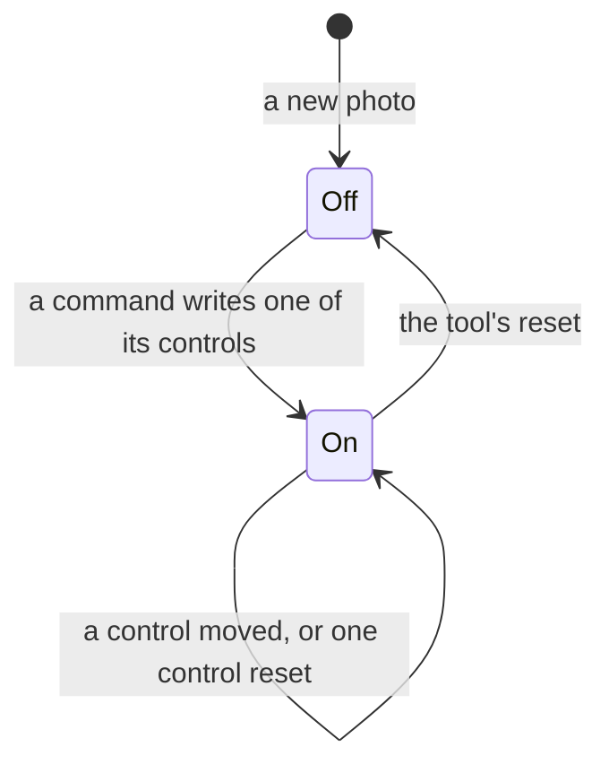
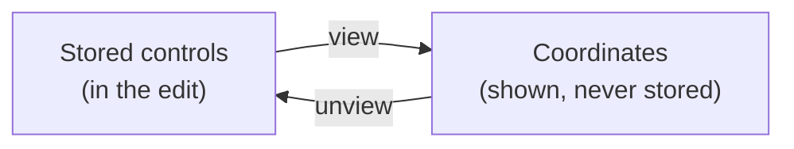

# Tools

The tools users edit with. In the first pass each is darktable's own: one tool per darktable module Apertrust includes, under darktable's name and with darktable's controls (decision 2: rewrite first, improve later). Exposure's page is the one exception, redesigned over darktable's controls (decision 88). Once the whole project is migrated (decision 2), Apertrust evolves on its own.

- A built tool's controls, defaults and invariants are on its page here.
- What each operation ports, and how, is in its spec in [ports/](../ports/).
- A tool still to build takes its controls from darktable's source at the reference release: the params struct's `$DESCRIPTION`s, `gui_init`, `gui_changed` and `gui_update` for when a row shows, and `init_presets` for its presets.

## Processing tools and utilities

Every tool in the Tools panel has one header, one page and one ⋯, and is one of two kinds (decisions 4 and 93):

| Kind | Is | darktable's | Examples |
| --- | --- | --- | --- |
| **Processing tool** | Edits the photo through the operations it binds; its controls are what the edit stores | processing module (iop) | Exposure, AgX, Colour calibration |
| **Utility tool**, "utility" for short | Edits nothing of its own, with no controls and no operation; it holds settings, view state or the photo's metadata | utility module (lib) | Collections, Export, Scopes, History |

- **Built:** a processing tool is a `ProcessingDefinition` with the trait `ProcessingTool` in `apertrust-tools`, drawn by the app's renderer with no code of its own; a utility is a `UtilityDefinition` in `utility::UTILITIES`, Scopes, History, Collections and Export, with the trait `UtilityTool` in the app, its page the same rows, never one that edits (`UtilityDefinition::check`), its own widgets custom rows its module draws, every tool's page drawn by one page drawer, Scopes' its graph with its buttons and History's its steps, each one custom row, Collections' its recents line and its Folders, two, and Export's setting rows naming the `export.*` keys with their own words, in groups, beside its custom rows (step 93.6); both embed the `ToolDefinition` every tool shares, from which the app draws every tool's header and ⋯ alike: ↺ as its `reset` says, presets where `presets` holds, a utility's drawn disabled until its presets are built, and ⋯ the app's items, Reset first and on a processing tool Copy Settings and Paste Settings, drawn disabled until built, then its declared items, then the layout's (decisions 91 and 93).
- **A tool's default state comes from its declaration,** `ToolDefinition::open_at_first` (decision 93): every processing tool starts closed; Collections, Scopes and History start open, and Export closed, Export… and Ctrl+E opening it. Once the person opens or closes a tool, that state, kept in settings, wins.
- **Presets** (decision 93; [gui.md](../gui.md#one-tool-model)): every tool's from the one pull-down processing tools and utilities share, each preset an `.appreset` file (decision 106): built for processing tools and Export, planned for Import.
- "Section" names only the Tools panel's block a tool is shown in, a header with its body.

## The tools by tab

Every tool's operation keeps darktable's place, darktable's v5.0 order throughout (decision 22; `src/common/iop_order.c`; [engine.md](../engine.md), Order): the tone equalizer at camera RGB 24.0, RGB curve and RGB levels at 42 and 43, before the tone mapper.

The Default workspace's tabs are Photos, Adjust, Detail, Geometry, Effects, Raw and History (decision 38): the tools grouped by editing stage, so that a normal edit stays in one tab, between Apertrust's own Photos and History, with no quick access panel or active-modules tab. Each tab lists its tools top to bottom in editing order, the order a person reaches for them; Raw, the raw stage's tools and the colour profiles, lists them in processing order. The lists are display order only: the processing order stays the pipeline's whatever a tab lists. These lists are the Default workspace's defaults: `data/workspaces/default.toml` holds them for the built tools, and a test holds them to decision 38's lists and each tool the Default workspace places in a tab to exactly one of them, a tool hidden by default in Edit, as the Colour picker will be, excepted. A tab with no tool built yet, Detail for now, is drawn disabled, saying it is to come. Each workspace's tabs, each tab's tools and the tools it hides are kept in the workspace's own file; a person is to reorder, pin, move, hide and float sections on screen, never the processing order, through a tool's ⋯ (Pin Tool, Move Tool to Tab ▸, Remove Tool, and Show Tool in Tab ▸ for a hidden tool), a drag of its header, keys and screen readers' actions, and a tool in no tab of a workspace is hidden, still reached from the Hidden tab and by Find Tool…, which matches a tool's name and darktable's (decisions 83 and 96; built: Phase 2's steps 1 to 4 and 6; planned: steps 5 and 7, floating in Phase 3). A new tool goes into its default tab where the workspace has one, else it is hidden. How the bar looks and behaves is [gui.md](../gui.md)'s (The Tools panel).

No built-in workspace keeps darktable's scene-referred groups; a person who wants them writes them as a workspace of their own (decisions 38 and 96). Essentials, a built-in workspace of a few tools, is [below](#the-essentials-workspace).

The tables below are in the Default workspace's order:

- **Built** means the tool is in `apertrust-tools`'s `TOOLS` and in the app; the details are on its page.
- **Switched** means a tool darktable leaves off on a new photo ([rule 4](#the-rules)).
- A **slot** is darktable's: the stage, then the order number.

### Adjust

Light and colour together, since a scene-referred edit interleaves them. The tab shows the edit's tone mapper, one of AgX, Sigmoid and Filmic RGB ([Tone mappers](#tone-mappers)). darktable's color harmonizer is not in the first pass. The Default workspace opens on this tab.

| Tool | darktable module | Operation, slot | Layers | Status | Docs |
| --- | --- | --- | --- | --- | --- |
| White balance | white balance | `temperature`, raw 3 | Background only | Built, its picker from Settings' from image area (decision 79); the button bar to come; the camera's presets with Finetune designed (decision 27), to build | [page](white-balance.md), [port](../ports/temperature.md) |
| Colour calibration | color calibration | `channelmixerrgb`, working 28.5 | Background only, until layers | Built, every tab, the CAT tab with follow writes and its picker; runs on every colour raw (decision 27) | [page](colour-calibration.md), [port](../ports/channelmixerrgb.md) |
| Exposure | exposure | `exposure`, camera RGB 21 | Yes | Built, every control ported, automatic mode with its computed EC readout (decision 87); Contrast and Pivot left for Colour balance RGB | [page](exposure.md), [port](../ports/exposure.md) |
| AgX | AgX | `agx`, working 45.5 | Background; on layers when they come, as a replacement | Built, the default tone mapper, with its five pickers; its actions and Show curve to come | [page](agx.md), [port](../ports/agx.md) |
| Sigmoid | sigmoid | `sigmoid`, darktable's 45.3 | Background; on layers when they come, as a replacement | Operation ported; tool planned (Phase 3), a tone mapper | [port](../ports/sigmoid.md) |
| Filmic RGB | filmic rgb | `filmicrgb`, darktable's 46.0 | Background; on layers when they come, as a replacement | Operation ported, v3 to v7; tool planned (Phase 3), a tone mapper | [port](../ports/filmicrgb.md) |
| Tone equalizer | tone equalizer | `toneequal`, camera RGB 24.0 | Yes | Built, switched (decision 32); the guided filters, wands and mask histogram to come | [page](tone-equalizer.md), [port](../ports/toneequal.md) |
| Local contrast | local contrast | `bilat`, display 54 | Yes | Operation ported, both modes; tool planned (Phase 3), switched | [port](../ports/bilat.md) |
| Haze removal | haze removal | `hazeremoval`, camera RGB 14 | Yes | Built, switched at darktable's 0.2 (decision 32) | [page](haze-removal.md), [port](../ports/hazeremoval.md) |
| RGB curve | rgb curve | `rgbcurve`, working 42 | Yes | Operation ported; built as the Tone curve's Luma curve, to be reshaped into RGB curve | [page](tone-curve.md), [port](../ports/rgbcurve.md) |
| RGB levels | rgb levels | `rgblevels`, working 43 | Yes | Operation ported; tool planned (Phase 3), switched | [port](../ports/rgblevels.md) |
| Colour balance RGB | color balance rgb | `colorbalancergb`, working 41.5 | Yes | Built, switched (decision 32), with its six pickers; the graph and mask display to come | [page](colour-balance-rgb.md), [port](../ports/colorbalancergb.md) |
| Colour equalizer | color equalizer | `colorequal`, working 41.2 | Yes | Built, switched (decision 32), darktable's page in its default layout, the graph alone; the mask displays and presets to come | [page](colour-equalizer.md), [port](../ports/colorequal.md) |
| RGB primaries | rgb primaries | `primaries`, working 28.9 | Yes | Built, switched (decision 32); the painted tracks to come | [page](rgb-primaries.md), [port](../ports/primaries.md) |

- **Colour calibration's** grey tab is darktable's black and white: any grey weight off 0 makes the photo grey.
- **Local contrast,** once on, starts at darktable's local laplacian filter, detail 125 %, highlights and shadows 50 % and midtone range 0.5.
- **RGB curve** keeps decision 31's fixed ends at (0, 0) and (1, 1); black and white are RGB levels'. Its graph is darktable's (decision 22).
- **The colour equalizer** has no untouched value at darktable's defaults, so it is switched (decision 32).

### Detail

What works at the scale of pixels: noise, sharpness and spots. darktable's raw chromatic aberrations (`cacorrect`) is left out, since every change would rerun demosaic; its hot pixels, liquify, raster mask and astrophoto denoise are not in the first pass.

| Tool | darktable module | Operation, slot | Layers | Status | Docs |
| --- | --- | --- | --- | --- | --- |
| Denoise (profiled) | denoise (profiled) | `denoiseprofile`, camera RGB 9 | Yes | Planned (Phase 2), switched | [port](../ports/denoiseprofile.md) |
| Sharpen | sharpen | `sharpen`, working 35 | Yes | Planned (Phase 3), switched | — |
| Diffuse or sharpen | diffuse or sharpen | `diffuse`, working, between 28.5 and 29 | Yes | Planned (Phase 3) | — |
| Retouch | retouch | `retouch`, camera RGB 20 | Retouch layers themselves | Planned (Phase 4) as retouch layers, heal and clone, ported from darktable's master (decision 74) | [layers](../layers.md#retouch-layers) |

- **Sharpen,** once on, starts at darktable's radius 2, amount 0.5 and threshold 0.5.
- **Diffuse or sharpen** is one tool, darktable's, with darktable's presets (lens deblur, local contrast, dehaze, bloom and others) but its two "sharpen demosaicing" ones (no AA filter and AA filter). darktable's manual has those used on an instance moved before input colour, and tools keep their place in the pipeline, layers included (decision 34). Demosaic's capture sharpening does that job at that place, as darktable has it.
- **darktable's retouch** is not a tool of the first pass: it is ported as retouch layers, heal and clone, with layers in Phase 4 ([layers.md](../layers.md#retouch-layers), decisions 34 and 74).

### Geometry

What changes the frame and corrects the lens: where the pixels land.

| Tool | darktable module | Operation, slot | Layers | Status | Docs |
| --- | --- | --- | --- | --- | --- |
| Crop | crop | `crop`, camera RGB 24.5 | Background only | Planned (Phase 3) | — |
| Rotate and perspective | rotate and perspective | `ashift`, camera RGB 15 | Background only | Planned (Phase 2) | — |
| Orientation | orientation | `flip`, camera RGB 16 | Background only | Built, darktable's page; runs on every photo at auto, the photo's own orientation; its guides and presets to come | [page](orientation.md), [port](../ports/flip.md) |
| Lens correction | lens correction | `lens`, camera RGB 13 | Background only | Planned (Phase 3), switched; the embedded-metadata method specified (decision 25), Lensfun's later | [port](../ports/lens.md) |
| Chromatic aberrations | chromatic aberrations | `cacorrectrgb`, camera RGB 13.5 | Background only | Planned (Phase 3) | — |

- **Crop** has no angle of its own, as darktable's crop has none: its straighten line writes Rotate and perspective's rotation.
- **Chromatic aberrations** keeps darktable's advanced parameters on its main page, in a plain group (decisions 29 and 100).

### Effects

The finishing looks. darktable's contrast equalizer, framing, enlarge canvas, graduated density, composite, watermark, censorize and blurs are not in the first pass.

| Tool | darktable module | Operation, slot | Layers | Status | Docs |
| --- | --- | --- | --- | --- | --- |
| Vignetting | vignetting | `vignette`, display 68 | Yes | Built, switched at darktable's −0.5 (decision 32), without dithering | [page](vignetting.md), [port](../ports/vignette.md) |
| Grain | grain | `grain`, display 65 | Background only | Built, switched at darktable's 25 % (decision 32) | [page](grain.md), [port](../ports/grain.md) |
| Soften | soften | `soften`, display 66 | Yes | Built, switched at darktable's 50 % (decision 32) | [page](soften.md), [port](../ports/soften.md) |
| Bloom | bloom | `bloom`, display 61 | Yes | Operation ported; tool planned (Phase 3), switched | [port](../ports/bloom.md) |

- **Bloom** blooms every pixel above about L 89.4 even at strength 0, so it has no untouched value; once on it starts at darktable's 20 %, 90 % and 25 %.

### Raw

The raw stage's tools and the colour profiles, set up rather than edited and rarely touched, in a tab of their own, out of the way, in processing order.

| Tool | darktable module | Operation, slot | Layers | Status | Docs |
| --- | --- | --- | --- | --- | --- |
| Raw black/white point | raw black/white point | `rawprepare`, raw 1 | Background only | Built; its levels start at the raw's own, flat field correction not ported | [page](raw-black-white-point.md), [port](../ports/rawprepare.md) |
| Highlight reconstruction | highlight reconstruction | `highlights`, raw 4 | Background only | Built; inpaint opposed ported, the threshold starting at the photo's own | [page](highlight-reconstruction.md), [port](../ports/highlights.md) |
| Demosaic | demosaic | `demosaic`, raw 8 | Background only | Built; RCD and Markesteijn 1-pass ported, the method listing the sensor's methods | [page](demosaic.md), [port](../ports/demosaic.md) |
| Input colour profile | input color profile | `colorin`, camera RGB 28 | Background only | Built; the photo's own matrix and the linear Rec709 and Rec2020 inputs ported, the working profile linear Rec2020, gamut clipping to all four profiles | [page](input-colour-profile.md), [port](../ports/colorin.md) |
| Output colour profile | output color profile | `colorout`, display 70 | Background only | Built; an edit chooses sRGB only until the display converts from the edit's profile (decision 26) | [page](output-colour-profile.md), [port](../ports/colorout.md) |

- **Demosaic** keeps capture sharpening, in the raw stage, as darktable has it.
- **Input colour profile** owns every colorin parameter, the camera profile included.

### The Essentials workspace

A built-in workspace beside Default (decision 96), `data/workspaces/essentials.toml`, id `essentials`, chosen from View › Workspace, with the tools most edits need. It opens on Adjust.

| Tab | Tools, top to bottom |
| --- | --- |
| Photos | Collections, Export |
| Adjust | Scopes, pinned; White balance, Exposure, AgX, Tone equalizer, Colour balance RGB, Orientation |
| History | History |

Every other tool is in no tab, so hidden: a workspace decides only what is shown, and a hidden tool is still processed. A tool's ⋯ › Remove Tool hides it the same way (built with step 4), its edit staying, and Show Tool in Tab ▸ brings it back; Remove Tool is disabled for Export, which every workspace keeps, and, once floating panels come (Phase 3), for a floating tool until it docks (decision 96).

### Photos, History and shared sections

- **Photos,** Apertrust's own tab, first (decisions 37, 38, 73 and 90): Collections, pinned, with Folders in folder mode (Phase 2) and Albums and Smart albums (Phase 5); Filters, Keywords and Metadata (Phase 3); Styles (built); then Export, last (built for the selection, else the active photo, its groups and Summary included; its presets Phase 3).
- **Styles** are darktable's styles, bundles of module values with no parameters of their own: the styles applied to the photo, then the person's styles as a tree ([gui.md](../gui.md#the-styles-tool)). Applying one is one change, or a layer with opacity (Phase 4). It is in the Photos tab because darktable's styles module is a lighttable module.
- **Export** is a utility, darktable's export module row for row ([gui.md](../gui.md#the-export-tool), decision 90): built for the selection, else the active photo, it edits nothing, its values the `export.*` settings, never the edit. Its groups, built: Storage options and Format options always open, as darktable's section labels, Global options collapsible and open at first, Metadata and Multi-preset export collapsible and closed. Its header has ↺, presets and ⋯, and no preset row: the preset in use, or Custom, is the Summary's Preset row, the Summary being a group after Multi-preset export, open at first. It stays in every workspace, so Export… and Ctrl+E always reveal it. Import is no tool: it is the Import sheet's ([gui.md](../gui.md#the-import-sheet), decision 86).
- **History,** Apertrust's own tab, last (decision 38): Snapshots, planned, then the edit's history ([history.md](../history.md#the-history-tab)), with no Scopes. The Colour picker, darktable's color picker utility, is hidden by default, in no tab of Edit, so in the Hidden tab and found by Find Tool… (decision 96), its tab to be decided ([pickers.md](../pickers.md#the-colour-picker), decision 79, planned).
- **Scopes** (decision 19): pinned over the tools of every editing tab, in neither the Photos tab nor History, as darktable's histogram sits over its groups. Its drags send Exposure's commands, so nothing is owned twice.
- **Layers** (Phase 4): Apertrust's own model, pinned in the editing tabs. A layer's mask, opacity and blend mode become the blend settings of each instance it adds; it owns no operation parameter.
- **AI denoise and AI erase** are Apertrust's own models (Phase 6), not darktable's; their tab is decided with their design.

## The rules

Port specs, tool pages and code cite these by number.

1. **One darktable module, one tool.** Each darktable module Apertrust includes is one tool, under darktable's name in British spelling. Its id is its operation's (`exposure`, `toneequal`, `colorbalancergb`). Operations never appear in the UI: a tool is a layer over its operation (decisions 4 and 28).
2. **Both white balances, as darktable has them** (decision 27). White balance is darktable's white balance over the raw-stage `temperature`, so a drag reruns demosaic (decision 12). Colour calibration is darktable's color calibration with its CAT tab. Improvements come after the rewrite works.
3. **Controls are darktable's, every one it shows** (decision 29).
   - In darktable's order, under its labels and ranges, ported or not; a control not ported is drawn disabled.
   - A fixed change of unit is allowed: a percentage for a factor, degrees for radians (decision 30).
   - Sliders are darktable's, soft ranges included (decision 30), and a range darktable moves with other controls moves with them (`ProcessingTool::range`, decision 30).
   - No control sets several parameters.
4. **A tool that is off is untouched** (decision 32).
   - A tool whose operation every photo runs starts at the photo as first shown, the operation's defaults for it, and is untouched there.
   - A tool darktable leaves off on a new photo is **switched**: off until a command writes one of its controls, then on with darktable's defaults for the rest, until its reset turns it off. Resetting one control leaves it on.
   - Nothing else shows that it is off: no dimming, no power button. Its reset is available only once it is on, and screen readers hear "Not applied".
5. **darktable's page, as darktable has it** (decisions 2 and 29). There is no Advanced controls toggle in the first pass.
   - A processing tool starts closed, as darktable's processing modules start collapsed, and so does Export, while Collections, Scopes and History start open, each declared in its `ToolDefinition` (`open_at_first`, decision 93); a tool's open state, once the person changes it, is kept in settings, never in the edit.
   - darktable's section labels are **plain groups**, each a title over the rows it holds, always open (decision 100).
   - Each of darktable's collapsible sections is a **collapsible group**, closed at first, but for a group a utility declares open at first, as the Export tool's Global options (decision 90), its open state kept in settings, never in the edit. A plain group may sit inside a collapsible one; no other group sits inside a group.
   - A group that is the first row of a tool's body, a tab or a group draws no space above it, so every tool's first row is 4 points under its header, or 8 under its tab strip, whatever the row (decision 100).
   - **Every darktable tab is a content tab**, in darktable's order, masking, masks, options and advanced included. Rows darktable shows under every tab show whichever tab is chosen.
   - **Rows follow darktable's conditions.** A row darktable shows only in one mode is hidden otherwise. A control that cannot act in the current state is drawn disabled, never hidden (decision 30), but for Exposure's two camera rows, hidden where the photo gives them nothing to do (`ProcessingTool::visible`, decision 88); hiding any other row needs a decision of its own. One parameter shown under two labels by mode has one row per mode.
   - **Exposure is the one exception** (decision 88): its page is redesigned. A Manual | Automatic switch replaces the Mode list, and Picker target with a reference replaces Area exposure mapping and measure mode; it adds Last pick with its warnings and labels with the camera's value, and drops Auto, while its controls, bindings and processing stay darktable's ([exposure.md](exposure.md#the-page-as-redesigned)).
6. **Lossless views** (decision 2). Where darktable shows the same stored values twice, the second is a second row, an exact, invertible change of coordinates the tool gives ([below](#lossless-views)). Nothing is stored twice.
7. **Presets are darktable's,** from `init_presets`, in the menu of the header's presets button.
   - Applying one is one change and one history step.
   - darktable's auto-applied workflow presets are Apertrust's defaults already.
   - A preset that sets a fixed parameter or a mode not ported is left out, and the tool's page says so.
8. **A choice lists darktable's options for the photo** (decisions 29 and 30; `ProcessingTool::options`).
   - The definition holds every option darktable lists on some photo, each with a permanent id; a photo lists those darktable lists for it.
   - An option not ported is drawn disabled, and choosing it is refused. So is an option the photo does not list.
   - An edit from another photo that holds one keeps it, shown last, chosen and disabled, "Not available for this photo".
   - Options darktable lists on no photo, kept only for old darktable edits, are left out until the import of darktable's edits needs them (decision 51, planned).
9. **Left out:** every module darktable marks deprecated, and modules that do another's job: colour zones (the colour equalizer's), monochrome (colour calibration's grey), base curve and the other display-referred legacy tone tools. Tone mappers are the exception: each is a tool of its own ([Tone mappers](#tone-mappers)).
10. **Quads, pickers and wands** are darktable's (decision 29): a picker on a row, a showmask view mode, an Auto quad that computes one control. Each is an action that writes controls, a picker that writes only settings, as Exposure's Reference picker (decision 88), or a view, and none is stored. A picker is declared in `ProcessingDefinition::pickers` with darktable's flags and applied by `ProcessingTool::pick` ([pickers.md](../pickers.md), decision 79). The tool's Auto has no header button. Readouts and read-only graphs are drawn as darktable shows them.
    - **darktable's packed lines are one line row** (decision 107; [gui.md](../gui.md#line-rows-and-end-items)): `Row::Line { start, readout, end }`, its start nothing, a label or a control; a slider's quad is its `end`, which choice, toggle and setting rows carry too. Built: lines of any shape, a toggle's end items after its switch, and a slider's picker or warning; planned, the end items of choice and setting rows.
    - **End items are a closed list:** `Picker` (built), turned on and off, or read once where its picker is declared one-shot (`Picker::once`), as RGB levels' Auto; `Action` (built, `ActionEnd`), a pure `ProcessingTool::action` with an icon or a text (`Face`), or a menu of the tool's actions (`ActionEnd::menu`, built); `Compute`, a result the tool's operation computes from the photo that the tool's `apply` writes as one change, shaped like a pick; `Mode`, a cursor of the tool's (decision 104); `View`, a mask on the photo; `Warning`, a read-only sign. `Warning` (built), a slider's alone. Each but a picker follows the tool's pure availability rule, extended to end items, so an action is never called as a control is (built, `ToolState::actions`); a picker's stays `ProcessingTool::picker_ready`.
    - **An action reads only its own tool's values and the photo,** and named facts another tool publishes from its own pure function (built: `ActionEnd::reads`, `ProcessingDefinition::publishes`, `ProcessingTool::publish`), as AgX's Read exposure reads Exposure's `effective_exposure`; never the whole edit's values.
    - **A Ctrl or Shift variant is an action of its own,** with its own id, the button running the plain one and the modifier the variant, the tooltip listing the keys. A gesture's keys on the photo stay the gesture's.
    - **One view across the edit,** view state as the History tab's eye: never stored, no history step, never exported, turned off by another view, Esc, a press, another photo or its tool's reset or turning off. **Every mode on the photo is a cursor,** its button a second door to it.
    - **A warning** (built, `ProcessingTool::warning`) sits in the quad's place before a slider's value while the tool's pure check reports it, its message the tooltip; its place stays reserved so the value never moves.
    - **Two or three compact controls may share one line,** `Row::Fields`, folding into labelled rows when narrow; **a tab strip may end with pickers or actions.**
11. **Layers** replace darktable's instances and per-module masks (decision 34; [layers.md](../layers.md)). A tool works on layers unless the tables above say background only.
12. **darktable's interface settings** (decision 29).
    - darktable's own settings for a tool, kept in darktablerc and never in an edit, are rows of the tool (`Row::Setting`), kept in `settings.toml` under `[tools.<module>]` once what uses them is built (decision 43).
    - A control darktable shows only under a preference that is off by default, or only for an edit made with an older algorithm, is not shown; its parameter stays at darktable's default or current value.
13. **Follow writes** (decision 27). Where darktable's GUI writes other parameters with a control, to keep one quantity consistent (colour calibration's illuminant writing `x`, `y` and the temperature; White balance's coefficients writing `preset`), the tool gives those writes (`ProcessingTool::follow`) and the session applies them in the same change.
    - A preset row's option takes none: it writes every control itself (`ProcessingTool::preset`), but for an option that turns a picker on (`PresetRow::pickers`), which writes nothing and leaves the writing to the pick.
    - A range that follows other controls clamps a value it leaves outside in the same change (decision 30).
    - darktable's session memory, values its GUI keeps but no edit stores, is not mirrored, but for White balance's user-modified coefficients, which its Settings' user modified writes back: the session keeps them for the open photo (`ProcessingTool::remember` and `recall`, decision 27).
14. **Menus and the toolbar** (decisions 91 and 92; [gui.md](../gui.md#context-menus)). A tool takes no right-click: its header, body and controls open no context menu, a control keeping its own gesture (a slider's fine control, a picker button's area).
    - Its own menu is its header's ⋯, its presets the header's presets button. In a Tools panel tool, ⋯ ends with the app's layout items, which a tool never declares, the Import tool taking none: Pin Tool or Unpin Tool, Move Tool Up and Move Tool Down, Move Tool to Tab ▸ and Remove Tool, or Show Tool in Tab ▸ alone for a hidden tool (decisions 83 and 96); Move Tool Up and Move Tool Down, as Alt+↑ and Alt+↓ on its focused header, move it one place in its list, and so do its custom actions, which are in the accessibility tree and reach screen readers once AccessKit's platform adapters pass custom actions on. Remove Tool takes it out of the workspace's tabs, never out of the edit. Help, last, opens the tool's page in the Apertrust Guide, in a Tools panel tool's ⋯, never the Import tool's, the Import sheet's Help being its footer's button, topic `import`; its topic `tools/processing/<id>` or `tools/utility/<id>`, from its kind and id, unless `ToolDefinition::help` overrides it (decision 97, planned).
    - It may add items to the photo's and a thumbnail's right-click menus, at most two each, and to its own ⋯, at most four, which opens through the menu builder, declared in `ToolDefinition::menus`, each one of its own actions (an `Action` end item, decision 107; a variant, planned), or for a utility a registry action it names, as History's `reset`, or a submenu of up to eight of them, and placed by its `section` (from `EDIT` up to, not including, `LAYOUT`, and in `EDIT` from order 200, after Reset, History's Reset itself alone at `(EDIT, 100)`) and `order`, as the app's own items are. The registry holds each of a processing tool's actions as `tool-<tool>-<action>`, generated as the app starts; a utility names a registry action that already exists. Orientation's Orientation ▸ is the first. A tool with nothing to add declares nothing, its ⋯ then holding the app's layout items alone, which every tool of the Tools panel's ⋯ ends with, and a utility declares its items in `utility::UTILITIES`, in the same `ToolDefinition::menus`, as History's Reset and its ⋯'s four (decision 93). Collections is the one exception for now: its ⋯'s Show in Finder and, for a photo opened alone, Open This Folder are not registry actions yet, so the app hands them to its header itself.
    - Every item it adds is reachable without a right-click, and each one in the photo's or a thumbnail's menu is listed on the tool's page.
    - It offers its actions for the toolbar (decision 92; [gui.md](../gui.md#customising-the-toolbar)), those of its own actions it chooses, up to two for a processing tool and any number for a utility, in `ToolDefinition::toolbar` (decision 93), a processing tool's of its own actions, a utility's the registry actions it names, with an icon of `apertrust-ui`'s by name, an icon `Action` end item's action taking its button's (decision 107), the app listing them with the rest of what can be placed; offered, an action is on the toolbar only where a person places it, once the Toolbar is drawn from a workspace's list (planned).

### Switched tools

A switched tool's life, by rule 4:

Off, it renders as no edit. On, every control it was not given takes darktable's default.

Built for the Tone equalizer, Colour balance RGB, RGB primaries, Haze removal, Vignetting, Soften and Grain, each at version 2 (`ProcessingDefinition::switched`). A version 1 edit migrates on where it rendered something, its values as they were, and off, its values dropped, where it rendered nothing. The other tools marked switched in the tables are switched as they are built.

### Fixed parameters

A parameter with no editing meaning and no darktable widget is fixed at darktable's value, owned by its tool with no control ([Owners by operation](#owners-by-operation)). `--param` and `Command::Set` refuse it (`EditError::Fixed`).

**Edits** store each tool's values with its version. Operation parameters are derived from them by the bindings, and old edits keep their look through versioned migrations (decisions 4, 28 and 43).

### Tone mappers

AgX now, Sigmoid and Filmic RGB as they come, each a tool of its own, as in darktable, in the Adjust tab after Exposure (decision 38).

- A setting chooses the tone mapper for new photos and which tool the Adjust tab shows.
- Each edit names its tone mapper's tool and keeps it; an edit that names none is AgX's. At most one tone mapper operation is planned, while its tool is on: always on a raw, on an image that is not a raw once touched (decision 111).
- A photo using another tone mapper shows that tool, with a note. Switching an existing photo is an explicit action, one undo step.
- The background has one tone mapper, its parameters global. Planned with layers: a layer may choose its own tone mapper, any of the three, which replaces the background's within its mask, never stacked on it, so a pixel is tone-mapped once; darktable's masked tone-mapper instances import onto such layers (decision 33).

### Owners by operation

Each operation parameter has at most one owning tool, and gets one as its tool is built (decisions 4 and 28). For the ported operations:

| Operation | Slot | Owner | Fixed, or without an owner |
| --- | --- | --- | --- |
| rawprepare | raw 1 | Raw black/white point | the crop margins, not shown (rule 12) |
| temperature | raw 3 | White balance | — (`various` not ported, which Settings writes) |
| highlights | raw 4 | Highlight reconstruction | — |
| demosaic | raw 8 | Demosaic | — |
| flip | camera RGB 16 | Orientation | — |
| exposure | camera RGB 21 | Exposure | — |
| toneequal | camera RGB 24.0 | Tone equalizer | — |
| colorin | camera RGB 28 | Input colour profile | `intent`, `blue_mapping` (no widget) |
| channelmixerrgb | working 28.5 | Colour calibration, every parameter (decision 27) | `version`, at 3 (rule 12) |
| colorbalancergb | working 41.5 | Colour balance RGB | — |
| rgbcurve | working 42 | RGB curve | the end nodes, at (0, 0) and (1, 1) (decision 31) |
| rgblevels | working 43 | RGB levels | — |
| agx | working 45.5 | AgX | — |
| grain | display 65 | Grain | `channel` (no widget) |
| vignette | display 68 | Vignetting | `unbound` (no widget) |
| colorout | display 70 | Output colour profile | `intent`, not shown (rule 12) |

### Lossless views

darktable draws some stored values twice: the tone equalizer's bands as sliders and as a curve, the colour equalizer's hues as sliders and as a curve, colour calibration's illuminant as its type's controls and as hue and chroma, and White balance's coefficients as temperature and tint. In the first pass:

- **Built:** Colour calibration's hue and chroma of `x` and `y`, and White balance's temperature and tint of its coefficients (decision 27). The tone equalizer's graph shows the bands themselves, the identity view, so it is a custom row naming the band controls (`Widget::Equalizer`), with no coordinates of its own; the colour equalizer's graphs show its nodes so (`Widget::HueCurve`).

How a view with coordinates works ([engine.md](../engine.md), Preset rows and lossless views):

- The tool gives it, as pure methods of `ProcessingTool`: the coordinates from the stored values (`view`) and back (`unview`).
- A coordinate is addressed like a control, and the session reports every view's coordinates with the values. Nothing is stored under a coordinate's id.
- Marks and reset belong to the stored controls. Once every coordinate is back at its default, the stored values are reset exactly.
- A view with fewer coordinates than controls (temperature and tint over three coefficients) writes the controls as darktable's GUI does, normalised. A view may read the camera, through the photo's image context.

### Planned changes to built tools

Each is separate work.

- **The Tone curve becomes RGB curve,** `rgbcurve`, one instance with darktable's controls: the Luma curve is its linked curve, Preserve colours its preserve colours, and the RGB, Red, Green and Blue tabs give way to the mode and the channel tabs. `tone_curve` joins `RETIRED`, so an edit holding it loses those values with a warning and stays editable (decision 43).

## Invariants

Each tool's page holds its invariants table (decision 28; the `tool-bindings` skill). It says what each control changes, what stays fixed, what zero means, and the control's range and response.

It then lists one row per invariant, and each row is a test in `crates/tools/tests/<file>.rs`, named, as the tool's source `crates/tools/src/<file>.rs` is, after its English name in snake case, not its id: White balance's (`temperature`) in `white_balance.rs`, Vignetting's (`vignette`) in `vignetting.rs`. A control whose rows cannot be tested is not yet defined.

The tables come before the bindings. A tolerance or a choice that a page marks as proposed is still open. A page with open questions ends with them and their options.

A first-pass tool's table needs only the rows every table has (below) and the darktable match (decision 22). The Tone curve is built as the Luma curve, which becomes RGB curve's linked curve in the first pass (decision 2).

### Rows every table has

- **Defaults:** the tool at its defaults renders byte-identical to no edit, on every image.
- **First step,** for a tool that adds an operation: the operation added at the tool's own defaults, against the untouched render: darktable's behaviour, measured and reported without a bound (decision 22).
- **Moved and reset:** a control moved and then reset renders byte-identical to no edit.
- **Order:** the same values set in any order render byte-identical.
- **On a layer** (Phase 4): a control on a full-mask layer at full opacity changes the image as the same value does on the background.

**A switched tool** ([rule 4](#the-rules), decision 32) has these in place of the defaults, first step and moved-and-reset rows, numbered after the tool's last, a withdrawn row's number left unused, and no row at zero for its controls:

- **Off:** untouched, or with controls only kept, the tool renders byte-identical to no edit, its plan and cache keys too, on every image.
- **On at darktable's defaults:** the tool's defaults, each made explicit, bind its operations' defaults for the photo exactly (`check::switched_defaults`, on the CPU), so the tool on and untouched is darktable's new instance.
- **First step:** the tool on at darktable's defaults, against no edit: darktable's behaviour, measured and reported without a bound.
- **Moved and reset:** each control moved, then the tool's reset (`ResetTool`), renders byte-identical to no edit, the tool off; each moved control reset alone (`ResetControl`) leaves the tool on, rendering as on at darktable's defaults.
- **An older edit,** once, for a tool that became switched: its earlier version's edits, migrated, bind the parameters they bound before.
- **Order** and **on a layer**, as above.

Every tool also has the CPU tests the `tool-bindings` skill lists under "Testing a module": ownership, rows and messages, the empty binding, range sweeps and transfer functions.

### Row ids

A letter per tool and a number: H for the Colour equalizer, A for AgX, D for Demosaic, O for Output colour profile, E for Exposure, C for Colour calibration, Q for the Tone equalizer, B for Colour balance RGB, P for RGB primaries, Z for Haze removal, G for Grain, S for Soften, V for Vignetting, R for Raw black/white point, K for Highlight reconstruction, T for Tone curve, W for White balance. A test's name starts with its row's id, such as `e4_exposure_scales_every_pixel_alike`. Ids are permanent: a dropped row leaves its number unused.

## Sliders against darktable

A first-pass tool's sliders are darktable's (rule 3, decision 30). Each tool's page records them, audited against darktable's params and `gui_init`, and a test in the tool's source holds its definition to that table through `testing::slider_differences`. It compares every slider row and number setting with darktable's (`testing::DarktableSlider`: the hard range, the soft range, the factor and offset it shows by, its digits). What is compared, in the units shown:

- **The range** a value may hold, the control's: darktable's hard range, the params' `$MIN` and `$MAX`, times the factor plus the offset. A typed value, a script or a preset may reach it. Where darktable's `gui_changed` moves it with other controls, as AgX's pivot's spans black to white relative exposure, the range, the track and the step are compared for given values through `ProcessingTool::range`, at the tool's defaults and, in the tool's own test, at others; the definition's range is then the widest any values give (decision 30).
- **The track's span at rest:** darktable's soft range (`dt_bauhaus_slider_set_soft_range`), `Slider::soft`, else the range. The track widens to show a value beyond it, and keeps that span until the row is reset, as darktable's `dt_bauhaus_slider_set` widens its visible range; a drag and the keys stay inside the span shown (`docs/gui.md`, How the rows are laid out).
- **The factor and offset:** `dt_bauhaus_slider_set_factor` and `_offset`, or the factor of 100 that `dt_bauhaus_slider_set_format(…, "%")` gives a slider whose hard maximum is within ±10, taking two of its digits. A tool stores the value as shown, and its binding converts back.
- **The decimals:** darktable's digits as `gui_init` leaves them; `dt_bauhaus_slider_from_params` gives a float `max(2, −⌊log₁₀(top / 100) + 0.1⌋)`, top the smaller of the hard range's width and its larger end's size.
- **The step:** what a key moves.
  - At rest, for a slider given none, as every float from params is, `dt_bauhaus_slider_get_step`: 1 in the parameter's units where the soft range's top reaches 100, else a hundredth of it in the units shown, taken to the power of ten at or just below it (within a tenth of a decade above), times 5 where it lies more than half a decade above that power: 0.04 EV gives 0.05, 0.2 % gives 0.1 %.
  - Once the track widens, the step is darktable's for the span shown, as its zoom step (`bauhaus/zoom_step`, on by default) makes it, never less than the step at rest.
  - A key's move, Ctrl's tenth included (Option's on the Mac), is never less than the last decimal shown, darktable's `min_visible`. A drag or a typed value rounds to the decimals shown instead, as darktable's `_slider_set_normalized` rounds to its digits.
  - A whole number from params, an int, steps by the 1 `dt_bauhaus_slider_from_params` gives it (`testing::DarktableSlider::whole`), as the tone equalizer's Filter diffusion does.

## Test images

| Name | What it is | Runs |
| --- | --- | --- |
| Ramp | Neutral greys in linear Rec2020, one column per 1/16 EV from 2⁻¹⁶ to 2⁴, with RGB 0.18 and 0.1744 among them; "extended" adds greys up to 2⁶ | CI's software GPUs |
| Sweep | The golden harness's synthetic sweep (`apertrust-golden`, `synthetic::sweep`): 360 hues, 23 saturations from neutral to beyond the gamut (negative channels included) and 8 levels from 0.001 to 4. It moves to a crate both can use | CI |
| Step chart | Flat grey patches 1/2 EV apart, from −8 to +4 EV around RGB 0.18. Each patch is at least four times the widest spatial filter's diameter, and is read over its central quarter. For operations with a neighbourhood, such as the tone equalizer's mask | CI |
| Corpus | The 29 raw.pixls.us samples of Phase 1's exit test. Rows name the ones they need: Canon EOS 90D (exposure bias −0.67 EV), Nikon Z 6 (bias 0), Fujifilm X-T5 (X-Trans), Sony ILCE-1 (bias +1 EV) | Locally, `#[ignore]` |
| Chart | `mire1.cr2` from darktable's integration images: a colour chart with saturated patches, test 0083's input | Locally |

"Every image" means all of them.

- Synthetic images enter after demosaic, already in the working space and white balanced.
- A test plans the operations its row needs, from exposure on, and leaves colorin out; a test that picks operations names them (decision 28).
- Colour calibration, which every colour raw runs (decision 27), adapts a synthetic image from the pipeline's own illuminant, D50, unless the edit sets one: the camera's, a raw's default, would balance it a second time.
- The image context is a colour raw's, with an exposure bias of 0 or −0.67 EV as the row says, so relative controls are tested over a base that is not zero.

## Where rows measure

| Measure | Read from |
| --- | --- |
| Scene | The image entering the tone mapper: linear Rec2020 RGBA f32, read back from a plan that ends before AgX |
| Tool output | The image leaving the tool's last operation, against the image entering its first. Used where a row is about the tool's own maths rather than the light it changes, as Tone curve's rows are |
| Frame | The export pipe's output before rounding to 8 bits, as the exit test reads it. Exact rows check the viewport pipe's frame too |
| EV | log₂ of a grey's luminance, from the working space's luminance row, relative to the grey the row names |
| ΔE2000 | Per pixel between two frames, in the output profile, as `apertrust-golden pipeline` computes it: the mean, the share of pixels over a threshold, the max |
| Chromaticity | Yrg's (r, g), colour balance rgb's own space, or the channel ratios where the row says so |
| Exact | Byte for byte: the frames' bytes, and `bind`'s output, the plan's instances and its cache keys, equal |
